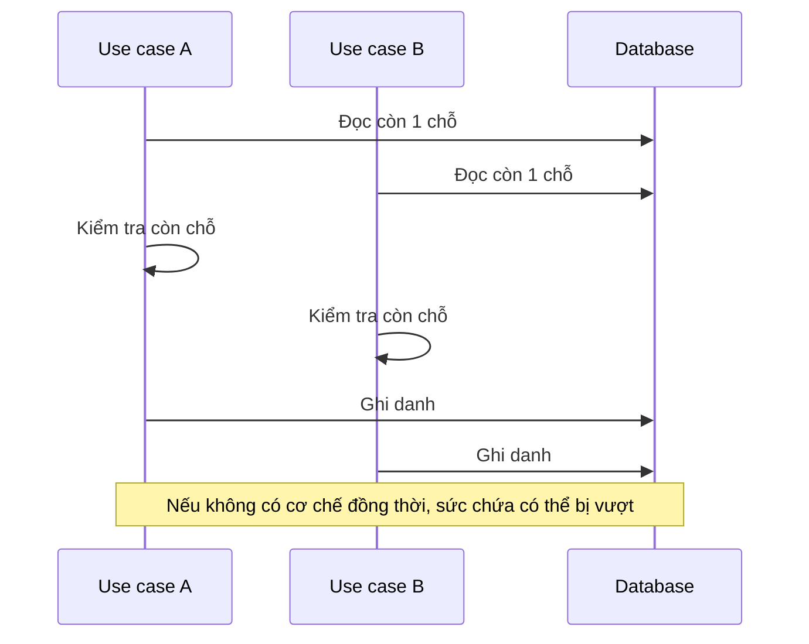
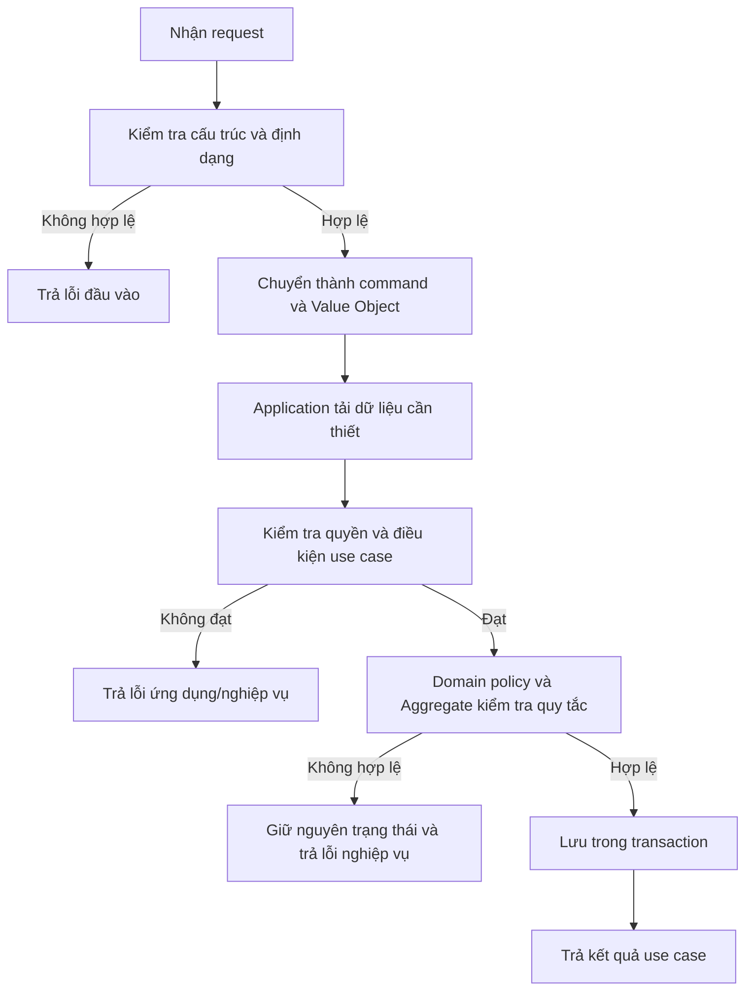

# Phân biệt kiểm tra đầu vào với xác nhận quy tắc nghiệp vụ

Trong một ca sử dụng, hệ thống thường phải kiểm tra dữ liệu trước khi thực hiện hành động. Tuy nhiên, không phải mọi kiểm tra đều cùng một loại. Một chuỗi ngày sai định dạng là lỗi đầu vào; một ngày giao hàng nằm ngoài thời gian phục vụ là quyết định nghiệp vụ; một đơn hàng đã giao không thể bị hủy là invariant của domain. Đặt các kiểm tra này đúng chỗ giúp hệ thống dễ hiểu, tránh lặp quy tắc và bảo vệ nghiệp vụ dù yêu cầu đến từ HTTP, message, batch job hay một giao diện khác.

Trong Domain-Driven Design (DDD), **input validation** xác nhận dữ liệu nhận vào có cấu trúc và định dạng hợp lệ; **business rule validation** xác nhận hành động có được phép theo chính sách và trạng thái nghiệp vụ hay không. Application layer điều phối các bước của use case, còn domain model bảo vệ invariant và hành vi cốt lõi. Adapter ở rìa hệ thống chuyển đổi dữ liệu giao tiếp thành kiểu dữ liệu mà application/domain hiểu được.

## 1. Hai câu hỏi khác nhau khi kiểm tra dữ liệu

Khi nhận một yêu cầu, hãy tách hai câu hỏi:

1. **Dữ liệu có thể được hiểu và sử dụng không?** Ví dụ: trường bắt buộc có mặt, số lượng là số nguyên dương, email đúng định dạng, ngày có thể parse.
2. **Với dữ liệu đó và trạng thái hiện tại, nghiệp vụ có cho phép hành động không?** Ví dụ: khách hàng có đủ điều kiện đăng ký khóa học, đơn hàng có thể hủy, tồn kho có đủ để giữ hàng.

Hai nhóm kiểm tra thường được gọi chung là validation, nhưng chúng có mục đích và vị trí khác nhau.

| Loại kiểm tra | Mục tiêu | Ví dụ | Nơi thường thực hiện |
|---|---|---|---|
| Input / structural validation | Xác nhận hình dạng và định dạng dữ liệu | Thiếu `courseId`, email sai định dạng, page size âm | HTTP/message adapter hoặc application boundary |
| Semantic input validation | Xác nhận giá trị đầu vào có ý nghĩa cơ bản | Số lượng phải lớn hơn 0, khoảng ngày bắt đầu trước ngày kết thúc | Value Object hoặc application boundary tùy ngữ nghĩa |
| Business rule validation | Xác nhận hành động phù hợp chính sách và ngữ cảnh | Khóa học đã đóng đăng ký, khách hàng vượt giới hạn mua | Domain model, domain policy và application orchestration |
| Invariant enforcement | Bảo đảm trạng thái domain luôn hợp lệ | Không cho aggregate có số lượng âm hoặc chuyển trạng thái sai | Entity, Value Object, Aggregate Root; có thể bổ sung database constraint |
| Authorization | Xác nhận actor có quyền thực hiện hành động | Chỉ quản lý lớp mới được mở đăng ký | Security/application boundary và domain authorization policy nếu là quy tắc nghiệp vụ |

Ranh giới giữa semantic validation và business rule đôi khi phụ thuộc bối cảnh. Chẳng hạn `quantity > 0` là điều kiện dữ liệu cơ bản của `Quantity`; `quantity <= 5` có thể là giới hạn mua theo chính sách; `availableStock >= quantity` là quyết định phụ thuộc trạng thái tồn kho. Hãy đặt tên và mô hình hóa theo ý nghĩa thay vì chỉ dựa vào việc tất cả đều trả về lỗi.

## 2. Input validation: kiểm tra dữ liệu trước khi thực hiện use case

Input validation kiểm tra dữ liệu được gửi vào có thể được diễn giải đúng và đáp ứng hợp đồng đầu vào hay không. Nó thường tập trung vào:

- Trường bắt buộc có được cung cấp không?
- Kiểu dữ liệu có đúng không?
- Chuỗi có đúng định dạng hoặc độ dài cho phép không?
- Giá trị có nằm trong giới hạn cấu trúc đã công bố không?
- Enum hoặc mã lựa chọn có thuộc tập giá trị được hỗ trợ không?
- Các trường có quan hệ cấu trúc hợp lệ không, ví dụ ngày bắt đầu không sau ngày kết thúc?

Ví dụ một request đăng ký khóa học có thể yêu cầu `studentId`, `courseId` và `email`. Nếu `courseId` bị thiếu hoặc `email` không thể parse theo hợp đồng, adapter có thể từ chối trước khi gọi use case.

### 2.1. Kiểm tra ở rìa hệ thống

HTTP controller hoặc message consumer là nơi đầu vào bên ngoài đi vào ứng dụng. Adapter biết cấu trúc giao thức như JSON field, header, path parameter hoặc message schema. Vì vậy, nó phù hợp để kiểm tra:

- JSON có parse được không.
- Field có đúng kiểu và đúng format không.
- Header hoặc path parameter có được cung cấp không.
- Payload có vượt giới hạn kích thước hay không.
- Giá trị enum có nằm trong hợp đồng API hay không.

Ví dụ Spring MVC:

```java
public record EnrollRequest(
    @NotBlank String studentId,
    @NotBlank String courseId,
    @Email @NotBlank String email
) {}

@RestController
@RequestMapping("/enrollments")
public class EnrollmentController {
    private final EnrollStudentUseCase enrollStudent;

    public EnrollmentController(EnrollStudentUseCase enrollStudent) {
        this.enrollStudent = enrollStudent;
    }

    @PostMapping
    ResponseEntity<EnrollmentResponse> enroll(
            @Valid @RequestBody EnrollRequest request) {
        EnrollmentId id = enrollStudent.execute(
            new EnrollStudentCommand(
                request.studentId(), request.courseId(), request.email()));
        return ResponseEntity.status(HttpStatus.CREATED)
            .body(new EnrollmentResponse(id.value()));
    }
}
```

Các annotation `@NotBlank`, `@Email` và `@Valid` kiểm tra hợp đồng payload. Controller chuyển request DTO thành command của application. Nó không nên tự quyết định khóa học đã đủ chỗ hay học viên có được đăng ký hay không.

### 2.2. Kiểm tra cấu trúc không thay thế domain validation

Một request có thể hoàn toàn hợp lệ về định dạng nhưng vẫn không hợp lệ về nghiệp vụ.

Ví dụ:

```json
{
  "studentId": "STU-100",
  "courseId": "COURSE-42",
  "email": "learner@example.com"
}
```

Payload có đủ field và email hợp lệ. Tuy nhiên:

- Khóa học có thể đã đóng đăng ký.
- Học viên có thể đã ghi danh khóa học này.
- Học viên có thể chưa hoàn thành khóa tiên quyết.
- Khóa học có thể đã hết chỗ.
- Học viên có thể không thuộc tổ chức được phép tham gia.

Các điều kiện này phụ thuộc dữ liệu và chính sách nghiệp vụ. Chúng cần được kiểm tra ở application/domain, không thể được xác nhận chỉ bằng annotation trên request DTO.

### 2.3. Không đưa mọi quy tắc vào Bean Validation

Bean Validation hoặc các thư viện validation tương tự rất hữu ích cho ràng buộc dữ liệu cục bộ. Nhưng không nên dùng chúng để truy cập repository, kiểm tra trạng thái aggregate hoặc gọi dịch vụ ngoài.

Ví dụ, annotation tùy chỉnh `@CourseHasAvailableSeat` có thể trông tiện, nhưng nếu validator phải truy cập database thì:

- Quy tắc bị ẩn trong cơ chế validation của framework.
- Có thể chạy trước khi application bắt đầu transaction.
- Có thể kiểm tra một snapshot đã lỗi thời.
- Khó phân biệt lỗi định dạng với quyết định nghiệp vụ.
- Một message consumer hoặc batch job có thể không chạy cùng validator.

Các điều kiện phụ thuộc trạng thái cần được kiểm tra trong use case và được bảo vệ tại điểm thay đổi trạng thái.

## 3. Semantic validation và Value Object

Không phải mọi kiểm tra giá trị đều nên nằm ở controller. Nếu một giá trị có ý nghĩa riêng trong domain và phải luôn tuân theo một số điều kiện, hãy mô hình hóa nó thành Value Object.

Ví dụ `Quantity`:

```java
public record Quantity(int value) {
    public Quantity {
        if (value <= 0) {
            throw new InvalidQuantityException(value);
        }
    }
}
```

`Quantity` đảm bảo mọi instance đều là số lượng dương. HTTP adapter có thể kiểm tra chuỗi hoặc kiểu JSON; domain vẫn bảo vệ điều kiện này vì `Quantity` cũng có thể được tạo từ message, batch job hoặc test.

Một ví dụ khác là `EmailAddress`:

```java
public final class EmailAddress {
    private final String value;

    private EmailAddress(String value) {
        this.value = value;
    }

    public static EmailAddress of(String raw) {
        Objects.requireNonNull(raw, "email is required");
        String normalized = raw.trim().toLowerCase(Locale.ROOT);
        if (!isAcceptedFormat(normalized)) {
            throw new InvalidEmailAddressException(raw);
        }
        return new EmailAddress(normalized);
    }

    public String value() {
        return value;
    }
}
```

Việc kiểm tra định dạng ở đây chỉ minh họa; định dạng email thực tế phức tạp hơn regex đơn giản. Điểm quan trọng là Value Object bảo vệ một giá trị miền có ý nghĩa, thay vì để mọi caller tự trim và kiểm tra theo cách riêng.

### 3.1. Đưa lỗi đầu vào về kiểu dữ liệu có ý nghĩa

Application command có thể chứa chuỗi thô vì đó là dữ liệu được chuyển từ adapter. Khi bắt đầu use case, application chuyển chuỗi thành các kiểu miền:

```java
public EnrollmentId execute(EnrollStudentCommand command) {
    StudentId studentId = StudentId.from(command.studentId());
    CourseId courseId = CourseId.from(command.courseId());
    EmailAddress email = EmailAddress.of(command.email());

    return enrollmentService.enroll(studentId, courseId, email);
}
```

Nếu hệ thống muốn gom tất cả lỗi định dạng trước khi gọi use case, adapter có thể kiểm tra cấu trúc trước. Tuy nhiên, Value Object vẫn phải bảo vệ invariant của chính nó để không phụ thuộc vào một caller duy nhất.

### 3.2. Không lạm dụng Value Object cho mọi field

Một field đơn giản không nhất thiết cần một class mới. Hãy tạo Value Object khi nó có quy tắc, thuật ngữ, phép so sánh hoặc hành vi riêng có ý nghĩa. Tránh tạo wrapper chỉ để đổi tên `String` mà không mang thêm bảo đảm hay ngữ nghĩa.

## 4. Business rule validation: xác nhận hành động theo nghiệp vụ

Business rule validation kiểm tra một hành động có được phép trong bối cảnh domain hiện tại không. Kết quả có thể phụ thuộc vào:

- Trạng thái của aggregate.
- Quy tắc của domain hoặc subdomain.
- Quan hệ giữa nhiều đối tượng.
- Thời gian và effective date của chính sách.
- Quyền và vai trò của actor.
- Tài nguyên có giới hạn như chỗ, tồn kho hoặc hạn mức.
- Lịch sử hành động và các điều kiện tiên quyết.

Ví dụ use case ghi danh cần xác nhận khóa học còn mở, học viên chưa đăng ký, đủ điều kiện tiên quyết và còn chỗ. Các điều kiện này không thể xác định chỉ từ payload.

### 4.1. Quy tắc nội tại thuộc Aggregate

Nếu quy tắc bảo vệ trạng thái bên trong một aggregate, hãy đặt nó trong hành vi của Aggregate Root.

```java
public final class CourseOffering {
    private final CourseId courseId;
    private final int capacity;
    private int enrolledCount;
    private RegistrationStatus status;

    public void enrollOne() {
        if (status != RegistrationStatus.OPEN) {
            throw new RegistrationClosedException(courseId);
        }
        if (enrolledCount >= capacity) {
            throw new CourseFullException(courseId);
        }
        enrolledCount++;
    }
}
```

`CourseOffering` bảo vệ invariant số lượng ghi danh không vượt sức chứa và chỉ cho phép ghi danh khi trạng thái mở. Application không nên tự tăng `enrolledCount` sau khi kiểm tra bằng getter.

Tuy nhiên, nếu nhiều request đồng thời cùng ghi danh vào chỗ cuối cùng, kiểm tra trong một object chưa đủ. Repository/adapter cần optimistic locking, pessimistic locking, conditional update hoặc constraint phù hợp để bảo vệ thay đổi đồng thời. Domain method xác định quy tắc; persistence boundary bảo đảm các transaction không cùng vượt qua điều kiện dựa trên snapshot cũ.

### 4.2. Quy tắc cần phối hợp nhiều đối tượng

Một quyết định có thể cần thông tin từ nhiều aggregate. Ví dụ ghi danh khóa học cần kiểm tra:

- `Student` có đang hoạt động không?
- `CourseOffering` có mở và còn chỗ không?
- Học viên đã hoàn thành các khóa tiên quyết chưa?
- Tài khoản có bị khóa do nghĩa vụ chưa thanh toán không?

Application service có thể tải dữ liệu cần thiết qua các repository/port và gọi domain policy hoặc domain service để đánh giá. Sau đó nó điều phối các hành vi thay đổi trạng thái.

Không nên đặt toàn bộ quyết định vào controller hoặc một validator của framework. Cũng không nên biến application service thành một khối `if/else` khổng lồ nếu các quy tắc có ý nghĩa riêng và cần được domain expert xác nhận.

## 5. Phân biệt kiểm tra trước với bảo vệ tại thời điểm thay đổi

Một lỗi thiết kế phổ biến là kiểm tra điều kiện một lần rồi cho rằng điều kiện đó vẫn đúng khi ghi dữ liệu. Trạng thái có thể thay đổi giữa lúc kiểm tra và lúc commit.

Ví dụ, application kiểm tra khóa học còn một chỗ. Trước khi nó lưu ghi danh, một request khác đã chiếm chỗ cuối cùng. Đây là **time-of-check to time-of-use (TOCTOU)**: trạng thái tại lúc kiểm tra khác trạng thái tại lúc sử dụng.



Do đó cần phân biệt:

- **Pre-check:** kiểm tra sớm để đưa ra phản hồi thân thiện hoặc tránh thực hiện công việc không cần thiết.
- **Authoritative check:** kiểm tra có thẩm quyền ngay tại transaction hoặc thao tác nguyên tử bảo vệ invariant.

Pre-check có thể hữu ích cho trải nghiệm người dùng nhưng không thay thế authoritative check. Khi ghi danh, cập nhật tồn kho hoặc giữ hạn mức, điều kiện cần được bảo vệ bằng cơ chế đồng thời phù hợp.

## 6. Tổ chức validation trong một Use Case

Một use case thường đi qua nhiều bước kiểm tra, nhưng cần giữ ranh giới trách nhiệm rõ ràng.



Một trình tự thực tế:

1. Adapter parse request/message và kiểm tra schema.
2. Adapter chuyển payload thành command/query.
3. Application chuyển dữ liệu thô thành kiểu miền cần thiết.
4. Application kiểm tra điều kiện điều phối và quyền truy cập.
5. Application tải aggregate qua repository/port.
6. Domain policy hoặc aggregate đánh giá và thực thi quy tắc nghiệp vụ.
7. Repository lưu thay đổi trong transaction; constraint/locking bảo vệ các invariant liên quan.
8. Adapter chuyển kết quả hoặc lỗi thành định dạng giao tiếp.

Không phải use case nào cũng cần đủ tám bước. Hãy giữ đúng các bước cần thiết và tránh tạo thêm lớp chỉ để tuân theo sơ đồ.

## 7. Ví dụ tổng hợp: ghi danh khóa học

Giả sử nền tảng đào tạo cho phép học viên đăng ký một khóa học. Quy tắc gồm:

- Payload phải có `studentId`, `courseId` và email hợp lệ.
- Học viên phải đang hoạt động.
- Khóa học phải trong thời gian mở đăng ký.
- Học viên phải hoàn thành khóa tiên quyết.
- Học viên chưa ghi danh khóa này.
- Số học viên không được vượt sức chứa.

### 7.1. Phân loại các điều kiện

| Điều kiện | Loại | Nơi xử lý gợi ý |
|---|---|---|
| `studentId` không được thiếu | Input validation | Request DTO / adapter |
| Email đúng định dạng | Input validation / Value Object | Adapter và `EmailAddress` |
| Số lượng chỗ không âm | Invariant | `CourseOffering` và persistence constraint |
| Học viên đang hoạt động | Business rule | Domain policy hoặc application/domain model |
| Đã hoàn thành khóa tiên quyết | Business rule | Domain policy dựa trên kết quả học tập |
| Khóa học đang mở đăng ký | Business rule và trạng thái aggregate | `CourseOffering` |
| Chưa ghi danh trùng | Business rule và uniqueness constraint | Application/domain và database |
| Actor có quyền ghi danh thay học viên | Authorization | Application/security policy |

### 7.2. Command của application

```java
public record EnrollStudentCommand(
    String studentId,
    String courseId,
    String email,
    String requestedBy
) {}
```

Command biểu đạt ý định của use case, không phải HTTP request. Một message consumer cũng có thể tạo command tương tự mà không cần Spring MVC.

### 7.3. Application service điều phối

```java
public final class EnrollStudentService implements EnrollStudentUseCase {
    private final StudentRepository students;
    private final CourseOfferingRepository offerings;
    private final EnrollmentRepository enrollments;
    private final EnrollmentEligibilityPolicy eligibilityPolicy;

    public EnrollStudentService(
            StudentRepository students,
            CourseOfferingRepository offerings,
            EnrollmentRepository enrollments,
            EnrollmentEligibilityPolicy eligibilityPolicy) {
        this.students = students;
        this.offerings = offerings;
        this.enrollments = enrollments;
        this.eligibilityPolicy = eligibilityPolicy;
    }

    @Override
    public EnrollmentId execute(EnrollStudentCommand command) {
        StudentId studentId = StudentId.from(command.studentId());
        CourseId courseId = CourseId.from(command.courseId());
        EmailAddress email = EmailAddress.of(command.email());

        Student student = students.findById(studentId)
            .orElseThrow(() -> new StudentNotFoundException(studentId));
        CourseOffering offering = offerings.findById(courseId)
            .orElseThrow(() -> new CourseNotFoundException(courseId));

        EnrollmentDecision decision = eligibilityPolicy.decide(student, offering);
        if (!decision.eligible()) {
            throw new EnrollmentNotAllowedException(decision.reasonCodes());
        }

        offering.enrollOne();
        Enrollment enrollment = Enrollment.create(studentId, courseId, email);
        enrollments.save(enrollment);
        offerings.save(offering);
        return enrollment.id();
    }
}
```

Đây là pseudo-code minh họa ranh giới, chưa thể hiện đầy đủ transaction và concurrency handling. Trong triển khai thực tế, tăng số chỗ và tạo enrollment phải nằm trong một transaction cục bộ nếu cùng database; cần unique constraint cho cặp student/course nếu không cho ghi danh trùng và optimistic/pessimistic locking hoặc cập nhật nguyên tử cho capacity. Nếu các aggregate nằm ở dịch vụ khác nhau, cần quy trình reservation/saga thay vì giả định một transaction bao trùm.

### 7.4. Domain policy trả kết quả có lý do

```java
public record EnrollmentDecision(
    boolean eligible,
    List<String> reasonCodes
) {}

public interface EnrollmentEligibilityPolicy {
    EnrollmentDecision decide(Student student, CourseOffering offering);
}
```

Policy có thể kiểm tra trạng thái học viên và điều kiện tiên quyết. Aggregate `CourseOffering` vẫn phải tự bảo vệ trạng thái mở và sức chứa khi thực hiện `enrollOne()`. Không nên dựa vào policy đã chạy trước đó để bỏ qua invariant ở thời điểm thay đổi.

## 8. Một lỗi có thể có nhiều cách biểu diễn

Không nên dùng một kiểu lỗi chung cho tất cả trường hợp. Mỗi lỗi cần đủ thông tin để caller hiểu và quyết định hành động tiếp theo.

| Lỗi | Ví dụ | Cách biểu diễn gợi ý |
|---|---|---|
| Payload sai | Thiếu `courseId`, email sai định dạng | Validation error gắn field và mã lỗi |
| Kiểu miền không hợp lệ | `Quantity` bằng 0 | Value Object exception hoặc validation result |
| Không tìm thấy aggregate | Không có học viên theo ID | Application not found error |
| Không đủ điều kiện | Chưa hoàn thành khóa tiên quyết | Business rejection với reason code |
| Trạng thái không cho phép | Khóa học đã đóng | Domain exception hoặc domain result |
| Xung đột đồng thời | Chỗ cuối đã bị request khác giữ | Conflict/retry result theo chính sách |
| Lỗi hạ tầng | Database timeout | Infrastructure error, không chuyển thành validation error |

### 8.1. Validation error có thể gom nhiều lỗi

Với lỗi cấu trúc, người dùng thường muốn biết nhiều field sai cùng lúc. Adapter có thể trả danh sách:

```json
{
  "code": "INVALID_REQUEST",
  "errors": [
    { "field": "studentId", "code": "REQUIRED" },
    { "field": "email", "code": "INVALID_FORMAT" }
  ]
}
```

Không nhất thiết phải dừng ở lỗi đầu tiên nếu có thể kiểm tra độc lập các field. Tuy nhiên, tránh chạy business rule sâu khi dữ liệu cấu trúc chưa đủ để diễn giải.

### 8.2. Business rejection có thể trả nhiều lý do

Một hồ sơ có thể chưa đủ điều kiện vì nhiều lý do. Nếu nghiệp vụ cho phép hiển thị tất cả lý do, decision object có thể chứa `reasonCodes`. Nếu các điều kiện phụ thuộc lẫn nhau hoặc cần bảo mật, chỉ trả lý do phù hợp. Không tiết lộ dữ liệu nhạy cảm hoặc quy tắc chống gian lận chi tiết cho actor không có quyền.

### 8.3. Không biến lỗi hạ tầng thành lỗi người dùng

Database timeout không có nghĩa là người dùng nhập sai. Nếu bắt mọi exception rồi trả `400 Bad Request`, client sẽ không biết cần sửa payload hay thử lại sau. Giữ phân loại lỗi chính xác giúp monitoring, retry và hỗ trợ vận hành hoạt động đúng.

## 9. Fail-fast hay gom nhiều lỗi?

Không có một chiến lược duy nhất cho mọi bước.

**Fail-fast** phù hợp khi:

- Không thể tiếp tục nếu thiếu một dữ liệu nền tảng.
- Điều kiện đầu tiên làm cho các kiểm tra tiếp theo vô nghĩa.
- Có nguy cơ thực hiện thao tác tốn kém hoặc không an toàn nếu tiếp tục.
- Quy tắc yêu cầu từ chối ngay, ví dụ actor không có quyền.

**Collect-all-errors** phù hợp khi:

- Các lỗi đầu vào độc lập và có thể kiểm tra cùng lúc.
- Người dùng có thể sửa nhiều field trong một lần.
- Giao diện cần hiển thị tất cả trường sai.
- Việc thu thập không gây side effect hoặc truy cập dữ liệu nhạy cảm không cần thiết.

Ví dụ, có thể báo đồng thời email sai định dạng và tên bị thiếu. Nhưng nếu `customerId` không tồn tại, không nên tiếp tục truy vấn hạn mức tín dụng như thể customer đã hợp lệ.

## 10. Validation, side effect và transaction

Một use case có thể gồm cả kiểm tra và thay đổi trạng thái. Hãy tránh tạo side effect trước khi các điều kiện cần thiết đã được xác nhận.

Ví dụ quy trình đặt hàng:

1. Kiểm tra cấu trúc request.
2. Tải khách hàng và sản phẩm.
3. Kiểm tra chính sách giá và khả năng đáp ứng.
4. Giữ tồn kho và hạn mức.
5. Tạo đơn hàng.
6. Lưu thay đổi và ghi outbox event.

Nếu bước 4 đã giữ tồn kho nhưng bước 5 thất bại, các thay đổi cùng database cần rollback trong một transaction. Nếu tồn kho và đơn hàng nằm ở các dịch vụ khác nhau, cần reservation và compensation. Không gửi email, publish message hoặc gọi dịch vụ ngoài trước khi transaction được commit nếu hành động đó phải phản ánh một thay đổi đã được chấp nhận.

### 10.1. Validation trước transaction không đủ cho dữ liệu biến động

Có thể kiểm tra sớm để cải thiện trải nghiệm, nhưng điều kiện có thể thay đổi cần được xác nhận lại trong transaction ghi. Ví dụ, màn hình hiển thị “còn 1 chỗ” không đảm bảo chỗ vẫn còn khi người dùng bấm đăng ký.

### 10.2. Đừng giữ transaction khi chờ người dùng hoặc hệ thống ngoài

Nếu quy trình cần phê duyệt thủ công hoặc chờ thanh toán, không giữ transaction database mở trong thời gian dài. Hãy lưu trạng thái chờ, giữ tài nguyên theo thời hạn nếu cần, sau đó tiếp tục qua một use case mới khi nhận kết quả.

## 11. Authorization không phải input validation

Một request có `studentId` hợp lệ không có nghĩa actor được phép đăng ký thay học viên đó. Xác thực danh tính (authentication), phân quyền (authorization) và kiểm tra dữ liệu là các vấn đề riêng.

- Authentication xác định actor là ai.
- Authorization xác định actor có quyền thực hiện hành động hoặc truy cập tài nguyên không.
- Input validation xác định payload có hợp lệ về cấu trúc và giá trị cơ bản không.
- Business rule validation xác định hành động có được phép theo nghiệp vụ không.

Một số quy tắc quyền truy cập thuần kỹ thuật có thể được xử lý ở security layer. Nếu quyền là một phần của nghiệp vụ, ví dụ chỉ người quản lý học viên mới có quyền xác nhận miễn điều kiện tiên quyết, hãy mô hình hóa quyết định đó bằng policy hoặc application service phù hợp.

Không tin `requestedBy` hoặc `customerId` từ payload như bằng chứng quyền. Actor cần được lấy từ security context đã xác thực và được chuyển vào use case dưới dạng một kiểu độc lập với framework.

## 12. Ánh xạ lỗi ra API

HTTP adapter chuyển các lỗi nội bộ thành response theo hợp đồng API. Một hướng ánh xạ tham khảo:

| Trường hợp | HTTP status thường dùng |
|---|---|
| Payload sai định dạng hoặc thiếu field | `400 Bad Request` |
| Dữ liệu đúng cấu trúc nhưng không xử lý được theo nội dung | `422 Unprocessable Content` nếu API chọn semantics này |
| Aggregate không tồn tại | `404 Not Found` |
| Xung đột trạng thái hoặc tài nguyên vừa bị chiếm | `409 Conflict` |
| Không có quyền | `403 Forbidden` hoặc `404` theo chính sách bảo mật |
| Lỗi phụ thuộc tạm thời | `503 Service Unavailable` |
| Lỗi không dự kiến | `500 Internal Server Error` |

Ánh xạ cụ thể phụ thuộc hợp đồng public. Domain không nên biết `HttpStatus` hoặc `ResponseEntity`; nó trả domain error hoặc decision. Adapter mới quyết định mã HTTP, cấu trúc JSON và thông điệp an toàn.

Ví dụ:

```java
@RestControllerAdvice
public class EnrollmentErrorHandler {
    @ExceptionHandler(EnrollmentNotAllowedException.class)
    ResponseEntity<ApiError> handleNotAllowed(EnrollmentNotAllowedException ex) {
        return ResponseEntity.unprocessableEntity()
            .body(new ApiError("ENROLLMENT_NOT_ALLOWED", ex.reasonCodes()));
    }

    @ExceptionHandler(CourseFullException.class)
    ResponseEntity<ApiError> handleCourseFull(CourseFullException ex) {
        return ResponseEntity.status(HttpStatus.CONFLICT)
            .body(new ApiError("COURSE_FULL", List.of()));
    }
}
```

Không trả stack trace hoặc thông tin nội bộ cho client. Với lỗi nghiệp vụ, dùng mã ổn định để frontend có thể xử lý; thông điệp hiển thị có thể được dịch ở presentation layer.

## 13. Kiểm thử input validation và business rule riêng biệt

Hai nhóm kiểm tra cần những loại test khác nhau.

### 13.1. Test input validation

- Thiếu field bắt buộc.
- Chuỗi rỗng hoặc chỉ có khoảng trắng.
- Sai định dạng email/ngày/mã định danh.
- Kiểu JSON không đúng.
- Số lượng, page size hoặc độ dài vượt giới hạn.
- Nhiều field sai cùng lúc được trả đúng danh sách lỗi.

Các test này thường đặt ở adapter/controller boundary hoặc command parsing boundary.

### 13.2. Test domain/business rules

- Khóa học đóng đăng ký thì từ chối.
- Học viên chưa hoàn thành prerequisite thì không đủ điều kiện.
- Học viên đã ghi danh thì không tạo enrollment thứ hai.
- Hủy đơn ở trạng thái không cho phép phải thất bại.
- Policy chọn đúng kết quả theo hạng khách hàng và thời điểm.
- Aggregate không thể chuyển sang trạng thái sai dù caller khác nhau.

Các test này nên gọi trực tiếp Value Object, policy hoặc aggregate mà không cần HTTP framework.

### 13.3. Integration test và concurrency test

Nếu rule phụ thuộc database, uniqueness, version hoặc trạng thái có thể thay đổi đồng thời, cần integration test với database phù hợp. Ví dụ hai request cùng đăng ký chỗ cuối cùng: chỉ một request được thành công. Unit test một aggregate đơn lẻ không chứng minh được bảo đảm đồng thời của database.

### 13.4. Test rằng adapter không chứa business rule

Một cách kiểm tra hữu ích là gọi cùng use case qua HTTP adapter và message consumer, sau đó xác nhận cả hai đều nhận cùng quyết định nghiệp vụ. Nếu một đường vào bỏ qua quy tắc vì controller mới là nơi kiểm tra, kiến trúc đang đặt logic sai chỗ.

## 14. Sai lầm thường gặp

**Đặt mọi validation ở controller.** Các caller khác như batch job và message consumer có thể bỏ qua quy tắc. Controller chỉ nên xử lý hợp đồng giao thức và chuyển đổi đầu vào.

**Đặt mọi validation trong domain.** Kiểm tra JSON parse được hay header có mặt là trách nhiệm adapter. Không đưa khái niệm HTTP vào domain.

**Nhầm dữ liệu hợp lệ với hành động được phép.** Payload có thể đúng định dạng nhưng khách hàng không đủ điều kiện hoặc tài nguyên đã hết. Cần kiểm tra business rules theo trạng thái hiện tại.

**Dùng annotation validation để truy vấn database.** Validator phụ thuộc hạ tầng và có thể kiểm tra snapshot lỗi thời. Điều kiện phụ thuộc trạng thái cần được xác nhận trong use case/transaction.

**Chỉ pre-check rồi không kiểm tra lúc ghi.** Trạng thái có thể thay đổi giữa kiểm tra và commit. Cần authoritative check, constraint hoặc locking.

**Để application service chứa tất cả nhánh nghiệp vụ.** Use case nên điều phối; invariant thuộc aggregate và quyết định có ý nghĩa riêng có thể thuộc policy/domain service.

**Dùng một exception chung cho mọi lỗi.** Người gọi không thể phân biệt payload sai, nghiệp vụ từ chối, dữ liệu không tồn tại và lỗi hạ tầng. Phân loại lỗi theo ý nghĩa.

**Trả danh sách rỗng khi database gặp lỗi.** Điều này biến sự cố thành kết quả nghiệp vụ giả và che giấu lỗi vận hành.

**Tin actor hoặc tenant từ payload.** Dữ liệu client gửi không chứng minh quyền. Lấy actor từ security context đã xác thực và kiểm tra quyền ở boundary phù hợp.

**Kiểm tra quyền nhưng không kiểm tra invariant.** Actor được phép không có nghĩa hành động luôn hợp lệ. Ví dụ quản lý được phép hủy đơn nhưng đơn đã hoàn tất có thể không còn được hủy.

## 15. Quy trình phân tích validation cho một use case

1. **Viết ý định use case.** Xác định actor muốn làm gì và kết quả mong muốn.
2. **Liệt kê dữ liệu đầu vào.** Ghi rõ field bắt buộc, kiểu, format và giới hạn cấu trúc.
3. **Xác định Value Object.** Tìm các giá trị miền có invariant riêng như tiền, số lượng, mã định danh hoặc địa chỉ.
4. **Liệt kê business rules.** Ghi các điều kiện phụ thuộc trạng thái, chính sách, quan hệ hoặc thời gian.
5. **Xác định invariant owner.** Quy tắc nào thuộc aggregate nào? Có invariant trải qua nhiều aggregate không?
6. **Xác định quyền truy cập.** Actor là ai và được phép thực hiện hành động nào?
7. **Chọn thời điểm kiểm tra.** Phân biệt pre-check với kiểm tra có thẩm quyền trong transaction hoặc thao tác nguyên tử.
8. **Định nghĩa lỗi và lý do.** Chọn error code, loại lỗi và khả năng retry phù hợp.
9. **Xác định side effect.** Đảm bảo không lưu hoặc phát sự kiện trước khi quyết định được chấp nhận theo transaction.
10. **Viết test theo từng lớp.** Test adapter/input, domain rules, application orchestration và concurrency/integration.

## 16. Checklist đánh giá

Trước khi hoàn tất use case, hãy kiểm tra:

- Input validation có giới hạn ở cấu trúc, định dạng và giá trị cơ bản không?
- Các giá trị miền quan trọng có Value Object để bảo vệ invariant riêng không?
- Business rules có được mô tả bằng thuật ngữ domain rõ ràng không?
- Quy tắc nội tại có nằm trong aggregate/value object phù hợp không?
- Quyết định phối hợp nhiều đối tượng có policy/domain service rõ ràng không?
- Application service có điều phối thay vì chứa toàn bộ quy tắc không?
- Authorization có được phân biệt với validation và business rule không?
- Điều kiện phụ thuộc trạng thái có được xác nhận lại tại thời điểm ghi không?
- Các invariant đồng thời có constraint, locking hoặc atomic operation phù hợp không?
- Lỗi đầu vào, nghiệp vụ, not found, conflict và hạ tầng có được phân loại riêng không?
- API response có mã lỗi ổn định và không tiết lộ dữ liệu nhạy cảm không?
- Test bao phủ cả đường vào HTTP/message và các trạng thái nghiệp vụ quan trọng không?

## 17. Câu hỏi tự kiểm tra

1. Phân biệt input validation với business rule validation bằng ví dụ đăng ký khóa học.
2. Vì sao email sai định dạng và học viên chưa hoàn thành khóa tiên quyết thuộc hai nhóm kiểm tra khác nhau?
3. Khi nào một kiểm tra nên được đặt trong Value Object?
4. Vì sao invariant của aggregate không nên chỉ được kiểm tra ở controller?
5. Phân biệt pre-check với authoritative check và giải thích vấn đề TOCTOU.
6. Vì sao annotation validation không phù hợp để kiểm tra tồn kho hoặc sức chứa trong database?
7. Application service nên phối hợp các repository và policy như thế nào?
8. Authorization khác business rule validation ở điểm nào?
9. Khi nào nên gom nhiều lỗi đầu vào và khi nào nên fail-fast?
10. Vì sao cần integration/concurrency test cho quy tắc giới hạn tài nguyên?

## Kết luận

Input validation bảo đảm dữ liệu có thể được hiểu theo hợp đồng đầu vào; business rule validation xác định hành động có được phép theo trạng thái và chính sách nghiệp vụ; invariant bảo vệ trạng thái domain luôn hợp lệ. Adapter kiểm tra cấu trúc giao tiếp, Value Object bảo vệ giá trị miền, Aggregate và Policy thực thi quy tắc, còn Application layer điều phối use case và xử lý kết quả. Với dữ liệu có thể thay đổi đồng thời, kiểm tra sớm cần được bổ sung bằng xác nhận có thẩm quyền tại thời điểm ghi. Khi phân biệt đúng các loại kiểm tra và đặt chúng đúng ranh giới, hệ thống dễ kiểm thử, nhất quán qua nhiều cách gọi và giải thích lỗi rõ ràng hơn.
