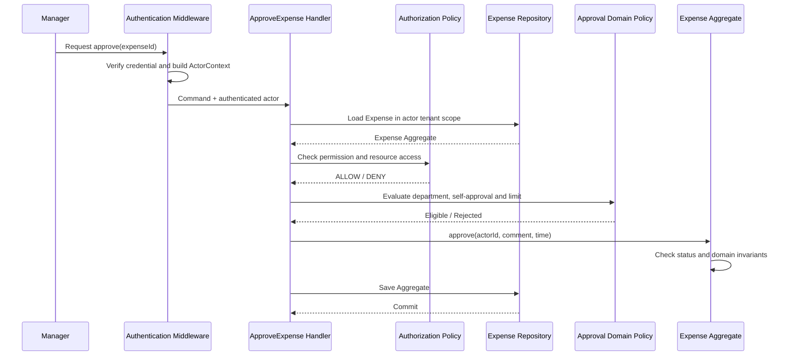
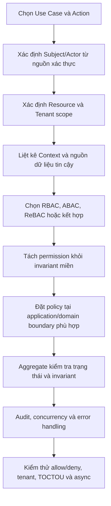

# Xác thực người dùng, phân quyền và quyết định quyền theo miền

Một use case chỉ được thực hiện khi hệ thống biết **ai đang yêu cầu hành động** và **người đó có được phép thực hiện hành động trên tài nguyên cụ thể trong hoàn cảnh hiện tại hay không**. Hai câu hỏi này liên quan nhưng khác nhau. Xác thực (authentication) xác định danh tính của chủ thể đang truy cập. Phân quyền (authorization) quyết định chủ thể đó có quyền thực hiện một hành động cụ thể hay không.

Trong Domain-Driven Design (DDD), việc phân quyền không chỉ là kiểm tra một role ở controller. Quyết định quyền có thể phụ thuộc vào ngữ cảnh miền: người phê duyệt có thuộc cùng đơn vị với yêu cầu không, tài liệu có thuộc tenant của người dùng không, khoản chi có vượt hạn mức không, đơn hàng đã ở trạng thái cho phép hủy chưa, hoặc người dùng có quan hệ quản lý với chủ sở hữu tài nguyên không. Các quy tắc này cần được đặt ở đúng lớp để vừa bảo vệ hệ thống vừa giữ mô hình miền rõ ràng.

Bài này trình bày cách kết hợp xác thực, phân quyền và quyết định quyền theo miền trong một use case; phân biệt RBAC, ABAC và quan hệ giữa các đối tượng; tổ chức policy, application service và aggregate; xử lý tenant, quyền thay đổi theo thời gian, tác vụ bất đồng bộ, audit và kiểm thử.

Trong `DOMAIN_DRIVEN_DESIGN`, use case là nơi điều phối hành động của actor qua các Aggregate, Repository và domain service. Xác thực cung cấp danh tính đáng tin cậy; authorization kiểm tra quyền truy cập; mô hình miền bảo vệ các quy tắc nghiệp vụ phải luôn đúng khi hành động được thực hiện.

## 1. Xác thực và phân quyền trả lời hai câu hỏi khác nhau

### 1.1. Authentication: ai đang truy cập?

Xác thực xác minh danh tính của một chủ thể thông qua bằng chứng phù hợp, chẳng hạn mật khẩu, passkey, chứng thư, token hoặc cơ chế đăng nhập liên kết. Kết quả thường là một principal hoặc security context chứa định danh chủ thể và một số thuộc tính đã được hệ thống xác minh.

Ví dụ, sau khi xác thực thành công, ứng dụng có thể nhận:

```text
subjectId = user-4821
issuer = https://identity.example
authenticatedAt = 2026-11-18T08:30:00Z
authenticationMethod = passkey
tenantId = tenant-17
```

Các trường trên là thông tin minh họa. Ứng dụng phải xác minh chữ ký, issuer, audience, thời hạn và các điều kiện của credential/token theo giao thức đang dùng. Không được tin một `userId` do client tự gửi trong request body chỉ vì nó có định dạng hợp lệ.

### 1.2. Authorization: chủ thể được làm gì?

Phân quyền đánh giá một yêu cầu truy cập dựa trên chủ thể, hành động, tài nguyên và ngữ cảnh:

```text
Subject:  user-4821
Action:   approve
Resource: expense-902
Context:  tenant-17, department=finance, amount=80,000,000 VND
Decision: DENY
Reason:   vượt hạn mức phê duyệt của chủ thể
```

Một người dùng có thể đăng nhập thành công nhưng không được xem hồ sơ của người khác. Một người dùng có role `Manager` cũng không mặc nhiên được phê duyệt mọi yêu cầu; họ có thể chỉ được phê duyệt yêu cầu trong đơn vị của mình và dưới một hạn mức.

### 1.3. Không đồng nhất identity, role và permission

| Khái niệm | Ý nghĩa | Ví dụ |
|---|---|---|
| Identity / Subject | Chủ thể đã được xác thực | `UserId(4821)` |
| Role | Nhóm trách nhiệm hoặc vị trí được gán | `DepartmentManager` |
| Permission | Hành động được phép theo một phạm vi | `expense:approve` |
| Resource | Đối tượng được truy cập | `ExpenseId(902)` |
| Policy | Quy tắc đánh giá quyền | Quản lý cùng phòng ban, trong hạn mức |
| Decision | Kết quả cho một yêu cầu cụ thể | `ALLOW` hoặc `DENY` |

Role thường là đầu vào để suy ra permission, nhưng role không phải lúc nào cũng đủ để đưa ra quyết định cuối cùng. Policy có thể cần kiểm tra trạng thái tài nguyên, quan hệ tổ chức, tenant, thời gian hoặc giá trị nghiệp vụ.

## 2. Mô hình hóa một yêu cầu authorization

### 2.1. Bốn thành phần cơ bản

Một yêu cầu authorization thường có bốn thành phần:

1. **Subject:** ai hoặc thành phần nào đang yêu cầu hành động?
2. **Action:** chủ thể muốn thực hiện việc gì?
3. **Resource:** hành động được thực hiện trên đối tượng nào?
4. **Context:** những dữ kiện nào ảnh hưởng đến quyết định?

Ví dụ với hệ thống quản lý chi phí:

```text
Subject:  employee-31
Action:   approve-expense
Resource: expense-902
Context:
  tenant: company-a
  department: sales
  amount: 12,500,000 VND
  status: SUBMITTED
  currentTime: 2026-11-18T08:45:00Z
```

Nếu policy chỉ nhận một chuỗi role, nó có thể bỏ qua những dữ kiện quyết định như department, amount hoặc status. Hãy xác định context tối thiểu cần thiết và lấy từ nguồn đáng tin cậy.

### 2.2. Subject phải có nguồn đáng tin cậy

Subject thường được lấy từ security context đã xác thực. Application service không nên tin `requestedBy`, `ownerId` hoặc `tenantId` do client gửi nếu những giá trị đó có thể được suy ra từ phiên đăng nhập.

Client có thể gửi ID của resource cần thao tác, ví dụ `expenseId`. Server phải tải resource và xác định tenant, owner, trạng thái cùng các thuộc tính cần thiết từ nguồn tin cậy. Không để client tự khai rằng tài liệu thuộc tenant của họ hoặc họ là quản lý của người tạo yêu cầu.

### 2.3. Action phải diễn tả ý định cụ thể

Không nên chỉ kiểm tra quyền chung như `hasAccess`. Hãy định danh hành động đủ cụ thể:

- `expense.view`
- `expense.submit`
- `expense.approve`
- `expense.reject`
- `document.download`
- `customer.contact.update`

Quyền xem không tự động bao gồm quyền sửa hoặc xóa. Quyền thực hiện một hành động cũng có thể khác nhau theo loại resource hoặc trạng thái của nó.

### 2.4. Context phải được giới hạn và xác thực

Context có thể gồm tenant, phòng ban, mức phân loại dữ liệu, thời gian, địa điểm nghiệp vụ, trạng thái resource hoặc kết quả của một quy trình. Mỗi thuộc tính cần có nguồn dữ liệu và mức tin cậy rõ ràng.

Không nên chuyển toàn bộ request, token hoặc object graph vào policy engine. Hãy tạo một authorization context có kiểu rõ ràng, chứa đúng dữ liệu cần cho quyết định. Điều này giúp kiểm thử, audit và kiểm soát dữ liệu tốt hơn.

## 3. RBAC, ABAC và authorization dựa trên quan hệ

### 3.1. Role-Based Access Control (RBAC)

RBAC gán người dùng vào role, sau đó gán permission cho role. Ví dụ:

```text
User: linh
  -> Role: FinanceApprover
       -> Permission: expense.view
       -> Permission: expense.approve
```

RBAC dễ hiểu và phù hợp khi quyền chủ yếu phụ thuộc vào chức năng hoặc vị trí. Tuy nhiên, chỉ có role thường không đủ để trả lời các câu hỏi như “có được duyệt yêu cầu của chính mình không?”, “có được duyệt trong hạn mức không?” hoặc “có được xem tài liệu của tenant khác không?”.

Có thể bổ sung điều kiện trong policy:

```text
FinanceApprover
AND subject.department == expense.department
AND subject.id != expense.requesterId
AND expense.amount <= subject.approvalLimit
```

### 3.2. Attribute-Based Access Control (ABAC)

ABAC đưa các thuộc tính của subject, resource, action và environment vào quyết định. Ví dụ:

- Subject: department, employmentStatus, clearanceLevel.
- Resource: ownerId, tenantId, classification, amount, status.
- Action: view, approve, export.
- Environment: thời điểm, thiết bị, mức rủi ro phiên đăng nhập.

Một policy ABAC có thể nói: nhân viên chỉ được xem hồ sơ trong tenant của họ và có classification không vượt clearance level được cấp.

ABAC linh hoạt nhưng policy có thể trở nên khó hiểu nếu có quá nhiều thuộc tính, nguồn dữ liệu không rõ hoặc các điều kiện bị lặp ở nhiều nơi. Cần đặt tên policy theo mục đích nghiệp vụ, quản lý version và kiểm thử các tổ hợp quan trọng.

### 3.3. Relationship-Based Access Control (ReBAC)

ReBAC đánh giá quyền dựa trên quan hệ giữa subject và resource:

- Người tạo tài liệu.
- Chủ sở hữu tài khoản.
- Thành viên của nhóm đang quản lý dự án.
- Quản lý trực tiếp của nhân viên.
- Người được chia sẻ quyền truy cập.

Ví dụ, người dùng được xem tài liệu nếu họ là owner, là thành viên của team sở hữu tài liệu hoặc được chia sẻ quyền xem. Quan hệ có thể được lưu trong domain model, directory tổ chức hoặc hệ thống quan hệ chuyên dụng.

### 3.4. Kết hợp các mô hình

Một hệ thống thực tế thường kết hợp RBAC, ABAC và ReBAC:

```text
ALLOW nếu:
  subject có permission "document.view"
  AND resource.tenantId == subject.activeTenantId
  AND (
       subject là owner
       OR subject thuộc team được chia sẻ
       OR subject có clearance phù hợp
  )
```

Không cần chọn một mô hình duy nhất cho mọi use case. Chọn cách biểu diễn đơn giản nhất đáp ứng đúng quy tắc, sau đó tách policy khi độ phức tạp thực sự tăng.

## 4. Phân biệt quyền truy cập với invariant nghiệp vụ

### 4.1. Authorization trả lời “ai được yêu cầu?”

Authorization kiểm tra chủ thể có quyền yêu cầu một hành động trên resource trong context hiện tại hay không. Ví dụ, nhân viên có quyền `expense.approve` và là quản lý của phòng ban sở hữu yêu cầu.

### 4.2. Domain invariant trả lời “hành động có hợp lệ lúc này?”

Aggregate bảo vệ các điều kiện nghiệp vụ phải luôn đúng. Ví dụ:

- Không thể phê duyệt một yêu cầu đã bị từ chối.
- Không thể phê duyệt yêu cầu chưa được gửi.
- Người yêu cầu không được tự phê duyệt yêu cầu của mình.
- Một yêu cầu chỉ được phê duyệt một lần.

Một số quy tắc có vẻ giống phân quyền nhưng thực chất là invariant miền. Chẳng hạn “người yêu cầu không thể tự phê duyệt” là quy tắc tách nhiệm vụ trong quy trình phê duyệt, có thể phải được bảo vệ bởi Aggregate ngay cả khi caller có role quản lý.

### 4.3. Hai lớp kiểm tra bổ sung cho nhau

Một use case có thể đi qua hai lớp:

1. Application layer xác định chủ thể và kiểm tra quyền truy cập.
2. Aggregate kiểm tra trạng thái và invariant miền trước khi thay đổi.

Nếu chỉ kiểm tra ở controller, một caller khác như scheduled job, message consumer hoặc API nội bộ có thể bỏ qua kiểm tra. Nếu chỉ kiểm tra trong Aggregate, mô hình có thể không biết chính sách identity, session, tenant hoặc permission của hệ thống bảo mật.

Không nên nhét toàn bộ framework security hoặc JWT vào entity. Hãy truyền các dữ kiện miền cần thiết cho hành vi, và giữ xác thực credential ở ranh giới hệ thống.

## 5. Đặt trách nhiệm trong kiến trúc DDD

### 5.1. Authentication ở ranh giới ứng dụng/hạ tầng

Web filter, middleware hoặc adapter xác minh credential và tạo principal. Application service nhận một actor đã được xác thực, không tự giải mã token hoặc xác minh mật khẩu.

```text
HTTP Request
    |
    v
Authentication Middleware
    |
    v
Authenticated Principal
    |
    v
Application Use Case
```

Application layer cần nhận identity đã được xác minh dưới dạng một abstraction ổn định như `ActorContext`, không phụ thuộc vào cấu trúc cụ thể của framework web.

### 5.2. Authorization ở application boundary

Application service điều phối việc kiểm tra quyền trước khi gọi hành vi thay đổi:

```text
ActorContext
    |
    v
Authorization Policy
    |
    v
Load Aggregate
    |
    v
Domain behavior / invariant
    |
    v
Repository save
```

Thứ tự tải resource và kiểm tra policy có thể thay đổi tùy policy cần thuộc tính của resource. Nếu cần tải resource trước, hãy bảo đảm việc đọc đó không tạo side effect và không tiết lộ thông tin nhạy cảm khi từ chối.

### 5.3. Domain Policy cho quyết định thuộc nghiệp vụ

Một số quyết định không chỉ là quyền truy cập kỹ thuật mà là chính sách nghiệp vụ. Ví dụ, hạn mức phê duyệt phụ thuộc cấp bậc, loại chi phí và đơn vị. Có thể mô hình hóa bằng domain policy:

```java
public interface ExpenseApprovalPolicy {
    ApprovalEligibility evaluate(
        ApproverProfile approver,
        Expense expense
    );
}
```

Policy này dùng kiểu miền và diễn tả quy tắc phê duyệt. Nó không cần biết JWT, HTTP header hay role string của framework.

### 5.4. Aggregate vẫn là người bảo vệ invariant

Application service có thể gọi policy rồi yêu cầu Aggregate thực hiện hành vi:

```java
public void approveExpense(ApproveExpenseCommand command) {
    UserActor actor = actorProvider.currentUser();
    Expense expense = expenseRepository.getRequired(command.expenseId());
    ApproverProfile profile = approverDirectory.load(actor.userId());

    authorization.requireAllowed(
        actor,
        Action.APPROVE_EXPENSE,
        ResourceRef.expense(expense.id())
    );

    ApprovalEligibility eligibility = approvalPolicy.evaluate(profile, expense);
    if (!eligibility.allowed()) {
        throw new ApprovalNotAllowed(eligibility.reason());
    }

    expense.approve(actor.userId(), command.comment(), clock.instant());
    expenseRepository.save(expense);
}
```

Đây là ví dụ khái quát. `authorization` có thể kiểm tra permission tổng quát, tenant và quan hệ truy cập; `approvalPolicy` kiểm tra điều kiện nghiệp vụ; `expense.approve` vẫn kiểm tra trạng thái và invariant của Aggregate. Trong một thiết kế khác, policy có thể được gọi ngay trước hành vi miền hoặc một phần quyết định có thể được truyền vào Aggregate. Cần chọn nơi đặt sao cho quy tắc không bị bỏ qua bởi các đường ghi khác.

## 6. Thiết kế kiểu dữ liệu cho Actor và Decision

### 6.1. Actor không phải lúc nào cũng là User

Một hành động có thể được thực hiện bởi:

- Người dùng đăng nhập.
- Dịch vụ máy hoặc workload identity.
- Scheduled job.
- Message consumer.
- Quản trị viên đang hỗ trợ người dùng khác.
- Một tiến trình được ủy quyền.

Không nên ép tất cả thành `UserId`. Có thể mô hình hóa chủ thể với loại và định danh:

```java
public sealed interface Actor
    permits UserActor, ServiceActor, SystemActor {
}

public record UserActor(UserId userId, TenantId activeTenantId) implements Actor {}

public record ServiceActor(ServiceId serviceId) implements Actor {}

public record SystemActor(String jobName) implements Actor {}
```

Các kiểu trên là minh họa. Hệ thống có thể cần thêm tenant, issuer hoặc delegated actor, nhưng nên tránh đưa credential hoặc secret vào domain model.

### 6.2. Decision nên có ngữ nghĩa rõ

Thay vì trả một boolean không có giải thích, policy có thể trả một kiểu quyết định:

```java
public sealed interface AccessDecision {
    record Allowed(String policyId) implements AccessDecision {}

    record Denied(String reasonCode) implements AccessDecision {}

    record Indeterminate(String reasonCode) implements AccessDecision {}
}
```

`Indeterminate` hữu ích khi policy không thể đánh giá vì dependency không sẵn sàng hoặc dữ liệu bắt buộc không xác định. Ở điểm thực thi, hệ thống thường phải fail closed: nếu không chứng minh được quyền, không cho thực hiện hành động. Tuy vậy, cần phân biệt lỗi hệ thống với từ chối nghiệp vụ để log, retry và hiển thị phù hợp.

### 6.3. Không để caller tự quyết định quyền bằng tham số boolean

API như `approve(expenseId, true)` rất nguy hiểm vì boolean không thể hiện ai đã quyết định và dựa trên policy nào. Caller có thể tự truyền `true`.

Hãy giữ quyết định authorization ở một thành phần đáng tin cậy và truyền vào Aggregate chỉ những dữ kiện miền cần thiết, hoặc gọi hành vi root sau khi application service đã kiểm tra quyền. Nếu Aggregate cần chứng minh một điều kiện miền, dùng kiểu có ngữ nghĩa như `ApprovalEligibility` thay vì boolean chung chung.

## 7. Multi-tenancy và phạm vi dữ liệu

### 7.1. Tenant là một phần của resource scope

Trong hệ thống nhiều tenant, mọi truy vấn và hành vi trên resource cần được giới hạn theo tenant được xác thực/ủy quyền. Chỉ kiểm tra tenant ở UI là không đủ.

Một policy cơ bản:

```text
resource.tenantId == actor.activeTenantId
```

Điều kiện này cần được bảo vệ ở application/persistence boundary. Query Repository nên đưa tenant vào điều kiện truy vấn khi phù hợp, và Aggregate có thể giữ tenant ID nếu nó là một phần của mô hình miền.

### 7.2. Không tin tenant ID do client tự chọn

Một user có thể thuộc nhiều tenant. Việc chọn tenant hoạt động cần được xác minh rằng user thực sự có membership hoặc quyền truy cập tenant đó. Không lấy một `tenantId` bất kỳ trong request rồi dùng nó làm phạm vi truy vấn.

Nếu API hỗ trợ header tenant, server phải kiểm tra membership và tạo `ActorContext` có tenant đã được xác minh. Mọi use case tiếp theo sử dụng context đó.

### 7.3. Ngăn truy cập chéo tenant ở nhiều lớp

Có thể kết hợp:

- Tenant scope trong Repository/query.
- Authorization policy kiểm tra actor và resource tenant.
- Unique key có tenant khi miền cần phân biệt ID theo tenant.
- Database row-level security nếu phù hợp.
- Kiểm thử truy cập chéo tenant cho cả read và write.

Đừng chỉ dựa vào một lớp kiểm tra nếu một đường truy cập khác có thể bỏ qua nó. Đồng thời, tránh lặp lại logic tenant không nhất quán ở nhiều nơi; hãy định nghĩa nguồn tenant đáng tin cậy và cơ chế thực thi rõ.

### 7.4. Tránh tiết lộ sự tồn tại của resource

Khi người dùng không có quyền truy cập, API có thể trả `403 Forbidden` hoặc `404 Not Found` tùy chính sách bảo mật và trải nghiệm. Với tài nguyên nhạy cảm, trả cùng một phản hồi cho “không tồn tại” và “không được phép biết” có thể giảm khả năng dò tìm ID. Hãy nhất quán và không để response, log hoặc thời gian xử lý vô tình tiết lộ dữ liệu.

## 8. Quyền thay đổi theo trạng thái và thời gian

### 8.1. Quyền truy cập có thể thay đổi

Một người dùng có thể được phép xem tài liệu khi còn là thành viên dự án. Khi membership bị thu hồi, quyền phải thay đổi theo. Vì vậy, không nên lưu permission lâu dài trong client và tin nó cho mọi request.

Token có thể chứa claims hoặc role tại thời điểm phát hành. Nếu quyền cần thu hồi tức thời, hệ thống phải có cơ chế kiểm tra trạng thái hiện tại, token revocation, version hoặc thời hạn token phù hợp. Không có một giải pháp duy nhất cho mọi hệ thống; hãy cân bằng độ trễ thu hồi và chi phí kiểm tra.

### 8.2. Kiểm tra quyền và TOCTOU

TOCTOU (time-of-check to time-of-use) xảy ra khi quyền được kiểm tra ở một thời điểm nhưng trạng thái liên quan thay đổi trước khi hành động thực sự được ghi.

Ví dụ:

1. Quản lý kiểm tra rằng mình đang quản lý phòng ban A.
2. Membership của quản lý bị thu hồi.
3. Request cũ tiếp tục phê duyệt khoản chi của phòng ban A.

Nếu quy tắc yêu cầu membership phải còn hiệu lực tại thời điểm phê duyệt, chỉ kiểm tra ở đầu request có thể không đủ. Có thể cần kiểm tra trong transaction, dùng version của membership/policy hoặc cơ chế khóa/đồng bộ phù hợp.

### 8.3. Tính nhất quán của policy và dữ liệu

Policy có thể dựa trên dữ liệu từ nhiều hệ thống: directory tổ chức, hệ thống nhân sự, membership service và Aggregate nghiệp vụ. Cần quyết định dữ liệu nào phải nhất quán tức thời, dữ liệu nào có thể eventual consistent và xử lý thế nào khi nguồn không sẵn sàng.

Với quyết định rủi ro cao như chuyển tiền hoặc phê duyệt khoản lớn, có thể cần lấy dữ liệu quyền mới nhất và ghi nhận version/snapshot của quyết định. Với hành động ít rủi ro như xem một nhãn hiển thị, cache có thể phù hợp hơn.

### 8.4. Kiểm tra quyền ở thời điểm đọc và ghi

Quyền xem và quyền sửa là hai quyết định riêng. Một người có thể được xem dữ liệu nhưng không được thay đổi. Một API cập nhật không nên dựa vào việc người dùng đã từng tải trang thành công.

Đối với use case ghi, kiểm tra quyền cần được thực hiện lại ở server tại thời điểm thực hiện hành động. Với tài nguyên có trạng thái thay đổi đồng thời, kết hợp authorization với concurrency control và invariant của Aggregate.

## 9. Tách quyền hệ thống khỏi quy tắc nghiệp vụ

### 9.1. Permission kỹ thuật

Các permission như `user.manage`, `document.export`, `expense.approve` mô tả khả năng truy cập. Chúng có thể được quản lý bởi identity/access management hoặc policy service.

### 9.2. Chính sách nghiệp vụ

Các quy tắc như “người phê duyệt không được là người yêu cầu”, “tổng tiền vượt hạn mức phải có hai cấp phê duyệt” hoặc “đơn đã bàn giao không thể hủy” là chính sách miền. Chúng cần được thể hiện bằng kiểu và hành vi miền để không bị bỏ qua bởi một controller khác.

### 9.3. Đừng đưa tên role vào mọi Aggregate

Nếu entity có code như:

```java
if (actor.role().equals("ADMIN")) {
    // allow
}
```

thì mô hình miền đang phụ thuộc vào cấu trúc phân quyền của ứng dụng. Role có thể đổi tên, được chia nhỏ hoặc được ánh xạ từ nhiều identity provider. Tốt hơn là application/policy layer chuyển role thành một quyết định hoặc năng lực có ý nghĩa miền trước khi gọi hành vi.

Tuy nhiên, không phải mọi vai trò đều chỉ là chi tiết kỹ thuật. Một số vai trò là khái niệm nghiệp vụ thực sự, ví dụ “người phê duyệt ngân sách” hoặc “người kiểm soát chất lượng”. Khi đó có thể mô hình hóa `Approver`, `BudgetOwner` hoặc `QualityInspector` như khái niệm miền thay vì dùng chuỗi role chung.

## 10. Authorization trong tác vụ bất đồng bộ và hệ thống tích hợp

### 10.1. Message consumer không có người dùng đang đăng nhập

Khi một consumer xử lý `OrderConfirmed`, không có HTTP principal của người đã đặt đơn trong thread hiện tại. Consumer cần một service identity hoặc actor hệ thống có quyền rõ ràng để thực hiện hành động của mình.

Không nên giả lập một user bất kỳ để vượt qua authorization. Hãy cấp quyền tối thiểu cho workload/service identity và ghi nhận nguồn gốc event.

### 10.2. Phân biệt người khởi tạo và actor thực thi

Một message có thể mang:

- `initiatedBy`: người hoặc dịch vụ khởi tạo hành động gốc.
- `publishedBy`: thành phần phát message.
- `processedBy`: consumer/service identity xử lý message.
- `correlationId`: định danh luồng công việc.
- `causationId`: message hoặc command gây ra sự kiện hiện tại.

Các trường này phục vụ trace và audit. `initiatedBy` không tự động cấp quyền cho consumer. Consumer vẫn phải được cấp quyền theo danh tính dịch vụ và policy của chính nó.

### 10.3. Delegation và impersonation

Quản trị viên có thể thao tác thay người dùng trong một quy trình hỗ trợ. Cần phân biệt:

- **Delegation:** người dùng ủy quyền cho chủ thể khác trong phạm vi và thời hạn xác định.
- **Impersonation:** quản trị viên tạm thời hành động dưới ngữ cảnh người dùng khác.

Nếu hệ thống hỗ trợ, phải ghi nhận cả actor thực tế và subject được đại diện, lý do, phạm vi, thời gian bắt đầu/kết thúc và người phê duyệt nếu cần. Không ghi đè identity quản trị viên thành identity người dùng rồi làm mất dấu vết người thực hiện.

### 10.4. Quyền phải được kiểm tra tại ranh giới tin cậy

Không tin message chỉ vì nó đến từ broker nội bộ. Xác minh nguồn gửi, quyền publish/consume theo topic/queue, schema và dữ liệu cần thiết. Nếu message yêu cầu thay đổi một Aggregate, consumer vẫn phải gọi hành vi miền và bảo vệ invariant.

## 11. Audit quyết định phân quyền

### 11.1. Vì sao cần audit?

Với các hành động quan trọng, hệ thống cần trả lời:

- Ai đã yêu cầu hành động?
- Họ đã được xác thực bằng loại danh tính nào?
- Hành động nào được yêu cầu trên resource nào?
- Policy nào được đánh giá và phiên bản nào?
- Kết quả là allow, deny hay indeterminate?
- Những thuộc tính quan trọng nào đã được dùng?
- Quyết định xảy ra khi nào và trong tenant nào?

Audit giúp điều tra sự cố, chứng minh tuân thủ và giải thích quyết định. Nó không nên lưu mật khẩu, access token, secret hoặc dữ liệu nhạy cảm không cần thiết.

### 11.2. Phân biệt access log và business audit

Access log ghi nhận request, status code, IP hoặc thông tin kỹ thuật. Business audit ghi nhận một quyết định nghiệp vụ hoặc hành động có ý nghĩa, chẳng hạn `ExpenseApproved` bởi ai và theo chính sách nào.

Hai loại log có thể liên kết bằng correlation ID nhưng phục vụ mục đích khác nhau. Một request HTTP thành công chưa chắc có nghĩa nghiệp vụ đã thay đổi; một business event nên được ghi nhận theo kết quả transaction thực tế.

### 11.3. Không để audit làm rò rỉ thông tin

Lý do từ chối có thể tiết lộ thông tin nội bộ, ví dụ tên phòng ban hoặc hạn mức của người khác. Hãy phân biệt reason code nội bộ cho audit với thông báo an toàn gửi về client.

Audit log cần kiểm soát quyền đọc, retention, tính toàn vẹn và khả năng truy vết. Không nên cho người dùng thường sửa hoặc xóa lịch sử quyết định của chính họ.

## 12. Xử lý lỗi authorization

### 12.1. Deny by default

Nếu policy không có quy tắc phù hợp hoặc không thể xác định quyền, mặc định từ chối. Không coi lỗi policy engine, thiếu dữ liệu hoặc timeout là cho phép.

### 12.2. Phân biệt từ chối và lỗi hệ thống

| Kết quả | Ý nghĩa | Cách xử lý thường gặp |
|---|---|---|
| Allowed | Policy xác nhận được phép | Tiếp tục use case |
| Denied | Có đủ dữ liệu và policy quyết định không cho phép | Trả lỗi truy cập phù hợp, ghi audit |
| Indeterminate | Không thể quyết định do lỗi hoặc thiếu dữ liệu | Fail closed, log/alert và có thể retry |
| Unauthenticated | Không có danh tính hợp lệ | Yêu cầu xác thực |
| Resource not found | Không tồn tại hoặc không thể tiết lộ sự tồn tại | Trả phản hồi theo chính sách bảo mật |
| Domain rule rejected | Có quyền truy cập nhưng hành động vi phạm quy tắc miền | Trả lỗi nghiệp vụ riêng |

Nếu gộp tất cả thành `403`, người vận hành khó phân biệt policy từ chối với hệ thống quyền đang lỗi. Nếu trả quá nhiều chi tiết, client có thể dò thông tin. Hãy giữ reason chi tiết trong audit và trả thông điệp phù hợp với threat model.

### 12.3. Không biến lỗi dependency thành quyền mặc định

Nếu directory hoặc policy service không phản hồi, không được fallback sang `ALLOW` chỉ để tăng availability. Có thể dùng cache quyết định gần nhất trong một số hệ thống, nhưng cần giới hạn tuổi, phạm vi và mức rủi ro; cache stale không phù hợp cho mọi hành động.

## 13. Hiệu năng và caching quyết định quyền

### 13.1. Cache có thể tăng hiệu năng

Các quyết định quyền lặp lại có thể được cache, đặc biệt khi policy và membership ít thay đổi. Cache key cần bao gồm những thuộc tính ảnh hưởng đến quyết định, chẳng hạn subject, action, resource scope, tenant và policy version.

### 13.2. Cache sai phạm vi gây rò rỉ quyền

Nếu cache chỉ theo `userId` mà bỏ qua `resourceId` hoặc `tenantId`, quyết định ALLOW cho một tài nguyên có thể bị dùng nhầm cho tài nguyên khác. Nếu cache theo role nhưng bỏ qua trạng thái resource, quyền có thể không bị thu hồi khi tài nguyên đổi trạng thái.

### 13.3. Thu hồi và invalidation

Khi role, membership hoặc policy thay đổi, cache cần được invalidated hoặc hết hạn theo chính sách. Với quyền rủi ro cao, có thể cần kiểm tra trực tiếp hoặc dùng version/revocation counter. Không có TTL chung phù hợp cho mọi loại quyết định.

## 14. Kiểm thử xác thực và phân quyền

### 14.1. Kiểm thử Authentication boundary

Kiểm tra token hết hạn, issuer/audience sai, chữ ký không hợp lệ, credential thiếu và principal được ánh xạ đúng. Những kiểm thử này thường thuộc security adapter hoặc integration test của middleware.

### 14.2. Kiểm thử Authorization Policy

Với mỗi policy, kiểm thử cả trường hợp cho phép và từ chối:

```java
@Test
void managerCanApproveWithinOwnDepartmentAndLimit() {
    ApproverProfile manager = managerOf("sales", Money.of(20_000_000));
    Expense expense = submittedExpense("sales", Money.of(12_000_000));

    assertTrue(policy.evaluate(manager, expense).allowed());
}

@Test
void managerCannotApproveExpenseAboveLimit() {
    ApproverProfile manager = managerOf("sales", Money.of(20_000_000));
    Expense expense = submittedExpense("sales", Money.of(25_000_000));

    assertFalse(policy.evaluate(manager, expense).allowed());
}
```

Thêm trường hợp khác phòng ban, tự phê duyệt, tenant khác, membership đã thu hồi, resource sai trạng thái và dữ liệu context thiếu.

### 14.3. Kiểm thử Aggregate invariant độc lập

Gọi trực tiếp hành vi miền để xác nhận quy tắc như “người yêu cầu không tự phê duyệt” hoặc “yêu cầu đã bị từ chối không thể phê duyệt lại” vẫn được bảo vệ, kể cả khi application service hoặc policy bị gọi sai.

### 14.4. Kiểm thử toàn bộ use case

Kiểm tra request hợp lệ đi qua authentication, authorization, policy miền, Aggregate và Repository. Kiểm tra request không có quyền không làm thay đổi dữ liệu. Kiểm tra actor/tenant không thể bị giả mạo bằng field client gửi.

### 14.5. Kiểm thử TOCTOU và concurrency

Mô phỏng membership hoặc trạng thái resource thay đổi giữa lúc policy được đánh giá và lúc transaction ghi. Xác định hệ thống cần từ chối, retry hay chấp nhận snapshot quyền đã kiểm tra. Với hành động rủi ro cao, kiểm tra version/locking hoặc kiểm tra lại trong transaction.

### 14.6. Kiểm thử tác vụ bất đồng bộ

Kiểm tra service identity có đúng permission, consumer không tin `initiatedBy` như credential, message tenant không bị giả mạo, và audit giữ được cả người khởi tạo lẫn dịch vụ thực thi.

## 15. Ví dụ luồng Use Case hoàn chỉnh

Giả sử nhân viên gửi yêu cầu chi phí và quản lý phê duyệt. Quy tắc:

- Quản lý phải được xác thực.
- Quản lý phải có permission phê duyệt chi phí.
- Quản lý phải thuộc cùng tenant và phòng ban của yêu cầu.
- Người tạo yêu cầu không được tự phê duyệt.
- Số tiền phải nằm trong hạn mức của quản lý; vượt hạn mức cần cấp phê duyệt khác.
- Yêu cầu phải ở trạng thái `SUBMITTED`.



Sơ đồ mô tả các trách nhiệm chính. Một số kiểm tra có thể được gộp hoặc chuyển vị trí tùy yêu cầu transaction, nhưng không được bỏ qua kiểm tra resource scope và invariant của Aggregate.

Ví dụ application handler:

```java
public void handle(ApproveExpenseCommand command) {
    UserActor actor = actorProvider.currentUser();

    Expense expense = expenseRepository
        .findByIdAndTenant(command.expenseId(), actor.activeTenantId())
        .orElseThrow(ExpenseNotFound::new);

    authorization.requireAllowed(
        actor,
        Action.APPROVE_EXPENSE,
        ResourceRef.expense(expense.id(), expense.tenantId())
    );

    ApproverProfile profile = approverDirectory.getProfile(actor.userId());
    approvalPolicy.requireEligible(profile, expense);

    expense.approve(actor.userId(), command.comment(), clock.instant());
    expenseRepository.save(expense);
}
```

Trong một hệ thống có transaction và cập nhật quyền đồng thời, cần xác định rõ dữ liệu profile/membership được đọc theo snapshot nào và có cần kiểm tra version trước commit hay không. Nếu điều kiện “quản lý còn thuộc phòng ban” phải đúng tại đúng thời điểm phê duyệt, hãy đưa nó vào consistency strategy phù hợp.

## 16. Những sai lầm thường gặp

**Chỉ kiểm tra người dùng đã đăng nhập.** Authentication không chứng minh người dùng được phép thực hiện mọi hành động. Mỗi use case cần authorization phù hợp.

**Dùng role như quyền tuyệt đối.** Role có thể cần kết hợp tenant, resource, trạng thái, hạn mức và quan hệ tổ chức.

**Tin `userId` hoặc `tenantId` do client gửi.** Lấy actor từ principal đã xác thực và xác minh tenant membership ở server.

**Chỉ kiểm tra ở UI hoặc controller.** Các đường gọi khác có thể bỏ qua. Đặt kiểm tra tại application boundary và bảo vệ invariant trong Aggregate.

**Đưa JWT hoặc framework security vào Entity.** Điều này làm domain phụ thuộc hạ tầng. Chuyển thông tin cần thiết sang kiểu actor và policy có ngữ nghĩa.

**Chỉ kiểm tra permission mà bỏ qua trạng thái miền.** Người có quyền vẫn không thể phê duyệt một yêu cầu đã hủy hoặc đã được xử lý.

**Chỉ kiểm tra invariant mà bỏ qua actor.** Aggregate có thể hợp lệ về trạng thái nhưng hành động lại do người không có quyền yêu cầu.

**Dùng boolean `isAdmin` làm ngữ cảnh duy nhất.** Nó không biểu đạt action, resource, tenant hoặc lý do quyết định. Dùng policy và decision có kiểu rõ.

**Fail open khi policy service lỗi.** Không thể xác định quyền thì mặc định không cho thực hiện; xử lý lỗi hệ thống riêng.

**Không xét TOCTOU.** Membership hoặc trạng thái resource có thể đổi giữa kiểm tra và ghi. Xác định yêu cầu nhất quán và dùng version/transaction phù hợp.

**Không phân biệt actor và initiator trong message.** Consumer chạy bằng service identity; người khởi tạo chỉ là dữ liệu truy vết, không tự cấp quyền.

**Cache quyền thiếu resource/tenant/policy version.** Cache key không đầy đủ có thể làm một quyết định ALLOW bị dùng sai phạm vi.

## 17. Quy trình thiết kế authorization cho Use Case

Có thể áp dụng các bước sau:



Các câu hỏi cần trả lời:

1. Actor là người dùng, service hay tiến trình hệ thống?
2. Danh tính được xác minh ở đâu và claims nào đáng tin cậy?
3. Action cụ thể là gì?
4. Resource thuộc tenant hoặc owner nào?
5. Quyền phụ thuộc role, thuộc tính hay quan hệ nào?
6. Dữ liệu policy lấy từ đâu và có thể stale bao lâu?
7. Quy tắc nào là authorization và quy tắc nào là invariant nghiệp vụ?
8. Có đường ghi nào có thể bỏ qua kiểm tra không?
9. Quyền có thể bị thu hồi giữa lúc kiểm tra và commit không?
10. Nếu policy dependency lỗi, hệ thống xử lý ra sao?
11. Quyết định nào cần audit và lưu reason/version nào?
12. Tác vụ bất đồng bộ dùng service identity và truy vết initiator như thế nào?

## 18. Checklist

Trước khi hoàn thiện use case có phân quyền, hãy kiểm tra:

- [ ] Authentication xác minh credential và tạo principal đáng tin cậy.
- [ ] Actor được lấy từ security context, không tin identity client tự khai.
- [ ] Action và Resource được định danh rõ.
- [ ] Tenant/resource scope được xác minh phía server.
- [ ] Policy xét đủ role, thuộc tính và quan hệ cần thiết.
- [ ] Quyền kỹ thuật được phân biệt với invariant nghiệp vụ.
- [ ] Aggregate bảo vệ trạng thái và quy tắc miền trong mọi đường ghi.
- [ ] Không đưa token/framework security trực tiếp vào domain entity.
- [ ] Thiếu quyền hoặc policy indeterminate đều fail closed.
- [ ] Lỗi truy cập được phân biệt với lỗi hệ thống và lỗi nghiệp vụ.
- [ ] TOCTOU, thu hồi quyền và concurrency được xem xét.
- [ ] Cache key có đủ subject, action, resource, tenant và policy version cần thiết.
- [ ] Tác vụ async dùng service identity có quyền tối thiểu.
- [ ] Audit giữ actor, resource, action, decision và policy version cần thiết.
- [ ] Có kiểm thử allow/deny, cross-tenant, invariant, TOCTOU và message consumer.

## 19. Câu hỏi tự kiểm tra

1. Authentication khác authorization ở điểm nào?
2. Vì sao một user có role `Manager` chưa chắc được phê duyệt mọi Expense?
3. RBAC, ABAC và ReBAC khác nhau như thế nào?
4. Quy tắc “người yêu cầu không được tự phê duyệt” nên được bảo vệ ở đâu?
5. Vì sao không nên đưa JWT hoặc chuỗi role của framework vào Aggregate?
6. Khi nào cần kiểm tra quyền trong transaction thay vì chỉ kiểm tra ở đầu request?
7. Vì sao `tenantId` trong request không thể tự động được tin cậy?
8. Consumer xử lý message cần dùng identity nào và lưu `initiatedBy` để làm gì?
9. Fail closed có nghĩa gì khi policy service không sẵn sàng?
10. Cache authorization thiếu `resourceId` hoặc `tenantId` có thể gây hậu quả gì?

**Gợi ý trả lời:**

- Câu 1: Authentication xác minh ai đang truy cập; authorization quyết định chủ thể được làm gì trên tài nguyên cụ thể trong context nào.
- Câu 2: Quyền có thể phụ thuộc tenant, phòng ban, hạn mức, quan hệ với resource, trạng thái và quy tắc tự phê duyệt.
- Câu 3: RBAC dựa trên role; ABAC dựa trên thuộc tính của subject/resource/action/environment; ReBAC dựa trên quan hệ giữa subject và resource.
- Câu 4: Đây là invariant/quy tắc quy trình miền cần được bảo vệ trong Aggregate hoặc domain policy có thể được mọi đường ghi sử dụng, không chỉ ở UI.
- Câu 5: Token và role string là chi tiết hạ tầng, có thể đổi theo identity provider. Domain nên nhận actor và policy có ngữ nghĩa ổn định.
- Câu 6: Khi membership, trạng thái resource hoặc điều kiện quyền có thể thay đổi giữa lúc kiểm tra và lúc commit, và nghiệp vụ yêu cầu quyền còn hiệu lực tại thời điểm ghi.
- Câu 7: Client có thể thay tenant ID để dò hoặc truy cập dữ liệu tenant khác. Server phải xác minh membership và tạo context đáng tin cậy.
- Câu 8: Consumer dùng service/workload identity của chính nó; `initiatedBy` lưu người hoặc dịch vụ khởi tạo luồng để audit, không phải credential cấp quyền.
- Câu 9: Nếu không chứng minh được quyền do lỗi hoặc thiếu dữ liệu, từ chối hành động; ghi nhận lỗi hệ thống và xử lý retry phù hợp.
- Câu 10: Quyết định ALLOW cho một tài nguyên hoặc tenant có thể bị tái sử dụng sai cho tài nguyên khác, gây truy cập trái phép.

## Kết luận

Một use case an toàn cần kết hợp ba lớp trách nhiệm: authentication xác minh actor; authorization quyết định actor có quyền thực hiện action trên resource trong context hiện tại; Aggregate và domain policy bảo vệ các quy tắc nghiệp vụ. RBAC, ABAC và ReBAC có thể được kết hợp theo nhu cầu, nhưng mọi thuộc tính dùng để quyết định phải có nguồn tin cậy. Hãy kiểm soát tenant ở server, xem xét quyền bị thu hồi và TOCTOU, dùng service identity cho tác vụ bất đồng bộ, ghi audit có kiểm soát và kiểm thử cả đường cho phép lẫn từ chối. Khi mỗi quy tắc được đặt đúng ranh giới, hệ thống vừa giữ được mô hình miền rõ ràng vừa tránh để quyền truy cập phụ thuộc vào một kiểm tra giao diện dễ bị bỏ qua.
