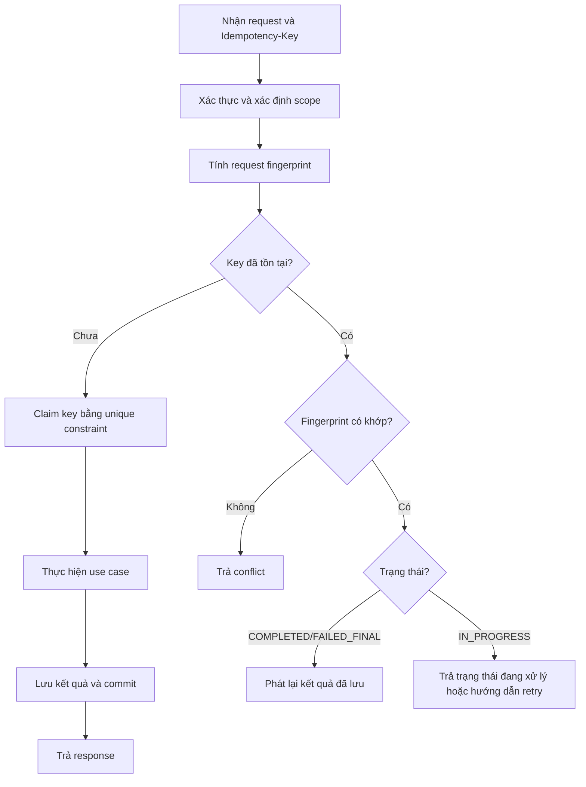
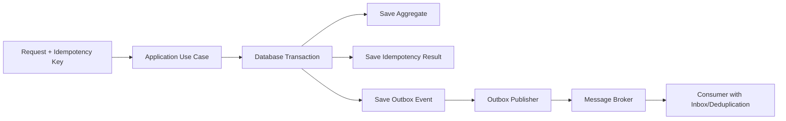

# Kiểm soát yêu cầu lặp bằng định danh thao tác khi cần

Trong một ứng dụng nghiệp vụ, client có thể gửi cùng một yêu cầu nhiều lần. Nguyên nhân thường gặp là timeout, mất kết nối, người dùng bấm nút nhiều lần, proxy tự retry hoặc message được giao lại. Nếu mỗi lần nhận được đều tạo một giao dịch mới, hệ thống có thể tạo hai đơn hàng, thu tiền hai lần, giữ hàng nhiều lần hoặc gửi nhiều yêu cầu hoàn tiền.

Một cách phổ biến để kiểm soát tình huống này là dùng **idempotency key**: một định danh do client tạo cho một lần thao tác nghiệp vụ và gửi lại nguyên vẹn trong các lần retry của chính thao tác đó. Server dùng key cùng phạm vi và dấu vân tay của request để nhận ra yêu cầu lặp, rồi trả lại kết quả đã có hoặc cho biết thao tác ban đầu vẫn đang được xử lý.

Idempotency key đặc biệt hữu ích với use case có tác động ghi và có thể bị retry qua mạng. Nó không thay thế invariant, transaction, unique constraint hoặc xử lý lỗi. Thiết kế cần xác định phạm vi key, cách xử lý payload khác nhau, cạnh tranh đồng thời, thời gian lưu, kết quả chưa xác định và các tác động ở hệ thống bên ngoài.

## 1. Vì sao một use case có thể được gọi nhiều lần?

Giao tiếp qua mạng không bảo đảm client luôn biết chắc server đã thực hiện yêu cầu hay chưa. Một request có thể đến server, được xử lý và commit thành công, nhưng response bị mất trên đường về. Client chỉ thấy timeout nên gửi lại. Nếu server xem lần gửi lại là một thao tác hoàn toàn mới, tác động nghiệp vụ có thể xảy ra lần thứ hai.

Một số tình huống điển hình:

- Người dùng bấm “Đặt hàng” hai lần vì giao diện chưa phản hồi.
- API gateway retry request sau khi kết nối tới application bị ngắt.
- Client nhận timeout trong khi server vẫn đang xử lý.
- Worker nhận lại message do chưa kịp acknowledge trước khi bị dừng.
- Mobile app gửi lại yêu cầu sau khi mất mạng rồi kết nối lại.
- Một tác vụ batch được chạy lại vì người vận hành không biết lần trước đã hoàn tất chưa.

Với truy vấn đọc, gọi lại thường không tạo tác động nghiệp vụ. Với command như `CreateOrder`, `ChargePayment`, `ReserveStock` hoặc `IssueRefund`, việc gọi lại có thể tạo thêm một kết quả mới nếu không có cơ chế nhận diện.

### 1.1. Timeout không có nghĩa là thao tác thất bại

Giả sử client gửi yêu cầu thanh toán:

1. Server nhận request và gửi lệnh tới payment provider.
2. Provider thu tiền thành công.
3. Server lưu giao dịch thành công.
4. Response bị mất trước khi tới client.
5. Client timeout và gửi lại request.

Từ góc nhìn client, kết quả chưa biết. Từ góc nhìn nghiệp vụ, tiền có thể đã được thu. Client không nên tạo một thao tác mới chỉ vì chưa nhận được response. Nó cần retry với cùng định danh hoặc truy vấn trạng thái thao tác trước đó.

Đây là vấn đề **unknown outcome** (kết quả chưa xác định), khác với một business rejection rõ ràng hoặc lỗi xảy ra trước khi server bắt đầu xử lý.

## 2. Idempotency là gì?

Một thao tác được gọi là idempotent nếu thực hiện lặp lại cùng một yêu cầu không làm thay đổi kết quả cuối cùng so với việc thực hiện một lần. Trong toán học, một hàm (f) là idempotent khi:

\[
f(f(x)) = f(x)
\]

Trong hệ thống nghiệp vụ, khái niệm này thường được dùng để mô tả hành vi của một command hoặc API: nhiều lần gửi cùng một ý định không tạo ra nhiều tác động tương đương.

Ví dụ:

- `SetOrderStatus(CONFIRMED)` có thể idempotent nếu đặt trạng thái đã xác nhận nhiều lần không phát sinh thêm tác động.
- `CreateOrder` thường không idempotent nếu mỗi lần gọi tạo một Order ID mới.
- `ChargeCard(100000)` thường không idempotent nếu mỗi lần gọi đều thu thêm tiền.
- `ReserveStock(2)` có thể không idempotent nếu mỗi lần gọi tạo một reservation mới.

Idempotency key giúp một thao tác vốn có khả năng tạo tác động lặp được xử lý theo cách idempotent trong một phạm vi và khoảng thời gian đã định nghĩa. Server ghi nhận key và kết quả, để lần gửi lại có thể được nhận diện là cùng một thao tác.

## 3. Idempotency key là gì?

Idempotency key là một định danh duy nhất cho một ý định thực hiện use case. Client tạo key trước lần gửi đầu tiên và dùng lại key đó cho mọi lần retry của cùng thao tác.

Ví dụ request:

```http
POST /api/orders
Idempotency-Key: 8e03978e-40d5-43e8-bc93-6894a57f9324
Content-Type: application/json

{
  "customerId": "cus-1024",
  "items": [
    { "sku": "SKU-RED-42", "quantity": 2 }
  ]
}
```

Nếu client không nhận được response, nó gửi lại đúng request với cùng `Idempotency-Key`. Server tra cứu key trong phạm vi thích hợp:

- Nếu chưa từng thấy key, server có thể bắt đầu thao tác.
- Nếu key đã hoàn tất với cùng request, server trả lại kết quả đã lưu.
- Nếu key đang được xử lý, server có thể trả trạng thái đang xử lý hoặc yêu cầu client thử lại sau.
- Nếu key đã được dùng với nội dung request khác, server từ chối vì client đang tái sử dụng key sai cách.

Một key thường được tạo bằng UUID hoặc một chuỗi đủ ngẫu nhiên. Nó không phải mã đơn hàng, mã thanh toán hoặc danh tính người dùng. Key đại diện cho một lần thực hiện use case; tài nguyên được tạo ra có identity riêng.

## 4. Phân biệt idempotency key với các định danh khác

| Loại định danh | Ý nghĩa | Ví dụ |
|---|---|---|
| Idempotency key | Nhận diện một lần thao tác để retry an toàn | `8e03978e-...` |
| Resource ID | Nhận diện tài nguyên được tạo hoặc quản lý | `order-7821` |
| Business reference | Mã tham chiếu do nghiệp vụ hoặc đối tác cung cấp | `purchase-order-2026-104` |
| Correlation ID | Liên kết log/trace của một luồng xử lý | `trace-9a71` |
| Message/Event ID | Nhận diện một message hoặc event cụ thể | `evt-3182` |
| User/Client ID | Nhận diện chủ thể gọi API | `merchant-17` |

Các định danh này có thể được lưu cùng nhau nhưng không thay thế lẫn nhau. Một đơn hàng có thể được tạo từ một thao tác có idempotency key, sau đó phát nhiều event với các event ID khác nhau. Correlation ID có thể thay đổi theo lần retry hoặc theo trace mới, trong khi idempotency key của thao tác cần được giữ nguyên.

## 5. Chọn phạm vi (scope) của key

Không nên tra cứu key chỉ bằng chuỗi key trên toàn hệ thống. Cần xác định phạm vi để tránh hai client hoặc hai loại thao tác vô tình dùng trùng một giá trị.

Một khóa duy nhất trong bảng có thể được xác định bởi:

\[
Scope = (Tenant/Client, Operation, IdempotencyKey)
\]

Ví dụ:

- Tenant hoặc merchant ID.
- Tên use case hoặc operation như `CreateOrder` hay `ChargePayment`.
- Idempotency key do client cung cấp.

Nếu hai tenant cùng gửi chuỗi key `abc-123`, chúng không nên va chạm nếu thao tác thuộc hai phạm vi độc lập. Tương tự, cùng key cho `CreateOrder` và `CancelOrder` không nhất thiết là cùng một thao tác.

Scope cũng là một phần của kiểm soát bảo mật. Client không được dùng key để đọc lại kết quả của tenant hoặc người dùng khác. Server phải xác thực và phân quyền trước khi trả kết quả đã lưu.

## 6. Ràng buộc key với nội dung request

Chỉ có key là chưa đủ. Server cần biết key có đang được dùng lại cho đúng nội dung thao tác ban đầu hay không. Vì vậy, thường lưu một **request fingerprint** (dấu vân tay request), chẳng hạn hash của payload đã chuẩn hóa.

Ví dụ:

- Lần đầu: key `K1`, tạo đơn gồm SKU A, số lượng 2.
- Lần hai: key `K1`, vẫn cùng nội dung: xem là retry của thao tác cũ.
- Lần ba: key `K1`, nhưng số lượng đổi thành 5: phải từ chối vì cùng key đang đại diện cho ý định khác.

### 6.1. Tạo fingerprint

Fingerprint có thể được tạo từ:

- Operation hoặc route có ý nghĩa nghiệp vụ.
- Phiên bản hợp đồng request.
- Các trường đầu vào ảnh hưởng đến kết quả.
- Tenant/client scope nếu chưa được đưa vào khóa riêng.

Nên canonicalize request trước khi hash để khác biệt không có ý nghĩa như thứ tự thuộc tính JSON không làm thay fingerprint. Cũng cần xác định rõ trường nào được loại trừ, ví dụ trace ID, timestamp truyền tải hoặc metadata không ảnh hưởng quyết định nghiệp vụ.

Ví dụ khái quát:

```java
String canonical = canonicalJson(request);
String fingerprint = sha256(operation + "\n" + apiVersion + "\n" + canonical);
```

Không nên hash chuỗi JSON thô nếu serializer có thể thay đổi thứ tự field hoặc cách biểu diễn số. Cũng không nên bỏ qua một field có ảnh hưởng tới hành vi chỉ để hai request khác nhau được xem là giống nhau.

### 6.2. Cùng key nhưng payload khác

Nếu fingerprint không khớp, server nên trả lỗi xung đột có ý nghĩa rõ, thường là HTTP `409 Conflict` trong API đồng bộ. Không được âm thầm trả kết quả cũ cho request mới vì client có thể tưởng rằng nội dung mới đã được xử lý.

Thông điệp lỗi nên giải thích rằng key đã được dùng cho request khác, nhưng không tiết lộ payload cũ hoặc dữ liệu nhạy cảm.

## 7. Lưu trữ trạng thái idempotency

Một bảng idempotency có thể lưu các thông tin:

| Trường | Mục đích |
|---|---|
| `scope` | Tenant/client hoặc phạm vi chủ thể |
| `operation` | Use case hoặc endpoint nghiệp vụ |
| `idempotency_key` | Key client gửi |
| `request_hash` | Fingerprint của request |
| `status` | Trạng thái xử lý |
| `resource_id` | ID tài nguyên được tạo/cập nhật nếu có |
| `response_status` | Mã trạng thái HTTP hoặc kết quả giao thức |
| `response_body` | Nội dung kết quả có thể phát lại, nếu cần |
| `created_at` | Thời điểm nhận lần đầu |
| `completed_at` | Thời điểm hoàn tất |
| `expires_at` | Thời điểm hết hạn lưu key theo chính sách |

Các trạng thái thường gặp:

- `IN_PROGRESS`: thao tác đã được nhận và đang xử lý.
- `COMPLETED`: thao tác đã hoàn tất và kết quả có thể phát lại.
- `FAILED_FINAL`: thao tác thất bại với kết quả cuối cùng được lưu theo chính sách.
- `RETRYABLE` hoặc trạng thái tương đương: thao tác có thể được thử lại sau lỗi tạm thời, nếu thiết kế cho phép.

Không nhất thiết mọi hệ thống cần tất cả trạng thái. Một transaction ngắn có thể lưu key và kết quả trong cùng commit mà không cần công bố `IN_PROGRESS` ra ngoài. Quy trình dài hoặc có xử lý bất đồng bộ thường cần trạng thái rõ ràng, lease hoặc cơ chế phục hồi.

### 7.1. Unique constraint là bắt buộc

Để hai request đến đồng thời không cùng tạo hai bản ghi cho một thao tác, database cần unique constraint trên scope:

```sql
CREATE TABLE idempotency_record (
    tenant_id          VARCHAR(80) NOT NULL,
    operation          VARCHAR(100) NOT NULL,
    idempotency_key    VARCHAR(200) NOT NULL,
    request_hash       VARCHAR(128) NOT NULL,
    status             VARCHAR(20) NOT NULL,
    resource_id        VARCHAR(100),
    response_status    INTEGER,
    response_body      TEXT,
    created_at         TIMESTAMP NOT NULL,
    completed_at       TIMESTAMP,
    expires_at         TIMESTAMP NOT NULL,
    PRIMARY KEY (tenant_id, operation, idempotency_key)
);
```

Tên kiểu dữ liệu và cú pháp cần điều chỉnh theo database. Điểm quan trọng là ràng buộc duy nhất phải được thực thi ở database. Kiểm tra “key đã tồn tại chưa?” trong Java rồi mới insert không đủ, vì hai thread có thể cùng thấy chưa tồn tại và cùng insert.

Với PostgreSQL, có thể dùng `ON CONFLICT DO NOTHING` để claim key mà không làm transaction rơi vào trạng thái lỗi do unique violation:

```sql
INSERT INTO idempotency_record (
    tenant_id, operation, idempotency_key, request_hash,
    status, created_at, expires_at
)
VALUES (
    :tenant_id, :operation, :key, :request_hash,
    'IN_PROGRESS', CURRENT_TIMESTAMP, :expires_at
)
ON CONFLICT (tenant_id, operation, idempotency_key) DO NOTHING;
```

Nếu số hàng được insert là `1`, request đã claim được key. Nếu là `0`, key đã được một request khác claim hoặc đã tồn tại; ứng dụng cần đọc record hiện tại và so fingerprint/trạng thái. Khi thao tác và record nằm trong cùng transaction, transaction cạnh tranh có thể chờ kết quả commit/rollback của request đầu trước khi biết insert có thành công hay không. Cú pháp tương đương cần điều chỉnh theo database khác.

## 8. Hai cách quản lý vòng đời thao tác

Có hai mẫu triển khai phổ biến. Không nên trộn chúng mà không xác định rõ transaction và trạng thái trung gian.

### 8.1. Ghi key, thay đổi nghiệp vụ và kết quả trong cùng transaction

Phù hợp với use case ngắn, tác động chủ yếu nằm trong cùng database:

1. Bắt đầu transaction.
2. Insert idempotency record với unique key.
3. Thực hiện hành vi nghiệp vụ và lưu Aggregate.
4. Lưu response hoặc resource ID vào idempotency record.
5. Commit tất cả cùng nhau.

Nếu transaction rollback, cả thay đổi nghiệp vụ và record cũng rollback. Một retry có thể thử thực hiện lại. Nếu transaction commit nhưng response mất, retry gặp unique key và đọc được kết quả đã lưu.

Với hai request đồng thời, unique constraint khiến một transaction giành quyền tạo key. Transaction còn lại có thể phải chờ. Sau khi transaction đầu commit, transaction sau đọc record đã hoàn tất và phát lại kết quả. Nếu transaction đầu rollback, request sau có thể trở thành request thực hiện thao tác.

Ưu điểm là tính nguyên tử rõ giữa idempotency record và dữ liệu nghiệp vụ trong cùng database. Nhược điểm là request lặp có thể phải chờ transaction đầu kết thúc; trạng thái `IN_PROGRESS` có thể chưa nhìn thấy vì record chưa commit.

### 8.2. Claim key trước, xử lý bất đồng bộ sau

Phù hợp với use case dài, cần gọi hệ thống ngoài hoặc có nhiều bước:

1. Transaction ngắn tạo record `IN_PROGRESS` cùng unique key và fingerprint.
2. Commit việc nhận thao tác.
3. Worker thực hiện các bước nghiệp vụ.
4. Lưu kết quả hoặc trạng thái thất bại.
5. Client truy vấn operation resource hoặc retry cùng key để nhận trạng thái mới.

Mẫu này cho phép request lặp nhìn thấy `IN_PROGRESS`, nhưng cần xử lý worker chết giữa chừng. Record có thể cần `lease_until`, `attempt`, `owner_token` hoặc cơ chế claim có thời hạn. Worker mới chỉ tiếp tục khi lease cũ hết hạn và phải đảm bảo các bước xử lý có thể thực hiện lại an toàn.

Không nên để một record `IN_PROGRESS` tồn tại vô hạn. Cần cơ chế phát hiện thao tác bị kẹt, phục hồi, chuyển sang cần can thiệp hoặc hoàn tất theo chính sách.

## 9. Quy trình xử lý một request có idempotency key

Một luồng đồng bộ có thể được mô tả như sau:



Sơ đồ là quy trình khái quát. Trong triển khai transaction đơn, thao tác claim và hoàn tất có thể nằm trong cùng transaction; khi đó request lặp có thể chờ unique constraint trước khi đọc được kết quả. Với quy trình bất đồng bộ, record `IN_PROGRESS` được commit trước và cần cơ chế lease/recovery.

## 10. Phản hồi khi request được gửi lại

Server cần có chính sách nhất quán cho từng trạng thái.

| Trạng thái đã lưu | Request lặp cùng fingerprint | Hành vi thường dùng |
|---|---|---|
| Chưa tồn tại | Lần đầu | Nhận và xử lý thao tác |
| `IN_PROGRESS` | Đang xử lý | Trả `202 Accepted`, `409 Conflict` hoặc response trạng thái theo API contract |
| `COMPLETED` | Đã thành công | Phát lại status/body hoặc resource reference đã lưu |
| `FAILED_FINAL` | Đã thất bại cuối cùng | Phát lại kết quả thất bại đã lưu |
| `RETRYABLE` | Lỗi tạm thời được phép thử lại | Claim lại theo quy tắc đồng bộ và lease |
| Fingerprint khác | Cùng key nhưng nội dung khác | Trả conflict, không thực hiện request mới |

### 10.1. Phát lại response hay chỉ trả resource ID?

Với API tạo tài nguyên, có thể lưu response status, body và một số header cần thiết để phát lại chính xác. Cách khác là lưu resource ID rồi đọc tài nguyên hiện tại để trả kết quả. Hai cách có ngữ nghĩa khác nhau:

- Phát lại response cũ phản ánh kết quả của lần thao tác ban đầu.
- Đọc resource hiện tại có thể trả trạng thái mới hơn do tài nguyên đã thay đổi sau đó.

Hãy chọn theo contract. Nếu cần trả đúng kết quả ban đầu, lưu snapshot response hoặc dữ liệu kết quả bất biến cần thiết. Không lưu header nhạy cảm như access token hoặc cookie vào response replay.

### 10.2. Request đang xử lý

Nếu thao tác còn `IN_PROGRESS`, API có thể trả:

```http
HTTP/1.1 202 Accepted
Location: /api/operations/op-7821
Retry-After: 2
```

Client có thể truy vấn operation resource hoặc gửi lại cùng key sau khoảng thời gian hướng dẫn. Không nên bắt đầu thao tác thứ hai chỉ vì thao tác đầu chưa hoàn tất.

## 11. Xử lý lỗi và quyết định có cho retry hay không

Không phải lỗi nào cũng nên được lưu như kết quả cuối cùng, và không phải lỗi nào cũng nên cho thực hiện lại ngay.

### 11.1. Business rejection

Ví dụ đơn không đủ điều kiện, hàng đã hết hoặc tài khoản không được phép thực hiện giao dịch. Nếu đây là kết quả cuối cùng của lần thao tác, có thể lưu `FAILED_FINAL` và phát lại cùng kết quả khi retry cùng key.

Nếu trạng thái nghiệp vụ có thể thay đổi và client muốn thử lại với điều kiện mới, client nên tạo một thao tác mới với key mới theo contract. Không nên dùng lại key cũ để biến một request đã bị từ chối thành request khác.

### 11.2. Lỗi tạm thời trước khi có tác động

Nếu server biết chắc chưa có tác động nghiệp vụ nào được commit, có thể rollback record và cho phép retry cùng key. Cần bảo đảm không có side effect ngoài transaction đã xảy ra.

### 11.3. Kết quả chưa xác định

Nếu server đã gọi hệ thống ngoài nhưng mất kết nối trước khi biết kết quả, không thể kết luận thao tác thất bại. Cần tra cứu trạng thái với provider bằng reference hoặc idempotency key đã gửi, hoặc đưa vào quy trình đối soát. Không được xóa record và thực hiện lại như một thao tác mới khi provider có thể đã thu tiền.

### 11.4. Không thay fingerprint khi retry

Retry cùng key phải giữ nguyên nội dung có ý nghĩa nghiệp vụ. Nếu người dùng thay số lượng, tài khoản nhận tiền hoặc địa chỉ giao hàng, đó là ý định khác và cần key mới. Việc sửa payload nhưng giữ key sẽ khiến kết quả replay không còn phù hợp.

## 12. Idempotency trong một use case Java

Có thể tách trách nhiệm idempotency khỏi domain model. Domain model vẫn thể hiện hành vi nghiệp vụ; application layer điều phối key, transaction và replay; repository lưu record; infrastructure triển khai database hoặc cache phù hợp.

Một kiểu dữ liệu đại diện cho key:

```java
public record IdempotencyKey(String value) {
    public IdempotencyKey {
        if (value == null || value.isBlank()) {
            throw new IllegalArgumentException("Idempotency key is required");
        }
        if (value.length() > 200) {
            throw new IllegalArgumentException("Idempotency key is too long");
        }
    }
}
```

Một record lưu kết quả:

```java
public record IdempotencyRecord(
        String tenantId,
        String operation,
        IdempotencyKey key,
        String requestHash,
        IdempotencyStatus status,
        String resourceId,
        int responseStatus,
        String responseBody
) {}

public enum IdempotencyStatus {
    IN_PROGRESS,
    COMPLETED,
    FAILED_FINAL
}
```

Một interface repository:

```java
public interface IdempotencyRepository {
    Optional<IdempotencyRecord> find(
            String tenantId,
            String operation,
            IdempotencyKey key);

    boolean tryCreate(IdempotencyRecord record);

    void complete(
            String tenantId,
            String operation,
            IdempotencyKey key,
            StoredResponse response);
}
```

`tryCreate` phải dựa vào unique constraint ở storage để xử lý cạnh tranh, không chỉ dùng một lần `find` rồi `insert` không có bảo vệ. Tên và kiểu trả về là minh họa; implementation cần định nghĩa cách xử lý transaction và unique violation của database.

### 12.1. Application service minh họa

```java
public final class CreateOrderHandler {
    private final IdempotencyRepository idempotency;
    private final OrderRepository orders;
    private final RequestFingerprint fingerprint;

    public CreateOrderHandler(
            IdempotencyRepository idempotency,
            OrderRepository orders,
            RequestFingerprint fingerprint) {
        this.idempotency = idempotency;
        this.orders = orders;
        this.fingerprint = fingerprint;
    }

    public StoredResponse handle(
            String tenantId,
            IdempotencyKey key,
            CreateOrderCommand command) {

        String operation = "CreateOrder";
        String requestHash = fingerprint.of(operation, command);

        Optional<IdempotencyRecord> existing =
                idempotency.find(tenantId, operation, key);

        if (existing.isPresent()) {
            IdempotencyRecord record = existing.get();
            if (!record.requestHash().equals(requestHash)) {
                throw new IdempotencyKeyReuseException();
            }
            return replayOrReportInProgress(record);
        }

        // tryCreate phải có unique constraint để chỉ một request claim được key.
        IdempotencyRecord claim = newInProgressRecord(
                tenantId, operation, key, requestHash);

        if (!idempotency.tryCreate(claim)) {
            // Một request khác có thể vừa claim key. Đọc lại và so fingerprint.
            return loadAndReplay(tenantId, operation, key, requestHash);
        }

        Order order = Order.create(command);
        orders.save(order);

        StoredResponse response = StoredResponse.created(
                "/api/orders/" + order.id().value(),
                order.id().value());

        idempotency.complete(tenantId, operation, key, response);
        return response;
    }
}
```

Đây là pseudocode ở mức application flow, không phải implementation production hoàn chỉnh. `find`, `tryCreate`, tạo Order, lưu Order và `complete` cần được tổ chức trong transaction đúng với mẫu lưu trữ đã chọn. Nếu claim đã commit riêng, cần lease và recovery cho `IN_PROGRESS`. Nếu toàn bộ thay đổi nằm trong một transaction, request cạnh tranh có thể chờ unique constraint rồi đọc kết quả sau commit. `tryCreate` phải dùng thao tác claim nguyên tử dựa trên unique constraint, ví dụ `INSERT ... ON CONFLICT DO NOTHING` trên PostgreSQL; không chỉ dùng `find` rồi `insert` không bảo vệ. Nếu dùng unique violation thông thường, cần xử lý transaction/savepoint theo đúng database vì một số hệ quản trị đánh dấu transaction là lỗi sau vi phạm constraint.

### 12.2. Không đưa idempotency key vào Aggregate nếu không thuộc nghiệp vụ

Idempotency key thường là metadata của giao thức/use case. Nó không nhất thiết là thuộc tính domain của `Order`. Có thể lưu key trong application persistence cùng với resource ID để hỗ trợ retry mà không làm domain model phụ thuộc vào HTTP header.

Nếu doanh nghiệp có một mã yêu cầu riêng mang ý nghĩa nghiệp vụ, ví dụ mã đặt hàng của đối tác phải duy nhất, đó có thể là business reference và cần invariant riêng. Không nên nhầm mã tham chiếu nghiệp vụ với key kỹ thuật chống retry.

## 13. Phối hợp idempotency với transaction và outbox

Đối với tác động nằm trong cùng database, cách an toàn thường là lưu:

- Thay đổi Aggregate.
- Bản ghi idempotency và kết quả trả về.
- Bản ghi outbox cho event cần công bố.

trong cùng một transaction. Khi commit, cả ba cùng tồn tại; khi rollback, cả ba cùng không được ghi nhận.



Outbox publisher có thể gửi lại message nếu không chắc lần gửi trước đã được broker nhận hay chưa. Vì vậy, consumer cũng nên xử lý idempotent, thường bằng cách lưu message/event ID vào inbox với unique constraint cùng thay đổi nghiệp vụ của consumer trong một transaction.

Idempotency ở API và deduplication ở consumer giải quyết hai ranh giới khác nhau:

- API key nhận diện lần gọi use case từ client.
- Inbox/event ID nhận diện message đã được consumer xử lý.

Không nên giả định idempotency key của API tự động bảo vệ mọi consumer hoặc mọi event trong quy trình.

## 14. Tác động tới hệ thống bên ngoài

Một database transaction không thể tự động rollback một khoản tiền đã thu ở payment provider hoặc một lệnh đã gửi tới đơn vị vận chuyển. Vì vậy, idempotency phải được phối hợp qua từng ranh giới.

### 14.1. Truyền key xuống provider nếu được hỗ trợ

Nếu payment provider hỗ trợ idempotency key, application có thể gửi một key ổn định cho cùng thao tác thanh toán. Key downstream nên được tạo hoặc ánh xạ theo operation cụ thể, tránh dùng lại tùy tiện cho nhiều khoản thanh toán khác nhau.

Nếu provider không hỗ trợ key, cần dùng reference duy nhất, truy vấn trạng thái, đối soát hoặc quy trình xử lý kết quả chưa xác định. Không thể bảo đảm không thu tiền lặp chỉ bằng cách lưu key ở ứng dụng nếu provider đã thực hiện tác động nhưng ứng dụng không biết.

### 14.2. Không giữ transaction database khi gọi mạng

Tránh mở transaction và khóa Aggregate rồi gọi provider qua HTTP trong thời gian dài. Có thể dùng quy trình nhiều bước:

1. Ghi nhận yêu cầu thanh toán ở trạng thái `PENDING` cùng operation ID.
2. Commit và phát command qua outbox.
3. Worker gọi provider với idempotency key downstream.
4. Nhận kết quả hoặc đối soát trạng thái.
5. Cập nhật Payment Aggregate và phát event kết quả.

Mỗi bước cần idempotency riêng và khả năng retry. Nếu một bước thất bại, quy trình phải biết trạng thái hiện tại và bước tiếp theo, thay vì bắt đầu lại toàn bộ từ đầu.

### 14.3. Saga và compensation

Trong một quy trình gồm nhiều context, idempotency không thay thế saga/process manager. Saga điều phối các bước và hành động bù trừ khi một bước sau thất bại. Idempotency giúp mỗi command hoặc message trong saga có thể được retry mà không lặp tác động.

Ví dụ, nếu đã giữ hàng nhưng thanh toán bị từ chối, saga có thể yêu cầu giải phóng reservation. Lệnh giải phóng cần idempotent hoặc có định danh riêng để khi được gửi lại không giải phóng nhầm một reservation mới.

## 15. Idempotency trong consumer xử lý message

Message broker thường có thể giao lại message, ví dụ khi consumer xử lý xong nhưng chưa kịp acknowledge trước khi tiến trình dừng. Consumer cần chống xử lý trùng bằng event/message ID.

Một bảng inbox đơn giản:

```sql
CREATE TABLE processed_message (
    consumer_name VARCHAR(100) NOT NULL,
    message_id    VARCHAR(200) NOT NULL,
    processed_at  TIMESTAMP NOT NULL,
    PRIMARY KEY (consumer_name, message_id)
);
```

Consumer xử lý trong một transaction:

1. Insert `(consumer_name, message_id)`.
2. Nếu unique conflict, message đã được xử lý; bỏ qua tác động nghiệp vụ.
3. Nếu insert thành công, thực hiện thay đổi Aggregate.
4. Commit cả inbox record và thay đổi nghiệp vụ cùng nhau.

Nếu inbox record được commit riêng trước khi cập nhật Aggregate, consumer có thể đánh dấu message đã xử lý rồi bị dừng trước khi thay đổi nghiệp vụ. Lần giao lại sẽ bị bỏ qua và tác động bị mất. Vì vậy, hai thay đổi cần cùng transaction nếu nằm trong một database.

## 16. Thời gian lưu key và hành vi sau khi hết hạn

Idempotency record không nhất thiết được lưu vĩnh viễn. Nhưng thời gian lưu phải dài hơn khoảng retry thực tế và phù hợp với hậu quả của thao tác.

Cần xác định:

- Client có thể retry trong bao lâu?
- Proxy, mobile app hoặc worker có thể gửi lại muộn đến mức nào?
- Thao tác có liên quan tiền, đơn hàng hoặc tài nguyên khan hiếm không?
- Sau khi record hết hạn, cùng key có được xem như thao tác mới không?
- Có cần giữ resource ID hoặc business reference lâu hơn record response không?

Nếu record bị xóa quá sớm, một retry muộn có thể tạo tác động lần hai. Với thao tác tài chính, có thể cần lưu dấu chống trùng lâu hơn thời gian cache response, hoặc dựa vào business uniqueness/ledger để ngăn giao dịch trùng.

### 16.1. TTL không phải bảo đảm duy nhất

TTL chỉ quy định thời gian lưu record idempotency. Nó không thay thế unique constraint cho mã nghiệp vụ hoặc cơ chế đối soát. Ví dụ, một yêu cầu tạo đơn có thể hết TTL nhưng business reference từ hệ thống đối tác vẫn phải duy nhất trong thời gian dài hơn.

### 16.2. Dọn dẹp an toàn

Job dọn record cần:

- Chỉ xóa record đã hoàn tất và hết thời gian lưu theo chính sách.
- Không xóa `IN_PROGRESS` chỉ vì đã cũ nếu chưa kiểm tra lease/recovery.
- Giữ lại thông tin audit cần thiết theo yêu cầu nghiệp vụ/pháp lý.
- Tránh xóa đồng thời với request đang đọc hoặc replay.
- Có metric về số record hết hạn và số request dùng lại key cũ.

## 17. Bảo mật và giới hạn sử dụng

Idempotency key không phải secret dùng để xác thực. Bất kỳ ai có key không được tự động có quyền đọc kết quả thao tác. Mọi request lặp vẫn phải qua authentication và authorization.

Các lưu ý:

- Scope key theo tenant/client và operation.
- Giới hạn chiều dài và định dạng key để tránh lạm dụng bộ nhớ/storage.
- Không đưa thông tin cá nhân hoặc bí mật vào key.
- Không ghi key cùng payload nhạy cảm vào log không được bảo vệ.
- Không trả response cũ nếu caller hiện tại không còn quyền xem tài nguyên.
- Giới hạn tốc độ tạo key và số record theo client.
- Dùng fingerprint phù hợp, không lưu payload nhạy cảm nếu không cần.
- Cân nhắc HMAC hoặc hash có khóa nếu fingerprint có thể tiết lộ thông tin qua tấn công đoán dữ liệu.

Nếu response đã lưu chứa thông tin nhạy cảm, cần áp dụng chính sách mã hóa, phân quyền và retention giống dữ liệu gốc.

## 18. Các sai lầm thường gặp

| Sai lầm | Hệ quả | Cách cải thiện |
|---|---|---|
| Tạo key mới cho mỗi lần retry | Server xem retry là thao tác mới | Client tạo một key cho ý định và giữ nguyên khi retry |
| Dùng key làm resource ID | Trộn định danh giao thức với identity nghiệp vụ | Lưu liên kết key → resource ID |
| Chỉ kiểm tra key trong bộ nhớ | Nhiều instance có thể cùng xử lý | Dùng unique constraint hoặc atomic claim trong storage dùng chung |
| Không lưu request fingerprint | Cùng key với payload khác bị replay sai | So fingerprint và trả conflict khi không khớp |
| Chỉ lưu key nhưng không lưu kết quả | Server không thể phát lại response nhất quán | Lưu status, resource ID hoặc response snapshot |
| Xóa key ngay sau response | Retry sau timeout có thể tạo tác động lần hai | Chọn retention theo retry window và rủi ro nghiệp vụ |
| Ghi idempotency và Aggregate ở hai transaction độc lập | Một bên commit, bên kia thất bại | Cùng transaction hoặc dùng workflow có trạng thái/recovery rõ |
| Giữ database transaction khi gọi API ngoài | Khóa lâu, cạn connection, khó phục hồi | Outbox/worker và idempotency downstream |
| Coi timeout là thất bại | Có thể thu tiền hoặc tạo đơn hai lần | Tra cứu trạng thái, dùng key ổn định và đối soát |
| Cho phép key cũ với payload mới | Replay nhầm kết quả | Tạo key mới cho ý định mới |
| Bỏ qua consumer message trùng | Side effect lặp ở downstream | Inbox/deduplication theo message ID |
| Tin rằng exactly-once được bảo đảm bởi broker | Vẫn có thể xử lý lại sau crash | Thiết kế at-least-once delivery với consumer idempotent |

## 19. Kiểm thử idempotency

Kiểm thử cần bao phủ cả request lặp tuần tự, request đồng thời và kết quả chưa xác định.

### 19.1. Cùng key, cùng payload, gửi tuần tự

Thiết lập:

- Gửi `CreateOrder` với key K và payload P.
- Gửi lại cùng key K và payload P.

Kết quả mong đợi:

- Chỉ có một Order được tạo.
- Lần thứ hai nhận cùng kết quả hoặc cùng resource reference theo contract.
- Không phát sinh thêm domain event hoặc outbox record như một thao tác mới.

### 19.2. Cùng key, payload khác

Gửi lần đầu với số lượng 2, lần hai với số lượng 5 nhưng giữ cùng key. Kết quả mong đợi là conflict; không tạo đơn thứ hai và không trả response cũ như thể payload mới đã được chấp nhận.

### 19.3. Hai request đồng thời

Gửi hai request giống nhau cùng lúc từ hai connection hoặc hai application instance. Xác minh unique constraint chỉ cho một thao tác claim, và cả hai caller cuối cùng nhận kết quả nhất quán theo contract.

### 19.4. Crash hoặc timeout sau commit

Mô phỏng server commit thành công nhưng response bị mất. Client retry cùng key. Xác minh server phát lại kết quả mà không tạo thêm tác động.

### 19.5. Rollback trước commit

Cho use case thất bại trước commit. Xác minh không có Aggregate hoặc idempotency record hoàn tất bị lưu sai. Retry sau đó phải tuân theo chính sách đã chọn.

### 19.6. Worker dừng khi đang IN_PROGRESS

Với xử lý bất đồng bộ, dừng worker sau khi claim key nhưng trước khi hoàn tất. Xác minh lease hết hạn, worker khác có thể phục hồi và không lặp side effect không an toàn.

### 19.7. Message giao lại

Gửi lại cùng event ID tới consumer. Xác minh consumer chỉ thay đổi Aggregate một lần và inbox record cùng thay đổi nghiệp vụ được commit nguyên tử.

## 20. Đo lường và vận hành

Idempotency cần được quan sát trong môi trường thực tế. Một số chỉ số hữu ích:

- Số request mới được nhận.
- Số request được replay theo key đã hoàn tất.
- Số lần cùng key nhưng fingerprint khác.
- Số thao tác ở trạng thái `IN_PROGRESS` quá lâu.
- Số lần claim key bị unique conflict.
- Thời gian chờ khi request lặp cạnh tranh với request đầu.
- Số lần worker phục hồi lease.
- Số message bị bỏ qua do đã xử lý.
- Số thao tác cần đối soát vì kết quả ngoài hệ thống chưa xác định.

Log nên có operation name, tenant/client scope đã được bảo vệ, key ở dạng che bớt hoặc hash, request/correlation ID và resource ID. Không ghi nguyên payload nhạy cảm chỉ để debug idempotency.

Khi tỷ lệ request lặp cao, cần tìm nguyên nhân ở client, gateway, timeout, UI hoặc provider. Idempotency là lớp bảo vệ tính đúng đắn; nó không nên che giấu một hệ thống thường xuyên timeout hoặc client retry quá mức.

## 21. Quy trình thiết kế idempotency cho một use case

1. **Xác định tác động:** use case có thể tạo giao dịch, thay đổi tài nguyên hoặc gọi hệ thống ngoài nào?
2. **Xác định ý định:** đâu là một lần thao tác nghiệp vụ và client nào tạo key?
3. **Chọn scope:** tenant/client, operation và key được kết hợp ra sao?
4. **Định nghĩa fingerprint:** trường nào ảnh hưởng tới kết quả, cách canonicalize và hash.
5. **Chọn vòng đời:** transaction đơn hay trạng thái `IN_PROGRESS` với worker/lease.
6. **Thiết kế cạnh tranh:** unique constraint, atomic claim và cách xử lý request đồng thời.
7. **Định nghĩa replay:** trả response cũ, resource ID hay operation status.
8. **Phân loại lỗi:** business rejection, transient failure và unknown outcome.
9. **Phối hợp tác động ngoài:** downstream key, outbox, inbox, saga hoặc reconciliation.
10. **Chọn retention:** thời gian lưu key và cách xử lý sau khi hết hạn.
11. **Kiểm soát truy cập:** xác thực, phân quyền và bảo vệ dữ liệu replay.
12. **Kiểm thử:** tuần tự, đồng thời, crash, retry, payload mismatch và message redelivery.

## 22. Checklist trước khi đưa use case vào vận hành

- [ ] Đã xác định thao tác nào có thể được retry và tạo tác động lặp.
- [ ] Client tạo key một lần cho một ý định và giữ nguyên qua retry.
- [ ] Key được scope theo tenant/client và operation phù hợp.
- [ ] Request fingerprint bao gồm mọi dữ liệu ảnh hưởng tới kết quả.
- [ ] Cùng key với payload khác bị từ chối rõ ràng.
- [ ] Database có unique constraint hoặc cơ chế atomic claim tương đương.
- [ ] Trạng thái `IN_PROGRESS` có lease/recovery nếu xử lý bất đồng bộ.
- [ ] Thay đổi Aggregate và idempotency result được commit nguyên tử khi cùng database.
- [ ] Response replay có ngữ nghĩa được mô tả trong API contract.
- [ ] Timeout và unknown outcome có cách tra cứu/đối soát.
- [ ] Tác động tới hệ thống ngoài có idempotency hoặc quy trình phục hồi riêng.
- [ ] Consumer message có inbox/deduplication khi cần.
- [ ] Retention đủ dài và job dọn dẹp không xóa thao tác đang chạy.
- [ ] Authentication/authorization vẫn được áp dụng cho request replay.
- [ ] Có integration test cho cạnh tranh đồng thời và crash sau commit.
- [ ] Có metric và cảnh báo cho thao tác bị kẹt hoặc cần đối soát.

## 23. Kết nối với các khái niệm DDD khác

Idempotency thường được triển khai ở application boundary để bảo vệ một use case trước retry. Aggregate vẫn chịu trách nhiệm bảo vệ invariant; Repository lưu Aggregate và record thao tác; transaction giúp thay đổi nghiệp vụ cùng kết quả idempotency được commit nguyên tử khi cùng một database. Domain Event và Transactional Outbox giúp công bố thay đổi sau commit; consumer dùng inbox hoặc message ID để chống xử lý trùng.

Khi một use case đi qua nhiều bounded context, idempotency cần được áp dụng ở từng ranh giới và phối hợp với process manager/saga. Một key ở API đầu vào không tự động bảo đảm payment provider, inventory service và message consumer chỉ thực hiện một lần. Mỗi bên cần contract, định danh thao tác và cơ chế phục hồi phù hợp.

Định danh thao tác có ích khi một yêu cầu có thể được gửi lại và việc lặp tác động là nguy hiểm. Thiết kế tốt giúp client retry khi kết quả chưa rõ, server nhận ra cùng ý định, và hệ thống trả lại kết quả đã có mà không tạo thêm giao dịch. Để đạt được điều đó, key phải đi cùng scope, fingerprint, unique constraint, transaction hoặc workflow bền vững, retention và kiểm thử đồng thời.
