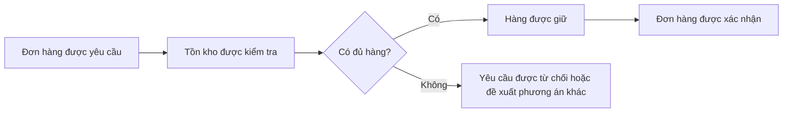

# Xác định mục tiêu kinh doanh, phạm vi vấn đề và các bên liên quan

Trong Domain-Driven Design (DDD), khám phá nghiệp vụ bắt đầu bằng việc hiểu doanh nghiệp đang cố gắng đạt được điều gì, vấn đề nào đang cản trở kết quả đó và những ai có kiến thức hoặc quyền quyết định liên quan. Đây là bước tìm hiểu **không gian vấn đề** trước khi thiết kế **không gian giải pháp**.

Một nhóm phát triển có thể xây dựng phần mềm đúng yêu cầu được ghi trong ticket nhưng vẫn giải quyết sai vấn đề. Chẳng hạn, yêu cầu “thêm nút xác nhận tồn kho” mô tả một giải pháp được đề xuất; nó chưa giải thích vì sao tồn kho cần được xác nhận, ai gặp khó khăn, tổn thất hiện tại là gì hay kết quả kinh doanh nào cần thay đổi. DDD yêu cầu nhóm cùng chuyên gia nghiệp vụ làm rõ những câu hỏi đó trước khi quyết định mô hình phần mềm.

## 1. Vì sao phải khám phá mục tiêu và phạm vi trước?

DDD xem phần mềm là một mô hình phục vụ một miền nghiệp vụ cụ thể. Chất lượng mô hình phụ thuộc nhiều vào mức độ nhóm hiểu miền đó. Nếu bắt đầu từ màn hình, bảng dữ liệu hoặc yêu cầu kỹ thuật, nhóm dễ đưa giả định của mình vào thiết kế và bỏ qua quy tắc thực tế của doanh nghiệp.

Khám phá nghiệp vụ giúp nhóm:

- **Chọn đúng vấn đề:** phân biệt triệu chứng, nguyên nhân và giải pháp đang được đề xuất.
- **Tạo cùng một cách hiểu:** chuyên gia nghiệp vụ, người dùng, người quản lý và kỹ sư có thể dùng chung thuật ngữ và cùng mô tả một kết quả mong muốn.
- **Đặt ranh giới hợp lý:** xác định phần nghiệp vụ cần nghiên cứu trong đợt này, các phần phụ thuộc và những gì nằm ngoài phạm vi.
- **Ưu tiên giá trị:** tập trung vào vấn đề có ảnh hưởng đáng kể đến mục tiêu kinh doanh, thay vì cố gắng tự động hóa mọi quy trình.
- **Chuẩn bị cho thiết kế chiến lược:** tạo cơ sở để nhận diện domain, subdomain, ranh giới ngữ cảnh (bounded context) và quan hệ giữa các ngữ cảnh ở những bước tiếp theo.

Khám phá không nhằm tạo ra một bản đặc tả đầy đủ mọi chức năng. Mục tiêu là đạt đủ hiểu biết để nhóm có thể đưa ra quyết định thiết kế có căn cứ và biết rõ điều gì vẫn cần xác minh.

## 2. Phân biệt miền nghiệp vụ, mục tiêu và vấn đề

Ba khái niệm này liên quan chặt chẽ nhưng trả lời những câu hỏi khác nhau.

| Khái niệm | Câu hỏi cần trả lời | Ví dụ |
|---|---|---|
| **Domain (miền nghiệp vụ)** | Doanh nghiệp đang hoạt động trong lĩnh vực nghiệp vụ nào? | Bán lẻ trực tuyến, giáo dục trực tuyến, quản lý bảo hiểm |
| **Business goal (mục tiêu kinh doanh)** | Doanh nghiệp muốn đạt được kết quả nào và vì sao kết quả đó quan trọng? | Giảm đơn hàng bị hủy vì thông tin tồn kho không chính xác |
| **Problem (vấn đề)** | Điều gì đang xảy ra khiến mục tiêu chưa đạt được? | Nhiều kênh bán hàng cùng sử dụng số lượng tồn kho cũ nên có thể nhận đơn vượt quá lượng hàng thực tế |
| **Proposed solution (giải pháp đề xuất)** | Một bên đang nghĩ đến cách xử lý nào? | Đồng bộ tồn kho thường xuyên hơn hoặc bổ sung bước giữ hàng |

Domain là bối cảnh rộng của hoạt động kinh doanh. Mục tiêu mô tả trạng thái doanh nghiệp muốn đạt. Vấn đề giải thích khoảng cách giữa trạng thái hiện tại và trạng thái mong muốn. Giải pháp là một giả thuyết về cách thu hẹp khoảng cách đó; nó cần được đánh giá sau khi vấn đề đã rõ.

### 2.1. Viết mục tiêu theo kết quả

Một mục tiêu tốt mô tả kết quả có ý nghĩa đối với doanh nghiệp hoặc khách hàng. “Xây dựng dịch vụ tồn kho mới” là mục tiêu triển khai. “Giảm số đơn hàng bị xác nhận nhưng không thể giao” mới mô tả kết quả nghiệp vụ.

Khi làm rõ mục tiêu, hãy hỏi:

1. Ai được hưởng lợi nếu mục tiêu đạt được?
2. Giá trị nào được tạo ra hoặc tổn thất nào được giảm đi?
3. Vì sao mục tiêu này quan trọng ở thời điểm hiện tại?
4. Có thể quan sát hoặc đo lường kết quả bằng dữ liệu nào?
5. Ai có quyền xác nhận rằng kết quả đã đạt?

Mục tiêu có thể gồm nhiều loại giá trị: tăng doanh thu, giảm chi phí, giảm rủi ro, tuân thủ quy định, cải thiện trải nghiệm, tăng khả năng vận hành hoặc rút ngắn thời gian xử lý. Không nên mặc định mọi dự án đều phải tối ưu doanh thu.

### 2.2. Chuyển yêu cầu giải pháp thành câu hỏi về vấn đề

Khi nhận một yêu cầu đã gắn với giải pháp, hãy tạm hoãn việc chọn công nghệ và hỏi ngược về tình huống thực tế.

| Yêu cầu được nêu | Câu hỏi khám phá |
|---|---|
| “Cần thêm màn hình duyệt đơn” | Quyết định nào đang thiếu? Ai cần đưa ra quyết định? Điều gì xảy ra nếu không duyệt? |
| “Cần đồng bộ dữ liệu theo thời gian thực” | Dữ liệu nào cần mới, mới đến mức nào và quyết định nghiệp vụ nào phụ thuộc vào độ mới đó? |
| “Cần một báo cáo tổng hợp” | Ai sử dụng báo cáo, họ cần quyết định điều gì và thông tin hiện tại chưa đáp ứng ở điểm nào? |
| “Cần tự động hóa quy trình” | Bước nào đang tốn công hoặc gây lỗi? Quy tắc nào có thể tự động hóa và trường hợp nào vẫn cần con người xử lý? |

Không phải giải pháp được đề xuất nào cũng sai. Nó chỉ chưa phải bằng chứng rằng nhóm đã hiểu vấn đề. Sau khi làm rõ bối cảnh và tiêu chí thành công, nhóm có thể xác nhận, điều chỉnh hoặc loại bỏ giải pháp đó.

## 3. Xác định và mô tả vấn đề

Một vấn đề nghiệp vụ nên được mô tả bằng sự kiện quan sát được, tác động và bối cảnh xảy ra. Tránh các kết luận mơ hồ như “hệ thống chậm”, “quy trình kém hiệu quả” hoặc “người dùng khó sử dụng” nếu chưa có ví dụ cụ thể.

Có thể dùng cấu trúc sau để tạo bản mô tả ban đầu:

> Khi **[đối tượng/tình huống]**, **[điều gì đang xảy ra]**, khiến **[đối tượng chịu ảnh hưởng]** gặp **[tác động nghiệp vụ]**. Điều này làm cho **[mục tiêu]** khó đạt được. Hiện nhóm biết **[bằng chứng]** và cần xác minh thêm **[giả định/câu hỏi]**.

Ví dụ:

> Khi nhiều kênh bán hàng nhận đơn gần như đồng thời, mỗi kênh có thể dựa trên một số lượng tồn kho chưa được cập nhật. Nhân viên vận hành phải liên hệ khách hàng để hủy hoặc đổi đơn, làm tăng chi phí xử lý và giảm độ tin cậy của dịch vụ. Doanh nghiệp muốn giảm số đơn đã xác nhận nhưng không thể giao. Nhóm cần kiểm tra thời điểm cập nhật tồn kho, quy tắc giữ hàng và cách xử lý khi hai đơn cùng tranh chấp một lượng hàng.

### 3.1. Tách triệu chứng, nguyên nhân và hệ quả

- **Triệu chứng** là dấu hiệu có thể quan sát: đơn bị hủy, nhân viên phải nhập lại dữ liệu, khách hàng gọi hỗ trợ nhiều lần.
- **Nguyên nhân có thể có** là điều kiện hoặc quy tắc tạo ra triệu chứng: dữ liệu tồn kho bị trễ, chưa có quy tắc giữ hàng, các kênh áp dụng cách tính khả dụng khác nhau.
- **Hệ quả** là ảnh hưởng đến khách hàng hoặc doanh nghiệp: mất doanh thu, tăng chi phí vận hành, giảm niềm tin hoặc tăng rủi ro.

Không nên xem giả thuyết ban đầu là nguyên nhân đã được chứng minh. Hãy tìm tình huống, dữ liệu và người có thể xác nhận hoặc bác bỏ từng giả thuyết. Một triệu chứng có thể có nhiều nguyên nhân; một nguyên nhân cũng có thể tạo ra nhiều triệu chứng.

### 3.2. Tìm hiểu quy trình và quy tắc thực tế

Hãy yêu cầu người tham gia mô tả một trường hợp cụ thể gần đây, từ lúc sự việc bắt đầu đến khi được xử lý xong. Với từng bước, tìm hiểu:

- Ai khởi tạo hoặc thực hiện bước đó?
- Họ cần thông tin gì để hành động?
- Họ dựa trên quy tắc hoặc điều kiện nào để quyết định?
- Trường hợp bình thường diễn ra thế nào? Trường hợp ngoại lệ thì sao?
- Hệ thống nào, bộ phận nào hoặc đối tác nào tham gia?
- Dữ liệu được tạo, thay đổi, xác nhận hoặc bàn giao ở đâu?
- Khi có sai lệch, ai phát hiện và ai có quyền xử lý?

Các câu hỏi này giúp khám phá hành vi và quy tắc của miền nghiệp vụ, thay vì chỉ ghi lại tên màn hình hoặc các bước trên giao diện hiện tại.

## 4. Đặt ranh giới phạm vi vấn đề

Phạm vi cho biết nhóm đang nghiên cứu phần nào của hoạt động nghiệp vụ, ở mức chi tiết nào và trong điều kiện nào. Nếu phạm vi quá rộng, nhóm khó thống nhất mục tiêu và khó xác định điểm kết thúc. Nếu phạm vi quá hẹp, nhóm có thể bỏ qua nguyên nhân hoặc phụ thuộc nằm ngoài một quy trình đơn lẻ.

### 4.1. Xác định điểm bắt đầu và kết thúc

Mô tả luồng nghiệp vụ bằng một sự kiện hoặc điều kiện bắt đầu và một kết quả hoặc điều kiện kết thúc. Sau đó làm rõ các tình huống ngoại lệ quan trọng.

Ví dụ với vấn đề tồn kho:

- **Bắt đầu:** khách hàng gửi yêu cầu đặt một mặt hàng.
- **Kết thúc dự kiến:** hệ thống xác nhận đơn với lượng hàng có thể đáp ứng, hoặc từ chối/đề xuất phương án khác theo quy tắc đã thống nhất.
- **Ngoại lệ cần xem xét:** nhiều yêu cầu cùng lúc, hàng bị hư hỏng, đơn bị hủy trong lúc giữ hàng, dữ liệu kho chưa cập nhật hoặc kho không phản hồi.

Điểm bắt đầu và kết thúc giúp nhóm xác định các tương tác cần hiểu. Chúng chưa mặc định rằng toàn bộ luồng phải nằm trong một service hay một bounded context.

### 4.2. Ghi rõ trong phạm vi và ngoài phạm vi

Một bảng phạm vi đơn giản giúp các bên phát hiện bất đồng sớm.

| Trong phạm vi | Ngoài phạm vi ở đợt khám phá này |
|---|---|
| Cách xác định lượng hàng có thể bán | Quy trình lựa chọn và ký hợp đồng với nhà cung cấp |
| Quy tắc giữ hàng khi tiếp nhận đơn | Tối ưu tuyến đường giao hàng |
| Xử lý hai yêu cầu cùng tranh chấp lượng hàng cuối | Chính sách tiếp thị và khuyến mãi |
| Giải phóng lượng hàng khi đơn bị hủy | Hạch toán và đối soát thanh toán |

Đây chỉ là ví dụ về cách ghi phạm vi. Trong dự án thực tế, nếu một phần ngoài phạm vi ảnh hưởng trực tiếp đến mục tiêu hoặc chứa quy tắc quan trọng, nhóm cần ghi nhận nó như một phụ thuộc hoặc câu hỏi mở. “Ngoài phạm vi” không có nghĩa là “không liên quan”.

### 4.3. Xác định góc nhìn và giới hạn

Phạm vi cần nêu rõ các giới hạn có thể làm thay đổi kết quả khám phá, chẳng hạn:

- Kênh bán hàng, loại sản phẩm, khu vực hoặc nhóm khách hàng được xem xét.
- Quy trình hiện tại hay cả quy trình tương lai.
- Giai đoạn thời gian và nguồn dữ liệu có thể truy cập.
- Quy định pháp lý, hợp đồng, chính sách nội bộ hoặc yêu cầu kiểm toán.
- Hệ thống cũ, đối tác và nhóm vận hành có liên quan.
- Thời gian, ngân sách, nhân lực hoặc quyền truy cập bị giới hạn.

Ghi rõ giả định và phụ thuộc. Ví dụ: “Nhóm giả định số liệu tồn kho tại kho là nguồn dữ liệu vận hành chính; cần xác nhận với quản lý kho.” Một giả định được ghi lại có thể được kiểm tra; một giả định không được nói ra thường biến thành lỗi thiết kế.

## 5. Nhận diện và phân tích các bên liên quan

**Stakeholder (bên liên quan)** là cá nhân, nhóm hoặc tổ chức có lợi ích, trách nhiệm, ảnh hưởng hoặc chịu tác động bởi vấn đề và kết quả của dự án. Stakeholder không chỉ là người trực tiếp sử dụng phần mềm.

Trong DDD, cần tìm được những người hiểu các quy tắc nghiệp vụ và có thể giải thích vì sao quy trình hoạt động như hiện tại. Những người này thường là **domain expert (chuyên gia miền nghiệp vụ)**. Một domain expert có thể là nhân viên vận hành lâu năm, chuyên viên nghiệp vụ, quản lý quy trình hoặc người chịu trách nhiệm về một quyết định chuyên môn. Chức danh cao không tự động đồng nghĩa với hiểu sâu mọi quy tắc; người trực tiếp xử lý ngoại lệ đôi khi nắm kiến thức mà tài liệu chính thức không thể hiện.

### 5.1. Các nhóm stakeholder thường gặp

| Nhóm | Mối quan tâm hoặc đóng góp | Điều cần xác minh |
|---|---|---|
| Nhà tài trợ, lãnh đạo nghiệp vụ | Mục tiêu, giá trị, ngân sách và mức ưu tiên | Ai chịu trách nhiệm cuối cùng về kết quả? |
| Chủ sở hữu sản phẩm hoặc quy trình | Phạm vi, ưu tiên, quyết định nghiệp vụ | Ai có quyền chốt phạm vi và xử lý xung đột ưu tiên? |
| Domain expert | Thuật ngữ, quy tắc, ngoại lệ và lịch sử nghiệp vụ | Ai có kinh nghiệm thực tế với các trường hợp khó? |
| Người dùng trực tiếp | Công việc hằng ngày, điểm đau và cách xử lý hiện tại | Những vai trò nào có quy trình khác nhau? |
| Vận hành và hỗ trợ | Khả năng vận hành, xử lý sự cố và bàn giao | Ai tiếp nhận khi quy trình thất bại? |
| Tài chính, pháp chế, an toàn hoặc tuân thủ | Rủi ro, kiểm soát, nghĩa vụ và bằng chứng | Có quy định hoặc giới hạn bắt buộc nào? |
| Đội kỹ thuật và kiến trúc | Hệ thống liên quan, dữ liệu, tích hợp và giới hạn kỹ thuật | Những phụ thuộc kỹ thuật nào ảnh hưởng đến phạm vi? |
| Đối tác hoặc nhà cung cấp | Cam kết dịch vụ, dữ liệu và quy trình trao đổi | Phụ thuộc bên ngoài nào có thể làm gián đoạn luồng? |
| Khách hàng hoặc người thụ hưởng | Nhu cầu, kỳ vọng và tác động của vấn đề | Nhóm đã có bằng chứng trực tiếp từ người thụ hưởng chưa? |

Không phải dự án nào cũng cần tất cả nhóm trên. Hãy chọn stakeholder dựa trên phạm vi và quyết định cần đưa ra. Cũng cần phân biệt người **có kiến thức**, người **chịu tác động**, người **có quyền quyết định** và người **thực hiện công việc**; một người có thể đảm nhận nhiều vai trò, nhưng các vai trò này không đồng nhất.

### 5.2. Lập bản đồ stakeholder

Với mỗi stakeholder hoặc nhóm stakeholder, ghi lại tối thiểu:

| Thông tin | Ý nghĩa |
|---|---|
| Vai trò và trách nhiệm | Họ tham gia vào phần nào của nghiệp vụ? |
| Mục tiêu và mối quan tâm | Họ muốn bảo vệ hoặc cải thiện điều gì? |
| Kiến thức miền | Họ hiểu quy tắc, trường hợp thường gặp và ngoại lệ nào? |
| Quyền quyết định | Họ có thể quyết định, phê duyệt hay chỉ tư vấn? |
| Mức độ ảnh hưởng và chịu tác động | Kết quả thay đổi công việc hoặc quyền lợi của họ ra sao? |
| Mức độ tham gia | Cần phỏng vấn, quan sát, workshop hay xác nhận kết quả? |
| Xung đột hoặc phụ thuộc | Mục tiêu của họ có khác với nhóm khác không? |

Không nên chỉ dùng ma trận quyền lực và mức độ quan tâm để chọn người tham gia. Cách đó hữu ích cho kế hoạch trao đổi, nhưng có thể bỏ sót nhân viên tuyến đầu có hiểu biết sâu về ngoại lệ hoặc khách hàng chịu ảnh hưởng lớn nhưng ít quyền lực trong tổ chức.

### 5.3. Xử lý góc nhìn và mục tiêu xung đột

Các bộ phận có thể định nghĩa “thành công” khác nhau. Bộ phận bán hàng muốn xác nhận đơn nhanh; kho muốn có đủ thời gian kiểm tra hàng; chăm sóc khách hàng muốn thông tin nhất quán; tài chính muốn hạn chế giao dịch phải hoàn lại.

Khi có bất đồng:

1. Ghi lại quan điểm của từng bên bằng ngôn ngữ của chính họ.
2. Hỏi về tình huống thực tế và hậu quả khiến họ ưu tiên như vậy.
3. Phân biệt quy tắc bắt buộc, chính sách có thể thương lượng và sở thích cá nhân.
4. Tìm người có thẩm quyền giải quyết xung đột hoặc quy trình ra quyết định phù hợp.
5. Ghi lại quyết định, lý do, người xác nhận và vấn đề còn bỏ ngỏ.

Không ép các bên đồng ý bằng cách chọn một thuật ngữ chung khi họ đang nói về hai khái niệm khác nhau. Sự khác biệt có thể phản ánh hai quy trình, hai chính sách hoặc hai góc nhìn nghiệp vụ thực sự cần được mô hình hóa.

## 6. Thu thập hiểu biết từ thực tế

Không có một kỹ thuật khám phá duy nhất phù hợp cho mọi miền. Hãy kết hợp trao đổi với stakeholder, quan sát công việc, xem dữ liệu và mô hình hóa quy trình để kiểm tra chéo thông tin.

### 6.1. Phỏng vấn theo tình huống

Phỏng vấn nên bắt đầu từ một trường hợp cụ thể thay vì câu hỏi quá rộng như “quy trình của anh/chị là gì?”. Ví dụ:

- “Lần gần nhất một đơn không thể giao diễn ra như thế nào?”
- “Ai phát hiện vấn đề đầu tiên? Họ dựa vào thông tin nào?”
- “Quyết định tiếp theo là gì? Có quy tắc nào chi phối quyết định đó?”
- “Trường hợp này khác trường hợp bình thường ở đâu?”
- “Nếu không xử lý đúng, khách hàng hoặc doanh nghiệp chịu ảnh hưởng gì?”
- “Có khi nào quy trình thực tế khác tài liệu hoặc chính sách không?”

Hỏi tiếp để làm rõ từ ngữ như “đã xác nhận”, “còn hàng”, “đơn hợp lệ” hoặc “hoàn tất”. Những từ quen thuộc có thể mang nghĩa khác nhau giữa các bộ phận.

### 6.2. Quan sát công việc

Quan sát người thực hiện công việc trong bối cảnh thật giúp phát hiện thao tác thủ công, bảng tính riêng, trao đổi ngoài hệ thống và cách xử lý ngoại lệ. Hãy xin phép phù hợp, tôn trọng dữ liệu nhạy cảm và ghi nhận quy trình thay vì đánh giá cá nhân. Một quy trình trên tài liệu có thể khác cách nhân viên thực sự hoàn thành công việc khi chịu áp lực thời gian.

### 6.3. Workshop và Event Storming

Workshop giúp nhiều vai trò cùng xây dựng một bức tranh về quy trình. Một kỹ thuật hữu ích trong DDD là **Event Storming**: nhóm cùng liệt kê các domain event (sự kiện nghiệp vụ) đã xảy ra, sắp xếp chúng theo dòng thời gian, sau đó bổ sung command, actor, policy và câu hỏi cần làm rõ khi phù hợp.

Ví dụ một chuỗi sự kiện đơn giản trong xử lý đơn hàng:

Sơ đồ trên chỉ minh họa một luồng đơn giản. Khi khám phá thực tế, nhóm cần tìm các sự kiện, điều kiện và nhánh ngoại lệ từ người hiểu nghiệp vụ. Event Storming hỗ trợ khám phá ngôn ngữ và hành vi; nó không tự động quyết định kiến trúc, service hay bounded context.

### 6.4. Kiểm tra bằng dữ liệu và tài liệu

Đối chiếu lời kể với dữ liệu vận hành, báo cáo sự cố, hợp đồng, chính sách, biểu mẫu và tài liệu quy trình nếu được phép truy cập. Dữ liệu có thể cho biết tần suất hoặc mức độ ảnh hưởng; phỏng vấn giúp giải thích vì sao sự việc xảy ra. Cả hai đều có giới hạn: dữ liệu có thể thiếu hoặc sai lệch, còn ký ức của người tham gia có thể không đầy đủ.

Ghi nguồn của từng nhận định: ai cung cấp, quan sát ở đâu, dữ liệu thuộc giai đoạn nào và mức độ chắc chắn ra sao. Phân biệt rõ **đã xác nhận**, **đang giả định** và **chưa biết**.

## 7. Xác định tiêu chí thành công

Mục tiêu chỉ hữu ích khi các bên có thể nhận biết tiến triển và xác nhận kết quả. Chọn chỉ số phản ánh giá trị nghiệp vụ, có định nghĩa thống nhất và có nguồn dữ liệu khả dụng.

Với ví dụ tồn kho, các chỉ số có thể gồm:

- Tỷ lệ đơn đã xác nhận nhưng sau đó không thể giao vì thiếu hàng.
- Số lần nhân viên phải liên hệ khách hàng để đổi hoặc hủy đơn do sai lệch tồn kho.
- Thời gian từ lúc nhận yêu cầu đặt hàng đến lúc có quyết định về khả năng đáp ứng.
- Tỷ lệ chênh lệch giữa lượng hàng được hệ thống coi là khả dụng và lượng hàng thực tế có thể bán.

Trước khi đặt mục tiêu định lượng, cần thống nhất cách tính, phạm vi dữ liệu, khoảng thời gian đo và giá trị cơ sở (baseline). Một mục tiêu minh họa có thể là “giảm tỷ lệ đơn bị hủy do thiếu hàng trong các kênh bán hàng thuộc phạm vi”; con số và thời hạn cụ thể phải được doanh nghiệp xác nhận dựa trên dữ liệu và ưu tiên thực tế.

Tránh chọn chỉ số dễ đo nhưng không đại diện cho kết quả. Ví dụ, số màn hình được triển khai hoặc số ticket đóng là chỉ số đầu ra của dự án, không chứng minh rằng vấn đề nghiệp vụ đã được giải quyết.

## 8. Quy trình khám phá đề xuất

Có thể tổ chức hoạt động khám phá theo các bước sau. Đây là vòng lặp có thể quay lại khi xuất hiện bằng chứng mới, không phải quy trình cứng buộc phải hoàn thành một lần.

1. **Chuẩn bị:** đọc yêu cầu ban đầu, xác định người bảo trợ, mục đích buổi khám phá và các giới hạn đã biết.
2. **Làm rõ mục tiêu:** hỏi kết quả mong muốn, giá trị, mức độ ưu tiên và cách xác nhận thành công.
3. **Mô tả vấn đề:** thu thập tình huống cụ thể, triệu chứng, tác động và các giả thuyết về nguyên nhân.
4. **Xác định stakeholder:** tìm người chịu tác động, người thực hiện, domain expert, người quyết định và các bên phụ thuộc.
5. **Khám phá quy trình:** phỏng vấn, quan sát, workshop và đối chiếu dữ liệu để hiểu hành vi, quy tắc và ngoại lệ.
6. **Đặt ranh giới:** xác định điểm bắt đầu, điểm kết thúc, phần trong/ngoài phạm vi, giới hạn và phụ thuộc.
7. **Thống nhất tiêu chí:** chốt chỉ số, cách đo, nguồn dữ liệu và người xác nhận kết quả.
8. **Xác nhận hiểu biết:** trình bày lại mô tả vấn đề, thuật ngữ, phạm vi và câu hỏi mở cho các bên liên quan phản hồi.

Nếu trong quá trình này nhóm phát hiện mục tiêu ban đầu không còn đúng hoặc phạm vi không giải thích được nguyên nhân chính, hãy cập nhật kết quả khám phá và xác nhận lại với người có thẩm quyền.

## 9. Ví dụ tổng hợp: giảm đơn hàng không thể đáp ứng

Giả sử một doanh nghiệp bán lẻ có website, ứng dụng di động và kênh bán hàng qua nhân viên. Khách hàng đôi khi đặt được sản phẩm mà kho không còn đủ hàng. Các bộ phận mô tả vấn đề theo những cách khác nhau: bán hàng nói cần xác nhận đơn nhanh hơn, kho nói số liệu cập nhật chậm, chăm sóc khách hàng nói họ nhận thông tin quá muộn.

### 9.1. Kết quả khám phá ban đầu

| Hạng mục | Nội dung đã thống nhất hoặc cần xác minh |
|---|---|
| Domain | Bán lẻ đa kênh |
| Mục tiêu kinh doanh | Giảm đơn đã xác nhận nhưng không thể giao do thiếu hàng; cải thiện độ tin cậy của cam kết với khách hàng |
| Vấn đề quan sát | Nhiều kênh có thể sử dụng thông tin tồn kho không đồng nhất khi tiếp nhận đơn |
| Tác động | Tăng hủy/đổi đơn, tăng công việc hỗ trợ và làm giảm niềm tin của khách hàng |
| Phạm vi ban đầu | Từ khi nhận yêu cầu đặt hàng đến khi xác định khả năng đáp ứng và giữ hàng hoặc từ chối yêu cầu |
| Ngoài phạm vi ban đầu | Mua hàng từ nhà cung cấp, tối ưu giao vận và đối soát thanh toán |
| Stakeholder cần tham gia | Quản lý bán hàng, quản lý kho, nhân viên xử lý đơn, chăm sóc khách hàng, chủ sở hữu quy trình, đội kỹ thuật và đại diện khách hàng |
| Giả thuyết cần kiểm tra | Độ trễ cập nhật, quy tắc giữ hàng và cách xử lý yêu cầu đồng thời có thể góp phần gây ra vấn đề |
| Tiêu chí theo dõi | Tỷ lệ đơn không thể giao do thiếu hàng, số lần xử lý thủ công và thời gian ra quyết định về khả năng đáp ứng |

### 9.2. Câu hỏi cần trả lời trước khi thiết kế

- “Tồn kho khả dụng” được định nghĩa giống nhau ở tất cả kênh không? Hàng đang giữ, hàng lỗi hoặc hàng chờ kiểm kê được tính thế nào?
- Khi hai đơn cùng yêu cầu đơn vị hàng cuối cùng, quy tắc ưu tiên là gì?
- Thời điểm nào được xem là đơn đã xác nhận? Có thể hủy giữ hàng trong những điều kiện nào?
- Ai có quyền xử lý chênh lệch giữa số liệu hệ thống và thực tế tại kho?
- Mỗi kênh đang trao đổi dữ liệu với hệ thống kho bằng cách nào? Có giới hạn hoặc cam kết nào từ đối tác?
- Khách hàng cần được thông báo ở thời điểm nào và ai chịu trách nhiệm về nội dung thông báo?

Những câu hỏi này cho thấy nhóm vẫn đang tìm hiểu quy tắc và ranh giới nghiệp vụ. Sau khi có câu trả lời và bằng chứng, nhóm mới có thể đánh giá cách phân chia trách nhiệm giữa các phần của miền, xác định các subdomain và khám phá bounded context phù hợp.

## 10. Kết quả cần có sau bước khám phá

Một bộ kết quả khám phá gọn nhưng có thể kiểm chứng thường gồm:

| Đầu ra | Nội dung cần ghi |
|---|---|
| Mục tiêu kinh doanh | Kết quả mong muốn, lý do và người chịu trách nhiệm xác nhận |
| Mô tả vấn đề | Tình huống, triệu chứng, tác động, bằng chứng và giả thuyết |
| Phạm vi | Điểm bắt đầu/kết thúc, phần bao gồm, phần loại trừ và phụ thuộc |
| Bản đồ stakeholder | Vai trò, mối quan tâm, kiến thức, quyền quyết định và cách tham gia |
| Thuật ngữ ban đầu | Những từ nghiệp vụ quan trọng cùng định nghĩa đã được xác nhận |
| Tiêu chí thành công | Chỉ số, cách tính, baseline, nguồn dữ liệu và người xác nhận |
| Giả định và câu hỏi mở | Điều chưa được chứng minh, người cần xác minh và bước tiếp theo |

Trước khi chuyển sang mô hình hóa sâu hơn, hãy kiểm tra:

- Các bên liên quan có thể diễn đạt mục tiêu bằng một cách hiểu tương thích không?
- Vấn đề được mô tả bằng tình huống và bằng chứng cụ thể chưa?
- Phạm vi có ranh giới rõ và có ghi nhận các phụ thuộc quan trọng không?
- Đã có domain expert cho các quy tắc và ngoại lệ chính chưa?
- Người có quyền quyết định và người chịu trách nhiệm xác nhận kết quả đã rõ chưa?
- Tiêu chí thành công có thể đo hoặc kiểm chứng không?
- Các giả định, mâu thuẫn và câu hỏi chưa giải quyết có được ghi lại không?

Nếu một câu trả lời còn thiếu, nhóm có thể tiếp tục khám phá có trọng tâm. Không cần giả vờ rằng mọi điều đã rõ; điều quan trọng là biết chính xác phần nào đã được xác nhận và phần nào vẫn là giả thuyết.

## 11. Sai lầm thường gặp

**Bắt đầu từ công nghệ hoặc chức năng được yêu cầu.** Nhóm có thể triển khai đúng giải pháp được đề xuất nhưng không cải thiện kết quả kinh doanh. Hãy truy ngược từ yêu cầu về tình huống, tác động và mục tiêu.

**Để phạm vi quá rộng.** Những cụm từ như “số hóa toàn bộ vận hành” không giúp nhóm biết nên khám phá điều gì trước. Hãy giới hạn theo kết quả, quy trình, đối tượng và điểm bắt đầu/kết thúc.

**Chỉ phỏng vấn người quản lý.** Người quản lý có thể hiểu mục tiêu và chính sách, trong khi nhân viên trực tiếp xử lý ngoại lệ biết cách công việc thực sự diễn ra. Cần đối chiếu nhiều góc nhìn.

**Coi tài liệu hiện tại là sự thật đầy đủ.** Tài liệu có thể cũ, thiếu ngoại lệ hoặc mô tả quy trình mong muốn thay vì quy trình đang diễn ra. Hãy kiểm tra bằng quan sát và ví dụ thực tế.

**Nhầm stakeholder với người dùng phần mềm.** Khách hàng, đối tác, cơ quan quản lý, nhóm vận hành và người chịu trách nhiệm rủi ro đều có thể là stakeholder dù họ không đăng nhập hệ thống.

**Không ghi nhận xung đột.** Hai bộ phận có thể dùng cùng một từ nhưng mang nghĩa khác nhau, hoặc có chính sách ưu tiên khác nhau. Hãy giữ lại sự khác biệt để xác minh và đưa ra quyết định minh bạch.

**Đặt chỉ số không gắn với giá trị.** Hoàn thành chức năng hoặc tăng số thao tác tự động không chứng minh vấn đề đã được giải quyết. Hãy đo kết quả mà doanh nghiệp và khách hàng quan tâm.

**Chốt ranh giới kỹ thuật quá sớm.** Một quy trình, phòng ban hoặc hệ thống hiện tại không nhất thiết tương ứng với một bounded context. Ranh giới mô hình cần phản ánh ngôn ngữ và quy tắc nghiệp vụ nhất quán; việc đó cần thêm khám phá và kiểm chứng.

## 12. Câu hỏi tự kiểm tra

1. Vì sao “xây dựng một service tồn kho” chưa phải là mô tả mục tiêu kinh doanh?
2. Làm thế nào phân biệt triệu chứng với nguyên nhân của một vấn đề nghiệp vụ?
3. Vì sao phạm vi cần ghi rõ cả phần ngoài phạm vi và các phụ thuộc?
4. Domain expert có nhất thiết là người quản lý cao nhất không? Hãy giải thích.
5. Khi bán hàng và kho có định nghĩa khác nhau về “hàng khả dụng”, nhóm nên xử lý thế nào?
6. Vì sao số lượng chức năng hoàn thành không đủ để chứng minh dự án tạo ra giá trị?
7. Event Storming hỗ trợ khám phá điều gì và vì sao kết quả của nó chưa tự quyết định bounded context?

## Kết luận

Khám phá nghiệp vụ trong DDD bắt đầu bằng việc hiểu kết quả doanh nghiệp cần đạt, vấn đề thực tế đang cản trở kết quả đó, ranh giới cần nghiên cứu và những người nắm kiến thức hoặc có quyền quyết định. Mục tiêu, mô tả vấn đề, phạm vi, stakeholder, tiêu chí thành công và các câu hỏi mở tạo thành nền tảng chung cho nhóm. Khi nền tảng này đủ rõ và được kiểm chứng, việc nhận diện subdomain, bounded context, context map và xây dựng mô hình chiến thuật sẽ có cơ sở nghiệp vụ vững chắc hơn.
