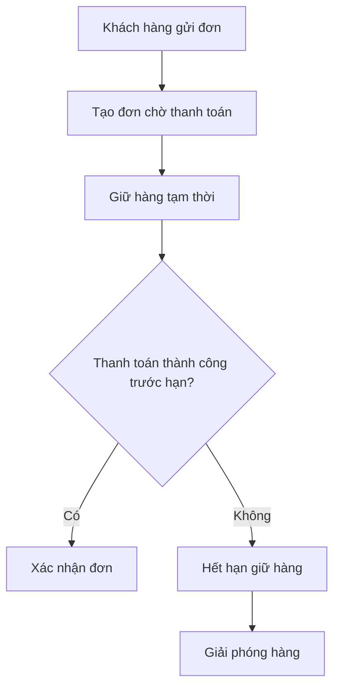

# Thu thập quy tắc, ngoại lệ, thuật ngữ và các điểm chưa thống nhất

Trong Domain-Driven Design (DDD), mô hình phần mềm cần phản ánh cách nghiệp vụ thực sự vận hành. Muốn xây dựng được mô hình như vậy, đội phát triển phải khám phá cách chuyên gia nghiệp vụ gọi tên sự vật, đưa ra quyết định, áp dụng quy tắc và xử lý những tình huống nằm ngoài luồng thông thường. Công việc này không dừng ở việc ghi lại quy trình hiện tại. Mục tiêu là làm rõ ý nghĩa và giới hạn của các khái niệm nghiệp vụ, đồng thời phát hiện những giả định hoặc bất đồng có thể khiến phần mềm hành xử sai.

Thu thập quy tắc, ngoại lệ, thuật ngữ và điểm chưa thống nhất là một phần quan trọng của **khám phá nghiệp vụ**. Kết quả thu thập giúp nhóm xây dựng ngôn ngữ chung (Ubiquitous Language), nhận diện các quy tắc cần bảo vệ trong mô hình miền, và có cơ sở để tiếp tục xác định subdomain, bounded context cùng các thành phần tactical design như entity, value object, aggregate, repository và domain event.

## 1. Mục tiêu của hoạt động khám phá

Khi kết thúc một vòng khám phá, nhóm cần trả lời được những câu hỏi sau:

- Nghiệp vụ đang cố gắng đạt kết quả gì, ai tham gia và sự kiện nào khởi đầu hoặc kết thúc một quy trình?
- Những điều kiện nào phải luôn đúng? Ai có quyền thay đổi chúng và chúng thay đổi trong trường hợp nào?
- Những trường hợp đặc biệt nào xảy ra trong thực tế? Hệ thống và nhân viên phải xử lý chúng ra sao?
- Một thuật ngữ có nghĩa chính xác là gì trong phạm vi đang khảo sát? Có từ đồng nghĩa, cách gọi địa phương hoặc nghĩa khác ở bộ phận khác không?
- Các bên đang hiểu khác nhau ở điểm nào? Ai có thẩm quyền quyết định và cần bằng chứng gì để chốt cách hiểu?
- Điều gì đã được xác nhận, điều gì mới là giả thuyết và điều gì vẫn cần điều tra?

Nhóm không cần lập tức giải quyết mọi câu hỏi. Điều cần thiết là làm cho phần chưa biết trở nên hữu hình, có người chịu trách nhiệm và có bước tiếp theo rõ ràng. Một câu hỏi chưa có lời giải nhưng được ghi nhận minh bạch hữu ích hơn một giả định được đưa vào mã nguồn như thể đó là sự thật.

## 2. Phân biệt năm loại thông tin cần thu thập

Các cuộc trao đổi nghiệp vụ thường trộn lẫn sự kiện, quy trình, quy tắc, chính sách và chi tiết triển khai. Nếu không tách chúng ra, nhóm dễ biến một mô tả tình huống thành quy tắc tổng quát hoặc nhầm một giới hạn kỹ thuật với yêu cầu nghiệp vụ.

| Loại thông tin | Ý nghĩa | Câu hỏi gợi mở |
|---|---|---|
| Sự kiện và bối cảnh | Điều đã xảy ra, ai liên quan, thời điểm và kết quả | Chuyện gì vừa xảy ra? Ai biết hoặc chịu trách nhiệm về việc đó? |
| Quy trình | Các bước và quyết định dẫn đến một kết quả | Việc này diễn ra theo thứ tự nào? Có nhánh rẽ ở đâu? |
| Quy tắc nghiệp vụ | Điều kiện hoặc ràng buộc quyết định trạng thái hợp lệ | Điều gì bắt buộc phải đúng? Khi nào được phép hoặc bị cấm? |
| Chính sách | Lựa chọn hoặc tham số có thể thay đổi theo tổ chức, sản phẩm, thời gian hay thị trường | Ai quyết định cách xử lý? Giá trị này có thể thay đổi khi nào? |
| Ràng buộc kỹ thuật | Giới hạn của hệ thống, tích hợp, dữ liệu hoặc hạ tầng | Đây là yêu cầu của nghiệp vụ hay giới hạn của giải pháp hiện tại? |

Ví dụ, “đơn hàng phải có ít nhất một dòng hàng” có thể là quy tắc nghiệp vụ. “Đơn hàng được chuyển cho kho sau khi thanh toán thành công” là một bước trong quy trình, nếu đó là chính sách đã được xác nhận. “Thời gian giữ hàng là 10 phút” có thể là chính sách cấu hình. “Dịch vụ thanh toán chỉ gửi thông báo tối đa ba lần” là một giới hạn tích hợp cần được xác minh từ nhà cung cấp. Những thông tin này liên quan với nhau nhưng không nên được ghi thành một loại quy tắc duy nhất.

## 3. Chuẩn bị trước khi thu thập

### 3.1. Chọn phạm vi có thể khảo sát

Không nên bắt đầu bằng câu hỏi quá rộng như “Hệ thống bán hàng hoạt động thế nào?”. Hãy chọn một năng lực hoặc một lát cắt nghiệp vụ có đầu vào và kết quả nhận biết được, chẳng hạn:

- Tiếp nhận và xác nhận đơn hàng.
- Phân bổ hàng tồn cho đơn.
- Tính phí giao hàng.
- Xử lý yêu cầu hoàn tiền.
- Đối soát khoản thanh toán.

Mô tả phạm vi bằng một câu: “Chúng ta đang tìm hiểu cách [vai trò] biến [đầu vào/sự kiện] thành [kết quả], trong điều kiện [giới hạn chính]”. Câu này giúp người tham gia biết nội dung nào thuộc buổi làm việc và nội dung nào cần ghi thành câu hỏi riêng.

Phạm vi khảo sát không đồng nghĩa với bounded context đã được xác định. Trong quá trình trao đổi, nhóm có thể phát hiện một từ hoặc một quy tắc được hiểu khác nhau giữa các bộ phận. Đó là tín hiệu để điều tra ranh giới mô hình, chưa phải kết luận cần tách context ngay lập tức.

### 3.2. Mời đúng người tham gia

Một người quản lý có thể giải thích mục tiêu và chính sách, nhưng người trực tiếp xử lý hồ sơ thường biết các ngoại lệ và thao tác thực tế. Tùy phạm vi, hãy trao đổi với:

- Người thực hiện công việc hằng ngày.
- Người phê duyệt hoặc chịu trách nhiệm về quyết định.
- Người hỗ trợ khi quy trình thất bại.
- Người quản lý chính sách hoặc chủ sở hữu nghiệp vụ.
- Đại diện của bộ phận nhận kết quả từ quy trình.
- Chuyên gia về hệ thống bên ngoài khi có tích hợp ảnh hưởng đến nghiệp vụ.

Không mặc định rằng một cá nhân có thể đại diện cho mọi vai trò. Nếu hai người mô tả cùng một quy trình khác nhau, hãy ghi lại khác biệt và tìm hiểu xem đó là do quyền hạn, loại giao dịch, thời điểm hay cách hiểu không thống nhất.

### 3.3. Chuẩn bị bằng chứng và câu hỏi

Nếu được phép tiếp cận, hãy chuẩn bị biểu mẫu, tài liệu hướng dẫn, báo cáo, dữ liệu mẫu đã ẩn thông tin nhạy cảm, lịch sử xử lý hoặc màn hình hệ thống liên quan. Các nguồn này giúp người tham gia nhớ lại tình huống cụ thể. Tuy nhiên, tài liệu và phần mềm hiện tại chỉ là bằng chứng về cách làm đang được ghi nhận; chúng không tự động chứng minh đó là quy tắc đúng hoặc mong muốn của nghiệp vụ.

Nên chuẩn bị một số câu hỏi mở, sau đó đào sâu bằng ví dụ thực tế. Tránh đưa sẵn câu trả lời vào câu hỏi, ví dụ “Đơn hàng luôn bị hủy sau 10 phút đúng không?”. Cách hỏi trung lập hơn là “Sau khi tạo đơn, điều gì xảy ra nếu khách hàng chưa thanh toán trong 10 phút?”.

## 4. Thu thập quy tắc nghiệp vụ

Quy tắc nghiệp vụ mô tả điều kiện, giới hạn hoặc quyết định mà tổ chức dùng để xác định một hành động hay trạng thái có hợp lệ hay không. Quy tắc có thể liên quan đến quyền hạn, số lượng, thời hạn, trạng thái, tính toán, thứ tự xử lý hoặc mối quan hệ giữa nhiều đối tượng.

### 4.1. Hỏi từ quyết định thực tế

Thay vì hỏi chung chung “Có những quy tắc nào?”, hãy yêu cầu người tham gia kể lại một quyết định gần đây:

1. Tình huống bắt đầu như thế nào?
2. Người xử lý có những thông tin nào tại thời điểm đó?
3. Họ phải quyết định điều gì?
4. Điều kiện nào khiến họ chọn phương án này thay vì phương án khác?
5. Nếu điều kiện không thỏa mãn thì chuyện gì xảy ra?
6. Có ai được phép ngoại lệ hoặc ghi đè quyết định không?
7. Quyết định có cần lưu lý do hoặc bằng chứng không?

Một quyết định cụ thể thường làm lộ ra quy tắc ẩn mà người tham gia không nghĩ đến khi được hỏi trực tiếp. Hãy tiếp tục hỏi “Tại sao?” và “Trong trường hợp nào điều đó không còn đúng?” cho đến khi xác định được điều kiện và phạm vi áp dụng.

### 4.2. Làm rõ cấu trúc của một quy tắc

Một quy tắc đủ rõ thường có các thành phần:

- **Phạm vi:** áp dụng cho loại giao dịch, khách hàng, sản phẩm, khu vực hoặc giai đoạn nào?
- **Điều kiện:** những điều kiện nào phải thỏa mãn trước khi quy tắc có hiệu lực?
- **Ràng buộc:** điều gì được phép, bắt buộc hoặc bị cấm?
- **Kết quả:** trạng thái, quyết định hoặc hành động nào được tạo ra?
- **Ngoại lệ và quyền hạn:** ai có thể xử lý khác đi, trong điều kiện nào và có cần ghi nhận lý do không?
- **Nguồn và hiệu lực:** ai xác nhận quy tắc, quy tắc có hiệu lực từ khi nào và được xem xét lại khi nào?

Có thể ghi quy tắc bằng cấu trúc “Khi [điều kiện], [vai trò/hệ thống] phải [hành động hoặc kết quả], trừ khi [ngoại lệ đã xác nhận]”. Không ép mọi quy tắc vào một câu nếu điều đó làm mất ý nghĩa. Với quy tắc tính toán, hãy ghi rõ đơn vị, cách làm tròn, thứ tự áp dụng và ví dụ số.

### 4.3. Tìm ranh giới và tính bất biến

Những câu hỏi sau thường phát hiện được ràng buộc quan trọng:

- Giá trị nhỏ nhất hoặc lớn nhất là bao nhiêu? Có bao gồm chính giá trị biên đó không?
- Điều gì phải luôn đúng trong suốt vòng đời của đối tượng?
- Hai hành động có thể xảy ra đồng thời không? Nếu có, hành động nào được ưu tiên?
- Một quyết định đã xác nhận có thể bị thay đổi không? Ai được thay đổi và cần lưu lịch sử gì?
- Quy tắc có khác nhau theo loại khách hàng, hợp đồng, khu vực hoặc thời điểm không?
- Nếu dữ liệu đầu vào thiếu, sai hoặc đến trễ, nghiệp vụ muốn hệ thống làm gì?

Các ràng buộc phải luôn được bảo vệ trong một phạm vi giao dịch là đầu mối hữu ích khi sau này xác định aggregate và invariant. Tuy nhiên, không phải mọi quy tắc đều cần đặt trong một aggregate. Một số quy tắc thuộc chính sách, quy trình liên phòng ban hoặc quyết định cần dữ liệu từ nhiều bounded context.

### 4.4. Phân biệt quy tắc với chính sách có thể thay đổi

Quy tắc “một đơn đã giao không thể quay lại trạng thái chưa giao” có thể là ràng buộc vòng đời. Chính sách “đơn chưa thanh toán được giữ chỗ trong 10 phút” có thể thay đổi theo kênh bán hoặc chiến dịch. Khi ghi nhận, hãy hỏi ai sở hữu quyết định thay đổi, thay đổi có cần phê duyệt và có hiệu lực cho giao dịch đang tồn tại hay chỉ giao dịch mới.

Nếu một con số có thể được điều chỉnh mà không thay đổi ý nghĩa nghiệp vụ cốt lõi, hãy cân nhắc ghi nó như tham số hoặc chính sách. Nếu thay đổi con số làm thay đổi cách hiểu về tính hợp lệ của nghiệp vụ, cần làm rõ quy tắc và thẩm quyền trước khi quyết định cách mô hình hóa.

## 5. Thu thập ngoại lệ và tình huống biên

Ngoại lệ không chỉ là lỗi hệ thống. Trong nghiệp vụ, ngoại lệ có thể là một trường hợp hợp lệ nhưng ít gặp, một chính sách đặc biệt, một sự cố cần khôi phục hoặc một tình huống chưa có cách xử lý thống nhất. Nếu chỉ mô tả luồng thành công phổ biến, mô hình sẽ bỏ sót phần thường gây ra nhiều tranh chấp và sửa đổi nhất.

### 5.1. Tìm ngoại lệ bằng cách thay đổi từng điều kiện

Sau khi người tham gia mô tả luồng thông thường, hãy thay đổi một yếu tố mỗi lần:

- Thiếu dữ liệu hoặc dữ liệu không hợp lệ.
- Giá trị đúng tại ngưỡng, thấp hơn ngưỡng hoặc cao hơn ngưỡng.
- Người thực hiện không có quyền.
- Một bước bị từ chối, thất bại hoặc bị hủy.
- Sự kiện đến muộn, đến lặp lại hoặc sai thứ tự.
- Hai người hoặc hai hệ thống cùng cập nhật một đối tượng.
- Đối tác bên ngoài ngừng hoạt động hoặc trả về kết quả không rõ ràng.
- Khách hàng thay đổi yêu cầu sau khi quy trình đã tiến xa.
- Quy tắc hoặc chính sách thay đổi trong khi giao dịch vẫn đang xử lý.

Với mỗi tình huống, hỏi: “Điều gì phải xảy ra tiếp theo?”, “Ai chịu trách nhiệm?”, “Có thể thử lại không?”, “Nếu thử lại thì có tạo tác động hai lần không?” và “Khi nào cần chuyển cho người có thẩm quyền?”.

### 5.2. Phân loại cách xử lý

| Nhóm tình huống | Đặc điểm | Nội dung cần làm rõ |
|---|---|---|
| Biến thể hợp lệ | Một luồng khác nhưng được nghiệp vụ cho phép | Điều kiện áp dụng, kết quả và quyền hạn |
| Vi phạm quy tắc | Đầu vào hoặc yêu cầu không thỏa điều kiện | Từ chối ở đâu, thông báo gì, có cho sửa không |
| Lỗi có thể phục hồi | Có thể thử lại hoặc tiếp tục sau khi khắc phục | Điều kiện thử lại, giới hạn số lần, chống xử lý trùng |
| Kết quả chưa xác định | Không biết hành động bên ngoài đã thành công hay chưa | Cách đối soát, kiểm tra trạng thái và xử lý an toàn |
| Trường hợp cần con người quyết định | Không thể tự động áp dụng quy tắc hiện có | Vai trò phê duyệt, thời hạn và bằng chứng cần lưu |
| Tình huống chưa có chính sách | Các bên chưa thống nhất hoặc chưa từng gặp | Người quyết định, thời điểm cần quyết định và tác động nếu trì hoãn |

Phân loại giúp nhóm không gom mọi vấn đề vào một thông báo lỗi chung. Một yêu cầu bị từ chối theo quy tắc, một giao dịch cần chờ đối soát và một trường hợp cần phê duyệt là ba trạng thái nghiệp vụ khác nhau.

### 5.3. Hỏi về quá trình khôi phục

Với ngoại lệ, kết quả cuối cùng chưa đủ. Hãy tìm hiểu cách nghiệp vụ trở lại trạng thái ổn định:

- Ai phát hiện vấn đề và ai được thông báo?
- Có thể tiếp tục từ bước nào hay phải bắt đầu lại?
- Hành động đã thực hiện có cần hoàn tác hoặc bù trừ không?
- Có cần lưu lịch sử, lý do, người phê duyệt hoặc chứng từ không?
- Nếu không thể xử lý ngay, đối tượng ở trạng thái nào và ai theo dõi?
- Khi một hệ thống bên ngoài gửi lại thông báo, làm sao tránh ghi nhận cùng một kết quả nhiều lần?

Các câu trả lời này có thể dẫn đến domain event, trạng thái trung gian, quy trình bù trừ hoặc yêu cầu tích hợp. Hãy ghi nhận nhu cầu nghiệp vụ trước, rồi mới chọn giải pháp kỹ thuật.

## 6. Khám phá và chuẩn hóa thuật ngữ

Ngôn ngữ chung là một trong những nền tảng của DDD. Chuyên gia nghiệp vụ và đội phát triển cần dùng cùng thuật ngữ với cùng ý nghĩa khi thảo luận về mô hình và hành vi của hệ thống. Tên biến, tên lớp, API, tài liệu và cuộc trao đổi nên phản ánh ngôn ngữ này.

### 6.1. Không suy ra nghĩa chỉ từ tên gọi

Khi nghe một từ như “đơn”, “khách hàng”, “hợp đồng”, “đã xác nhận” hoặc “hoàn tất”, đừng vội gán cho nó một định nghĩa quen thuộc. Hãy hỏi:

- Người trong nghiệp vụ dùng từ này để chỉ điều gì?
- Đối tượng này bắt đầu tồn tại từ thời điểm nào và kết thúc khi nào?
- Nó khác với khái niệm gần giống ở điểm nào?
- Có những trạng thái nào? Ai được phép chuyển trạng thái?
- Cùng một từ có được bộ phận khác dùng với nghĩa khác không?
- Có từ nào nghe giống nhau nhưng thực chất là hai khái niệm khác nhau không?

Ví dụ, “khách hàng” trong bộ phận bán hàng có thể là người mua, trong bộ phận hỗ trợ có thể là người liên hệ, còn trong kế toán có thể là pháp nhân chịu trách nhiệm thanh toán. Đây có thể là ba vai trò hoặc ba mô hình khác nhau. Nhóm cần xác định ngữ cảnh sử dụng trước khi quyết định có thể dùng chung một khái niệm hay không.

### 6.2. Ghi glossary theo ngữ cảnh

Một glossary hữu ích nên có tối thiểu các cột sau:

| Thuộc tính | Nội dung |
|---|---|
| Thuật ngữ chuẩn | Từ hoặc cụm từ được nhóm thống nhất sử dụng |
| Định nghĩa | Ý nghĩa cụ thể trong phạm vi đang khảo sát |
| Ngữ cảnh | Quy trình, bộ phận hoặc bounded context nơi thuật ngữ có nghĩa này |
| Từ đồng nghĩa/cách gọi khác | Những cách gọi đang tồn tại và cách xử lý chúng |
| Phân biệt | Khái niệm gần giống nhưng không đồng nhất |
| Ví dụ | Một trường hợp cụ thể giúp kiểm tra cách hiểu |
| Người xác nhận | Vai trò hoặc chuyên gia chịu trách nhiệm xác nhận |
| Trạng thái | Đã xác nhận, tạm dùng hoặc còn tranh luận |

Không nên cố tạo một từ điển toàn doanh nghiệp nếu cùng một từ có nghĩa khác nhau ở các ngữ cảnh. Trong DDD, sự khác biệt đó có thể là dấu hiệu cho thấy các mô hình cần được giữ riêng và liên kết với nhau qua một ranh giới rõ ràng.

### 6.3. Gắn thuật ngữ với hành vi

Một định nghĩa chỉ mô tả danh từ thường chưa đủ. Hãy hỏi đối tượng đó có thể thực hiện hành động gì, nhận sự kiện nào, chịu quy tắc nào và thay đổi trạng thái ra sao. Chẳng hạn, nếu “đơn đã xác nhận” có nghĩa khác với “đơn đã tiếp nhận”, nhóm cần chỉ ra sự kiện hoặc quyết định nào làm thay đổi trạng thái và vai trò nào có quyền thực hiện.

Khi thuật ngữ được dùng nhất quán trong ví dụ, quy tắc, sự kiện và mô hình, nó trở thành một phần của Ubiquitous Language thay vì chỉ là danh sách từ vựng.

## 7. Ghi nhận điểm chưa thống nhất và giả định

Điểm chưa thống nhất xuất hiện khi các bên đưa ra định nghĩa, quy tắc hoặc cách xử lý khác nhau; khi tài liệu mâu thuẫn với thực tế; hoặc khi chưa ai có thẩm quyền quyết định. Không nên tự chọn cách hiểu thuận tiện nhất cho lập trình rồi xem đó là quyết định nghiệp vụ.

### 7.1. Phân biệt bất đồng với thiếu thông tin

- **Thiếu thông tin:** chưa có đủ dữ kiện để trả lời. Ví dụ: chưa biết nhà cung cấp thanh toán có gửi lại callback hay không.
- **Khác biệt theo ngữ cảnh:** mỗi bên đúng trong phạm vi riêng. Ví dụ: bộ phận bán hàng và kế toán dùng “khách hàng” cho hai vai trò khác nhau.
- **Bất đồng về quy tắc:** các bên đề xuất cách xử lý khác nhau cho cùng một tình huống.
- **Mâu thuẫn giữa tài liệu và thực tế:** tài liệu mô tả một cách làm nhưng nhân viên đang thực hiện cách khác.
- **Chưa có chính sách:** tổ chức chưa quyết định cách xử lý một tình huống.
- **Giả định của đội phát triển:** điều được suy ra từ giao diện, dữ liệu hoặc mã hiện tại nhưng chưa được chuyên gia nghiệp vụ xác nhận.

Phân loại đúng giúp chọn người và phương pháp xác minh phù hợp. Một vấn đề thiếu thông tin có thể cần tra cứu dữ liệu; một bất đồng chính sách cần người có thẩm quyền quyết định.

### 7.2. Dùng sổ theo dõi câu hỏi mở

Mỗi điểm chưa thống nhất nên được ghi thành một mục riêng, có thể dùng mẫu sau:

| Trường | Nội dung cần ghi |
|---|---|
| Mã câu hỏi | Mã ngắn để tham chiếu trong biên bản, mô hình và ticket |
| Tình huống | Ví dụ cụ thể làm phát sinh câu hỏi |
| Các cách hiểu | Từng cách hiểu, người hoặc vai trò đang ủng hộ |
| Bằng chứng hiện có | Tài liệu, dữ liệu, quy trình hoặc ví dụ đã kiểm tra |
| Tác động | Ảnh hưởng đến khách hàng, vận hành, dữ liệu hoặc thiết kế |
| Người quyết định | Vai trò có thẩm quyền chốt cách xử lý |
| Bước tiếp theo | Phỏng vấn, kiểm tra dữ liệu, workshop hoặc thử nghiệm |
| Hạn cần có câu trả lời | Thời điểm cần quyết định để không chặn công việc liên quan |
| Trạng thái | Mở, đang xác minh, đã quyết định hoặc chấp nhận tạm thời |

Nếu cần quyết định tạm thời để tiếp tục công việc, hãy ghi rõ phạm vi, người chấp thuận, ngày xem xét lại và cách xử lý dữ liệu đã phát sinh. Không để một giả định tạm thời biến thành quy tắc vĩnh viễn chỉ vì nó đã được triển khai.

### 7.3. Ưu tiên câu hỏi theo tác động

Không phải mọi câu hỏi mở đều cần giải quyết ngay. Hãy ưu tiên theo:

- Mức độ ảnh hưởng nếu hiểu sai: mất tiền, sai quyền truy cập, sai dữ liệu, vi phạm cam kết hoặc ảnh hưởng trải nghiệm khách hàng.
- Phạm vi ảnh hưởng: một vai trò, một quy trình hay nhiều bộ phận.
- Khả năng đảo ngược: quyết định có thể sửa dễ dàng hay tạo dữ liệu khó khôi phục.
- Mức độ chặn công việc: câu hỏi có ngăn việc xác định mô hình hoặc hoàn thành luồng chính không.
- Thời điểm cần quyết định: chính sách có hiệu lực theo ngày, hợp đồng hoặc chiến dịch nào không.

Những câu hỏi liên quan đến tính đúng đắn của tiền, quyền hạn, trạng thái cuối cùng và tính toàn vẹn dữ liệu thường cần được xác minh sớm.

## 8. Các kỹ thuật khám phá hữu ích

Không có một kỹ thuật duy nhất phù hợp với mọi nghiệp vụ. Kết hợp nhiều cách tiếp cận giúp kiểm tra chéo thông tin và phát hiện phần bị bỏ sót.

### 8.1. Phỏng vấn theo tình huống

Yêu cầu người tham gia kể lại một trường hợp thật từ đầu đến cuối. Dùng câu hỏi tiếp nối để tìm quyết định, quy tắc, ngoại lệ và thuật ngữ. Ưu tiên ví dụ gần đây, có kết quả rõ ràng. Sau buổi phỏng vấn, gửi lại các điểm quan trọng để người tham gia xác nhận hoặc sửa.

### 8.2. Quan sát công việc

Quan sát người thực hiện quy trình giúp phát hiện thao tác ngầm, bảng tính phụ, trao đổi ngoài hệ thống và bước kiểm tra không có trong tài liệu. Khi quan sát, hãy hỏi lý do của hành động thay vì chỉ ghi lại thao tác. Một thao tác thủ công có thể là quy tắc nghiệp vụ, cách khắc phục hạn chế của hệ thống hoặc thói quen không còn cần thiết; cần xác minh trước khi mô hình hóa.

### 8.3. Event Storming

Event Storming là kỹ thuật workshop dùng các sự kiện miền để cùng khám phá quy trình và ngôn ngữ. Nhóm thường bắt đầu bằng những sự kiện đã xảy ra, sắp xếp chúng theo dòng thời gian, rồi bổ sung lệnh, vai trò, chính sách, hệ thống bên ngoài và điểm gây tranh luận.

Ví dụ các sự kiện trong một luồng đặt hàng có thể là `Đơn hàng được tạo`, `Hàng được giữ`, `Thanh toán được ghi nhận`, `Đơn hàng được xác nhận` và `Hàng được giải phóng`. Khi sắp xếp các sự kiện, nhóm có thể nhận ra một bước không phải lúc nào cũng xảy ra, hai sự kiện có thể đến sai thứ tự hoặc một quyết định đang phụ thuộc vào bộ phận khác.

Điểm có giá trị của workshop không chỉ là sơ đồ cuối cùng mà còn là các câu hỏi được lộ ra: sự kiện nào là sự thật nghiệp vụ, ai phát ra nó, điều kiện nào tạo ra nó và các bên hiểu nó giống nhau không. Hãy ghi rõ những phần còn tranh luận thay vì ép nhóm đồng thuận trong buổi họp.

### 8.4. Example Mapping

Example Mapping giúp phân tích một câu chuyện nghiệp vụ thông qua bốn nhóm thông tin:

- **Câu chuyện:** người dùng hoặc vai trò muốn đạt mục tiêu gì?
- **Quy tắc:** điều kiện nào chi phối câu chuyện?
- **Ví dụ:** tình huống cụ thể nào chứng minh quy tắc?
- **Câu hỏi:** điều gì chưa rõ hoặc chưa được quyết định?

Ví dụ cụ thể giúp phát hiện câu chữ mơ hồ. Nếu nhóm nói “khách hàng thân thiết được giảm giá”, hãy hỏi một số khách hàng cụ thể được hưởng ưu đãi, thời điểm xác định hạng thành viên, cách tính giảm giá và trường hợp hoàn trả. Nếu không thể đưa ra ví dụ nhất quán, quy tắc có thể chưa đủ rõ.

### 8.5. Đối chiếu tài liệu, dữ liệu và hệ thống hiện tại

Hướng dẫn vận hành, biểu mẫu, báo cáo, lịch sử giao dịch và mã nguồn có thể cung cấp bằng chứng bổ sung. Hãy đối chiếu chúng với lời kể của người thực hiện. Nếu dữ liệu cho thấy một ngoại lệ xảy ra thường xuyên nhưng tài liệu không đề cập, hãy đưa nó trở lại buổi trao đổi để xác nhận ý nghĩa và cách xử lý mong muốn.

Mã nguồn hiện tại phản ánh quyết định của những người đã xây dựng hệ thống trước đó. Nó có thể chứa quy tắc đúng, quy tắc lỗi thời hoặc giải pháp tình thế. Không nên coi hành vi hiện tại của phần mềm là định nghĩa cuối cùng của miền nghiệp vụ.

## 9. Ví dụ xuyên suốt: khám phá quy trình đặt hàng

Giả sử nhóm đang tìm hiểu quy trình đặt hàng trực tuyến có thanh toán điện tử. Đây là ví dụ minh họa; các con số và chính sách dưới đây chỉ là giả định để thực hành câu hỏi, cần được chuyên gia nghiệp vụ xác nhận trước khi sử dụng trong một hệ thống thực tế.

### 9.1. Mô tả luồng thông thường

Người tham gia mô tả: khách hàng gửi đơn, hệ thống giữ hàng, khách hàng thanh toán, đơn được xác nhận và kho chuẩn bị giao. Nhóm ghi lại các sự kiện và hỏi điều kiện của từng bước.



Sơ đồ chỉ mô tả một giả thuyết về luồng chính. Trước khi coi đây là mô hình nghiệp vụ, nhóm phải xác nhận thời điểm giữ hàng, thời hạn, ý nghĩa của “thanh toán thành công” và điều kiện xác nhận đơn.

### 9.2. Đặt câu hỏi để làm rõ quy tắc

| Chủ đề | Câu hỏi khám phá | Thông tin cần xác nhận |
|---|---|---|
| Tạo đơn | Đơn được tạo khi khách hàng bấm đặt hàng hay sau khi kiểm tra dữ liệu? | Sự kiện bắt đầu vòng đời đơn và điều kiện tạo đơn |
| Giữ hàng | Hàng được giữ ở thời điểm nào? Giữ toàn bộ hay từng dòng hàng? | Phạm vi giữ hàng và cách xử lý đơn thiếu hàng |
| Thời hạn | Thời gian giữ bắt đầu từ lúc nào? Có thay đổi theo kênh không? | Mốc thời gian, đơn vị và chính sách áp dụng |
| Thanh toán | Thông báo thành công từ nhà cung cấp hay kết quả đối soát là căn cứ cuối cùng? | Nguồn sự thật và cách xử lý kết quả chưa xác định |
| Xác nhận | Ai hoặc thành phần nào có quyền xác nhận đơn? | Điều kiện chuyển trạng thái và quyền hạn |
| Hủy đơn | Khách hàng có thể hủy ở trạng thái nào? | Các trạng thái được phép hủy và hậu quả liên quan |

Giả sử chuyên gia xác nhận chính sách mẫu: hàng được giữ trong 10 phút kể từ khi tạo yêu cầu thanh toán; chỉ đơn có thanh toán được xác nhận mới chuyển sang bước chuẩn bị hàng. Nhóm vẫn cần hỏi điều gì xảy ra khi thanh toán đến đúng thời điểm hết hạn, hoặc khi thông báo thanh toán đến muộn.

### 9.3. Tìm ngoại lệ

| Tình huống | Câu hỏi cần làm rõ | Vì sao quan trọng |
|---|---|---|
| Hai khách cùng mua sản phẩm cuối cùng | Giao dịch nào được giữ hàng? Hệ thống có thể xác nhận vượt tồn không? | Tính nhất quán của tồn kho và thứ tự ưu tiên |
| Thanh toán thành công sau khi hết hạn giữ hàng | Đơn được mở lại, từ chối hay hoàn tiền? Nếu hàng đã bán cho người khác thì sao? | Tránh xác nhận đơn không thể đáp ứng |
| Nhà cung cấp gửi callback hai lần | Hệ thống ghi nhận một hay hai lần? | Tránh nhân đôi thanh toán hoặc sự kiện |
| Callback đến trước thông báo tạo yêu cầu được xử lý xong | Có thể liên kết kết quả với đơn bằng dữ liệu nào? | Xử lý sự kiện sai thứ tự |
| Chỉ một phần hàng còn tồn | Có giao một phần, chờ bổ sung hay hủy toàn bộ? | Phát hiện chính sách phân bổ và giao hàng |
| Đơn đã đóng gói nhưng khách yêu cầu hủy | Ai quyết định và chi phí phát sinh do ai chịu? | Ranh giới giữa vận hành kho và chăm sóc khách hàng |

Nhóm không tự chọn cách giải quyết các trường hợp này. Mỗi trường hợp được ghi vào sổ câu hỏi mở, gắn với người có thẩm quyền quyết định. Khi chính sách được xác nhận, nhóm cập nhật quy tắc, ví dụ và luồng sự kiện tương ứng.

### 9.4. Làm rõ thuật ngữ

Trong ví dụ này, các từ “đặt hàng”, “tạo đơn”, “giữ hàng”, “xác nhận đơn”, “thanh toán thành công” và “hủy đơn” có thể được dùng thay thế nhau trong giao tiếp hằng ngày. Nhóm cần định nghĩa chúng riêng:

- **Tạo đơn:** hành động tạo bản ghi và mã định danh cho yêu cầu mua hàng. Cần xác nhận đơn ở trạng thái nào sau hành động này.
- **Giữ hàng:** phân bổ tạm thời một lượng tồn kho để tránh giao cùng số lượng đó cho giao dịch khác. Cần xác nhận giữ hàng có làm giảm số lượng tồn khả dụng hay thay đổi tồn thực tế.
- **Thanh toán thành công:** kết quả được nghiệp vụ công nhận là đã nhận tiền. Cần xác định nguồn dữ liệu có thẩm quyền và cách đối soát.
- **Xác nhận đơn:** quyết định cho phép chuyển đơn sang bước xử lý tiếp theo. Không nên mặc định nó đồng nghĩa với tạo đơn hoặc nhận được callback thanh toán.
- **Hủy đơn:** kết thúc hoặc dừng xử lý đơn theo một lý do và điều kiện cụ thể. Cần phân biệt hủy trước thanh toán, sau thanh toán và sau khi kho đã xử lý.

Nếu bộ phận kho dùng “xác nhận” để chỉ việc kho nhận lệnh, còn bộ phận bán hàng dùng từ đó để chỉ việc thanh toán được chấp nhận, nhóm nên giữ rõ ngữ cảnh và cân nhắc các tên khác nhau trong mô hình.

### 9.5. Từ phát hiện đến mô hình DDD

Sau khi thông tin được xác nhận, nhóm có thể dùng nó làm đầu vào cho các bước thiết kế:

- Các thuật ngữ và định nghĩa đã thống nhất trở thành một phần của Ubiquitous Language.
- Các sự kiện như `Đơn hàng được tạo`, `Hàng được giữ` và `Đơn hàng được xác nhận` giúp mô tả thay đổi có ý nghĩa trong miền.
- Quy tắc về số lượng được giữ, trạng thái đơn và chuyển trạng thái là ứng viên để phân tích invariant và ranh giới aggregate.
- Chính sách giữ hàng theo thời gian có thể cần một mô hình thời hạn và hành vi giải phóng hàng.
- Sự kiện thanh toán từ nhà cung cấp và quy trình kho có thể thuộc các mô hình hoặc bounded context khác nhau, cần xác định cách trao đổi thông tin.

Đây là các đầu mối để phân tích, chưa phải kết luận thiết kế. Quyết định về aggregate, repository hay context map cần dựa trên ranh giới nhất quán của dữ liệu và quy tắc đã được khám phá.

## 10. Mẫu ghi chép có thể dùng trong buổi khám phá

Để tránh thông tin rời rạc, nhóm có thể dùng một cấu trúc ghi chép thống nhất. Không cần điền đủ mọi trường ngay trong buổi đầu; hãy đánh dấu rõ phần chưa biết.

### 10.1. Phiếu quy tắc

```text
Mã quy tắc:
Tên ngắn:
Phạm vi/ngữ cảnh:
Phát biểu quy tắc:
Điều kiện áp dụng:
Kết quả mong đợi:
Ngoại lệ đã xác nhận:
Vai trò có thẩm quyền:
Ví dụ đúng:
Ví dụ không hợp lệ:
Nguồn xác nhận:
Ngày và trạng thái xác nhận:
```

### 10.2. Phiếu ngoại lệ

```text
Mã tình huống:
Sự kiện kích hoạt:
Trạng thái trước khi xảy ra:
Điều kiện bất thường:
Hành vi hiện tại:
Hành vi nghiệp vụ mong muốn:
Người chịu trách nhiệm:
Cách khôi phục/đối soát:
Tác động nếu không xử lý:
Điểm còn chưa thống nhất:
```

### 10.3. Phiếu thuật ngữ

```text
Thuật ngữ:
Định nghĩa trong ngữ cảnh:
Ngữ cảnh sử dụng:
Từ đồng nghĩa hoặc cách gọi khác:
Khái niệm dễ nhầm lẫn:
Ví dụ cụ thể:
Người xác nhận:
Trạng thái:
```

### 10.4. Phiếu câu hỏi mở

```text
Mã câu hỏi:
Tình huống phát sinh:
Các cách hiểu hiện có:
Bằng chứng đã kiểm tra:
Tác động của từng cách hiểu:
Người quyết định:
Bước xác minh tiếp theo:
Hạn cần quyết định:
Trạng thái:
Quyết định cuối cùng và ngày xác nhận:
```

## 11. Xác minh kết quả khám phá

Thông tin thu thập từ một cuộc phỏng vấn chưa nên được xem là mô hình đã xác nhận. Hãy kiểm tra chéo bằng cách trình bày lại cho người tham gia và đi qua các ví dụ cụ thể.

### 11.1. Kiểm tra bằng ví dụ và phản ví dụ

Với mỗi quy tắc quan trọng, cần ít nhất một ví dụ thỏa mãn và một ví dụ không thỏa mãn. Với quy tắc có ngưỡng, kiểm tra giá trị ngay dưới ngưỡng, đúng ngưỡng và ngay trên ngưỡng. Với quy trình có thời hạn, kiểm tra trước hạn, đúng thời điểm hết hạn và sau hạn. Với quy tắc phụ thuộc trạng thái, kiểm tra các trạng thái trước và sau hành động.

Nếu hai chuyên gia đưa ra kết quả khác nhau cho cùng một ví dụ, quy tắc vẫn chưa đủ rõ hoặc đang có khác biệt về ngữ cảnh. Hãy quay lại sổ câu hỏi mở.

### 11.2. Kiểm tra tính nhất quán

Đối chiếu glossary, quy tắc, ví dụ, sự kiện và quy trình. Một thuật ngữ không nên có hai định nghĩa khác nhau trong cùng ngữ cảnh nếu chưa giải thích được lý do. Một sự kiện không nên vừa được mô tả là “đã xảy ra” vừa được mô tả là “có thể bị từ chối” nếu nhóm chưa phân biệt lệnh với sự kiện. Một quy tắc không nên phụ thuộc vào dữ liệu mà quy trình chưa xác định được nguồn cung cấp.

### 11.3. Xác nhận quyền quyết định

Người mô tả quy trình không phải lúc nào cũng là người có quyền thay đổi chính sách. Hãy ghi nhận vai trò xác nhận và nguồn bằng chứng. Nếu không có người chịu trách nhiệm, đó là một vấn đề tổ chức cần được nêu rõ; đội phát triển không nên tự nhận quyền quyết định thay cho nghiệp vụ.

### 11.4. Biến kết quả thành đầu vào có thể hành động

Sau mỗi vòng khám phá, hãy cập nhật:

- Glossary theo từng ngữ cảnh và các thuật ngữ còn tranh luận.
- Danh sách quy tắc với phạm vi, điều kiện, kết quả và ví dụ.
- Danh sách ngoại lệ cùng cách phục hồi hoặc người xử lý.
- Sổ câu hỏi mở, người phụ trách và hạn cần quyết định.
- Sơ đồ quy trình hoặc dòng sự kiện đã được xác nhận, có đánh dấu phần giả thuyết.
- Các ví dụ nghiệp vụ có thể chuyển thành tiêu chí chấp nhận hoặc kiểm thử hành vi sau này.

Đây là tài liệu sống. Khi chính sách thay đổi hoặc nhóm phát hiện thêm tình huống, cần cập nhật định nghĩa và ví dụ liên quan, đồng thời thông báo cho những người sử dụng ngôn ngữ đó.

## 12. Lỗi thường gặp khi khám phá

| Lỗi | Hệ quả | Cách cải thiện |
|---|---|---|
| Chỉ phỏng vấn quản lý | Bỏ sót cách xử lý thực tế và ngoại lệ | Kết hợp người ra quyết định với người trực tiếp làm việc |
| Chỉ mô tả luồng thành công | Thiếu hành vi khi thất bại, trễ hoặc tranh chấp | Dùng tình huống biên và ví dụ phản chứng |
| Chấp nhận từ ngữ mơ hồ | Mô hình và mã nguồn dùng cùng tên nhưng khác nghĩa | Hỏi định nghĩa, ngữ cảnh, ví dụ và khái niệm phân biệt |
| Coi hệ thống hiện tại là nguồn chân lý | Mang theo lỗi cũ và giới hạn kỹ thuật vào mô hình mới | Đối chiếu hành vi hệ thống với chính sách và thực tế nghiệp vụ |
| Tự giải quyết bất đồng | Đội phát triển âm thầm quyết định chính sách | Ghi câu hỏi, tác động và người có thẩm quyền chốt |
| Gộp mọi ngoại lệ thành lỗi | Không phân biệt từ chối, thử lại, đối soát và phê duyệt | Phân loại tình huống và mô tả cách khôi phục |
| Tạo glossary toàn cục quá sớm | Che mất khác biệt giữa các bounded context | Gắn định nghĩa với ngữ cảnh và giữ rõ các cách dùng khác nhau |
| Ghi quy tắc không có ví dụ | Không phát hiện được cách diễn giải khác nhau | Kiểm tra bằng ví dụ đúng, sai và giá trị biên |
| Không ghi nguồn và người xác nhận | Không biết mức độ tin cậy hoặc ai cần được hỏi lại | Lưu nguồn, vai trò, trạng thái và ngày xác nhận |

## 13. Gợi ý tổ chức một buổi khám phá

Với một phạm vi nhỏ, nhóm có thể tổ chức buổi làm việc khoảng 60–90 phút. Thời lượng có thể thay đổi theo độ phức tạp và số lượng vai trò.

| Thời gian tham khảo | Hoạt động | Kết quả mong đợi |
|---|---|---|
| 5–10 phút | Xác nhận mục tiêu, phạm vi và vai trò tham gia | Mọi người hiểu đang khám phá phần nào |
| 10–20 phút | Kể lại một trường hợp thực tế từ đầu đến cuối | Dòng sự kiện và các quyết định chính |
| 15–20 phút | Hỏi sâu về điều kiện và quy tắc | Danh sách quy tắc, phạm vi và ví dụ |
| 10–15 phút | Thử các tình huống ngoại lệ và giá trị biên | Danh sách ngoại lệ và cách xử lý chưa rõ |
| 10 phút | Chốt thuật ngữ và các cách hiểu khác nhau | Glossary sơ bộ theo ngữ cảnh |
| 5–10 phút | Xếp ưu tiên câu hỏi mở và giao người xác minh | Chủ sở hữu và bước tiếp theo |

Nên có một người điều phối đặt câu hỏi, một người ghi nhận và những người có hiểu biết nghiệp vụ liên quan. Người ghi nhận cần phân biệt rõ nội dung đã được xác nhận với giả thuyết hoặc ý kiến cá nhân. Sau buổi làm việc, gửi lại bản ghi ngắn để người tham gia xác nhận trước khi dùng nó làm đầu vào thiết kế.

## 14. Khi nào có thể chuyển sang bước thiết kế tiếp theo?

Nhóm có thể chuyển sang phân tích mô hình khi:

- Phạm vi và mục tiêu nghiệp vụ đã được mô tả đủ rõ.
- Các thuật ngữ chính có định nghĩa gắn với ngữ cảnh và ví dụ.
- Những quy tắc quan trọng có điều kiện, kết quả và người xác nhận.
- Các ngoại lệ có tác động lớn đã được mô tả cùng cách xử lý hoặc câu hỏi cần quyết định.
- Điểm chưa thống nhất được ghi nhận, có người phụ trách và được đánh giá tác động.
- Các bên liên quan đã xem lại những kết luận chính và xác nhận hoặc chỉ rõ phần còn tranh luận.

Không cần đợi mọi câu hỏi nhỏ đều được giải quyết. Tuy nhiên, những giả định ảnh hưởng đến tính toàn vẹn dữ liệu, quyền hạn, tiền, trạng thái cuối cùng hoặc cam kết với khách hàng phải được làm rõ trước khi thiết kế phụ thuộc vào chúng.

Khi đã có nền tảng này, nhóm có thể tiếp tục tìm ranh giới subdomain và bounded context, xây dựng context map, rồi phân tích các khái niệm chiến thuật như entity, value object, aggregate, repository và domain event. Các quyết định thiết kế nên truy ngược được về quy tắc, ví dụ và ngôn ngữ nghiệp vụ đã được xác nhận. Đó là cách giữ cho mô hình miền phản ánh nghiệp vụ thay vì chỉ phản ánh cấu trúc dữ liệu hoặc cách tổ chức mã nguồn hiện tại.
