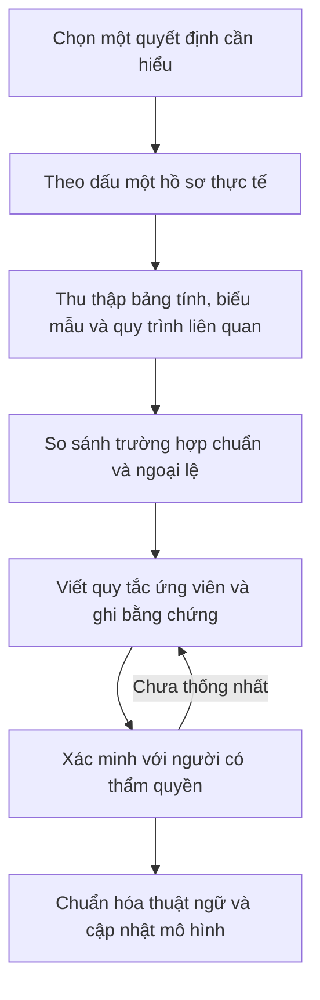

# Tìm quyết định nghiệp vụ ẩn trong bảng tính, biểu mẫu và quy trình thủ công

Trong nhiều tổ chức, quy tắc nghiệp vụ không nằm gọn trong một tài liệu đặc tả. Chúng có thể được phân tán giữa công thức Excel, danh sách lựa chọn trong biểu mẫu, màu nền của một ô, hướng dẫn viết tay, bước phê duyệt qua email và kinh nghiệm của một nhân viên lâu năm. Khi phần mềm mới được xây dựng, những chi tiết này thường bị xem là thao tác hành chính. Thực tế, chúng có thể đang chứa các quyết định làm thay đổi quyền lợi khách hàng, chi phí, rủi ro hoặc cách công việc được xử lý.

Trong phần **Khám phá nghiệp vụ** của `DOMAIN_DRIVEN_DESIGN`, mục tiêu là chuyển hiểu biết nghiệp vụ thành mô hình và ngôn ngữ chung giữa chuyên gia nghiệp vụ với đội phát triển. Mô tả của module nhấn mạnh cả strategic design — như subdomain, bounded context và context map — lẫn tactical design — như entity, value object, aggregate, repository và domain event. Để đi tới những mô hình đó, đội phát triển cần hiểu cách tổ chức thực sự đưa ra quyết định. Bài này trình bày cách lần theo quyết định đang ẩn trong bảng tính, biểu mẫu và quy trình thủ công, rồi chuyển phát hiện thành quy tắc có thể xác minh và mô hình hóa.

## 1. Nhận diện một quyết định nghiệp vụ

Một **quyết định nghiệp vụ** là lựa chọn được đưa ra dựa trên một hoặc nhiều dữ kiện và ngữ cảnh, dẫn đến một kết quả hoặc hành động có ý nghĩa đối với hoạt động của tổ chức. Quyết định có thể được tự động hóa bằng công thức, được thực hiện bởi nhân viên theo kinh nghiệm, hoặc cần người có thẩm quyền phê duyệt.

Hãy phân biệt ba loại thông tin thường xuất hiện cạnh nhau:

| Loại | Câu hỏi cần trả lời | Ví dụ |
|---|---|---|
| Dữ kiện (fact) | Điều gì đã xảy ra hoặc đang đúng? | Đơn hàng được giao lúc 14:30 ngày 12/5; giá trị đơn là 8 triệu đồng. |
| Hoạt động (activity) | Ai làm việc gì? | Nhân viên mở bảng theo dõi và kiểm tra chứng từ. |
| Quyết định (decision) | Dựa trên điều kiện nào để chọn kết quả? | Yêu cầu có giá trị trên ngưỡng phải được trưởng nhóm duyệt. |

Một quy trình có thể mô tả đầy đủ các hoạt động nhưng vẫn bỏ sót quyết định. Ví dụ, câu “nhân viên chuyển hồ sơ cho quản lý” chỉ mô tả một bước. Câu “nhân viên chuyển hồ sơ cho quản lý khi số tiền hoàn vượt ngưỡng được phân quyền” mới hé lộ quy tắc. Câu hỏi khám phá quan trọng là: **Điều gì khiến người thực hiện chọn nhánh này thay vì nhánh khác?**

Quyết định thường có các thành phần sau:

- **Điểm kích hoạt:** sự kiện hoặc thời điểm khiến quyết định cần được đưa ra, chẳng hạn khi nhận hồ sơ hoặc trước khi phát hành hóa đơn.
- **Đầu vào:** dữ kiện được dùng để đánh giá, chẳng hạn loại khách hàng, số tiền, ngày giao hàng, trạng thái chứng từ.
- **Điều kiện:** quy tắc kết hợp các đầu vào, bao gồm điều kiện bắt buộc và điều kiện loại trừ.
- **Kết quả:** chấp thuận, từ chối, tính một giá trị, yêu cầu bổ sung thông tin hoặc chuyển cho một vai trò khác.
- **Thẩm quyền:** cá nhân hoặc vai trò được phép quyết định, phê duyệt hay ghi đè kết quả.
- **Ngoại lệ:** tình huống không đi theo quy tắc thông thường và cách xử lý được chấp nhận.

Không phải mọi thao tác đều là quy tắc nghiệp vụ. Việc tô màu một ô có thể chỉ để dễ đọc; nhưng nếu màu đỏ khiến nhân viên dừng xử lý và gọi quản lý, màu đó đang mang ý nghĩa nghiệp vụ trong thực tế. Cần hỏi người dùng và đối chiếu trường hợp thật trước khi kết luận.

## 2. Vì sao các tài liệu vận hành là nguồn bằng chứng quan trọng?

Tài liệu vận hành cho thấy cách công việc được thực hiện trong hoàn cảnh cụ thể. Chúng thường ghi lại những điều mà phỏng vấn chung chung không làm lộ ra: trường nào bắt buộc, ngưỡng nào khiến hồ sơ bị chuyển tuyến, ai được sửa kết quả, và trường hợp nào khiến nhân viên phải làm ngoài quy trình.

| Nguồn | Dấu hiệu cần quan sát | Câu hỏi khám phá |
|---|---|---|
| Bảng tính | Công thức, ô nhập tay, ô khóa, danh sách chọn, màu sắc, bộ lọc, cột phụ, ghi chú, phiên bản sao chép | Cột này được tính như thế nào? Ai có thể sửa kết quả? Vì sao có dòng không theo công thức? |
| Biểu mẫu | Trường bắt buộc, giá trị mặc định, danh sách lựa chọn, kiểm tra dữ liệu, câu hỏi điều kiện, tệp đính kèm | Vì sao phải thu thập thông tin này? Thiếu thông tin thì hồ sơ bị chặn hay được xử lý tiếp? |
| Quy trình thủ công | Bàn giao, phê duyệt, hàng đợi, thời gian chờ, chuyển cấp, làm lại, kênh trao đổi ngoài luồng | Điều gì kích hoạt bước này? Ai có quyền bỏ qua hoặc yêu cầu làm lại? |
| Email, tin nhắn, ghi chú | Cụm từ lặp lại, yêu cầu bổ sung, lý do từ chối, chỉ dẫn ngoại lệ | Đây là chính sách đã thống nhất hay cách xử lý tạm thời của một cá nhân? |

### 2.1. Đọc bảng tính như một dấu vết của quyết định

Đừng chỉ nhìn tiêu đề cột và vài dòng dữ liệu. Hãy kiểm tra cấu trúc và cách bảng được sử dụng:

- **Công thức:** tìm các hàm `IF`, `IFS`, `AND`, `OR`, `VLOOKUP`, `XLOOKUP`, `COUNTIF` hoặc các phép tính ngưỡng. Chúng có thể thể hiện điều kiện phân loại, tính phí, xếp hạng hay chuyển cấp.
- **Ô nhập tay nằm cạnh ô công thức:** đây có thể là nơi nhân viên ghi đè kết quả tự động. Hỏi vì sao cần ghi đè và ai được phép làm việc đó.
- **Danh sách chọn và xác thực dữ liệu:** các lựa chọn được giới hạn thường phản ánh cách tổ chức phân loại đối tượng hoặc chuẩn hóa quyết định.
- **Định dạng có điều kiện và màu sắc:** màu có thể biểu thị trạng thái, mức độ ưu tiên hoặc cảnh báo. Xác nhận ý nghĩa của màu với người dùng thay vì tự suy diễn.
- **Ô khóa, vùng ẩn, sheet ẩn và vùng tra cứu:** chúng có thể chứa ngưỡng, bảng giá, mã phân loại hoặc tham số được quản lý riêng.
- **Bản sao và phiên bản:** nhiều file có tên như `final`, `final-new` hoặc bản theo từng nhóm có thể cho thấy quy tắc đã phân nhánh hoặc dữ liệu chuẩn chưa thống nhất.
- **Dòng ngoại lệ:** các dòng có ghi chú, công thức bị thay thế, giá trị khác thường hoặc trạng thái được sửa thủ công thường chứa nhiều thông tin hơn một dòng bình thường.

Một công thức cho biết bảng tính đang tính gì tại thời điểm quan sát; nó chưa chứng minh đó là chính sách chính thức. Công thức có thể lỗi thời, được tạo để hỗ trợ một nhóm nhỏ hoặc bị nhân viên sửa khi gặp tình huống đặc biệt. Luôn xác minh công thức bằng hồ sơ thực tế và người chịu trách nhiệm về nghiệp vụ.

### 2.2. Đọc biểu mẫu để tìm điều kiện và phân loại

Biểu mẫu quyết định dữ liệu nào được thu thập và đôi khi quyết định hồ sơ sẽ đi đâu tiếp theo. Hãy chú ý:

- Trường bắt buộc thường chỉ ra dữ kiện tối thiểu để đưa ra quyết định.
- Danh sách lựa chọn có thể chứa các loại nghiệp vụ, lý do, mức độ rủi ro hoặc trạng thái được tổ chức công nhận.
- Giá trị mặc định có thể phản ánh giả định của quy trình. Cần kiểm tra người dùng có thường giữ nguyên hay sửa giá trị đó.
- Câu hỏi điều kiện và phần biểu mẫu xuất hiện theo câu trả lời trước có thể mã hóa các nhánh xử lý.
- Quy tắc kiểm tra dữ liệu có thể ngăn hồ sơ thiếu thông tin đi tiếp, nhưng cũng có thể chỉ là tiện ích kỹ thuật.
- Trường đính kèm, chữ ký hoặc xác nhận có thể là bằng chứng bắt buộc cho một loại quyết định.

Đặc biệt, hãy hỏi vì sao một trường tồn tại. Nếu câu trả lời là “để biết thêm thông tin” thì chưa đủ. Cần xác định thông tin đó được dùng để tính toán, phân loại, chứng minh điều kiện, phân quyền hay giải quyết tranh chấp.

### 2.3. Quan sát quy trình thủ công thay vì chỉ đọc hướng dẫn

Quy trình được viết ra thường mô tả luồng chuẩn. Công việc thực tế còn có hàng đợi, chờ phản hồi, trao đổi miệng, nhắc việc, làm lại và ngoại lệ. Hãy theo dõi một hồ sơ từ lúc phát sinh đến khi kết thúc, ghi lại:

1. Ai nhận hồ sơ và họ kiểm tra thông tin nào trước tiên?
2. Ở bước nào hồ sơ được tiếp tục, tạm dừng, từ chối hoặc chuyển cho người khác?
3. Người xử lý dựa vào quy tắc, công cụ hay kinh nghiệm nào để chọn nhánh?
4. Khi thiếu dữ liệu hoặc hệ thống không hỗ trợ, họ làm gì?
5. Kết quả được ghi ở đâu và ai được xem là nguồn có thẩm quyền?

Nếu nhân viên phải hỏi một đồng nghiệp lâu năm mỗi khi gặp một loại hồ sơ, có thể đang tồn tại tri thức nghiệp vụ chưa được ghi lại. Nếu một nhóm dùng bảng riêng để “sửa” dữ liệu trước khi nhập vào hệ thống, hãy tìm hiểu quyết định nào đang diễn ra trong bước sửa đó.

## 3. Quy trình khám phá có thể lặp lại

Một cuộc khám phá hiệu quả bắt đầu từ hồ sơ thật và một câu hỏi nghiệp vụ rõ ràng. Không cần lập tức đọc mọi bảng tính trong tổ chức. Chọn một quyết định có ảnh hưởng đáng kể, theo dấu nó qua các vai trò và công cụ, sau đó mở rộng khi có bằng chứng.



### Bước 1: Chọn câu hỏi quyết định

Phát biểu câu hỏi dưới dạng lựa chọn mà nghiệp vụ phải đưa ra, ví dụ:

- Hồ sơ có đủ điều kiện được chấp thuận không?
- Giao dịch cần người quản lý phê duyệt hay được xử lý tự động?
- Đơn hàng được áp dụng mức giá hoặc chính sách nào?
- Trường hợp nào phải chuyển sang bộ phận chuyên trách?
- Khi nào một yêu cầu được xem là quá hạn?

Ưu tiên quyết định có tác động đến khách hàng, doanh thu, chi phí, rủi ro, tuân thủ hoặc thời gian xử lý. Xác định phạm vi thời gian, nhóm người dùng và loại hồ sơ để tránh trộn các chính sách khác nhau.

### Bước 2: Theo dấu hồ sơ từ đầu đến cuối

Yêu cầu người thực hiện mở một hồ sơ cụ thể và kể lại những gì đã làm. Tốt nhất hãy xem trực tiếp thao tác trong bảng tính, biểu mẫu và công cụ liên quan. Ghi nhận thời điểm, dữ kiện có sẵn, người tham gia, kết quả và lý do chọn kết quả.

Đừng chỉ hỏi “quy trình chuẩn là gì?”. Hãy hỏi “với hồ sơ này, anh/chị đã quyết định điều gì ở bước này, dựa trên thông tin nào?”. Câu hỏi gắn với tình huống giúp người tham gia nhớ lại các điều kiện thực tế thay vì chỉ nhắc lại quy trình lý tưởng.

### Bước 3: So sánh nhiều loại trường hợp

Một trường hợp thành công hiếm khi đủ để suy ra quy tắc. Tìm ít nhất các nhóm trường hợp sau nếu chúng tồn tại:

- Trường hợp thông thường được xử lý đúng quy trình.
- Trường hợp bị từ chối hoặc dừng lại.
- Trường hợp cần bổ sung dữ liệu hoặc phê duyệt.
- Trường hợp được chấp thuận ngoại lệ hoặc bị ghi đè kết quả.
- Trường hợp có dữ liệu thiếu, mâu thuẫn hoặc đến muộn.

So sánh các trường hợp giúp nhận ra dữ kiện nào thực sự làm thay đổi quyết định. Nếu hai hồ sơ gần giống nhau nhưng có kết quả khác nhau, hãy tìm khác biệt về thời điểm, vai trò, bằng chứng, phiên bản chính sách hoặc ngữ cảnh mà bảng tính không thể hiện.

### Bước 4: Đặt câu hỏi để làm rõ quy tắc

Các câu hỏi sau thường giúp phát hiện phần nghiệp vụ đang bị ẩn:

- Điều kiện nào bắt buộc để chọn kết quả này? Có điều kiện loại trừ nào không?
- Ngưỡng được tính theo ngày lịch hay ngày làm việc? Mốc thời gian bắt đầu từ sự kiện nào?
- Nếu thiếu một đầu vào, quyết định bị hoãn, từ chối hay dùng giá trị mặc định?
- Ai được quyền phê duyệt hoặc ghi đè? Có cần lý do hay bằng chứng không?
- Quy tắc có khác nhau theo loại khách hàng, sản phẩm, kênh, khu vực hoặc thời điểm không?
- Khi hai nguồn dữ liệu mâu thuẫn, nguồn nào được ưu tiên và ai giải quyết?
- Quy tắc này có ngày hiệu lực, ngày hết hiệu lực hoặc phiên bản không?
- Điều gì xảy ra sau khi quyết định được đưa ra? Ai cần nhận thông báo và dữ liệu nào phải được cập nhật?

Hỏi thêm “lần gần nhất quy tắc này được áp dụng sai hoặc phải xử lý ngoại lệ là khi nào?”. Một câu chuyện cụ thể thường làm rõ giới hạn của quy tắc nhanh hơn một câu trả lời khái quát.

### Bước 5: Ghi riêng bằng chứng, diễn giải và giả thuyết

Không gộp mọi điều nghe được thành “quy tắc đã xác nhận”. Hãy phân biệt:

- **Bằng chứng quan sát:** công thức trong ô, lựa chọn trên biểu mẫu, thao tác của nhân viên, hồ sơ đã được xử lý.
- **Diễn giải:** ý nghĩa có thể có của bằng chứng, chẳng hạn màu vàng có vẻ biểu thị hồ sơ đang chờ.
- **Quy tắc ứng viên:** phát biểu có thể kiểm chứng, chẳng hạn “hồ sơ có giá trị vượt ngưỡng A cần trưởng nhóm phê duyệt”.
- **Quy tắc đã xác nhận:** quy tắc được người có thẩm quyền nghiệp vụ xác nhận và đối chiếu với các trường hợp thực tế.

Ghi người xác nhận, ngày xác nhận, phạm vi áp dụng và những câu hỏi còn mở. Nếu hai nhóm mô tả khác nhau, giữ lại cả hai cách hiểu và tìm nguyên nhân: có thể họ thuộc hai chính sách, hai giai đoạn hoặc hai bounded context khác nhau.

### Bước 6: Xác minh bằng ví dụ cụ thể

Đưa quy tắc ứng viên trở lại cho chuyên gia nghiệp vụ dưới dạng bảng điều kiện và kết quả. Yêu cầu họ kiểm tra cả trường hợp chuẩn lẫn ngoại lệ. Nếu có thể, chọn một hồ sơ lịch sử và hỏi: “Theo quy tắc vừa mô tả, kết quả phải là gì? Kết quả thực tế có giống vậy không? Nếu khác, vì sao?”.

Một quy tắc chỉ được coi là đủ rõ khi người nghiệp vụ và đội phát triển có thể cùng dự đoán kết quả cho cùng một tập dữ kiện, đồng thời biết ai có quyền xử lý ngoại lệ.

## 4. Ví dụ xuyên suốt: khám phá quyết định hoàn tiền

Ví dụ sau là tình huống giả định để minh họa phương pháp. Các mốc 7 ngày và 30 ngày chỉ là dữ liệu của ví dụ, không phải chính sách chung hay khuyến nghị pháp lý.

Một nhóm chăm sóc khách hàng sử dụng bảng tính “Theo dõi yêu cầu hoàn tiền”. Bảng có các cột `MaYeuCau`, `LoaiHang`, `SoNgayTuKhiNhan`, `DaMo`, `KetQuaDeXuat`, `NguoiDuyet` và `GhiChu`. Cột kết quả đề xuất được tính bằng công thức:

```excel
=IF([@LoaiHang]="TheQuaTang","TuChoi",IF(AND([@SoNgayTuKhiNhan]<=7,[@DaMo]="Khong"),"TuDong",IF([@SoNgayTuKhiNhan]<=30,"CanQuanLyDuyet","TuChoi")))
```

Khi đọc công thức, ta có thể hình thành giả thuyết ban đầu:

1. Thẻ quà tặng bị từ chối.
2. Hàng thông thường được yêu cầu trong vòng 7 ngày và chưa mở có thể được xử lý tự động.
3. Yêu cầu trong vòng 30 ngày nhưng không thỏa điều kiện tự động cần quản lý duyệt.
4. Yêu cầu quá 30 ngày bị từ chối theo kết quả đề xuất.

Tiếp theo, quan sát một số hồ sơ:

| Hồ sơ | Dữ kiện quan sát | Kết quả trong bảng | Ghi chú thực tế |
|---|---|---|---|
| R-101 | Hàng thường, 4 ngày, chưa mở | Tự động | Được xử lý tự động. |
| R-102 | Hàng thường, 12 ngày, đã mở | Cần quản lý duyệt | Quản lý kiểm tra và phê duyệt. |
| R-103 | Hàng thường, 38 ngày | Từ chối | Nhân viên chuyển quản lý vì sản phẩm bị lỗi; quản lý chấp thuận ngoại lệ sau khi xem bằng chứng. |
| R-104 | Thẻ quà tặng, 2 ngày, chưa mở | Từ chối | Bị từ chối theo loại hàng. |

Hồ sơ R-103 cho thấy công thức không thể hiện toàn bộ cách nghiệp vụ vận hành. Có một nhánh ngoại lệ liên quan đến hàng lỗi và thẩm quyền của quản lý. Nếu chỉ sao chép công thức sang phần mềm mới, hệ thống có thể từ chối một trường hợp mà tổ chức hiện đang cho phép xử lý ngoại lệ.

Từ đây, đội khám phá cần hỏi tiếp:

- “Hàng lỗi” được xác định bằng mô tả của khách hàng, kết quả kiểm tra hay mã lỗi đã xác nhận?
- Bằng chứng nào cần có trước khi quản lý chấp thuận ngoại lệ?
- Chỉ quản lý nào được duyệt? Có giới hạn số tiền hoặc yêu cầu thêm cấp phê duyệt không?
- Mốc 7 và 30 ngày được tính từ ngày mua, ngày giao hay ngày khách xác nhận nhận hàng?
- Thẻ quà tặng có bị loại trừ trong mọi tình huống không, kể cả khi phát sinh lỗi?
- Khi quản lý ghi đè kết quả, bảng có lưu người duyệt, thời điểm và lý do không?

Sau khi xác minh, đội có thể ghi lại bảng quyết định ứng viên như sau. Bảng này vẫn cần chuyên gia nghiệp vụ xác nhận trước khi trở thành chính sách chính thức:

| Loại hàng | Số ngày từ khi nhận | Tình trạng | Kết quả ứng viên | Thẩm quyền |
|---|---:|---|---|---|
| Thẻ quà tặng | Bất kỳ | Bất kỳ | Từ chối theo chính sách ví dụ | Nhân viên áp dụng quy tắc |
| Hàng thường | Tối đa 7 | Chưa mở, không có lỗi được ghi nhận | Đề xuất tự động | Theo phân quyền tự động |
| Hàng thường | Tối đa 30 | Không thỏa điều kiện tự động | Chuyển quản lý duyệt | Quản lý |
| Hàng thường | Trên 30 | Không có ngoại lệ được xác nhận | Đề xuất từ chối | Theo chính sách ví dụ |
| Hàng thường | Trên 30 | Có lỗi được xác minh | Xem xét ngoại lệ | Quản lý có thẩm quyền |

Ví dụ này cho thấy ba nguồn bổ sung cho nhau: công thức làm lộ điều kiện chuẩn, biểu mẫu cho biết dữ kiện cần thu thập, còn hồ sơ và quy trình thủ công làm lộ quyền phê duyệt cùng ngoại lệ. Không nguồn nào riêng lẻ mô tả đầy đủ quyết định.

## 5. Ghi nhận quyết định thành tài liệu có thể kiểm chứng

Sau mỗi buổi khám phá, hãy tạo một bản ghi ngắn cho từng quyết định. Mẫu dưới đây đủ để nhóm nghiệp vụ và kỹ thuật cùng rà soát:

```yaml
decision_id: REFUND_ELIGIBILITY
business_question: "Yêu cầu hoàn tiền có đủ điều kiện xử lý không?"
trigger: "Khi tiếp nhận yêu cầu hoàn tiền"
inputs:
  - "Loại hàng"
  - "Ngày nhận hàng và ngày gửi yêu cầu"
  - "Tình trạng hàng"
  - "Bằng chứng về lỗi (nếu có)"
candidate_rule: "Áp dụng điều kiện chuẩn; trường hợp ngoại lệ cần người có thẩm quyền xem xét"
outcomes:
  - "Chấp thuận tự động"
  - "Chuyển quản lý duyệt"
  - "Từ chối"
  - "Yêu cầu bổ sung bằng chứng"
owner: "Vai trò chịu trách nhiệm về chính sách hoàn tiền"
evidence:
  - "Tên bảng tính, sheet và ô công thức liên quan"
  - "Mã hồ sơ lịch sử đã đối chiếu"
exceptions:
  - "Hàng lỗi được xem xét ngoài thời hạn chuẩn"
confidence: "Cần xác nhận với chủ sở hữu chính sách"
open_questions:
  - "Mốc thời gian bắt đầu được tính từ sự kiện nào?"
effective_from: "Chưa xác định"
```

Khi ghi bằng chứng, nên chỉ rõ tên tài liệu, sheet, cột hoặc ô, phiên bản file, mã hồ sơ và vai trò đã xác nhận. Điều này giúp người khác truy ngược phát hiện và nhận ra khi tài liệu nguồn thay đổi.

Một bản ghi quyết định tốt cần trả lời được bốn câu hỏi: quy tắc đến từ đâu, ai xác nhận, áp dụng cho trường hợp nào, và còn điều gì chưa rõ. Không nên ghi một giả thuyết thành quy tắc chính thức chỉ vì nó xuất hiện trong công thức hoặc được một cá nhân nhắc lại.

## 6. Chuyển phát hiện thành ngôn ngữ và mô hình miền

Khi các quyết định đã được xác minh, hãy diễn đạt chúng bằng ngôn ngữ mà chuyên gia nghiệp vụ sử dụng và cả nhóm hiểu thống nhất. Ví dụ, nếu tổ chức phân biệt “yêu cầu được tiếp nhận”, “yêu cầu đủ điều kiện”, “yêu cầu được phê duyệt” và “ngoại lệ được chấp thuận”, đừng gộp tất cả vào một trạng thái mơ hồ như `Hợp lệ`.

### 6.1. Xây dựng từ điển thuật ngữ

Với mỗi thuật ngữ quan trọng, ghi định nghĩa, ví dụ, điều kiện sử dụng và những từ dễ nhầm lẫn. Một số câu hỏi hữu ích:

- “Ngày nhận” là ngày đơn vị vận chuyển báo giao thành công hay ngày khách xác nhận?
- “Hàng đã mở” nói đến bao bì ngoài, niêm phong hay việc đã sử dụng sản phẩm?
- “Được duyệt” là đã có quyết định hay tiền đã được hoàn thành công?
- “Ngoại lệ” là trường hợp được phép theo chính sách hay trường hợp cần xin một quyết định đặc biệt?

Những khác biệt nhỏ trong từ ngữ có thể dẫn đến khác biệt lớn trong mô hình dữ liệu và hành vi hệ thống.

### 6.2. Nhận diện quy tắc, ràng buộc và trách nhiệm

Phân loại phát hiện để đội phát triển biết phần nào cần được mô hình hóa:

- **Quy tắc đủ điều kiện:** xác định một đối tượng có được phép đi tiếp hay không.
- **Quy tắc tính toán:** tính phí, hạn mức, điểm, thời hạn hoặc số tiền.
- **Quy tắc phân tuyến:** quyết định hồ sơ thuộc nhóm xử lý hoặc vai trò nào.
- **Ràng buộc nhất quán:** điều kiện phải luôn đúng, chẳng hạn không thể hoàn tiền vượt số tiền đã thanh toán.
- **Quyền quyết định:** xác định ai có thể chấp thuận, từ chối hoặc ghi đè.
- **Quy tắc theo thời gian:** xác định ngày hiệu lực, thời hạn, thời điểm chốt dữ liệu hoặc phiên bản chính sách.

Một quy tắc có thể được thực thi ở nhiều nơi trong hiện trạng. Khi thiết kế mô hình, cần xác định nơi chịu trách nhiệm về quy tắc đó và cách các phần khác sử dụng kết quả, tránh để mỗi màn hình hoặc dịch vụ tự diễn giải một chính sách.

### 6.3. Liên hệ với các khái niệm DDD

Khám phá quyết định cung cấp đầu vào cho thiết kế chiến lược và chiến thuật, nhưng không nên gán khái niệm DDD quá sớm khi chưa đủ bằng chứng.

- **Subdomain:** nhóm quyết định có thể giúp nhận ra một năng lực nghiệp vụ riêng, chẳng hạn quản lý hoàn tiền hoặc quản lý tín dụng. Cần xem xét mục tiêu và giá trị nghiệp vụ của năng lực đó, không chỉ dựa vào tên một bảng tính.
- **Bounded context:** nếu cùng một thuật ngữ được hiểu khác nhau giữa các nhóm, hoặc một nhóm có chính sách và mô hình riêng, đó có thể là dấu hiệu cần khảo sát ranh giới ngữ cảnh. Sự khác biệt phải được xác minh bằng trách nhiệm và cách dùng mô hình.
- **Entity:** có thể cần một đối tượng có định danh và vòng đời, chẳng hạn `YeuCauHoanTien`, nếu hồ sơ được theo dõi qua nhiều trạng thái và quyết định.
- **Value object:** các khái niệm như `KhoangThoiGianHoanTien`, `SoTienHoan` hoặc `LyDoHoanTien` có thể được biểu diễn bằng giá trị bất biến với quy tắc rõ ràng.
- **Aggregate:** các quyết định về trạng thái và tính nhất quán có thể cho thấy nhóm dữ liệu nào cần được thay đổi như một đơn vị. Ví dụ, trạng thái phê duyệt và thông tin quyết định có thể cần được bảo vệ cùng nhau.
- **Domain service:** một phép đánh giá nghiệp vụ có thể phù hợp với dịch vụ miền nếu nó không thuộc tự nhiên về một entity hay value object cụ thể. Cần giữ quy tắc gần mô hình miền thay vì biến nó thành tiện ích kỹ thuật chung.
- **Repository:** nếu nghiệp vụ cần truy xuất yêu cầu theo định danh hoặc theo một tiêu chí miền, repository cung cấp cách truy cập đối tượng miền mà không để quy tắc nghiệp vụ phụ thuộc vào cách lưu trữ.
- **Domain event:** các sự kiện như `YeuCauHoanTienDuocTiepNhan`, `YeuCauHoanTienCanQuanLyDuyet`, `YeuCauHoanTienDuocChapThuan` hoặc `NgoaiLeHoanTienDuocChapThuan` có thể diễn đạt điều đã xảy ra sau một quyết định. Tên sự kiện nên phản ánh ngôn ngữ miền và sự kiện đã được xác nhận.

Không phải mọi quyết định đều cần một class, service hay event riêng. Chọn cấu trúc dựa trên độ phức tạp, vòng đời, ranh giới nhất quán và nhu cầu giao tiếp giữa các phần của hệ thống.

## 7. Những sai lầm thường gặp

**Coi công thức là chính sách chính thức.** Công thức chỉ phản ánh một phần cách công cụ đang hoạt động. Hãy kiểm tra phiên bản, ô bị ghi đè và trường hợp ngoại lệ, rồi xác nhận với người sở hữu chính sách.

**Chỉ phỏng vấn quản lý.** Quản lý có thể hiểu mục tiêu và chính sách, trong khi nhân viên tuyến đầu biết các điểm nghẽn và cách xử lý tình huống thực tế. Cần đối chiếu cả hai góc nhìn.

**Chỉ quan sát luồng thành công.** Hồ sơ bị từ chối, chờ bổ sung, chuyển cấp hoặc được ghi đè thường làm lộ điều kiện quan trọng. Đừng xem ngoại lệ là dữ liệu nhiễu cần bỏ qua.

**Suy luận từ màu sắc hoặc tên cột.** Một cột `Priority` không tự nói lên cách tính ưu tiên; một ô màu đỏ không tự chứng minh có vi phạm. Hỏi ý nghĩa, điều kiện và hệ quả thực tế.

**Bỏ qua quyền ghi đè.** Nếu nhân viên có thể sửa kết quả nhưng không lưu lý do, phần mềm mới có nguy cơ làm mất một quyết định đang tồn tại. Cần làm rõ ai được ghi đè, trong điều kiện nào và cần lưu dấu vết gì.

**Trộn quy tắc của các nhóm hoặc thời kỳ.** Các nhóm có thể dùng cùng tên nhưng áp dụng chính sách khác nhau; quy tắc cũng có thể thay đổi theo ngày hiệu lực. Ghi rõ phạm vi và thời điểm thay vì tạo một quy tắc chung thiếu chính xác.

**Mô hình hóa quá sớm.** Đừng biến từng cột Excel thành một thuộc tính entity hoặc từng bước thủ công thành một service. Trước hết phải hiểu quyết định, thuật ngữ, trách nhiệm và ranh giới nghiệp vụ.

**Không xác định chủ sở hữu quy tắc.** Khi không biết ai có quyền xác nhận, nhóm phát triển dễ tự quyết định chính sách. Ghi rõ người hoặc vai trò chịu trách nhiệm và đưa câu hỏi chưa giải quyết vào danh sách cần làm rõ.

## 8. Đầu ra cần có sau một đợt khám phá

Một đợt khám phá hoàn chỉnh nên tạo ra các tài liệu ngắn, có thể truy ngược và được nghiệp vụ xác nhận:

1. **Danh mục nguồn:** bảng tính, biểu mẫu, quy trình, phiên bản và vai trò đang sử dụng.
2. **Sơ đồ luồng thực tế:** các bước, vai trò, điểm bàn giao, điểm chờ và nơi quyết định được đưa ra.
3. **Danh mục quyết định:** câu hỏi nghiệp vụ, đầu vào, điều kiện, kết quả, thẩm quyền và ngoại lệ.
4. **Bảng quyết định:** các tổ hợp điều kiện và kết quả đã được kiểm tra bằng ví dụ.
5. **Từ điển thuật ngữ:** định nghĩa thống nhất cho các khái niệm dễ hiểu khác nhau.
6. **Nhật ký bằng chứng và câu hỏi mở:** nguồn quan sát, người xác nhận, mức độ tin cậy và vấn đề cần giải quyết.
7. **Hệ quả đối với mô hình:** các quy tắc, ràng buộc, vòng đời và ranh giới cần khảo sát tiếp trong thiết kế DDD.

Trước khi kết thúc, hãy kiểm tra:

- [ ] Đã theo dấu ít nhất một hồ sơ thực tế từ đầu đến cuối.
- [ ] Đã xem xét trường hợp thông thường và các ngoại lệ quan trọng.
- [ ] Đã xác định dữ kiện nào làm thay đổi kết quả quyết định.
- [ ] Đã làm rõ vai trò có quyền phê duyệt hoặc ghi đè.
- [ ] Đã phân biệt bằng chứng quan sát với giả thuyết và quy tắc đã xác nhận.
- [ ] Đã kiểm tra thuật ngữ và ví dụ với chuyên gia nghiệp vụ.
- [ ] Đã ghi phạm vi áp dụng, thời điểm hiệu lực và câu hỏi còn mở.

Khám phá quyết định ẩn là bước nối giữa công việc vận hành hằng ngày và mô hình miền. Khi đội phát triển hiểu vì sao một hồ sơ được chấp thuận, bị từ chối, chuyển cấp hoặc xử lý ngoại lệ, họ có cơ sở để đặt đúng tên cho khái niệm, xác định trách nhiệm và thiết kế quy tắc nhất quán. Bảng tính, biểu mẫu và quy trình thủ công vì thế trở thành bằng chứng để cùng chuyên gia nghiệp vụ xây dựng một mô hình phản ánh đúng cách tổ chức tạo ra quyết định.
