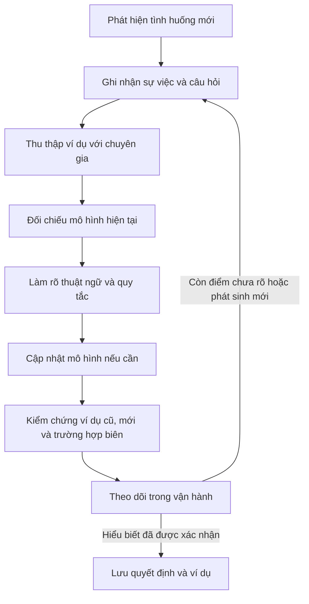

# Lặp lại quá trình học nghiệp vụ khi xuất hiện tình huống mới

Trong Domain-Driven Design (DDD), việc khám phá nghiệp vụ không kết thúc sau buổi phỏng vấn đầu tiên hay khi nhóm đã vẽ xong mô hình miền. Hiểu biết về nghiệp vụ được hình thành dần qua các cuộc trao đổi, ví dụ thực tế, quyết định vận hành và phản hồi khi phần mềm được sử dụng. Khi xuất hiện một tình huống mới, nhóm cần quay lại kiểm tra điều mình đang tin là đúng, xác định tình huống đó có làm thay đổi cách hiểu nghiệp vụ hay không, rồi cập nhật mô hình khi có đủ bằng chứng.

Quá trình này thường được gọi là **iterative domain discovery** — khám phá nghiệp vụ theo vòng lặp. Mỗi vòng lặp bắt đầu từ một câu hỏi hoặc tình huống cụ thể, đi qua trao đổi với người hiểu nghiệp vụ, làm rõ quy tắc và kết thúc bằng việc kiểm chứng hiểu biết mới trong mô hình, ngôn ngữ và phần mềm. Nhờ đó, mô hình miền luôn phản ánh hiểu biết hiện tại của nhóm thay vì trở thành một bản thiết kế cũ mà mã nguồn phải tuân theo.

## 1. Vì sao phải tiếp tục học nghiệp vụ?

Yêu cầu ban đầu thường mô tả luồng phổ biến. Khi hệ thống đi vào sử dụng, nhóm mới gặp những trường hợp ít xảy ra nhưng có ảnh hưởng lớn: khách hàng thay đổi quyết định, thanh toán đến muộn, hàng hóa chỉ được giao một phần, một đối tác trả dữ liệu khác dự kiến hoặc chính sách vừa được điều chỉnh.

Một tình huống mới có thể cho thấy:

- Nhóm đã hiểu chưa đủ một quy tắc hiện có. Ví dụ, “đơn hàng có thể hủy” còn thiếu điều kiện về thời điểm và phần hàng đã được giao.
- Một khái niệm nghiệp vụ chưa xuất hiện trong mô hình. Ví dụ, doanh nghiệp phân biệt “giữ hàng” với “xuất kho”, nhưng mô hình hiện tại chỉ có một trạng thái `RESERVED`.
- Một thuật ngữ đang được dùng với nhiều ý nghĩa. Ví dụ, “hoàn tất đơn hàng” có thể có nghĩa là đã đóng gói, đã bàn giao cho đơn vị vận chuyển hoặc khách đã nhận hàng.
- Một quy tắc chỉ đúng trong một ngữ cảnh. Ví dụ, giá đang hiển thị trong catalog có thể thay đổi, trong khi giá của dòng hàng đã đặt cần được giữ lại để bảo toàn lịch sử giao dịch.
- Ranh giới hoặc quan hệ giữa các phần nghiệp vụ cần được xem xét lại. Ví dụ, quy trình hoàn tiền có chính sách riêng và không thể được xử lý như một bước đơn giản trong vòng đời đơn hàng.

Nếu bỏ qua những tín hiệu này, nhóm có thể thêm các nhánh điều kiện rời rạc vào mã nguồn mà không hiểu nguyên nhân nghiệp vụ. Những nhánh đó thường làm mô hình khó giải thích và khiến các thay đổi tiếp theo trở nên rủi ro.

Vì vậy, cần xem mô hình miền là một hiểu biết có thể được kiểm chứng và điều chỉnh. Một tình huống mới không mặc nhiên có nghĩa là mô hình cũ sai; nó là cơ hội để xác định phạm vi mà mô hình hiện tại giải thích được và phần kiến thức còn thiếu.

## 2. Những tín hiệu khởi động một vòng khám phá mới

Không phải mọi yêu cầu thay đổi giao diện hay lỗi kỹ thuật đều cần mở lại việc khám phá nghiệp vụ. Nhóm nên chú ý những tín hiệu cho thấy quy tắc, khái niệm, quyết định hoặc ranh giới nghiệp vụ chưa được hiểu đầy đủ.

| Tín hiệu | Câu hỏi cần đặt ra | Ví dụ |
| --- | --- | --- |
| Xuất hiện ngoại lệ trong vận hành | Điều kiện nào làm luồng thông thường không còn đúng? | Kho chỉ có thể giao một phần số lượng đã đặt. |
| Người dùng giải thích khác với giả định của nhóm | Thuật ngữ hoặc quy tắc nào đang bị hiểu khác nhau? | Nhân viên nói “đã xử lý” nhưng ý họ là đã bàn giao cho hãng vận chuyển. |
| Chính sách thay đổi | Quy tắc mới áp dụng từ khi nào và cho đối tượng nào? | Đơn hàng khuyến mãi có thời hạn hủy khác đơn hàng thông thường. |
| Hệ thống bên ngoài trả kết quả bất ngờ | Đây là lỗi tích hợp hay phản ánh một trạng thái nghiệp vụ hợp lệ? | Cổng thanh toán báo giao dịch đang chờ xác nhận sau khi khách đã rời trang. |
| Một quyết định phải hỏi đi hỏi lại | Mô hình đã thiếu dữ kiện hoặc hành vi cần thiết nào? | Nhân viên luôn phải tra cứu thủ công lý do một mặt hàng bị giữ lại. |
| Hai bộ phận dùng cùng từ theo hai nghĩa | Có phải đang có hai mô hình hoặc hai ngữ cảnh khác nhau? | “Khách hàng hoạt động” ở bộ phận bán hàng khác với tiêu chí ở bộ phận chăm sóc khách hàng. |
| Kiểm thử nghiệp vụ không thể diễn đạt rõ | Nhóm chưa thống nhất điều kiện đầu vào và kết quả mong đợi nào? | Không xác định được khi nào đơn hàng được coi là đã hoàn tất. |

Nguồn tín hiệu có thể là cuộc gọi hỗ trợ, quan sát nhân viên làm việc, báo cáo sự cố, dữ liệu vận hành, yêu cầu pháp lý, cuộc họp với đối tác hoặc phản hồi từ kiểm thử. Điều quan trọng là truy ngược tín hiệu về tình huống và quy tắc nghiệp vụ cụ thể.

## 3. Vòng lặp khám phá nghiệp vụ

Một vòng khám phá nên đủ nhỏ để xử lý một câu hỏi cụ thể, nhưng đủ đầy để hiểu ảnh hưởng của nó tới mô hình. Có thể tổ chức thành bảy bước sau.

### Bước 1: Ghi nhận tình huống và lý do cần tìm hiểu

Mô tả điều đã xảy ra bằng ngôn ngữ trung lập. Ghi rõ ai gặp tình huống, đang thực hiện mục tiêu gì, trạng thái của đối tượng liên quan, hành động đã xảy ra và kết quả quan sát được.

Không nên ghi ngay kết luận như “cần thêm trạng thái mới” hoặc “API đang sai”. Đó là giả thuyết về cách giải quyết. Trước hết hãy ghi nhận sự kiện và điều nhóm chưa hiểu.

Một bản ghi tình huống ngắn có thể gồm:

- **Bối cảnh:** bộ phận, vai trò hoặc kênh nào đang xử lý?
- **Mục tiêu:** người tham gia muốn đạt kết quả gì?
- **Trạng thái ban đầu:** đối tượng nghiệp vụ đang ở trạng thái nào?
- **Diễn biến:** hành động nào xảy ra, theo thứ tự nào?
- **Kết quả thực tế:** hệ thống và người dùng quan sát thấy điều gì?
- **Điểm chưa rõ:** quy tắc, thuật ngữ hoặc quyết định nào cần xác minh?

Ví dụ: “Nhân viên kho nhận yêu cầu hủy một đơn gồm ba mặt hàng. Hai mặt hàng đã được bàn giao cho đơn vị vận chuyển, mặt hàng thứ ba vẫn đang nằm trong kho. Nhân viên không biết yêu cầu hủy áp dụng cho toàn đơn hay chỉ phần chưa bàn giao.” Bản ghi này cho thấy vấn đề cần khám phá mà chưa áp đặt cách xử lý.

### Bước 2: Thu thập diễn biến và ví dụ cụ thể

Trao đổi với người trực tiếp xử lý tình huống và người có quyền quyết định chính sách. Khi có thể, hãy quan sát công việc hoặc xem một hồ sơ đã được xử lý. Một câu trả lời tổng quát như “thường thì chúng tôi hủy đơn” chưa đủ để hiểu điều kiện và ngoại lệ.

Hãy hỏi theo diễn biến:

1. Điều gì đã xảy ra ngay trước thời điểm này?
2. Ai có quyền đưa ra quyết định?
3. Họ dựa vào thông tin hoặc chính sách nào?
4. Có những lựa chọn nào và vì sao chọn lựa chọn đó?
5. Nếu một điều kiện thay đổi, kết quả có khác không?
6. Có trường hợp nào tương tự nhưng được xử lý khác không?
7. Khách hàng, nhân viên hoặc hệ thống khác cần được thông báo điều gì?

Yêu cầu chuyên gia đưa ra ít nhất một ví dụ thành công, một ví dụ bị từ chối và một trường hợp ở ranh giới nếu nghiệp vụ có sự phân biệt đó. Ví dụ cụ thể giúp phát hiện các từ như “đã gửi”, “đã xác nhận”, “còn hàng” vốn có thể đang che giấu nhiều trạng thái khác nhau.

### Bước 3: Đối chiếu với mô hình và hiểu biết hiện tại

Đặt tình huống mới cạnh mô hình, thuật ngữ và quy tắc nhóm đang sử dụng. Hỏi xem tình huống đã được mô hình giải thích hay chưa, và nếu có thì mô hình giải thích bằng quy tắc nào.

Có thể phân loại phát hiện ban đầu như sau:

| Loại phát hiện | Ý nghĩa | Hướng xử lý ban đầu |
| --- | --- | --- |
| Biến thể đã được dự kiến | Tình huống mới chỉ là một dữ liệu hoặc tổ hợp đầu vào khác, quy tắc hiện tại vẫn giải thích đúng. | Bổ sung ví dụ và kiểm thử; chưa cần thay đổi mô hình. |
| Quy tắc chưa rõ | Nhóm biết kết quả mong muốn nhưng chưa biết điều kiện hoặc thứ tự áp dụng. | Tiếp tục hỏi chuyên gia, xác định ngoại lệ và quyền quyết định. |
| Thiếu khái niệm hoặc trạng thái | Mô hình không thể diễn đạt một sự phân biệt có ý nghĩa nghiệp vụ. | Làm rõ thuật ngữ, vòng đời và hành vi liên quan. |
| Khác biệt theo ngữ cảnh | Cùng một thuật ngữ hoặc dữ liệu có ý nghĩa khác ở các bộ phận. | Xem xét ranh giới Bounded Context và cách chuyển đổi mô hình. |
| Phụ thuộc bên ngoài | Kết quả phụ thuộc vào đối tác, cơ quan hoặc hệ thống khác. | Xác định hợp đồng, trạng thái chờ, lỗi và trách nhiệm xử lý. |
| Giả định cũ không còn đúng | Chính sách hoặc cách vận hành đã thay đổi. | Ghi nhận quyết định mới, phạm vi áp dụng và thời điểm hiệu lực. |

Phân loại chỉ là bước định hướng. Một tình huống có thể đồng thời cho thấy thiếu quy tắc và khác biệt ngữ cảnh. Không nên chọn giải pháp kỹ thuật trước khi biết nguyên nhân nghiệp vụ.

### Bước 4: Làm rõ ngôn ngữ và quy tắc

Đưa những từ ngữ quan trọng vào cuộc trao đổi và yêu cầu các bên mô tả ý nghĩa bằng ví dụ. Nếu hai người dùng cùng một từ nhưng chỉ hai trạng thái khác nhau, cần gọi tên chúng riêng hoặc xác định rõ phạm vi sử dụng.

Ví dụ, nhóm có thể phát hiện ba mốc khác nhau:

- `Packed`: hàng đã được đóng gói trong kho.
- `HandedOver`: kiện hàng đã được bàn giao cho đơn vị vận chuyển.
- `Delivered`: khách hàng đã nhận hàng.

Nếu nghiệp vụ xác nhận đây là ba sự kiện riêng biệt, mô hình cần giữ được sự phân biệt ấy. Chỉ đổi tên trạng thái khi chưa hiểu quy tắc chuyển trạng thái sẽ không giải quyết được vấn đề.

Khi làm rõ quy tắc, hãy ghi cả điều kiện, ngoại lệ, người có quyền quyết định và thời điểm áp dụng. Một câu như “đơn hàng được hủy trước khi giao” cần được hỏi thêm: “giao” là lúc rời kho hay lúc khách nhận? Hủy một phần có được phép không? Phí phát sinh được xử lý thế nào? Ai xác nhận yêu cầu?

### Bước 5: Cập nhật mô hình ở đúng phạm vi

Sau khi thống nhất hiểu biết mới, xác định phần nào của mô hình cần thay đổi. Tùy phát hiện, thay đổi có thể nằm ở nhiều mức:

- **Ngôn ngữ chung:** bổ sung thuật ngữ, định nghĩa hoặc ví dụ để loại bỏ nhập nhằng.
- **Quy tắc và hành vi:** làm rõ điều kiện, giới hạn hoặc kết quả của một hành động.
- **Entity hoặc Value Object:** thêm khái niệm có danh tính, hoặc mô tả một giá trị cần được kiểm tra như một đơn vị.
- **Aggregate:** điều chỉnh ranh giới nhất quán nếu một hành vi phải bảo vệ thêm bất biến trong cùng một giao dịch.
- **Domain Event:** biểu diễn một sự việc nghiệp vụ có ý nghĩa để phần khác phản ứng.
- **Bounded Context hoặc Context Map:** xem xét lại ranh giới và quan hệ nếu hai nhóm dùng mô hình khác nhau hoặc cần hợp đồng tích hợp mới.

Không phải phát hiện nào cũng đòi hỏi thêm Entity, trạng thái hoặc dịch vụ. Đôi khi chỉ cần sửa một quy tắc, đổi tên một hành vi, bổ sung ví dụ hoặc ghi rõ một quyết định. Hãy chọn thay đổi nhỏ nhất đủ để mô hình diễn đạt đúng nghiệp vụ.

### Bước 6: Kiểm chứng với ví dụ cũ và mới

Đưa mô hình đã cập nhật trở lại cho chuyên gia nghiệp vụ xem xét. Diễn đạt quy tắc thành các ví dụ cụ thể để mọi người cùng xác nhận kết quả.

Nên kiểm tra ít nhất ba nhóm tình huống:

1. **Luồng phổ biến:** hành vi thường ngày vẫn hoạt động đúng.
2. **Tình huống mới:** quy tắc mới giải thích đúng trường hợp vừa phát hiện.
3. **Trường hợp biên hoặc bị từ chối:** hệ thống không chấp nhận hành động khi điều kiện không thỏa mãn.

Các ví dụ đã thống nhất có thể được chuyển thành kiểm thử tự động. Với quy tắc có nhiều tổ hợp điều kiện, bảng quyết định hoặc kiểm thử theo ví dụ giúp nhóm nhìn thấy trường hợp còn thiếu. Kiểm thử xác nhận cách hiểu đã được thống nhất; nó không thay thế việc hỏi chuyên gia khi quy tắc vẫn mơ hồ.

### Bước 7: Theo dõi kết quả và tiếp tục học

Sau khi cập nhật mô hình và phần mềm, theo dõi xem nhân viên có còn phải xử lý thủ công hay hỏi lại cùng một câu hỏi không. Quan sát lỗi nghiệp vụ, yêu cầu hỗ trợ, trường hợp bị từ chối và phản hồi từ các ngữ cảnh liên quan.

Nếu tình huống mới vẫn không được giải thích, mở vòng khám phá tiếp theo. Nếu quy tắc hoạt động đúng, lưu lại ví dụ và quyết định để người tham gia sau này hiểu vì sao mô hình có cách biểu diễn hiện tại.



## 4. Ví dụ xuyên suốt: học lại quy tắc hủy đơn hàng

Giả sử nhóm phát triển một hệ thống thương mại điện tử. Mô hình ban đầu có `Order` với hai hành vi chính: `confirm()` để xác nhận đơn hàng và `cancel()` để hủy đơn. Nhóm hiểu rằng đơn hàng chỉ được hủy khi chưa giao cho khách.

Sau một thời gian vận hành, nhân viên kho báo cáo trường hợp một đơn gồm ba dòng hàng. Hai dòng đã được bàn giao cho đơn vị vận chuyển, dòng còn lại chưa rời kho. Khách hàng yêu cầu hủy toàn bộ đơn. Nhân viên không thể thực hiện vì hệ thống chỉ hỗ trợ hủy toàn đơn.

### 4.1. Ghi nhận điều đã biết và điều chưa biết

Nhóm ghi nhận các dữ kiện:

- Đơn hàng đã được xác nhận.
- Có nhiều dòng hàng trong cùng đơn.
- Một phần hàng đã được bàn giao cho đơn vị vận chuyển.
- Phần hàng còn lại vẫn do kho quản lý.
- Khách yêu cầu hủy toàn bộ đơn.

Những câu hỏi chưa có câu trả lời:

- Khách có quyền hủy phần chưa bàn giao không?
- Hai dòng đã bàn giao có thể bị thu hồi hay phải xử lý theo quy trình trả hàng?
- Đơn hàng được xem là một đơn vị duy nhất hay từng dòng có vòng đời giao nhận riêng?
- Tiền cần hoàn là bao nhiêu và ai xác nhận khoản hoàn?
- Việc hủy một phần ảnh hưởng đến phí vận chuyển hoặc khuyến mãi như thế nào?

Nhóm chưa vội thêm trạng thái `PARTIALLY_CANCELLED` vì chưa biết nghiệp vụ có cho phép hành động đó và nó có ý nghĩa gì.

### 4.2. Trao đổi với chuyên gia và tìm quy tắc

Qua trao đổi với nhân viên vận hành và người phụ trách chính sách, nhóm xác nhận:

1. Khách có thể hủy các dòng hàng chưa được bàn giao cho đơn vị vận chuyển.
2. Dòng hàng đã bàn giao không còn thuộc quy trình hủy đơn; nếu khách không muốn nhận, yêu cầu được xử lý bằng quy trình trả hàng sau giao.
3. Một đơn có thể gồm nhiều dòng với tiến trình giao nhận khác nhau.
4. Giá và khuyến mãi của các dòng đã đặt phải được giữ lại để tính phần tiền cần hoàn theo chính sách.

Nhóm cũng phát hiện từ “đã giao” trước đây được dùng không thống nhất: nhân viên kho dùng để chỉ đã bàn giao cho hãng vận chuyển, còn bộ phận chăm sóc khách hàng dùng để chỉ khách đã nhận hàng.

### 4.3. Cập nhật ngôn ngữ và mô hình

Ngôn ngữ chung được làm rõ với các thuật ngữ `HandedOver` (đã bàn giao cho đơn vị vận chuyển) và `Delivered` (khách đã nhận). Nhóm xác định hành vi hủy cần chỉ rõ phạm vi: hủy toàn bộ phần còn đủ điều kiện hay hủy một dòng hàng cụ thể.

Một mô hình minh họa có thể biểu diễn hành vi ở cấp `Order` như sau:

```java
public final class Order {
    private final OrderId id;
    private final List<OrderLine> lines;

    public CancellationResult cancelUnhandedLines() {
        List<OrderLine> eligibleLines = lines.stream()
                .filter(OrderLine::canBeCancelled)
                .toList();

        if (eligibleLines.isEmpty()) {
            return CancellationResult.nothingToCancel();
        }

        eligibleLines.forEach(OrderLine::cancel);
        return CancellationResult.cancelled(eligibleLines);
    }
}
```

Đoạn mã chỉ minh họa cách diễn đạt hành vi. `OrderLine::canBeCancelled` phải được định nghĩa theo quy tắc đã thống nhất, chẳng hạn dòng hàng chưa được bàn giao và chưa ở trạng thái bị khóa bởi một quy trình khác. Cách tính tiền hoàn, phát hành sự kiện và lưu thay đổi cần được thiết kế đầy đủ trong hệ thống thực tế.

Nếu việc hủy các dòng cần được các bộ phận khác biết đến, mô hình có thể phát sinh sự kiện như `OrderLinesCancelled`. Bộ phận thanh toán dùng thông tin đó để tính hoàn tiền; kho dùng nó để giải phóng lượng hàng đã giữ. Hợp đồng giữa các Bounded Context cần xác định rõ dữ liệu được gửi, cách xử lý thông điệp lặp và điều gì xảy ra nếu một bên tạm thời không hoạt động.

### 4.4. Kiểm chứng và ghi lại quyết định

Nhóm cùng chuyên gia xác nhận các ví dụ:

| Tình huống | Kết quả mong đợi |
| --- | --- |
| Tất cả dòng hàng chưa được bàn giao | Có thể hủy các dòng đủ điều kiện theo chính sách. |
| Một số dòng đã bàn giao, một số dòng chưa bàn giao | Chỉ hủy phần đủ điều kiện; phần đã bàn giao đi theo quy trình trả hàng nếu khách không nhận. |
| Tất cả dòng đã bàn giao | Không hủy theo quy trình trước giao; hướng dẫn khách dùng quy trình trả hàng phù hợp. |
| Dòng hàng đang có một yêu cầu xử lý khác khóa thao tác | Từ chối hoặc yêu cầu xử lý xung đột theo quy tắc đã thống nhất. |

Các ví dụ trở thành kiểm thử cho hành vi hủy. Nhóm ghi lại định nghĩa thuật ngữ, chính sách hủy từng phần, các giả định còn hiệu lực và ngày quyết định có hiệu lực. Sau khi triển khai, nhóm theo dõi các yêu cầu hủy bị từ chối và trường hợp nhân viên vẫn cần can thiệp thủ công.

Qua ví dụ, một tình huống mới đã dẫn đến việc làm rõ ngôn ngữ, quy tắc ở cấp dòng hàng và hợp tác giữa Order, Inventory, Payment. Nhóm không chỉ thêm một nhánh xử lý mà còn hiểu vì sao quy trình cần được phân biệt.

## 5. Đưa hiểu biết mới vào ngôn ngữ, mô hình và mã nguồn

Khám phá chỉ có giá trị lâu dài khi kết quả được lưu ở những nơi đội ngũ thực sự sử dụng. Không nên chỉ ghi biên bản cuộc họp rồi để mô hình và mã nguồn giữ cách hiểu cũ.

### 5.1. Cập nhật Ubiquitous Language

Khi xuất hiện thuật ngữ mới hoặc một từ cũ có nhiều nghĩa, cập nhật bảng thuật ngữ của ngữ cảnh liên quan và dùng cách gọi đã thống nhất trong trao đổi, tài liệu, tên lớp, phương thức và kiểm thử.

Một mục thuật ngữ nên ghi:

- Tên được sử dụng trong ngữ cảnh.
- Định nghĩa ngắn gọn và ví dụ.
- Những thuật ngữ gần nghĩa cần phân biệt.
- Ngữ cảnh áp dụng và người xác nhận khi cần.

Không nên ép toàn doanh nghiệp dùng cùng một tên nếu các Bounded Context có cách hiểu hợp lệ khác nhau. Khi cần trao đổi qua ranh giới, hãy xác định rõ cách ánh xạ giữa các mô hình.

### 5.2. Cập nhật mô hình và bất biến

Nếu hiểu biết mới thay đổi điều kiện hợp lệ của một hành động, hãy xác định Aggregate hoặc dịch vụ miền chịu trách nhiệm bảo vệ điều kiện đó. Nếu chỉ thay đổi cách trình bày dữ liệu, có thể không cần sửa mô hình miền.

Một câu hỏi hữu ích là: “Nếu một lập trình viên gọi hành vi này trong trạng thái không hợp lệ, mô hình có thể ngăn chặn hoặc biểu diễn rõ kết quả không?” Nếu quy tắc chỉ tồn tại trong ghi chú giao diện hoặc một controller, mô hình có thể chưa bảo vệ được nghiệp vụ.

### 5.3. Cập nhật hợp đồng giữa các ngữ cảnh

Khi tình huống mới ảnh hưởng nhiều Bounded Context, cần trao đổi với chủ sở hữu các ngữ cảnh liên quan. Xác định bên nào là nguồn sự thật cho từng dữ liệu, bên nào phát sự kiện, bên nào phản ứng và cách xử lý khi thông tin đến muộn hoặc không hợp lệ.

Ví dụ, Order có thể sở hữu trạng thái đơn hàng, Inventory sở hữu trạng thái tồn kho và Payment sở hữu trạng thái giao dịch thanh toán. Không nên để một ngữ cảnh tự ý sửa trạng thái nội bộ của ngữ cảnh khác. Việc phối hợp cần thông qua hợp đồng rõ ràng như lệnh, API hoặc Domain Event.

### 5.4. Giữ liên kết giữa quyết định và kiểm thử

Với mỗi quy tắc quan trọng, nên có một hoặc nhiều ví dụ được xác nhận và kiểm thử tương ứng. Khi chính sách thay đổi, nhóm có thể truy ra kiểm thử nào cần cập nhật và vì sao.

Kiểm thử nên dùng thuật ngữ nghiệp vụ để người không trực tiếp viết mã vẫn hiểu được hành vi đang được xác nhận. Ví dụ, tên kiểm thử `cannotCancelLineAfterHandedOver` diễn đạt rõ quy tắc hơn một tên chung chung như `testStatus3`.

## 6. Tránh những cách học gây sai lệch mô hình

### 6.1. Không biến mọi trường hợp hiếm thành một khái niệm mới

Một trường hợp khác dữ liệu chưa chắc là một khái niệm mới. Trước khi thêm trạng thái hoặc Entity, hãy hỏi liệu quy tắc hiện tại đã bao quát trường hợp đó chưa. Nếu khác biệt chỉ là giá trị đầu vào, mô hình có thể không cần thay đổi.

### 6.2. Không suy ra quy tắc từ một cá nhân hoặc một lần xử lý

Một nhân viên có thể đang dùng cách làm tạm thời hoặc hiểu chính sách theo kinh nghiệm riêng. Hãy xác minh với người chịu trách nhiệm nghiệp vụ và so sánh với các trường hợp đã được xử lý. Khi các bên bất đồng, ghi rõ điểm chưa thống nhất thay vì tự chọn một cách hiểu.

### 6.3. Không nhầm lỗi kỹ thuật với quy tắc nghiệp vụ

Một yêu cầu thất bại có thể do timeout, dữ liệu sai định dạng hoặc dịch vụ bên ngoài gián đoạn. Nhưng việc một giao dịch đang chờ, bị từ chối hay đã được chấp nhận cũng có thể là trạng thái nghiệp vụ hợp lệ. Cần xác định hệ thống đang gặp lỗi vận hành hay đang biểu diễn một diễn biến nghiệp vụ.

### 6.4. Không chỉ thêm điều kiện vào mã nguồn

Một câu `if` mới có thể làm tình huống hiện tại chạy được, nhưng nếu nhóm không cập nhật ngôn ngữ và quy tắc thì người phát triển sau này sẽ không biết vì sao điều kiện đó tồn tại. Hãy đưa quyết định về đúng mô hình và lưu ví dụ xác nhận.

### 6.5. Không thay đổi mô hình toàn cục vì một ngữ cảnh

Nếu hai bộ phận dùng cùng từ theo hai nghĩa, việc đổi một lớp dùng chung có thể làm hỏng mô hình của bộ phận còn lại. Trước tiên hãy xác định Bounded Context, quyền sở hữu và cách chuyển đổi dữ liệu giữa chúng.

### 6.6. Không xem mô hình là bất biến sau khi triển khai

Mô hình có thể cần thay đổi khi doanh nghiệp học được điều mới. Việc thay đổi phải có lý do, ví dụ và kế hoạch chuyển đổi phù hợp, nhưng không nên giữ một khái niệm sai chỉ vì nó đã được triển khai.

## 7. Tổ chức hoạt động khám phá trong đội phát triển

Để vòng lặp học nghiệp vụ diễn ra đều đặn, nhóm có thể đưa hoạt động này vào quy trình phát triển hằng ngày:

1. **Tạo nơi ghi nhận câu hỏi nghiệp vụ:** lưu tình huống, nguồn phát hiện và điều chưa rõ; tránh ghi kết luận khi chưa xác minh.
2. **Mời đúng người tham gia:** có người trực tiếp vận hành, người hiểu chính sách và người chịu trách nhiệm cho mô hình liên quan.
3. **Dùng ví dụ thay cho mô tả trừu tượng:** đi qua dữ liệu, trạng thái, hành động và kết quả của một trường hợp thật đã được ẩn thông tin nhạy cảm nếu cần.
4. **Làm rõ ranh giới thảo luận:** xác định ngữ cảnh nào đang được khám phá và những ngữ cảnh nào chịu ảnh hưởng.
5. **Ghi quyết định và điều chưa chắc chắn:** nêu rõ quy tắc, phạm vi áp dụng, người xác nhận và thời điểm có hiệu lực.
6. **Chuyển kết quả thành thay đổi có thể kiểm chứng:** cập nhật mô hình, hợp đồng, tài liệu và kiểm thử tương ứng.
7. **Xem lại sau khi vận hành:** kiểm tra xem cách hiểu mới có giải quyết được tình huống và có tạo ra vấn đề mới ở nơi khác không.

Các buổi Event Storming, Domain Storytelling hoặc workshop phân tích ví dụ có thể hỗ trợ hoạt động này. Chúng giúp nhiều vai trò cùng nhìn thấy sự kiện, hành động, chính sách và điểm bàn giao. Tuy nhiên, kết quả của workshop vẫn cần được xác nhận và chuyển thành ngôn ngữ, mô hình cùng kiểm thử cụ thể.

## 8. Checklist cho một vòng học nghiệp vụ mới

Trước khi kết thúc một vòng khám phá, nhóm có thể tự kiểm tra:

- [ ] Tình huống được mô tả bằng sự việc quan sát được và có nguồn xác nhận.
- [ ] Đã xác định mục tiêu, vai trò, trạng thái ban đầu, diễn biến và kết quả.
- [ ] Đã hỏi người hiểu nghiệp vụ về ví dụ phổ biến, ngoại lệ và trường hợp bị từ chối.
- [ ] Đã đối chiếu tình huống với mô hình, thuật ngữ và quy tắc hiện tại.
- [ ] Đã phân biệt dữ kiện, giả thuyết và quyết định đã được xác nhận.
- [ ] Đã xác định phạm vi Bounded Context và các bên chịu ảnh hưởng.
- [ ] Ngôn ngữ chung và quy tắc liên quan đã được cập nhật khi cần.
- [ ] Các ví dụ cũ, mới và trường hợp biên đã được kiểm chứng.
- [ ] Kiểm thử hoặc hợp đồng tích hợp đã được cập nhật nếu hành vi thay đổi.
- [ ] Quyết định, người xác nhận và thời điểm hiệu lực đã được lưu lại.
- [ ] Có cách theo dõi kết quả sau khi thay đổi được đưa vào vận hành.

Checklist là công cụ hỗ trợ trao đổi, không phải thủ tục cần hoàn thành máy móc. Nếu chưa có đủ thông tin để xác nhận quy tắc, hãy ghi rõ câu hỏi còn mở và người cần tham gia giải quyết.

## 9. Kết luận

Trong DDD, khám phá nghiệp vụ là hoạt động diễn ra liên tục. Mỗi tình huống mới giúp nhóm kiểm tra những giả định cũ, phát hiện thuật ngữ chưa rõ, quy tắc còn thiếu hoặc ranh giới mô hình chưa phù hợp. Một vòng học hiệu quả bắt đầu từ sự việc cụ thể, trao đổi với người hiểu nghiệp vụ, đối chiếu mô hình, cập nhật ở đúng phạm vi và kiểm chứng lại bằng ví dụ.

Kết quả cần được thể hiện đồng bộ trong ngôn ngữ chung, mô hình miền, hợp đồng giữa các Bounded Context và kiểm thử. Khi nhóm duy trì vòng lặp này, phần mềm có thể tiến hóa cùng hiểu biết và cách vận hành của doanh nghiệp, còn mô hình miền tiếp tục là công cụ chung để chuyên gia nghiệp vụ và đội phát triển suy nghĩ, trao đổi và đưa ra quyết định.
