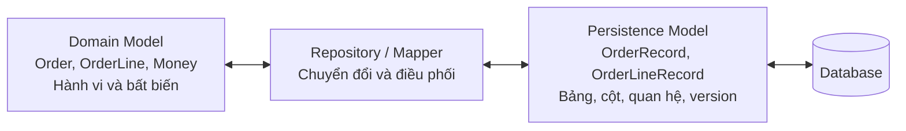

# Mô hình miền và mô hình lưu trữ: khi nào dùng chung hoặc tách riêng

Trong Domain-Driven Design (DDD), **domain model** diễn đạt khái niệm, hành vi và quy tắc nghiệp vụ; **persistence model** diễn đạt cách dữ liệu được tổ chức để lưu và truy vấn trong một cơ chế lưu trữ cụ thể. Hai mô hình có thể dùng chung lớp khi miền đơn giản và cách lưu trữ không gây ảnh hưởng đáng kể đến thiết kế. Khi quy tắc nghiệp vụ phong phú, ranh giới Aggregate cần được bảo vệ hoặc schema có nhiều yêu cầu riêng, tách chúng thường giúp mô hình miền rõ ràng và dễ thay đổi hơn.

Không có quy tắc rằng mọi ứng dụng DDD đều phải có hai bộ class riêng. Tách mô hình cũng tạo chi phí mapping, chuyển đổi và bảo trì. Quyết định nên dựa trên mức độ khác nhau giữa hai trách nhiệm, độ phức tạp của miền, đặc điểm ORM và tốc độ thay đổi của schema.

## 1. Hai mô hình phục vụ hai mục tiêu khác nhau

Domain model trả lời những câu hỏi thuộc nghiệp vụ:

- Đơn hàng có thể được xác nhận trong điều kiện nào?
- Khách hàng có được thay đổi địa chỉ sau khi đơn đã gửi không?
- Tổng tiền được tính theo quy tắc nào?
- Aggregate nào sở hữu một bất biến?
- Một hành động tạo ra Domain Event nào?

Persistence model trả lời những câu hỏi thuộc lưu trữ:

- Dữ liệu được ánh xạ vào bảng, cột và khóa nào?
- Quan hệ được biểu diễn bằng foreign key hay bảng liên kết?
- Cột nào cần index, unique constraint hoặc version?
- ORM nạp quan hệ theo chiến lược nào?
- Dữ liệu cũ được migrate sang schema mới ra sao?

Ví dụ, domain model có thể biểu diễn `Order` như một Aggregate Root với hành vi `confirm()`. Persistence model có thể lưu đơn vào bảng `orders`, các dòng hàng vào `order_lines`, liên kết bằng `order_id`, và dùng cột `version` để optimistic locking.



Hai mô hình có thể trùng nhau về cấu trúc trong một số ứng dụng, nhưng mục tiêu thiết kế của chúng vẫn khác nhau.

## 2. Domain Model không phải bản sao của schema

Một domain model tốt sử dụng ngôn ngữ của nghiệp vụ và đặt hành vi ở nơi có thể bảo vệ quy tắc. Nó không nên được thiết kế chỉ để phản chiếu từng bảng hoặc từng cột.

Ví dụ, bảng `orders` có thể chứa `status`, `customer_id`, `shipping_address` và `total_amount`. Nhưng domain model có thể cần:

- `OrderId` thay vì UUID trần.
- `Money` thay vì hai giá trị rời rạc `total_amount` và `currency_code`.
- `ShippingAddress` là Value Object.
- Các phương thức `addLine()`, `changeShippingAddress()` và `confirm()` để bảo vệ vòng đời.
- Một tập hợp `OrderLine` chỉ có thể thay đổi thông qua Aggregate Root.

Ngược lại, persistence model có thể cần `@Version`, cột kỹ thuật, khóa ngoại, trường audit, tên cột tương thích hệ thống cũ hoặc cấu trúc phục vụ truy vấn. Những chi tiết đó không nhất thiết là khái niệm nghiệp vụ.

Một bảng cũng không đồng nghĩa với một Entity. Một Entity có thể được lưu qua nhiều bảng; nhiều khái niệm miền có thể được lưu chung trong một bảng; Value Object có thể được nhúng vào bản ghi của Entity sở hữu nó. Cấu trúc lưu trữ là quyết định kỹ thuật dựa trên yêu cầu truy vấn, nhất quán và vận hành.

## 3. Khi nào có thể dùng chung domain model và persistence model?

Dùng chung class có thể là lựa chọn hợp lý khi:

- Ứng dụng chủ yếu là CRUD với quy tắc nghiệp vụ đơn giản.
- Đối tượng dữ liệu gần như trùng với khái niệm nghiệp vụ.
- ORM không buộc class phải có các hành vi hoặc quan hệ làm suy yếu mô hình.
- Schema ít thay đổi và không có nhiều nhu cầu lưu trữ đặc thù.
- Đội ngũ chấp nhận mức phụ thuộc vào ORM để giảm số lớp và mapping.
- Lợi ích của việc tách riêng chưa đủ lớn so với chi phí duy trì hai mô hình.

Ví dụ, một ứng dụng quản lý danh mục nội bộ có đối tượng `Category` với tên, mô tả và trạng thái kích hoạt. Nếu quy tắc chỉ gồm kiểm tra tên bắt buộc và bật/tắt danh mục, một class vừa mang hành vi đơn giản vừa được JPA ánh xạ có thể đủ rõ.

```java
@Entity
@Table(name = "categories")
public class Category {
    @Id
    private UUID id;

    @Column(nullable = false, unique = true)
    private String name;

    @Column(nullable = false)
    private boolean active;

    protected Category() {
        // Dành cho ORM.
    }

    public Category(UUID id, String name) {
        this.id = Objects.requireNonNull(id);
        rename(name);
        this.active = true;
    }

    public void rename(String newName) {
        if (newName == null || newName.isBlank()) {
            throw new IllegalArgumentException("Category name is required");
        }
        this.name = newName.trim();
    }

    public void deactivate() {
        this.active = false;
    }
}
```

Đây là lựa chọn có chủ ý: class vừa là domain object vừa là JPA entity. Các annotation và constructor dành cho ORM là phụ thuộc persistence được chấp nhận vì lợi ích đơn giản hóa. Nếu sau này quy tắc hoặc nhu cầu lưu trữ phức tạp hơn, có thể tách mô hình.

## 4. Khi nào nên tách hai mô hình?

Tách domain model và persistence model thường hữu ích khi có một hoặc nhiều dấu hiệu:

- Domain model có hành vi và bất biến phong phú, trong khi ORM yêu cầu constructor, setter hoặc quan hệ mutable không phù hợp.
- Aggregate cần kiểm soát truy cập chặt, nhưng persistence cần thao tác collection hoặc quan hệ theo cách khác.
- Schema phải tương thích hệ thống cũ, tên cột hoặc cấu trúc bảng không phản ánh ngôn ngữ nghiệp vụ.
- Cần lưu một domain object qua nhiều bảng hoặc kết hợp dữ liệu từ nhiều nguồn.
- Một mô hình đọc cần denormalize hoặc join nhiều bảng để tối ưu truy vấn.
- Ứng dụng có nhiều cách lưu trữ hoặc cần thay đổi database độc lập với mô hình miền.
- ORM proxy, lazy loading hoặc cascade làm rò rỉ hành vi persistence vào domain model.
- Mô hình API, báo cáo và mô hình miền có hình dạng khác nhau rõ rệt.

Ví dụ, `Order` là Aggregate Root có các bất biến về dòng hàng và trạng thái. JPA lại cần quản lý quan hệ `@OneToMany`, constructor không tham số, khóa ngoại, cascade và version. Nếu các yêu cầu này làm domain class khó giữ encapsulation, có thể dùng `OrderRecord` và `OrderLineRecord` riêng trong infrastructure.

## 5. Ví dụ domain model độc lập với JPA

Domain model tập trung vào ý nghĩa nghiệp vụ và không mang annotation ORM:

```java
public final class Order {
    private final OrderId id;
    private final List<OrderLine> lines;
    private OrderStatus status;

    private Order(OrderId id, List<OrderLine> lines, OrderStatus status) {
        this.id = Objects.requireNonNull(id);
        this.lines = new ArrayList<>(lines);
        this.status = Objects.requireNonNull(status);
    }

    public static Order create(OrderId id) {
        return new Order(id, List.of(), OrderStatus.DRAFT);
    }

    public static Order reconstitute(
        OrderId id,
        List<OrderLine> lines,
        OrderStatus status
    ) {
        return new Order(id, lines, status);
    }

    public void addLine(OrderLine line) {
        requireDraft();
        lines.add(Objects.requireNonNull(line));
    }

    public void confirm() {
        requireDraft();
        if (lines.isEmpty()) {
            throw new OrderMustContainAtLeastOneLine();
        }
        status = OrderStatus.CONFIRMED;
    }

    public OrderId id() {
        return id;
    }

    public List<OrderLine> lines() {
        return List.copyOf(lines);
    }

    public OrderStatus status() {
        return status;
    }

    private void requireDraft() {
        if (status != OrderStatus.DRAFT) {
            throw new OrderCannotBeChanged(status);
        }
    }
}
```

Đoạn mã là ví dụ rút gọn; `OrderLine`, `OrderId`, `OrderStatus` và các exception được định nghĩa riêng. Factory `reconstitute()` dành cho việc dựng lại Aggregate từ dữ liệu đã lưu. Nó cần kiểm tra dữ liệu được khôi phục có đáp ứng các bất biến cần thiết; không nên tạo một đường khôi phục tùy tiện cho phép nạp trạng thái không hợp lệ.

Domain model không biết JPA dùng bảng nào, collection được cascade ra sao hoặc version được lưu ở cột nào. Nó chỉ biết các hành vi và quy tắc của đơn hàng.

## 6. Persistence Model phản ánh nhu cầu của ORM và schema

Các lớp persistence có thể mang cấu trúc phù hợp với JPA:

```java
@Entity
@Table(name = "orders")
class OrderRecord {
    @Id
    UUID id;

    @Column(nullable = false)
    String status;

    @Version
    long version;

    @OneToMany(mappedBy = "order", cascade = CascadeType.ALL,
               orphanRemoval = true, fetch = FetchType.LAZY)
    List<OrderLineRecord> lines = new ArrayList<>();

    protected OrderRecord() {}
}

@Entity
@Table(name = "order_lines")
class OrderLineRecord {
    @Id
    UUID id;

    @ManyToOne(fetch = FetchType.LAZY, optional = false)
    @JoinColumn(name = "order_id", nullable = false)
    OrderRecord order;

    @Column(nullable = false)
    String sku;

    @Column(nullable = false)
    int quantity;

    protected OrderLineRecord() {}
}
```

`OrderRecord` và `OrderLineRecord` là cấu trúc lưu trữ. Chúng có thể có collection mutable và quan hệ hai chiều để phục vụ ORM. `version` là chi tiết concurrency; `mappedBy`, `cascade` và `orphanRemoval` là cấu hình persistence. Domain model không cần biết các chi tiết này.

Trong một thiết kế tách riêng, không nên trả `OrderRecord` ra application layer hoặc API. Infrastructure dùng nó để đọc/ghi dữ liệu rồi chuyển sang domain model.

## 7. Mapping giữa hai mô hình

Khi tách riêng, cần có mapper hoặc persistence adapter chịu trách nhiệm chuyển đổi. Ví dụ đơn giản:

```java
final class OrderMapper {
    Order toDomain(OrderRecord record) {
        List<OrderLine> lines = record.lines.stream()
            .map(line -> new OrderLine(
                new OrderLineId(line.id),
                new Sku(line.sku),
                Quantity.of(line.quantity)
            ))
            .toList();

        return Order.reconstitute(
            new OrderId(record.id),
            lines,
            OrderStatus.valueOf(record.status)
        );
    }

    OrderRecord toRecord(Order order, OrderRecord target) {
        target.id = order.id().value();
        target.status = order.status().name();

        // Đồng bộ các dòng theo identity, không thay toàn bộ collection một cách mù quáng.
        synchronizeLines(target, order.lines());
        return target;
    }
}
```

Đoạn mapper minh họa trách nhiệm và cố ý lược bỏ phần `synchronizeLines()`. Trong hệ thống thật, việc đồng bộ collection cần xử lý thêm dòng mới, dòng bị xóa, dòng đã thay đổi, quan hệ cha-con và orphan removal. Không nên đơn giản xóa toàn bộ dòng cũ rồi tạo lại nếu các dòng có định danh hoặc lịch sử riêng.

Mapping có thể nằm trong adapter triển khai Repository. Domain layer chỉ định nghĩa giao diện repository làm việc với Aggregate Root:

```java
public interface OrderRepository {
    Optional<Order> findById(OrderId id);
    void save(Order order);
}
```

Infrastructure có thể triển khai bằng JPA, JDBC hoặc một nguồn lưu trữ khác. Application service gọi repository theo ngôn ngữ miền mà không phụ thuộc vào `OrderRecord`.

## 8. Repository không phải DAO của từng bảng

Trong DDD, Repository thường được định nghĩa theo Aggregate Root. Nó cung cấp cách nạp và lưu Aggregate như một đơn vị nhất quán. Repository không nhất thiết phải phơi ra mọi thao tác CRUD của từng bảng.

Ví dụ, `OrderRepository` làm việc với `Order`. Việc nạp `OrderLineRecord` và đồng bộ các dòng thuộc trách nhiệm của adapter. Không cần tạo `OrderLineRepository` cho phép application service sửa dòng hàng độc lập nếu `OrderLine` thuộc Aggregate `Order`.

Đối với truy vấn chỉ đọc, có thể dùng query service hoặc read model riêng thay vì nạp toàn bộ Aggregate. Ví dụ, màn hình danh sách đơn có thể cần mã đơn, tên khách hàng, tổng tiền và ngày tạo; nó không cần khôi phục đầy đủ mọi hành vi của `Order`.

## 9. ORM có thể tác động đến Domain Model như thế nào?

Khi dùng chung class, cần hiểu các đặc điểm của ORM có thể ảnh hưởng đến mô hình:

### Constructor và field access

JPA thường yêu cầu constructor không tham số có phạm vi `public` hoặc `protected`. Điều này có thể làm domain class có một constructor chỉ dành cho ORM. Field access giúp tránh setter công khai, nhưng class vẫn mang annotation và quy tắc mapping.

### Lazy loading và proxy

ORM có thể tạo proxy hoặc truy cập database khi một quan hệ lazy được đọc. Nếu domain method vô tình duyệt một collection lazy ngoài transaction, có thể phát sinh lỗi hoặc truy vấn không mong muốn. Domain model bị ảnh hưởng bởi thời điểm và môi trường persistence.

### Quan hệ hai chiều

JPA có thể cần tham chiếu hai chiều như `OrderRecord.lines` và `OrderLineRecord.order`. Quan hệ này phục vụ lưu trữ nhưng có thể làm object graph phức tạp, gây vòng lặp khi serialize và làm khó giữ encapsulation.

### Collection và cascade

ORM quản lý collection, dirty checking, cascade và orphan removal. Cách ORM theo dõi collection có thể hạn chế việc thay thế collection bằng immutable collection hoặc defensive copy. Nếu domain cần kiểm soát thay đổi chặt, tách persistence model có thể đơn giản hơn.

### Equality và identity

Entity trong domain thường so sánh theo domain identity. ORM proxy, ID được sinh khi persist và lifecycle của entity có thể khiến `equals()`/`hashCode()` khó cài đặt. Không nên đưa các thuộc tính mutable hoặc collection vào equality của Entity.

Những vấn đề này không có nghĩa JPA không thể dùng với domain model. Chúng là các đánh đổi cần được xem xét theo cách tổ chức class và ORM cụ thể.

## 10. Value Object và cách ánh xạ lưu trữ

Value Object được nhận diện bằng giá trị, không phải identity lưu trữ. Một `Money` có thể được ánh xạ thành hai cột `amount` và `currency_code`; một `Address` có thể được nhúng vào bảng khách hàng hoặc đơn hàng.

Với JPA, có thể dùng `@Embeddable` và `@Embedded` nếu chấp nhận annotation trong domain class. Nếu muốn domain model độc lập ORM, tạo `MoneyRecord` hoặc các cột tương ứng trong persistence model rồi mapper chuyển đổi.

Không nên tạo bảng riêng cho mọi Value Object chỉ vì nó là một class. Cũng không nên coi Value Object thành Entity chỉ vì persistence cần một khóa kỹ thuật. Quyết định mapping dựa trên cách lưu trữ và truy vấn; identity vẫn do nghiệp vụ quyết định.

## 11. Read Model và CQRS: không phải mọi dữ liệu đọc đều là Domain Entity

Màn hình, báo cáo và tìm kiếm thường cần dữ liệu đã join hoặc tổng hợp từ nhiều Aggregate. Nạp các Aggregate chỉ để hiển thị có thể tốn kém và tạo áp lực không cần thiết lên domain model.

Có thể tạo read model riêng:

```java
public record OrderListItem(
    UUID orderId,
    String customerName,
    BigDecimal totalAmount,
    String currencyCode,
    Instant submittedAt,
    String status
) {}
```

Query service có thể ánh xạ trực tiếp kết quả SQL vào `OrderListItem`. Đây là mô hình phục vụ đọc, không phải Aggregate Root và không nên được dùng để cập nhật trạng thái đơn hàng.

Trong CQRS, write model và read model có thể có cấu trúc khác nhau. Write model bảo vệ hành vi và bất biến; read model tối ưu cho truy vấn. Hai mô hình có thể cập nhật đồng bộ hoặc bất đồng bộ tùy yêu cầu nhất quán và kiến trúc.

## 12. Tách mô hình không có nghĩa mapping càng nhiều càng tốt

Mỗi lớp chuyển đổi đều có chi phí:

- Thêm code mapper và kiểm thử.
- Có nguy cơ mất dữ liệu hoặc chuyển đổi sai.
- Phải đồng bộ thay đổi giữa domain model và persistence model.
- Cần xử lý identity, collection, quan hệ và dữ liệu null.
- Tăng thời gian đọc code khi một thao tác đi qua nhiều lớp.

Nếu hai mô hình gần như giống hệt và không có lý do độc lập để thay đổi, tách riêng có thể chỉ tạo thêm boilerplate. Mục tiêu là tách khi hai mô hình thực sự có áp lực khác nhau, không phải tạo thêm lớp để tuân theo một công thức kiến trúc.

## 13. Một số chiến lược triển khai

| Chiến lược | Đặc điểm | Phù hợp khi |
| --- | --- | --- |
| Dùng chung class | Domain class mang annotation ORM và được lưu trực tiếp | CRUD hoặc miền đơn giản, ít xung đột giữa quy tắc và mapping |
| Domain model + persistence model riêng | Mapper chuyển đổi giữa Aggregate và record/entity lưu trữ | Miền giàu hành vi, schema hoặc ORM có yêu cầu riêng |
| Domain model + read model riêng | Write model bảo vệ quy tắc; query model tối ưu đọc | Màn hình và báo cáo có nhu cầu truy vấn khác mô hình ghi |
| Dùng chung một phần | Một số Value Object hoặc kiểu đơn giản được ánh xạ trực tiếp, Aggregate phức tạp được tách | Hệ thống có độ phức tạp không đồng đều |

Có thể bắt đầu với một chiến lược đơn giản rồi tách ở những nơi có áp lực thực tế. Không nhất thiết toàn bộ module phải dùng cùng một mức tách biệt.

## 14. Những lỗi thường gặp

**Thiết kế domain model theo bảng.** Mỗi bảng thành một class với getter/setter và không có hành vi. Mô hình khi đó phản ánh schema hơn là ngôn ngữ và quy tắc nghiệp vụ.

**Đưa mọi annotation ORM vào miền mà không cân nhắc.** Điều này tạo phụ thuộc persistence và có thể buộc domain class chấp nhận constructor, proxy hoặc quan hệ không phù hợp. Dùng chung chỉ khi đánh đổi đó chấp nhận được.

**Tách mọi class thành hai bản sao.** Nếu domain và persistence model giống nhau và thay đổi cùng nhau, mapper chỉ làm tăng mã. Hãy xác định lợi ích cụ thể trước khi tách.

**Để persistence entity đi xuyên lên application/API.** API khi đó phụ thuộc schema, lazy loading và cấu trúc ORM. Hãy trả domain result hoặc DTO/read model phù hợp.

**Dùng read model để cập nhật Aggregate.** Read model thường thiếu hành vi và bất biến. Thay đổi nghiệp vụ phải đi qua write model hoặc Aggregate Root.

**Mapping collection bằng cách xóa và tạo lại tất cả.** Có thể làm mất identity dòng con, lịch sử, khóa ngoại hoặc audit. Hãy đồng bộ theo định danh và quy tắc của Aggregate.

**Để mapper tự quyết định quy tắc nghiệp vụ.** Mapper chuyển đổi dữ liệu; nó không nên quyết định đơn có được xác nhận hay giá nào hợp lệ. Quy tắc thuộc domain model hoặc domain service.

**Nhầm transaction ORM với ranh giới Aggregate.** Một transaction có thể cập nhật nhiều bảng, nhưng điều đó không tự chứng minh các đối tượng thuộc cùng một Aggregate. Ranh giới Aggregate được xác định bởi bất biến và nhất quán nghiệp vụ.

## 15. Quy trình quyết định dùng chung hay tách riêng

Khi thiết kế một module, có thể đi theo các bước:

1. **Xác định khái niệm miền:** liệt kê Entity, Value Object, Aggregate và hành vi cần bảo vệ.
2. **Xác định áp lực lưu trữ:** tìm yêu cầu về schema, khóa, index, legacy, ORM, truy vấn và concurrency.
3. **So sánh cấu trúc:** kiểm tra domain model có bị ép thêm setter, quan hệ hoặc constructor chỉ để ORM hoạt động không.
4. **Đánh giá thay đổi độc lập:** domain rule và schema có thường thay đổi vì các lý do khác nhau không?
5. **Chọn mức tách tối thiểu:** dùng chung ở phần đơn giản; tách Aggregate hoặc read model ở phần có khác biệt rõ.
6. **Định nghĩa repository:** domain layer làm việc với Aggregate Root; infrastructure triển khai lưu trữ và mapping.
7. **Thiết kế transaction và version:** bảo vệ bất biến khi ghi, đồng thời kiểm soát xung đột cập nhật.
8. **Kiểm thử mapping:** xác nhận dữ liệu round-trip không làm mất identity, trạng thái hoặc Value Object.
9. **Kiểm thử hành vi miền độc lập:** các unit test domain không cần khởi động ORM hoặc database.
10. **Đánh giá chi phí:** nếu mapping không tạo ranh giới hữu ích, cân nhắc dùng chung class để giảm độ phức tạp.

## 16. Checklist đánh giá thiết kế

- Domain class có diễn đạt thuật ngữ và hành vi nghiệp vụ không?
- ORM có buộc domain class mở setter hoặc công khai collection mutable không?
- Domain model có bị phụ thuộc vào tên bảng, cột hoặc chi tiết schema không?
- Có lý do cụ thể để domain và persistence model thay đổi độc lập không?
- Aggregate Root có thể bảo vệ bất biến mà không bị ORM bypass không?
- Repository làm việc với Aggregate Root hay để application layer thao tác trực tiếp từng bảng?
- Mapping có giữ nguyên identity, quan hệ và trạng thái không?
- Read model có được tách khỏi write model khi nhu cầu truy vấn khác biệt không?
- Unit test domain có thể chạy mà không cần database không?
- Chi phí mapper và bảo trì hai mô hình có xứng đáng với lợi ích tách biệt không?

## 17. Nguyên tắc cần ghi nhớ

Domain model diễn đạt nghiệp vụ; persistence model diễn đạt cách lưu trữ. Dùng chung class phù hợp khi miền đơn giản và ORM không làm méo hành vi hoặc ranh giới Aggregate. Tách riêng phù hợp khi domain có nhiều bất biến, schema/ORM tạo áp lực khác biệt, cần read model riêng hoặc muốn thay đổi lưu trữ độc lập.

Hãy quyết định theo áp lực thực tế và chọn mức tách vừa đủ. Khi tách, đặt mapping trong infrastructure, để Repository làm việc với Aggregate Root và giữ read model cho truy vấn. Khi dùng chung, hiểu rõ phụ thuộc ORM và bảo vệ hành vi miền bằng encapsulation. Mục tiêu cuối cùng là mô hình dễ hiểu, dữ liệu được lưu đúng và chi phí thay đổi được kiểm soát.
