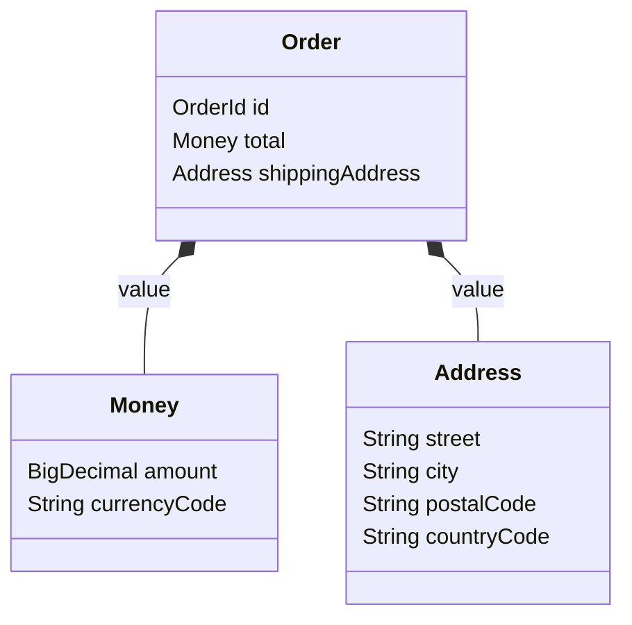

# Ánh xạ Value Object bằng embeddable hoặc bộ chuyển đổi

Trong Domain-Driven Design (DDD), Value Object biểu diễn một khái niệm được xác định bằng giá trị thay vì identity. `Money`, `Address`, `EmailAddress`, `Quantity` hoặc `DateRange` thường là Value Object vì chúng có ý nghĩa, quy tắc hợp lệ và cách so sánh riêng. Khi lưu mô hình này bằng ORM như JPA/Hibernate, cần ánh xạ giá trị vào cấu trúc lưu trữ mà không biến nó thành Entity chỉ để phù hợp với database.

JPA cung cấp hai cơ chế thường dùng: **Embeddable** (`@Embeddable` và `@Embedded`) để ánh xạ một Value Object thành nhiều cột thuộc bản ghi sở hữu; và **AttributeConverter** (`@Converter` và `@Convert`) để chuyển một thuộc tính miền thành một kiểu dữ liệu cơ bản mà database có thể lưu. Hai cơ chế phục vụ nhu cầu khác nhau. Chọn đúng cơ chế giúp giữ ngữ nghĩa Value Object, tránh tạo identity giả và làm cho truy vấn, schema cũng như migration dễ kiểm soát.

Bài học này trình bày cách lựa chọn, cách ánh xạ `Money`, `Address` và `EmailAddress`, cách xử lý equality và immutability, các giới hạn của ORM, cùng những lựa chọn kiến trúc khi muốn giữ domain model độc lập với persistence.

## 1. Value Object không cần identity để được lưu trữ

Giả sử một `Order` có tổng tiền và địa chỉ giao hàng. Trong mô hình miền:

- `Order` là Entity có `OrderId` và vòng đời riêng.
- `Money` là Value Object được xác định bởi số tiền và loại tiền.
- `Address` là Value Object được xác định bởi các thành phần địa chỉ theo quy tắc của Ordering.

Khi lưu đơn hàng, `Money` và `Address` thường được lưu cùng bản ghi của `Order`, hoặc ở các bảng phụ thuộc vào `Order` nếu chúng là collection. Chúng không cần ID riêng nếu nghiệp vụ không theo dõi identity và vòng đời độc lập của chúng.



Sơ đồ mô tả quan hệ sở hữu. Việc `Money` hoặc `Address` được lưu ở cùng bảng hay bảng khác là quyết định persistence, không làm thay đổi bản chất miền của chúng.

### 1.1. Không tạo Entity chỉ vì ORM cần một bảng

Một Value Object không trở thành Entity chỉ vì cần lưu nhiều field. Nếu thêm một ID tự sinh cho `Address` nhưng nghiệp vụ vẫn chỉ quan tâm giá trị địa chỉ, mô hình sẽ có identity kỹ thuật không mang ý nghĩa miền. Điều đó dễ dẫn đến Repository, vòng đời và thao tác cập nhật không cần thiết.

Hãy tạo Entity khi khái niệm thực sự cần được nhận diện xuyên suốt thay đổi, có vòng đời hoặc quy tắc riêng. Nếu hai giá trị tương đương được xem là cùng một giá trị, và chúng chỉ tồn tại như một phần của Aggregate sở hữu, Value Object thường phù hợp hơn.

### 1.2. Phân biệt `@Embedded` và `@EmbeddedId`

`@Embedded` dùng để nhúng một đối tượng giá trị vào Entity sở hữu nó. `@EmbeddedId` dùng một lớp giá trị làm khóa chính tổng hợp của Entity. Một lớp ID có thể là Value Object trong domain model, nhưng mục đích persistence của `@EmbeddedId` là định danh Entity. Không nên dùng `@EmbeddedId` cho `Money`, `Address` hoặc Value Object thông thường.

## 2. Chọn Embeddable hay AttributeConverter?

Hai cơ chế đều giúp ORM chuyển đổi kiểu miền, nhưng khả năng ánh xạ khác nhau.

| Tiêu chí | `@Embeddable` / `@Embedded` | `AttributeConverter` |
|---|---|---|
| Cấu trúc | Một Value Object gồm nhiều thuộc tính | Một thuộc tính được chuyển thành một kiểu dữ liệu cơ bản |
| Số cột thường dùng | Nhiều cột | Một cột |
| Truy vấn từng thành phần | Có thể truy cập từng thuộc tính qua path | Thường truy vấn theo giá trị thuộc tính đã convert |
| Ràng buộc schema | Có thể đặt precision, length, nullable cho từng cột | Ràng buộc chủ yếu đặt trên cột đích |
| Tình huống phù hợp | `Money(amount, currency)`, `Address(street, city, ...)` | `EmailAddress`, `PhoneNumber`, mã định danh có một biểu diễn lưu trữ |
| Khả năng tái sử dụng | Có thể nhúng vào nhiều Entity và đổi tên cột ở từng nơi | Có thể tái sử dụng converter cho kiểu miền tương ứng |

**Chọn Embeddable** khi Value Object có nhiều thành phần cần lưu riêng, truy vấn riêng, đánh index hoặc áp dụng constraint ở database. Ví dụ, `Money` có `amount` và `currencyCode`; ứng dụng có thể lọc theo loại tiền hoặc tổng hợp theo số tiền.

**Chọn AttributeConverter** khi Value Object có một biểu diễn lưu trữ cơ bản phù hợp và không cần tách thành nhiều cột. Ví dụ, `EmailAddress` có thể lưu vào một cột `VARCHAR` sau khi được kiểm tra và chuẩn hóa.

Không có quy tắc rằng một Value Object luôn phải dùng một cơ chế. Hãy chọn dựa trên ngữ nghĩa, truy vấn, schema và cách hệ thống cần vận hành.

## 3. Ánh xạ Value Object nhiều thành phần bằng `@Embeddable`

`@Embeddable` đánh dấu lớp có các thuộc tính được ánh xạ vào bảng của Entity sở hữu. `@Embedded` đặt một instance của lớp đó trong Entity. Value Object không có bảng riêng chỉ vì được khai báo là embeddable.

### 3.1. Ví dụ Money

Giả sử Ordering cần lưu tổng tiền gồm số tiền và mã tiền tệ. Có thể định nghĩa `Money` như sau:

```java
import jakarta.persistence.Access;
import jakarta.persistence.AccessType;
import jakarta.persistence.Column;
import jakarta.persistence.Embeddable;

import java.math.BigDecimal;
import java.util.Currency;
import java.util.Objects;

@Embeddable
@Access(AccessType.FIELD)
public class Money {
    @Column(name = "amount", precision = 19, scale = 4, nullable = false)
    private BigDecimal amount;

    @Column(name = "currency_code", length = 3, nullable = false)
    private String currencyCode;

    // Constructor phục vụ provider ORM khi khôi phục dữ liệu.
    protected Money() {}

    public Money(BigDecimal amount, Currency currency) {
        this.amount = normalize(Objects.requireNonNull(amount));
        this.currencyCode = Objects.requireNonNull(currency).getCurrencyCode();
    }

    public BigDecimal amount() {
        return amount;
    }

    public Currency currency() {
        return Currency.getInstance(currencyCode);
    }

    public Money add(Money other) {
        if (!currencyCode.equals(other.currencyCode)) {
            throw new IllegalArgumentException("Không thể cộng hai loại tiền khác nhau");
        }
        return new Money(amount.add(other.amount), currency());
    }

    private static BigDecimal normalize(BigDecimal value) {
        return value.stripTrailingZeros();
    }

    @Override
    public boolean equals(Object other) {
        if (this == other) return true;
        if (!(other instanceof Money money)) return false;
        return currencyCode.equals(money.currencyCode)
            && amount.compareTo(money.amount) == 0;
    }

    @Override
    public int hashCode() {
        return Objects.hash(amount.stripTrailingZeros(), currencyCode);
    }
}
```

Trong ví dụ:

- `@Embeddable` cho biết `Money` được lưu như một phần của Entity sở hữu.
- `@Access(AccessType.FIELD)` xác định JPA đọc/ghi field; ORM không cần setter công khai.
- Constructor nghiệp vụ kiểm tra dữ liệu và tạo giá trị hợp lệ.
- Constructor `protected` không tham số hỗ trợ provider khôi phục object. Một số provider có cơ chế riêng, nhưng constructor này là cách tương thích phổ biến với JPA.
- Không có ID và không có Repository cho `Money`.
- Equality dựa trên số tiền và loại tiền. `BigDecimal.equals()` phân biệt scale (`10.0` khác `10.00`), nên ví dụ dùng `compareTo()` và chuẩn hóa hash code để equality phản ánh giá trị số.

`scale = 4` là quyết định schema minh họa, không phải quy tắc chung cho mọi loại tiền. Hệ thống tài chính cần chọn độ chính xác, quy tắc làm tròn và số chữ số thập phân theo loại tiền cùng chính sách nghiệp vụ. Không nên mặc định `stripTrailingZeros()` thay thế được quy tắc làm tròn.

### 3.2. Nhúng Money vào Entity

```java
import jakarta.persistence.AttributeOverride;
import jakarta.persistence.AttributeOverrides;
import jakarta.persistence.Column;
import jakarta.persistence.Embedded;
import jakarta.persistence.Entity;
import jakarta.persistence.Id;
import jakarta.persistence.Table;

import java.util.UUID;

@Entity
@Table(name = "orders")
public class OrderEntity {
    @Id
    @Column(name = "order_id", nullable = false)
    private UUID id;

    @Embedded
    @AttributeOverrides({
        @AttributeOverride(
            name = "amount",
            column = @Column(name = "total_amount", precision = 19, scale = 4, nullable = false)
        ),
        @AttributeOverride(
            name = "currencyCode",
            column = @Column(name = "total_currency", length = 3, nullable = false)
        )
    })
    private Money total;

    protected OrderEntity() {}
}
```

Entity `OrderEntity` có một ID; `Money` được trải ra thành hai cột `total_amount` và `total_currency` trong bảng `orders`. Không cần bảng `money` hoặc khóa ngoại cho `Money` trong cách ánh xạ này.

`@AttributeOverride` thay tên và cấu hình cột tại vị trí nhúng. Điều này hữu ích khi cùng một loại Value Object được dùng ở nhiều thuộc tính có vai trò khác nhau, ví dụ `subtotal`, `tax`, `shippingFee` và `grandTotal`.

### 3.3. Dùng cùng một Embeddable nhiều lần

Nếu Entity chứa hai địa chỉ, chẳng hạn địa chỉ thanh toán và địa chỉ giao hàng, mỗi thuộc tính cần tên cột riêng:

```java
@Embedded
@AttributeOverrides({
    @AttributeOverride(name = "street", column = @Column(name = "shipping_street")),
    @AttributeOverride(name = "city", column = @Column(name = "shipping_city")),
    @AttributeOverride(name = "postalCode", column = @Column(name = "shipping_postal_code")),
    @AttributeOverride(name = "countryCode", column = @Column(name = "shipping_country_code"))
})
private Address shippingAddress;

@Embedded
@AttributeOverrides({
    @AttributeOverride(name = "street", column = @Column(name = "billing_street")),
    @AttributeOverride(name = "city", column = @Column(name = "billing_city")),
    @AttributeOverride(name = "postalCode", column = @Column(name = "billing_postal_code")),
    @AttributeOverride(name = "countryCode", column = @Column(name = "billing_country_code"))
})
private Address billingAddress;
```

Nếu không override tên cột, hai thuộc tính có thể va chạm tên mặc định hoặc phụ thuộc naming strategy của provider. Đặt tên tường minh giúp schema dễ đọc, migration ổn định và tránh bất ngờ khi đổi ORM.

## 4. Ánh xạ Address bằng Embeddable

`Address` thường gồm nhiều thành phần và có thể cần truy vấn hoặc constraint theo từng phần, vì vậy Embeddable thường phù hợp.

```java
import jakarta.persistence.Access;
import jakarta.persistence.AccessType;
import jakarta.persistence.Column;
import jakarta.persistence.Embeddable;

import java.util.Locale;
import java.util.Objects;

@Embeddable
@Access(AccessType.FIELD)
public class Address {
    @Column(name = "street", length = 200, nullable = false)
    private String street;

    @Column(name = "city", length = 100, nullable = false)
    private String city;

    @Column(name = "postal_code", length = 20)
    private String postalCode;

    @Column(name = "country_code", length = 2, nullable = false)
    private String countryCode;

    protected Address() {}

    public Address(String street, String city, String postalCode, String countryCode) {
        this.street = requireText(street, "street");
        this.city = requireText(city, "city");
        this.postalCode = postalCode == null ? null : postalCode.trim();
        this.countryCode = normalizeCountryCode(countryCode);
    }

    public String street() { return street; }
    public String city() { return city; }
    public String postalCode() { return postalCode; }
    public String countryCode() { return countryCode; }

    private static String requireText(String value, String field) {
        if (value == null || value.isBlank()) {
            throw new IllegalArgumentException(field + " không được để trống");
        }
        return value.trim();
    }

    private static String normalizeCountryCode(String value) {
        String code = requireText(value, "countryCode").toUpperCase(Locale.ROOT);
        if (!code.matches("[A-Z]{2}")) {
            throw new IllegalArgumentException("Mã quốc gia phải có hai chữ cái");
        }
        return code;
    }

    @Override
    public boolean equals(Object other) {
        if (this == other) return true;
        if (!(other instanceof Address address)) return false;
        return street.equals(address.street)
            && city.equals(address.city)
            && Objects.equals(postalCode, address.postalCode)
            && countryCode.equals(address.countryCode);
    }

    @Override
    public int hashCode() {
        return Objects.hash(street, city, postalCode, countryCode);
    }
}
```

Ví dụ này dùng mã quốc gia hai ký tự và một số trường bắt buộc theo chính sách minh họa. Quy tắc địa chỉ thực tế khác nhau giữa các quốc gia; không nên áp đặt một cấu trúc địa chỉ duy nhất nếu miền cần hỗ trợ nhiều định dạng. Equality của `Address` cũng cần được triển khai theo những thành phần thật sự quyết định tương đương trong bounded context.

## 5. Ánh xạ Value Object đơn giản bằng `AttributeConverter`

`AttributeConverter<X, Y>` chuyển đổi một thuộc tính Java kiểu `X` sang kiểu dữ liệu cơ bản `Y` để lưu vào một cột, và chuyển ngược lại khi đọc. Cơ chế này phù hợp với Value Object có một biểu diễn lưu trữ đơn giản.

Ví dụ, `EmailAddress` được lưu trong một cột `VARCHAR`:

```java
public record EmailAddress(String value) {
    public EmailAddress {
        if (value == null || value.isBlank()) {
            throw new IllegalArgumentException("Email không được để trống");
        }
        value = value.trim();
        if (!value.matches("^[^\\s@]+@[^\\s@]+\\.[^\\s@]+$")) {
            throw new IllegalArgumentException("Email không hợp lệ");
        }
    }
}
```

Converter:

```java
import jakarta.persistence.AttributeConverter;
import jakarta.persistence.Converter;

@Converter(autoApply = false)
public class EmailAddressConverter
        implements AttributeConverter<EmailAddress, String> {

    @Override
    public String convertToDatabaseColumn(EmailAddress attribute) {
        return attribute == null ? null : attribute.value();
    }

    @Override
    public EmailAddress convertToEntityAttribute(String dbData) {
        return dbData == null ? null : new EmailAddress(dbData);
    }
}
```

Sử dụng trong Entity:

```java
import jakarta.persistence.Column;
import jakarta.persistence.Convert;
import jakarta.persistence.Entity;
import jakarta.persistence.Id;

@Entity
public class CustomerEntity {
    @Id
    private Long id;

    @Convert(converter = EmailAddressConverter.class)
    @Column(name = "email_address", length = 254, nullable = false)
    private EmailAddress email;

    protected CustomerEntity() {}
}
```

JPA gọi converter khi ghi và đọc thuộc tính. Domain model làm việc với `EmailAddress`, còn database lưu chuỗi. `EmailAddress` không cần biết JPA hoặc SQL.

Regex trong ví dụ chỉ là kiểm tra định dạng cơ bản, không chứng minh địa chỉ tồn tại hoặc có thể nhận thư. Quy tắc xác minh email cần theo yêu cầu nghiệp vụ và quy trình xác nhận thực tế.

### 5.1. `autoApply` hay `@Convert` tường minh?

`@Converter(autoApply = true)` yêu cầu provider tự áp dụng converter cho các thuộc tính có kiểu phù hợp trong persistence unit, theo quy tắc của JPA. Nó tiện khi mọi nơi sử dụng kiểu đó đều có cùng cách lưu.

`autoApply = false` kết hợp `@Convert` tường minh giúp kiểm soát phạm vi. Cách này phù hợp khi một kiểu có thể được lưu khác nhau theo ngữ cảnh hoặc chỉ một số thuộc tính cần converter.

Không nên bật `autoApply` chỉ vì muốn giảm annotation. Nếu cùng một kiểu Java có hai quy tắc lưu trữ khác nhau, converter tự động có thể tạo ra hành vi khó dự đoán.

### 5.2. Converter có thể ánh xạ nhiều field thành nhiều cột không?

`AttributeConverter` chuyển một thuộc tính sang một kiểu dữ liệu cơ bản để lưu trong một cột. Nó không phải cơ chế ánh xạ một object thành nhiều cột độc lập. Nếu `Money` cần lưu `amount` và `currencyCode` ở hai cột, hãy dùng `@Embeddable`.

Về mặt kỹ thuật có thể serialize cả `Money` thành một chuỗi hoặc JSON trong một cột rồi chuyển ngược lại. Nhưng cách đó làm việc lọc theo tiền tệ, lập index, constraint và tổng hợp SQL khó hơn. Chỉ chọn biểu diễn đóng gói như vậy khi database thực sự cần lưu nguyên khối và truy vấn không cần tách thành phần.

## 6. Chọn giữa Embeddable và Converter bằng tình huống thực tế

| Value Object | Cấu trúc miền | Cơ chế thường phù hợp | Lý do |
|---|---|---|---|
| `Money` | Số tiền + loại tiền | Embeddable | Hai thành phần cần lưu và truy vấn riêng |
| `Address` | Đường, thành phố, mã bưu chính, quốc gia | Embeddable | Nhiều field và có thể cần lọc/constraint riêng |
| `EmailAddress` | Một chuỗi đã chuẩn hóa | AttributeConverter | Một giá trị có biểu diễn VARCHAR rõ ràng |
| `PhoneNumber` | Số điện thoại đã chuẩn hóa | AttributeConverter | Có thể lưu một chuỗi E.164 nếu mô hình chỉ cần một giá trị |
| `DateRange` | Ngày bắt đầu + ngày kết thúc | Embeddable | Cần truy vấn từng mốc hoặc kiểm tra khoảng |
| `Percentage` | Một số thập phân | Converter hoặc Embeddable | Converter nếu chỉ có một số; Embeddable nếu có thêm đơn vị/loại |

Đây là gợi ý, không phải quy tắc cố định. Ví dụ `PhoneNumber` có thể cần thêm extension hoặc country context, khi đó Embeddable có thể phù hợp hơn. `Percentage` có thể cần lưu đơn vị, loại tỷ lệ hoặc quy tắc làm tròn riêng.

## 7. Null, optional và trạng thái dữ liệu không hoàn chỉnh

Ánh xạ Value Object cần làm rõ khi nào toàn bộ giá trị có thể vắng mặt và khi nào các thành phần bên trong được phép null.

Ví dụ, địa chỉ giao hàng có thể chưa được cung cấp khi đơn còn ở trạng thái nháp. Khi đó `shippingAddress` có thể là `null` theo mô hình, hoặc được biểu diễn bằng một trạng thái rõ ràng khác. Khi đặt đơn, Aggregate kiểm tra địa chỉ bắt buộc trước khi chuyển trạng thái.

Không nên dùng một `Address` tồn tại nhưng tất cả field đều null để biểu diễn “chưa có địa chỉ” nếu điều đó tạo ra object không hợp lệ. Hãy chọn một trong các cách:

- Cho phép thuộc tính Value Object nullable ở giai đoạn nghiệp vụ tương ứng.
- Dùng trạng thái hoặc kiểu kết quả riêng để biểu diễn chưa cung cấp.
- Chỉ tạo Value Object khi đủ các thành phần bắt buộc.

### 7.1. Null của toàn bộ Embeddable

Khi các cột của một embeddable đều nullable và không có dữ liệu, cách provider tái tạo thuộc tính cần được kiểm tra theo phiên bản JPA/Hibernate và cấu hình mapping. Không nên dựa vào giả định rằng mọi tổ hợp cột null luôn được chuyển thành `null` object theo cùng một cách ở mọi provider.

Nếu phân biệt “không có địa chỉ” với “địa chỉ có một số field chưa biết” là quan trọng, hãy mô hình hóa điều đó rõ ràng và kiểm thử trên provider thực tế. Có thể dùng cột presence flag hoặc một trạng thái riêng khi cần phân biệt các trường hợp.

### 7.2. Không để dữ liệu cũ tạo ra Value Object vô hiệu

Khi đọc dữ liệu từ database, constructor hoặc converter có thể từ chối dữ liệu không hợp lệ. Điều này tốt để bảo vệ domain model, nhưng dữ liệu lịch sử có thể không tuân theo quy tắc hiện tại. Cần có kế hoạch migration hoặc bước chuyển đổi dữ liệu trước khi bật validation chặt hơn.

Không nên âm thầm thay dữ liệu sai bằng giá trị mặc định, vì như vậy hệ thống có thể che giấu lỗi dữ liệu. Nếu cần tương thích dữ liệu cũ, hãy định nghĩa rõ chính sách chuyển đổi và ghi nhận các bản ghi cần xử lý.

## 8. Immutability của Value Object và yêu cầu của JPA

Value Object thường bất biến sau khi tạo. Điều này giúp equality ổn định, tránh side effect và làm cho việc chia sẻ giá trị an toàn hơn. Tuy nhiên, JPA cần cơ chế khởi tạo và nạp dữ liệu từ database.

Một số điểm cần cân nhắc:

- Embeddable thường cần constructor không tham số `public` hoặc `protected` để provider khởi tạo theo quy ước JPA.
- Dùng field access để provider có thể gán field qua cơ chế persistence, trong khi domain API không cung cấp setter công khai.
- Tránh công khai setter chỉ để ORM hoạt động; setter có thể tạo đường thay đổi Value Object sau khi tạo.
- Một số provider hỗ trợ tốt hơn các cấu trúc immutable hoặc record, nhưng khả năng này có thể phụ thuộc phiên bản và không phải lúc nào cũng portable theo JPA.
- Với `AttributeConverter`, Value Object có thể là record hoặc class immutable vì converter tự tạo instance từ dữ liệu cơ bản.

Trong ví dụ `Money`, field không phải `final` để tương thích rộng với provider, nhưng API công khai không có setter. Domain code chỉ tạo giá trị mới thông qua constructor hoặc phương thức trả về `Money` mới. ORM có thể nạp field bằng reflection theo mapping.

Nếu yêu cầu domain model hoàn toàn độc lập với JPA hoặc cần dùng Java record/final class nghiêm ngặt, có thể giữ domain Value Object thuần và tạo persistence representation riêng để mapper chuyển đổi.

## 9. Truy vấn Value Object sau khi ánh xạ

### 9.1. Truy vấn thuộc tính Embeddable

Vì các thành phần của Embeddable được ánh xạ thành các cột, JPQL có thể tham chiếu path của chúng. Ví dụ, tìm đơn có tổng tiền theo một loại tiền:

```jpql
select o
from OrderEntity o
where o.total.currencyCode = :currencyCode
```

Hoặc lọc theo ngưỡng tiền trong một loại tiền đã xác định:

```jpql
select o
from OrderEntity o
where o.total.currencyCode = :currencyCode
  and o.total.amount >= :minimumAmount
```

Việc tách cột giúp database có thể lập index hoặc constraint phù hợp. Cần nhớ so sánh tiền phải xét loại tiền; không so sánh `amount` của hai loại tiền khác nhau như cùng một đơn vị.

### 9.2. Truy vấn thuộc tính dùng Converter

Với `EmailAddress`, thuộc tính Java vẫn có kiểu `EmailAddress`, còn cột lưu chuỗi. Có thể truy vấn qua thuộc tính đã convert bằng JPQL theo provider/JPA support:

```jpql
select c
from CustomerEntity c
where c.email = :email
```

Với JPQL, hãy truyền parameter dưới kiểu `EmailAddress` và xác minh provider áp dụng converter cho path thuộc tính trong phiên bản đang dùng. Đặc biệt kiểm tra khi dùng native SQL hoặc biểu thức function: native SQL thao tác trực tiếp cột lưu trữ nên phải dùng biểu diễn database, ví dụ chuỗi email đã chuẩn hóa.

## 10. Embeddable trong collection: `@ElementCollection`

Nếu Aggregate có nhiều Value Object cùng loại, chẳng hạn danh sách địa chỉ liên hệ hoặc các nhãn, có thể dùng `@ElementCollection` kết hợp `@CollectionTable`. Các phần tử vẫn không có identity độc lập trong mô hình.

Ví dụ collection các Value Object `Tag`:

```java
import jakarta.persistence.Column;
import jakarta.persistence.Embeddable;
import java.util.Objects;

@Embeddable
public class Tag {
    @Column(name = "tag_value", length = 50, nullable = false)
    private String value;

    protected Tag() {}

    public Tag(String value) {
        if (value == null || value.isBlank()) {
            throw new IllegalArgumentException("Tag không được để trống");
        }
        this.value = value.trim();
    }

    @Override
    public boolean equals(Object other) {
        return other instanceof Tag tag && value.equals(tag.value);
    }

    @Override
    public int hashCode() {
        return Objects.hash(value);
    }
}
```

Entity sở hữu collection được ánh xạ trong một file riêng:

```java
import jakarta.persistence.CollectionTable;
import jakarta.persistence.ElementCollection;
import jakarta.persistence.Entity;
import jakarta.persistence.Id;
import jakarta.persistence.JoinColumn;
import jakarta.persistence.Table;

import java.util.ArrayList;
import java.util.List;
import java.util.UUID;

@Entity
@Table(name = "orders")
public class OrderWithTags {
    @Id
    private UUID id;

    @ElementCollection
    @CollectionTable(
        name = "order_tags",
        joinColumns = @JoinColumn(name = "order_id")
    )
    private List<Tag> tags = new ArrayList<>();

    protected OrderWithTags() {}
}
```

Các hàng trong `order_tags` phụ thuộc vào `Order` và không đại diện cho Entity có vòng đời độc lập. Nếu tag cần identity, lịch sử, trạng thái riêng hoặc được quản lý độc lập, hãy xem xét mô hình Entity thay vì `@ElementCollection`.

Với collection cần giữ thứ tự, có thể dùng `@OrderColumn`; với Set cần xác định equality của phần tử và unique constraint tương ứng. ORM mapping không tự quyết định quy tắc nghiệp vụ về trùng lặp hoặc thứ tự.

## 11. Giữ domain model độc lập với ORM

Có hai hướng kiến trúc phổ biến.

### 11.1. Đặt annotation persistence trực tiếp lên Value Object

Ví dụ `Money` vừa là domain class vừa mang `@Embeddable`, `@Column`. Cách này đơn giản, ít lớp chuyển đổi và phù hợp với ứng dụng có mô hình vừa phải, chấp nhận domain layer phụ thuộc JPA.

Ưu điểm:

- Ít code mapping và ít lớp trung gian.
- Domain object được ORM nạp trực tiếp.
- Dễ triển khai với persistence model đơn giản.

Giới hạn:

- Domain class phụ thuộc annotation và yêu cầu khởi tạo của JPA.
- Một số lựa chọn thiết kế như record/final class có thể bị giới hạn bởi provider.
- Khi cùng domain model cần nhiều schema hoặc nhiều persistence technology, annotation có thể làm tăng coupling.

### 11.2. Tách Persistence Model và Domain Model

Nếu muốn domain model thuần, tạo persistence representation riêng:

```java
import jakarta.persistence.Column;
import jakarta.persistence.Embeddable;

import java.math.BigDecimal;
import java.util.Currency;
import java.util.Objects;

// Domain model: không phụ thuộc JPA. Hai class dưới đây minh họa hai file riêng.
record DomainMoney(BigDecimal amount, Currency currency) {
    public DomainMoney {
        Objects.requireNonNull(amount);
        Objects.requireNonNull(currency);
    }
}

// Persistence representation: phụ thuộc JPA.
@Embeddable
public class MoneyEmbeddable {
    @Column(name = "amount", precision = 19, scale = 4)
    private BigDecimal amount;

    @Column(name = "currency_code", length = 3)
    private String currencyCode;

    protected MoneyEmbeddable() {}

    static MoneyEmbeddable from(DomainMoney money) {
        MoneyEmbeddable value = new MoneyEmbeddable();
        value.amount = money.amount();
        value.currencyCode = money.currency().getCurrencyCode();
        return value;
    }

    DomainMoney toDomain() {
        return new DomainMoney(amount, Currency.getInstance(currencyCode));
    }
}
```

Mapper chuyển đổi giữa domain object và persistence representation. Cách này giữ domain model độc lập nhưng tạo thêm code và yêu cầu kiểm thử mapping. Không nên tách chỉ để tạo nhiều lớp giống hệt nhau nếu lợi ích kiến trúc chưa rõ.

### 11.3. Chọn mức tách phù hợp

| Tình huống | Hướng thường phù hợp |
|---|---|
| Ứng dụng nhỏ, JPA là persistence duy nhất, mapping đơn giản | Annotation trực tiếp có thể đủ |
| Domain model cần độc lập framework hoặc dùng nhiều persistence | Tách persistence model và mapper |
| Value Object một giá trị đơn giản, converter rõ ràng | `AttributeConverter` |
| Value Object nhiều field cần truy vấn riêng | Embeddable hoặc persistence representation nhiều cột |
| Provider hỗ trợ record nhưng cần portable JPA | Kiểm tra phiên bản/provider; cân nhắc class embeddable tiêu chuẩn |

Mục tiêu không phải tránh mọi annotation bằng mọi giá. Mục tiêu là giữ cho các quyết định persistence không làm thay đổi ý nghĩa nghiệp vụ hoặc khiến domain model phụ thuộc quá sâu vào framework.

## 12. Schema, migration và constraint

Ánh xạ Value Object tạo ra các cột trong schema, vì vậy thay đổi cấu trúc Value Object có thể là thay đổi schema. Ví dụ, thêm `districtCode` vào `Address` có thể cần thêm cột, backfill dữ liệu cũ và cập nhật query.

Một số điểm cần quản lý:

- Đặt tên cột rõ ràng, nhất quán; dùng `@AttributeOverride` khi nhúng cùng kiểu nhiều lần.
- Khai báo `nullable`, `length`, `precision`, `scale` theo quy tắc dữ liệu thực tế.
- Dùng database constraint cho các điều kiện dữ liệu có thể bảo vệ ở tầng lưu trữ, chẳng hạn `NOT NULL`, `CHECK` hoặc `UNIQUE` khi phù hợp.
- Không coi constraint database là thay thế hành vi miền; constraint là lớp bảo vệ bổ sung và cần đồng bộ với domain rule.
- Thực hiện schema migration có thứ tự; tránh chỉ dựa vào `ddl-auto=update` ở môi trường production.
- Khi thay đổi cách converter chuẩn hóa dữ liệu, kiểm tra dữ liệu đã lưu để tránh hai biểu diễn của cùng một giá trị.

Ví dụ, `currency_code` nên có giới hạn độ dài phù hợp và dữ liệu hợp lệ theo danh sách tiền tệ được hỗ trợ. `amount` cần precision/scale đủ cho các giá trị nghiệp vụ. Các giới hạn này phải được thống nhất giữa Value Object, converter, schema và chính sách tài chính.

## 13. Kiểm thử mapping Value Object

Kiểm thử cần chứng minh cả ngữ nghĩa miền và việc ORM chuyển đổi dữ liệu đúng.

### 13.1. Unit test cho Value Object

- Giá trị không hợp lệ bị từ chối khi tạo.
- Equality phản ánh đúng giá trị và quy tắc chuẩn hóa.
- `Money` không cộng hai loại tiền khác nhau.
- `EmailAddress` chuẩn hóa và xác thực theo chính sách.
- Value Object không cho phép thay đổi trạng thái qua API công khai.

Ví dụ:

```java
@Test
void moneyEqualityIgnoresBigDecimalScale() {
    Money a = new Money(new BigDecimal("10.0"), Currency.getInstance("VND"));
    Money b = new Money(new BigDecimal("10.00"), Currency.getInstance("VND"));

    assertEquals(a, b);
    assertEquals(a.hashCode(), b.hashCode());
}
```

### 13.2. Persistence integration test

Với Embeddable:

- Persist Entity có `Money` và đọc lại.
- Xác nhận số tiền và currency được lưu ở đúng cột.
- Nhúng cùng loại Value Object ở hai field với `@AttributeOverride` và xác nhận không trùng cột.
- Truy vấn theo từng thuộc tính embeddable.
- Kiểm tra hành vi khi toàn bộ hoặc một phần cột nullable.

Với Converter:

- Ghi `EmailAddress` và xác nhận cột chứa biểu diễn mong đợi.
- Đọc dữ liệu và xác nhận converter tái tạo Value Object.
- Kiểm tra `null`, chuỗi không hợp lệ và dữ liệu lịch sử.
- Kiểm tra query parameter có áp dụng converter đúng cách trên provider đang sử dụng.

Nên chạy integration test với database/provider gần production. In-memory database có thể không thể hiện đầy đủ khác biệt về precision, collation, constraint hoặc hành vi SQL của hệ quản trị thực tế.

## 14. Những sai lầm thường gặp

- **Tạo Entity cho mọi Value Object:** thêm identity và Repository không có ý nghĩa miền.
- **Dùng Converter cho object nhiều field cần truy vấn:** serialize vào một cột làm khó lọc, index và constraint.
- **Dùng Embeddable cho kiểu chỉ có một giá trị đơn giản mà không cần cấu trúc:** có thể tăng annotation và mapping không cần thiết; Converter có thể rõ hơn.
- **Quên `@AttributeOverride` khi nhúng cùng loại nhiều lần:** tên cột va chạm hoặc phụ thuộc naming strategy.
- **Nhầm `@Embedded` với `@EmbeddedId`:** dùng cơ chế khóa chính cho Value Object thông thường.
- **Dùng `autoApply = true` thiếu kiểm soát:** converter bị áp dụng ở những nơi không có cùng quy tắc lưu.
- **Cho rằng `AttributeConverter` ánh xạ nhiều cột:** converter chuyển một thuộc tính sang một giá trị database cơ bản.
- **Để lộ setter chỉ để ORM hoạt động:** tạo đường thay đổi Value Object ngoài hành vi miền.
- **Cho rằng `record` luôn được JPA hỗ trợ portable như Embeddable class:** khả năng phụ thuộc phiên bản và provider.
- **Không xử lý null và dữ liệu cũ:** ORM có thể nạp dữ liệu không tạo được Value Object hợp lệ.
- **Bỏ qua equality của BigDecimal:** `10.0` và `10.00` có thể khác nhau theo `equals()` dù cùng giá trị số.
- **Dựa hoàn toàn vào schema generation:** migration production cần được quản lý và kiểm thử.
- **Để domain class phụ thuộc persistence mà không cân nhắc:** framework có thể chi phối constructor, field và cách tổ chức mô hình.

## 15. Quy trình chọn và triển khai mapping

Khi đưa một Value Object vào persistence, có thể thực hiện theo trình tự:

1. **Xác định ngữ nghĩa miền:** Value Object gồm những thành phần nào, equality và invariant ra sao?
2. **Xác định nhu cầu truy vấn:** có cần lọc, sắp xếp, index hoặc constraint theo từng thành phần không?
3. **Chọn cơ chế:** nhiều field độc lập thường dùng Embeddable; một biểu diễn cơ bản thường dùng Converter.
4. **Thiết kế schema:** đặt tên cột, kiểu dữ liệu, nullable, precision, scale và constraint.
5. **Thiết kế khởi tạo:** bảo đảm constructor/factory của domain kiểm tra dữ liệu; quyết định có dùng persistence model riêng hay không.
6. **Viết mapper hoặc annotation:** tránh để chi tiết ORM rò rỉ vào hành vi nghiệp vụ.
7. **Viết test:** unit test cho Value Object và integration test cho persist/load/query.
8. **Lập migration:** chuyển dữ liệu cũ và xác nhận tương thích trước khi phát hành.

```mermaid
flowchart TD
    A[Value Object trong domain model] --> B{Có nhiều thành phần cần lưu/truy vấn riêng?}
    B -->|Có| C[@Embeddable + @Embedded]
    B -->|Không| D{Có một biểu diễn database cơ bản?}
    D -->|Có| E[AttributeConverter]
    D -->|Không| F[Thiết kế persistence representation phù hợp]
    C --> G[Đặt tên cột và override nếu cần]
    E --> H[Định nghĩa converter và phạm vi áp dụng]
    F --> I[Mapper giữa domain và persistence]
    G --> J[Kiểm thử persist/load/query]
    H --> J
    I --> J
    J --> K[Migration và xác minh dữ liệu]
```

## 16. Checklist ánh xạ Value Object

Trước khi hoàn thiện mapping, hãy kiểm tra:

- [ ] Value Object được xác định bằng giá trị và không có identity giả.
- [ ] Đã chọn Embeddable hoặc Converter dựa trên cấu trúc và nhu cầu truy vấn.
- [ ] Embeddable có constructor và access strategy phù hợp provider.
- [ ] Các cột có tên, kiểu, precision, scale, length và nullability rõ ràng.
- [ ] Các vị trí nhúng lặp lại dùng `@AttributeOverride` khi cần.
- [ ] Converter có xử lý `null`, dữ liệu không hợp lệ và chuẩn hóa nhất quán.
- [ ] `autoApply` chỉ bật khi mọi nơi dùng kiểu đều có cùng quy tắc lưu.
- [ ] Equality và hash code phản ánh đúng giá trị miền.
- [ ] Domain API không cung cấp setter chỉ để phục vụ ORM.
- [ ] Đã xác định domain model có mang annotation JPA hay dùng persistence model riêng.
- [ ] Query theo thành phần Value Object hoạt động đúng.
- [ ] Integration test chạy với provider/database phù hợp.
- [ ] Schema migration và dữ liệu lịch sử đã được xem xét.

## 17. Câu hỏi tự kiểm tra

1. Vì sao Value Object không cần identity riêng để được lưu trong database?
2. Khác biệt giữa `@Embeddable`/`@Embedded` và `AttributeConverter` là gì?
3. Vì sao `Money(amount, currencyCode)` thường phù hợp với Embeddable hơn một Converter lưu nguyên khối?
4. `@AttributeOverride` giải quyết vấn đề gì khi một Entity nhúng cùng loại Value Object nhiều lần?
5. Khi nào `@Converter(autoApply = true)` phù hợp và khi nào nên dùng `@Convert` tường minh?
6. Vì sao không nên nhầm `@Embedded` với `@EmbeddedId`?
7. JPA constructor và field access ảnh hưởng thế nào đến thiết kế Value Object bất biến?
8. Vì sao cần kiểm tra null semantics và dữ liệu lịch sử khi converter tạo lại Value Object?
9. Khi nào nên tách domain Value Object khỏi persistence representation?
10. Những kiểm thử nào chứng minh mapping Value Object hoạt động đúng với ORM và database thực tế?

## Kết luận

Embeddable phù hợp khi Value Object có nhiều thành phần cần được lưu thành các cột riêng và có thể truy vấn độc lập. AttributeConverter phù hợp khi một Value Object có một biểu diễn database cơ bản, chẳng hạn một chuỗi hoặc một số. Cả hai cơ chế đều cho phép domain model sử dụng kiểu có ngữ nghĩa thay vì phải làm việc trực tiếp với primitive.

Hãy bắt đầu từ cấu trúc và quy tắc của Value Object, sau đó xét nhu cầu truy vấn và schema để chọn mapping. Giữ equality, validation và hành vi trong mô hình miền; kiểm soát chi tiết ORM ở persistence boundary theo mức coupling mà kiến trúc chấp nhận. Kiểm thử cả round-trip, query, null và migration để dữ liệu được lưu và khôi phục mà vẫn giữ đúng ý nghĩa nghiệp vụ.
