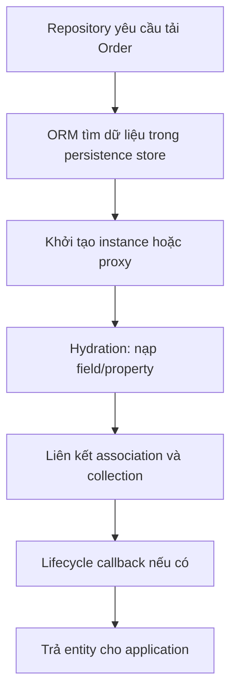

# Yêu cầu khởi tạo của ORM và bảo vệ trạng thái hợp lệ

Trong Domain-Driven Design (DDD), entity và aggregate cần bảo vệ các invariant để trạng thái nghiệp vụ luôn hợp lệ. Tuy nhiên, khi dùng Object-Relational Mapping (ORM), đối tượng không phải lúc nào cũng được tạo theo cách thông thường bằng `new` hoặc factory của domain. ORM có thể khởi tạo đối tượng bằng reflection, proxy hoặc cơ chế riêng của provider, sau đó nạp dữ liệu từ database vào các thuộc tính.

Điều này tạo ra một ranh giới quan trọng: **tạo mới một đối tượng theo nghiệp vụ** khác với **khôi phục một đối tượng đã tồn tại từ persistence**. Constructor và factory nghiệp vụ bảo vệ việc tạo mới. ORM cần một cơ chế khởi tạo và hydration tương thích với framework. Khi ORM nạp dữ liệu, hệ thống vẫn phải bảo đảm aggregate được khôi phục ở trạng thái có ý nghĩa và không âm thầm chấp nhận dữ liệu cũ hoặc sai invariant.

Bài học này tập trung vào yêu cầu khởi tạo của ORM, cách hydration hoạt động, ảnh hưởng của field/property access và proxy, cũng như các lựa chọn thiết kế để giữ domain model hợp lệ. Ví dụ dùng Java và JPA làm nền tảng; một số chi tiết proxy, record và constructor có thể khác theo ORM provider và phiên bản.

## Sau bài học này

Bạn có thể:

- Giải thích vì sao ORM cần constructor và khả năng truy cập thuộc tính riêng.
- Phân biệt constructor tạo mới với cơ chế reconstitution/rehydration.
- Hiểu cách ORM khởi tạo, nạp field, liên kết association và tạo proxy.
- Nhận biết rủi ro khi setter hoặc constructor chứa logic nghiệp vụ bị gọi trong lúc hydration.
- Chọn giữa ánh xạ trực tiếp domain entity và tách persistence model khỏi domain model.
- Bảo vệ invariant khi đọc dữ liệu cũ, dữ liệu lỗi hoặc dữ liệu được ghi bởi hệ thống khác.
- Dùng database constraint, lifecycle callback và optimistic locking đúng vai trò.
- Kiểm thử cả domain behavior lẫn quá trình lưu/đọc lại qua ORM.

## 1. Vì sao ORM có yêu cầu khởi tạo riêng?

Khi lập trình thông thường, ta thường tạo đối tượng bằng constructor hoặc static factory:

```java
Order order = Order.create(customerId, requestedLines, now);
```

Factory nhận dữ liệu đầu vào, kiểm tra điều kiện, tạo value object và thiết lập trạng thái ban đầu. Sau khi trả về, caller có thể tin rằng `Order` là một đơn mới hợp lệ theo quy tắc miền.

ORM có nhiệm vụ khác. Khi đọc một hàng từ database, nó cần tạo một instance Java rồi nạp các giá trị đã lưu vào instance đó. Nó không có sẵn command như `PlaceOrder`, cũng không nên chạy lại quy trình tạo đơn như thể khách hàng vừa đặt hàng lần nữa.

Một luồng nạp dữ liệu điển hình:



Thứ tự và chi tiết nội bộ phụ thuộc provider, cache và chiến lược fetch. Điểm cần nhớ là ORM đang **khôi phục trạng thái đã lưu**, không thực hiện lại nghiệp vụ tạo mới.

### ORM không phải domain factory

ORM cần tạo object theo cấu trúc persistence. Domain factory cần tạo object theo quy tắc nghiệp vụ. Hai mục tiêu này có thể dùng chung một class trong mô hình đơn giản, nhưng không nên mặc định rằng constructor do ORM gọi đã kiểm tra đầy đủ mọi invariant của domain.

Nếu trộn hai trách nhiệm, constructor có thể vừa phải đáp ứng framework vừa phải xử lý quy tắc tạo mới. Điều đó thường dẫn đến constructor rỗng công khai, setter cho mọi field hoặc các giá trị mặc định giả tạo để ORM có thể khởi tạo.

## 2. Yêu cầu khởi tạo entity trong JPA

Với entity theo mô hình JPA phổ biến, cần lưu ý các yêu cầu sau:

- Entity class phải có constructor không tham số với visibility `public` hoặc `protected`.
- Entity class không được là `final`.
- Các phương thức và persistent instance field không được là `final` theo yêu cầu entity của JPA.
- Entity phải là top-level class hoặc static nested class; inner class gắn với instance bên ngoài không phù hợp.

Ví dụ:

```java
@Entity
@Table(name = "orders")
@Access(AccessType.FIELD)
public class OrderEntity {
    @Id
    private UUID id;

    @Column(nullable = false)
    private String status;

    @Version
    private long version;

    protected OrderEntity() {
        // Dành cho ORM khởi tạo entity khi đọc dữ liệu.
    }
}
```

Constructor `protected` đáp ứng yêu cầu truy cập của JPA và hạn chế code thông thường bên ngoài tạo một entity persistence chưa được nạp dữ liệu. Không nên đặt constructor này làm nơi tạo trạng thái nghiệp vụ mặc định, gửi event hoặc gọi dịch vụ ngoài.

### Vì sao class entity không nên final?

Một số ORM tạo proxy bằng cách sinh subclass để hỗ trợ lazy loading hoặc theo dõi trạng thái. Nếu entity class là `final`, provider không thể tạo subclass proxy theo cách đó. Một số provider có cơ chế bytecode enhancement khác, nhưng không nên giả định mọi cấu hình đều hỗ trợ cùng cách.

Các phương thức `final` cũng có thể cản trở interception/proxy. Hãy tuân theo yêu cầu của JPA và tài liệu provider đang dùng.

### Embeddable và value object

`@Embeddable` thường được dùng để ánh xạ một value object vào các cột của bảng chứa entity. Các yêu cầu constructor và hỗ trợ immutable type có thể phụ thuộc phiên bản JPA/provider. Với class embeddable thông thường, hãy cung cấp constructor không tham số phù hợp và kiểm tra tài liệu provider. Một số ORM hiện đại hỗ trợ record hoặc immutable embeddable theo cách riêng; không nên coi đó là khả năng đồng nhất trên mọi provider.

### Đừng suy rộng yêu cầu JPA thành quy tắc cho mọi ORM

Hibernate, EclipseLink và các thư viện persistence khác có thể có extension hoặc cơ chế khởi tạo riêng. Nếu dùng một provider cụ thể, hãy phân biệt yêu cầu chuẩn JPA với extension của provider. Thiết kế domain model nên tránh phụ thuộc vào một hành vi ngầm chưa được xác nhận.

## 3. Constructor không tham số không đồng nghĩa với đối tượng hợp lệ

Một constructor không tham số dành cho ORM có thể để các field ở trạng thái chưa được nạp:

```java
protected OrderEntity() {
    // ORM sẽ nạp id, status và các thuộc tính persistence sau đó.
}
```

Trong lúc constructor chạy, `id` và `status` có thể vẫn là `null`. Đây không phải một `Order` nghiệp vụ đã sẵn sàng sử dụng; đó là instance kỹ thuật đang trong quá trình hydration.

Vì vậy, không nên để code ứng dụng gọi constructor này rồi sử dụng object như aggregate hợp lệ. Visibility `protected` giúp giảm khả năng gọi nhầm, nhưng không tự bảo đảm invariant.

### Tránh giá trị mặc định giả

Một cách làm dễ gây lỗi là gán trạng thái mặc định trong no-arg constructor chỉ để tránh null:

```java
protected OrderEntity() {
    this.status = "DRAFT";
    this.total = BigDecimal.ZERO;
}
```

Khi ORM nạp dữ liệu, các giá trị này có thể bị ghi đè. Nếu quá trình hydration lỗi hoặc một field không được ánh xạ như mong đợi, object có thể giữ giá trị mặc định và trông có vẻ hợp lệ dù dữ liệu thực tế bị thiếu.

No-arg constructor nên tối giản và không tạo ra giả định nghiệp vụ. Nếu cần giá trị mặc định khi tạo đơn mới, hãy đặt nó trong factory nghiệp vụ như `Order.create(...)`.

### Tránh side effect trong constructor

Constructor dành cho ORM không nên:

- Gửi email hoặc message.
- Gọi HTTP hoặc truy cập database khác.
- Tạo ID nghiệp vụ mới mỗi lần ORM nạp lại entity.
- Ghi audit event như thể người dùng vừa tạo đối tượng.
- Tạo child entity hoặc collection theo một quy trình nghiệp vụ.
- Đọc security context hoặc đồng hồ hệ thống để quyết định trạng thái.

ORM có thể tạo instance trong nhiều tình huống: truy vấn, refresh, proxy initialization hoặc khôi phục từ cache. Side effect trong constructor có thể bị chạy ở thời điểm không mong muốn và lặp lại ngoài ý định.

## 4. Phân biệt creation và reconstitution

Trong domain model, nên phân biệt hai thao tác:

- **Creation (tạo mới):** bắt đầu một vòng đời nghiệp vụ mới, kiểm tra command đầu vào, thiết lập trạng thái ban đầu và có thể phát domain event như `OrderPlaced`.
- **Reconstitution/Rehydration (khôi phục):** tái tạo một đối tượng đã tồn tại từ snapshot/persistence state, giữ lại identity và trạng thái đã được ghi nhận, không giả vờ rằng nghiệp vụ vừa xảy ra lần nữa.

Ví dụ:

```java
public final class Order {
    private final OrderId id;
    private final CustomerId customerId;
    private final List<OrderLine> lines;
    private final OrderStatus status;

    private Order(
        OrderId id,
        CustomerId customerId,
        List<OrderLine> lines,
        OrderStatus status
    ) {
        this.id = Objects.requireNonNull(id);
        this.customerId = Objects.requireNonNull(customerId);
        this.lines = List.copyOf(lines);
        this.status = Objects.requireNonNull(status);
        validateState();
    }

    public static Order create(
        OrderId id,
        CustomerId customerId,
        List<OrderLine> requestedLines
    ) {
        if (requestedLines == null || requestedLines.isEmpty()) {
            throw new EmptyOrderCannotBePlacedException();
        }
        return new Order(
            id, customerId, requestedLines, OrderStatus.DRAFT
        );
    }

    public static Order rehydrate(OrderSnapshot snapshot) {
        return new Order(
            snapshot.id(),
            snapshot.customerId(),
            snapshot.lines(),
            snapshot.status()
        );
    }

    private void validateState() {
        if (lines.isEmpty() && status != OrderStatus.DRAFT) {
            throw new InvalidPersistedOrderException(id);
        }
    }
}
```

Ví dụ đã lược giản kiểu snapshot và các quy tắc khác. Cả hai factory đều tạo một `Order` có invariant hợp lệ, nhưng ngữ nghĩa khác nhau. `create(...)` diễn đạt việc bắt đầu đơn mới; `rehydrate(...)` khôi phục một trạng thái đã tồn tại và không tự phát `OrderPlaced`.

### Rehydration không phải replay một use case mới

Nếu mỗi lần đọc đơn từ database lại gọi `Order.create(...)`, hệ thống có thể tạo lại event, ID hoặc trạng thái ban đầu sai. Rehydration phải giữ identity và trạng thái được lưu, sau đó xác minh chúng vẫn thỏa các bất biến cần thiết.

### Có thể dùng cùng constructor nội bộ

Ví dụ trên dùng một constructor private để thiết lập cấu trúc và kiểm tra invariant chung. Hai factory công khai thể hiện hai ý định khác nhau. Trong miền phức tạp, có thể có các factory riêng hoặc một `OrderReconstitutor`/mapper chuyên trách.

## 5. ORM hydration hoạt động như thế nào?

Hydration là quá trình ORM nạp dữ liệu persistence vào instance. Ở mức khái niệm, các bước thường gồm:

1. Xác định entity cần tải và đọc dữ liệu tương ứng.
2. Tạo instance hoặc proxy theo cơ chế provider.
3. Nạp các persistent attribute qua field access hoặc property access.
4. Thiết lập quan hệ và collection theo fetch plan.
5. Áp dụng trạng thái quản lý của persistence context, dirty tracking và version.
6. Chạy lifecycle callback phù hợp nếu entity khai báo.

Không nên dựa vào thứ tự cụ thể giữa mọi association hoặc callback nếu specification/provider không bảo đảm. Đặc biệt, không nên giả định toàn bộ object graph đã được tải khi một entity được trả về.

### Field access

Nếu annotation mapping được đặt trên field, JPA dùng field access. Provider có thể đọc/ghi trực tiếp field theo cơ chế persistence mà không gọi business setter.

```java
@Entity
@Access(AccessType.FIELD)
public class CustomerEntity {
    @Id
    private UUID id;

    @Column(name = "credit_limit")
    private BigDecimal creditLimit;

    protected CustomerEntity() {}
}
```

Điều này hữu ích khi muốn giữ setter không công khai hoặc không cung cấp setter cho code ứng dụng. Nhưng cũng có nghĩa các kiểm tra trong setter không phải là hàng rào đáng tin cậy để bảo vệ trạng thái được ORM nạp.

### Property access

Nếu mapping được đặt trên getter, provider dùng property access và có thể gọi setter tương ứng để nạp dữ liệu.

```java
@Entity
@Access(AccessType.PROPERTY)
public class CustomerEntity {
    private UUID id;
    private BigDecimal creditLimit;

    protected CustomerEntity() {}

    @Id
    public UUID getId() {
        return id;
    }

    protected void setId(UUID id) {
        this.id = id;
    }

    public BigDecimal getCreditLimit() {
        return creditLimit;
    }

    protected void setCreditLimit(BigDecimal creditLimit) {
        this.creditLimit = creditLimit;
    }
}
```

Với property access, setter có thể được gọi trong quá trình hydration. Tuy nhiên, không nên giả định các setter được gọi theo thứ tự nghiệp vụ hoặc tất cả field liên quan đã có giá trị khi một setter chạy.

### Không dùng setter để kiểm tra invariant nhiều thuộc tính

Giả sử `validFrom` và `validTo` phải tạo thành một khoảng hợp lệ. Nếu `setValidFrom(...)` kiểm tra `validTo` ngay lập tức, ORM có thể gọi setter trước khi `validTo` được nạp. Đối tượng có thể bị từ chối dù dữ liệu cuối cùng hợp lệ.

Ngược lại, nếu setter chỉ gán giá trị để ORM nạp, code ứng dụng có thể gọi nó và tạo trạng thái không hợp lệ. Vì vậy, property setter của persistence entity không nên được xem như API nghiệp vụ. Hãy dùng hành vi miền rõ ràng và kiểm tra toàn bộ snapshot sau khi đã khôi phục.

## 6. Proxy và lazy loading ảnh hưởng đến entity

ORM có thể dùng proxy để trì hoãn tải association hoặc entity cho đến khi ứng dụng thực sự truy cập. Proxy là một object đại diện cho entity, có thể chỉ biết ID trước khi dữ liệu đầy đủ được nạp.

Ví dụ, `order.getCustomer()` có thể trả một proxy của `CustomerEntity`. Khi gọi một phương thức cần dữ liệu, provider mới truy vấn database.

### Hệ quả đối với thiết kế class

- Entity cần đáp ứng yêu cầu không-final của JPA khi provider dùng subclass proxy.
- Constructor và phương thức truy cập cần tương thích với cơ chế proxy của provider.
- Truy cập lazy association ngoài persistence context có thể gây lỗi lazy initialization.
- `equals()` và `hashCode()` không nên vô tình kích hoạt tải toàn bộ object graph.
- Serialization trực tiếp entity/proxy ra API có thể gây vòng lặp, query bất ngờ hoặc lộ dữ liệu.

### Cẩn trọng với equals và hashCode

Entity có identity; value object có equality theo giá trị. Với entity được proxy, so sánh bằng `getClass()` tuyệt đối có thể cho kết quả khác giữa class thật và proxy subclass. Cách triển khai equality phụ thuộc chiến lược ID và provider.

Một số nguyên tắc:

- Không dùng toàn bộ field mutable để tạo hash code cho entity được đặt trong `HashSet`/`HashMap`.
- Không truy cập lazy association trong `equals()` hoặc `hashCode()`.
- Xác định rõ identity trước và sau khi persist, đặc biệt khi ID được database sinh.
- Kiểm thử equality với proxy nếu ứng dụng phụ thuộc vào hành vi đó.

Không có một đoạn `equals/hashCode` chung đúng cho mọi chiến lược ID và ORM. Hãy theo hướng dẫn provider và mô hình identity của domain.

### Không để proxy rò ra khỏi persistence boundary

Application/query layer nên trả DTO hoặc read model phù hợp thay vì đưa proxy ORM ra controller. Nếu domain model được tách khỏi persistence entity, mapper có thể tải dữ liệu cần thiết trong persistence context rồi tạo domain snapshot độc lập.

## 7. Hai chiến lược ánh xạ: domain entity trực tiếp và persistence model riêng

Không có một chiến lược duy nhất phù hợp với mọi dự án. Quyết định phụ thuộc độ phức tạp domain, nhu cầu ORM, mức độ immutable và chi phí mapping.

### Chiến lược A: ánh xạ trực tiếp domain entity

Với mô hình đơn giản, entity domain có thể đồng thời là JPA entity:

```java
@Entity
@Table(name = "orders")
@Access(AccessType.FIELD)
public class Order {
    @Id
    private UUID id;

    @Enumerated(EnumType.STRING)
    private OrderStatus status;

    @Version
    private long version;

    protected Order() {
        // Dành cho ORM.
    }

    public void confirm() {
        if (status != OrderStatus.ACCEPTED) {
            throw new OrderCannotBeConfirmedException();
        }
        status = OrderStatus.CONFIRMED;
    }
}
```

Ưu điểm:

- Ít class và ít mapping hơn.
- Phù hợp với domain đơn giản, cấu trúc persistence gần mô hình miền.
- Dễ triển khai khi provider hỗ trợ tốt các kiểu và quan hệ đang dùng.

Rủi ro:

- Domain class phải đáp ứng yêu cầu constructor, proxy và mapping.
- ORM có thể nạp field trực tiếp, không đi qua business method.
- Annotation, lazy loading và collection persistence có thể ảnh hưởng thiết kế domain.
- Việc khôi phục dữ liệu cũ và kiểm tra invariant cần được cân nhắc riêng.

Nếu chọn cách này, hãy giữ field private, no-arg constructor tối thiểu, không để setter công khai tùy tiện và cung cấp hành vi miền có ý nghĩa. Bổ sung kiểm tra sau load hoặc cơ chế khôi phục phù hợp nếu dữ liệu persistence có thể không hợp lệ.

### Chiến lược B: tách persistence model khỏi domain model

Với domain phức tạp hoặc cần mô hình miền độc lập ORM, có thể dùng một class persistence để ánh xạ database và mapper để tạo domain aggregate.

```java
@Entity
@Table(name = "orders")
@Access(AccessType.FIELD)
public class OrderRow {
    @Id
    private UUID id;

    @Column(nullable = false)
    private UUID customerId;

    @Column(nullable = false)
    private String status;

    @Version
    private long version;

    protected OrderRow() {}

    // Getter phục vụ mapper; không phơi entity này ra application.
}
```

Domain model giữ constructor/factory và invariant riêng:

```java
public final class Order {
    private final OrderId id;
    private final CustomerId customerId;
    private final OrderStatus status;

    private Order(OrderId id, CustomerId customerId, OrderStatus status) {
        this.id = Objects.requireNonNull(id);
        this.customerId = Objects.requireNonNull(customerId);
        this.status = Objects.requireNonNull(status);
        validateState();
    }

    public static Order rehydrate(OrderSnapshot snapshot) {
        return new Order(
            snapshot.id(), snapshot.customerId(), snapshot.status()
        );
    }

    private void validateState() {
        // Kiểm tra các invariant của domain trên snapshot hoàn chỉnh.
    }
}
```

Mapper chuyển persistence representation thành snapshot miền:

```java
public final class OrderMapper {
    public Order toDomain(OrderRow row) {
        return Order.rehydrate(new OrderSnapshot(
            new OrderId(row.id()),
            new CustomerId(row.customerId()),
            OrderStatus.valueOf(row.status())
        ));
    }

    public void copyToRow(Order order, OrderRow row) {
        // Chuyển các giá trị miền sang persistence fields.
    }
}
```

Đây là ví dụ khung; mapper thực tế cần ánh xạ đầy đủ các dòng hàng, value object, version và dữ liệu liên quan. Nếu trạng thái trong database không nhận diện được, mapper nên báo lỗi dữ liệu hoặc áp dụng chính sách migration rõ ràng, không âm thầm chuyển sang trạng thái mặc định.

Ưu điểm:

- Domain model không cần đáp ứng yêu cầu proxy/constructor của ORM.
- Có thể dùng immutable domain object và factory có validation đầy đủ.
- Persistence schema có thể thay đổi mà ít ảnh hưởng đến mô hình miền.
- Mapper tạo một ranh giới rõ để phát hiện dữ liệu cũ hoặc sai.

Chi phí:

- Thêm class và mapping code.
- Cần xử lý identity, version và quan hệ giữa persistence row với aggregate.
- Có thể cần tối ưu truy vấn để tránh tải hoặc map quá nhiều dữ liệu.

### Chọn chiến lược nào?

| Tiêu chí | Domain entity là JPA entity | Persistence model riêng |
| --- | --- | --- |
| Độ phức tạp domain | Đơn giản đến vừa phải | Vừa đến phức tạp, nhiều invariant |
| Chi phí ban đầu | Thấp hơn | Cao hơn do mapper và snapshot |
| Phụ thuộc ORM | Domain class chịu yêu cầu ORM | Chủ yếu persistence model chịu yêu cầu ORM |
| Immutable domain | Khó hơn với entity JPA mutable | Dễ tổ chức hơn |
| Kiểm tra khi rehydrate | Cần cơ chế rõ sau hydration | Factory/mapper có thể kiểm tra snapshot trước khi tạo domain object |
| Thay đổi schema | Có thể lan vào domain class | Được cô lập qua mapper |

Không nên tách persistence model chỉ vì muốn có nhiều layer. Hãy dùng khi lợi ích cô lập và bảo vệ mô hình miền lớn hơn chi phí mapping.

## 8. Bảo vệ invariant khi ORM nạp dữ liệu

Constructor tạo mới có thể kiểm tra dữ liệu đầu vào. Nhưng với field access, ORM có thể ghi trực tiếp vào field sau khi constructor đã chạy. Do đó, validation trong constructor không tự động bảo vệ dữ liệu được hydration.

Ví dụ, `Order` yêu cầu:

- `id` và `customerId` không null.
- `status` phải là trạng thái được biết.
- Đơn đã xác nhận phải có ít nhất một dòng hàng.
- Tổng tiền phải khớp với các dòng hàng theo quy tắc của miền.

Nếu ORM nạp `status = CONFIRMED` nhưng collection dòng hàng rỗng do mapping sai hoặc dữ liệu bị hỏng, constructor có thể đã chạy trước khi các field được nạp. Hệ thống cần một điểm xác minh sau khi toàn bộ snapshot cần thiết đã có.

### Cách 1: dùng rehydration factory và mapper

Đây là cách rõ ràng khi domain model tách khỏi persistence entity. Mapper tải dữ liệu cần thiết, tạo snapshot đầy đủ rồi gọi `Order.rehydrate(snapshot)`. Factory kiểm tra invariant trước khi trả domain object.

Ưu điểm là quy tắc validation nằm trong domain và không phụ thuộc thứ tự hydration của ORM.

### Cách 2: kiểm tra trạng thái sau khi load

Nếu dùng JPA entity trực tiếp làm domain entity, có thể dùng `@PostLoad` để kiểm tra những điều kiện cục bộ khi dữ liệu đã được nạp:

```java
@Entity
@Access(AccessType.FIELD)
public class DateWindowEntity {
    @Id
    private UUID id;

    private Instant startsAt;
    private Instant endsAt;

    protected DateWindowEntity() {}

    @PostLoad
    private void validateLoadedState() {
        if (startsAt == null || endsAt == null || !startsAt.isBefore(endsAt)) {
            throw new PersistenceException("Invalid persisted date window");
        }
    }
}
```

`@PostLoad` chạy sau khi provider nạp entity theo lifecycle callback. Ví dụ chỉ kiểm tra hai scalar field đã được ánh xạ. Nó không phải nơi thích hợp để gọi dịch vụ ngoài, truy vấn thêm nhiều aggregate, phát domain event hoặc thực hiện quy trình nghiệp vụ.

Nếu invariant phụ thuộc collection hoặc association lazy, callback có thể chạy khi quan hệ chưa được tải. Không nên ép tải cả object graph trong callback. Hãy dùng mapper/reconstitution hoặc một bước xác minh có chủ đích sau khi tải đủ dữ liệu.

### Cách 3: kiểm tra bằng database constraint

Database có thể bảo vệ một số điều kiện cấu trúc:

```sql
CREATE TABLE date_windows (
    id UUID PRIMARY KEY,
    starts_at TIMESTAMP NOT NULL,
    ends_at TIMESTAMP NOT NULL,
    CONSTRAINT ck_date_window_order CHECK (starts_at < ends_at)
);
```

`NOT NULL`, `CHECK`, `UNIQUE`, foreign key và các ràng buộc khác giúp ngăn dữ liệu không hợp lệ từ nhiều đường ghi, không chỉ từ ứng dụng Java hiện tại.

Tuy nhiên, database constraint không thay thế domain invariant. Một quy tắc phụ thuộc nhiều đối tượng, chính sách thời điểm, quyền người dùng hoặc quy trình có thể không biểu diễn đầy đủ bằng constraint SQL.

### Kết hợp nhiều lớp bảo vệ

Một thiết kế bền vững thường có:

- Domain factory và hành vi aggregate để bảo vệ quy tắc nghiệp vụ.
- Rehydration validation để phát hiện dữ liệu cũ hoặc sai khi khôi phục.
- Database constraint để bảo vệ tính toàn vẹn ở nơi lưu trữ.
- Migration và data repair để xử lý dữ liệu lịch sử không còn phù hợp.
- Integration test để xác nhận ORM mapping thực sự giữ đúng trạng thái.

## 9. Lifecycle callback không phải nơi đặt nghiệp vụ

JPA cung cấp callback như `@PrePersist`, `@PostPersist`, `@PreUpdate`, `@PostUpdate`, `@PostLoad` và `@PreRemove`. Chúng hữu ích cho một số thao tác gắn với vòng đời persistence, nhưng không nên dùng thay cho Application Service hoặc Domain Event.

Ví dụ có thể dùng callback để:

- Kiểm tra một số trường persistence đã được nạp.
- Gán metadata kỹ thuật như `updatedAt` nếu chính sách được xác định rõ.
- Chuẩn hóa một giá trị persistence đơn giản.
- Ghi nhận thông tin kỹ thuật phù hợp với lifecycle.

Không nên dùng callback để:

- Gửi email hoặc gọi message broker trực tiếp.
- Gọi HTTP hoặc truy vấn dịch vụ bên ngoài.
- Thực hiện quy trình nghiệp vụ nhiều bước.
- Tạo domain event như thể người dùng vừa thực hiện command.
- Truy cập tùy tiện các association lazy hoặc EntityManager.

Callback có thể chạy trong các thao tác persistence khác nhau và chịu ảnh hưởng provider. Nếu callback gửi message rồi transaction rollback, hệ thống có thể phát ra sự thật không tồn tại. Với sự kiện cần công bố, hãy ghi outbox trong transaction ứng dụng.

### `@PostLoad` không thay thế rehydration

`@PostLoad` là hook của persistence lifecycle, không phải factory miền. Nó không cung cấp một hợp đồng đầy đủ về cách khôi phục aggregate, đặc biệt khi invariant cần nhiều association hoặc cần dịch dữ liệu từ schema cũ. Dùng nó cho kiểm tra cục bộ, đơn giản; dùng mapper/reconstitution khi cần xác minh toàn bộ mô hình miền.

## 10. Value Object và mapping ORM

Value Object thường bất biến và được xác định bởi giá trị. ORM lại cần ánh xạ các thuộc tính vào cột hoặc document. Cần chọn cơ chế sao cho persistence không phá vỡ ngữ nghĩa value object.

### Embeddable

Một value object như `Money` có thể được ánh xạ bằng `@Embeddable`:

```java
@Embeddable
@Access(AccessType.FIELD)
public class MoneyEmbeddable {
    @Column(name = "amount", nullable = false)
    private BigDecimal amount;

    @Column(name = "currency", nullable = false, length = 3)
    private String currency;

    protected MoneyEmbeddable() {}

    public BigDecimal amount() {
        return amount;
    }

    public String currency() {
        return currency;
    }
}
```

Mapper có thể chuyển `MoneyEmbeddable` thành domain `Money` qua factory kiểm tra precision, currency và quy tắc làm tròn. Nếu dùng immutable embeddable hoặc record, hãy xác nhận provider và phiên bản hỗ trợ cách khởi tạo đó.

### Không để null representation phá invariant

Một embeddable có thể có nhiều cột. Tùy mapping/provider, một nhóm cột đều null có thể được biểu diễn thành giá trị null thay vì một object với các field null. Cần xác định trong miền `Money` có được phép vắng mặt hay không, và mapping có thể phân biệt “không có giá trị” với “giá trị bằng 0” như thế nào.

### Value Object bất biến và field access

Nếu ORM ghi trực tiếp field của một embeddable, constructor kiểm tra của value object có thể không được dùng để tạo instance. Với domain model tách biệt, mapper chuyển persistence representation qua factory domain. Nếu dùng trực tiếp immutable value object, cần dựa vào hỗ trợ chính thức của provider và kiểm thử hydration thực tế.

## 11. Migration và dữ liệu lịch sử

Invariant có thể thay đổi khi nghiệp vụ phát triển. Ví dụ trước đây hệ thống cho phép đơn đã xác nhận không có dòng hàng vì dữ liệu được import từ hệ thống cũ; hiện tại quy tắc mới yêu cầu mọi đơn xác nhận phải có ít nhất một dòng hàng.

Nếu chỉ thêm validation vào `rehydrate(...)`, hệ thống có thể không đọc được dữ liệu cũ. Không nên bỏ qua validation để ứng dụng chạy tiếp mà không hiểu hậu quả.

Một quy trình xử lý có thể gồm:

1. Xác định dữ liệu lịch sử nào vi phạm invariant mới.
2. Phân loại bản ghi có thể sửa tự động và bản ghi cần nghiệp vụ quyết định.
3. Viết migration/data repair có thể kiểm tra và chạy lại an toàn.
4. Lưu dấu nguồn gốc hoặc lịch sử sửa nếu cần audit.
5. Triển khai validation mới sau khi dữ liệu được chuẩn hóa hoặc có chính sách tương thích rõ.
6. Theo dõi các lỗi rehydration để phát hiện nguồn ghi sai còn tồn tại.

### Không biến dữ liệu sai thành trạng thái mặc định

Nếu database chứa `status = 'CONFIRMED_V2'` nhưng enum hiện tại không nhận diện, không nên tự đổi thành `DRAFT`. Cách đó làm mất sự thật lịch sử và có thể cho phép hành vi sai. Hãy báo lỗi mapping có ngữ cảnh, dùng migration hoặc thiết kế một chính sách tương thích có chủ đích.

## 12. Version, optimistic locking và tính toàn vẹn khi ghi

ORM thường hỗ trợ optimistic locking qua `@Version`:

```java
@Entity
public class OrderEntity {
    @Id
    private UUID id;

    @Version
    private long version;

    protected OrderEntity() {}
}
```

Version giúp phát hiện hai transaction cùng cập nhật một bản ghi từ những phiên bản khác nhau. Nó không phải domain invariant, nhưng là cơ chế persistence bảo vệ cập nhật đồng thời.

Khi có optimistic locking conflict, application có thể tải lại aggregate và quyết định có thể thử lại hay cần trả conflict. Không nên tự động retry mọi command nếu hành động có tác động ngoài hoặc không idempotent.

### Database constraint và domain validation bổ sung cho nhau

- Domain kiểm tra quy tắc bằng ngôn ngữ nghiệp vụ trước khi chấp nhận hành vi.
- Database bảo vệ tính toàn vẹn ở thời điểm ghi, kể cả khi có writer khác.
- Optimistic locking phát hiện cập nhật dựa trên trạng thái cũ.
- Application quyết định cách phản hồi hoặc retry theo use case.

Không nên chỉ dựa vào validation phía Java vì có thể có batch job, migration hoặc service khác ghi trực tiếp database. Cũng không nên chuyển toàn bộ nghiệp vụ thành constraint SQL vì domain cần diễn đạt quy tắc và kết quả có ý nghĩa với người dùng.

## 13. Kiểm thử ORM và trạng thái sau khi khôi phục

Một unit test gọi constructor hoặc factory không chứng minh ORM có thể khởi tạo và nạp entity đúng. Cần kiểm thử cả domain và persistence.

### Domain unit test

- `create(...)` từ chối dữ liệu đầu vào không hợp lệ.
- `rehydrate(...)` từ chối snapshot vi phạm invariant.
- Rehydration giữ identity, trạng thái và dữ liệu đã lưu.
- Rehydration không phát lại event tạo mới hoặc lặp side effect.
- Hành vi miền sau rehydration vẫn hoạt động đúng.

### Persistence integration test

- ORM có thể khởi tạo entity qua constructor được cung cấp.
- Persist rồi load lại giữ đúng dữ liệu.
- Field/property access hoạt động theo mapping đã chọn.
- Embeddable/value object được ánh xạ đúng, kể cả null/zero và precision.
- Lazy proxy hoạt động trong persistence context và không bị dùng sai ngoài context.
- `@PostLoad` chỉ kiểm tra trạng thái cần thiết và không tạo side effect.
- Database constraint từ chối dữ liệu sai.
- Optimistic locking phát hiện cập nhật đồng thời.

### Kiểm thử dữ liệu lịch sử

Nên có test cho bản ghi cũ hoặc giá trị enum không còn hợp lệ nếu hệ thống hỗ trợ migration qua nhiều phiên bản. Test phải xác nhận lỗi được phát hiện hoặc migration chuyển đổi đúng, không âm thầm gán trạng thái mặc định.

### Ví dụ kiểm thử round-trip

```java
@DataJpaTest
class OrderPersistenceTest {
    @Autowired EntityManager entityManager;

    @Test
    void persistsAndReloadsOrderState() {
        OrderEntity row = new OrderEntity(/* factory/fixture phù hợp */);
        entityManager.persist(row);
        entityManager.flush();
        UUID id = row.getId();

        entityManager.clear();

        OrderEntity reloaded = entityManager.find(OrderEntity.class, id);
        assertNotNull(reloaded);
        assertEquals("DRAFT", reloaded.getStatus());
    }
}
```

Đây là khung minh họa; constructor/fixture và getter được lược giản. `entityManager.clear()` buộc persistence context bỏ instance đang quản lý để lần `find` tiếp theo thực sự đọc lại từ persistence store hoặc cache cấp thấp hơn theo cấu hình.

## 14. Những sai lầm thường gặp

- **Dùng public no-arg constructor như API tạo entity:** code ứng dụng có thể tạo object persistence rỗng và sử dụng sai.
- **Đặt logic nghiệp vụ vào constructor ORM:** hydration có thể kích hoạt side effect hoặc tạo trạng thái ban đầu sai.
- **Giả định constructor validation bảo vệ dữ liệu ORM nạp:** field access có thể ghi trực tiếp sau constructor.
- **Dùng setter để kiểm tra invariant nhiều field:** ORM có thể gọi setter theo thứ tự không phù hợp với logic nghiệp vụ.
- **Dùng setter công khai cho mọi thuộc tính:** caller có thể thay đổi trạng thái ngoài hành vi aggregate.
- **Để entity final hoặc persistent method final:** có thể xung đột với proxy và yêu cầu JPA.
- **Phát event trong `@PostLoad` hoặc `@PostPersist`:** đọc dữ liệu có thể tạo tác động nghiệp vụ lặp hoặc event trước khi transaction hoàn tất.
- **Gọi HTTP/database khác trong lifecycle callback:** làm persistence lifecycle phụ thuộc mạng và khó kiểm thử.
- **Tin rằng `@PostLoad` kiểm tra được toàn bộ aggregate graph:** association có thể chưa được tải.
- **Đưa proxy ORM ra API:** gây lazy loading bất ngờ, vòng lặp serialization và phụ thuộc persistence.
- **Dùng một kiểu persistence làm domain model dù invariant phức tạp:** mapping và framework có thể chi phối thiết kế miền.
- **Tách persistence model không có lý do:** tăng mapping code nhưng không tạo thêm giá trị.
- **Bỏ qua dữ liệu cũ khi invariant thay đổi:** validation mới có thể làm ứng dụng không đọc được dữ liệu lịch sử.
- **Chỉ kiểm tra ở Java:** writer khác có thể đưa dữ liệu sai vào database.
- **Chỉ dựa vào database constraint:** quy tắc miền và thông báo nghiệp vụ không được mô hình hóa đầy đủ.

## 15. Quy trình thiết kế entity tương thích ORM

Khi ánh xạ một aggregate/entity vào ORM, hãy đi theo các bước:

1. **Xác định mô hình:** domain entity có thể đồng thời là persistence entity hay cần persistence model riêng?
2. **Kiểm tra yêu cầu provider:** no-arg constructor, class/method final, proxy, field/property access và embeddable support.
3. **Tách creation khỏi reconstitution:** factory tạo mới áp dụng quy tắc tạo; rehydration khôi phục snapshot đã tồn tại.
4. **Giữ constructor ORM tối thiểu:** không gửi event, gọi dịch vụ hoặc tạo trạng thái nghiệp vụ giả.
5. **Chọn access strategy:** field access hoặc property access; hiểu rõ provider sẽ nạp dữ liệu bằng cách nào.
6. **Bảo vệ invariant sau hydration:** mapper/factory hoặc validation sau load trên trạng thái đã hoàn chỉnh.
7. **Bảo vệ database:** NOT NULL, CHECK, UNIQUE, foreign key và version khi phù hợp.
8. **Quản lý proxy/lazy loading:** không để persistence proxy rò ra khỏi boundary và tránh equals/hashCode kích hoạt tải ngoài ý muốn.
9. **Thiết kế migration:** xác định cách xử lý dữ liệu lịch sử khi quy tắc miền thay đổi.
10. **Kiểm thử round-trip:** persist, clear, reload, kiểm tra mapping, invariant và concurrency.

## Checklist rà soát

- [ ] Entity JPA đáp ứng yêu cầu constructor và khả năng proxy của provider.
- [ ] No-arg constructor có visibility phù hợp và chỉ phục vụ ORM.
- [ ] Constructor ORM không tạo ID nghiệp vụ, phát event hoặc gọi dịch vụ ngoài.
- [ ] Factory tạo mới và factory rehydrate có ngữ nghĩa riêng.
- [ ] ORM access strategy đã được xác định rõ.
- [ ] Không dựa vào setter để bảo vệ invariant nhiều thuộc tính khi hydration.
- [ ] Field access không bị nhầm là đã chạy validation trong setter.
- [ ] Proxy và lazy association không rò ra API/application boundary.
- [ ] Equality/hashCode tương thích identity và proxy strategy.
- [ ] Rehydration xác minh snapshot hoàn chỉnh khi cần.
- [ ] Lifecycle callback không chứa workflow hoặc external I/O.
- [ ] Database constraint bổ sung cho domain validation.
- [ ] Dữ liệu lịch sử có kế hoạch migration khi invariant thay đổi.
- [ ] Có integration test cho persist/load, callback, proxy và optimistic locking.

## Kết luận

ORM cần khởi tạo và nạp entity theo cơ chế persistence, còn domain model cần tạo và khôi phục đối tượng theo quy tắc nghiệp vụ. No-arg constructor và proxy compatibility là yêu cầu kỹ thuật; chúng không chứng minh object đã hợp lệ. Hãy tách rõ creation và rehydration, hiểu field/property access, không đặt side effect vào constructor hoặc lifecycle callback, và xác minh trạng thái sau khi hydration hoàn tất. Với domain đơn giản có thể ánh xạ trực tiếp JPA entity nếu giữ ranh giới cẩn thận; với domain phức tạp, persistence model cùng mapper và rehydration factory giúp bảo vệ invariant rõ hơn. Database constraint, migration và integration test hoàn thiện thêm lớp bảo vệ để dữ liệu được khôi phục vẫn có ý nghĩa trong mô hình miền.
