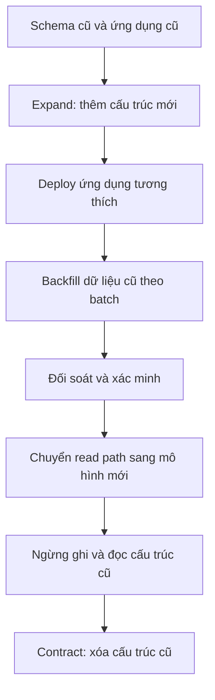
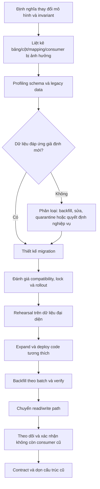

# Kiểm tra mô hình trước thay đổi lược đồ và dữ liệu cũ

Một thay đổi trong mô hình miền thường kéo theo thay đổi ở cách lưu trữ. Ta có thể tách một Value Object thành nhiều thuộc tính, đổi trạng thái của Aggregate, thêm một quan hệ, thay đổi cách biểu diễn tiền hoặc loại bỏ một trường không còn ý nghĩa. Nhưng database đang chứa dữ liệu được tạo bởi nhiều phiên bản ứng dụng và nhiều quy tắc nghiệp vụ trong quá khứ. Thay đổi class Java hoặc mapping ORM không tự động làm cho dữ liệu cũ trở nên hợp lệ theo mô hình mới.

Trước khi thay đổi lược đồ (schema) hoặc chuyển đổi dữ liệu cũ (legacy data), cần kiểm tra đồng thời ba thứ: **mô hình miền muốn biểu diễn điều gì, cấu trúc lưu trữ hiện tại đang bảo đảm điều gì, và dữ liệu thực tế có đáp ứng giả định mới hay không**. Nếu chỉ sửa entity rồi để ORM tự cập nhật schema, hệ thống có thể mất dữ liệu, khóa bảng lâu, đọc sai giá trị hoặc triển khai thất bại khi phiên bản cũ và mới cùng chạy.

Bài này trình bày cách đánh giá tác động trước migration, kiểm tra chất lượng dữ liệu cũ, thiết kế schema evolution tương thích nhiều phiên bản ứng dụng, chuyển đổi dữ liệu theo từng giai đoạn và xác minh kết quả. Ví dụ sử dụng Java/JPA và SQL minh họa; cú pháp migration cụ thể cần điều chỉnh theo database đang dùng.

Trong `DOMAIN_DRIVEN_DESIGN`, persistence và ORM là cơ chế lưu, khôi phục Aggregate và Value Object. Schema phục vụ persistence; nó cần hỗ trợ mô hình miền và invariant, nhưng không quyết định ranh giới Aggregate hay ngôn ngữ nghiệp vụ. Mọi migration quan trọng cần được kiểm tra bằng use case và quy tắc miền, không chỉ bằng việc ứng dụng khởi động thành công.

## 1. Phân biệt thay đổi mô hình miền và thay đổi schema

### 1.1. Domain Model diễn tả ý nghĩa nghiệp vụ

Domain Model mô tả Entity, Value Object, Aggregate, hành vi và invariant. Ví dụ, một `Money` có số tiền và loại tiền; một `Order` có trạng thái và các dòng hàng; một `Customer` có định danh và thông tin liên hệ.

```java
public record Money(BigDecimal amount, Currency currency) {
    public Money {
        Objects.requireNonNull(amount);
        Objects.requireNonNull(currency);
    }
}
```

Kiểu miền này biểu diễn một khái niệm có ý nghĩa. Nó không nói rằng database bắt buộc phải có một bảng `money`. Persistence có thể lưu hai cột `amount` và `currency_code`, một embedded object, một JSON document hoặc một cấu trúc khác phù hợp.

### 1.2. Persistence Model diễn tả cách lưu và khôi phục

Persistence Model gồm bảng, cột, khóa, index, constraint, quan hệ và mapping ORM. Nó có thể khác Domain Model để đáp ứng yêu cầu truy vấn, tương thích dữ liệu cũ hoặc đặc tính của database.

```text
Domain Model                 Persistence Model
------------                 ------------------
Order                        orders
  OrderId                      id
  CustomerId                   customer_id
  Money total                  total_amount
                               currency_code
  OrderStatus                  status_code
  List<OrderLine>              order_lines
```

Một Aggregate có thể được lưu qua nhiều bảng. Một số trường persistence như version, audit timestamp hoặc discriminator có thể không phải khái niệm miền. Ngược lại, một Value Object có thể được ánh xạ vào một hoặc nhiều cột mà không có bảng riêng.

### 1.3. ORM mapping không thay thế migration có kiểm soát

ORM có thể tạo schema trong môi trường phát triển, nhưng tự động cập nhật schema ở production thường không đủ để kiểm soát thay đổi nguy hiểm. Việc đổi kiểu cột, thêm `NOT NULL`, đổi tên hoặc xóa cột có thể cần backfill, kiểm tra dữ liệu và phối hợp phiên bản ứng dụng.

Với môi trường có dữ liệu quan trọng, schema migration nên được quản lý bằng công cụ/versioning rõ ràng như Flyway, Liquibase hoặc quy trình migration nội bộ. ORM mapping cần khớp với schema sau migration; không nên coi `ddl-auto=update` là kế hoạch chuyển đổi dữ liệu production.

## 2. Bắt đầu từ ý nghĩa nghiệp vụ và invariant

### 2.1. Xác định lý do thay đổi

Trước khi viết migration, hãy mô tả thay đổi bằng ngôn ngữ miền:

- Khái niệm nào thay đổi?
- Use case nào cần hành vi mới?
- Invariant nào được thêm, bỏ hoặc thay đổi?
- Dữ liệu lịch sử cần giữ nguyên ý nghĩa nào?
- Những bounded context hoặc consumer nào đang dùng dữ liệu này?

Ví dụ, thay đổi `Order.status` từ một chuỗi tự do thành tập trạng thái miền có kiểm soát không chỉ là đổi cột `VARCHAR` thành `SMALLINT`. Cần biết các giá trị cũ như `NEW`, `PENDING`, `WAITING_PAYMENT`, `DONE` đang đại diện cho trạng thái nào và có giá trị nào bị dùng sai.

### 2.2. Xác định invariant mới

Giả sử mô hình mới yêu cầu mọi đơn đã đặt phải có ít nhất một dòng hàng và có currency code rõ ràng. Hãy viết invariant trước:

- `Order` được tạo ở trạng thái `PLACED` phải có ít nhất một `OrderLine`.
- Mọi dòng hàng phải có số lượng dương.
- Tổng tiền và các dòng hàng phải dùng cùng loại tiền theo chính sách của đơn.
- Đơn cũ không xác định được currency không được tự động gán một loại tiền tùy tiện.

Các điều kiện này giúp xác định dữ liệu cần kiểm tra và quy tắc backfill. Nếu dữ liệu cũ vi phạm invariant, cần có quyết định nghiệp vụ về cách sửa, giữ trạng thái ngoại lệ hoặc cách ly bản ghi.

### 2.3. Phân biệt invariant mới với constraint vật lý

Không phải mọi invariant đều có thể biểu diễn bằng một constraint database đơn giản. `NOT NULL`, `CHECK`, `UNIQUE` và foreign key rất hữu ích cho các điều kiện dữ liệu cục bộ. Nhưng một quy tắc như “người phê duyệt không phải người yêu cầu và thuộc phòng ban hợp lệ tại thời điểm duyệt” có thể cần dữ liệu từ nhiều nguồn và hành vi miền.

Database constraint là lớp bảo vệ bổ sung, không thay thế Aggregate và domain policy. Ngược lại, kiểm tra trong Java cũng không thay thế unique constraint hoặc concurrency control khi nhiều transaction có thể ghi đồng thời.

## 3. Khảo sát schema hiện tại trước khi sửa

### 3.1. Lập danh sách đối tượng bị ảnh hưởng

Đối với mỗi bảng/cột liên quan, ghi nhận:

- Kiểu dữ liệu, độ dài, precision và scale.
- Nullability, default và constraint.
- Primary key, foreign key và unique key.
- Index, partition và trigger.
- View, stored procedure, job và báo cáo sử dụng cột.
- ORM mapping, converter và query tùy chỉnh.
- API, event payload hoặc consumer phụ thuộc vào trường dữ liệu.

Một cột có thể được dùng ngoài ứng dụng chính: BI, export, data warehouse, job đồng bộ, hệ thống kế toán hoặc script vận hành. Chỉ tìm trong codebase chưa chắc đã tìm thấy mọi consumer.

### 3.2. Tìm cách dữ liệu thực sự được ghi

Schema hiện tại không nói hết dữ liệu được tạo ra như thế nào. Cần xác định:

- Phiên bản ứng dụng nào đã ghi dữ liệu.
- Có import thủ công hoặc migration cũ nào từng chạy không.
- Có hệ thống ngoài nào ghi trực tiếp vào database không.
- Có bản ghi được tạo trước khi constraint được thêm không.
- Có logic mặc định ở database và logic mặc định ở Java khác nhau không.

Ví dụ, Java có thể coi `status = null` là `PENDING`, nhưng database lại có default `NEW`. Dữ liệu cũ có thể chứa cả hai giá trị. Migration phải dựa trên ý nghĩa thực tế, không suy ra chỉ từ tên enum hiện tại.

### 3.3. Kiểm tra phụ thuộc và đường truy cập

Đổi tên một cột có thể ảnh hưởng đến:

- JPQL, Criteria API, native SQL.
- Index và constraint có tên tham chiếu cột cũ.
- View hoặc trigger.
- ETL, CDC và data warehouse.
- API trả dữ liệu trực tiếp từ entity.
- Integration Event đã công bố cho consumer.

Nên lập bảng tác động trước khi thay đổi:

| Thành phần | Câu hỏi cần kiểm tra | Rủi ro nếu bỏ sót |
|---|---|---|
| Domain Model | Invariant và hành vi nào thay đổi? | Mô hình mới không nhất quán |
| ORM Mapping | Field, converter, fetch và cascade có thay đổi? | Runtime mapping lỗi hoặc tải sai |
| Database Schema | Cột, khóa, index, constraint nào thay đổi? | DDL thất bại hoặc khóa bảng |
| Legacy Data | Bản ghi cũ có đáp ứng quy tắc mới? | Backfill sai hoặc dữ liệu không thể đọc |
| API/Event | Consumer cũ có hiểu representation mới? | Rolling deployment bị vỡ |
| Reports/Jobs | Có truy vấn hoặc export phụ thuộc schema? | Báo cáo hoặc job lỗi |

## 4. Profiling dữ liệu cũ

Không nên viết migration dựa trên giả định rằng dữ liệu production luôn sạch. Trước khi thêm constraint hoặc đổi kiểu, hãy chạy truy vấn profiling trên bản sao dữ liệu phù hợp và thống kê các trường hợp bất thường.

### 4.1. Kiểm tra NULL và giá trị rỗng

```sql
SELECT
    COUNT(*) AS total_rows,
    SUM(CASE WHEN status IS NULL THEN 1 ELSE 0 END) AS null_status,
    SUM(CASE WHEN TRIM(status) = '' THEN 1 ELSE 0 END) AS blank_status
FROM orders;
```

Kết quả giúp biết có thể thêm `NOT NULL` ngay hay cần backfill. Cú pháp `TRIM` và cách xử lý chuỗi rỗng có thể khác giữa các database.

### 4.2. Thống kê giá trị không nằm trong tập hợp dự kiến

```sql
SELECT status, COUNT(*) AS row_count
FROM orders
GROUP BY status
ORDER BY row_count DESC;
```

So sánh toàn bộ giá trị thực tế với tập trạng thái mà domain model mới hiểu. Đừng chỉ kiểm tra các giá trị được liệt kê trong enum Java; hãy tìm giá trị legacy, typo, viết hoa/thường khác nhau và mã do hệ thống ngoài ghi.

### 4.3. Tìm bản ghi trùng khóa nghiệp vụ

```sql
SELECT tenant_id, external_order_number, COUNT(*) AS duplicate_count
FROM orders
GROUP BY tenant_id, external_order_number
HAVING COUNT(*) > 1;
```

Trước khi thêm unique constraint, phải quyết định bản ghi nào là đúng, bản ghi nào cần hợp nhất hoặc đánh dấu ngoại lệ. Không xóa trùng tự động nếu chưa biết các quan hệ, thanh toán hoặc sự kiện đã phát sinh từ từng bản ghi.

### 4.4. Tìm dữ liệu mồ côi

```sql
SELECT line.id, line.order_id
FROM order_lines line
LEFT JOIN orders ord ON ord.id = line.order_id
WHERE ord.id IS NULL;
```

Nếu có orphan row, việc thêm foreign key có thể thất bại. Cần xác định đây là dữ liệu lỗi, dữ liệu được giữ để audit hay một trường hợp hợp lệ theo chính sách cũ.

### 4.5. Kiểm tra miền giá trị và precision

```sql
SELECT COUNT(*) AS invalid_amounts
FROM orders
WHERE total_amount < 0
   OR total_amount > 999999999999.99;
```

Đối chiếu giới hạn thực tế với kiểu mới. Khi đổi `DECIMAL(p,s)`, cần tính xem có giá trị bị làm tròn, overflow hoặc mất scale không. Với ngày giờ, cần kiểm tra timezone, độ chính xác mili/micro giây và các giá trị sentinel như `1970-01-01` hoặc `9999-12-31`.

### 4.6. Lập báo cáo chất lượng dữ liệu

Mỗi kiểm tra nên ghi lại:

- Truy vấn và phiên bản script đã chạy.
- Thời điểm chụp dữ liệu.
- Tổng số bản ghi kiểm tra và số bản ghi bất thường.
- Phân loại lỗi và quy tắc xử lý được duyệt.
- Số lượng bản ghi được backfill, sửa, cách ly hoặc bỏ qua.
- Người chịu trách nhiệm xác nhận kết quả nghiệp vụ.

Không nên ghi dữ liệu nhạy cảm thô vào log migration. Dùng ID, số lượng và mã lỗi đủ để điều tra theo quyền phù hợp.

## 5. Phân loại mức độ nguy hiểm của thay đổi schema

### 5.1. Thay đổi thường tương thích (additive)

Ví dụ:

- Thêm một cột nullable.
- Thêm một bảng mới chưa được phiên bản cũ sử dụng.
- Thêm index theo cách không chặn ghi quá lâu.
- Thêm một giá trị enum mà consumer cũ có thể bỏ qua an toàn.

Ngay cả thay đổi additive cũng cần kiểm tra dung lượng, thời gian DDL, lock và hành vi ORM. Thêm cột `NOT NULL` không có default vào bảng lớn có thể không tương thích hoặc rất tốn kém tùy database.

### 5.2. Thay đổi phá vỡ tương thích (breaking)

Ví dụ:

- Xóa hoặc đổi tên cột đang được ứng dụng cũ đọc.
- Thu hẹp độ dài hoặc precision.
- Thêm `NOT NULL` khi dữ liệu hiện tại có NULL.
- Đổi kiểu dữ liệu với chuyển đổi không mất mát không được bảo đảm.
- Thay mã trạng thái hoặc ý nghĩa của một giá trị hiện có.
- Đổi cấu trúc message mà consumer cũ không hiểu.

Các thay đổi này thường cần nhiều lần phát hành, giai đoạn tương thích và thời điểm contract riêng.

### 5.3. Thay đổi ngữ nghĩa có thể nguy hiểm hơn thay đổi cấu trúc

Một cột vẫn là `VARCHAR(20)` nhưng `CLOSED` trước đây có nghĩa “đã đóng”, nay được hiểu là “đã hủy” là thay đổi ngữ nghĩa nghiêm trọng. Schema validation có thể vẫn pass trong khi hành vi nghiệp vụ sai.

Hãy phân biệt:

- **Structural migration:** thay cấu trúc lưu trữ.
- **Data migration:** chuyển đổi giá trị đã lưu.
- **Semantic migration:** thay đổi cách diễn giải dữ liệu theo quy tắc miền.

Một thay đổi có thể cần cả ba. Kiểm thử phải xác minh kết quả nghiệp vụ, không chỉ kiểu cột.

## 6. Chiến lược Expand-and-Contract

Với hệ thống triển khai rolling deployment, nhiều instance ứng dụng cũ và mới có thể chạy đồng thời. Không nên đổi schema theo cách phiên bản cũ không còn đọc/ghi được ngay lập tức. Chiến lược **Expand-and-Contract** chia migration thành giai đoạn mở rộng tương thích và giai đoạn thu hẹp sau khi mọi consumer đã chuyển đổi.

### 6.1. Giai đoạn Expand

Thêm cấu trúc mới nhưng giữ cấu trúc cũ:

- Thêm cột hoặc bảng mới ở trạng thái có thể chấp nhận dữ liệu cũ.
- Giữ cột cũ để ứng dụng phiên bản cũ tiếp tục hoạt động.
- Tạo index/constraint mới theo cách phù hợp với database và kích thước bảng.
- Chưa xóa hoặc đổi nghĩa cột đang được phiên bản cũ sử dụng.

Ví dụ, thêm `currency_code` nullable cạnh `total_amount`:

```sql
ALTER TABLE orders
ADD COLUMN currency_code VARCHAR(3);
```

Ứng dụng cũ vẫn ghi `total_amount`; ứng dụng mới có thể đọc trường mới khi đã được backfill. Đây mới là bước mở rộng, chưa phải migration hoàn tất.

### 6.2. Deploy phiên bản tương thích

Phát hành ứng dụng có thể làm việc với cả schema cũ và mới. Tùy tình huống, ứng dụng có thể:

- Đọc cột mới nếu có, fallback cột cũ trong giai đoạn chuyển tiếp.
- Ghi cả hai cột trong cùng database transaction.
- Đọc cột cũ nhưng bắt đầu populate cột mới.
- Ghi một representation mới vào bảng mới mà vẫn giữ consumer cũ hoạt động.
- Dùng trigger hoặc compatibility layer tạm thời để xử lý writer cũ nếu cần và nếu phép chuyển đổi xác định được.

Dual-write ở application cần được thiết kế cẩn thận. Hai giá trị phải được ghi nguyên tử trong cùng transaction; nếu hai hệ thống lưu trữ độc lập, cần một cơ chế đồng bộ bền vững khác. Tránh hai đường ghi có thể tạo ra hai nguồn sự thật không đồng bộ.

Lưu ý khi rolling deployment: instance cũ chỉ biết `total_amount` sẽ tiếp tục tạo hoặc sửa bản ghi mà không cập nhật `currency_code`. Vì vậy, dual-write chỉ có ở phiên bản mới chưa đủ để bảo đảm cột mới luôn đầy đủ trong lúc phiên bản cũ còn ghi. Trước khi chuyển toàn bộ read path sang cột mới, cần một trong các cách: triển khai phiên bản bridge để mọi writer cùng ghi cả hai cột và chờ hết writer cũ; dùng trigger/database compatibility layer tạm thời nếu quy tắc suy ra giá trị hoàn toàn xác định; hoặc giữ fallback đọc cột cũ, chạy backfill bù và đối soát cho đến khi không còn writer cũ. Không dùng trigger/default để bịa ra giá trị nghiệp vụ không có nguồn sự thật.

### 6.3. Backfill dữ liệu cũ

Chuyển dữ liệu hiện có sang representation mới theo batch. Backfill cần:

- Idempotent: chạy lại không làm sai hoặc nhân đôi dữ liệu.
- Có checkpoint: biết đã xử lý đến đâu.
- Có batch size và giới hạn thời gian/lock.
- Có retry và phân loại lỗi.
- Có khả năng tạm dừng, tiếp tục và đối soát.
- Không ghi đè dữ liệu mới hơn được ứng dụng cập nhật trong lúc backfill.

Với bảng lớn, tránh một transaction khổng lồ cập nhật hàng triệu dòng. Chia batch theo khóa ổn định hoặc khoảng ID, theo dõi replication lag và tải database.

### 6.4. Verify và chuyển đọc sang cấu trúc mới

Sau backfill, kiểm tra:

- Số dòng đã chuyển đổi và số dòng còn lại.
- Giá trị mới có khớp quy tắc chuyển đổi không.
- Không có NULL hoặc giá trị ngoài miền ngoài dự kiến.
- Các tổng, checksum hoặc thống kê đối soát có phù hợp.
- Ứng dụng mới đọc và ghi representation mới ổn định.
- Báo cáo, job và consumer liên quan đã tương thích.

Sau khi xác minh, có thể chuyển read path sang cột mới. Nên dùng feature flag hoặc rollout có kiểm soát nếu cần canary và khả năng quay lại đường đọc cũ trong thời gian ngắn.

### 6.5. Giai đoạn Contract

Chỉ sau khi mọi instance, job và consumer đã ngừng dùng cấu trúc cũ mới:

- Ngừng ghi cột cũ.
- Xác nhận không còn truy vấn hoặc consumer đọc cột cũ.
- Xóa code fallback và dual-write.
- Xóa cột/index/constraint cũ trong migration riêng.
- Theo dõi sau khi contract để phát hiện dependency bị bỏ sót.

Không gộp expand, backfill, chuyển đọc và xóa cột vào một lần deploy nếu hệ thống có rolling deployment hoặc dữ liệu lớn.

### 6.6. Sơ đồ các giai đoạn



## 7. Ví dụ: chuyển tổng tiền thành Money Value Object

### 7.1. Mô hình cũ

Ứng dụng cũ lưu:

```text
orders
  id
  total_amount DECIMAL(18,2)
```

Giá trị `total_amount` không có currency code. Có thể hệ thống trước đây chỉ phục vụ một thị trường, hoặc currency được suy ra từ cấu hình tenant. Trước khi thêm currency, cần xác định nguồn sự thật của loại tiền trong từng bản ghi lịch sử.

### 7.2. Mô hình mới

Domain Model muốn biểu diễn:

```java
public record Money(BigDecimal amount, Currency currency) {
    public Money {
        Objects.requireNonNull(amount);
        Objects.requireNonNull(currency);
    }
}
```

Persistence có thể dùng hai cột:

```text
orders
  id
  total_amount DECIMAL(18,2)
  currency_code VARCHAR(3)
```

### 7.3. Expand

```sql
ALTER TABLE orders
ADD COLUMN currency_code VARCHAR(3) NULL;
```

Ứng dụng mới cần đọc an toàn khi `currency_code` còn null. Không tạo `Money` với currency giả chỉ để tránh lỗi constructor; cần một đường chuyển tiếp hoặc trạng thái dữ liệu legacy được mô hình hóa rõ ở persistence boundary.

### 7.4. Xác định nguồn currency cho dữ liệu cũ

Có thể có các trường hợp:

- Currency được xác định chắc chắn từ tenant và không thay đổi trong suốt lịch sử.
- Currency được xác định từ tài khoản/đơn hàng snapshot đã lưu.
- Currency có thể thay đổi theo thời gian nên tenant hiện tại không đủ để suy ra.
- Không có dữ liệu đáng tin cậy để xác định currency.

Chỉ trường hợp đầu hoặc thứ hai có thể backfill tự động khi có bằng chứng phù hợp. Trường hợp không xác định cần được cách ly, đối soát hoặc xử lý theo quyết định nghiệp vụ; không mặc định gán `VND` chỉ vì ứng dụng hiện tại chạy ở Việt Nam.

### 7.5. Backfill có kiểm soát

Ví dụ theo cú pháp PostgreSQL, minh họa trường hợp mỗi tenant có một currency lịch sử ổn định được xác nhận:

```sql
UPDATE orders ord
SET currency_code = tenant.default_currency
FROM tenants tenant
WHERE ord.tenant_id = tenant.id
  AND ord.currency_code IS NULL;
```

Truy vấn này chỉ đúng nếu `default_currency` là nguồn sự thật lịch sử cho tất cả đơn cũ. Nếu tenant đã đổi currency, cần bảng lịch sử hiệu lực theo thời gian hoặc snapshot trên đơn. Không dùng một truy vấn đơn giản khi giả định nghiệp vụ không đúng.

### 7.6. Verify trước khi bắt buộc NOT NULL

```sql
SELECT COUNT(*) AS missing_currency
FROM orders
WHERE currency_code IS NULL;
```

Đồng thời kiểm tra mã tiền tệ nằm trong tập mã được hỗ trợ, số tiền có scale hợp lệ và tổng tiền không bị thay đổi ngoài chính sách. Khi tất cả bản ghi đã được xử lý và phiên bản ứng dụng cũ không còn ghi null, có thể thêm constraint:

```sql
ALTER TABLE orders
ALTER COLUMN currency_code SET NOT NULL;
```

Cú pháp trên là ví dụ PostgreSQL; database khác có cú pháp và chiến lược lock khác. Trên bảng lớn, cần đánh giá cách thêm constraint ít ảnh hưởng nhất.

## 8. Xử lý dữ liệu legacy không hợp lệ

### 8.1. Không giả định mọi bản ghi đều có thể chuyển đổi

Khi mô hình mới nghiêm ngặt hơn, dữ liệu cũ có thể không đáp ứng:

- Giá trị enum không còn được hỗ trợ.
- Trường bắt buộc bị null.
- Khóa ngoại bị mồ côi.
- Dữ liệu trùng theo business key mới.
- Số tiền vượt precision hoặc có scale bất thường.
- Ngày giờ không có timezone hoặc dùng sentinel.
- Trạng thái cũ không ánh xạ một-một sang trạng thái mới.

Hãy phân loại dữ liệu thành: tự động chuyển đổi được; cần quy tắc nghiệp vụ xác nhận; cần sửa thủ công; cần cách ly; hoặc không được phép tiếp tục sử dụng.

### 8.2. Không dùng default giả để che dữ liệu thiếu

Gán `UNKNOWN`, chuỗi rỗng, ID mặc định hoặc số 0 có thể khiến migration chạy thành công nhưng thay đổi ý nghĩa dữ liệu. Chỉ dùng giá trị mặc định khi miền định nghĩa rõ ý nghĩa của nó.

Ví dụ, `UNKNOWN_CURRENCY` có thể là trạng thái migration nội bộ để cách ly dữ liệu, nhưng không nên tự động trở thành một `Money` hợp lệ có thể dùng trong tính toán.

### 8.3. Bảng quarantine hoặc exception report

Với dữ liệu không thể chuyển đổi tự động, có thể lưu ID và mã lý do vào bảng quarantine hoặc tạo báo cáo exception. Bản ghi gốc cần được giữ nguyên cho đến khi có quyết định xử lý.

Quarantine cần có:

- ID nguồn và bảng nguồn.
- Mã lỗi chuyển đổi.
- Thời điểm phát hiện và phiên bản migration.
- Trạng thái xử lý.
- Người hoặc quy trình xác nhận.
- Kết quả chuyển đổi cuối cùng và khả năng truy vết.

Không sao chép toàn bộ dữ liệu nhạy cảm sang bảng quarantine nếu chỉ cần ID và thông tin tối thiểu.

### 8.4. Mapping trạng thái cũ sang trạng thái mới

Ví dụ, hệ thống cũ có `NEW`, `WAITING`, `DONE`, `CANCEL`. Mô hình mới có `DRAFT`, `PLACED`, `CONFIRMED`, `FULFILLED`, `CANCELLED`. Không thể suy luận chắc chắn rằng `DONE` luôn là `FULFILLED`; có thể nó từng biểu diễn cả giao hàng hoàn tất và thanh toán xong.

Hãy xây dựng bảng ánh xạ được chuyên gia nghiệp vụ xác nhận:

| Legacy value | Ý nghĩa đã xác minh | New representation | Cách xử lý |
|---|---|---|---|
| `NEW` | Bản nháp chưa gửi | `DRAFT` | Chuyển đổi tự động nếu dữ liệu phù hợp |
| `WAITING` | Chờ thanh toán hoặc chờ giữ chỗ? | Chưa xác định | Phân tích thêm dữ liệu liên quan |
| `DONE` | Hoàn tất theo định nghĩa cũ | `FULFILLED` hoặc trạng thái khác | Chỉ ánh xạ sau khi xác minh |
| `CANCEL` | Đã hủy | `CANCELLED` | Kiểm tra thời điểm và lý do nếu cần |

Không đưa một giá trị mơ hồ vào trạng thái mới chỉ để migration không còn lỗi. Khi ý nghĩa không rõ, hãy giữ lại dữ liệu gốc và chuyển vào luồng xử lý ngoại lệ.

## 9. Migration phải an toàn khi chạy lại và theo batch

### 9.1. Idempotency

Migration hoặc backfill có thể bị dừng giữa chừng do deploy, timeout hoặc sự cố database. Nếu chạy lại, nó không được làm hỏng dữ liệu đã chuyển đổi.

Ví dụ, cập nhật chỉ các dòng còn `currency_code IS NULL` an toàn hơn một lệnh ghi đè mọi dòng bằng currency suy ra từ cấu hình hiện tại. Tuy nhiên, điều kiện này chỉ an toàn nếu nguồn currency và quy tắc backfill đã được xác nhận.

### 9.2. Batch và checkpoint

Với bảng lớn, xử lý theo khoảng ID hoặc keyset pagination:

```text
lastProcessedId = checkpoint

while more rows:
    load next batch where id > lastProcessedId
    transform only rows that still need migration
    write batch in a bounded transaction
    verify batch result
    persist checkpoint
```

Tránh dùng offset pagination trên bảng lớn nếu dữ liệu liên tục thay đổi và offset gây chi phí cao. Chọn khóa ổn định, có index và bảo đảm không bỏ sót bản ghi.

### 9.3. Tránh ghi đè dữ liệu mới

Trong khi backfill chạy, ứng dụng mới có thể cập nhật cùng bản ghi. Backfill cần điều kiện update để chỉ chuyển đổi nếu bản ghi vẫn ở trạng thái cũ, hoặc dùng version/updated_at để phát hiện thay đổi cạnh tranh.

Ví dụ khái quát:

```sql
UPDATE orders
SET currency_code = :derivedCurrency
WHERE id = :id
  AND currency_code IS NULL
  AND version = :observedVersion;
```

Nếu số dòng được cập nhật bằng 0, bản ghi có thể đã thay đổi; đọc lại và quyết định có cần xử lý lại hay không.

### 9.4. Theo dõi tải và lock

Migration trên bảng lớn có thể tạo transaction log lớn, replication lag, lock contention hoặc làm chậm query nghiệp vụ. Cần giới hạn batch size, khoảng nghỉ, lock timeout và thời gian chạy; theo dõi CPU, I/O, deadlock, replication lag và connection pool.

Thêm index trên bảng lớn có thể cần chiến lược online/concurrent riêng của database. Không giả định một câu `CREATE INDEX` luôn không khóa ghi.

## 10. Tương thích giữa nhiều phiên bản ứng dụng

### 10.1. Backward compatibility và forward compatibility

Trong rolling deployment, phiên bản cũ có thể chạy đồng thời với phiên bản mới. Cần xác định:

- Phiên bản cũ có đọc được schema sau expand không?
- Phiên bản mới có đọc được dữ liệu cũ chưa backfill không?
- Consumer cũ có hiểu event/API representation mới không?
- Có trường nào phiên bản cũ sẽ ghi đè hoặc xóa không chủ ý không?

Backward-compatible change thường cho phép code mới đọc dữ liệu cũ. Forward-compatible change cho phép code cũ bỏ qua hoặc vẫn hoạt động khi gặp dữ liệu mới, tùy hợp đồng. Không phải mọi enum, JSON field hoặc schema message đều tự động tương thích.

### 10.2. Enum persistence

JPA `@Enumerated(EnumType.STRING)` dễ đọc hơn ordinal, nhưng đổi tên enum constant có thể làm dữ liệu cũ không deserialize được. `EnumType.ORDINAL` còn rủi ro hơn vì đổi thứ tự khai báo có thể làm một số nguyên cũ mang ý nghĩa khác.

Có thể dùng converter với mã lưu trữ ổn định:

```java
public enum OrderStatus {
    DRAFT("D"),
    PLACED("P"),
    CONFIRMED("C"),
    CANCELLED("X");

    private final String code;

    OrderStatus(String code) {
        this.code = code;
    }

    public String code() {
        return code;
    }
}
```

```java
@Converter(autoApply = true)
public class OrderStatusConverter
        implements AttributeConverter<OrderStatus, String> {

    @Override
    public String convertToDatabaseColumn(OrderStatus status) {
        return status == null ? null : status.code();
    }

    @Override
    public OrderStatus convertToEntityAttribute(String code) {
        if (code == null) return null;
        return Arrays.stream(OrderStatus.values())
            .filter(status -> status.code().equals(code))
            .findFirst()
            .orElseThrow(() -> new UnknownOrderStatusCode(code));
    }
}
```

Khi thêm hoặc đổi mã, cần migration dữ liệu và converter có khả năng đọc representation trong giai đoạn chuyển tiếp. Không dùng ordinal làm hợp đồng lưu trữ lâu dài.

Chỉ đặt `autoApply = true` khi mọi thuộc tính `OrderStatus` trong persistence unit đều dùng cùng bảng mã. Nếu một số trường có quy ước lưu khác, đặt `autoApply = false` và gắn `@Convert` tường minh tại thuộc tính cần converter này.

### 10.3. Thay đổi JSON hoặc Integration Event

Nếu lưu Value Object dưới JSON hoặc phát Integration Event, thêm field thường dễ tương thích hơn xóa/đổi kiểu field. Consumer cần xử lý field không biết theo hợp đồng; producer cần có chính sách default rõ ràng khi đọc payload cũ.

Khi thay schema event, cân nhắc version rõ ràng hoặc upcaster/adapter. Không để class nội bộ của domain trở thành hợp đồng wire format ngoài ý muốn.

### 10.4. Không xóa cột khi vẫn còn phiên bản cũ

Trong rolling deployment, một instance cũ có thể tiếp tục ghi cột cũ sau khi instance mới đã chuyển sang cột mới. Chỉ contract sau khi xác minh mọi instance, worker, scheduled job, consumer và script đã chuyển đổi.

## 11. ORM Mapping và ranh giới Domain Model

### 11.1. Embedded Value Object

Một Value Object như `Money` có thể được ánh xạ vào các cột của bảng sở hữu:

```java
@Embeddable
public class MoneyEmbeddable {
    @Column(name = "amount", precision = 18, scale = 2)
    private BigDecimal amount;

    @Column(name = "currency_code", length = 3)
    private String currencyCode;

    protected MoneyEmbeddable() {
        // Dành cho ORM nếu provider yêu cầu.
    }

    public Money toDomain() {
        return new Money(
            amount,
            Currency.getInstance(currencyCode)
        );
    }
}
```

Đây là ví dụ persistence mapping. Nếu domain model dùng record hoặc constructor bất biến, có thể dùng constructor mapping/converter hoặc persistence model riêng. Không cần ép domain Value Object có setter công khai chỉ vì ORM yêu cầu cơ chế hydrate.

### 11.2. Entity và Aggregate không đồng nghĩa với bảng

Một `OrderLine` có thể là entity con trong `Order` Aggregate và được lưu ở bảng riêng. Nó không vì thế mà cần Repository công khai riêng. Repository của `Order` tải và lưu root cùng các thành phần nội bộ.

Ngược lại, hai Aggregate độc lập có thể có quan hệ khóa ngoại trong database. Trong domain, thường tham chiếu Aggregate khác bằng ID thay vì object reference hai chiều không giới hạn.

### 11.3. Cascade cần phản ánh quyền sở hữu vòng đời

ORM cascade như `PERSIST`, `MERGE`, `REMOVE` là cơ chế persistence, không phải định nghĩa Aggregate. Chỉ cấu hình cascade khi vòng đời thành phần thực sự thuộc root và hành vi đó phù hợp với quy tắc miền.

Không dùng `CascadeType.REMOVE` cho Aggregate khác chỉ vì có quan hệ object. Xóa một Order không nên tự động xóa Customer, Product hoặc Payment Aggregate.

### 11.4. Lazy/Eager và fetch plan

Fetch strategy phải đáp ứng hành vi Aggregate mà không tải toàn bộ hệ thống. Các collection nội bộ cần cho invariant phải được nạp khi Repository trả Aggregate cho use case ghi. Các quan hệ ngoài Aggregate nên truy vấn riêng bằng ID hoặc projection.

Đổi mapping `LAZY` thành `EAGER` có thể làm tăng số query hoặc tải quá nhiều dữ liệu. Đổi `EAGER` thành `LAZY` có thể làm phát sinh lỗi khi session đóng. Hãy kiểm thử query plan và hành vi thực tế thay vì xem annotation là một tối ưu vô hại.

## 12. Thêm constraint và index sau khi dữ liệu đã sạch

### 12.1. Thêm NOT NULL

Quy trình an toàn thường là:

1. Thêm cột nullable.
2. Deploy code ghi giá trị mới.
3. Backfill dữ liệu cũ.
4. Kiểm tra không còn null.
5. Thêm constraint `NOT NULL` theo chiến lược phù hợp database.

Nếu thêm `NOT NULL` trước khi ứng dụng mới ghi giá trị, phiên bản cũ có thể lỗi khi insert.

### 12.2. Thêm UNIQUE

Trước khi thêm unique constraint, phải profiling duplicates theo đúng business key và tenant scope. Nếu unique key là `(tenant_id, external_id)`, không thể chỉ kiểm tra `external_id` toàn bảng nếu cùng một external ID hợp lệ ở nhiều tenant.

Trong lúc xử lý duplicates, cần ngăn dữ liệu mới tạo thêm duplicate. Có thể triển khai code kiểm tra trước, sau đó thêm unique constraint để database bảo vệ tính nguyên tử trước concurrent writes. Kiểm tra ở Java đơn thuần có race condition.

### 12.3. Thêm Foreign Key

Trước khi thêm foreign key, tìm orphan row và xác định chính sách xử lý. Nếu bảng lớn, cân nhắc thêm constraint theo chế độ kiểm tra từng bước hoặc chiến lược ít khóa mà database hỗ trợ.

### 12.4. Thêm Index

Index cần dựa trên query thực tế và execution plan. Index mới làm tăng chi phí ghi, dung lượng và thời gian migration. Với bảng lớn, đánh giá khả năng tạo index online/concurrently, lock và replication lag theo database cụ thể.

## 13. Rollback, Roll-forward và phục hồi

### 13.1. Không phải migration nào cũng rollback an toàn

Nếu migration chỉ thêm một cột nullable, rollback có thể đơn giản. Nhưng nếu đã hợp nhất hai bản ghi, chuẩn hóa trạng thái hoặc xóa cột cũ, không phải lúc nào cũng có thể tái tạo dữ liệu ban đầu.

Một migration có `down` script không đồng nghĩa dữ liệu có thể được phục hồi chính xác. Hãy xác định dữ liệu nào bị mất, có snapshot/backup hay không và rollback có gây mất các ghi mới sau deploy không.

### 13.2. Ưu tiên roll-forward cho thay đổi dữ liệu đã ghi nhận

Với migration đã chạy trên production, cách an toàn có thể là tạo migration sửa tiếp (roll-forward) thay vì cố đảo ngược mọi thay đổi. Cần giữ log migration, checkpoint, số lượng đã xử lý và quy tắc bù trừ.

### 13.3. Backup không thay thế rehearsal

Backup chỉ hữu ích nếu có thể khôi phục trong thời gian cho phép. Hãy diễn tập restore, xác định RPO/RTO, kiểm tra dung lượng và quyền truy cập. Với thay đổi lớn, thử migration trên bản sao dữ liệu gần thực tế và đo thời gian/lock trước khi chạy production.

### 13.4. Kế hoạch dừng và quay lại

Trước khi chạy, xác định:

- Điều kiện bắt đầu và điều kiện dừng migration.
- Ngưỡng lỗi, thời gian chạy và mức lock chấp nhận được.
- Cách pause/resume batch.
- Cách phát hiện dữ liệu sai.
- Cách chuyển ứng dụng về read path cũ nếu cần.
- Khi nào phải restore backup và ai có quyền quyết định.
- Cách bảo vệ dữ liệu mới phát sinh sau thời điểm backup.

## 14. Kiểm thử migration và mô hình sau chuyển đổi

### 14.1. Kiểm thử migration trên dữ liệu đại diện

Tạo fixture hoặc bản sao đã ẩn danh đại diện cho:

- Bản ghi bình thường.
- Giá trị null/rỗng.
- Giá trị legacy ít gặp.
- Bản ghi trùng hoặc orphan.
- Giá trị biên về độ dài, precision và thời gian.
- Bản ghi có quan hệ phức tạp hoặc lịch sử dài.

Chạy migration từ schema phiên bản cũ và xác nhận schema/dữ liệu mới đúng. Không chỉ chạy migration trên database trống vì nó không kiểm tra được dữ liệu lịch sử.

### 14.2. Kiểm thử round-trip qua Repository

Sau migration, tạo hoặc tải Aggregate qua Repository, kiểm tra Value Object, Entity con, trạng thái và invariant. Lưu lại rồi tải lại để xác nhận mapping hai chiều.

### 14.3. Kiểm thử tương thích hai phiên bản

Nếu có rolling deployment, kiểm tra:

- Phiên bản cũ chạy trên schema sau expand.
- Phiên bản mới đọc dữ liệu trước và sau backfill.
- Phiên bản cũ và mới ghi đồng thời trong giai đoạn chuyển tiếp.
- Consumer cũ xử lý message mới hoặc bỏ qua field mới đúng hợp đồng.
- Contract chỉ chạy sau khi phiên bản cũ không còn hoạt động.

### 14.4. Kiểm thử tính đúng đắn nghiệp vụ

Kiểm tra các use case quan trọng sau migration:

- Tạo Aggregate mới.
- Đọc Aggregate lịch sử.
- Thay đổi và lưu Aggregate.
- Tính tổng tiền, thuế hoặc số lượng.
- Tìm kiếm theo business key.
- Xử lý event hoặc báo cáo dựa trên dữ liệu mới.

Một migration có thể chạy xong và ORM mapping không lỗi nhưng vẫn làm thay đổi kết quả nghiệp vụ. Hãy so sánh output trước/sau bằng dữ liệu đã được xác nhận.

### 14.5. Kiểm thử hiệu năng và vận hành

Đo thời gian DDL/backfill, query latency, lock wait, deadlock, replication lag, dung lượng transaction log và ảnh hưởng đến connection pool. Thử pause/resume và retry để xác nhận quy trình vận hành được.

## 15. Quy trình kiểm tra trước khi thay đổi schema



Các bước thực hiện:

1. Mô tả ý nghĩa nghiệp vụ của thay đổi và invariant mới.
2. Xác định domain model, persistence mapping, schema và consumer bị ảnh hưởng.
3. Profiling dữ liệu thực tế để tìm null, duplicate, orphan và giá trị ngoài miền.
4. Xác định quy tắc chuyển đổi được xác nhận; cách ly dữ liệu mơ hồ.
5. Phân loại migration additive, breaking và semantic.
6. Thiết kế Expand-and-Contract nếu có nhiều phiên bản cùng chạy.
7. Viết migration/backfill idempotent, theo batch và có checkpoint.
8. Rehearsal trên bản sao dữ liệu gần production.
9. Deploy, backfill, đối soát và chuyển read path có kiểm soát.
10. Chỉ contract sau khi mọi ứng dụng, job và consumer đã chuyển đổi.
11. Theo dõi và giữ phương án roll-forward/restore phù hợp.

## 16. Những sai lầm thường gặp

**Sửa entity rồi để ORM tự đổi production schema.** Mapping không biết cách diễn giải dữ liệu cũ hoặc thời điểm an toàn để xóa cột. Quản lý migration có version và kiểm soát riêng.

**Chỉ kiểm tra schema, không profiling dữ liệu.** Constraint mới có thể thất bại hoặc dữ liệu cũ có thể bị hiểu sai. Hãy chạy truy vấn kiểm tra trước.

**Thêm NOT NULL trước khi backfill và deploy tương thích.** Phiên bản cũ có thể không ghi cột mới. Dùng các giai đoạn expand, backfill và contract.

**Đổi tên hoặc xóa cột trong một lần deploy.** Instance cũ, job hoặc consumer vẫn có thể dùng cột đó. Chờ hết dependency rồi mới contract.

**Gán default tùy tiện cho dữ liệu thiếu.** Giá trị mặc định có thể làm sai lịch sử và phép tính. Chỉ backfill khi có nguồn sự thật và quy tắc nghiệp vụ xác nhận.

**Dùng enum ordinal trong database.** Thay đổi thứ tự enum có thể đổi ý nghĩa dữ liệu. Dùng mã ổn định và converter có kiểm soát.

**Backfill trong một transaction khổng lồ.** Có thể tạo lock lâu, log lớn và khó resume. Dùng batch, checkpoint và điều kiện cập nhật idempotent.

**Dual-write không nguyên tử.** Hai representation có thể lệch nhau. Nếu cùng database, ghi trong cùng transaction; nếu khác hệ thống, dùng cơ chế đồng bộ bền vững.

**Tin rằng rollback script luôn khôi phục được dữ liệu.** Chuyển đổi mất mát hoặc ghi mới sau migration có thể không đảo ngược. Chuẩn bị roll-forward, backup và rehearsal.

**Kiểm thử chỉ trên database trống.** Không phát hiện legacy value, duplicate, orphan và null. Dùng dữ liệu đại diện đã ẩn danh.

**Nhầm schema hợp lệ với mô hình miền hợp lệ.** Database có thể lưu giá trị đúng kiểu nhưng sai ý nghĩa. Kiểm thử invariant và use case sau migration.

## 17. Checklist

Trước khi triển khai thay đổi schema hoặc dữ liệu, hãy kiểm tra:

- [ ] Thay đổi mô hình và invariant mới được mô tả rõ.
- [ ] Domain Model và Persistence Model được phân biệt.
- [ ] Đã lập danh sách bảng, cột, constraint, index, trigger, query và consumer bị ảnh hưởng.
- [ ] Đã xác định các phiên bản ứng dụng từng ghi dữ liệu.
- [ ] Đã profiling NULL, blank, duplicate, orphan, enum, range và precision.
- [ ] Quy tắc chuyển đổi legacy data được chuyên gia nghiệp vụ xác nhận.
- [ ] Dữ liệu mơ hồ được quarantine/đối soát thay vì gán default giả.
- [ ] Migration có version, được review và có thể rehearsal.
- [ ] Expand-and-Contract phù hợp với rolling deployment.
- [ ] Backfill idempotent, theo batch, có checkpoint và không ghi đè dữ liệu mới.
- [ ] Index/constraint được thêm theo chiến lược phù hợp database.
- [ ] ORM mapping, converter, cascade và fetch plan được kiểm tra.
- [ ] Đã kiểm thử tương thích ứng dụng cũ/mới và consumer.
- [ ] Có đối soát số lượng/checksum và kiểm thử use case sau migration.
- [ ] Có giám sát lock, lag, lỗi và backlog.
- [ ] Rollback/roll-forward, backup và restore rehearsal đã được xác định.
- [ ] Chỉ contract sau khi không còn consumer dùng cấu trúc cũ.

## 18. Câu hỏi tự kiểm tra

1. Vì sao thay đổi Domain Model không đồng nghĩa phải thay schema theo cùng cấu trúc class?
2. Trước khi thêm `NOT NULL`, cần kiểm tra dữ liệu nào?
3. Vì sao thêm một cột nullable thường an toàn hơn đổi tên cột ngay lập tức trong rolling deployment?
4. Expand-and-Contract gồm những giai đoạn nào?
5. Backfill cần những thuộc tính gì để có thể chạy lại sau sự cố?
6. Khi nào không được tự động gán default cho dữ liệu cũ?
7. Vì sao `EnumType.ORDINAL` có thể làm dữ liệu đổi nghĩa?
8. Làm thế nào để tránh backfill ghi đè dữ liệu mới do ứng dụng cập nhật?
9. Vì sao một migration có down script vẫn có thể không rollback an toàn?
10. Cần kiểm thử gì ngoài việc ứng dụng khởi động thành công sau migration?

**Gợi ý trả lời:**

- Câu 1: Domain Model diễn tả ý nghĩa và hành vi; schema là cách lưu trữ. Một Value Object có thể ánh xạ vào nhiều cột hoặc nhiều class có thể dùng chung cấu trúc lưu.
- Câu 2: NULL, blank, giá trị legacy, dữ liệu do phiên bản cũ ghi và mọi consumer chưa ghi cột mới; cần backfill và verify trước constraint.
- Câu 3: Cột nullable mới cho phép phiên bản cũ tiếp tục đọc/ghi schema cũ trong giai đoạn chuyển tiếp; đổi tên ngay có thể làm phiên bản cũ lỗi.
- Câu 4: Expand schema, deploy code tương thích, backfill, verify, chuyển read/write path, ngừng dùng cấu trúc cũ rồi contract/xóa cấu trúc cũ.
- Câu 5: Idempotent, batch, checkpoint, retry, điều kiện tránh ghi đè dữ liệu mới và báo cáo kết quả.
- Câu 6: Khi không có nguồn sự thật xác định giá trị đúng hoặc default làm thay đổi ý nghĩa lịch sử; cần cách ly hoặc quyết định nghiệp vụ.
- Câu 7: Ordinal lưu vị trí enum; thêm hoặc sắp xếp lại constant có thể khiến số cũ ánh xạ sang trạng thái khác.
- Câu 8: Chỉ update khi giá trị vẫn ở trạng thái cũ, dùng version/updated_at hoặc checkpoint và đọc lại các dòng bị thay đổi cạnh tranh.
- Câu 9: Dữ liệu có thể đã bị hợp nhất/xóa hoặc ghi mới sau migration; đảo schema không tái tạo được dữ liệu ban đầu.
- Câu 10: Kiểm thử migration trên dữ liệu đại diện, round-trip Repository, invariant, use case, tương thích hai phiên bản, concurrency và hiệu năng/vận hành.

## Kết luận

Thay đổi schema an toàn bắt đầu từ việc hiểu ý nghĩa miền và dữ liệu thực tế. Hãy xác định invariant mới, khảo sát mọi consumer, profiling legacy data và phân loại rủi ro cấu trúc lẫn ngữ nghĩa trước khi viết migration. Với hệ thống đang hoạt động, Expand-and-Contract, backfill idempotent theo batch, đối soát và chuyển đổi từng bước giúp phiên bản cũ và mới cùng tồn tại trong thời gian triển khai. ORM chỉ là lớp ánh xạ; Repository và Aggregate vẫn phải khôi phục, bảo vệ đúng trạng thái miền. Kiểm thử trên dữ liệu đại diện, giám sát vận hành và kế hoạch roll-forward/restore là phần của thiết kế migration, không phải việc bổ sung sau cùng.
