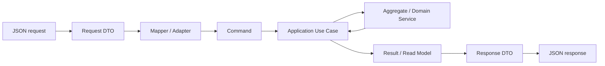

# Tránh trả trực tiếp toàn bộ aggregate qua JSON

Trong Domain-Driven Design (DDD), Aggregate là mô hình nghiệp vụ có trạng thái, hành vi và invariant cần được bảo vệ. API là hợp đồng trao đổi dữ liệu giữa ứng dụng với client như trình duyệt, mobile app hoặc hệ thống đối tác. Hai mục tiêu này khác nhau: Aggregate biểu diễn quy tắc domain; API cung cấp dữ liệu ổn định, vừa đủ và phù hợp với nhu cầu của người gọi.

Nếu Controller trả thẳng Aggregate qua JSON, cấu trúc nội bộ của domain sẽ vô tình trở thành hợp đồng công khai. Một thay đổi trong Aggregate có thể làm đổi JSON mà client đang phụ thuộc. Các trường nội bộ có thể bị lộ, quan hệ hai chiều có thể gây vòng lặp serialize, lazy loading có thể tạo truy vấn ngoài ý muốn và client có thể gửi ngược những field mà họ không được quyền thay đổi.

Cách thiết kế phù hợp là xác định rõ dữ liệu API cần nhận và trả, rồi tạo DTO (Data Transfer Object) tương ứng. Application Layer chuyển đổi giữa API DTO và mô hình use case/domain; Aggregate vẫn chịu trách nhiệm bảo vệ invariant. DTO không phải bản sao toàn bộ Entity. Nó là hình dạng dữ liệu được thiết kế cho một hợp đồng và một mục đích cụ thể.

Bài viết dùng API đặt hàng để giải thích vì sao không nên serialize trực tiếp Aggregate, cách thiết kế request/response DTO, cách ánh xạ dữ liệu và những điểm cần kiểm tra về bảo mật, hiệu năng, versioning và ranh giới Bounded Context.

## 1. Aggregate và JSON phục vụ hai mục tiêu khác nhau

Aggregate là một ranh giới nhất quán trong mô hình domain. Nó nhóm các đối tượng cần được bảo vệ bởi một Aggregate Root. API JSON là định dạng truyền dữ liệu qua một ranh giới giao tiếp.

Một Aggregate Order có thể chứa:

- OrderId và trạng thái đơn.
- CustomerId của người đặt.
- Các OrderLine và giá tại thời điểm đặt.
- Địa chỉ giao hàng.
- Các Domain Event đang chờ được xử lý.
- Những quy tắc và phương thức dùng để đặt, hủy hoặc thay đổi đơn.

Một API trả thông tin đơn hàng cho người mua có thể chỉ cần:

- Mã đơn và trạng thái hiển thị.
- Ngày tạo đơn.
- Danh sách dòng hàng với tên, số lượng và đơn giá.
- Tổng tiền.
- Địa chỉ giao hàng đã chọn.

API này không cần phơi bày toàn bộ hành vi, object reference, thông tin nội bộ hoặc trạng thái kỹ thuật của Aggregate.

### 1.1. Aggregate là mô hình hành vi, DTO là hợp đồng dữ liệu

| Tiêu chí | Aggregate / Domain Model | API DTO |
|---|---|---|
| Mục tiêu | Bảo vệ quy tắc và trạng thái nghiệp vụ | Trao đổi dữ liệu qua API |
| Cấu trúc | Theo khái niệm và invariant domain | Theo nhu cầu của từng endpoint/use case |
| Hành vi | Có phương thức domain | Thường chỉ mang dữ liệu |
| Danh tính | Entity và Aggregate Root có identity | Có thể chứa ID để tham chiếu |
| Quan hệ | Có thể chứa Entity con và Value Object | Chỉ thể hiện dữ liệu cần gửi |
| Thay đổi | Theo quy tắc domain | Theo version và compatibility của API |
| Quyền truy cập | Được kiểm soát qua hành vi domain | Chỉ công khai field được phép |

DTO thường không có hành vi nghiệp vụ. Nó không nên trở thành nơi thay thế Aggregate để kiểm tra các invariant quan trọng.

### 1.2. Không có quy tắc một Entity tương ứng một DTO

Một Aggregate có thể phục vụ nhiều API khác nhau:

- Chi tiết đơn hàng cho người mua.
- Danh sách đơn hàng cho nhân viên vận hành.
- Thông tin đơn hàng rút gọn cho màn hình dashboard.
- Payload tích hợp cho hệ thống vận chuyển.

Mỗi nhu cầu có thể cần một DTO khác nhau. Ngược lại, một response DTO có thể tổng hợp dữ liệu từ nhiều Aggregate hoặc Read Model.

Vì vậy, không nên tạo DTO chỉ bằng cách sao chép mọi field của Entity rồi đổi hậu tố thành Dto. Hãy bắt đầu từ câu hỏi: client cần biết điều gì để thực hiện công việc của nó?

## 2. Rủi ro khi trả trực tiếp Aggregate qua JSON

Serialize một object graph domain thành JSON có vẻ nhanh lúc đầu, nhưng thường tạo ra các vấn đề khó kiểm soát khi ứng dụng phát triển.

### 2.1. Làm lộ dữ liệu nội bộ

Aggregate có thể chứa thông tin không dành cho client:

- Ghi chú nội bộ của nhân viên.
- Chi tiết đánh giá rủi ro hoặc lý do từ chối.
- Giá vốn, biên lợi nhuận hoặc thông tin nhà cung cấp.
- Dữ liệu định danh hoặc thông tin nhạy cảm.
- Cờ kỹ thuật, version persistence hoặc trạng thái xử lý nội bộ.
- Domain Event chưa được công bố.

Nếu serialize toàn bộ object, chỉ cần thêm một field vào Aggregate cũng có thể khiến dữ liệu đó xuất hiện trong API mà không có chủ ý.

Ví dụ, Order có thể chứa field `internalNote` dành riêng cho bộ phận vận hành. Nếu response trả trực tiếp Order, người mua có thể nhìn thấy ghi chú này sau một thay đổi mapping hoặc cấu hình serializer.

DTO tạo allowlist rõ ràng: chỉ field được khai báo mới được đưa ra hợp đồng.

### 2.2. Lộ cấu trúc nội bộ và làm client phụ thuộc domain model

Giả sử domain đổi cách biểu diễn địa chỉ từ bốn field riêng thành một Value Object `PostalAddress`. Nếu JSON được tạo trực tiếp từ Aggregate, cấu trúc response có thể đổi theo:

```json
{
  "shippingAddress": {
    "street": "12 Nguyen Hue",
    "district": "District 1",
    "city": "Ho Chi Minh City"
  }
}
```

Sau khi refactor domain, serializer có thể tạo một cấu trúc khác dù ý nghĩa API không đổi. Client phải sửa theo cấu trúc nội bộ mà họ không cần biết.

Nếu response DTO được định nghĩa độc lập, domain có thể thay đổi cách tổ chức mà API vẫn giữ hợp đồng cũ.

### 2.3. Vòng lặp tham chiếu khi serialize object graph

Mô hình đối tượng có thể có quan hệ hai chiều:

- Order tham chiếu Customer.
- Customer giữ danh sách Order.
- Order chứa OrderLine.
- OrderLine tham chiếu lại Order.

Serializer đi theo các tham chiếu này có thể lặp vô hạn hoặc phát sinh JSON lồng sâu ngoài dự kiến.

Ví dụ đơn giản:

```java
class Order {
    private Customer customer;
}

class Customer {
    private List<Order> orders;
}
```

Nếu serializer lần theo `order.customer.orders[0].customer...`, nó có thể gặp vòng lặp. Một số thư viện có annotation để bỏ qua hoặc xử lý tham chiếu, nhưng đó là cách xử lý ở tầng serialization. Thiết kế DTO cho phép chỉ biểu diễn quan hệ cần thiết, thường bằng ID hoặc dữ liệu tóm tắt.

### 2.4. Lazy loading và truy vấn ngoài ý muốn

ORM có thể tải quan hệ khi serializer đọc getter. Một response tưởng như chỉ cần một truy vấn có thể kích hoạt nhiều truy vấn bổ sung:

- Đọc Order.
- Đọc Customer.
- Đọc từng OrderLine.
- Đọc Product cho từng dòng.
- Đọc Payment hoặc Shipment cho từng đơn.

Điều này dễ tạo N+1 query, tăng thời gian phản hồi hoặc phát sinh lỗi lazy initialization khi persistence context đã đóng.

DTO giúp xác định dữ liệu cần truy vấn. Query có thể dùng projection, fetch plan hoặc Read Model phù hợp thay vì serialize một object graph không giới hạn.

### 2.5. Client có thể phụ thuộc vào những field không ổn định

Nếu API trả toàn bộ Aggregate, client có thể bắt đầu sử dụng bất kỳ field nào xuất hiện trong JSON. Sau đó, một field vốn chỉ phục vụ nội bộ trở thành phụ thuộc ngầm của client.

Khi cần đổi tên, xóa hoặc đổi kiểu field, đội phát triển phải cân nhắc compatibility với nhiều client. Hợp đồng API cần được thiết kế và version hóa có chủ ý, không nên phát sinh tự động từ cấu trúc domain.

### 2.6. Nguy cơ mass assignment khi nhận JSON trực tiếp

Rủi ro không chỉ xuất hiện khi trả response. Nếu Controller nhận JSON rồi deserialize trực tiếp vào Aggregate, client có thể gửi các field mà họ không được phép thay đổi.

Ví dụ, request của người mua có thể chứa `status`, `totalAmount`, `approvedBy` hoặc `paymentState`. Nếu object binding cho phép gán các field đó, client có thể cố thay đổi trạng thái hoặc giá trị do server kiểm soát.

Request DTO giới hạn rõ những dữ liệu client được gửi. Aggregate vẫn tự kiểm tra và thực hiện hành vi hợp lệ.

## 3. Thiết kế Request DTO theo hành động của API

Request DTO biểu diễn dữ liệu đầu vào của một endpoint hoặc use case. Nó chỉ nên chứa những thông tin mà client được phép cung cấp cho hành động đó.

Ví dụ, API yêu cầu đặt một đơn đã được tạo ở trạng thái Draft có thể chỉ nhận mã đơn:

```java
public record PlaceOrderRequest(
    String orderId
) {}
```

Controller chuyển request DTO thành Command:

```java
@RestController
@RequestMapping("/api/orders")
public class OrderController {
    private final PlaceOrderUseCase placeOrder;

    public OrderController(PlaceOrderUseCase placeOrder) {
        this.placeOrder = placeOrder;
    }

    @PostMapping("/{orderId}/place")
    public ResponseEntity<PlaceOrderResponse> place(
            @PathVariable String orderId) {

        PlaceOrderResult result = placeOrder.handle(
            new PlaceOrderCommand(new OrderId(orderId))
        );

        return ResponseEntity.ok(
            new PlaceOrderResponse(
                result.orderId().value(),
                result.status().name()
            )
        );
    }
}
```

Trong ví dụ này, client không được gửi trạng thái mới. Hành động `place` được biểu diễn bằng endpoint và use case; Aggregate quyết định chuyển trạng thái có hợp lệ hay không.

### 3.1. Tách request theo từng use case

Không nên dùng một `OrderRequest` lớn cho mọi hành động như tạo đơn, sửa địa chỉ, đặt đơn và hủy đơn.

Mỗi hành động có dữ liệu đầu vào khác nhau:

| Use case | Request DTO có thể chứa |
|---|---|
| Tạo đơn nháp | Danh sách sản phẩm, số lượng, địa chỉ giao hàng |
| Thay đổi số lượng | Order ID, Line ID, số lượng mới |
| Đổi địa chỉ giao hàng | Order ID, địa chỉ mới |
| Đặt đơn | Order ID hoặc thông tin xác nhận cần thiết |
| Hủy đơn | Order ID, lý do hủy do người dùng cung cấp nếu được phép |

Tách DTO giúp giới hạn dữ liệu được phép thay đổi và làm rõ ý nghĩa của từng endpoint.

### 3.2. Không nhận các field do server kiểm soát

Những field sau thường do server hoặc domain quyết định:

- ID được sinh theo chính sách hệ thống.
- Trạng thái Order.
- Tổng tiền và số tiền giảm giá.
- Người phê duyệt.
- Thời điểm tạo hoặc hoàn tất.
- Version persistence.
- Trạng thái thanh toán được xác nhận từ Payment Context.

Nếu client cần đề xuất một giá trị, hãy đặt tên và kiểm tra nó như một input nghiệp vụ cụ thể. Ví dụ, `requestedDeliveryDate` có thể là yêu cầu của khách; `confirmedDeliveryDate` là kết quả được hệ thống xác nhận. Không nên dùng một field chung cho cả hai ý nghĩa.

### 3.3. Validation ở DTO không thay thế invariant domain

Request DTO có thể dùng Bean Validation để kiểm tra cấu trúc:

```java
public record ChangeQuantityRequest(
    @NotNull UUID lineId,
    @Positive int quantity
) {}
```

Validation này giúp từ chối request thiếu ID hoặc số lượng không hợp lệ trước khi vào use case. Tuy nhiên, nó không thay thế các quy tắc như:

- Đơn đã đặt thì không được sửa số lượng.
- Dòng hàng phải thuộc đúng Order.
- Người gọi phải có quyền sửa đơn.
- Số lượng mới không được vượt hạn mức mua.

Những điều kiện phụ thuộc trạng thái và ngữ cảnh nghiệp vụ cần được kiểm tra trong Application/Domain theo đúng trách nhiệm. Aggregate phải bảo vệ invariant mà mọi đường gọi đều cần tuân thủ.

## 4. Thiết kế Response DTO theo nhu cầu người gọi

Response DTO định nghĩa dữ liệu API sẽ công khai. Nó nên chứa đúng thông tin cần thiết cho client, với tên field và kiểu dữ liệu ổn định.

Ví dụ, người mua xem chi tiết đơn:

```java
public record OrderDetailResponse(
    String orderId,
    String status,
    Instant placedAt,
    List<OrderLineResponse> lines,
    AddressResponse shippingAddress,
    MoneyResponse total
) {}

public record OrderLineResponse(
    String productCode,
    String productName,
    int quantity,
    MoneyResponse unitPrice,
    MoneyResponse lineTotal
) {}

public record AddressResponse(
    String recipientName,
    String street,
    String district,
    String city,
    String postalCode
) {}

public record MoneyResponse(
    String amount,
    String currency
) {}
```

DTO này không cần chứa phương thức `place()`, collection các Aggregate khác hoặc toàn bộ dữ liệu của Customer. Nó chỉ mô tả phần thông tin người mua cần hiển thị.

### 4.1. Dùng DTO khác nhau cho các góc nhìn khác nhau

Một danh sách đơn hàng thường không cần toàn bộ chi tiết:

```java
public record OrderSummaryResponse(
    String orderId,
    String status,
    Instant createdAt,
    String totalAmount,
    String currency,
    int lineCount
) {}
```

Màn hình quản trị có thể cần thêm thông tin vận hành:

```java
public record OrderOperationsResponse(
    String orderId,
    String status,
    String customerReference,
    String paymentStatus,
    String fulfillmentStatus,
    Instant createdAt
) {}
```

Ba response có thể lấy dữ liệu từ cùng Aggregate hoặc các Read Model khác nhau. Việc chúng khác nhau là bình thường vì người mua, nhân viên vận hành và dashboard có mục tiêu khác nhau.

### 4.2. DTO có thể tổng hợp dữ liệu từ nhiều Aggregate

Một response dashboard có thể kết hợp Order, Payment và Shipment. Không cần tạo một Aggregate khổng lồ chỉ để trả về một JSON có đầy đủ các phần đó.

Ví dụ:

```java
public record OrderTrackingResponse(
    String orderId,
    String orderStatus,
    String paymentStatus,
    List<ShipmentTrackingResponse> shipments
) {}

public record ShipmentTrackingResponse(
    String trackingCode,
    String deliveryStatus,
    Instant estimatedDeliveryAt
) {}
```

Application Query Service có thể lấy dữ liệu từ các nguồn tương ứng và dựng response. DTO phản ánh góc nhìn truy vấn, còn mỗi Aggregate vẫn giữ quyền quản lý trạng thái của mình.

### 4.3. Không đưa Entity hoặc Aggregate con vào DTO

Một response không nên chứa trực tiếp `Customer`, `Product`, `OrderLine` hoặc một class domain khác. Hãy chuyển chúng thành DTO hoặc kiểu dữ liệu đơn giản phù hợp.

Ví dụ, thay vì:

```java
public record BadOrderResponse(
    Order order,
    Customer customer
) {}
```

Hãy tạo response chỉ gồm dữ liệu cần công khai:

```java
public record OrderDetailResponse(
    String orderId,
    String customerDisplayName,
    List<OrderLineResponse> lines,
    String status
) {}
```

Cách này ngăn domain object bị serialize đệ quy và tránh để API phụ thuộc trực tiếp vào class nội bộ.

## 5. Luồng chuyển đổi giữa API DTO, Command và Aggregate

Một kiến trúc phổ biến có thể tổ chức theo luồng:



Mỗi bước có trách nhiệm riêng:

- Request DTO biểu diễn hợp đồng đầu vào.
- Mapper chuyển kiểu giao thức thành kiểu ứng dụng/domain.
- Command diễn đạt ý định use case.
- Application Service điều phối.
- Aggregate và Domain Service thực hiện quy tắc.
- Result hoặc Read Model mang dữ liệu cần trả.
- Response DTO biểu diễn hợp đồng đầu ra.

Không phải ứng dụng nào cũng cần một class riêng cho từng mũi tên. Với use case đơn giản, Controller có thể chuyển đổi trực tiếp vài field. Khi mapping phức tạp hoặc được dùng nhiều nơi, hãy tách mapper để giữ trách nhiệm rõ ràng.

### 5.1. Controller không nên trở thành nơi chứa logic domain

Controller thường chịu trách nhiệm:

- Nhận HTTP request.
- Chuyển đổi path/query/body thành input model.
- Gọi use case.
- Chuyển kết quả thành HTTP status và response DTO.

Controller không nên tự tính tổng tiền, thay trạng thái Aggregate hoặc truy cập field nội bộ để quyết định nghiệp vụ.

### 5.2. Application Layer không nhất thiết phải biết HTTP DTO

Một cách tách rõ là Controller chuyển `PlaceOrderRequest` thành `PlaceOrderCommand`, rồi use case trả `PlaceOrderResult`. Response mapper chuyển kết quả đó thành `PlaceOrderResponse`.

Như vậy, Application Layer không cần phụ thuộc vào annotation Jackson, `ResponseEntity` hoặc cấu trúc JSON. Cùng use case có thể được gọi từ REST Controller, message handler hoặc CLI.

Trong ứng dụng nhỏ, có thể dùng cùng một record cho Command và input DTO nếu nó không làm Application phụ thuộc vào giao thức. Khi API và use case có nhu cầu khác nhau, hãy tách chúng.

### 5.3. Không ánh xạ máy móc mọi field

Mapper cần chuyển đổi có chủ đích:

- ID dạng chuỗi của API thành `OrderId`.
- Chuỗi tiền tệ thành `Currency` đã được xác thực.
- Giá trị số lượng thành `Quantity`.
- Domain status thành trạng thái API được công bố.
- Value Object địa chỉ thành cấu trúc response ổn định.

Không nên dùng reflection mapper để tự động sao chép tất cả field giữa Aggregate và DTO mà không có allowlist. Mapping tường minh giúp reviewer nhận ra dữ liệu nào đang được công khai hoặc nhận từ client.

## 6. Ví dụ Java: tạo đơn từ Request DTO đến Aggregate

Giả sử người mua tạo một đơn nháp với các sản phẩm và địa chỉ giao hàng.

### 6.1. Request DTO

```java
public record CreateOrderRequest(
    @NotEmpty List<@Valid CreateOrderLineRequest> lines,
    @NotNull @Valid AddressRequest shippingAddress
) {}

public record CreateOrderLineRequest(
    @NotBlank String productCode,
    @Positive int quantity
) {}

public record AddressRequest(
    @NotBlank String recipientName,
    @NotBlank String street,
    @NotBlank String city,
    @NotBlank String postalCode
) {}
```

Request chỉ nhận mã sản phẩm, số lượng và địa chỉ khách cung cấp. Client không gửi Order ID, giá bán được xác nhận hoặc trạng thái thanh toán.

### 6.2. Command và kiểu dữ liệu ứng dụng

```java
public record CreateOrderCommand(
    List<RequestedOrderLine> lines,
    ShippingAddress shippingAddress
) {}

public record RequestedOrderLine(
    ProductCode productCode,
    Quantity quantity
) {}
```

Command sử dụng kiểu có ý nghĩa trong ứng dụng/domain. Nó không mang annotation HTTP hoặc Jackson.

### 6.3. Mapper từ Request sang Command

```java
@Component
public class CreateOrderRequestMapper {
    public CreateOrderCommand toCommand(CreateOrderRequest request) {
        List<RequestedOrderLine> lines = request.lines().stream()
            .map(line -> new RequestedOrderLine(
                new ProductCode(line.productCode()),
                new Quantity(line.quantity())
            ))
            .toList();

        AddressRequest address = request.shippingAddress();

        ShippingAddress shippingAddress = new ShippingAddress(
            address.recipientName(),
            address.street(),
            address.city(),
            address.postalCode()
        );

        return new CreateOrderCommand(lines, shippingAddress);
    }
}
```

Trong thực tế, constructor của Value Object nên kiểm tra và chuẩn hóa dữ liệu theo quy tắc domain. Mapper có thể chuyển đổi lỗi định dạng thành lỗi đầu vào phù hợp.

### 6.4. Application Use Case

```java
public final class CreateOrderUseCase {
    private final OrderRepository orders;
    private final ProductCatalog products;

    public CreateOrderUseCase(
            OrderRepository orders,
            ProductCatalog products) {
        this.orders = orders;
        this.products = products;
    }

    public OrderCreatedResult handle(CreateOrderCommand command) {
        List<OrderLine> lines = command.lines().stream()
            .map(requested -> {
                Product product = products
                    .findByCode(requested.productCode())
                    .orElseThrow(ProductNotFoundException::new);

                return OrderLine.create(
                    product.id(),
                    product.name(),
                    requested.quantity(),
                    product.currentPrice()
                );
            })
            .toList();

        Order order = Order.createDraft(
            OrderId.newId(),
            lines,
            command.shippingAddress()
        );

        orders.save(order);

        return new OrderCreatedResult(order.id());
    }
}
```

Use case tải thông tin sản phẩm qua port phù hợp, tạo các dòng hàng theo giá hiện tại và yêu cầu Order factory tạo Aggregate hợp lệ. Giá được xác định từ nguồn có thẩm quyền của hệ thống, không tin giá client gửi lên.

Đây là ví dụ minh họa. Một hệ thống thực tế cần xử lý số lượng tồn kho, giá có hiệu lực, khuyến mãi, thuế, transaction và idempotency theo quy trình nghiệp vụ. Nếu tạo đơn nháp không cần giữ giá cố định, có thể chọn thời điểm định giá khác; điều đó phải được xác nhận bằng quy tắc domain.

### 6.5. Response DTO

```java
public record CreateOrderResponse(
    String orderId,
    String status
) {}

public record OrderCreatedResult(
    OrderId orderId,
    OrderStatus status
) {}
```

Controller ánh xạ kết quả:

```java
@PostMapping
public ResponseEntity<CreateOrderResponse> create(
        @Valid @RequestBody CreateOrderRequest request) {

    CreateOrderCommand command = requestMapper.toCommand(request);
    OrderCreatedResult result = createOrder.handle(command);

    CreateOrderResponse response = new CreateOrderResponse(
        result.orderId().value().toString(),
        result.status().name()
    );

    return ResponseEntity.status(HttpStatus.CREATED).body(response);
}
```

Trong thiết kế đầy đủ, trạng thái trả về đến từ kết quả use case thay vì hard-code. Ví dụ đã rút gọn để thể hiện ranh giới giữa request, command, domain và response.

## 7. DTO cho cập nhật: tránh biến request thành lệnh ghi toàn bộ object

Một lỗi thường gặp là tạo endpoint `PUT /orders/{id}` nhận toàn bộ Order JSON, rồi ánh xạ ngược thành Aggregate. Cách này dễ khiến client ghi đè các field không liên quan hoặc gửi trạng thái không hợp lệ.

### 7.1. Dùng request theo hành động

Ví dụ, đổi số lượng một dòng hàng:

```java
public record ChangeOrderLineQuantityRequest(
    @NotNull UUID lineId,
    @Positive int quantity
) {}
```

Use case có thể thực hiện:

```java
public void handle(
        OrderId orderId,
        ChangeOrderLineQuantityCommand command) {

    Order order = orders.findById(orderId)
        .orElseThrow(OrderNotFoundException::new);

    order.changeLineQuantity(
        new OrderLineId(command.lineId()),
        new Quantity(command.quantity())
    );

    orders.save(order);
}
```

Aggregate kiểm tra trạng thái đơn, xác minh dòng hàng thuộc chính đơn đó và áp dụng quy tắc thay đổi số lượng.

### 7.2. Phân biệt PUT và PATCH ở mức hợp đồng

- PUT thường biểu diễn thay thế representation của một tài nguyên theo contract đã định nghĩa.
- PATCH biểu diễn thay đổi một phần.
- Command endpoint có thể diễn đạt hành động rõ ràng như `/place`, `/cancel` hoặc `/change-quantity`.

Dù dùng HTTP method nào, không nên cho phép client sửa các field domain mà họ không có quyền. Cần xác định semantics của request và xử lý rõ field bị thiếu, field null hoặc field không được phép.

### 7.3. Không dùng DTO như một Aggregate có thể deserialize

Một request chứa toàn bộ `OrderDetailResponse` rồi ánh xạ thành Order có thể tạo ra nhiều vấn đề:

- Client có thể sửa `status`, `total`, `customerId` hoặc dữ liệu kiểm toán.
- Dữ liệu cũ có thể ghi đè thay đổi mới.
- Field không được gửi có thể bị gán null hoặc giá trị mặc định.
- Quy tắc chuyển trạng thái bị bỏ qua.
- Các thành phần thuộc Aggregate khác có thể bị cập nhật ngoài quyền sở hữu.

Request DTO nên biểu diễn ý định và dữ liệu đầu vào được phép; use case tải Aggregate hiện tại rồi yêu cầu hành vi cụ thể.

## 8. DTO và bảo mật API

DTO là một lớp bảo vệ quan trọng, nhưng không thay thế authorization hoặc validation.

### 8.1. Chỉ công khai field được phép

Response DTO cần được xem như allowlist. Trước khi thêm field, hãy hỏi:

- Người gọi có quyền xem dữ liệu này không?
- Dữ liệu có chứa thông tin cá nhân hoặc nội bộ không?
- Field có cần thiết cho use case hiện tại không?
- Giá trị có thể được suy ra hoặc khai thác để lộ thông tin khác không?

Một API quản trị và API cho khách hàng có thể dùng response DTO khác nhau dù cùng đọc một Aggregate.

### 8.2. Không tin dữ liệu do client gửi

Client có thể sửa JSON bằng DevTools hoặc gọi API trực tiếp. Không tin các field như:

- `customerId` nếu danh tính khách hàng phải lấy từ security context.
- `unitPrice` nếu giá do Product Catalog hoặc Pricing quyết định.
- `discountAmount` nếu giảm giá do policy xác định.
- `paymentStatus` nếu Payment Context là nguồn có thẩm quyền.
- `approvedBy` nếu người phê duyệt phải lấy từ danh tính đã xác thực.

Nếu client được phép chọn một đối tượng liên quan, hãy xác thực quyền truy cập và quan hệ của đối tượng đó trong Application/Domain.

### 8.3. DTO không thay thế authorization theo đối tượng

Việc request chỉ chứa `orderId` không đảm bảo người gọi có quyền thao tác trên Order đó. Use case hoặc policy bảo mật cần xác minh người gọi có quyền thực hiện hành động.

Tương tự, response DTO không nên được tạo chỉ bằng cách bỏ các field nhạy cảm ở Controller sau khi đã nạp toàn bộ dữ liệu không cần thiết. Query nên chỉ lấy dữ liệu mà caller được phép xem, theo chính sách truy cập.

### 8.4. Không để lỗi nội bộ rò qua JSON

Exception domain hoặc persistence không nên được serialize trực tiếp thành response. API nên chuyển chúng thành error DTO có cấu trúc ổn định, không phơi stack trace, SQL, tên bảng hoặc thông tin nội bộ.

Ví dụ:

```json
{
  "type": "https://api.example.com/problems/order-state",
  "title": "Không thể đặt đơn hàng",
  "status": 409,
  "code": "ORDER_INVALID_STATE",
  "detail": "Đơn hàng hiện không ở trạng thái cho phép đặt."
}
```

Thông báo chi tiết cần phù hợp với người gọi và chính sách bảo mật. Log nội bộ có thể giữ correlation ID và thông tin chẩn đoán cần thiết, nhưng response công khai không nên chứa dữ liệu nhạy cảm.

## 9. DTO, hiệu năng và Read Model

DTO giúp kiểm soát payload, nhưng chỉ tạo DTO không tự động làm truy vấn hiệu quả. Nếu mapper gọi getter của nhiều quan hệ lazy, vấn đề N+1 vẫn có thể xảy ra.

### 9.1. Chọn dữ liệu ngay từ truy vấn

Với trang danh sách, thường không cần tải Aggregate đầy đủ. Có thể truy vấn projection chỉ gồm field cần thiết:

```java
public interface OrderSummaryView {
    UUID getOrderId();
    String getStatus();
    Instant getCreatedAt();
    BigDecimal getTotalAmount();
}
```

Query adapter có thể ánh xạ projection thành `OrderSummaryResponse`. Đây là read path; nó không cần dựng toàn bộ Aggregate nếu không thực hiện hành vi domain.

### 9.2. Phân biệt write model và read model

Write model thường tập trung bảo vệ invariant và thay đổi Aggregate. Read model có thể tối ưu cho truy vấn, tìm kiếm, tổng hợp và phân trang.

Một response API có thể được tạo từ:

- Aggregate sau khi use case thay đổi.
- Projection từ database.
- Read Model được cập nhật từ Domain Event.
- Dữ liệu tổng hợp từ nhiều Bounded Context qua hợp đồng tích hợp.

Không cần ép tất cả API đọc qua Aggregate chỉ vì DDD sử dụng Repository cho Aggregate.

### 9.3. Không trả collection không giới hạn

Một Aggregate có thể có hàng nghìn dòng hoặc lịch sử sự kiện. Response chi tiết không nên mặc định trả tất cả dữ liệu.

Hãy cân nhắc:

- Pagination cho danh sách.
- Giới hạn số lượng phần tử.
- Endpoint riêng cho lịch sử hoặc chi tiết mở rộng.
- Summary DTO cho màn hình tổng quan.
- Cursor pagination khi dữ liệu thay đổi thường xuyên.
- Projection chỉ lấy các field cần thiết.

Payload nhỏ hơn giúp giảm băng thông và thời gian serialize, đồng thời tránh biến một API thành cơ chế tải toàn bộ object graph.

## 10. Versioning và tính tương thích của API

API là hợp đồng giữa các hệ thống có vòng đời triển khai độc lập. Domain model có thể thay đổi thường xuyên hơn hợp đồng công khai.

### 10.1. Thay đổi nội bộ không nhất thiết làm đổi API

Ví dụ, domain đổi từ `fullName` sang Value Object `PersonName`, nhưng API vẫn trả:

```json
{
  "recipientName": "Nguyen An"
}
```

Mapper chuyển cấu trúc mới thành field cũ. Client không cần biết domain đã refactor.

### 10.2. Thay đổi response cần cân nhắc compatibility

| Thay đổi | Rủi ro với client cũ |
|---|---|
| Thêm field optional | Thường tương thích nếu client bỏ qua field lạ |
| Đổi tên field | Phá vỡ client đang đọc field cũ |
| Xóa field | Phá vỡ client đang phụ thuộc field |
| Đổi kiểu dữ liệu | Có thể gây lỗi parse hoặc logic |
| Đổi ý nghĩa field | Nguy hiểm vì JSON vẫn parse nhưng nghiệp vụ sai |
| Thay cấu trúc lồng nhau | Có thể phá vỡ mapping client |

Đừng cho rằng thêm field luôn an toàn trong mọi client. Một số client hoặc schema validator có thể từ chối field không biết. Hãy tuân theo compatibility policy của API và kiểm tra consumer thực tế.

### 10.3. Không dùng domain version làm API version

`@Version` của JPA hoặc version của Aggregate phục vụ concurrency/persistence. Nó không phải version của hợp đồng HTTP.

API version có thể được quản lý qua URL, header, media type hoặc chính sách tương thích. Domain model và API contract cần có vòng đời thay đổi riêng.

### 10.4. DTO giúp hỗ trợ nhiều phiên bản API

Nếu cần hỗ trợ client cũ, có thể giữ response DTO v1 và tạo response DTO v2, cùng ánh xạ từ application result hoặc read model. Không nhất thiết duy trì hai phiên bản Aggregate.

Điều này cho phép domain tiếp tục phát triển trong khi API migration diễn ra theo lộ trình rõ ràng.

## 11. DTO và Bounded Context

Trong DDD, cùng một khái niệm có thể có ý nghĩa khác nhau ở các Bounded Context. API DTO là một phần của hợp đồng tại ranh giới context, nên không nên dùng chung một domain class xuyên qua mọi context.

Ví dụ, Product có thể được mô hình hóa khác nhau:

- Product Catalog quản lý tên, mô tả, danh mục và trạng thái công bố.
- Ordering cần ProductId, tên và giá tại thời điểm mua.
- Inventory cần SKU, vị trí kho và số lượng.
- Analytics cần các thuộc tính phục vụ phân tích.

Khi Ordering công bố dữ liệu cho Shipping, nó có thể gửi một integration DTO chứa OrderId, địa chỉ giao hàng và các dòng hàng cần giao. Shipping chuyển payload đó thành mô hình nội bộ của mình. Nó không cần nhận class Order của Ordering.

### 11.1. API DTO không phải Domain Event

Request DTO mô tả ý định đầu vào. Response DTO mô tả kết quả hoặc dữ liệu đọc. Domain Event mô tả một sự việc đã xảy ra trong domain.

| Loại | Ví dụ | Ý nghĩa |
|---|---|---|
| Request DTO / Command | `PlaceOrderRequest` | Client yêu cầu đặt đơn |
| Response DTO | `OrderDetailResponse` | API trả thông tin đơn |
| Domain Event | `OrderPlaced` | Đơn đã được đặt thành công trong domain |
| Integration Event | `OrderPlacedIntegrationEvent` | Thông báo ổn định cho context/hệ thống khác |

Integration Event thường có contract riêng, metadata như event ID, occurredAt, schema version và payload được chọn lọc. Không nên serialize trực tiếp Aggregate hoặc Domain Event nội bộ rồi gửi qua message broker.

### 11.2. Chuyển đổi qua Anti-Corruption Layer khi tích hợp

Khi nhận payload từ hệ thống ngoài, adapter có thể chuyển DTO của đối tác thành Command hoặc kiểu domain nội bộ. Domain không nên phụ thuộc trực tiếp tên field, enum hoặc cấu trúc JSON của nhà cung cấp.

Nếu đối tác đổi `shipment_state` thành `delivery_status`, chỉ adapter mapping cần thay đổi nếu ý nghĩa nghiệp vụ không đổi.

## 12. Quy trình thiết kế DTO cho một endpoint

Có thể dùng quy trình sau khi xây dựng API mới hoặc refactor endpoint đang trả trực tiếp Aggregate.

### Bước 1: Xác định mục tiêu của endpoint

Viết rõ người gọi muốn làm gì hoặc cần xem gì. Ví dụ: “Người mua xem trạng thái và các dòng hàng của một đơn”.

Tránh bắt đầu bằng việc lấy class Order rồi quyết định field nào sẽ serialize.

### Bước 2: Xác định dữ liệu được phép gửi hoặc nhận

Với request, lập allowlist field client được phép cung cấp. Với response, lập danh sách field caller được phép xem và thực sự cần.

Tách dữ liệu do client đề xuất khỏi dữ liệu do hệ thống xác nhận.

### Bước 3: Xác định use case và mô hình domain liên quan

Request được chuyển thành Command. Use case tải Aggregate hoặc gọi Query Service. Quy tắc domain được thực hiện trong Aggregate, Value Object hoặc Domain Service.

Không để DTO quyết định trạng thái nghiệp vụ hoặc trở thành Aggregate thứ hai.

### Bước 4: Thiết kế response theo nhu cầu sử dụng

Chọn kiểu dữ liệu, tên field, quan hệ lồng nhau, định dạng thời gian, tiền tệ và quy tắc null. Xác định có cần summary, detail hoặc operations view riêng không.

### Bước 5: Viết mapper tường minh

Chuyển đổi giữa request/response và kiểu ứng dụng/domain. Mapper không nên tự thực hiện quyết định nghiệp vụ như tính giá hoặc xác nhận thanh toán.

Nếu mapping cần dữ liệu từ nhiều nguồn, hãy đặt việc truy vấn và phối hợp ở Query Service/Application Layer.

### Bước 6: Kiểm tra bảo mật và quyền truy cập

Xác minh caller có quyền thực hiện hành động và xem từng phần dữ liệu. Đừng tin ID hoặc field nhạy cảm do client gửi.

### Bước 7: Kiểm tra hiệu năng và payload

Xác định query có tải lazy relation không, có N+1 không, có trả collection quá lớn không và có thể dùng projection hay pagination không.

### Bước 8: Kiểm tra compatibility

Đánh giá ảnh hưởng của việc thêm, đổi tên, xóa hoặc đổi kiểu field. Xác định API versioning và cách chuyển đổi client nếu cần.

### Bước 9: Viết test ở đúng ranh giới

- Mapper test xác minh chuyển đổi field và kiểu dữ liệu.
- Controller/API test xác minh JSON, HTTP status và validation.
- Application test xác minh use case được gọi với dữ liệu đúng.
- Domain test xác minh invariant.
- Query/integration test xác minh dữ liệu được truy vấn đúng và không phát sinh vấn đề persistence quan trọng.

## 13. Những sai lầm thường gặp

**Trả trực tiếp Aggregate từ Controller.** Domain model trở thành hợp đồng API ngoài ý muốn, dễ lộ field và gây coupling. Hãy tạo response DTO phù hợp với endpoint.

**Dùng một DTO cho mọi thao tác.** Request tạo, sửa, đặt và hủy đơn có quyền và dữ liệu khác nhau. Tách DTO theo use case.

**Nhận toàn bộ Aggregate từ JSON rồi lưu lại.** Client có thể ghi đè trạng thái, giá, người phê duyệt hoặc dữ liệu nội bộ. Hãy nhận Command/Request DTO giới hạn và gọi hành vi trên Aggregate đã nạp.

**Tạo DTO bằng cách sao chép tất cả field Entity.** Điều này chỉ đổi tên lớp mà không tạo ranh giới hợp đồng. Chọn field theo nhu cầu và quyền truy cập.

**Đưa Entity con hoặc Value Object domain vào response.** JSON vẫn phụ thuộc object graph nội bộ và có thể gặp vòng lặp/lazy loading. Ánh xạ sang kiểu response riêng.

**Dùng annotation serializer để che mọi field nhạy cảm.** Annotation có thể hỗ trợ, nhưng allowlist DTO rõ ràng dễ review hơn và không để serialization policy chi phối domain model.

**Đặt logic nghiệp vụ trong mapper.** Mapper nên chuyển đổi biểu diễn. Quyết định giá, trạng thái hoặc quyền thay đổi thuộc domain/application.

**Cho rằng DTO tự giải quyết bảo mật.** DTO giới hạn field nhưng không xác minh caller có quyền trên Order. Cần authorization theo đối tượng và use case.

**Dùng Aggregate đầy đủ cho API đọc danh sách.** Query có thể dùng projection hoặc Read Model. Không cần tải object graph chỉ để hiển thị vài field.

**Serialize Domain Event nội bộ thành Integration Event.** Event nội bộ có thể thay đổi theo mô hình. Hãy định nghĩa contract tích hợp ổn định và mapping riêng.

**Dùng JPA version làm API version.** Hai version phục vụ mục đích khác nhau. Persistence concurrency không thay thế versioning hợp đồng API.

## 14. Checklist trước khi công khai JSON

**Hợp đồng**

- Endpoint có mục tiêu và người gọi rõ ràng không?
- Request/response DTO có được thiết kế theo use case không?
- Field có tên, kiểu và ý nghĩa ổn định không?
- Có đang phơi bày class Aggregate hoặc Entity con không?

**Dữ liệu đầu vào**

- Client chỉ gửi field được phép thay đổi không?
- Các field do server kiểm soát có bị loại khỏi request không?
- Validation cấu trúc và validation domain có ở đúng nơi không?
- ID tham chiếu có được xác thực quyền truy cập không?

**Dữ liệu đầu ra**

- Response chỉ chứa field caller được phép xem không?
- Có lộ ghi chú nội bộ, dữ liệu cá nhân hoặc trạng thái kỹ thuật không?
- Có vòng tham chiếu hoặc quan hệ lồng sâu không cần thiết không?
- Có trả collection lớn hoặc dữ liệu dư thừa không?

**Mapping và truy vấn**

- Mapping có tường minh và dễ review không?
- Mapper có vô tình thực hiện logic nghiệp vụ không?
- Query có kích hoạt lazy loading hoặc N+1 không?
- Có thể dùng projection hoặc Read Model không?

**Vận hành và compatibility**

- API có chính sách versioning không?
- Thay đổi field có tương thích client cũ không?
- Error response có tránh lộ stack trace và SQL không?
- DTO và Integration Event có contract riêng không?
- Test đã kiểm tra JSON, validation, authorization và mapping chưa?

## 15. Kết luận

Aggregate và API DTO phục vụ hai mục tiêu khác nhau. Aggregate bảo vệ hành vi, trạng thái và invariant của domain. DTO định nghĩa dữ liệu được phép đi qua ranh giới API. Trả trực tiếp Aggregate qua JSON làm lộ cấu trúc nội bộ, tạo phụ thuộc giữa client và domain model, có thể gây vòng lặp serialize, lazy loading, truy vấn dư thừa và mass assignment.

Hãy thiết kế Request DTO theo hành động và quyền của client; thiết kế Response DTO theo nhu cầu đọc; chuyển đổi qua Application Layer; để Aggregate thực hiện hành vi và bảo vệ invariant. Với truy vấn tổng hợp, dùng Query Service hoặc Read Model phù hợp. Với tích hợp giữa Bounded Context, định nghĩa contract riêng thay vì gửi domain object nội bộ.

DTO không phải lớp dữ liệu phụ được tạo ra cho đủ kiến trúc. Nó là hợp đồng có chủ đích, giúp domain tiếp tục phát triển mà không buộc mọi client phải thay đổi theo cấu trúc nội bộ của Aggregate.

