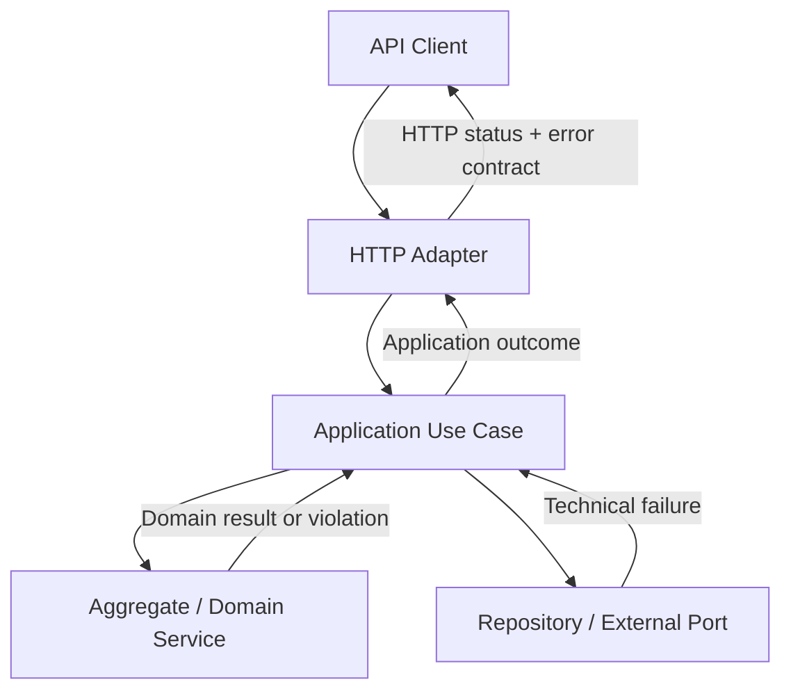

# Ánh xạ lỗi nghiệp vụ thành phản hồi có thể hiểu và xử lý

Một hệ thống có thể từ chối một yêu cầu vì nhiều lý do: đơn hàng đã được xác nhận, số dư không đủ, phiên bản dữ liệu đã thay đổi, người gọi không có quyền hoặc dịch vụ lưu trữ đang tạm thời không khả dụng. Những tình huống này không cùng một loại lỗi và không nên được trả về bằng một thông báo chung như “Request failed”.

Trong Domain-Driven Design (DDD), mô hình miền chịu trách nhiệm nhận biết và diễn đạt các quy tắc nghiệp vụ. Application layer điều phối use case và xác định kết quả của thao tác. API adapter chuyển kết quả đó thành giao thức mà client hiểu được, chẳng hạn HTTP status, error code và cấu trúc Problem Details.

Mục tiêu của việc ánh xạ là giúp client hiểu điều gì đã xảy ra, có thể làm gì tiếp theo và có thể xử lý kết quả bằng máy. Hợp đồng lỗi cần ổn định, không để lộ chi tiết nội bộ và không biến lỗi kỹ thuật thành một quyết định nghiệp vụ giả.

## Mục tiêu học tập

Sau bài này, bạn có thể:

- Phân biệt lỗi nghiệp vụ, lỗi đầu vào, lỗi quyền truy cập, xung đột đồng thời và lỗi kỹ thuật.
- Đặt trách nhiệm phát hiện và chuyển đổi lỗi ở đúng layer.
- Thiết kế error code ổn định và thông tin lỗi hữu ích cho client.
- Ánh xạ kết quả miền sang HTTP status và Problem Details.
- Phân biệt 400, 401, 403, 404, 409, 412, 422 và 5xx theo ngữ nghĩa.
- Trả lỗi validation theo từng field mà không làm lộ dữ liệu nhạy cảm.
- Xử lý localization, correlation ID, retry và idempotency.
- Kiểm thử mapping lỗi và tính tương thích của API contract.

## 1. Không phải mọi lỗi đều giống nhau

Một request không thành công có thể xuất phát từ nhiều nguyên nhân:

- **Lỗi đầu vào:** request thiếu trường bắt buộc, sai định dạng hoặc vi phạm giới hạn của hợp đồng API.
- **Lỗi nghiệp vụ:** yêu cầu hợp lệ về cú pháp nhưng không được phép theo quy tắc miền, ví dụ đơn đã giao không thể bị hủy.
- **Lỗi quyền truy cập:** actor chưa đăng nhập hoặc không được phép thực hiện hành động.
- **Xung đột trạng thái/đồng thời:** dữ liệu đã thay đổi kể từ lúc client đọc hoặc một thao tác cạnh tranh đã thắng.
- **Lỗi phụ thuộc bên ngoài:** database, broker hoặc payment provider tạm thời không khả dụng.
- **Lỗi hệ thống không dự kiến:** bug, vi phạm giả định nội bộ hoặc lỗi lập trình.

Nếu tất cả đều được chuyển thành HTTP 400 với thông báo “Invalid request”, client không thể phân biệt trường hợp nào cần sửa dữ liệu, trường hợp nào cần đăng nhập, trường hợp nào nên tải lại và trường hợp nào có thể thử lại sau.

| Loại lỗi | Ví dụ | Hướng xử lý của client |
| --- | --- | --- |
| Đầu vào | Thiếu orderId hoặc quantity âm | Sửa request |
| Nghiệp vụ | Đơn đã giao nên không thể hủy | Hiển thị lý do hoặc chọn hành động khác |
| Quyền | Người dùng không có quyền xác nhận đơn | Đăng nhập hoặc yêu cầu quyền phù hợp |
| Xung đột | Version đã cũ | Tải lại và quyết định lại |
| Phụ thuộc ngoài | Payment provider timeout | Thử lại theo chính sách hoặc kiểm tra trạng thái |
| Lỗi bất ngờ | Null pointer hoặc lỗi lập trình | Báo lỗi chung và cung cấp mã truy vết |

Một thông báo lỗi hữu ích trả lời ba câu hỏi: điều gì đã xảy ra, nó được nhận diện bằng mã nào và bên gọi có thể làm gì tiếp theo.

## 2. Phân chia trách nhiệm giữa Domain, Application và API

Không nên để Entity hoặc Domain Service phụ thuộc HTTP status hay cấu trúc JSON. Một quy tắc như “đơn đã giao không thể hủy” vẫn đúng dù use case được gọi từ REST API, message handler, CLI hay một tác vụ nền.

Có thể phân chia trách nhiệm như sau:

- **Domain Model:** phát hiện vi phạm bất biến hoặc trả kết quả nghiệp vụ có ý nghĩa, ví dụ OrderCannotBeCancelled.
- **Application Service:** điều phối use case, tải Aggregate, kiểm tra quyền ứng dụng, xử lý kết quả miền và phân biệt lỗi phụ thuộc.
- **API Adapter:** ánh xạ kết quả ứng dụng sang HTTP status, response body, header và định dạng lỗi của API.
- **Infrastructure Adapter:** chuyển lỗi kỹ thuật của database/provider thành lỗi tích hợp có ngữ nghĩa đủ an toàn để application xử lý.



### Domain không nên biết HTTP

Không viết logic như:

```java
if (order.isDelivered()) {
    throw new ResponseStatusException(
        HttpStatus.CONFLICT,
        "Order cannot be cancelled"
    );
}
```

Đoạn code trên buộc mô hình miền phụ thuộc Spring Web. Nếu cùng quy tắc được gọi từ message consumer hoặc batch job, lớp miền vẫn mang khái niệm HTTP dù không có HTTP request nào.

Thay vào đó, miền diễn đạt lỗi bằng một kiểu miền:

```java
public final class OrderCannotBeCancelled
        extends RuntimeException {
    public OrderCannotBeCancelled(OrderId orderId) {
        super("Order cannot be cancelled: " + orderId);
    }
}
```

Hoặc trả một kết quả nghiệp vụ tường minh nếu việc từ chối là nhánh bình thường của use case. Application layer hoặc adapter sẽ quyết định cách biểu diễn ra bên ngoài.

Thông điệp exception trong ví dụ chỉ phục vụ nội bộ. Không nên mặc định trả nguyên văn nó cho client vì có thể chứa ID nội bộ, dữ liệu nhạy cảm hoặc chi tiết triển khai.

## 3. Chọn giữa Domain Exception và Result Type

Có hai cách thường gặp để diễn đạt một hành vi không thể thực hiện.

### Dùng exception cho vi phạm hoặc tình huống bất thường theo luồng gọi

Exception có thể phù hợp khi một hành vi được yêu cầu nhưng vi phạm điều kiện miền và caller không thể tiếp tục luồng hiện tại:

```java
public void cancel(CancellationReason reason) {
    if (status == OrderStatus.DELIVERED) {
        throw new OrderCannotBeCancelled(id);
    }

    status = OrderStatus.CANCELLED;
    cancellationReason = reason;
}
```

Exception mang ý nghĩa miền, không phải mã HTTP. Nó không nên được dùng cho mọi nhánh điều khiển thông thường nếu việc từ chối là kết quả dự kiến và xảy ra thường xuyên.

### Dùng Result Type cho các kết quả nghiệp vụ có thể dự đoán

Nếu use case có nhiều kết quả bình thường, có thể biểu diễn bằng kiểu kết quả:

```java
public sealed interface CancelOrderOutcome
    permits Cancelled, CancellationRejected, OrderNotFound {}

public record Cancelled(OrderId orderId)
    implements CancelOrderOutcome {}

public record CancellationRejected(
    String reasonCode
) implements CancelOrderOutcome {}

public record OrderNotFound(OrderId orderId)
    implements CancelOrderOutcome {}
```

Application Service có thể trả các kết quả này để API adapter ánh xạ. Không cần dùng exception để biểu diễn một nhánh đã được mô tả trong hợp đồng use case.

### Chọn cách nào?

| Tiêu chí | Domain Exception | Result Type |
| --- | --- | --- |
| Cách diễn đạt | Luồng hiện tại bị gián đoạn | Kết quả là một nhánh tường minh |
| Phù hợp khi | Vi phạm điều kiện hoặc không thể tiếp tục | Nhiều kết quả nghiệp vụ dự kiến |
| Caller | Bắt exception có kiểu ở ranh giới phù hợp | Pattern matching hoặc kiểm tra kiểu kết quả |
| Chi phí | Cần quản lý exception mapping | Cần định nghĩa các variant |
| Lưu ý | Không dùng exception chung chung cho mọi thứ | Không biến mọi lỗi kỹ thuật thành result nghiệp vụ |

Hai cách có thể cùng tồn tại trong một hệ thống. Điều quan trọng là domain không trả HTTP response và API adapter không phải đoán ý nghĩa từ chuỗi thông báo.

## 4. Thiết kế error code ổn định

Client cần một mã lỗi ổn định để xử lý bằng chương trình. Không nên yêu cầu client so sánh nội dung message vì message có thể được dịch, chỉnh sửa hoặc thay đổi cách diễn đạt.

Ví dụ các mã lỗi:

| Error code | Ý nghĩa | Có thể hành động tiếp? |
| --- | --- | --- |
| ORDER_NOT_FOUND | Không tìm thấy đơn | Kiểm tra ID hoặc quyền truy cập |
| ORDER_ALREADY_CONFIRMED | Đơn đã được xác nhận | Không gửi lại cùng hành động |
| ORDER_CANNOT_BE_CANCELLED | Trạng thái hiện tại không cho phép hủy | Chọn hành động khác |
| ORDER_VERSION_CONFLICT | Dữ liệu đã thay đổi | Tải lại và đánh giá lại |
| PAYMENT_PROVIDER_UNAVAILABLE | Nhà cung cấp thanh toán tạm thời không khả dụng | Có thể retry theo chính sách |
| REQUEST_VALIDATION_FAILED | Input không đáp ứng hợp đồng | Sửa field được chỉ ra |

Một error code tốt có các đặc điểm:

- Ổn định giữa các phiên bản API tương thích.
- Không phụ thuộc vào ngôn ngữ hiển thị.
- Có ý nghĩa rõ ràng và không quá tổng quát.
- Không chứa ID người dùng, token hoặc dữ liệu nhạy cảm.
- Có thể được ghi log, đo lường và tìm kiếm.
- Có thể được tài liệu hóa để client biết cách xử lý.

Không dùng tên class Java làm public error code. Việc đổi tên class nội bộ không nên buộc client thay đổi. Cũng không dùng mã lỗi database như SQLSTATE hoặc tên exception của provider làm hợp đồng công khai.

### Tách code, message và detail

- **code:** mã máy đọc ổn định, ví dụ ORDER_VERSION_CONFLICT.
- **title:** mô tả ngắn cho con người, có thể được dịch.
- **detail:** giải thích cụ thể trong phạm vi an toàn.
- **instance:** URI hoặc định danh của lần xảy ra lỗi nếu cần.
- **correlationId/traceId:** mã để tìm log nội bộ, nếu chính sách cho phép công khai.

Code phục vụ logic của client; message phục vụ người đọc. Không nên dùng message làm khóa điều khiển chương trình.

## 5. Ánh xạ sang HTTP status code

HTTP status thể hiện loại kết quả ở cấp giao thức. Nó không phải bản sao trực tiếp của domain error code.

| HTTP status | Ngữ nghĩa | Ví dụ |
| --- | --- | --- |
| 400 Bad Request | Request không hợp lệ ở mức cú pháp hoặc hợp đồng | JSON sai, thiếu tham số bắt buộc |
| 401 Unauthorized | Thiếu hoặc không hợp lệ thông tin xác thực | Token hết hạn |
| 403 Forbidden | Đã nhận diện caller nhưng không cho phép hành động | Không có quyền xác nhận đơn |
| 404 Not Found | Không tìm thấy tài nguyên hoặc không tiết lộ sự tồn tại | Order ID không tồn tại |
| 409 Conflict | Xung đột với trạng thái hiện tại của tài nguyên | Đơn đã được xác nhận, version xung đột |
| 412 Precondition Failed | Điều kiện HTTP được gửi qua request header không thỏa | If-Match ETag không còn khớp |
| 422 Unprocessable Content | Nội dung hiểu được nhưng không thể xử lý theo ngữ nghĩa/hợp đồng | Field hợp lệ về cú pháp nhưng vi phạm quy tắc xử lý |
| 429 Too Many Requests | Vượt giới hạn tần suất | Rate limit |
| 500 Internal Server Error | Lỗi server không dự kiến | Bug hoặc lỗi không phân loại |
| 502/503/504 | Lỗi gateway hoặc dịch vụ tạm thời | Upstream lỗi, unavailable hoặc timeout |

### Phân biệt 400 và 422

Một quy ước phổ biến là dùng 400 cho lỗi parse hoặc cấu trúc request và 422 cho nội dung có cấu trúc hợp lệ nhưng không thể xử lý. Tuy nhiên, một API có thể chọn 400 cho cả validation errors nếu hợp đồng đã định nghĩa nhất quán. Điều quan trọng là client có thể nhận diện chi tiết field và error code.

### Phân biệt 409 và 412

Nếu client gửi version trong body và ứng dụng phát hiện xung đột trạng thái, 409 thường phù hợp. Nếu client dùng HTTP conditional request như If-Match và ETag không còn khớp, 412 diễn đạt chính xác việc precondition của giao thức thất bại.

Không trả 412 chỉ vì database optimistic lock thất bại nếu request không hề có precondition HTTP. Hãy ánh xạ theo hợp đồng mà client đã sử dụng.

### 401 và 403

401 có nghĩa request thiếu hoặc có credentials không hợp lệ; response thường cần challenge phù hợp với cơ chế xác thực. 403 có nghĩa server hiểu caller nhưng từ chối quyền thực hiện. Trong một số hệ thống, 404 được dùng thay 403 để không tiết lộ tài nguyên có tồn tại hay không. Đây là chính sách bảo mật cần được áp dụng nhất quán.

### Không dùng 200 cho mọi lỗi

Trả HTTP 200 với body chứa `success=false` hoặc `error=true` làm client khó sử dụng semantics HTTP, middleware, cache và monitoring. Chỉ dùng kiểu response như vậy nếu giao thức cấp cao hơn có hợp đồng riêng và được thiết kế rõ ràng; với REST/HTTP thông thường, hãy dùng status phù hợp.

## 6. Dùng Problem Details cho response lỗi HTTP

RFC 9457 định nghĩa Problem Details cho HTTP APIs. Response thường dùng media type `application/problem+json` và cung cấp các trường chuẩn:

- type: URI nhận diện loại vấn đề.
- title: tên ngắn của vấn đề.
- status: HTTP status.
- detail: mô tả cụ thể cho lần xảy ra lỗi.
- instance: định danh lần xảy ra lỗi.

API có thể thêm extension members như code, errors hoặc correlationId. Các extension cần được tài liệu hóa và giữ tương thích. Giá trị status trong body phải khớp với HTTP status thực tế của response; không chỉ đặt status trong JSON rồi gửi HTTP 200.

Ví dụ response khi đơn không thể hủy:

```json
{
  "type": "https://api.example.com/problems/order-cannot-be-cancelled",
  "title": "Order cannot be cancelled",
  "status": 409,
  "detail": "The order has already been dispatched.",
  "instance": "/orders/ORD-204/cancellation",
  "code": "ORDER_CANNOT_BE_CANCELLED",
  "correlationId": "01JQ8M5K7T2W9Y4A"
}
```

URI type nên ổn định và có thể trỏ tới tài liệu mô tả loại lỗi. Không cần tạo một trang riêng cho từng lần xảy ra lỗi; type định danh loại vấn đề, còn instance nhận diện lần xảy ra cụ thể nếu API có nhu cầu.

### Lỗi validation theo field

Một lỗi validation có thể chỉ ra nhiều field cùng lúc:

```json
{
  "type": "https://api.example.com/problems/request-validation",
  "title": "Request validation failed",
  "status": 422,
  "code": "REQUEST_VALIDATION_FAILED",
  "errors": [
    {
      "field": "quantity",
      "code": "QUANTITY_MUST_BE_POSITIVE",
      "message": "Quantity must be greater than zero."
    },
    {
      "field": "shippingAddress.postalCode",
      "code": "POSTAL_CODE_INVALID",
      "message": "Postal code format is invalid."
    }
  ]
}
```

Tên field phải khớp với API contract, không nhất thiết trùng tên property trong Domain Model. Không trả giá trị nhạy cảm đã nhận trong request nếu nó có thể chứa thông tin cá nhân hoặc bí mật.

## 7. Tạo một error contract trong Java

Có thể chuẩn hóa lỗi ở application boundary bằng một kiểu dữ liệu không phụ thuộc HTTP:

```java
public record ApplicationError(
    String code,
    String messageKey,
    Map<String, Object> parameters,
    ErrorCategory category
) {}

public enum ErrorCategory {
    VALIDATION,
    NOT_FOUND,
    FORBIDDEN,
    BUSINESS_RULE,
    CONFLICT,
    TEMPORARY_DEPENDENCY,
    INTERNAL
}
```

Domain có thể dùng các exception có kiểu hoặc domain result. Application layer chuyển chúng thành ApplicationError hoặc outcome tương ứng. API adapter ánh xạ ApplicationError sang HTTP status và Problem Details.

Ví dụ mapper:

```java
public final class HttpErrorMapper {
    public HttpStatus statusFor(ApplicationError error) {
        return switch (error.code()) {
            case "REQUEST_MALFORMED" -> HttpStatus.BAD_REQUEST;
            case "REQUEST_VALIDATION_FAILED" ->
                HttpStatus.UNPROCESSABLE_ENTITY;
            case "ORDER_NOT_FOUND" -> HttpStatus.NOT_FOUND;
            case "ACCESS_DENIED" -> HttpStatus.FORBIDDEN;
            case "ORDER_ALREADY_CONFIRMED",
                 "ORDER_CANNOT_BE_CANCELLED",
                 "ORDER_VERSION_CONFLICT" -> HttpStatus.CONFLICT;
            case "PRECONDITION_FAILED" -> HttpStatus.PRECONDITION_FAILED;
            case "PAYMENT_PROVIDER_UNAVAILABLE" ->
                HttpStatus.SERVICE_UNAVAILABLE;
            default -> HttpStatus.INTERNAL_SERVER_ERROR;
        };
    }
}
```

Đây là chính sách ví dụ ánh xạ theo public error code và ngữ nghĩa của API. ErrorCategory vẫn hữu ích để phân nhóm log và metric, nhưng quá rộng để tự quyết định status cho mọi trường hợp: một BUSINESS_RULE có thể là 409 hoặc 422 tùy ý nghĩa và hợp đồng. Các code chưa được ánh xạ tường minh cần đi qua fallback an toàn và được ghi log để đội phát triển bổ sung mapping.

### Giữ mapping ở adapter

Controller advice hoặc exception handler có thể tập trung việc chuyển application outcomes thành HTTP:

```java
@RestControllerAdvice
public final class ApiExceptionHandler {
    private final ProblemDetailsFactory problems;

    public ApiExceptionHandler(ProblemDetailsFactory problems) {
        this.problems = problems;
    }

    @ExceptionHandler(OrderCannotBeCancelled.class)
    public ResponseEntity<ProblemDetail> handle(
        OrderCannotBeCancelled exception
    ) {
        ProblemDetail problem = problems.create(
            HttpStatus.CONFLICT,
            "ORDER_CANNOT_BE_CANCELLED",
            "The order cannot be cancelled in its current state."
        );

        return ResponseEntity
            .status(HttpStatus.CONFLICT)
            .body(problem);
    }
}
```

Handler không trả trực tiếp exception.getMessage(). Nó chọn error code công khai và nội dung đã được kiểm soát. Nếu Application Service đã trả Result Type thay vì ném exception, presenter/controller có thể pattern-match các variant và dùng cùng một ProblemDetailsFactory.

## 8. Thông điệp lỗi, localization và tính ổn định

Message có thể được dịch theo ngôn ngữ của người dùng. Error code cần ổn định để client không phải thay đổi logic khi message thay đổi.

Một hợp đồng có thể chứa messageKey nội bộ như `order.cannot-cancel`. API adapter dùng locale đã được xác định để chọn nội dung phù hợp. Tuy nhiên, không bắt client phải dịch messageKey nội bộ nếu API không công bố nó như hợp đồng.

Nên phân biệt:

- **Public error code:** ổn định, dành cho client.
- **Localized message:** dành cho người dùng.
- **Internal exception message:** phục vụ debug, không tự động công khai.
- **Log detail:** thông tin vận hành, có thể chứa dữ liệu nhạy cảm nên cần chính sách bảo vệ.

Nếu client cần hành động theo lỗi, hãy dùng code và extension field có cấu trúc, không parse câu tiếng Việt hoặc tiếng Anh.

## 9. Không làm lộ thông tin nội bộ hoặc nhạy cảm

Response lỗi là một bề mặt API và cần được kiểm soát như response thành công. Không trả:

- Stack trace hoặc tên package/class nội bộ.
- SQL, tên bảng, connection string hoặc thông tin database.
- Access token, API key, password hoặc secret.
- Dữ liệu cá nhân của người khác.
- Thông tin cho phép đoán sự tồn tại của tài nguyên khi chính sách yêu cầu che giấu.
- Chi tiết cấu hình hoặc topology của hạ tầng.

Trong môi trường production, lỗi không dự kiến thường trả một thông báo chung và correlationId. Log nội bộ lưu exception gốc với trace phù hợp và quyền truy cập được kiểm soát.

Ví dụ:

```json
{
  "type": "https://api.example.com/problems/internal-error",
  "title": "An unexpected error occurred",
  "status": 500,
  "code": "INTERNAL_ERROR",
  "correlationId": "01JQ8M5K7T2W9Y4A"
}
```

Client có thể cung cấp correlationId khi liên hệ hỗ trợ. Không dùng correlationId thay thế authentication hoặc authorization.

## 10. Retry và hướng dẫn hành động tiếp theo

Một response lỗi nên giúp client biết có nên thử lại hay không. Tuy nhiên, không phải lỗi nào cũng có thể retry an toàn.

| Trường hợp | Retry? | Gợi ý |
| --- | --- | --- |
| Validation failed | Không | Sửa dữ liệu |
| Business rule rejected | Thường không | Thay đổi điều kiện hoặc chọn hành động khác |
| 401 | Sau khi xác thực lại | Làm mới credentials theo flow |
| 403 | Không tự retry | Yêu cầu quyền phù hợp |
| 409 conflict | Không retry nguyên request mù quáng | Tải trạng thái mới và quyết định lại |
| 412 precondition failed | Không retry với ETag cũ | Đọc representation mới |
| 429 rate limit | Có thể | Tuân thủ Retry-After |
| 503 temporary unavailable | Có thể | Backoff, jitter và giới hạn số lần |
| Timeout không rõ kết quả | Cần kiểm tra | Dùng idempotency key hoặc truy vấn trạng thái |

### Retry-After

Với rate limit hoặc dịch vụ tạm thời không khả dụng, server có thể trả Retry-After để gợi ý thời điểm thử lại. Client nên tôn trọng giá trị này, dùng exponential backoff và jitter khi phù hợp, đồng thời giới hạn số lần retry.

### Không retry tự động lỗi nghiệp vụ

Nếu OrderCannotBeCancelled vì đơn đã giao, retry sau một giây không làm điều kiện thay đổi. Client nên hiển thị lý do hoặc hướng dẫn chọn hành động khác.

### Timeout có thể không biết tác động đã xảy ra chưa

Nếu client gọi xác nhận thanh toán và timeout trước khi nhận response, server có thể đã thực hiện giao dịch. Client không nên tạo một request mới với idempotency key khác. Hãy gửi lại cùng key hoặc truy vấn trạng thái theo operation/payment reference.

## 11. Correlation ID, logging và observability

Correlation ID liên kết request với log, event và các bước xử lý tiếp theo. Nó giúp đội vận hành tìm nguyên nhân mà không cần đưa stack trace ra public API.

Một error response có thể trả correlationId hoặc traceId nếu chính sách bảo mật cho phép. Giá trị này cần được tạo hoặc xác thực ở middleware/gateway, không nên tin một giá trị tùy ý do client gửi rồi dùng làm định danh nội bộ mà không kiểm tra.

Log nên ghi:

- Error code và loại lỗi.
- Correlation/trace ID.
- Use case hoặc operation name.
- Aggregate/resource identifier ở dạng được phép.
- Kết quả và thời gian xử lý.
- Thông tin dependency khi lỗi kỹ thuật.

Tránh ghi toàn bộ request body, token, password hoặc dữ liệu cá nhân vào log. Cần phân biệt lỗi nghiệp vụ thường gặp với lỗi hệ thống để monitoring không tạo cảnh báo sai.

## 12. Giữ error contract tương thích theo thời gian

Client có thể phụ thuộc vào error code và extension fields. Vì vậy, thay đổi hợp đồng lỗi cũng cần quản lý như thay đổi response thành công.

Các nguyên tắc:

- Không đổi ý nghĩa một error code đã công bố.
- Không tái sử dụng code cũ cho một tình huống khác.
- Có thể bổ sung extension field tùy chọn nếu client cũ bỏ qua field lạ.
- Không xóa field bắt buộc hoặc đổi kiểu mà không có kế hoạch versioning.
- Tài liệu hóa status, code, điều kiện xuất hiện và hướng xử lý.
- Duy trì mapping nhất quán giữa các endpoint có cùng ngữ nghĩa.

Nếu một lỗi cũ được chia thành nhiều trường hợp chi tiết hơn, có thể bổ sung code mới trong khi giữ code cũ cho những client chưa cần phân biệt. Tránh làm client cũ hỏng chỉ vì message được diễn đạt lại.

## 13. Kiểm thử error mapping

Kiểm thử cần bao gồm cả ngữ nghĩa miền và hợp đồng giao tiếp.

### Kiểm thử Domain Model

- Order đã giao từ chối cancel với đúng domain error hoặc result.
- Order hợp lệ có thể cancel.
- Domain Model không import HTTP hoặc framework web.
- Exception không chứa dữ liệu bí mật trong public contract.

### Kiểm thử Application Service

- Domain rejection được chuyển thành application outcome đúng.
- NotFound, Forbidden và Conflict được phân biệt.
- Lỗi database/provider không bị chuyển nhầm thành lỗi nghiệp vụ.
- Transaction rollback khi thao tác ghi thất bại.
- Idempotency giữ nguyên kết quả khi request được gửi lại.

### Kiểm thử API Adapter

- Domain/application error ánh xạ đúng HTTP status.
- Problem Details có type, title, status, code và correlationId theo hợp đồng.
- Validation error chỉ ra field và code phù hợp.
- Response không chứa stack trace hoặc thông tin nội bộ.
- Localization không làm thay đổi error code.
- Header Retry-After được trả khi chính sách yêu cầu.

### Bảng kiểm thử mẫu

| Scenario | Expected status | Expected code |
| --- | ---: | --- |
| JSON không hợp lệ | 400 | REQUEST_MALFORMED |
| Thiếu trường bắt buộc | 400 hoặc 422 | REQUEST_VALIDATION_FAILED |
| Chưa xác thực | 401 | AUTHENTICATION_REQUIRED |
| Không có quyền | 403 hoặc 404 theo policy | ACCESS_DENIED |
| Không tìm thấy Order | 404 | ORDER_NOT_FOUND |
| Không thể hủy do trạng thái | 409 | ORDER_CANNOT_BE_CANCELLED |
| If-Match không còn khớp | 412 | PRECONDITION_FAILED |
| Rate limit | 429 | RATE_LIMIT_EXCEEDED |
| Provider tạm ngừng | 503 | PAYMENT_PROVIDER_UNAVAILABLE |
| Lỗi không dự kiến | 500 | INTERNAL_ERROR |

Các status và code trong bảng là ví dụ cho một API contract. Hệ thống cần công bố và duy trì quy ước nhất quán.

## 14. Những sai lầm thường gặp

- **Trả mọi lỗi bằng 400:** client không phân biệt validation, quyền, xung đột và lỗi server.
- **Trả 200 cho lỗi:** làm sai semantics HTTP và gây khó khăn cho middleware/monitoring.
- **Trả exception message nguyên văn:** có thể lộ thông tin nội bộ hoặc dữ liệu nhạy cảm.
- **Dùng message làm error code:** thay đổi ngôn ngữ làm hỏng logic client.
- **Để Domain Model biết HTTP status:** mô hình miền bị phụ thuộc adapter.
- **Ánh xạ lỗi chỉ theo tên class:** cùng một exception có thể cần cách xử lý khác tùy use case hoặc giao thức.
- **Gộp business rejection với infrastructure failure:** client có thể retry một hành động vốn không bao giờ hợp lệ.
- **Dùng 409 và 412 tùy tiện:** client không biết conflict thuộc trạng thái miền hay HTTP precondition.
- **Công khai stack trace và SQL:** làm tăng nguy cơ lộ thông tin.
- **Không có correlation ID:** khó truy tìm lỗi qua nhiều service.
- **Không quản lý error code theo version:** client phụ thuộc vào một hợp đồng không ổn định.
- **Retry mọi 5xx hoặc timeout vô hạn:** có thể lặp tác động và gây quá tải hệ thống.

## 15. Quy trình thiết kế và review error contract

Khi thiết kế một API hoặc use case, có thể thực hiện theo thứ tự:

1. Liệt kê các kết quả thất bại có thể dự đoán từ nghiệp vụ.
2. Phân loại từng kết quả: validation, authorization, business rule, conflict hay technical failure.
3. Định nghĩa error code công khai, ổn định và có tài liệu.
4. Đặt domain error/result trong mô hình miền mà không phụ thuộc HTTP.
5. Chuyển kết quả qua application boundary với ngữ nghĩa rõ ràng.
6. Ánh xạ sang HTTP status và Problem Details tại adapter.
7. Xác định field-level errors, localization và correlation metadata.
8. Quy định retry, Retry-After, idempotency và hành động tiếp theo.
9. Kiểm tra dữ liệu có thể bị lộ trong detail, log và trace.
10. Viết contract test cho từng error scenario.
11. Review tính tương thích trước khi đổi code hoặc cấu trúc response đã công bố.

Checklist:

- [ ] Domain Model không phụ thuộc HTTP hoặc JSON.
- [ ] Lỗi nghiệp vụ được phân biệt với lỗi kỹ thuật.
- [ ] Error code ổn định và không phụ thuộc message.
- [ ] HTTP status phản ánh đúng ngữ nghĩa của giao thức.
- [ ] Problem Details có cấu trúc nhất quán.
- [ ] Validation error chỉ rõ field và code phù hợp.
- [ ] Response không chứa stack trace, SQL hoặc secret.
- [ ] Correlation ID có thể liên kết với log nội bộ.
- [ ] Retry policy phù hợp với khả năng idempotent.
- [ ] Error contract có tài liệu và kiểm thử tương thích.

## Kết luận

Ánh xạ lỗi nghiệp vụ thành phản hồi API là trách nhiệm ở ranh giới ứng dụng, không phải lý do để đưa HTTP vào Domain Model. Domain diễn đạt quy tắc và kết quả miền; Application Service điều phối use case; API adapter chuyển chúng thành status, error code và Problem Details phù hợp với giao thức.

Một error contract tốt giúp client phân biệt điều cần sửa, điều bị từ chối, xung đột cần tải lại và lỗi có thể thử lại. Hãy giữ error code ổn định, message an toàn và có thể dịch, cung cấp correlation ID để truy vết, đồng thời kiểm soát retry và idempotency theo tác động thực tế. Khi đó, lỗi trở thành một phần có thể dự đoán và kiểm thử của API thay vì một thông báo bất ngờ khó xử lý.
