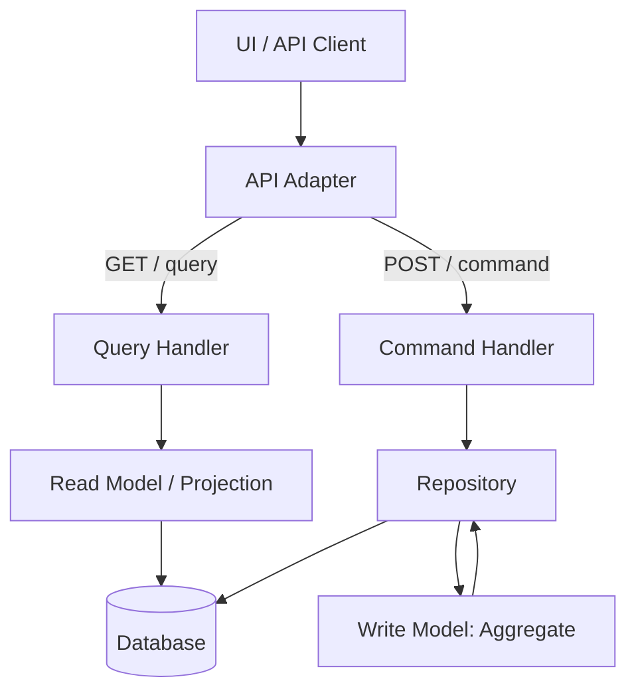
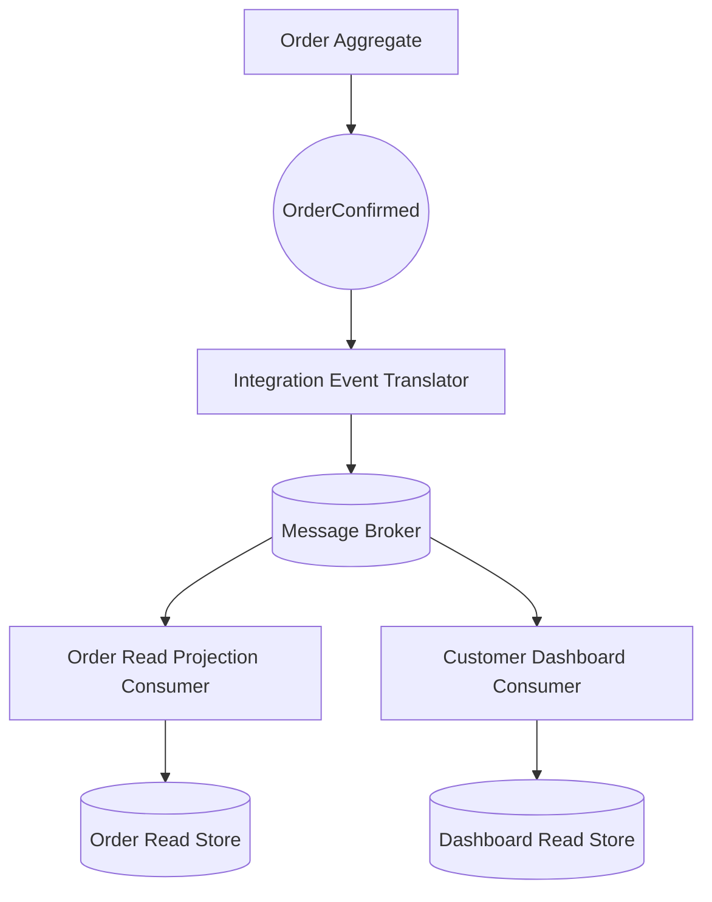
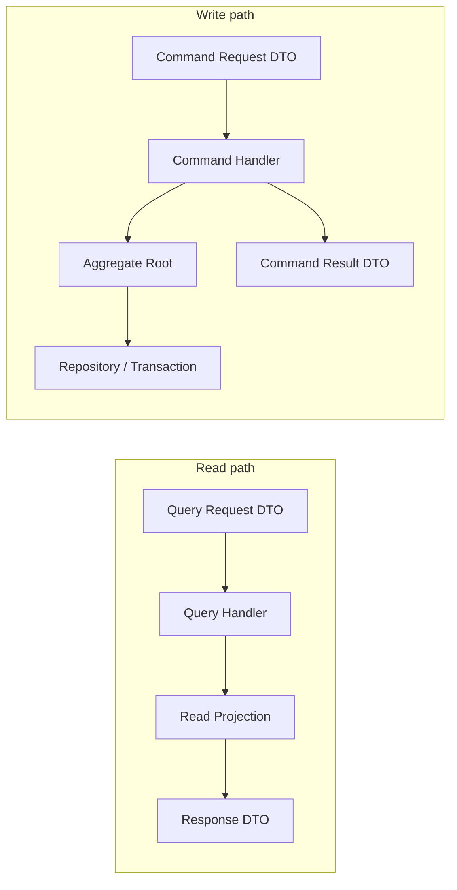

# Phân biệt mô hình đọc cho giao diện với mô hình dùng để thay đổi trạng thái

Trong Domain-Driven Design (DDD), mô hình miền mô tả các khái niệm, hành vi và quy tắc nghiệp vụ. Tuy nhiên, một giao diện thường cần dữ liệu được tổ chức theo cách rất khác với cách mô hình miền bảo vệ trạng thái. Màn hình chi tiết đơn hàng có thể cần tên khách hàng, tổng tiền, nhãn trạng thái, lịch sử giao hàng và thông tin thanh toán trong một response duy nhất. Khi nhân viên xác nhận đơn, hệ thống lại cần tải aggregate `Order`, kiểm tra invariant và thực hiện hành vi `confirm()`.

Hai nhu cầu này có mục đích khác nhau. **Read Model (mô hình đọc)** tổ chức dữ liệu để truy vấn và trình bày hiệu quả. **Write Model (mô hình ghi)** tổ chức trạng thái và hành vi để thực hiện thay đổi nghiệp vụ an toàn. Trong DDD, write model thường là domain model gồm aggregate, entity và value object; read model có thể là projection hoặc DTO được thiết kế theo nhu cầu truy vấn.

API DTO (Data Transfer Object) là cấu trúc dữ liệu trao đổi qua ranh giới API. Nó có thể được dùng để trả dữ liệu đọc hoặc nhận yêu cầu ghi, nhưng không đồng nghĩa với domain entity hay read model. Tách rõ các khái niệm này giúp giao diện thay đổi mà không làm mô hình miền mất đi ý nghĩa, đồng thời giúp các thao tác ghi luôn đi qua nơi bảo vệ invariant.

## Sau bài học này

Bạn có thể:

- Phân biệt read model, write model, domain model và API DTO.
- Giải thích vì sao giao diện cần projection riêng thay vì nhận trực tiếp aggregate.
- Thiết kế query DTO theo nhu cầu màn hình và command DTO theo ý định thay đổi.
- Dùng aggregate root để thực hiện thao tác ghi và bảo vệ invariant.
- Chọn cách tạo read model từ truy vấn database hoặc projection được cập nhật bằng event.
- Hiểu CQRS ở mức tách mô hình đọc/ghi và tránh triển khai quá mức cần thiết.
- Xử lý eventual consistency, dữ liệu trễ, phân trang và cập nhật đồng thời.
- Bảo vệ dữ liệu nhạy cảm, quyền truy cập và hợp đồng API.
- Kiểm thử riêng luồng đọc, luồng ghi và quá trình cập nhật projection.

## 1. Vì sao mô hình đọc và mô hình ghi có mục tiêu khác nhau?

Hãy xét màn hình chi tiết một đơn hàng. Người dùng cần xem:

- Mã đơn và thời điểm đặt.
- Tên khách hàng và địa chỉ giao hàng.
- Các dòng sản phẩm, số lượng và giá tại thời điểm mua.
- Tổng tiền, trạng thái thanh toán và trạng thái giao hàng.
- Lịch sử cập nhật gần đây.

Một response cho màn hình có thể kết hợp dữ liệu từ `Order`, `Customer`, `Payment` và `Shipment`. Nó cần tên hiển thị, nhãn đã định dạng và cấu trúc thuận tiện cho UI. Để hiển thị, giao diện không cần tải toàn bộ aggregate graph hoặc gọi từng repository theo cách domain model sử dụng.

Ngược lại, khi nhân viên bấm “Xác nhận đơn”, hệ thống cần kiểm tra đơn có đang ở trạng thái cho phép xác nhận, có dòng hàng hợp lệ và các điều kiện nghiệp vụ khác hay không. Việc này phải đi qua aggregate root để bảo vệ trạng thái. Một DTO hiển thị có trường `status = "ACCEPTED"` không đủ thẩm quyền để quyết định đơn có thể chuyển sang `CONFIRMED` hay không.

### Hai câu hỏi khác nhau

- **Đọc:** “Tôi cần hiển thị hoặc tra cứu thông tin nào, theo hình dạng nào?”
- **Ghi:** “Tôi muốn thực hiện hành động nghiệp vụ nào, và trạng thái hiện tại có cho phép hành động đó không?”

Read model tối ưu cho câu hỏi thứ nhất. Write model bảo vệ câu hỏi thứ hai.

## 2. Các khái niệm cần phân biệt

Các thuật ngữ thường xuất hiện cùng nhau nhưng không thay thế cho nhau:

| Khái niệm | Mục đích | Ví dụ |
| --- | --- | --- |
| Domain Model / Write Model | Biểu diễn trạng thái, hành vi và invariant để thay đổi nghiệp vụ | `Order`, `OrderLine`, `Money`, `Order.confirm()` |
| Read Model | Biểu diễn dữ liệu theo nhu cầu truy vấn hoặc màn hình | `OrderDetailsView`, `OrderSummary`, dashboard projection |
| API DTO | Hợp đồng dữ liệu qua ranh giới HTTP/message | `OrderDetailsResponse`, `ConfirmOrderRequest` |
| Command | Diễn đạt ý định yêu cầu thay đổi | `ConfirmOrder`, `CancelOrder` |
| Query | Diễn đạt yêu cầu đọc | `GetOrderDetails`, `SearchOrders` |
| Persistence Model | Biểu diễn dữ liệu theo cấu trúc lưu trữ/ORM | `OrderRow`, JPA entity hoặc document record |

Một read model có thể được serialize thành API response DTO. Nhưng API response DTO vẫn thuộc hợp đồng giao tiếp; nó không nhất thiết là projection lưu sẵn trong hệ thống. Tương tự, command DTO nhận từ HTTP có thể được chuyển thành application command trước khi use case xử lý.

### Không đồng nhất DTO với domain object

DTO chủ yếu vận chuyển dữ liệu. Domain object chứa hành vi và bảo vệ quy tắc. Nếu controller trả trực tiếp JPA entity hoặc aggregate, cấu trúc nội bộ, association và lazy proxy có thể rò ra API. Nếu controller nhận trực tiếp domain entity để cập nhật, client có thể gửi các field mà họ không được phép thay đổi.

Một lớp chuyển đổi ở ranh giới API giúp giữ hợp đồng bên ngoài độc lập với domain model.

## 3. Write Model: mô hình dùng để thay đổi trạng thái

Write Model mô tả các khái niệm và quy tắc cần thiết để thực hiện hành vi nghiệp vụ. Trong DDD, nó thường gồm:

- **Entity:** đối tượng có identity và vòng đời.
- **Value Object:** giá trị được xác định bởi thuộc tính và thường bất biến.
- **Aggregate:** ranh giới nhất quán của nhóm đối tượng.
- **Aggregate Root:** điểm truy cập để yêu cầu thay đổi aggregate.
- **Domain Service:** quy tắc không thuộc tự nhiên về một entity/value object cụ thể.
- **Domain Event:** sự thật nghiệp vụ đã xảy ra trong bounded context.

Ví dụ `Order` có thể bảo vệ các invariant:

- Chỉ đơn ở trạng thái phù hợp mới được xác nhận.
- Đơn đã xác nhận không thể thêm dòng hàng theo chính sách hiện tại.
- Số lượng mỗi dòng hàng phải hợp lệ.
- Tổng tiền phải được tính theo giá và quy tắc làm tròn có hiệu lực.

Hành vi ghi nên đi qua aggregate root:

```java
public final class Order {
    private final OrderId id;
    private final List<OrderLine> lines;
    private OrderStatus status;

    public void confirm(Instant now) {
        if (status != OrderStatus.ACCEPTED) {
            throw new OrderCannotBeConfirmedException(id, status);
        }
        if (lines.isEmpty()) {
            throw new EmptyOrderCannotBeConfirmedException(id);
        }

        status = OrderStatus.CONFIRMED;
        // Ghi nhận OrderConfirmed sau khi hành vi thành công.
    }
}
```

Ví dụ lược giản constructor và event collection. Điểm quan trọng là `Order` tự kiểm tra điều kiện miền. Caller không nên gửi một object có `status = CONFIRMED` rồi yêu cầu persistence ghi đè trạng thái.

### Write Model không phải bản sao của form

Form có thể có các trường tạm như `confirmCheckbox`, `displayTotal`, `customerName` hoặc `formattedAddress`. Những trường đó phục vụ giao diện. Aggregate chỉ nên chứa dữ liệu thuộc trách nhiệm miền và cần thiết để bảo vệ hành vi.

Khi một field trên form có vẻ giống field domain, vẫn cần xác định ai có quyền quyết định giá trị đó. Ví dụ, client có thể gửi `unitPrice`, nhưng giá bán có thể phải được lấy từ chính sách định giá phía server. Không nên tin một giá trị từ UI chỉ vì DTO có cùng tên.

## 4. Read Model: dữ liệu được tổ chức cho truy vấn

Read Model là cấu trúc dữ liệu được tối ưu để trả lời một hoặc nhiều câu hỏi đọc. Nó có thể:

- Kết hợp dữ liệu từ nhiều aggregate hoặc bảng.
- Chỉ giữ các trường mà một màn hình cần.
- Dùng tên và cấu trúc thuận tiện cho việc hiển thị.
- Được denormalize để tránh nhiều truy vấn khi đọc.
- Có thể được lưu thành projection riêng hoặc tạo động từ query.
- Không cần chứa đầy đủ hành vi và invariant của domain aggregate.

Ví dụ:

```java
public record OrderDetailsView(
    String orderNumber,
    Instant placedAt,
    String customerDisplayName,
    List<OrderLineView> lines,
    BigDecimal totalAmount,
    String currencyCode,
    String paymentStatusLabel,
    String deliveryStatusLabel
) {}

public record OrderLineView(
    String productName,
    BigDecimal quantity,
    BigDecimal lineTotal
) {}
```

`OrderDetailsView` không phải aggregate. Nó là dữ liệu đã được tổ chức để hiển thị chi tiết đơn. Nó có thể kết hợp thông tin từ nhiều nguồn mà không làm `Order` phải sở hữu tên khách hàng, nhãn thanh toán hoặc trạng thái vận chuyển.

### Read Model có thể là projection tạm thời

Không phải read model nào cũng cần bảng riêng. Một query SQL có thể join các bảng và chiếu trực tiếp vào DTO. Cách này phù hợp khi truy vấn chưa quá phức tạp, dữ liệu cần nhất quán với database hiện tại và chi phí truy vấn chấp nhận được.

### Read Model có thể được lưu riêng

Với màn hình có lượng truy cập lớn, nhiều phép tổng hợp hoặc cần kết hợp dữ liệu từ nhiều bounded context, có thể duy trì projection riêng. Projection được cập nhật khi có event hoặc khi một quy trình đồng bộ chạy.

Lúc này, read model có thể hơi trễ so với write model. Giao diện và use case phải hiểu rõ mức trễ đó có chấp nhận được hay không.

## 5. API DTO: hợp đồng ở ranh giới giao tiếp

API DTO định nghĩa dữ liệu được gửi qua HTTP hoặc một giao thức khác. Nó bảo vệ API khỏi thay đổi nội bộ và cho phép kiểm tra dữ liệu đầu vào theo yêu cầu giao tiếp.

Ví dụ request:

```java
public record ConfirmOrderRequest(
    String confirmationNote
) {}
```

Application adapter chuyển request thành command:

```java
public record ConfirmOrder(
    OrderId orderId,
    UserId actorId,
    String confirmationNote
) {}
```

Response DTO có thể lấy dữ liệu từ read model:

```java
public record OrderDetailsResponse(
    String orderNumber,
    String customerName,
    String status,
    String total,
    List<OrderLineResponse> lines
) {}
```

API response có thể định dạng tiền thành chuỗi theo locale hoặc biểu diễn trạng thái thành nhãn phù hợp. Những chi tiết này không nên làm thay đổi kiểu `Money` hoặc `OrderStatus` trong domain.

### Vì sao không trả trực tiếp domain entity?

- Có thể lộ field nội bộ mà API không nên công bố.
- Lazy association có thể kích hoạt truy vấn bất ngờ hoặc lỗi khi session đóng.
- Cấu trúc aggregate thay đổi sẽ làm API thay đổi ngoài ý muốn.
- Serialization có thể gặp vòng lặp quan hệ hai chiều.
- Client có thể phụ thuộc vào chi tiết mà domain cần tự do thay đổi.

### Vì sao không nhận domain entity từ request?

Nếu API deserialize trực tiếp thành `Order`, client có thể cố gửi `status`, `version`, `total`, `approvedBy` hoặc field nội bộ. Việc chỉ bỏ qua field không đáng tin cậy có thể phụ thuộc cấu hình serializer. Dùng request DTO có allowlist field rõ ràng giúp kiểm soát ý định và quyền cập nhật.

## 6. Tổ chức luồng đọc và luồng ghi

Một kiến trúc đơn giản có thể tách query handler và command handler dù vẫn dùng chung database:



Luồng đọc truy vấn dữ liệu cần thiết và trả projection/DTO. Luồng ghi tải aggregate, gọi hành vi miền và lưu trạng thái. Hai luồng có thể dùng cùng database và cùng tiến trình; việc tách trách nhiệm không bắt buộc phải tách hạ tầng.

### Ví dụ Query Handler

```java
public record GetOrderDetails(OrderId orderId, UserId actorId) {}

public final class GetOrderDetailsHandler {
    private final OrderQueries queries;
    private final OrderReadAccessPolicy accessPolicy;

    public Optional<OrderDetailsView> handle(GetOrderDetails query) {
        accessPolicy.ensureCanView(query.actorId(), query.orderId());
        return queries.findDetails(query.orderId());
    }
}
```

Query handler có thể gọi một query port trả `OrderDetailsView`; nó không cần tải aggregate chỉ để đọc. Quyền truy cập vẫn phải được kiểm tra vì projection có thể chứa dữ liệu nhạy cảm.

### Ví dụ Command Handler

```java
public record ConfirmOrder(OrderId orderId, UserId actorId) {}

public final class ConfirmOrderHandler {
    private final OrderRepository orders;
    private final OrderWriteAccessPolicy accessPolicy;
    private final TransactionRunner transactions;

    public void handle(ConfirmOrder command) {
        transactions.required(() -> {
            Order order = orders.findById(command.orderId())
                .orElseThrow(() -> new OrderNotFoundException(command.orderId()));

            accessPolicy.ensureCanConfirm(command.actorId(), order);
            order.confirm(Instant.now());
            orders.save(order);
        });
    }
}
```

Ví dụ lược giản transaction abstraction, clock và event/outbox. Command handler điều phối; `Order` bảo vệ invariant. Nếu thao tác cần ghi event tích hợp, application chuyển Domain Event thành Integration Event và ghi outbox cùng transaction.

## 7. CQRS: tách mô hình đọc và mô hình ghi

**Command Query Responsibility Segregation (CQRS)** là cách tổ chức trong đó mô hình dùng để xử lý thay đổi (command/write model) được tách khỏi mô hình dùng để truy vấn (query/read model).

CQRS có nhiều mức áp dụng:

1. **Tách logic:** command handler và query handler riêng, nhưng cùng database và cùng ứng dụng.
2. **Tách projection:** write model lưu aggregate; read model được tạo từ query hoặc projection riêng.
3. **Tách store:** write database và read database riêng, read store được cập nhật từ event hoặc cơ chế đồng bộ.
4. **Tách dịch vụ:** command side và query side triển khai độc lập khi có nhu cầu vận hành/scale thực sự.

Không cần bắt đầu ở mức cao nhất. Nhiều hệ thống chỉ cần tách command/query handler và dùng projection SQL là đã nhận được phần lớn lợi ích.

### CQRS không đồng nghĩa Event Sourcing

CQRS nói về sự phân tách trách nhiệm đọc và ghi. Event Sourcing nói về cách lưu trữ trạng thái bằng chuỗi event làm nguồn dữ liệu có thẩm quyền. Có thể dùng CQRS với database quan hệ lưu trạng thái hiện tại; cũng có thể dùng Event Sourcing mà không triển khai hai dịch vụ đọc/ghi riêng biệt.

### Khi nào nên cân nhắc CQRS?

- Màn hình đọc cần dữ liệu tổng hợp từ nhiều aggregate.
- Truy vấn có hình dạng khác xa write model.
- Khối lượng đọc cao hơn nhiều so với ghi và cần scale riêng.
- Có nhiều read view khác nhau cho các nhóm người dùng.
- Có thể chấp nhận và quản lý độ trễ của projection.
- Việc tách giúp giảm độ phức tạp thực tế thay vì chỉ thêm nhiều lớp.

### Khi nào chưa cần?

- Ứng dụng nhỏ với CRUD đơn giản.
- Truy vấn và ghi có cấu trúc gần nhau.
- Một database và một repository đã đáp ứng hiệu năng.
- Đội chưa có nhu cầu vận hành projection, event consumer hoặc eventual consistency.

CQRS làm tăng số mô hình, mapping và quy trình đồng bộ. Chỉ áp dụng khi sự khác biệt giữa đọc và ghi đủ rõ để bù lại chi phí.

## 8. Tạo Read Model bằng query projection

Với truy vấn không cần lưu riêng projection, query adapter có thể đọc dữ liệu từ các bảng và chiếu thẳng vào DTO:

```sql
SELECT
    o.order_number,
    o.placed_at,
    c.display_name AS customer_name,
    o.total_amount,
    o.currency_code,
    o.status
FROM orders o
JOIN customers c ON c.id = o.customer_id
WHERE o.id = :order_id;
```

Query service chuyển kết quả thành `OrderDetailsView` hoặc response DTO. Câu SQL là chi tiết infrastructure; application chỉ phụ thuộc hợp đồng đọc.

### Projection chỉ lấy trường cần thiết

Không nên dùng `SELECT *` rồi serialize toàn bộ entity. Projection nên lấy các cột cần thiết cho use case. Điều này giảm dữ liệu truyền, tránh lộ field không cần và giúp truy vấn dễ tối ưu.

### Query có thể kết hợp nhiều aggregate

Read model có thể join thông tin từ nhiều bảng hoặc projection nếu quyền sở hữu và kiến trúc dữ liệu cho phép. Điều đó không có nghĩa các đối tượng đó thuộc cùng một aggregate. Read model tối ưu cho đọc; aggregate boundary vẫn do invariant quyết định.

### Tách truy vấn đọc khỏi repository ghi

```java
public interface OrderRepository {
    Optional<Order> findById(OrderId id);
    void save(Order order);
}

public interface OrderQueries {
    Optional<OrderDetailsView> findDetails(OrderId id);
    Page<OrderSummary> search(OrderSearch criteria);
}
```

`OrderRepository` tải aggregate để thay đổi. `OrderQueries` trả projection để đọc. Không cần ép query phức tạp qua một repository phải trả về aggregate đầy đủ.

## 9. Tạo Read Model bằng projection từ event

Với read model cần cập nhật bất đồng bộ hoặc kết hợp dữ liệu từ nhiều bounded context, có thể dùng event consumer để duy trì projection.

Ví dụ khi Bán hàng công bố `SalesOrderConfirmed`, projection đơn hàng có thể cập nhật trạng thái hiển thị. Khi Vận chuyển công bố `ShipmentDelivered`, projection có thể cập nhật nhãn giao hàng.



Mỗi projection consumer xây dựng mô hình phù hợp với câu hỏi đọc của mình. Một event có thể cập nhật nhiều read model mà không buộc write model phải biết từng màn hình.

### Projection cần xử lý message lặp

Broker có thể giao event nhiều lần. Consumer cần idempotency, chẳng hạn lưu event ID đã xử lý hoặc dùng version của aggregate để tránh áp dụng cùng thay đổi hai lần.

### Projection cần xử lý thứ tự

Nếu event đến sai thứ tự, projection có thể bị lùi trạng thái. Có thể dùng `aggregateVersion` hoặc sequence để phát hiện event cũ, bỏ qua event đã áp dụng hoặc chờ event còn thiếu theo chính sách.

### Projection có thể cần rebuild

Khi logic hiển thị thay đổi hoặc projection bị hỏng, đội có thể cần tái tạo read store từ event log hoặc nguồn dữ liệu có thẩm quyền. Nếu không dùng Event Sourcing, nguồn rebuild có thể là database write model hoặc event archive được lưu đủ lâu. Cần xác định trước dữ liệu nào được giữ và quy trình rebuild có an toàn không.

## 10. Eventual Consistency và dữ liệu đọc bị trễ

Khi read model được cập nhật bất đồng bộ, có khoảng thời gian write model đã commit nhưng projection chưa phản ánh thay đổi. Đây là eventual consistency.

Ví dụ, nhân viên xác nhận đơn thành công, nhưng màn hình danh sách vẫn hiển thị `ACCEPTED` trong vài trăm mili giây hoặc vài giây trước khi consumer cập nhật projection sang `CONFIRMED`.

### Cần định nghĩa mức trễ chấp nhận được

Không phải màn hình nào cũng cần dữ liệu mới nhất tức thời. Dashboard tổng hợp có thể chấp nhận trễ vài phút. Màn hình xác nhận thanh toán hoặc kiểm tra tồn kho có thể cần dữ liệu có thẩm quyền trước khi đưa ra quyết định.

Read model trễ phù hợp để hiển thị, nhưng không nên dùng nó làm căn cứ duy nhất cho một quyết định ghi có hậu quả quan trọng nếu chưa có bước xác nhận ở write model.

### Cách phản hồi sau command

Một số lựa chọn:

- Trả kết quả command từ write model, ví dụ `CONFIRMED`, rồi UI cập nhật lạc quan.
- Trả `commandId` hoặc `operationId` và cho UI truy vấn trạng thái xử lý.
- Trả projection version hoặc vị trí event để query side chờ đến khi bắt kịp.
- Dùng truy vấn trực tiếp write store cho một số màn hình cần đọc sau ghi tức thời.

Không nên giả định command thành công thì mọi read model đã cập nhật ngay. API cần thể hiện rõ nguồn của response và mức nhất quán.

### Read-your-writes

Nếu người dùng vừa thực hiện thay đổi và ngay sau đó đọc lại, họ thường mong thấy kết quả của chính thao tác đó. Có thể hỗ trợ bằng cách trả trạng thái từ command response, chờ projection đạt version tương ứng hoặc đọc từ nguồn có thẩm quyền trong một khoảng thời gian.

Đây là quyết định trải nghiệm và kiến trúc; không phải mọi query đều cần bypass read model.

## 11. Bảo mật và quyền truy cập trong Read Model

Read model thường kết hợp nhiều dữ liệu, vì vậy có thể vô tình đưa thông tin nhạy cảm đến người không có quyền.

Các nguyên tắc:

- Áp dụng authorization cho query trước hoặc trong lúc truy vấn theo cách phù hợp.
- Giới hạn field theo vai trò và mục đích sử dụng.
- Không trả dữ liệu cá nhân hoặc thông tin thanh toán chỉ vì projection đã có sẵn.
- Phân biệt dữ liệu nội bộ với dữ liệu được phép công bố qua API.
- Không tin rằng UI ẩn một cột đồng nghĩa server đã bảo vệ dữ liệu đó.
- Kiểm tra quyền theo tenant/organization khi truy vấn theo ID hoặc tiêu chí.

Ví dụ, `OrderDetailsView` cho khách hàng có thể chỉ chứa địa chỉ giao hàng và trạng thái đơn của chính họ. View cho nhân viên hỗ trợ có thể chứa thêm thông tin liên hệ; view cho nhân viên tài chính có thể chứa dữ liệu thanh toán. Không nên dùng một response DTO quá rộng cho mọi vai trò nếu quyền khác nhau.

### Tránh IDOR

Một endpoint `GET /orders/{id}` không được trả dữ liệu chỉ vì caller biết ID. Query handler cần kiểm tra quyền sở hữu hoặc quyền truy cập theo tenant. Tương tự, command handler phải kiểm tra caller có quyền thay đổi aggregate đó.

## 12. Phân trang, lọc và sắp xếp cho mô hình đọc

Read model thường phục vụ danh sách lớn. API nên có giới hạn rõ về phân trang, lọc và sắp xếp.

```java
public record OrderSearchRequest(
    String status,
    Instant fromInclusive,
    Instant toExclusive,
    int page,
    int size
) {}

public record OrderSummaryResponse(
    String orderNumber,
    String customerName,
    String status,
    String total
) {}
```

Adapter xác thực tham số request, chuyển thành query criteria nội bộ và gọi query handler. Không nên để client gửi tên cột SQL hoặc biểu thức sort tùy ý.

### Giới hạn page size

Server nên giới hạn page size tối đa để tránh client yêu cầu hàng trăm nghìn bản ghi trong một response. Với dữ liệu lớn, cursor/keyset pagination có thể ổn định và hiệu quả hơn offset pagination.

### Thứ tự cần ổn định

Nếu sắp xếp theo `createdAt`, nhiều bản ghi có thể có cùng timestamp. Thêm ID làm khóa phụ ổn định để tránh phần tử bị lặp hoặc bỏ sót giữa các trang khi dữ liệu thay đổi.

### Lọc theo ngôn ngữ nghiệp vụ

Một bộ lọc như `awaitingPayment` nên được ánh xạ thành tiêu chí có ý nghĩa, thay vì để client tự gửi `status != PAID AND status != CANCELLED`. Query adapter có thể chuyển tiêu chí đó thành SQL phù hợp.

## 13. Mapping giữa Read Model, API DTO và Domain Model

Một luồng đọc có thể gồm:

1. API adapter nhận query request.
2. Chuyển request thành query criteria.
3. Query service đọc projection hoặc read store.
4. Mapper chuyển kết quả thành response DTO.
5. Serializer trả JSON cho client.

Một luồng ghi có thể gồm:

1. API adapter nhận request DTO.
2. Xác thực cấu trúc và danh tính caller.
3. Chuyển thành command.
4. Application handler tải aggregate qua repository.
5. Aggregate thực hiện hành vi và bảo vệ invariant.
6. Repository lưu thay đổi; outbox ghi event nếu cần.
7. Application trả command result; adapter chuyển thành response DTO.



### Mapping không nên trở thành logic nghiệp vụ

Mapper có thể đổi tên trường, định dạng ngày/tiền, kết hợp dữ liệu và chuyển enum sang nhãn. Nhưng quyết định một đơn có được xác nhận hay không phải thuộc domain model. Nếu mapper bắt đầu tính chiết khấu, quyết định trạng thái hoặc sửa aggregate, trách nhiệm đã bị đặt sai.

### Một domain model có thể phục vụ nhiều read model

Một aggregate `Order` có thể là nguồn cho nhiều view:

- `OrderSummary` cho danh sách.
- `OrderDetailsView` cho màn hình chi tiết.
- `DailySalesReportRow` cho báo cáo.
- `CustomerOrderHistoryItem` cho lịch sử khách hàng.

Không cần ép một cấu trúc duy nhất đáp ứng mọi màn hình. Mỗi read model nên phục vụ một câu hỏi đọc cụ thể và chỉ chứa dữ liệu cần thiết.

## 14. Ví dụ xuyên suốt: màn hình đơn hàng và thao tác xác nhận

Giả sử ứng dụng có màn hình danh sách đơn, màn hình chi tiết và nút xác nhận đơn.

### Màn hình danh sách

Query service trả projection:

```java
public record OrderSummary(
    OrderId id,
    String orderNumber,
    String customerName,
    OrderStatus status,
    Money total,
    Instant placedAt
) {}

public interface OrderQueries {
    Page<OrderSummary> search(OrderSearch criteria);
}
```

Query adapter có thể join `orders` với `customers` và chiếu trực tiếp vào `OrderSummary`. Không cần tải từng aggregate `Order` rồi gọi `customerRepository` cho từng dòng.

### Màn hình chi tiết

Một projection khác có thể kết hợp payment và shipment:

```java
public record OrderDetailsView(
    String orderNumber,
    String customerName,
    List<OrderLineView> lines,
    Money total,
    String paymentStatus,
    String shipmentStatus
) {}
```

Read model này có thể được tạo bằng query nhiều bảng hoặc projection cập nhật từ event. Nếu dữ liệu shipment cập nhật bất đồng bộ, response cần phản ánh thời điểm hoặc trạng thái cập nhật phù hợp nếu trải nghiệm yêu cầu.

### Nút xác nhận

Khi nhân viên bấm xác nhận, UI gửi ý định:

```json
{
  "confirmationNote": "Đã kiểm tra thông tin đơn"
}
```

API adapter lấy `orderId` từ route và actor từ security context, tạo command `ConfirmOrder`. Application handler tải aggregate, kiểm tra quyền, gọi `order.confirm()` và lưu trong transaction. Nếu domain từ chối, API trả lỗi phù hợp. UI không tự gửi `status = CONFIRMED` để ghi đè.

### Cập nhật màn hình sau xác nhận

Command response có thể trả trạng thái mới từ write model. Read projection sẽ được cập nhật sau khi event được xử lý. UI có thể cập nhật tạm thời bằng kết quả command, sau đó tải lại read model khi projection đã bắt kịp.

Luồng này cho phép read model được tối ưu cho giao diện mà write model vẫn bảo vệ tính đúng đắn nghiệp vụ.

## 15. Những sai lầm thường gặp

- **Trả trực tiếp aggregate cho UI:** lộ cấu trúc domain, lazy proxy và field nội bộ.
- **Dùng một DTO cho mọi mục đích:** request, response, read projection và domain model có vòng đời khác nhau.
- **Dùng read model để ghi:** client sửa projection hoặc gửi trạng thái hiển thị để thay đổi aggregate.
- **Dùng aggregate cho mọi query:** tải quá nhiều object và tạo N+1 query.
- **Nhồi logic nghiệp vụ vào mapper:** mapping trở thành nơi quyết định trạng thái và chính sách.
- **Coi DTO là domain object:** thiếu hành vi và invariant, phụ thuộc cấu trúc API.
- **Tách CQRS quá sớm:** thêm read database, broker và consumer khi truy vấn đơn giản chưa cần.
- **Không tính eventual consistency:** UI tưởng command thành công nhưng query projection vẫn hiển thị dữ liệu cũ.
- **Dùng projection trễ cho quyết định ghi quan trọng:** quyết định dựa trên dữ liệu không có thẩm quyền hoặc đã cũ.
- **Không kiểm tra quyền trên read path:** lộ dữ liệu qua endpoint tra cứu theo ID hoặc filter.
- **Projection không idempotent:** event giao lặp làm tổng tiền hoặc số lượng bị cộng nhiều lần.
- **Không có chiến lược rebuild projection:** read store hỏng hoặc schema đổi nhưng không thể tạo lại.
- **API DTO phụ thuộc entity ORM:** thay đổi database hoặc mapping làm vỡ hợp đồng API.
- **Không giới hạn truy vấn:** page size lớn, sort tùy ý hoặc query tổng hợp gây tải hệ thống.

## 16. Quy trình thiết kế Read Model và Write Model

Khi xây dựng một chức năng mới, hãy thực hiện theo các bước:

1. **Xác định câu hỏi đọc:** UI hoặc caller cần hiển thị những dữ liệu nào và từ nguồn nào?
2. **Xác định hành động ghi:** người dùng muốn thực hiện hành vi nghiệp vụ nào?
3. **Xác định invariant:** aggregate nào sở hữu quy tắc cần bảo vệ?
4. **Thiết kế write model:** command, aggregate root, value object và hành vi miền.
5. **Thiết kế read model:** projection riêng theo màn hình hoặc truy vấn, chỉ chứa trường cần thiết.
6. **Thiết kế API DTO:** request/response độc lập với domain và persistence model.
7. **Chọn cách tạo projection:** query động, database view, materialized view hoặc event consumer.
8. **Xác định consistency:** dữ liệu đọc có cần tức thời không; độ trễ tối đa chấp nhận là bao nhiêu?
9. **Thiết kế bảo mật:** field nào được phép trả theo actor, tenant và mục đích?
10. **Thiết kế hiệu năng:** index, phân trang, sắp xếp ổn định và giới hạn page size.
11. **Thiết kế cập nhật:** event ID, version, idempotency và rebuild nếu projection bất đồng bộ.
12. **Kiểm thử:** domain behavior, query projection, API contract và consistency sau command.

## Checklist rà soát

- [ ] Read model được thiết kế theo câu hỏi đọc cụ thể.
- [ ] Write model bảo vệ invariant bằng aggregate root và hành vi miền.
- [ ] API DTO tách khỏi domain entity và persistence entity.
- [ ] Command diễn đạt ý định thay đổi; query diễn đạt nhu cầu đọc.
- [ ] Query không tải aggregate nếu chỉ cần projection đơn giản.
- [ ] Command không dùng read projection làm nguồn duy nhất để quyết định ghi.
- [ ] Mapper chỉ chuyển đổi dữ liệu, không sở hữu quy tắc nghiệp vụ.
- [ ] Quyền truy cập được kiểm tra trên cả read path và write path.
- [ ] Projection chỉ chứa field cần thiết và không lộ dữ liệu nhạy cảm.
- [ ] CQRS được áp dụng ở mức phù hợp với nhu cầu.
- [ ] Nếu projection bất đồng bộ, độ trễ và hành vi read-your-writes đã rõ.
- [ ] Consumer xử lý event lặp, sai thứ tự và rebuild projection.
- [ ] API có phân trang, sort ổn định và giới hạn truy vấn.
- [ ] Có test cho domain invariant, query mapping và API contract.

## Kết luận

Read Model và Write Model phục vụ hai mục tiêu khác nhau. Read Model tổ chức dữ liệu theo câu hỏi của giao diện và có thể kết hợp nhiều nguồn; Write Model giữ hành vi và invariant của domain để thay đổi trạng thái an toàn. API DTO bảo vệ hợp đồng giao tiếp ở ranh giới hệ thống, còn persistence model phục vụ lưu trữ. Có thể tách command/query handler và dùng chung database trước khi cần CQRS đầy đủ. Khi cần projection bất đồng bộ, phải thiết kế độ trễ, idempotency, bảo mật và khả năng rebuild. Giữ rõ các ranh giới này giúp giao diện linh hoạt mà không làm suy yếu mô hình nghiệp vụ.
