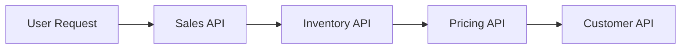
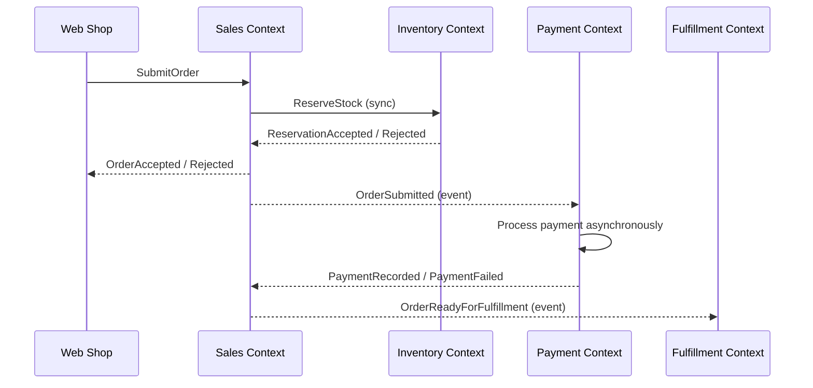
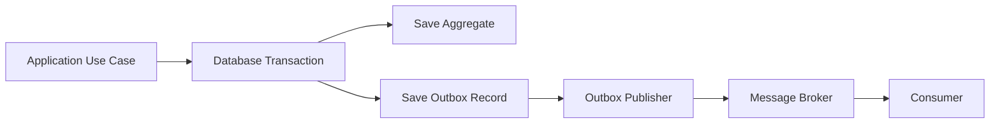
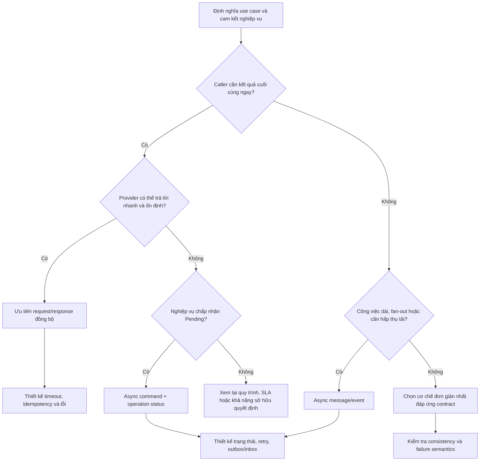

# Lựa chọn tích hợp đồng bộ hoặc bất đồng bộ theo yêu cầu nghiệp vụ

Trong Domain-Driven Design (DDD), mỗi **bounded context** sở hữu mô hình, quy tắc và ngôn ngữ riêng. Khi một use case cần thông tin hoặc hành động từ context khác, các bên phải chọn cách giao tiếp phù hợp. Hai cách phổ biến là **tích hợp đồng bộ (synchronous)**, trong đó bên gọi chờ phản hồi, và **tích hợp bất đồng bộ (asynchronous)**, trong đó bên gửi tiếp tục công việc sau khi thông điệp được tiếp nhận và kết quả có thể đến sau.

Không có lựa chọn nào luôn tốt hơn. Giao tiếp đồng bộ phù hợp khi use case cần kết quả ngay để đưa ra quyết định tiếp theo, chẳng hạn kiểm tra và giữ hàng trước khi xác nhận đơn. Giao tiếp bất đồng bộ phù hợp khi công việc có thể hoàn tất sau, cần hấp thụ tải, phát thông tin cho nhiều consumer hoặc phải phối hợp một quy trình dài qua nhiều context. Quyết định nên bắt đầu từ cam kết nghiệp vụ về thời điểm phản hồi, mức độ nhất quán, khả năng phục hồi và trải nghiệm người dùng.

Bài học này giải thích hai kiểu tích hợp, những đánh đổi của chúng, cách phân biệt command và event, cách bảo đảm tính tin cậy bằng outbox/inbox, retry và idempotency, cũng như cách kết hợp đồng bộ và bất đồng bộ trong một quy trình DDD.

## 1. Tích hợp đồng bộ và bất đồng bộ là gì?

### 1.1. Tích hợp đồng bộ

Trong tích hợp đồng bộ, caller gửi yêu cầu và chờ kết quả từ provider trước khi tiếp tục bước xử lý hiện tại. Các giao thức thường gặp gồm HTTP request/response, REST, gRPC hoặc lời gọi trong cùng tiến trình qua một interface công khai.

Ví dụ:

1. Sales Context gửi yêu cầu giữ 2 sản phẩm tới Inventory Context.
2. Inventory kiểm tra tồn kho và thực hiện quyết định giữ hàng.
3. Inventory trả kết quả `Accepted` hoặc `Rejected`.
4. Sales dùng kết quả để tiếp tục hoặc từ chối xác nhận đơn.

Caller nhận phản hồi trong cùng luồng tương tác. Điều này thuận tiện khi người dùng hoặc use case cần biết kết quả ngay. Đổi lại, caller phụ thuộc vào thời gian phản hồi và khả năng sẵn sàng của provider.

### 1.2. Tích hợp bất đồng bộ

Trong tích hợp bất đồng bộ, bên gửi công bố hoặc gửi thông điệp qua broker, queue, event stream hay cơ chế truyền tin khác. Bên gửi không cần chờ toàn bộ công việc phía nhận hoàn tất. Kết quả có thể được thông báo bằng một message hoặc event khác.

Ví dụ:

1. Sales phát `StockReservationRequested` hoặc gửi command `ReserveStock`.
2. Broker tiếp nhận thông điệp và xác nhận đã nhận theo cơ chế của nó.
3. Sales có thể trả cho người dùng trạng thái `Pending`.
4. Inventory xử lý thông điệp và phát `StockReserved` hoặc `StockReservationRejected`.
5. Sales tiêu thụ kết quả và cập nhật trạng thái đơn.

Thông báo broker đã nhận message không có nghĩa nghiệp vụ giữ hàng đã thành công. Nó chỉ xác nhận thông điệp đã được tiếp nhận theo cam kết của hệ thống truyền tin. Kết quả nghiệp vụ xuất hiện sau khi consumer xử lý.

### 1.3. “Đồng bộ” không đồng nghĩa với “nhất quán mạnh”

Một lời gọi HTTP đồng bộ không tự động tạo ra một giao dịch nguyên tử xuyên nhiều bounded context. Provider có thể commit dữ liệu của mình rồi caller gặp timeout trước khi nhận response. Một response thành công cũng có thể chỉ phản ánh trạng thái tại một thời điểm, không bảo đảm các read model ở context khác đã cập nhật.

Tương tự, bất đồng bộ không nhất thiết luôn có độ trễ dài. Một consumer có thể xử lý message trong vài mili giây, nhưng caller vẫn không chờ kết quả trong cùng request. Điểm phân biệt chính là quan hệ chờ đợi và hợp đồng phản hồi, không chỉ là tốc độ thực tế.

## 2. Bắt đầu từ yêu cầu nghiệp vụ

Trước khi chọn REST, gRPC, queue hay event broker, hãy làm rõ use case cần cam kết điều gì.

Các câu hỏi quan trọng:

- Người dùng hoặc caller có cần biết kết quả cuối cùng ngay trong cùng tương tác không?
- Có thể trả về trạng thái `Pending` và thông báo kết quả sau không?
- Quyết định cần dữ liệu mới nhất tại thời điểm nào?
- Có thể chấp nhận trạng thái tạm thời chưa đồng bộ giữa các context không?
- Nếu provider không sẵn sàng, nghiệp vụ có thể tiếp tục, chờ, từ chối hay lưu yêu cầu để xử lý sau?
- Tác động có thể retry an toàn không?
- Có cần xử lý một thông điệp cho nhiều consumer không?
- Công việc có thể kéo dài hoặc phụ thuộc vào con người/hệ thống bên ngoài không?
- Có yêu cầu thứ tự xử lý, audit hoặc phát lại lịch sử không?

Đừng chọn bất đồng bộ chỉ vì hệ thống đang dùng message broker, cũng đừng chọn đồng bộ chỉ vì HTTP API dễ triển khai. Hãy xác định cam kết nghiệp vụ trước rồi chọn cách giao tiếp đáp ứng cam kết đó.

## 3. Khi nào nên chọn tích hợp đồng bộ?

Đồng bộ thường phù hợp khi caller cần một quyết định hoặc dữ liệu ngay để hoàn thành bước nghiệp vụ hiện tại.

### 3.1. Cần phản hồi ngay để tiếp tục

Ví dụ:

- Kiểm tra thông tin xác thực trước khi cho phép truy cập.
- Tính giá báo ngay trên màn hình checkout.
- Kiểm tra hạn mức còn lại trước khi chấp nhận một yêu cầu.
- Giữ chỗ hoặc giữ hàng và cần biết kết quả trước khi xác nhận bước tiếp theo.
- Kiểm tra quyền hoặc trạng thái của một tài nguyên trước khi cho phép thao tác.

Nếu không có phản hồi, caller không thể quyết định bước hiện tại. Một API request/response có thể thể hiện rõ kết quả và lỗi nghiệp vụ.

### 3.2. Kết quả nhỏ và thời gian xử lý dự đoán được

Lời gọi đồng bộ thường dễ quản lý hơn khi:

- Operation hoàn tất nhanh.
- Số lượng dependency nhỏ.
- Payload và response có kích thước giới hạn.
- Provider có SLA phù hợp với trải nghiệm của caller.
- Timeout có thể đặt rõ ràng.

Nếu một use case cần gọi tuần tự nhiều dịch vụ chậm, tổng latency sẽ tăng theo thời gian của từng dependency. Khi đó cần cân nhắc gộp truy vấn, cache, song song hóa an toàn hoặc chuyển một phần quy trình sang bất đồng bộ.

### 3.3. Cần từ chối sớm theo quy tắc có thẩm quyền

Khi một context sở hữu quy tắc quyết định, caller có thể gọi API của context đó để nhận câu trả lời. Ví dụ Inventory sở hữu lượng hàng và quy tắc reservation; Sales không nên tự đọc bảng tồn kho để quyết định giữ hàng.

Lời gọi đồng bộ tới Inventory giúp Sales nhận kết quả từ đúng nơi có thẩm quyền. Tuy nhiên, nếu thao tác cần bảo vệ invariant, Inventory phải kiểm tra và ghi nhận quyết định trong một giao dịch có concurrency control; không chỉ trả lời một phép kiểm tra tồn kho rồi để Sales tự giả định hàng đã được giữ.

## 4. Đánh đổi của tích hợp đồng bộ

### 4.1. Phụ thuộc thời gian và khả năng sẵn sàng

Caller chỉ hoàn tất được bước hiện tại khi provider phản hồi. Nếu provider chậm hoặc không sẵn sàng, caller có thể bị chậm hoặc thất bại theo.

Một chuỗi gọi đồng bộ có thể tạo hiệu ứng dây chuyền:



Nếu mỗi dependency có latency hoặc tỷ lệ lỗi riêng, toàn bộ luồng chịu ảnh hưởng từ các dependency trên đường đi. Gọi tuần tự nhiều context cũng làm tăng tổng thời gian phản hồi.

### 4.2. Timeout tạo ra kết quả chưa xác định

Timeout chỉ cho biết caller không nhận được phản hồi trong thời gian quy định. Nó không chứng minh provider chưa thực hiện hành động.

Ví dụ Inventory có thể đã tạo reservation và commit, nhưng response bị mất. Sales timeout rồi thử lại. Nếu command không idempotent, hệ thống có thể tạo hai reservation.

Vì vậy, operation có tác động ghi cần định danh thao tác hoặc cơ chế idempotency. Caller cũng cần phân biệt:

- Business rejection rõ ràng.
- Provider không sẵn sàng trước khi xử lý.
- Timeout khi kết quả chưa xác định.
- Lỗi dữ liệu hoặc lỗi hợp đồng không thể retry.

### 4.3. Coupling giữa các context

Caller phụ thuộc vào endpoint, contract, timeout, khả năng sẵn sàng và cách provider xử lý lỗi. Thay đổi contract cần được quản lý và thông báo. Nếu caller biết quá nhiều về mô hình nội bộ provider, ranh giới bounded context bị suy yếu.

Hãy giao tiếp qua API hoặc Published Language có chủ đích, và dùng Anti-Corruption Layer (ACL) khi mô hình phía caller khác với ngôn ngữ phía provider.

### 4.4. Các biện pháp bảo vệ

- **Timeout/deadline:** giới hạn thời gian chờ cho từng lời gọi và toàn bộ request.
- **Circuit breaker:** tạm ngừng gọi dependency đang lỗi liên tục để tránh khuếch đại sự cố.
- **Bulkhead:** giới hạn tài nguyên dành cho từng dependency để một provider không làm cạn toàn bộ thread/connection.
- **Retry có kiểm soát:** chỉ retry lỗi tạm thời và thao tác có thể thực hiện lại an toàn; dùng backoff và giới hạn số lần.
- **Fallback:** chỉ dùng khi có kết quả thay thế được nghiệp vụ chấp nhận, không tự giả định dữ liệu cũ luôn an toàn.
- **Idempotency:** bảo vệ command có tác động ghi trước retry hoặc timeout không rõ kết quả.

Không nên dùng retry để xử lý business rejection như hết hàng hoặc không đủ hạn mức. Retry liên tục trong khi provider đang quá tải có thể làm sự cố nặng hơn.

## 5. Khi nào nên chọn tích hợp bất đồng bộ?

Bất đồng bộ phù hợp khi caller không cần kết quả cuối cùng trong cùng request hoặc khi công việc cần được xử lý độc lập với thời điểm gửi.

### 5.1. Công việc kéo dài hoặc có nhiều bước

Ví dụ:

- Xử lý thanh toán qua provider bên ngoài.
- Đối soát giao dịch.
- Tạo và theo dõi lô giao hàng.
- Phát hành hóa đơn điện tử.
- Chạy quy trình phê duyệt cần con người.
- Tính toán báo cáo hoặc xử lý dữ liệu lớn.

Caller có thể nhận một operation ID và trạng thái `Accepted`/`Pending`, rồi truy vấn hoặc nhận thông báo khi quy trình hoàn tất.

### 5.2. Không muốn caller phụ thuộc vào thời gian hoạt động của consumer

Broker có thể lưu thông điệp để consumer xử lý khi sẵn sàng, tùy cấu hình durability và chính sách lưu trữ. Producer không cần giữ kết nối tới consumer trong suốt thời gian xử lý.

Điều này giảm coupling về thời gian, nhưng không loại bỏ phụ thuộc hoàn toàn: producer phụ thuộc vào broker, contract và khả năng xử lý về sau của consumer. Nếu broker hoặc quota lưu trữ bị lỗi, producer vẫn cần xử lý tình huống đó.

### 5.3. Một sự kiện có nhiều consumer

Khi một sự kiện nghiệp vụ có ý nghĩa với nhiều context, publish event giúp mỗi consumer xử lý theo nhu cầu riêng.

Ví dụ sau khi đơn được xác nhận:

- Inventory cập nhật kế hoạch phân bổ.
- Fulfillment chuẩn bị quy trình xử lý đơn.
- Notification gửi email hoặc thông báo.
- Analytics cập nhật mô hình báo cáo.

Sales không cần gọi lần lượt từng context và chờ tất cả hoàn tất. Nó công bố sự kiện `OrderConfirmed`; mỗi consumer đăng ký và xử lý độc lập.

### 5.4. Hấp thụ tải và tách tốc độ producer/consumer

Queue có thể làm bộ đệm khi producer tạo công việc nhanh hơn tốc độ consumer xử lý. Consumer có thể mở rộng số worker hoặc xử lý theo batch. Tuy nhiên, backlog vẫn phải được giới hạn và giám sát; broker không làm cho năng lực xử lý vô hạn.

## 6. Đánh đổi của tích hợp bất đồng bộ

### 6.1. Kết quả đến sau và eventual consistency

Sau khi một event được phát, các context khác có thể chưa cập nhật ngay. Trong khoảng thời gian đó, các read model có thể hiển thị dữ liệu cũ hoặc trạng thái `Pending`.

Nghiệp vụ phải chấp nhận khoảng trễ này và định nghĩa trải nghiệm phù hợp: hiển thị đang xử lý, cho phép xem trạng thái, gửi thông báo khi hoàn tất hoặc cho phép thao tác tiếp theo trong giới hạn an toàn.

### 6.2. Khó theo dõi hơn một lời gọi trực tiếp

Một message có thể đi qua broker, nhiều consumer và nhiều lần retry. Log của một request HTTP không đủ để hiểu toàn bộ quy trình. Cần correlation ID, causation ID, message ID, tracing và operation state.

### 6.3. Consumer phải chịu được duplicate và thứ tự khác dự kiến

Nhiều broker cung cấp giao nhận at-least-once hoặc có thể redeliver khi consumer chưa acknowledge. Consumer cần idempotent. Thứ tự message có thể chỉ được bảo đảm trong một partition, queue hoặc key cụ thể; không nên giả định thứ tự toàn cục nếu broker không cam kết.

### 6.4. Cần quản lý lỗi và backlog

Message có thể bị lỗi liên tục do schema không hợp lệ, dữ liệu không còn phù hợp hoặc bug trong consumer. Cần retry có giới hạn, dead-letter queue (DLQ), khả năng replay có kiểm soát và quy trình xử lý thủ công.

### 6.5. Khó cung cấp câu trả lời tức thì

Nếu người dùng cần biết ngay một hành động đã được chấp nhận hay từ chối, bất đồng bộ thuần túy có thể khiến trải nghiệm mơ hồ. Có thể giải quyết bằng cách trả `202 Accepted` kèm operation ID và trạng thái rõ, nhưng nghiệp vụ phải chấp nhận việc kết quả cuối cùng đến sau.

## 7. Phân biệt Command và Event trong tích hợp

Command và event thường được truyền qua cùng một message broker nhưng có ý nghĩa khác nhau.

| Khía cạnh | Command | Event |
|---|---|---|
| Ý nghĩa | Yêu cầu một bên thực hiện hành động | Thông báo một điều đã xảy ra |
| Cách đặt tên | Mệnh lệnh, ví dụ `ReserveStock` | Thể quá khứ, ví dụ `StockReserved` |
| Người nhận | Thường có một owner chịu trách nhiệm xử lý | Có thể có nhiều consumer quan tâm |
| Kết quả | Có thể chấp nhận, từ chối hoặc xử lý sau | Là sự kiện đã được ghi nhận, không phải yêu cầu để từ chối |
| Hợp đồng | Nêu yêu cầu, dữ liệu và điều kiện | Nêu sự thật, thời điểm và ngữ nghĩa |

Ví dụ:

- `ReserveStock`: yêu cầu Inventory giữ hàng.
- `StockReserved`: Inventory thông báo việc giữ hàng đã thành công.
- `StockReservationRejected`: thông báo yêu cầu giữ hàng bị từ chối.

Không phát `StockReserved` ngay khi nhận `ReserveStock`. Chỉ phát event sau khi quyết định giữ hàng đã được ghi nhận thành công. Nếu command thất bại, event kết quả phải phản ánh đúng thất bại hoặc từ chối.

## 8. Đồng bộ và bất đồng bộ có thể kết hợp trong cùng một use case

Một hệ thống không cần chọn duy nhất một phong cách. Một use case có thể dùng đồng bộ cho quyết định cần phản hồi ngay và bất đồng bộ cho tác động hậu xử lý.

Ví dụ checkout:

1. Web Shop gọi Sales để tạo yêu cầu đặt hàng.
2. Sales gọi Inventory đồng bộ để tạo reservation có thời hạn vì cần biết ngay việc giữ hàng có thành công không.
3. Sales ghi nhận đơn ở trạng thái phù hợp và commit.
4. Sales phát `OrderSubmitted` qua outbox.
5. Payment Context xử lý thanh toán bất đồng bộ.
6. Payment phát `PaymentRecorded` hoặc `PaymentFailed`.
7. Sales nhận kết quả và chuyển đơn sang trạng thái tiếp theo.
8. Fulfillment và Notification phản ứng với các event tương ứng.

Sơ đồ:



Đây là ví dụ khái quát. Trạng thái `OrderAccepted` cần được định nghĩa rõ: có thể nghĩa là Sales đã nhận đơn và giữ hàng thành công, chưa nhất thiết là thanh toán hoàn tất. Nếu thanh toán là điều kiện bắt buộc để chấp nhận đơn, tên và trạng thái cần phản ánh chính xác cam kết đó.

## 9. Ví dụ thiết kế API đồng bộ cho một quyết định nghiệp vụ

Giả sử Sales cần yêu cầu Inventory giữ hàng và nhận kết quả ngay.

Request:

```http
POST /inventory/reservations
Idempotency-Key: 1b2d4e...
Content-Type: application/json

{
  "orderReference": "ORD-7821",
  "locationId": "WH-HCM-01",
  "items": [
    { "sku": "SKU-RED-42", "quantity": 2, "unit": "piece" }
  ],
  "expiresAt": "2026-11-18T03:45:00Z"
}
```

Response khi chấp nhận:

```http
HTTP/1.1 201 Created
Content-Type: application/json

{
  "reservationId": "RES-1042",
  "status": "ACTIVE",
  "expiresAt": "2026-11-18T03:45:00Z"
}
```

Response khi không đủ hàng có thể là lỗi nghiệp vụ có cấu trúc, chẳng hạn `409 Conflict` hoặc mã lỗi domain được ánh xạ theo API contract. Provider cần định nghĩa rõ mã lỗi và ý nghĩa, không bắt caller phân tích chuỗi thông báo.

### 9.1. API phải thực hiện hành động có thẩm quyền

Không nên tạo API `GET /availability` rồi để Sales tự quyết định rằng hàng đã được giữ. Giữa thời điểm đọc khả dụng và thời điểm Sales ghi đơn, một đơn khác có thể giữ hết số lượng. Nếu nghiệp vụ cần cam kết tài nguyên, API phải thực hiện reservation nguyên tử tại Inventory và trả về kết quả.

API query vẫn hữu ích để hiển thị ước lượng tồn kho. Nhưng cần phân biệt “số lượng đang hiển thị” với “số lượng đã được giữ cho đơn”.

## 10. Ví dụ tích hợp bất đồng bộ cho quy trình dài

Giả sử Payment Context phải gọi provider thanh toán bên ngoài. Không nên giữ transaction database mở trong lúc chờ provider.

Một luồng có thể là:

1. Sales phát command `InitiatePayment` với payment reference và idempotency key.
2. Payment Context nhận command, ghi `Payment` ở trạng thái `PENDING` và outbox trong transaction.
3. Worker đọc outbox và gọi payment provider.
4. Provider phản hồi đồng bộ hoặc gửi callback sau.
5. Payment Context cập nhật Payment Aggregate và phát `PaymentRecorded` hoặc `PaymentFailed`.
6. Sales tiêu thụ event và cập nhật trạng thái đơn.

Caller nhận được xác nhận rằng yêu cầu thanh toán đã được tiếp nhận, không phải xác nhận tiền đã được thu. API có thể trả `202 Accepted` và operation/payment ID để client theo dõi.

### 10.1. Trạng thái quy trình phải được mô hình hóa

Ví dụ trạng thái Payment:

```text
CREATED -> PENDING -> AUTHORIZED -> CAPTURED
                   -> FAILED
                   -> UNKNOWN -> RECONCILING -> CAPTURED / FAILED
```

Đây chỉ là ví dụ; trạng thái thực tế phụ thuộc mô hình thanh toán. Trạng thái `UNKNOWN` hữu ích khi timeout khiến hệ thống chưa biết provider đã thực hiện tác động hay chưa. Quy trình cần truy vấn hoặc đối soát trước khi quyết định retry một khoản thu mới.

## 11. Đảm bảo message không bị mất: Transactional Outbox

Một vấn đề thường gặp là ứng dụng cập nhật database rồi publish event riêng. Nếu database commit thành công nhưng publish thất bại, context khác không nhận được sự kiện. Nếu publish thành công nhưng transaction database rollback, consumer nhận được event về một thay đổi chưa xảy ra.

Transactional Outbox giải quyết khoảng trống này bằng cách lưu thay đổi Aggregate và bản ghi outbox trong cùng transaction database:



Một worker riêng đọc outbox, publish message và đánh dấu đã gửi. Nếu worker dừng sau khi publish nhưng trước khi đánh dấu, message có thể được gửi lại. Vì vậy, outbox thường hỗ trợ giao nhận ít nhất một lần; consumer vẫn cần idempotency.

Outbox bảo đảm sự thay đổi trong database và ý định phát event được lưu cùng nhau. Nó không biến database và broker thành một transaction phân tán duy nhất.

## 12. Consumer xử lý message an toàn bằng Inbox và Idempotency

Consumer có thể nhận cùng một message nhiều lần. Một bảng inbox hoặc processed-message có unique constraint theo consumer và message ID giúp nhận diện message đã xử lý.

Trình tự điển hình:

1. Bắt đầu transaction tại consumer.
2. Ghi message ID vào inbox.
3. Nếu message ID đã tồn tại, bỏ qua tác động nghiệp vụ và kết thúc an toàn.
4. Nếu chưa tồn tại, gọi hành vi Aggregate và lưu thay đổi.
5. Commit inbox record và thay đổi Aggregate cùng nhau.
6. Acknowledge message sau khi transaction commit.

Nếu inbox được ghi trước trong một transaction riêng rồi consumer bị dừng trước khi cập nhật Aggregate, message redelivery có thể bị bỏ qua dù tác động nghiệp vụ chưa xảy ra. Do đó, inbox và thay đổi nghiệp vụ nên cùng transaction nếu cùng database.

Idempotency key ở API đầu vào và message ID ở inbox bảo vệ hai ranh giới khác nhau. Một key từ client không tự động chống trùng mọi event downstream.

## 13. Retry, backoff và Dead-Letter Queue

Retry là cần thiết với lỗi tạm thời như mất kết nối broker, database failover hoặc dependency gián đoạn. Nhưng retry phải có giới hạn và dựa trên loại lỗi.

### 13.1. Retry có backoff

Có thể tăng thời gian chờ giữa các lần thử, thường kèm jitter để nhiều worker không retry đồng loạt:

```text
attempt 1: retry after 1s + jitter
attempt 2: retry after 2s + jitter
attempt 3: retry after 4s + jitter
then: move to DLQ or mark for intervention
```

Các con số chỉ là minh họa; cần cấu hình theo SLA, loại message và khả năng phục hồi của dependency.

### 13.2. Không retry lỗi nghiệp vụ vô hạn

Thông điệp yêu cầu giữ hàng bị từ chối vì hết hàng không trở nên hợp lệ chỉ vì gửi lại ngay. Consumer cần phân biệt:

- Lỗi tạm thời có thể retry.
- Business rejection là kết quả xử lý hợp lệ.
- Message sai schema hoặc thiếu dữ liệu cần xử lý/quarantine.
- Lỗi code lặp lại cần DLQ và cảnh báo.

### 13.3. Dead-Letter Queue

DLQ giữ các message không thể xử lý sau chính sách retry. Đội vận hành cần biết nguyên nhân, payload/reference liên quan, số lần thử và cách replay an toàn. Replay không nên bỏ qua kiểm tra idempotency hoặc chạy lại một tác động đã hoàn tất.

## 14. Thứ tự message và phân vùng

Một số quy trình cần xử lý sự kiện theo thứ tự, chẳng hạn `ReservationCreated` phải được xử lý trước `ReservationReleased` của cùng reservation. Broker có thể bảo đảm thứ tự trong một partition hoặc queue, nhưng không nhất thiết trên toàn hệ thống.

Hãy xác định:

- Thứ tự cần bảo đảm ở phạm vi nào: aggregate, order, customer hay toàn bộ stream?
- Partition key nên là Aggregate ID hoặc business key nào?
- Consumer có thể xử lý song song các message khác key không?
- Có version hoặc sequence number để phát hiện message cũ/đến trễ không?
- Nếu message đến sai thứ tự, consumer chờ, bỏ qua hay tái dựng trạng thái?

Không nên yêu cầu thứ tự toàn cục nếu nghiệp vụ chỉ cần thứ tự trong từng Aggregate. Thứ tự càng rộng thường càng hạn chế khả năng mở rộng.

## 15. Eventual consistency và trải nghiệm người dùng

Với tích hợp bất đồng bộ, một context có thể đã commit thay đổi nhưng context khác chưa cập nhật. Đây là trạng thái tạm thời cần được phản ánh trong mô hình và giao diện.

Ví dụ, sau khi người dùng gửi yêu cầu thanh toán:

- UI hiển thị “Đang xử lý thanh toán”.
- API trả operation ID.
- Client polling endpoint trạng thái hoặc nhận push notification.
- Khi Payment Context phát `PaymentRecorded`, Sales cập nhật đơn.
- UI hiển thị “Đã thanh toán” khi nhận trạng thái mới.

Không nên hiển thị “Thanh toán thành công” ngay khi broker nhận command. Tên trạng thái cần phản ánh điều đã được xác nhận. Nếu người dùng có thể thực hiện hành động tiếp theo trong lúc pending, cần định nghĩa hành động nào được phép và cách xử lý khi kết quả cuối cùng thất bại.

### 15.1. Read-your-writes và read model

Sau khi một command thành công, người dùng thường mong nhìn thấy thay đổi của chính mình. Nếu read model được cập nhật bất đồng bộ, có thể cần:

- Trả response chứa trạng thái mới từ write model.
- Đọc trực tiếp từ nguồn có thẩm quyền trong một khoảng thời gian.
- Trả version/operation ID và cho client biết read model đang cập nhật.
- Dùng polling hoặc push khi projection đã bắt kịp.

Không nên giả định event được publish đồng nghĩa mọi projection đã cập nhật xong.

## 16. Saga hoặc Process Manager cho quy trình nhiều context

Khi một use case kéo dài qua nhiều bounded context, không thể dựa vào một transaction database duy nhất. Saga hoặc Process Manager theo dõi trạng thái quy trình, gửi command tiếp theo khi nhận event và khởi tạo hành động bù trừ khi cần.

Ví dụ đặt hàng:

1. Sales tạo Order ở trạng thái `PENDING`.
2. Sales yêu cầu Inventory giữ hàng.
3. Khi `StockReserved`, Sales yêu cầu Payment xử lý thanh toán.
4. Khi `PaymentRecorded`, Sales xác nhận đơn và yêu cầu Fulfillment chuẩn bị giao.
5. Nếu Payment thất bại, Sales yêu cầu Inventory giải phóng reservation và chuyển đơn sang trạng thái phù hợp.

Compensation không phải rollback thời gian. Nếu đã thu tiền hoặc đã giao hàng, không thể xóa sự kiện đã xảy ra; cần một hành động nghiệp vụ bù trừ như hoàn tiền hoặc thu hồi hàng.

Saga cần lưu trạng thái bền vững, xử lý event trùng, timeout, retry và quy trình can thiệp thủ công. Không nên đặt toàn bộ orchestration vào một consumer không có state rõ ràng.

## 17. Kết hợp đồng bộ và bất đồng bộ theo từng bước

Một quyết định thực tế có thể dùng cả hai phong cách:

| Bước | Kiểu tích hợp | Lý do |
|---|---|---|
| Kiểm tra dữ liệu đầu vào cục bộ | Đồng bộ trong context | Cần phản hồi ngay, không có network hop |
| Yêu cầu giữ hàng | Đồng bộ hoặc async có operation state | Phụ thuộc việc người dùng cần kết quả giữ hàng ngay hay chấp nhận chờ |
| Ghi nhận đơn và outbox | Transaction cục bộ | Lưu trạng thái và ý định phát event cùng nhau |
| Gửi yêu cầu thanh toán | Bất đồng bộ | Có thể phụ thuộc provider và callback lâu |
| Thông báo email | Bất đồng bộ | Không cần chặn việc xác nhận nghiệp vụ |
| Tra cứu trạng thái đơn | Đồng bộ query | Người dùng cần xem trạng thái hiện tại |
| Cập nhật báo cáo | Bất đồng bộ event/projection | Có thể chấp nhận độ trễ |

Điểm quyết định không phải “context này dùng sync hay async” cho mọi API. Hãy chọn theo từng use case và từng bước nghiệp vụ.

## 18. So sánh tổng hợp

| Tiêu chí | Đồng bộ | Bất đồng bộ |
|---|---|---|
| Phản hồi | Trong cùng tương tác | Sau khi xử lý hoặc qua trạng thái operation |
| Coupling thời gian | Caller phụ thuộc provider đang sẵn sàng | Producer và consumer ít phụ thuộc thời điểm chạy cùng lúc |
| Consistency | Có thể lấy quyết định trực tiếp từ provider, nhưng không tự tạo transaction xuyên context | Thường chấp nhận eventual consistency và trạng thái trung gian |
| Latency caller | Bao gồm thời gian chờ provider | Thường chỉ chờ tiếp nhận message/operation |
| Failure handling | Timeout, circuit breaker, fallback và unknown outcome | Retry, DLQ, replay, backlog và reconciliation |
| Duplicate | Cần idempotency cho retry command | Cần idempotent consumer/inbox và có thể cần idempotency key |
| Ordering | Thứ tự lời gọi theo luồng caller | Cần xác định partition/order guarantee |
| Fan-out | Caller thường phải gọi nhiều dependency | Một event có thể có nhiều consumer |
| Quan sát | Trace request/response | Correlation, message trace, consumer lag và operation state |
| Phù hợp | Quyết định nhanh, cần kết quả ngay | Quy trình dài, hậu xử lý, fan-out, hấp thụ tải |

## 19. Cây quyết định chọn kiểu tích hợp



Cây quyết định chỉ là hướng dẫn. Nếu nghiệp vụ không chấp nhận pending nhưng provider không thể đáp ứng SLA, nhóm cần thảo luận lại quy trình hoặc cam kết sản phẩm; không thể giải quyết mâu thuẫn đó chỉ bằng cách đổi giao thức.

## 20. Các lỗi thường gặp khi lựa chọn

| Lỗi | Hệ quả | Cách cải thiện |
|---|---|---|
| Chọn async vì cho rằng nó luôn mở rộng tốt hơn | Tạo eventual consistency và vận hành phức tạp dù không cần | Bắt đầu từ yêu cầu phản hồi và consistency |
| Chọn sync cho mọi bước | Chuỗi dependency làm tăng latency và khuếch đại lỗi | Tách hậu xử lý hoặc quy trình dài sang async |
| Xem broker ack là nghiệp vụ thành công | Caller báo thành công khi consumer chưa xử lý | Phân biệt accepted, processed và completed |
| Dùng GET availability để cam kết tài nguyên | Tồn kho có thể thay đổi trước khi ghi đơn | Dùng command reservation tại context sở hữu tồn |
| Gọi nhiều context tuần tự trong một request | Latency và failure probability tăng | Giảm dependency hoặc chuyển bước không cần ngay sang async |
| Retry mọi lỗi | Tạo tải lớn và lặp tác động | Phân loại lỗi, dùng backoff và idempotency |
| Phát event trước khi commit | Consumer nhận sự kiện về thay đổi chưa tồn tại | Dùng transactional outbox |
| Giả định message chỉ đến một lần | Duplicate tạo tác động lặp | Inbox/deduplication và consumer idempotent |
| Không định nghĩa thứ tự message | Trạng thái sai khi event đến trễ | Partition key, version và quy tắc xử lý out-of-order |
| Không có DLQ/replay procedure | Message lỗi bị kẹt hoặc mất dấu | Thiết kế vận hành và can thiệp thủ công |
| Giữ transaction khi gọi dịch vụ ngoài | Lock lâu, cạn connection và deadlock | Commit ý định/outbox rồi xử lý ngoài transaction |
| Đưa domain model của provider vào caller | Tạo coupling giữa bounded context | Contract rõ và ACL khi cần |

## 21. Checklist thiết kế tích hợp giữa hai bounded context

Trước khi triển khai, hãy xác nhận:

- [ ] Context sở hữu dữ liệu và quy tắc đã được xác định.
- [ ] Use case có yêu cầu phản hồi tức thời hay chấp nhận pending.
- [ ] Mức độ nhất quán cần thiết và khoảng trễ chấp nhận được đã được thống nhất.
- [ ] Command và event được phân biệt đúng ngữ nghĩa.
- [ ] Contract/Published Language có schema và định nghĩa rõ.
- [ ] Timeout, deadline và hành vi khi provider không sẵn sàng đã được mô tả.
- [ ] Command có tác động ghi có idempotency hoặc business uniqueness phù hợp.
- [ ] Async consumer có retry, backoff, DLQ và idempotency.
- [ ] Outbox/inbox được dùng khi cần bảo đảm lưu thay đổi và thông điệp.
- [ ] Thứ tự message và partition key phù hợp với invariant.
- [ ] Trạng thái operation và cách thông báo kết quả cuối cùng đã rõ.
- [ ] Saga/process manager có state, timeout và compensation khi quy trình nhiều bước.
- [ ] Có correlation ID, tracing, metric backlog và cảnh báo.
- [ ] Có contract test và integration test cho timeout, duplicate, out-of-order và provider unavailable.
- [ ] Caller không truy cập trực tiếp database hoặc mô hình nội bộ của context khác.

## 22. Kết nối với Context Map và các mẫu DDD

Context Map mô tả quan hệ giữa các bounded context và quyền ảnh hưởng của mỗi bên. Kiểu tích hợp đồng bộ hay bất đồng bộ là một phần của cách hiện thực quan hệ đó, nhưng không thay thế việc xác định quan hệ và ownership.

- Với **Customer-Supplier**, hai bên có thể thống nhất API hoặc event contract; supplier cần hiểu nhu cầu downstream.
- Với **Conformist**, consumer có thể chấp nhận contract của upstream và xây adapter phù hợp.
- Với **Anti-Corruption Layer**, caller chuyển đổi dữ liệu và ngữ nghĩa của provider sang mô hình nội bộ.
- Với **Open Host Service**, provider công bố giao diện để nhiều consumer truy cập.
- Với **Published Language**, các bên thống nhất schema và ngữ nghĩa của message/API.
- Với **Separate Ways**, hai context có thể không tích hợp nếu chi phí phối hợp lớn hơn giá trị.

Một lời gọi đồng bộ không có nghĩa caller được phép dùng chung entity hoặc repository của provider. Một event bất đồng bộ cũng không có nghĩa mọi consumer phải dùng cùng một domain model. Mỗi context tiếp tục sở hữu mô hình riêng và trao đổi qua hợp đồng có chủ đích.

## 23. Kết luận

Tích hợp đồng bộ phù hợp khi use case cần kết quả hoặc quyết định ngay, operation có thời gian xử lý dự đoán được và caller chấp nhận phụ thuộc vào provider trong thời gian request. Tích hợp bất đồng bộ phù hợp khi công việc có thể hoàn tất sau, cần fan-out, hấp thụ tải hoặc phối hợp một quy trình dài. Mỗi lựa chọn có những yêu cầu riêng về lỗi, consistency, idempotency, quan sát và vận hành.

Trong DDD, quyết định tích hợp phải tôn trọng quyền sở hữu của bounded context. Provider bảo vệ mô hình và invariant của mình; consumer giao tiếp qua API, command hoặc event contract đã công bố. Nhiều use case sẽ kết hợp cả hai kiểu: đồng bộ cho quyết định cần ngay, bất đồng bộ cho các bước tiếp theo. Thiết kế tốt là thiết kế phản ánh đúng cam kết nghiệp vụ và có thể phục hồi khi mạng, broker hoặc một context gặp sự cố.
