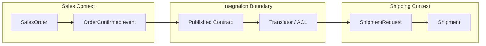

# Chuyển đổi thuật ngữ giữa các ngữ cảnh mà không hợp nhất mô hình

Trong một hệ thống lớn, nhiều bộ phận cùng nói về một đối tượng nhưng không nhất thiết hiểu nó theo cùng một cách. Bộ phận bán hàng xem **Order** là cam kết mua bán giữa khách hàng và doanh nghiệp; bộ phận giao vận xem nó là chỉ thị cần đóng gói và vận chuyển; kế toán xem nó là căn cứ ghi nhận doanh thu hoặc công nợ. Nếu ép các bên dùng chung một class `Order` với một bộ field và một bộ quy tắc, mô hình sẽ dần chứa những ý nghĩa xung đột.

Domain-Driven Design (DDD) giải quyết vấn đề này bằng cách giữ mỗi **Bounded Context** có mô hình và **Ubiquitous Language** riêng. Khi các context cần trao đổi, chúng chuyển đổi thông tin qua một ranh giới tích hợp có chủ đích. Việc chuyển đổi giữ được ý nghĩa cần thiết cho bên nhận mà không buộc hai bên hợp nhất mô hình.

Mục tiêu không phải dịch tên field từ `salesOrderId` sang `orderId`. Mục tiêu là hiểu hai bên đang nói về khái niệm gì, quy tắc nào áp dụng và thông tin nào có thể chuyển giao. Một context có thể gửi sự kiện hoặc hợp đồng dữ liệu; context còn lại diễn giải chúng thành khái niệm của chính mình.

## 1. Vì sao mỗi Bounded Context cần ngôn ngữ riêng?

**Bounded Context** là ranh giới trong đó một mô hình và ngôn ngữ nhất quán có hiệu lực. Một thuật ngữ có thể mang ý nghĩa khác nhau ở các context khác nhau mà không có gì sai.

Ví dụ trong một doanh nghiệp thương mại điện tử:

| Thuật ngữ | Sales Context | Shipping Context | Accounting Context |
|---|---|---|---|
| Order | Yêu cầu mua hàng đã được chấp nhận theo chính sách bán hàng | Yêu cầu cần thực hiện đóng gói và giao hàng | Chứng từ hoặc căn cứ phát sinh nghiệp vụ tài chính |
| Customer | Người hoặc tổ chức mua hàng | Có thể không phải người nhận kiện hàng | Bên chịu trách nhiệm thanh toán hoặc đối tác hợp đồng |
| Address | Địa chỉ thanh toán hoặc địa chỉ giao do người mua chọn | Điểm giao hàng đã được xác minh và có hướng dẫn tiếp cận | Địa chỉ pháp lý hoặc địa chỉ xuất hóa đơn |
| Completed | Đơn đã hoàn tất theo quy trình bán hàng | Kiện hàng đã giao thành công | Các điều kiện ghi nhận kế toán đã được đáp ứng |
| Cancelled | Giao dịch bán bị hủy theo chính sách | Yêu cầu giao vận bị dừng hoặc thu hồi | Bút toán có thể cần đảo hoặc điều chỉnh riêng |

Một thuật ngữ giống nhau về mặt chữ không chứng minh hai context có cùng khái niệm. Ngược lại, hai thuật ngữ khác nhau có thể mô tả cùng một sự kiện hoặc một phần thông tin tương đương.

### 1.1. Ngôn ngữ chung có phạm vi theo context

Ubiquitous Language giúp chuyên gia nghiệp vụ và đội phát triển trong một context dùng cùng thuật ngữ khi thảo luận, viết code và kiểm thử. Nó không yêu cầu toàn doanh nghiệp phải dùng một từ điển duy nhất cho mọi mô hình.

Khi Sales nói “đơn đã xác nhận”, Shipping có thể cần biết rằng “yêu cầu giao hàng đã được tạo” và có địa chỉ giao hợp lệ. Shipping không nhất thiết cần toàn bộ khái niệm về giá khuyến mãi, chính sách đổi trả hoặc hạn mức tín dụng. Nó cần một thông điệp phù hợp với trách nhiệm giao vận.

Giữ ngôn ngữ riêng giúp:

- Mỗi context mô hình hóa đúng quy tắc mà nó sở hữu.
- Thay đổi trong một context ít làm lan truyền sang context khác.
- Tránh một model lớn chứa field chỉ có ý nghĩa với một vài bộ phận.
- Làm rõ ai chịu trách nhiệm về dữ liệu và quyết định.
- Giúp việc tích hợp trở thành một hợp đồng có thể kiểm tra thay vì chia sẻ object nội bộ.

### 1.2. Tích hợp không có nghĩa là đồng nhất mô hình

Hai context có thể trao đổi thông tin mà không dùng chung entity, aggregate hoặc database schema. Context gửi chịu trách nhiệm phát biểu điều đã xảy ra hoặc cung cấp hợp đồng được công bố. Context nhận chịu trách nhiệm chuyển đổi thông tin đó thành mô hình của mình.

Ví dụ, Sales có `SalesOrder` còn Shipping có `Shipment`. `SalesOrder` không phải là `Shipment`; việc một đơn được xác nhận có thể dẫn đến yêu cầu tạo shipment, nhưng hai đối tượng có vòng đời và quy tắc khác nhau.



Sơ đồ thể hiện hướng chuyển đổi khái niệm. Nó không yêu cầu mọi hệ thống phải dùng message broker hoặc triển khai ACL thành một microservice riêng.

## 2. Chuyển đổi thuật ngữ là chuyển đổi ngữ nghĩa

Một integration boundary cần chuyển đổi cả dữ liệu lẫn ý nghĩa. Việc đổi tên field chỉ là một phần nhỏ.

Giả sử Sales gửi:

```json
{
  "salesOrderId": "SO-1042",
  "status": "CONFIRMED",
  "buyerId": "CUS-77",
  "deliveryAddress": {
    "line1": "12 Nguyen Hue",
    "city": "Ho Chi Minh City"
  },
  "items": [
    { "sku": "SKU-9", "quantity": 2 }
  ]
}
```

Shipping cần quyết định có thể tạo yêu cầu giao hàng hay không. Nó có thể cần:

- Mã tham chiếu đơn bán để truy vết.
- Người nhận và thông tin liên hệ giao hàng, không nhất thiết là buyer.
- Địa chỉ giao đã được chuẩn hóa theo quy tắc địa chỉ của Shipping.
- Các mặt hàng cần giao, số lượng và yêu cầu xử lý đặc biệt.
- Thời điểm dự kiến giao hoặc service level đã cam kết.
- Khóa chống xử lý lặp.

Shipping có thể mô hình hóa một kiểu khác:

```java
public record ShipmentRequest(
    SalesReference salesReference,
    Recipient recipient,
    DeliveryAddress destination,
    List<ParcelLine> lines,
    DeliveryServiceLevel serviceLevel,
    Instant requestedAt
) {}
```

`ShipmentRequest` không sao chép toàn bộ `SalesOrder`. Nó biểu đạt phần thông tin Shipping cần để bắt đầu quy trình của mình. `SalesReference` là tham chiếu đến nguồn phát sinh, không biến SalesOrder thành aggregate của Shipping.

### 2.1. Những câu hỏi phải trả lời khi dịch

Với mỗi khái niệm được chuyển qua ranh giới, hãy hỏi:

1. Khái niệm ở context gửi thực sự có nghĩa gì?
2. Context nhận cần quyết định hoặc thực hiện hành động nào?
3. Thông tin nào cần thiết cho quyết định đó?
4. Quy tắc nào chỉ có hiệu lực ở context gửi và không nên chuyển sang bên nhận?
5. Dữ liệu nào phải được biến đổi, bổ sung, chuẩn hóa hoặc từ chối?
6. Nếu không thể ánh xạ chính xác, hệ thống sẽ làm gì?
7. Ai sở hữu định nghĩa và thay đổi của hợp đồng?

Một bản dịch tốt có thể bỏ một số field không liên quan, đổi cấu trúc, tách một khái niệm thành nhiều giá trị hoặc tổng hợp nhiều nguồn thành một khái niệm mới. Điều cần giữ là ý nghĩa đủ cho hành vi của context nhận.

### 2.2. Không mang toàn bộ model nội bộ qua boundary

Tránh gửi trực tiếp JPA entity, aggregate object, domain event object nội bộ hoặc DTO phụ thuộc package của context nguồn. Nếu bên nhận import class nội bộ của bên gửi, hai context đã bị ghép ở mức mã nguồn dù chúng có database riêng.

Hãy công bố contract có chủ đích như API schema, message schema hoặc Published Language. Contract là phần giao tiếp được quản lý; domain model nội bộ vẫn thuộc quyền sở hữu của context nguồn.

## 3. Context Map và quan hệ giữa các context

**Context Map** mô tả các Bounded Context và quan hệ tích hợp giữa chúng. Nó giúp nhóm hiểu context nào cung cấp dữ liệu, context nào tiêu thụ, ai có quyền quyết định hợp đồng và mức độ phụ thuộc giữa các bên.

Một số quan hệ thường gặp trong DDD:

| Pattern | Ý nghĩa | Hệ quả đối với chuyển đổi |
|---|---|---|
| Customer-Supplier | Upstream cung cấp năng lực cho downstream; hai bên có thể phối hợp yêu cầu | Cần hợp đồng và cơ chế trao đổi thay đổi; downstream có thể xây translator |
| Anti-Corruption Layer (ACL) | Downstream tạo lớp chuyển đổi để bảo vệ mô hình của mình khỏi mô hình bên ngoài | Dịch ngữ nghĩa, dữ liệu và lỗi tại ranh giới |
| Conformist | Downstream chấp nhận mô hình và ngôn ngữ của upstream | Ít chuyển đổi hơn nhưng downstream chịu ảnh hưởng khi upstream thay đổi |
| Published Language | Các bên giao tiếp bằng một ngôn ngữ/hợp đồng được công bố | Schema phải rõ nghĩa, có version và quy trình thay đổi |
| Shared Kernel | Một phần nhỏ mô hình hoặc mã được hai context cùng chia sẻ và thay đổi có phối hợp | Chỉ chia sẻ phần thật sự ổn định; tránh biến toàn bộ model thành thư viện chung |
| Open Host Service | Upstream cung cấp một giao diện công khai để nhiều downstream tích hợp | Giao diện cần ổn định, có tài liệu và semantics rõ |

Các pattern này mô tả quan hệ tổ chức và tích hợp. Chúng không phải lựa chọn loại trừ tuyệt đối; một context map có thể kết hợp Published Language với ACL, hoặc một downstream có thể conformist với một upstream nhưng bảo vệ một context khác bằng ACL.

### 3.1. Upstream và downstream

Upstream là context có ảnh hưởng đến dữ liệu hoặc hợp đồng mà context khác sử dụng. Downstream là context phụ thuộc vào thông tin hoặc năng lực đó. Đây là quan hệ phụ thuộc, không phải đánh giá cấp bậc hay tầm quan trọng của đội ngũ.

Ví dụ, Sales phát sự kiện `OrderConfirmed`; Shipping tiêu thụ sự kiện để tạo shipment request. Sales là upstream đối với hợp đồng sự kiện này, Shipping là downstream. Shipping vẫn sở hữu mô hình `Shipment` và các quy tắc phân công hãng vận chuyển, đóng gói, giao hàng.

### 3.2. Context Map giúp xác định nơi đặt translator

Translator thường nằm ở phía cần bảo vệ mô hình khỏi cách diễn đạt của context khác. Với ACL, downstream kiểm soát lớp chuyển đổi và quyết định cách thông tin bên ngoài được hiểu trong domain của mình.

Không phải lúc nào translator cũng phải nằm trong một dịch vụ độc lập. Nó có thể là:

- Adapter trong application/infrastructure của downstream.
- Một module integration riêng trong cùng codebase.
- Một consumer/anti-corruption component cạnh message broker.
- Một gateway chuyển đổi giữa API và mô hình nội bộ.

Chọn vị trí theo quyền sở hữu mô hình, yêu cầu triển khai và vận hành. Điều quan trọng là boundary rõ và domain model của context nhận không phụ thuộc trực tiếp vào kiểu dữ liệu nội bộ của context gửi.

## 4. Anti-Corruption Layer (ACL)

**Anti-Corruption Layer** là lớp chuyển đổi giúp một context bảo vệ mô hình và ngôn ngữ của mình khỏi ảnh hưởng không mong muốn từ context khác hoặc hệ thống legacy. ACL tiếp nhận giao diện bên ngoài, diễn giải dữ liệu và chuyển nó thành command, value object hoặc domain concept của context nội bộ.

ACL đặc biệt hữu ích khi:

- Upstream dùng thuật ngữ hoặc cấu trúc không phù hợp với domain của downstream.
- Hệ thống legacy có mô hình dữ liệu phức tạp hoặc không nhất quán.
- API bên ngoài thay đổi theo lịch riêng mà downstream không kiểm soát.
- Downstream cần giữ quy tắc riêng và không muốn import model của đối tác.
- Một hợp đồng bên ngoài chứa nhiều chi tiết không liên quan đến use case nội bộ.

### 4.1. Các thành phần thường có trong ACL

ACL có thể bao gồm nhiều thành phần, không bắt buộc phải có tất cả:

- **External client/adapter:** giao tiếp với API, message broker hoặc hệ thống legacy.
- **Contract DTO:** biểu diễn payload bên ngoài.
- **Translator/mapper:** chuyển cấu trúc và ý nghĩa sang mô hình nội bộ.
- **Anti-corruption policy:** quyết định cách xử lý giá trị không hỗ trợ, trạng thái lạ hoặc thông tin thiếu.
- **Error translator:** chuyển lỗi giao tiếp thành kết quả hoặc lỗi phù hợp với downstream.
- **Observability:** ghi nhận version, correlation ID, mapping failure và thông tin cần thiết để vận hành.

Không nên để domain object tự parse JSON, gọi HTTP hoặc biết mã lỗi của nhà cung cấp. Những trách nhiệm này thuộc adapter/ACL.

### 4.2. Ví dụ Sales-to-Shipping translator

Contract nhận từ Sales:

```java
public record OrderConfirmedV1(
    String eventId,
    String salesOrderId,
    String buyerId,
    String buyerName,
    AddressPayload deliveryAddress,
    List<ConfirmedLinePayload> lines,
    String deliveryPromise,
    Instant confirmedAt
) {}
```

Mô hình Shipping:

```java
public record Recipient(String name, ContactDetails contact) {}

public record DeliveryAddress(
    String street,
    String locality,
    String postalCode,
    CountryCode country
) {}

public record ParcelLine(Sku sku, PositiveQuantity quantity) {}

public record ShipmentRequest(
    SalesReference salesReference,
    Recipient recipient,
    DeliveryAddress destination,
    List<ParcelLine> lines,
    DeliveryServiceLevel serviceLevel
) {}
```

Translator chuyển đổi:

```java
public final class SalesOrderTranslator {
    public ShipmentRequest toShipmentRequest(OrderConfirmedV1 event) {
        Recipient recipient = new Recipient(
            event.buyerName(),
            ContactDetails.fromBuyerReference(event.buyerId())
        );

        DeliveryAddress destination = DeliveryAddress.fromExternal(
            event.deliveryAddress().streetLine(),
            event.deliveryAddress().cityName(),
            event.deliveryAddress().postalCode(),
            event.deliveryAddress().countryCode()
        );

        List<ParcelLine> lines = event.lines().stream()
            .map(line -> new ParcelLine(
                Sku.from(line.sku()),
                PositiveQuantity.of(line.quantity())
            ))
            .toList();

        return new ShipmentRequest(
            SalesReference.from(event.salesOrderId()),
            recipient,
            destination,
            lines,
            DeliveryServiceLevel.fromSalesPromise(event.deliveryPromise())
        );
    }
}
```

Đây là pseudo-code mô tả trách nhiệm chuyển đổi; trong hệ thống thật, contact có thể được gửi trong event hoặc được truy vấn qua một port riêng. Không nên dùng buyer mặc định làm recipient nếu Sales cho phép người mua chọn người nhận khác. Ví dụ cho thấy translator phải ánh xạ theo ý nghĩa, không chỉ đổi tên field.

### 4.3. Mapping failure phải được xử lý có chủ đích

Giả sử Sales gửi `deliveryPromise = "SAME_DAY_PLUS"` nhưng Shipping chưa hỗ trợ giá trị đó. Có một số lựa chọn:

- Từ chối event và đưa vào dead-letter/quarantine để xử lý, nếu không thể tạo shipment an toàn.
- Ánh xạ sang mức dịch vụ tổng quát hơn, chỉ khi domain expert xác nhận semantics tương đương.
- Tạo trạng thái `NEEDS_MANUAL_REVIEW` nếu nghiệp vụ cho phép giữ yêu cầu chờ xử lý.
- Bổ sung khả năng mới ở Shipping trước khi bật giá trị mới từ Sales.

Không nên tự động chuyển giá trị lạ thành `STANDARD` chỉ để tránh lỗi. Việc đó có thể làm sai cam kết giao hàng. Unknown value cần có chính sách rõ ràng, có log và có khả năng quan sát.

## 5. Chuyển đổi các thuật ngữ dễ gây nhầm lẫn

### 5.1. Order không nhất thiết là một khái niệm chung

Trong Sales, `SalesOrder` có thể chứa:

- Buyer, giá, discount và thuế.
- Các dòng hàng theo catalog bán hàng.
- Điều khoản thanh toán.
- Trạng thái xác nhận và hủy theo chính sách bán hàng.

Trong Shipping, `Shipment` có thể chứa:

- Người nhận và địa chỉ giao.
- Các kiện hàng, trọng lượng, kích thước.
- Hãng vận chuyển, service level và tracking number.
- Trạng thái lấy hàng, đang giao, giao thất bại và giao thành công.

Sales order có thể tạo ra một hoặc nhiều shipment. Một shipment có thể gom hàng từ nhiều order nếu chính sách fulfillment cho phép. Vì vậy, mapping `SalesOrder -> Shipment` không nhất thiết là một-một.

### 5.2. Customer, Buyer, Recipient và Payer

Một người có thể đảm nhận nhiều vai trò, nhưng các vai trò không đồng nhất:

| Khái niệm | Ý nghĩa trong context tương ứng |
|---|---|
| Buyer | Người thực hiện việc mua hàng |
| Recipient | Người nhận kiện hàng |
| Payer | Bên chịu trách nhiệm thanh toán |
| Account Holder | Chủ thể sở hữu tài khoản hoặc quan hệ hợp đồng |
| Customer | Thuật ngữ do từng context định nghĩa; cần xem cụ thể vai trò nào |

Nếu event chỉ gửi `customerId`, Shipping không nên giả định đó là người nhận. Contract cần mang thông tin người nhận hoặc một tham chiếu mà Shipping có thể phân giải theo quy tắc đã thống nhất.

### 5.3. Address có thể mang ngữ nghĩa khác nhau

Địa chỉ thanh toán, địa chỉ pháp lý và địa chỉ giao hàng có thể cùng chứa đường, thành phố, quốc gia nhưng có validation và mục đích khác nhau.

- Billing Address có thể cần tên pháp nhân và mã bưu chính phục vụ hóa đơn.
- Legal Address có thể cần địa chỉ đăng ký pháp lý.
- Delivery Address có thể cần hướng dẫn giao hàng, giờ nhận, cổng vào hoặc tọa độ.

Không nên tạo một `Address` dùng chung toàn hệ thống với hàng chục field tùy chọn nếu các context có quy tắc khác nhau. Hãy giữ `BillingAddress`, `LegalAddress` và `DeliveryAddress` ở context sở hữu chúng, sau đó chuyển đổi qua contract.

### 5.4. Status không nên được ánh xạ bằng cùng tên một cách máy móc

`COMPLETED` ở Sales có thể không tương đương `DELIVERED` ở Shipping hoặc `POSTED` ở Accounting. Một mapping rõ ràng có thể là:

| Sales event/status | Shipping interpretation | Accounting interpretation |
|---|---|---|
| `ORDER_CONFIRMED` | Tạo shipment request nếu đủ dữ liệu | Ghi nhận trạng thái đơn theo quy trình kế toán |
| `ORDER_CANCELLED` | Yêu cầu hủy shipment nếu chưa giao; nếu đã giao thì tạo quy trình xử lý khác | Xem xét hoàn tiền hoặc bút toán điều chỉnh |
| `ORDER_COMPLETED` | Không tự suy ra shipment đã giao nếu contract không bảo đảm điều đó | Không tự suy ra mọi điều kiện ghi nhận đã hoàn tất |

Mapping trạng thái cần dựa trên sự kiện và điều kiện nghiệp vụ, không chỉ so sánh enum name.

## 6. Published Language và hợp đồng tích hợp

**Published Language** là ngôn ngữ/hợp đồng được công bố để các context hoặc hệ thống khác giao tiếp. Nó có thể là REST API schema, message schema, event contract hoặc một mô hình dữ liệu chuẩn hóa cho một mục đích cụ thể.

Published Language không phải là toàn bộ domain model của upstream. Nó là phần giao tiếp được thiết kế để bên khác hiểu và có thể thay đổi theo quy trình quản trị hợp đồng.

### 6.1. Hợp đồng nên nói về sự kiện hoặc ý định rõ ràng

Một event nên dùng tên quá khứ để diễn đạt điều đã xảy ra, ví dụ `OrderConfirmed`, `PaymentCaptured`, `ShipmentDelivered`. Một command diễn đạt ý định yêu cầu bên nhận thực hiện, ví dụ `RequestShipment`, `CancelShipment`.

Không nhầm event với command:

- Event: Sales đã xác nhận đơn; consumer có thể phản ứng.
- Command: yêu cầu Shipping tạo shipment; Shipping có thể chấp nhận hoặc từ chối.

Nếu Sales chỉ phát `OrderConfirmed`, Shipping không nên hiểu rằng shipment đã được tạo. Nó mới nhận thông tin để quyết định tạo yêu cầu giao vận theo quy tắc của mình.

### 6.2. Contract DTO không phải domain entity

Contract DTO được thiết kế cho tương thích giao tiếp. Nó có thể có:

- Field version hoặc schema version.
- Mã định danh event và correlation ID.
- Thời điểm phát sinh và nguồn phát.
- Các giá trị enum có quy tắc mở rộng.
- Field optional và default được định nghĩa rõ.
- Metadata cho tracing hoặc tenant scope.

Domain entity có identity, hành vi, invariant và vòng đời riêng. Không nên dùng contract DTO làm entity chỉ để giảm mapping.

### 6.3. Schema evolution

Hợp đồng tích hợp sẽ thay đổi. Khi thêm field, đổi enum hoặc thay semantics, cần đánh giá khả năng tương thích:

- **Backward compatible:** consumer cũ vẫn đọc được message mới theo quy ước đã thống nhất.
- **Forward compatible:** consumer mới có thể đọc message cũ và xử lý field chưa có.
- **Breaking change:** consumer cần thay đổi để hiểu contract mới hoặc semantics đã đổi.

Một số nguyên tắc:

- Thêm field optional có default rõ thường an toàn hơn đổi nghĩa field cũ.
- Consumer nên xử lý unknown enum value theo chính sách đã thiết kế.
- Không đổi đơn vị đo hoặc currency mà không version/định nghĩa lại contract.
- Không tái sử dụng một field cũ với semantics mới.
- Dùng version khi thay đổi không thể tương thích ngược.
- Có thời gian chuyển tiếp và kế hoạch loại bỏ version cũ.

### 6.4. Không tạo một Canonical Data Model toàn cục quá sớm

Một mô hình dữ liệu chuẩn dùng chung cho mọi context có thể giảm số lượng mapping ở thời điểm đầu, nhưng dễ trở thành mô hình thỏa hiệp. Nó thường chứa các field và semantics khác nhau, khiến mỗi context phải hiểu một phần không liên quan.

Published Language có thể chuẩn hóa một contract cụ thể, ví dụ event `OrderConfirmedV1`, mà không cần chuẩn hóa toàn bộ `Order` của doanh nghiệp. Hãy chuẩn hóa phần giao tiếp có giá trị rõ ràng, giữ các mô hình domain nội bộ độc lập.

## 7. ACL, Conformist và Shared Kernel: chọn cách tích hợp

Không phải quan hệ nào cũng cần ACL. Hãy chọn pattern theo quyền kiểm soát, mức độ khác biệt của mô hình và chi phí duy trì.

### 7.1. Khi nên dùng ACL

ACL phù hợp khi downstream cần bảo vệ mô hình khỏi semantics không phù hợp, dữ liệu legacy hoặc hợp đồng không ổn định. Nó đặc biệt hữu ích khi upstream không thể thay đổi theo nhu cầu của downstream.

Chi phí của ACL gồm code mapping, kiểm thử contract, giám sát lỗi và quản lý version. Nếu hai context chỉ trao đổi một contract rất nhỏ, một adapter đơn giản có thể đủ; không cần xây một framework chuyển đổi tổng quát.

### 7.2. Khi conformist có thể chấp nhận được

Conformist là lựa chọn khi downstream chấp nhận mô hình của upstream vì chi phí chuyển đổi lớn hơn lợi ích, hoặc upstream đã là chuẩn mà downstream phải tuân theo.

Điều đó không có nghĩa domain downstream phải import mọi class nội bộ. Downstream vẫn có thể dùng adapter để chuyển contract công khai sang kiểu dữ liệu nội bộ tối thiểu. Conformist nói về việc chấp nhận semantics upstream, không nhất thiết là chia sẻ cùng object graph hoặc database.

### 7.3. Shared Kernel cần phạm vi rất nhỏ

Shared Kernel là một phần nhỏ của model hoặc code được hai context cùng chia sẻ và phải phối hợp khi thay đổi. Nó có thể phù hợp với một tập khái niệm thực sự ổn định và được cả hai bên hiểu giống nhau.

Rủi ro xuất hiện khi shared kernel mở rộng thành thư viện domain dùng chung cho mọi thứ. Khi đó, thay đổi một context có thể buộc nhiều context phát hành cùng lúc; ngôn ngữ của các bên bị khóa vào một mô hình chung.

Nếu chỉ cần chia sẻ kiểu primitive hoặc schema giao tiếp, hãy cân nhắc Published Language hoặc contract library thay vì chia sẻ entity/aggregate. Dù dùng shared kernel, không nên đưa các quy tắc riêng của một context vào phần dùng chung.

## 8. Đồng bộ qua API và qua Domain Event

Có hai hình thức tích hợp phổ biến. Cả hai đều cần chuyển đổi semantics ở ranh giới.

### 8.1. Synchronous API

Context nhận gọi API của context cung cấp để lấy dữ liệu hoặc yêu cầu hành động. Ví dụ Shipping gọi Sales để truy vấn thông tin đơn trước khi tạo shipment.

Ưu điểm:

- Có thể nhận kết quả ngay trong cùng luồng xử lý.
- Phù hợp khi use case thực sự cần dữ liệu mới tại thời điểm quyết định.
- Contract request/response dễ mô tả cho một thao tác cụ thể.

Hạn chế:

- Tạo phụ thuộc availability và latency giữa hai context.
- Lỗi upstream có thể làm use case downstream thất bại.
- Gọi nhiều API tuần tự có thể kéo dài transaction hoặc request.
- Dễ biến downstream thành bản sao truy vấn của upstream nếu không xác định rõ nhu cầu.

Không giữ transaction database của downstream mở trong lúc chờ API bên ngoài nếu có thể tránh. Hãy tải dữ liệu cần thiết trước hoặc mô hình hóa quy trình bất đồng bộ.

### 8.2. Domain Event / integration event

Context phát event sau khi một thay đổi nghiệp vụ đã được chấp nhận. Consumer nhận event, chuyển đổi sang mô hình của mình và thực hiện hành vi tương ứng.

Ví dụ:

```text
Sales: OrderConfirmed
       |
       v
Integration Event Contract
       |
       v
Shipping ACL / Translator
       |
       v
Shipping: Create ShipmentRequest
```

Ưu điểm:

- Giảm phụ thuộc đồng bộ.
- Consumer có thể xử lý theo tốc độ của mình.
- Một event có thể phục vụ nhiều consumer với mô hình riêng.
- Dễ mở rộng quy trình nghiệp vụ theo sự kiện.

Hạn chế:

- Consumer có thể nhận trễ hoặc nhận lặp.
- Thứ tự event cần được xác định theo aggregate/partition nếu quan trọng.
- Event contract phải được quản lý version.
- Trạng thái downstream có thể nhất quán cuối cùng thay vì tức thời.

Consumer nên idempotent, dùng `eventId` hoặc business key để tránh tạo shipment trùng. Nếu publish event phải đồng bộ với transaction nguồn, cân nhắc transactional outbox.

### 8.3. Event không phải bản sao toàn bộ aggregate

Không nên phát một event chứa mọi field của aggregate chỉ vì tiện cho consumer. Hãy gửi dữ liệu đủ để consumer xử lý contract đã công bố. Nếu consumer cần thêm dữ liệu, cân nhắc query API hoặc một event khác có chủ đích.

Payload quá lớn và chứa mọi chi tiết nội bộ khiến upstream khó thay đổi, downstream phụ thuộc vào cấu trúc không liên quan và nguy cơ lộ dữ liệu tăng lên.

## 9. Xử lý dữ liệu không thể ánh xạ trực tiếp

Trong tích hợp thực tế, contract có thể chứa dữ liệu thiếu, không hợp lệ, không còn hỗ trợ hoặc có ý nghĩa khác.

### 9.1. Field thiếu

Nếu Shipping cần địa chỉ giao nhưng event không có, hệ thống phải có chính sách rõ:

- Từ chối tạo shipment và yêu cầu Sales bổ sung.
- Tạo shipment request ở trạng thái chờ bổ sung nếu nghiệp vụ cho phép.
- Tra cứu địa chỉ qua một API được công bố nếu có quyền và nguồn dữ liệu phù hợp.

Không nên tự lấy billing address làm delivery address nếu chưa có quy tắc xác nhận.

### 9.2. Giá trị enum không biết

Một enum trong JSON có thể mở rộng trong tương lai. Consumer nên xử lý unknown value theo semantics:

- Nếu giá trị không ảnh hưởng đến quyết định, có thể giữ nguyên như một chuỗi opaque hoặc bỏ qua theo contract.
- Nếu giá trị quyết định một hành vi an toàn, cần từ chối hoặc đưa vào trạng thái xử lý thủ công.
- Nếu có mapping mặc định, default phải được domain owner phê duyệt.

Tránh deserialize trực tiếp vào enum kín rồi làm consumer crash mà không có dead-letter policy. Cũng không nên âm thầm map mọi giá trị lạ về một trạng thái mặc định.

### 9.3. Đơn vị đo và tiền tệ

`weight = 2` có thể là kilogram hoặc pound; `amount = 100` có thể là USD hoặc VND. Contract phải nêu đơn vị và currency rõ ràng. Translator cần chuyển đổi bằng quy tắc được xác nhận, không dựa vào suy đoán.

Nếu đổi đơn vị, ghi rõ precision và rounding. Nếu cần tỷ giá, ghi nhận tỷ giá và thời điểm áp dụng để quyết định có thể tái hiện.

### 9.4. Thời gian và timezone

Các context có thể dùng thời gian theo múi giờ địa phương hoặc UTC. Contract nên phân biệt instant với local date/time, timezone và effective date. Ví dụ “giao trước 17:00 ngày mai” cần timezone của địa điểm giao, không chỉ là một timestamp thiếu ngữ cảnh.

## 10. Xử lý lỗi qua ranh giới context

Lỗi từ upstream không nên được chuyển nguyên xi thành exception nội bộ của downstream. ACL cần phân loại và chuyển đổi:

| Lỗi bên ngoài | Cách diễn giải phía downstream |
|---|---|
| HTTP 404 cho SalesOrder | Không có tham chiếu đơn nguồn; use case tạo shipment có thể từ chối hoặc chờ đồng bộ |
| HTTP 429 / rate limit | Lỗi phụ thuộc tạm thời; retry có backoff theo hợp đồng |
| HTTP 5xx / timeout | Upstream chưa thể xác nhận; không suy ra đơn không tồn tại |
| Unknown status trong event | Mapping không hỗ trợ; quarantine/manual review hoặc policy được phê duyệt |
| Thiếu địa chỉ giao bắt buộc | Lỗi contract/data quality; không tự suy diễn địa chỉ khác |
| Duplicate event | Bỏ qua hoặc trả kết quả đã xử lý dựa trên idempotency key |

Phân biệt “upstream không trả lời” với “upstream xác nhận không tồn tại”. Timeout không phải not found. Nếu chuyển timeout thành `OrderNotFound`, hệ thống có thể tạo hành vi sai và che giấu sự cố.

### 10.1. Retry phải dựa trên semantics

Retry phù hợp với lỗi tạm thời và thao tác idempotent. Không retry vô hạn lỗi contract hoặc dữ liệu không ánh xạ được. Dùng giới hạn, backoff, dead-letter queue và quy trình xử lý lại có kiểm soát.

### 10.2. Correlation và tracing

Giữ các định danh cần thiết qua boundary như `eventId`, `correlationId`, `causationId` và source reference. Chúng giúp truy vết một quyết định xuyên nhiều context mà không yêu cầu dùng chung entity ID nội bộ.

## 11. Kiểm thử translator và integration contract

Translator là phần quan trọng của boundary, vì một mapping sai có thể tạo quyết định nghiệp vụ sai dù hai dịch vụ đều chạy bình thường.

### 11.1. Unit test mapping

Kiểm tra:

- ID nguồn được giữ làm reference đúng.
- Buyer và recipient được phân biệt.
- Address được chuyển sang loại địa chỉ phù hợp.
- Quantity, currency, unit và timezone được diễn giải đúng.
- Status/event chỉ ánh xạ khi semantics tương đương.
- Field thiếu hoặc unknown value được xử lý theo policy.
- Thông tin không cần thiết hoặc nhạy cảm không bị chuyển qua.

Ví dụ:

```java
class SalesOrderTranslatorTest {
    @Test
    void mapsConfirmedOrderToShipmentRequest() {
        OrderConfirmedV1 event = confirmedOrderEvent();

        ShipmentRequest request = new SalesOrderTranslator()
            .toShipmentRequest(event);

        assertEquals("SO-1042", request.salesReference().value());
        assertEquals("12 Nguyen Hue", request.destination().street());
        assertEquals(2, request.lines().getFirst().quantity().value());
    }
}
```

### 11.2. Contract tests

Contract test xác minh producer phát đúng schema/semantics đã công bố và consumer hiểu hợp đồng đó. Có thể kiểm tra:

- Required/optional fields.
- Enum và unknown value behavior.
- Schema compatibility giữa version.
- Timestamp, currency và đơn vị đo.
- Ví dụ payload thực tế được consumer chấp nhận.
- Quy tắc idempotency và event ordering nếu contract yêu cầu.

### 11.3. Consumer-driven contract

Trong một số tổ chức, downstream công bố nhu cầu giao tiếp dưới dạng contract test; upstream chạy kiểm tra để biết thay đổi của mình có phá vỡ consumer hay không. Cách này hữu ích khi nhiều consumer phụ thuộc cùng một API. Tuy nhiên, contract test không thay thế việc domain expert xác nhận semantics. Một schema có thể tương thích về cấu trúc nhưng thay đổi ý nghĩa của `status`.

### 11.4. Test mapping failure và vận hành

Ngoài happy path, hãy kiểm thử unknown enum, thiếu field, currency không hỗ trợ, địa chỉ không hợp lệ, duplicate event, timeout và lỗi schema. Xác minh lỗi được log, gắn correlation ID và đưa đến retry/quarantine phù hợp.

## 12. Quản lý thay đổi khi một context phát triển

Context có quyền phát triển mô hình nội bộ mà không cần yêu cầu mọi consumer thay đổi theo. Tuy nhiên, khi thay đổi contract công khai, cần quản lý tương thích.

Một quy trình thay đổi có thể gồm:

1. Domain owner xác định thay đổi về semantics hoặc dữ liệu.
2. Contract owner đánh giá ảnh hưởng đến consumer.
3. Thêm field/version hoặc tạo contract mới nếu cần breaking change.
4. Công bố tài liệu, ví dụ payload và thời gian chuyển tiếp.
5. Consumer cập nhật translator và contract tests.
6. Theo dõi mức sử dụng version cũ.
7. Ngừng version cũ sau khi các consumer đã chuyển đổi.

Không nên đổi nghĩa một field hiện có nhưng giữ nguyên tên và version. Đây là dạng breaking change khó phát hiện vì schema vẫn hợp lệ.

### 12.1. Consumer phải chịu trách nhiệm với model của mình

Nếu Sales đổi cấu trúc `Address`, Shipping chỉ cần cập nhật translator khi contract công khai thay đổi. Domain `DeliveryAddress` của Shipping không nhất thiết phải đổi theo. Đây là lợi ích quan trọng của việc tách contract khỏi model nội bộ.

### 12.2. Tránh mapping hai chiều tự động

Không phải lúc nào cũng có phép chuyển đổi ngược hoàn hảo. `Shipment` có thể chứa nhiều thông tin mà `SalesOrder` không biết; một `SalesOrder` có thể tạo nhiều shipment. Vì vậy, không nên mặc định tạo `toSalesOrder()` từ `Shipment` chỉ vì đã có `toShipmentRequest()`.

Nếu context cần gửi dữ liệu ngược, hãy xác định một event hoặc command riêng với semantics rõ, ví dụ `ShipmentDelivered` hoặc `ReportDeliveryException`. Mỗi hướng tích hợp có thể có contract và translator riêng.

## 13. Tổ chức code cho integration boundary

Một cách tổ chức package ở phía Shipping:

```text
shipping
├── domain
│   ├── model
│   │   ├── Shipment.java
│   │   ├── DeliveryAddress.java
│   │   └── Recipient.java
│   └── policy
│       └── DeliveryEligibilityPolicy.java
├── application
│   └── usecase
│       └── CreateShipmentFromSalesOrder.java
└── infrastructure
    └── integration
        └── sales
            ├── OrderConfirmedV1.java
            ├── SalesOrderTranslator.java
            ├── SalesEventConsumer.java
            └── SalesContractErrorHandler.java
```

Contract DTO và translator nằm ở integration/infrastructure boundary. Application nhận `ShipmentRequest` hoặc command nội bộ. Domain chỉ làm việc với `DeliveryAddress`, `Recipient`, `Shipment` và các kiểu của Shipping.

Trong một modular monolith, các module có thể nằm cùng process nhưng vẫn giữ package/module boundary. Trong microservices, boundary còn được củng cố bằng API/message contract và quyền sở hữu dữ liệu. Tách process không tự động tạo ra bounded context đúng; điều quan trọng là mô hình và trách nhiệm được phân định.

## 14. Khi nào cần Shared Kernel, Published Language hoặc ACL?

| Câu hỏi | Lựa chọn cần cân nhắc |
|---|---|
| Hai context có một phần mô hình rất nhỏ, ổn định và thực sự cùng ý nghĩa không? | Shared Kernel với ownership và quy trình thay đổi chung |
| Nhiều consumer cần một hợp đồng giao tiếp ổn định do upstream công bố? | Published Language / Open Host Service |
| Downstream cần bảo vệ model khỏi legacy hoặc semantics không phù hợp? | Anti-Corruption Layer |
| Downstream chấp nhận semantics upstream vì không có quyền hoặc lợi ích để chuyển đổi? | Conformist |
| Hai bên có thể phối hợp yêu cầu và ưu tiên thay đổi hợp đồng? | Customer-Supplier |

Các pattern có thể phối hợp. Ví dụ upstream cung cấp Published Language; downstream dùng ACL để chuyển contract đó thành domain model nội bộ. Nếu hai context cùng quản lý một kernel nhỏ, phần còn lại vẫn có thể được chuyển đổi độc lập.

## 15. Sai lầm thường gặp

**Dùng chung một entity giữa các context.** Một `Order` toàn cục thường gom các trạng thái và quy tắc không tương thích. Hãy để mỗi context có model riêng và chỉ chia sẻ contract cần thiết.

**Chỉ đổi tên field mà không dịch semantics.** `customerId` không tự động là recipient ID; `COMPLETED` không tự động là `DELIVERED`. Phải hiểu khái niệm và quy tắc của hai bên.

**Đưa domain entity vào message/API.** Điều này làm consumer phụ thuộc cấu trúc nội bộ và framework của producer. Dùng Published Language hoặc contract DTO.

**Tạo canonical model cho toàn doanh nghiệp quá sớm.** Mô hình chung có thể trở thành thỏa hiệp và buộc mọi context dùng cùng một cách diễn giải. Chuẩn hóa contract theo nhu cầu tích hợp cụ thể.

**Đặt ACL trong context nguồn dù downstream cần bảo vệ model.** Lớp chống nhiễm thường thuộc phía downstream vì đó là bên quyết định cách tiếp nhận và chuyển đổi dữ liệu bên ngoài.

**Ánh xạ giá trị lạ về default tùy tiện.** Điều này có thể biến một cam kết giao hàng nhanh thành giao tiêu chuẩn hoặc hiểu sai trạng thái thanh toán. Từ chối, quarantine hoặc xử lý thủ công theo policy.

**Coi timeout là not found.** Không nhận được phản hồi không có nghĩa dữ liệu không tồn tại. Phân loại lỗi giao tiếp và lỗi nghiệp vụ riêng.

**Giả định mapping luôn một-một và hai chiều.** Một sales order có thể tạo nhiều shipment; shipment có thể gom nhiều đơn. Hãy mô hình hóa quan hệ thực tế.

**Không version contract.** Thay đổi semantics mà không quản lý tương thích có thể làm consumer ra quyết định sai dù payload vẫn parse được.

**Chỉ test schema, không test nghĩa.** Contract có thể đúng cấu trúc nhưng mapping buyer thành recipient hoặc sai currency. Cần unit test translator và xác nhận domain semantics.

**Để translator trở thành domain service của mọi thứ.** Translator nên tập trung vào boundary; không biến nó thành nơi chứa quy tắc nội bộ của Shipping hoặc Sales.

## 16. Quy trình thiết kế chuyển đổi giữa hai context

1. **Xác định hai Bounded Context.** Ghi rõ owner, mục tiêu, model và ngôn ngữ của từng bên.
2. **Xác định nhu cầu tích hợp.** Bên nhận cần làm gì khi nhận thông tin: truy vấn, tạo yêu cầu, cập nhật trạng thái hay phản ứng với event?
3. **Làm rõ semantics nguồn.** Hỏi domain expert về ý nghĩa của thuật ngữ, trạng thái, thời điểm và dữ liệu.
4. **Xác định semantics đích.** Bên nhận cần khái niệm nào, quy tắc nào và dữ liệu tối thiểu nào?
5. **Thiết kế Published Language/contract.** Chọn event, command hoặc API schema phù hợp; không xuất toàn bộ model nội bộ.
6. **Lập mapping có chủ đích.** Ghi field nguồn, khái niệm đích, phép chuyển đổi, đơn vị, default và trường hợp không ánh xạ được.
7. **Chọn pattern trong Context Map.** ACL, Conformist, Customer-Supplier, Shared Kernel hoặc Open Host Service tùy quyền sở hữu và mức độ khác biệt.
8. **Đặt translator ở boundary.** Đảm bảo domain đích không import model nguồn.
9. **Thiết kế lỗi và thay đổi contract.** Quy định unknown value, retry, idempotency, version và deprecation.
10. **Kiểm thử semantics.** Unit test mapping, contract test producer/consumer và integration test các luồng quan trọng.
11. **Theo dõi vận hành.** Dùng correlation ID, metric mapping failure, dead-letter và quy trình replay.

## 17. Checklist đánh giá

Trước khi hoàn tất một integration boundary, hãy kiểm tra:

- Mỗi context có ngôn ngữ và mô hình riêng được mô tả rõ không?
- Các thuật ngữ giống nhau nhưng khác nghĩa đã được nhận diện chưa?
- Contract có biểu đạt sự kiện/ý định thay vì lộ entity nội bộ không?
- Bên nhận có mô hình nội bộ riêng và translator rõ ràng không?
- Mapping có chuyển semantics, đơn vị, trạng thái và vai trò đúng không?
- Quan hệ một-nhiều hoặc nhiều-một có được mô hình hóa đúng không?
- Unknown value và dữ liệu thiếu có chính sách xử lý không?
- ACL có nằm ở phía cần bảo vệ mô hình không?
- Contract có version và quy trình thay đổi tương thích không?
- Event có idempotency, correlation và chính sách retry phù hợp không?
- Timeout có được phân biệt với not found và business rejection không?
- Có test mapping, contract và lỗi vận hành không?
- Có metric và quy trình xử lý message không ánh xạ được không?
- Có đang tạo shared/canonical model lớn hơn nhu cầu thực tế không?

## 18. Câu hỏi tự kiểm tra

1. Vì sao cùng thuật ngữ `Order` có thể mang ý nghĩa khác nhau trong Sales và Shipping?
2. Ubiquitous Language có cần giống nhau trên toàn doanh nghiệp không? Giải thích.
3. Chuyển đổi semantics khác gì với đổi tên field?
4. Anti-Corruption Layer bảo vệ downstream khỏi điều gì và thường được đặt ở đâu?
5. Published Language khác domain model nội bộ như thế nào?
6. Khi nào Conformist có thể hợp lý và rủi ro của nó là gì?
7. Vì sao không nên tạo một canonical data model toàn cục quá sớm?
8. Một sales order có thể tạo nhiều shipment thì mapping nên được thiết kế ra sao?
9. Vì sao timeout của upstream không được diễn giải thành dữ liệu không tồn tại?
10. Cần những loại test nào để bảo đảm translator chuyển đúng cả cấu trúc lẫn ý nghĩa?

## Kết luận

Mỗi Bounded Context cần giữ mô hình và ngôn ngữ phản ánh đúng trách nhiệm nghiệp vụ của mình. Khi tích hợp, các bên trao đổi qua contract có chủ đích và chuyển đổi thông tin thành khái niệm nội bộ ở boundary. Context Map giúp xác định quan hệ và quyền sở hữu; Published Language làm rõ hợp đồng; Anti-Corruption Layer bảo vệ downstream khỏi semantics không phù hợp; translator biến đổi dữ liệu, trạng thái và vai trò theo quy tắc đã xác nhận. Giữ các mô hình riêng giúp từng context phát triển độc lập hơn, trong khi contract và mapping được kiểm thử, version và vận hành một cách có kiểm soát.
