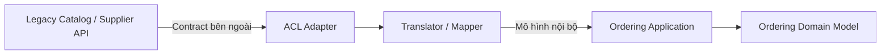
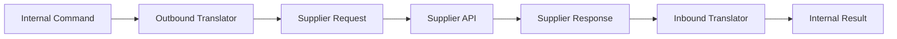
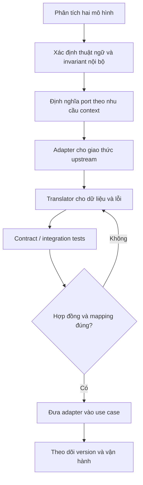

# Thiết kế lớp chống xâm lấn để cách ly hệ thống cũ hoặc nhà cung cấp

Trong Domain-Driven Design (DDD), mỗi Bounded Context có mô hình, thuật ngữ và quy tắc riêng. Khi một context cần tích hợp với hệ thống cũ hoặc dịch vụ của nhà cung cấp, hai bên thường không chia sẻ cùng một cách hiểu về dữ liệu. Hệ thống ngoài có thể dùng mã trạng thái khó hiểu, cấu trúc dữ liệu cũ, đơn vị đo khác nhau hoặc một mô hình được thiết kế quanh giới hạn kỹ thuật của nó. Nếu đưa trực tiếp những khái niệm đó vào domain model, ngôn ngữ của context nội bộ sẽ dần bị chi phối bởi mô hình bên ngoài.

**Anti-Corruption Layer (ACL)** là lớp chuyển đổi và cách ly giúp bảo vệ mô hình của context đang xây dựng. ACL tiếp nhận giao thức hoặc cấu trúc dữ liệu từ bên ngoài, diễn giải chúng theo ngôn ngữ của context nội bộ, rồi chuyển yêu cầu nội bộ thành định dạng mà hệ thống ngoài hiểu được. Nhờ đó, domain model giữ được thuật ngữ, invariant và thiết kế riêng trong khi vẫn có thể sử dụng năng lực của hệ thống cũ hoặc nhà cung cấp.

Bài học này trình bày khi nào cần ACL, cách xác định ranh giới upstream/downstream, cách thiết kế port và adapter, cách dịch dữ liệu và lỗi, cách kiểm thử hợp đồng tích hợp, cùng những trường hợp không cần tạo ACL đầy đủ.

## 1. Vấn đề khi để mô hình bên ngoài xâm nhập domain model

Giả sử bounded context Ordering cần lấy thông tin sản phẩm từ một hệ thống Catalog cũ. Hệ thống cũ trả về dữ liệu như sau:

```json
{
  "ITEM_NO": "SKU-1042",
  "ITEM_DESC": "Wireless keyboard",
  "SELL_ST": "A",
  "UNIT_PRC": "129900.00",
  "CURR": "VND",
  "UOM": "EA"
}
```

Các tên trường là viết tắt theo quy ước của hệ thống cũ. Trạng thái `A` có thể có nghĩa là được phép bán, `D` là ngừng kinh doanh. Nếu Ordering dùng trực tiếp những trường này, domain model có thể xuất hiện các khái niệm như `SELL_ST`, `UNIT_PRC` hoặc `UOM`. Mọi use case phải biết cách diễn giải mã trạng thái và chuỗi số tiền.

Điều đó tạo ra một số vấn đề:

- Thuật ngữ nội bộ bị trộn với thuật ngữ và cấu trúc của nhà cung cấp.
- Quy tắc chuyển đổi bị lặp ở nhiều nơi gọi API.
- Khi nhà cung cấp đổi tên field hoặc mã trạng thái, nhiều thành phần nội bộ phải sửa.
- Domain model phụ thuộc vào chi tiết giao thức, JSON hoặc schema của hệ thống ngoài.
- Dữ liệu sai hoặc chưa được hỗ trợ có thể đi sâu vào Aggregate trước khi được phát hiện.
- Kiểm thử nghiệp vụ cần dựng các object theo cấu trúc của nhà cung cấp thay vì ngôn ngữ nội bộ.

ACL gom việc diễn giải vào một ranh giới có chủ đích. Bên trong Ordering, ứng dụng làm việc với `Sku`, `ProductSnapshot`, `Money` và `ProductAvailability`; bên ngoài, adapter làm việc với `ITEM_NO`, `UNIT_PRC`, `SELL_ST` và giao thức của Catalog cũ.

## 2. ACL trong Context Map

Context Map mô tả quan hệ giữa các Bounded Context và cách chúng phối hợp. Khi một context tiêu thụ mô hình hoặc dịch vụ do context khác cung cấp, quan hệ upstream/downstream giúp xác định bên nào có ảnh hưởng tới hợp đồng tích hợp.

- **Upstream:** context hoặc hệ thống cung cấp năng lực, dữ liệu hoặc hợp đồng mà bên khác sử dụng.
- **Downstream:** context tiêu thụ năng lực hoặc dữ liệu từ upstream và phải thích nghi với hợp đồng đó ở một mức độ nào đó.
- **ACL:** cơ chế phía downstream để dịch mô hình upstream thành mô hình nội bộ và giữ cho thay đổi bên ngoài không lan vào domain model.



ACL thường nằm ở phía downstream vì đó là nơi cần bảo vệ mô hình của chính mình. Nó không có nghĩa phải xây một microservice riêng. ACL có thể là một module, adapter, gateway hoặc nhóm mapper trong cùng ứng dụng, miễn là ranh giới và trách nhiệm được thể hiện rõ.

### 2.1. ACL không thay đổi quyền sở hữu mô hình

Ordering sở hữu `Order`, `Sku`, `Money` và các quy tắc đặt hàng của nó. Catalog cũ sở hữu mã `SELL_ST`, cách biểu diễn giá và giao thức của nó. ACL dịch giữa hai bên; nó không làm cho Ordering trở thành chủ sở hữu dữ liệu Catalog, cũng không cho phép Catalog quyết định invariant nội bộ của Order.

### 2.2. ACL không nhất thiết là một Context Map relationship riêng

ACL là một cách triển khai ranh giới tích hợp, thường dùng trong quan hệ downstream với upstream. Context Map còn có những kiểu quan hệ khác như Conformist, Shared Kernel, Customer-Supplier, Partnership hoặc Published Language. Chọn quan hệ phù hợp trước, rồi mới xác định ACL có cần thiết không.

## 3. Khi nào nên dùng Anti-Corruption Layer?

ACL hữu ích khi mô hình hoặc giao thức bên ngoài khác đáng kể với mô hình nội bộ, hoặc khi việc phụ thuộc trực tiếp sẽ làm tăng chi phí thay đổi.

Một số dấu hiệu:

- Hệ thống cũ dùng schema, mã trạng thái hoặc tên trường khó hiểu.
- Nhà cung cấp có thuật ngữ không phù hợp với ngôn ngữ chung của context.
- Một API bên ngoài gộp nhiều khái niệm mà domain model cần phân biệt.
- Đơn vị đo, tiền tệ, timezone hoặc quy tắc làm tròn khác nhau.
- Hợp đồng ngoài thay đổi thường xuyên hoặc có nhiều phiên bản.
- Hệ thống ngoài trả lỗi và mã phản hồi theo cách không phù hợp với use case nội bộ.
- Nhiều adapter cần dùng chung một chính sách dịch và chuẩn hóa.
- Cần thay thế nhà cung cấp trong tương lai mà không viết lại domain model.

Không phải mọi tích hợp đều cần một ACL lớn. Nếu API bên ngoài đã có mô hình đơn giản, ổn định và gần với ngôn ngữ nội bộ, một adapter mỏng có thể đủ. ACL cần có giá trị bảo vệ cụ thể; nếu chỉ chuyển tiếp từng field mà không có quy tắc dịch nào, nó có thể trở thành lớp pass-through làm tăng độ phức tạp.

## 4. Thiết kế ranh giới: port nội bộ và adapter bên ngoài

Một cách triển khai phổ biến là để application/domain layer định nghĩa port theo nhu cầu của use case. Adapter ở infrastructure layer thực hiện port bằng cách gọi API, SDK, SOAP service, message broker hoặc database cũ.

Port nên dùng kiểu và thuật ngữ của context nội bộ. Không đưa `LegacyProductResponse`, `HttpResponse`, `JsonNode` hoặc lớp SDK của nhà cung cấp vào chữ ký port.

Ví dụ port trong Ordering:

```java
import java.util.Optional;

public interface ProductCatalog {
    Optional<ProductSnapshot> findBySku(Sku sku);
}
```

Các kiểu miền tối thiểu:

```java
import java.math.BigDecimal;
import java.util.Currency;
import java.util.Objects;

public record Sku(String value) {
    public Sku {
        Objects.requireNonNull(value);
        value = value.trim();
        if (value.isEmpty()) {
            throw new IllegalArgumentException("SKU không được để trống");
        }
    }
}

public record Money(BigDecimal amount, Currency currency) {
    public Money {
        Objects.requireNonNull(amount);
        Objects.requireNonNull(currency);
        if (amount.signum() < 0) {
            throw new IllegalArgumentException("Giá bán không được âm");
        }
    }
}

public enum ProductAvailability {
    AVAILABLE,
    DISCONTINUED
}

public record ProductSnapshot(
    Sku sku,
    String name,
    ProductAvailability availability,
    Money unitPrice
) {
    public ProductSnapshot {
        Objects.requireNonNull(sku);
        Objects.requireNonNull(name);
        Objects.requireNonNull(availability);
        Objects.requireNonNull(unitPrice);
        if (name.isBlank()) {
            throw new IllegalArgumentException("Tên sản phẩm không được để trống");
        }
    }
}
```

`ProductSnapshot` là dữ liệu mà Ordering cần tại thời điểm tra cứu. Đây không nhất thiết là Entity `Product` của Catalog. Ordering có thể chỉ cần tên, trạng thái được phép bán và giá tham chiếu để tạo dòng hàng; vòng đời đầy đủ của Product vẫn thuộc Catalog.

### 4.1. Adapter che giấu giao thức

Adapter có trách nhiệm gọi dịch vụ ngoài, xử lý giao thức, xác thực response ở mức kỹ thuật và chuyển dữ liệu qua translator. Ví dụ, adapter dùng một client của hệ thống Catalog cũ:

```java
public interface LegacyCatalogClient {
    LegacyProductResponse getItem(String itemNo);
}

public record LegacyProductResponse(
    String ITEM_NO,
    String ITEM_DESC,
    String SELL_ST,
    String UNIT_PRC,
    String CURR,
    String UOM
) {}
```

Những kiểu `Legacy...` chỉ nên tồn tại trong adapter/infrastructure. Domain model và application handler không nhận chúng trực tiếp.

## 5. Translator: chuyển ngôn ngữ, không chỉ đổi tên field

Translator thực hiện việc diễn giải ý nghĩa của dữ liệu upstream thành khái niệm nội bộ. Công việc có thể gồm:

- Đổi tên trường theo ngôn ngữ nội bộ.
- Chuyển mã trạng thái thành enum hoặc khái niệm miền.
- Parse chuỗi số thành `BigDecimal` và ghép với `Currency` thành `Money`.
- Chuẩn hóa SKU, mã quốc gia, đơn vị đo hoặc timezone.
- Chọn giá trị phù hợp khi upstream có nhiều trường gần giống nhau.
- Từ chối dữ liệu không thể diễn giải an toàn.
- Ghi nhận thông tin chẩn đoán mà không làm lộ chi tiết kỹ thuật vào domain model.

Translator không nên âm thầm đoán khi dữ liệu ngoài không rõ nghĩa. Ví dụ, trạng thái `X` chưa biết không nên tự động coi là `AVAILABLE`. Hãy định nghĩa rõ cách xử lý mã không hỗ trợ: từ chối response, đưa vào trạng thái `UNKNOWN` nếu domain cho phép, hoặc đánh dấu cần xử lý thủ công.

Ví dụ translator:

```java
import java.math.BigDecimal;
import java.util.Currency;

public final class LegacyProductTranslator {
    public ProductSnapshot toProductSnapshot(LegacyProductResponse source) {
        Sku sku = new Sku(source.ITEM_NO());
        String name = requireText(source.ITEM_DESC(), "ITEM_DESC");

        ProductAvailability availability = switch (source.SELL_ST()) {
            case "A" -> ProductAvailability.AVAILABLE;
            case "D" -> ProductAvailability.DISCONTINUED;
            default -> throw new UnsupportedLegacyStatus(source.SELL_ST());
        };

        BigDecimal amount = new BigDecimal(source.UNIT_PRC());
        Currency currency = Currency.getInstance(source.CURR());
        Money unitPrice = new Money(amount, currency);

        return new ProductSnapshot(sku, name, availability, unitPrice);
    }

    private String requireText(String value, String field) {
        if (value == null || value.isBlank()) {
            throw new InvalidLegacyProduct("Thiếu trường " + field);
        }
        return value.trim();
    }
}

final class UnsupportedLegacyStatus extends RuntimeException {
    UnsupportedLegacyStatus(String status) {
        super("Mã trạng thái Catalog không được hỗ trợ: " + status);
    }
}

final class InvalidLegacyProduct extends RuntimeException {
    InvalidLegacyProduct(String message) {
        super(message);
    }
}
```

Mã trạng thái và tên trường trong ví dụ là hợp đồng giả định của hệ thống cũ. Khi triển khai thật, phải xác nhận ý nghĩa với chủ sở hữu hệ thống upstream. `UOM` cũng chưa được đưa vào `ProductSnapshot` vì ví dụ Ordering chưa cần đơn vị bán; nếu use case cần, hãy ánh xạ nó thành một Value Object như `UnitOfMeasure` với danh sách đơn vị được hỗ trợ.

### 5.1. Không làm mất ý nghĩa khi chuẩn hóa

Chuẩn hóa không đồng nghĩa với xóa bỏ khác biệt có ý nghĩa. Ví dụ:

- `VND` và `USD` không thể được đổi thành cùng một `Money` chỉ bằng cách bỏ mã tiền tệ.
- `kg` và `lb` cần quy đổi theo công thức và độ chính xác xác định; không chỉ đổi nhãn.
- Thời điểm UTC và giờ địa phương cần timezone hoặc offset rõ ràng.
- Trạng thái `SUSPENDED` không nhất thiết tương đương `DISCONTINUED`.

Nếu upstream biểu diễn hai trường hợp mà domain cần phân biệt, translator phải giữ sự phân biệt đó. Nếu context không cần phân biệt, quyết định gộp cần được ghi nhận trong ngôn ngữ nội bộ và được chuyên gia nghiệp vụ xác nhận.

### 5.2. Dữ liệu thiếu, không hợp lệ và chưa biết

Hãy phân biệt ba trường hợp:

- **Thiếu dữ liệu bắt buộc:** response không đủ để tạo mô hình nội bộ hợp lệ; cần từ chối hoặc đưa vào quy trình xử lý lỗi.
- **Giá trị không hợp lệ:** dữ liệu có mặt nhưng không thỏa định dạng hoặc invariant; cần báo lỗi mapping và ghi log phù hợp.
- **Giá trị hợp lệ nhưng chưa biết ý nghĩa:** hợp đồng upstream có thể đã mở rộng; cần chính sách tương thích rõ, không mặc định coi là giá trị an toàn.

Đối với enum, cách xử lý mã mới cần được cân nhắc. Nếu domain model có `UNKNOWN` và mọi hành vi phía sau xử lý an toàn, có thể ánh xạ vào đó. Nếu mã trạng thái ảnh hưởng đến việc cho phép bán hoặc thanh toán, fail closed thường an toàn hơn việc đoán.

## 6. Adapter hoàn chỉnh cho Product Catalog cũ

Adapter triển khai port nội bộ và dùng client cùng translator ở phía hạ tầng:

```java
import java.util.Optional;

public final class LegacyProductCatalogAdapter implements ProductCatalog {
    private final LegacyCatalogClient client;
    private final LegacyProductTranslator translator;

    public LegacyProductCatalogAdapter(
            LegacyCatalogClient client,
            LegacyProductTranslator translator) {
        this.client = client;
        this.translator = translator;
    }

    @Override
    public Optional<ProductSnapshot> findBySku(Sku sku) {
        try {
            LegacyProductResponse response = client.getItem(sku.value());
            if (response == null) {
                return Optional.empty();
            }
            return Optional.of(translator.toProductSnapshot(response));
        } catch (LegacyItemNotFound ex) {
            return Optional.empty();
        } catch (LegacyTransportException ex) {
            throw new ProductCatalogUnavailable(ex);
        }
    }
}

final class ProductCatalogUnavailable extends RuntimeException {
    ProductCatalogUnavailable(Throwable cause) {
        super("Không thể truy cập Product Catalog", cause);
    }
}
```

Adapter ánh xạ trường hợp “không tìm thấy SKU” thành `Optional.empty()` nếu đó là ý nghĩa đúng của use case. Lỗi kết nối được chuyển thành lỗi kỹ thuật nội bộ `ProductCatalogUnavailable`, không giả vờ rằng sản phẩm không tồn tại. Lỗi mapping như `UnsupportedLegacyStatus` hoặc `InvalidLegacyProduct` cũng cần được phân loại riêng để quan sát và xử lý.

Trong code thực tế, `LegacyItemNotFound` và `LegacyTransportException` là kiểu lỗi do client adapter định nghĩa dựa trên giao thức upstream. Không đưa các exception của SDK nhà cung cấp qua port nội bộ.

## 7. Dịch cả chiều đi: command nội bộ thành request bên ngoài

ACL không chỉ chuyển dữ liệu từ upstream vào. Khi Ordering yêu cầu giữ hàng hoặc tạo giao dịch với một nhà cung cấp, adapter cũng cần dịch command nội bộ sang request mà bên ngoài hiểu.

Ví dụ, nội bộ có command:

```java
public record ReserveStock(Sku sku, Quantity quantity, OrderId orderId) {}

public record Quantity(int value) {
    public Quantity {
        if (value <= 0) {
            throw new IllegalArgumentException("Số lượng phải lớn hơn 0");
        }
    }
}
```

Nhà cung cấp có thể yêu cầu payload:

```json
{
  "material": "SKU-1042",
  "requested_qty": 2,
  "reference_no": "ORD-90017"
}
```

Adapter tạo request ngoài từ command nội bộ. Khi nhận phản hồi, nó dịch mã kết quả của nhà cung cấp thành kết quả nội bộ như `StockReserved`, `InsufficientStock` hoặc `SupplierUnavailable`.



Không để application handler phải tự dựng JSON, đặt header, xử lý mã HTTP hoặc hiểu mã lỗi của nhà cung cấp. Những chi tiết đó thuộc adapter.

## 8. Dịch lỗi và phân loại kết quả

Một ACL tốt không chỉ dịch dữ liệu thành công mà còn chuyển lỗi upstream thành các loại kết quả có ý nghĩa trong context nội bộ.

| Kết quả bên ngoài | Ý nghĩa có thể có | Cách biểu diễn nội bộ |
|---|---|---|
| HTTP 404 hoặc mã “item not found” | Không có sản phẩm theo SKU | `Optional.empty()` hoặc `ProductNotFound` tùy use case |
| HTTP 429 | Bị giới hạn tốc độ | `SupplierRateLimited` hoặc lỗi tạm thời để retry |
| HTTP 5xx / timeout | Nhà cung cấp tạm thời không khả dụng | `ProductCatalogUnavailable` |
| HTTP 401/403 | Sai credential hoặc thiếu quyền tích hợp | Lỗi cấu hình/quyền tích hợp, cần cảnh báo vận hành |
| Response thiếu field bắt buộc | Hợp đồng không đáp ứng yêu cầu | `InvalidSupplierResponse` |
| Mã trạng thái mới chưa biết | Hợp đồng đã thay đổi hoặc dữ liệu mới | Lỗi mapping hoặc trạng thái `UNKNOWN` nếu an toàn |
| Từ chối nghiệp vụ rõ ràng | Không thể thực hiện yêu cầu theo chính sách | Kết quả miền tương ứng, ví dụ `InsufficientStock` |

Không gộp mọi lỗi thành `RuntimeException("API failed")`. Phân loại rõ giúp application layer biết trường hợp nào cần hiển thị thông báo, retry, yêu cầu người dùng sửa dữ liệu hoặc báo đội vận hành.

### 8.1. Không biến lỗi kỹ thuật thành kết quả nghiệp vụ sai

Nếu nhà cung cấp timeout khi tra cứu sản phẩm, không được ánh xạ timeout thành “không tìm thấy sản phẩm”. `Optional.empty()` có nghĩa là đã tra cứu thành công và không có kết quả; `ProductCatalogUnavailable` có nghĩa là chưa xác định được kết quả.

Tương tự, lỗi xác thực tích hợp không phải là lỗi người dùng nhập SKU. Giữ đúng ý nghĩa giúp hệ thống không từ chối đơn hàng sai lý do hoặc tiếp tục xử lý dựa trên dữ liệu chưa xác thực.

### 8.2. Retry, timeout và circuit breaker

Adapter có thể áp dụng timeout, retry có giới hạn và circuit breaker cho lời gọi ngoài. Chính sách cần dựa trên tính chất thao tác:

- Lời gọi đọc thường có thể retry khi lỗi tạm thời, nếu request an toàn.
- Lời gọi ghi cần idempotency key hoặc mã tham chiếu duy nhất trước khi retry, để tránh tạo giao dịch trùng.
- Không retry vô hạn; đặt deadline và giới hạn số lần thử.
- Circuit breaker giúp ngừng gọi một dịch vụ đang lỗi liên tục và cho hệ thống phục hồi.
- Ghi nhận metric và log có correlation ID để truy vết.

Đây là chính sách độ tin cậy ở ranh giới tích hợp. Nó không thay thế validation miền hoặc quyết định nghiệp vụ.

## 9. ACL với REST, SOAP, message và database cũ

ACL có thể bọc nhiều loại giao thức. Nguyên tắc không thay đổi: giao thức và schema bên ngoài dừng ở adapter; bên trong chỉ dùng mô hình của context hiện tại.

| Kiểu tích hợp | Trách nhiệm của adapter/ACL | Điều cần chú ý |
|---|---|---|
| REST/HTTP | Xây request, xác thực, parse response, map status code | Timeout, version API, pagination, rate limit |
| SOAP/XML | Tạo/đọc XML, xử lý namespace và fault | Schema XSD, mã lỗi và tương thích WSDL |
| Message broker | Map integration event, metadata và version | Duplicate, ordering, idempotency, retry, dead-letter |
| File/batch | Đọc layout, encoding, delimiter và record code | File một phần, bản ghi lỗi, replay và đối soát |
| Database cũ | Chuyển schema/query thành mô hình nội bộ | Quyền sở hữu dữ liệu, transaction, coupling và lịch thay đổi |

### 9.1. Tránh truy vấn trực tiếp database của hệ thống khác

Nếu có thể, hãy dùng API hoặc hợp đồng được upstream hỗ trợ. Truy vấn trực tiếp bảng của hệ thống cũ làm downstream phụ thuộc vào schema nội bộ, index, trigger và giả định chưa được công bố. Khi upstream thay đổi, ACL có thể không có cách phát hiện sớm.

Nếu không thể tránh đọc database cũ, hãy coi schema đó là hợp đồng tích hợp: cô lập SQL trong adapter, chỉ đọc các view hoặc bảng được thỏa thuận, xác định quyền sở hữu, theo dõi thay đổi và kiểm thử với dữ liệu đại diện. Không để domain model phụ thuộc trực tiếp vào tên bảng hoặc cột cũ.

### 9.2. Message event cần translator riêng

Một integration event của nhà cung cấp không nhất thiết là Domain Event của Ordering. Ví dụ, nhà cung cấp phát `INV_STK_01` với field `MATNR`, `QTY_AVL`; ACL chuyển thành một thông tin nội bộ có tên `StockAvailabilityUpdated` hoặc một command phù hợp.

Không dùng nguyên schema event ngoài làm class domain nội bộ. Hợp đồng event công bố ra ngoài cần version và compatibility policy riêng; Domain Event nội bộ có thể thay đổi theo mô hình của context.

## 10. ACL và Published Language

Published Language là ngôn ngữ hoặc hợp đồng được công bố để các context trao đổi với nhau. Một upstream có thể công bố API hoặc event schema rõ ràng, nhưng downstream vẫn có thể cần ACL nếu ngôn ngữ đó không phù hợp với mô hình của mình.

ACL không có nghĩa phải từ chối mọi thuật ngữ upstream. Nó có nghĩa downstream chủ động quyết định thuật ngữ nào được đưa vào mô hình nội bộ và cách chuyển đổi chúng. Nếu hai context đã có ngôn ngữ tích hợp ổn định, được hai bên cùng sở hữu và có ý nghĩa gần nhau, mapper có thể rất mỏng.

### 10.1. Khi nào Conformist có thể phù hợp?

Conformist là lựa chọn khi downstream chấp nhận mô hình upstream và không đầu tư xây lớp dịch riêng. Cách này có thể hợp lý khi:

- Mô hình upstream đơn giản, ổn định và đã phù hợp với nhu cầu downstream.
- Context downstream không có mô hình nghiệp vụ riêng đáng kể cho phần tích hợp.
- Chi phí xây và duy trì ACL lớn hơn lợi ích bảo vệ.
- Hai bên có mức độ phụ thuộc được chấp nhận rõ ràng.

Nếu downstream có domain model giàu quy tắc và muốn giữ ngôn ngữ riêng, Conformist có thể khiến mô hình nội bộ bị ràng buộc quá chặt với upstream.

### 10.2. Khi nào cần Customer-Supplier hoặc Partnership?

Nếu hai đội có thể phối hợp, Customer-Supplier giúp downstream tham gia vào việc định hình hợp đồng upstream theo nhu cầu của mình. Partnership phù hợp khi hai bên phụ thuộc lẫn nhau và cùng phối hợp phát triển. ACL vẫn có thể hữu ích để giữ ranh giới nội bộ, ngay cả khi quan hệ giữa hai đội tốt.

## 11. Kiểm thử ACL

ACL nên được kiểm thử ở nhiều mức để bảo đảm dữ liệu và lỗi được dịch đúng.

### 11.1. Unit test cho Translator

Kiểm tra:

- Mã trạng thái upstream được ánh xạ đúng.
- Giá tiền và tiền tệ được tạo đúng.
- Dữ liệu thiếu hoặc sai định dạng bị từ chối.
- Mã trạng thái mới chưa biết được xử lý theo chính sách.
- Chuẩn hóa không làm mất khác biệt có ý nghĩa.
- Request nội bộ được chuyển thành payload bên ngoài chính xác.

Ví dụ:

```java
@Test
void mapsLegacyAvailableStatusToInternalAvailability() {
    LegacyProductResponse response = new LegacyProductResponse(
        "SKU-1042",
        "Wireless keyboard",
        "A",
        "129900.00",
        "VND",
        "EA"
    );

    ProductSnapshot product = new LegacyProductTranslator()
        .toProductSnapshot(response);

    assertEquals(new Sku("SKU-1042"), product.sku());
    assertEquals(ProductAvailability.AVAILABLE, product.availability());
    assertEquals(new BigDecimal("129900.00"), product.unitPrice().amount());
}
```

### 11.2. Contract test

Contract test xác nhận adapter và upstream thống nhất về request/response hoặc event schema. Nếu có môi trường sandbox của nhà cung cấp, kiểm tra:

- Endpoint, method, header và authentication.
- Tên field, kiểu dữ liệu, format và trường bắt buộc.
- Mã trạng thái và error response.
- Pagination, rate limit và version.
- Hành vi khi thêm field hoặc mã enum mới.

Nếu upstream không cung cấp môi trường contract test, có thể lưu fixture response đã ẩn dữ liệu nhạy cảm và kiểm thử translator/adapter trên fixture. Fixture cần được quản lý phiên bản và cập nhật khi hợp đồng thay đổi.

### 11.3. Integration test và characterization test

Integration test kiểm tra adapter với client, serialization và môi trường kết nối thật hoặc giả lập gần thực tế. Với hệ thống cũ ít tài liệu, characterization test ghi lại hành vi hiện tại của nó bằng các mẫu request/response đã biết trước khi thay đổi adapter.

Test không nên chỉ xác nhận “HTTP 200”. Cần chứng minh dữ liệu được dịch đúng và lỗi được chuyển thành ý nghĩa nội bộ đúng.

## 12. Theo dõi thay đổi hợp đồng và phiên bản

Hệ thống cũ hoặc nhà cung cấp có thể thay đổi schema, mã trạng thái, cách tính giá hoặc chính sách xác thực. ACL giúp cô lập thay đổi nhưng không làm cho thay đổi biến mất.

Một quy trình quản lý hợp đồng nên gồm:

1. Theo dõi tài liệu API, schema hoặc thông báo phiên bản của upstream.
2. Lưu ví dụ request/response đại diện và test fixture.
3. Phát hiện field bắt buộc bị thiếu, kiểu dữ liệu thay đổi hoặc mã enum mới.
4. Cập nhật translator và contract test trước khi đưa phiên bản mới vào sử dụng.
5. Nếu cần hỗ trợ hai phiên bản, tạo adapter hoặc mapper theo version rồi chuẩn hóa về cùng mô hình nội bộ.
6. Loại bỏ mapping cũ sau khi upstream ngừng hỗ trợ và dữ liệu đã được chuyển đổi.

Không nên để translator tích tụ nhiều nhánh `if` cho mọi phiên bản mà không có kế hoạch loại bỏ. Khi khác biệt giữa các phiên bản lớn, tách adapter theo version giúp trách nhiệm rõ hơn.

## 13. ACL không phải nơi chứa toàn bộ nghiệp vụ

ACL chịu trách nhiệm dịch và cách ly. Nó không nên trở thành nơi quyết định mọi quy tắc của Ordering hoặc sao chép domain model của upstream.

Ví dụ, translator có thể chuyển trạng thái `A` thành `ProductAvailability.AVAILABLE`. Nhưng quyết định có cho phép đặt sản phẩm vào đơn hay không có thể còn phụ thuộc vào thời gian bán, kênh bán, khách hàng, chính sách giá và trạng thái của Order. Quyết định đó thuộc domain/application logic của Ordering.

Phân chia trách nhiệm:

| Trách nhiệm | Nơi phù hợp |
|---|---|
| HTTP, SOAP, SDK, serialization | Adapter/infrastructure |
| Đổi tên field, mã trạng thái, đơn vị và format | Translator/ACL |
| Ánh xạ lỗi giao thức thành lỗi tích hợp nội bộ | Adapter/ACL |
| Quyết định nghiệp vụ có được đặt hàng không | Domain/application của Ordering |
| Bảo vệ invariant của Order | Aggregate Root hoặc domain service phù hợp |
| Retry, timeout, circuit breaker | Integration adapter/platform policy |
| Lưu lịch sử tương tác và correlation ID | Observability/integration layer theo chính sách |

ACL không nên chứa quy tắc định giá, quyền phê duyệt hoặc invariant của Aggregate nếu những quy tắc đó thuộc context nội bộ. Ngược lại, domain model không nên parse JSON hoặc hiểu mã lỗi HTTP của nhà cung cấp.

## 14. Những sai lầm thường gặp

- **Đưa DTO bên ngoài vào domain model:** thuật ngữ và cấu trúc của upstream lan vào nội bộ.
- **Chỉ đổi tên field nhưng không dịch ý nghĩa:** các mã trạng thái và đơn vị vẫn mang ngữ nghĩa không rõ ràng.
- **Map giá trị chưa biết thành trạng thái an toàn:** có thể cho phép hành vi nghiệp vụ sai.
- **Biến timeout thành không tìm thấy:** lỗi kỹ thuật bị hiểu nhầm thành kết quả nghiệp vụ.
- **Đưa toàn bộ nghiệp vụ vào ACL:** adapter trở thành domain service thứ hai và khó xác định nơi sở hữu quy tắc.
- **Tạo ACL pass-through:** thêm lớp nhưng không bảo vệ hoặc chuẩn hóa được điều gì.
- **Dùng một DTO chung cho nhiều context:** ngôn ngữ và nhu cầu của các bounded context bị trộn.
- **Dùng trực tiếp database của hệ thống cũ:** downstream phụ thuộc vào schema và chi tiết triển khai không được cam kết.
- **Dùng integration event ngoài làm Domain Event nội bộ:** hợp đồng công bố và mô hình miền bị gắn chặt.
- **Không có contract test:** upstream đổi field hoặc mã trạng thái mà downstream không phát hiện.
- **Retry thao tác ghi mà không có idempotency:** có thể tạo giao dịch trùng.
- **Không theo dõi lỗi mapping:** dữ liệu upstream mới hoặc sai format bị bỏ qua âm thầm.
- **Không có kế hoạch bỏ mapping phiên bản cũ:** adapter tích tụ nhánh tương thích không còn cần thiết.

## 15. Quy trình thiết kế Anti-Corruption Layer

Có thể triển khai ACL theo các bước sau:

1. **Xác định context cần bảo vệ:** ghi rõ domain model, thuật ngữ và invariant mà context nội bộ sở hữu.
2. **Làm rõ quan hệ upstream/downstream:** ai cung cấp hợp đồng, ai tiêu thụ và ai có thể thay đổi nó.
3. **Liệt kê điểm khác biệt:** field, enum, đơn vị, timezone, quy tắc giá, lỗi, giao thức và version.
4. **Định nghĩa port nội bộ:** đặt tên theo use case và dùng kiểu miền, không dùng DTO của nhà cung cấp.
5. **Xây adapter:** đóng gói client, HTTP/SOAP/message/file/database và cấu hình kết nối.
6. **Xây translator:** chuyển dữ liệu, lỗi và command theo chính sách rõ ràng; từ chối dữ liệu không thể diễn giải an toàn.
7. **Xác định reliability policy:** timeout, retry, idempotency, circuit breaker và observability.
8. **Viết test:** unit test cho translator, contract test cho schema và integration test cho adapter.
9. **Theo dõi hợp đồng:** quản lý version, fixture, thay đổi và kế hoạch loại bỏ mapping cũ.
10. **Đánh giá chi phí:** giữ ACL ở mức cần thiết; không biến nó thành một lớp trừu tượng rỗng.



## 16. Checklist thiết kế ACL

Trước khi hoàn thiện một tích hợp, hãy kiểm tra:

- [ ] Bounded Context nội bộ và mô hình cần bảo vệ đã được xác định.
- [ ] Quan hệ upstream/downstream và quyền sở hữu hợp đồng đã rõ.
- [ ] Port nội bộ dùng thuật ngữ và kiểu dữ liệu của context hiện tại.
- [ ] DTO, SDK và mã lỗi của nhà cung cấp không lọt vào domain model.
- [ ] Translator xử lý rõ field, enum, đơn vị, timezone, tiền tệ và dữ liệu thiếu.
- [ ] Giá trị không biết hoặc không hợp lệ không bị âm thầm map thành trạng thái an toàn.
- [ ] Lỗi kỹ thuật được phân biệt với kết quả nghiệp vụ như không tìm thấy hoặc từ chối.
- [ ] Adapter xử lý timeout, retry, idempotency và circuit breaker theo loại thao tác.
- [ ] Domain logic và invariant vẫn nằm ở context sở hữu chúng.
- [ ] Có contract test hoặc fixture cho request/response/event.
- [ ] Có log, metric và correlation ID để theo dõi lỗi tích hợp.
- [ ] Có chính sách version và kế hoạch loại bỏ mapping cũ.
- [ ] ACL mang lại giá trị bảo vệ cụ thể, không chỉ là lớp pass-through.

## 17. Câu hỏi tự kiểm tra

1. Vì sao mô hình của hệ thống cũ hoặc nhà cung cấp có thể làm xói mòn ngôn ngữ của một Bounded Context?
2. Anti-Corruption Layer thường được đặt ở phía nào trong quan hệ upstream/downstream? Vì sao?
3. Khác biệt giữa adapter và translator là gì?
4. Vì sao port nội bộ không nên nhận DTO của nhà cung cấp?
5. Khi gặp mã trạng thái upstream chưa biết, cần quyết định theo những tiêu chí nào?
6. Vì sao timeout không nên được ánh xạ thành “không tìm thấy sản phẩm”?
7. ACL khác Conformist và Published Language ở vai trò nào?
8. Khi nào một adapter mỏng là đủ và khi nào cần ACL rõ ràng?
9. Làm thế nào để kiểm thử thay đổi hợp đồng của API hoặc message upstream?
10. Vì sao ACL không nên chứa invariant của Aggregate hoặc toàn bộ nghiệp vụ nội bộ?

## Kết luận

Anti-Corruption Layer bảo vệ một Bounded Context bằng cách đặt ranh giới giữa mô hình nội bộ và hệ thống bên ngoài. Port thể hiện nhu cầu bằng ngôn ngữ nội bộ; adapter xử lý giao thức; translator diễn giải dữ liệu, trạng thái và lỗi thành khái niệm mà context có thể hiểu và kiểm soát.

Hãy xây ACL khi khác biệt về mô hình hoặc hợp đồng có nguy cơ lan vào domain model. Dịch ý nghĩa chứ không chỉ đổi tên field, giữ invariant ở context sở hữu chúng, phân biệt lỗi kỹ thuật với kết quả nghiệp vụ và kiểm thử hợp đồng tích hợp. Một ACL hiệu quả giúp context nội bộ tiếp tục phát triển theo ngôn ngữ và quy tắc của chính nó ngay cả khi hệ thống cũ hoặc nhà cung cấp thay đổi.
