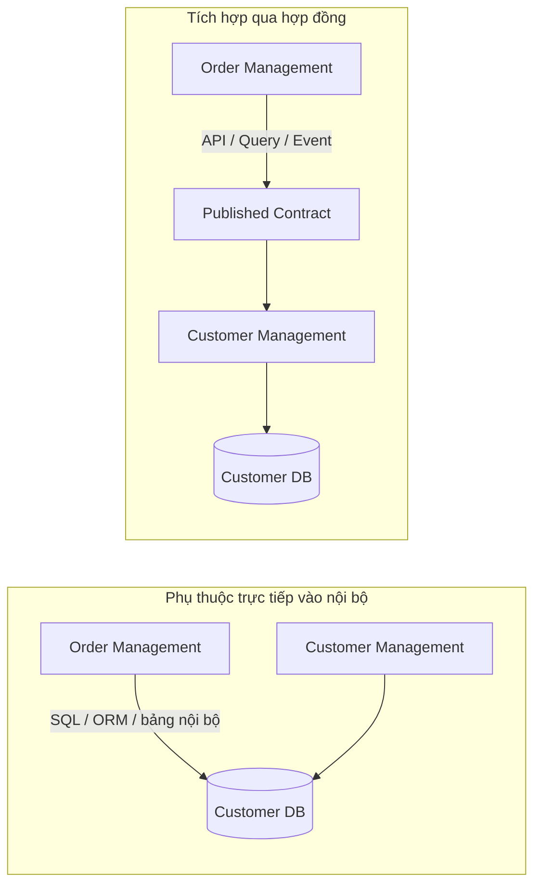
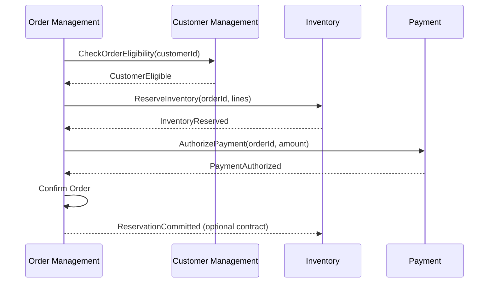

# Quyền sở hữu dữ liệu và tránh truy cập trực tiếp dữ liệu nội bộ của ngữ cảnh khác

Trong Domain-Driven Design (DDD), mỗi **Bounded Context** sở hữu một mô hình miền và chịu trách nhiệm về các quy tắc liên quan đến mô hình đó. Quyền sở hữu này bao gồm định nghĩa ý nghĩa dữ liệu, tạo và thay đổi dữ liệu, bảo vệ bất biến, quản lý vòng đời và quyết định cách công bố thông tin cho các ngữ cảnh khác.

Một context khác có thể cần biết thông tin khách hàng, trạng thái thanh toán hoặc tình trạng giao hàng, nhưng nhu cầu đó không trao cho nó quyền đọc trực tiếp bảng, repository, ORM entity hay database nội bộ của context sở hữu dữ liệu. Việc tích hợp nên đi qua hợp đồng được công bố như API, command, query, integration event hoặc read model được thiết kế cho bên tiêu thụ. Cách làm này giữ cho mỗi context có thể thay đổi mô hình nội bộ mà không buộc các context khác thay đổi theo.

## 1. Quyền sở hữu dữ liệu trong Bounded Context

Một Bounded Context xác định phạm vi mà trong đó một mô hình và ngôn ngữ nghiệp vụ có ý nghĩa nhất quán. Context sở hữu dữ liệu là nơi có thẩm quyền quyết định:

- Dữ liệu biểu diễn khái niệm nghiệp vụ nào và các trường có ý nghĩa gì.
- Quy tắc nào cho phép tạo, sửa, hủy hoặc chuyển trạng thái.
- Dữ liệu nào là nguồn chính thức (source of truth) cho một sự thật nghiệp vụ.
- Định danh được tạo và quản lý ra sao.
- Ai được phép đọc hoặc yêu cầu thay đổi dữ liệu.
- Những thông tin nào được công bố ra ngoài và theo hợp đồng nào.

Ví dụ trong hệ thống bán hàng:

| Bounded Context | Dữ liệu và trách nhiệm sở hữu |
| --- | --- |
| Customer Management | Hồ sơ khách hàng, thông tin liên hệ, phân nhóm và trạng thái hồ sơ |
| Order Management | Đơn hàng, dòng hàng, trạng thái đơn và giá đã chốt trên đơn |
| Payment | Giao dịch thanh toán, cấp phép, capture, hoàn tiền và đối soát |
| Inventory | Tồn kho khả dụng, reservation và quy tắc giữ/giải phóng hàng |
| Fulfillment | Lệnh lấy hàng, đóng gói, vận chuyển và trạng thái giao hàng |

Một người có thể được nhận diện trong nhiều context, nhưng mỗi context có thể có cách biểu diễn và mục đích khác nhau. Customer Management quản lý hồ sơ khách hàng; Order Management chỉ cần những dữ kiện đủ để lập và xử lý đơn; Payment có thể cần thông tin người thanh toán theo yêu cầu tuân thủ riêng. Không nên ép tất cả dùng chung một object `Customer` với mọi trường và hành vi.

## 2. Source of truth và bản sao dữ liệu

Source of truth là nơi có thẩm quyền cuối cùng đối với một sự thật nghiệp vụ cụ thể. Điều này không có nghĩa chỉ được phép tồn tại một bản sao dữ liệu trong toàn hệ thống.

Một context khác có thể lưu bản sao hoặc projection để phục vụ quy trình và truy vấn của mình. Ví dụ, Order Management có thể lưu tên hiển thị và địa chỉ giao tại thời điểm đặt hàng. Đây là snapshot có ý nghĩa trong ngữ cảnh đơn hàng, không phải bản sao toàn bộ hồ sơ khách hàng do Customer Management sở hữu.

Hãy phân biệt:

- **Dữ liệu chủ:** context sở hữu có quyền quyết định và cập nhật.
- **Dữ liệu tham chiếu:** định danh dùng để liên kết đến đối tượng ở context khác.
- **Snapshot:** giá trị được ghi lại tại một thời điểm để bảo toàn ý nghĩa của giao dịch.
- **Projection/read model:** dữ liệu được sao chép hoặc tổng hợp để tối ưu truy vấn ở context tiêu thụ.

Ví dụ, đơn hàng đã xác nhận có thể giữ `customerId`, tên người nhận và địa chỉ giao đã chốt. Khi khách hàng đổi địa chỉ hồ sơ sau đó, đơn cũ vẫn cần giữ địa chỉ đã dùng tại thời điểm mua. Nếu màn hình cần địa chỉ hiện tại, ứng dụng có thể truy vấn Customer Management hoặc dùng projection cập nhật theo sự kiện. Hai dữ liệu trả lời hai câu hỏi khác nhau.

## 3. Vì sao không nên truy cập trực tiếp database của context khác?

Giả sử Order Management chạy câu SQL trực tiếp vào bảng `customers` do Customer Management quản lý. Ban đầu truy vấn có thể hoạt động, nhưng nó tạo ra phụ thuộc vào:

- Tên bảng, tên cột, kiểu dữ liệu và quan hệ nội bộ.
- Quy tắc lọc, trạng thái ẩn hoặc cách diễn giải null của context sở hữu.
- Cấu trúc phân quyền và cách mã hóa dữ liệu.
- Cách context thực hiện migration hoặc thay đổi schema.
- Chiến lược transaction, khóa và tính nhất quán nội bộ.

Nếu Customer Management đổi `phone_number` thành cấu trúc liên hệ nhiều loại, thay đổi quy tắc lưu địa chỉ hoặc tách bảng, Order Management có thể hỏng dù hợp đồng nghiệp vụ của Customer Management không thay đổi. Một migration nội bộ trở thành thay đổi phối hợp toàn hệ thống.

Truy cập trực tiếp còn bỏ qua hành vi của context sở hữu. Một câu `UPDATE customers SET status = ...` có thể bỏ qua xác minh, audit, Domain Event, đồng bộ dữ liệu hoặc các bất biến mà chỉ Aggregate Root mới bảo vệ.



Hợp đồng công bố tạo ra một ranh giới ổn định hơn. Context sở hữu vẫn có thể đổi bảng, index, ORM hoặc cấu trúc Aggregate miễn là giữ tương thích hợp đồng đã cam kết.

## 4. Không chia sẻ ORM Entity hoặc Repository giữa các context

Một ORM entity thường phản ánh cả mô hình đối tượng và chi tiết persistence. Nếu Order Management import `CustomerEntity` từ module của Customer Management, nó có thể vô tình phụ thuộc vào:

- Annotation ORM và mapping quan hệ.
- Lazy loading, proxy và lifecycle của persistence context.
- Setter hoặc collection mutable không thuộc hợp đồng nghiệp vụ.
- Các trường nội bộ có thể thay đổi hoặc không được phép công bố.

Tương tự, không nên gọi `CustomerRepository` nội bộ của context khác như thể đó là một API tích hợp. Repository trong DDD phục vụ việc nạp và lưu Aggregate thuộc context sở hữu; nó không phải giao diện công khai mặc định cho mọi ứng dụng khác.

Thay vào đó, context sở hữu có thể công bố một interface ứng dụng hoặc API contract:

```java
public interface CustomerProfileQuery {
    Optional<CustomerProfileView> findProfile(CustomerId customerId);
}

public record CustomerProfileView(
    CustomerId customerId,
    String displayName,
    CustomerStatus status
) {}
```

Đây là hợp đồng đọc được thiết kế cho nhu cầu cụ thể của bên tiêu thụ. Implementation có thể gọi application service, query model hoặc database nội bộ; bên gọi không biết và không cần biết chi tiết đó.

## 5. Tham chiếu bằng định danh thay vì giữ object của context khác

Giữa các Aggregate hoặc Bounded Context, thường nên lưu định danh thay vì giữ tham chiếu trực tiếp đến object mutable thuộc nơi khác.

Ví dụ, Order Management có thể mô hình hóa:

```java
public final class Order {
    private final OrderId id;
    private final CustomerId customerId;
    private final List<OrderLine> lines;

    // Hành vi và bất biến của đơn hàng.
}
```

`Order` chỉ giữ `CustomerId`. Nó không giữ một `Customer` object để tự sửa địa chỉ, hạng khách hàng hoặc trạng thái hồ sơ. Khi cần dữ kiện, application service gọi hợp đồng của Customer Management rồi chuyển thông tin cần thiết thành dữ kiện miền phù hợp.

Việc dùng ID không có nghĩa mọi thông tin đều phải truy vấn từ xa mỗi lần. Nếu đơn hàng cần lưu địa chỉ nhận hàng tại thời điểm đặt, địa chỉ đó có thể là Value Object do Order Management sở hữu trong Aggregate `Order`. Dữ kiện đã được sao chép có chủ đích và có ngữ nghĩa riêng trong context đơn hàng.

## 6. Tích hợp đồng bộ qua API hoặc query contract

Khi cần câu trả lời ngay trong luồng xử lý, context tiêu thụ có thể gọi API hoặc query contract do context sở hữu cung cấp.

Ví dụ, trước khi chấp nhận đơn, Order Management cần biết khách hàng có đang được phép đặt hàng không. Nó có thể gọi:

```java
public interface CustomerEligibilityQuery {
    CustomerEligibility checkOrderEligibility(CustomerId customerId);
}

public record CustomerEligibility(
    CustomerId customerId,
    boolean canPlaceOrder,
    String reasonCode
) {}
```

Application service điều phối:

```java
public OrderSubmissionResult submit(SubmitOrder command) {
    CustomerEligibility eligibility =
        customerEligibilityQuery.checkOrderEligibility(command.customerId());

    if (!eligibility.canPlaceOrder()) {
        return OrderSubmissionResult.rejected(eligibility.reasonCode());
    }

    Order order = orders.findById(command.orderId())
        .orElseThrow(() -> new OrderNotFound(command.orderId()));

    order.submit(command.occurredAt());
    orders.save(order);
    return OrderSubmissionResult.accepted(order.id());
}
```

Ví dụ chỉ minh họa ranh giới gọi và điều phối; transaction, event và xử lý lỗi cần được thiết kế phù hợp. Order Management sử dụng kết quả nghiệp vụ `CustomerEligibility`, không đọc bảng hoặc dùng Entity nội bộ của Customer Management.

API đồng bộ phù hợp khi quyết định cần có ngay, nhưng tạo phụ thuộc về độ trễ và khả năng sẵn sàng. Nếu Customer Management ngừng hoạt động, luồng đặt đơn có thể bị ảnh hưởng. Cần quy định timeout, retry có giới hạn, circuit breaker và hành vi khi không thể xác minh. Không nên mặc định timeout đồng nghĩa khách hàng không đủ điều kiện.

## 7. Tích hợp bất đồng bộ qua Integration Event

Nếu context tiêu thụ không cần câu trả lời tức thời, context sở hữu có thể công bố Integration Event khi dữ liệu thay đổi. Các context khác đăng ký và cập nhật mô hình riêng.

Ví dụ Customer Management công bố:

```java
public record CustomerProfileChanged(
    UUID eventId,
    CustomerId customerId,
    String displayName,
    CustomerStatus status,
    Instant occurredAt,
    long schemaVersion
) {}
```

Order Management có thể nhận event và cập nhật projection phục vụ tìm kiếm hoặc hiển thị. Nó không cần truy cập bảng khách hàng để biết tên mới.

Một Integration Event cần:

- Có tên và payload theo ngôn ngữ công bố của context phát sinh.
- Chỉ chứa dữ kiện được phép chia sẻ và có ý nghĩa với consumer.
- Có định danh event để xử lý trùng.
- Có version hoặc metadata hợp đồng khi cần.
- Có thời điểm nghiệp vụ xảy ra, phân biệt với thời điểm nhận/xử lý.
- Có chính sách tương thích schema và vòng đời hỗ trợ consumer.

Domain Event nội bộ và Integration Event không nhất thiết giống nhau. Domain Event phản ánh sự thật trong mô hình nội bộ; adapter có thể chuyển đổi nó thành hợp đồng tích hợp phù hợp, loại bỏ chi tiết nội bộ và đổi cách diễn đạt cho bên nhận.

## 8. Cập nhật projection cục bộ thay vì đọc database từ xa

Một context có thể cần tìm kiếm nhanh theo nhiều thuộc tính thuộc context khác. Gọi API cho từng dòng kết quả có thể gây ra nhiều network round-trip. Một giải pháp là tiêu thụ Integration Event và duy trì projection cục bộ.

Ví dụ, Order Management duy trì bảng `customer_summary` chỉ gồm:

| Trường | Mục đích trong Order Management |
| --- | --- |
| `customer_id` | Liên kết đơn với khách hàng |
| `display_name` | Hiển thị tên khách hàng trên danh sách đơn |
| `customer_status` | Lọc hoặc cảnh báo theo trạng thái được công bố |
| `source_version` | Phát hiện event cũ hoặc trùng phiên bản |
| `updated_at` | Theo dõi thời điểm projection được cập nhật |

Projection này do Order Management sở hữu cho mục đích đọc của nó. Customer Management vẫn là nguồn chính thức của hồ sơ khách hàng. Nếu projection bị mất, có thể xây dựng lại từ event history, snapshot hoặc API đồng bộ dữ liệu do producer công bố.

Projection có thể trễ so với nguồn chính thức. Giao diện và quy trình cần chấp nhận hoặc thể hiện độ trễ đó. Với quyết định quan trọng cần dữ liệu mới nhất, hãy gọi API xác minh hoặc thiết kế một quy trình đồng bộ phù hợp thay vì dựa vào projection eventual consistency.

## 9. Anti-Corruption Layer bảo vệ mô hình của context tiêu thụ

Khi tích hợp với context khác hoặc hệ thống bên ngoài, mô hình và thuật ngữ của bên kia có thể không phù hợp với miền nội bộ. **Anti-Corruption Layer (ACL)** chuyển đổi hợp đồng bên ngoài thành mô hình mà context tiêu thụ hiểu được.

Ví dụ, hệ thống CRM cũ gửi trạng thái khách hàng bằng mã `A`, `S`, `B`. Order Management không nên để các mã đó lan vào domain model. ACL có thể ánh xạ:

```java
public enum CustomerStatus {
    ACTIVE,
    SUSPENDED,
    BLOCKED,
    UNKNOWN
}

public final class LegacyCustomerStatusTranslator {
    public CustomerStatus translate(String legacyCode) {
        return switch (legacyCode) {
            case "A" -> CustomerStatus.ACTIVE;
            case "S" -> CustomerStatus.SUSPENDED;
            case "B" -> CustomerStatus.BLOCKED;
            default -> CustomerStatus.UNKNOWN;
        };
    }
}
```

Mapping phải dựa trên hợp đồng và ý nghĩa đã được xác nhận. Không nên âm thầm biến mã không nhận diện thành `ACTIVE`; giá trị không biết cần được xử lý rõ ràng, có thể từ chối, cách ly message hoặc yêu cầu cập nhật mapping.

ACL cũng có thể chuyển đơn vị đo, tiền tệ, định danh, cấu trúc lồng nhau, trạng thái và thuật ngữ. Nó giúp mô hình nội bộ không bị chi phối bởi schema hoặc ngôn ngữ của hệ thống tích hợp.

## 10. Published Language và hợp đồng tích hợp

Khi nhiều context cần trao đổi ổn định, các bên có thể thống nhất một **Published Language**: mô hình trao đổi được công bố với tên, cấu trúc và ý nghĩa rõ ràng.

Hợp đồng tích hợp nên định nghĩa:

- Tên message, command hoặc event và ý nghĩa nghiệp vụ.
- Định danh và quy tắc định dạng.
- Đơn vị đo, tiền tệ, múi giờ và quy ước thời gian.
- Trường bắt buộc, trường tùy chọn và ý nghĩa khi thiếu.
- Quy tắc versioning và tương thích ngược.
- Cách xử lý message trùng, đến trễ hoặc sai thứ tự.
- Quyền truy cập, phân loại dữ liệu và chính sách lưu giữ.
- Cách thông báo thay đổi hoặc ngừng hỗ trợ phiên bản cũ.

Không nên công bố trực tiếp schema database hoặc toàn bộ Domain Entity như một hợp đồng. Hợp đồng cần phản ánh thông tin mà bên ngoài được phép biết và producer cam kết duy trì.

## 11. Chia sẻ dữ liệu không có nghĩa chia sẻ quyền sở hữu

Có thể có nhiều bản sao dữ liệu nhưng chỉ một context chịu trách nhiệm chính thức cho từng sự thật nghiệp vụ. Ví dụ:

- Customer Management sở hữu trạng thái hồ sơ khách hàng.
- Order Management sở hữu snapshot người nhận và giá đã chốt trên đơn.
- Payment sở hữu trạng thái giao dịch thanh toán.
- Fulfillment sở hữu trạng thái đóng gói và giao hàng.

Nếu Order Management lưu `customerStatus` để phục vụ tìm kiếm, nó cần biết trường đó là projection được cập nhật từ Customer Management và có thể trễ. Nó không được tự sửa trường này để thay đổi trạng thái hồ sơ khách hàng.

Một context có thể sở hữu một bản sao dữ liệu đã biến đổi cho mục đích riêng. Bản sao đó cần có tên, trách nhiệm và quy tắc cập nhật rõ ràng để tránh nhầm với dữ liệu chủ.

## 12. Database vật lý có thể dùng chung, nhưng quyền ghi cần rõ

Ranh giới sở hữu dữ liệu trước hết là ranh giới logic và nghiệp vụ. Hai context có thể tạm thời dùng cùng một database server hoặc thậm chí cùng một database vật lý vì lý do vận hành. Điều đó không tự động làm chúng thành một Bounded Context.

Tuy vậy, nếu nhiều context cùng đọc/ghi trực tiếp các bảng nội bộ của nhau, ranh giới ownership đã bị suy yếu. Một hướng chuyển tiếp có thể là:

- Mỗi context có schema hoặc tập bảng thuộc quyền quản lý rõ ràng.
- Chỉ context sở hữu được phép ghi các bảng đó.
- Context khác dùng API, event hoặc read-only projection được công bố.
- Migration được quản lý bởi owner và thay đổi hợp đồng được thông báo.
- Quyền truy cập database được giới hạn ở mức phù hợp để giảm đường ghi ngoài luồng.

Đây có thể là bước trung gian khi chưa thể tách database vật lý. Mục tiêu là giữ quyền ghi và quy tắc nghiệp vụ tập trung ở owner, đồng thời giảm phụ thuộc vào schema nội bộ.

## 13. Điều phối quy trình qua nhiều context

Một quy trình có thể cần nhiều context cùng tham gia. Ví dụ, xác nhận đơn cần kiểm tra khách hàng, giữ hàng trong Inventory và cấp phép thanh toán trong Payment.

Không nên để Order Management mở transaction rồi cập nhật trực tiếp các bảng của cả ba context. Thay vào đó, application service hoặc process manager điều phối qua hợp đồng:



Mỗi context bảo vệ Aggregate và transaction của mình. Quy trình tổng thể có thể nhất quán theo thời gian thay vì một transaction ACID xuyên nhiều service.

Nếu một bước thất bại sau khi bước trước đã thành công, quy trình cần mô hình hóa trạng thái chờ, retry và hành động bù trừ. Ví dụ, nếu giữ hàng thành công nhưng thanh toán bị từ chối, Order Management có thể yêu cầu Inventory giải phóng reservation. Đây là một command qua hợp đồng; không được tự sửa bản ghi reservation trong database Inventory.

## 14. Eventual Consistency và cách sử dụng dữ liệu trễ

Khi dữ liệu được sao chép qua event, consumer thường cập nhật projection sau producer. Trong khoảng thời gian đó, hai context có thể quan sát giá trị khác nhau. Đây là **eventual consistency**.

Hãy xác định:

- Quy trình nào chấp nhận dữ liệu trễ vài giây hoặc vài phút.
- Quy trình nào cần xác minh đồng bộ trước khi quyết định.
- Giao diện có cần hiển thị “đang đồng bộ” hoặc thời điểm cập nhật gần nhất không.
- Event bị lỗi có được retry và đưa vào dead-letter queue không.
- Projection có thể được dựng lại và đối soát ra sao.
- Event cũ hoặc sai thứ tự được nhận biết bằng version/sequence thế nào.

Không nên dùng projection trễ cho một quyết định không thể đảo ngược nếu nghiệp vụ yêu cầu dữ liệu mới nhất. Ví dụ, trạng thái hồ sơ dùng để hiển thị lịch sử có thể chấp nhận trễ; quyết định chặn một giao dịch rủi ro có thể cần API kiểm tra trực tiếp hoặc một cơ chế đồng bộ có độ tin cậy cao hơn.

## 15. Bảo đảm message và dữ liệu tích hợp nhất quán

Nếu context cập nhật dữ liệu trong database rồi mới publish event bằng một thao tác riêng, có thể xảy ra hai tình huống:

- Database commit thành công nhưng publish thất bại, consumer không nhận được thay đổi.
- Event được publish trước nhưng transaction database rollback, consumer nhận thông tin chưa được xác nhận.

Transactional Outbox giúp lưu thay đổi Aggregate và message cần công bố trong cùng transaction. Publisher riêng đọc outbox và gửi message; consumer cần idempotency vì message có thể được gửi lặp.

Ở phía consumer, có thể lưu `eventId` đã xử lý hoặc dùng một inbox/deduplication table. Nếu event mang `aggregateVersion`, consumer có thể phát hiện event trùng hoặc event cũ. Cần có quy trình retry, dead-letter và replay projection khi message không thể xử lý.

Không nên giả định broker bảo đảm exactly-once end-to-end cho mọi side effect. Thiết kế thường cần chấp nhận at-least-once delivery và làm cho consumer xử lý lặp an toàn.

## 16. Bảo mật và giới hạn dữ liệu được công bố

Quyền sở hữu dữ liệu cũng là trách nhiệm kiểm soát thông tin. Context sở hữu cần quyết định trường nào có thể công bố cho từng consumer, mục đích sử dụng nào được phép và thời gian lưu giữ ra sao.

Ví dụ, một event `CustomerProfileChanged` dùng cho hiển thị đơn hàng có thể chỉ cần `customerId`, `displayName` và trạng thái được phép chia sẻ. Nó không nên mang toàn bộ thông tin nhận dạng, dữ liệu thanh toán hoặc trường nội bộ không liên quan.

Hãy xem xét:

- Xác thực và phân quyền consumer theo API hoặc topic.
- Chỉ công bố các trường cần thiết cho mục đích tích hợp.
- Không đưa secret, token, thông tin xác thực hoặc dữ liệu nhạy cảm không cần thiết vào event.
- Mã hóa và kiểm soát truy cập theo yêu cầu hệ thống.
- Có quy trình xóa, ẩn danh hoặc cập nhật projection khi dữ liệu nguồn phải được xử lý theo chính sách lưu giữ.
- Ghi log truy cập và theo dõi consumer sử dụng hợp đồng nào.

Một bản sao cục bộ không làm mất trách nhiệm bảo vệ dữ liệu của context tiêu thụ. Consumer phải tuân thủ mục đích và thời hạn lưu giữ đã thỏa thuận.

## 17. Khi nào có thể chia sẻ một phần mô hình?

DDD có khái niệm **Shared Kernel** cho phần mô hình nhỏ mà hai context hoặc nhóm cùng thống nhất chia sẻ và cùng chịu trách nhiệm thay đổi. Đây là ngoại lệ có chủ đích, không phải lý do để dùng chung toàn bộ Entity, Repository hoặc schema.

Shared Kernel chỉ nên chứa phần thực sự ổn định và có ngữ nghĩa thống nhất. Hai bên cần quy trình phối hợp thay đổi, versioning và kiểm thử tương thích. Nếu mỗi context cần diễn giải khái niệm theo cách khác, nên dùng contract riêng và mapping thay vì ép dùng chung.

Các kiểu giá trị phổ quát như định dạng tiền tệ hoặc định danh chuẩn có thể được chia sẻ ở mức thư viện kỹ thuật nếu ngữ nghĩa không mang quy tắc riêng của một context. Tuy nhiên, `Money` trong Pricing và `Money` trong Accounting vẫn có thể có quy tắc làm tròn, độ chính xác hoặc ý nghĩa khác nhau; cần kiểm tra trước khi dùng chung.

## 18. Những lỗi thường gặp khi tích hợp dữ liệu

**Đọc trực tiếp bảng của context khác.** Tạo phụ thuộc vào schema, migration và quy tắc nội bộ. Hãy dùng API, event hoặc projection được công bố.

**Ghi trực tiếp vào dữ liệu do context khác sở hữu.** Bỏ qua Aggregate Root, validation và Domain Event. Hãy gửi command qua hợp đồng của owner.

**Chia sẻ ORM Entity hoặc Repository xuyên context.** Làm rò rỉ persistence model và lifecycle của ORM. Hãy công bố DTO, query contract hoặc integration message.

**Dùng chung một mô hình Customer cho mọi context.** Mỗi context có mục đích và ngôn ngữ riêng. Hãy dùng ID, snapshot và model cục bộ phù hợp.

**Nhầm projection với source of truth.** Bản sao có thể trễ và chỉ phục vụ một mục đích. Hãy ghi rõ owner và độ tươi dữ liệu.

**Gọi API đồng bộ cho mọi truy vấn.** Tạo độ trễ và phụ thuộc sẵn sàng không cần thiết. Hãy cân nhắc projection cục bộ nếu nghiệp vụ chấp nhận eventual consistency.

**Phát event nội bộ như hợp đồng công khai mà không lọc.** Consumer bị phụ thuộc vào chi tiết domain model. Hãy thiết kế Integration Event và Published Language riêng khi cần.

**Không có quy tắc versioning và replay.** Consumer có thể hỏng khi schema đổi hoặc projection không thể dựng lại. Hãy quản lý phiên bản, idempotency và quy trình đồng bộ lại.

**Cố giữ transaction phân tán cho mọi quy trình.** Làm các context phụ thuộc chặt vào nhau. Hãy xác định ranh giới nhất quán và dùng process manager/saga cùng hành động bù trừ khi phù hợp.

## 19. Quy trình xác định quyền sở hữu và cách tích hợp

1. **Xác định sự thật nghiệp vụ:** mô tả dữ liệu đang nói về điều gì, ai có thẩm quyền thay đổi và ai cần sử dụng.
2. **Chọn Bounded Context sở hữu:** đặt quy tắc, vòng đời và source of truth ở context phù hợp.
3. **Phân biệt dữ liệu chủ và bản sao:** xác định trường nào là master, tham chiếu, snapshot hoặc projection.
4. **Xác định nhu cầu của consumer:** cần đọc ngay, nhận thay đổi hay lưu projection cục bộ?
5. **Chọn hợp đồng:** API/query cho yêu cầu đồng bộ; command để yêu cầu owner thay đổi; Integration Event để thông báo sự thật đã xảy ra.
6. **Thiết kế mapping/ACL:** chuyển thuật ngữ, ID, trạng thái, đơn vị và cấu trúc của bên ngoài sang mô hình nội bộ.
7. **Quy định consistency:** xác định độ trễ chấp nhận được, version, thứ tự, retry và cách đối soát.
8. **Bảo vệ transaction và message:** dùng outbox/inbox hoặc cơ chế tương đương khi cần tính nhất quán và xử lý lặp.
9. **Giới hạn quyền truy cập:** không cho consumer ghi bảng nội bộ; công bố đúng dữ liệu cần thiết.
10. **Quản lý vòng đời hợp đồng:** versioning, tương thích, thông báo ngừng hỗ trợ và kiểm thử consumer.

## 20. Checklist rà soát quyền sở hữu dữ liệu

- Context nào là owner có thẩm quyền của sự thật nghiệp vụ này?
- Ai được phép tạo, cập nhật hoặc xóa dữ liệu chủ?
- Context khác đang giữ ID, snapshot hay projection?
- Có nơi nào đọc trực tiếp bảng, view nội bộ hoặc ORM entity của context khác không?
- Có nơi nào ghi dữ liệu của context khác mà bỏ qua hành vi của owner không?
- Hợp đồng API/event có công bố đúng dữ kiện cần thiết và có ý nghĩa ổn định không?
- Có ACL để bảo vệ mô hình nội bộ khỏi thuật ngữ hoặc schema bên ngoài không?
- Consumer có biết dữ liệu projection có thể trễ không?
- Event có version, event ID, idempotency và quy trình replay phù hợp không?
- Quy trình nhiều context có trạng thái lỗi, retry và compensation không?
- Quyền truy cập và trường dữ liệu công bố có được giới hạn theo mục đích không?
- Có thể thay đổi schema nội bộ của owner mà không buộc consumer sửa theo không?

## 21. Nguyên tắc cần ghi nhớ

Mỗi Bounded Context nên sở hữu dữ liệu, mô hình và các quy tắc tạo hoặc thay đổi dữ liệu trong phạm vi của mình. Context khác có thể tham chiếu bằng ID, lưu snapshot hoặc duy trì projection, nhưng cần biết rõ dữ liệu nào là source of truth và bản sao nào có thể trễ.

Hãy tích hợp qua hợp đồng công bố như API, command, Integration Event hoặc read model; dùng Anti-Corruption Layer để chuyển đổi mô hình khi cần. Tránh truy cập trực tiếp database, ORM Entity hoặc Repository nội bộ của context khác vì điều đó làm lộ schema và bỏ qua quy tắc của owner. Khi quyền sở hữu và hợp đồng được xác định rõ, mỗi context có thể phát triển độc lập hơn trong khi toàn hệ thống vẫn phối hợp được.
