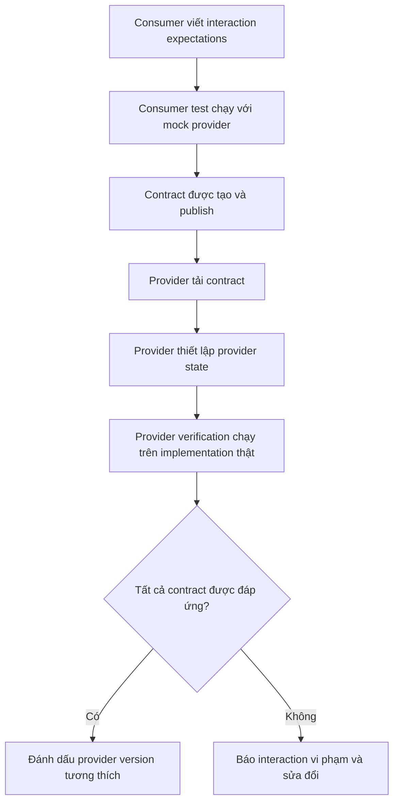
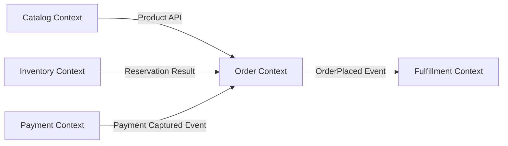
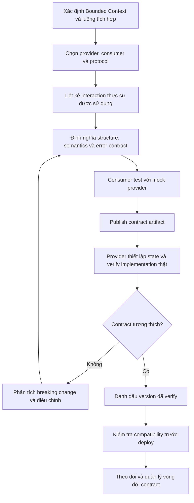

# Kiểm thử hợp đồng giữa bên cung cấp và bên sử dụng

Trong một hệ thống có nhiều Bounded Context, các context thường trao đổi dữ liệu qua HTTP API, message broker, event hoặc một giao thức tích hợp khác. Bên cung cấp (provider) công bố một khả năng hoặc dữ liệu; bên sử dụng (consumer) dựa vào hợp đồng đó để thực hiện use case của mình. Hai bên có thể được phát triển, triển khai và thay đổi ở những thời điểm khác nhau. Một thay đổi tưởng như nhỏ ở provider, chẳng hạn đổi tên field, thay mã trạng thái hoặc đổi ý nghĩa một giá trị, có thể làm consumer ngừng hoạt động dù từng service vẫn chạy bình thường khi kiểm thử riêng.

**Kiểm thử hợp đồng (contract testing)** xác minh rằng provider và consumer hiểu và thực hiện đúng thỏa thuận tích hợp giữa họ. Kiểm thử tập trung vào ranh giới giao tiếp: request, response, message, schema, headers, trạng thái lỗi và các giả định mà consumer thực sự sử dụng. Nó giúp phát hiện sớm việc một bên thay đổi làm vỡ hợp đồng của bên kia, trước khi lỗi xuất hiện trong môi trường tích hợp hoặc production.

Trong Domain-Driven Design (DDD), hợp đồng không chỉ là cấu trúc JSON hay chữ ký API. Nó còn thể hiện ngôn ngữ được công bố giữa các Bounded Context, cách diễn giải dữ liệu và quy tắc tương thích theo thời gian. Bài này trình bày cách xác định contract boundary, Consumer-Driven Contract Testing, provider verification, kiểm thử message bất đồng bộ, quản lý phiên bản, CI và các giới hạn cần hiểu rõ.

`DOMAIN_DRIVEN_DESIGN` dùng strategic design để xác định Bounded Context và quan hệ tích hợp, đồng thời dùng tactical design để xây dựng mô hình nội bộ của từng context. Contract testing nằm tại ranh giới giữa các context: mỗi bên có thể giữ mô hình miền riêng, nhưng phải thống nhất cách trao đổi dữ liệu và ý nghĩa của thông điệp.

## 1. Vì sao cần kiểm thử hợp đồng?

### 1.1. Hai Bounded Context có mô hình riêng

Giả sử một hệ thống thương mại điện tử có:

- **Catalog Context:** quản lý thông tin sản phẩm, giá niêm yết và trạng thái kinh doanh của sản phẩm.
- **Order Context:** tiếp nhận đơn hàng, chốt giá tại thời điểm đặt và quản lý vòng đời đơn.
- **Inventory Context:** quản lý tồn kho và reservation.

Catalog có thể gọi một sản phẩm là `Product`; Order có thể biểu diễn mặt hàng đã mua bằng `OrderLine`; Inventory có thể quản lý `StockItem`. Các khái niệm này liên quan nhưng không nhất thiết là cùng một class hay có cùng vòng đời.

Khi Order gọi Catalog để lấy thông tin sản phẩm, hai context cần thống nhất một contract. Order cần biết định danh sản phẩm, đơn vị tiền, đơn giá và trạng thái có thể bán. Catalog có thể có thêm mô tả, ảnh, thông tin SEO hoặc thuộc tính nội bộ mà Order không sử dụng.

Contract nên phản ánh phần trao đổi thực sự cần thiết giữa hai context. Nó không buộc hai bên dùng chung domain model hoặc chia sẻ cùng một database schema.

### 1.2. Unit test riêng không phát hiện lỗi tích hợp

Catalog có thể pass unit test vì service của nó trả về `unitPrice`. Order cũng có thể pass unit test vì mock trả đúng object mà Order mong đợi. Nhưng nếu API thực tế đổi thành `price`, hai service vẫn không giao tiếp được.

```text
Order Context (consumer)             Catalog Context (provider)
-----------------------              --------------------------
OrderProductClient                   GET /products/{id}
expects: unitPrice                   returns: price
        |                                      |
        +--------------- X --------------------+
                 contract mismatch
```

Mock trong unit test chỉ xác nhận code consumer làm việc với mock do chính test định nghĩa. Nó không chứng minh provider thật vẫn cung cấp đúng dữ liệu đó.

### 1.3. Contract test phát hiện lỗi ở ranh giới

Contract test xác minh các giả định giao tiếp độc lập với toàn bộ hệ thống. Khi provider đổi response hoặc consumer thay đổi cách sử dụng API, kiểm thử hợp đồng có thể chỉ ra chính xác interaction nào không còn tương thích.

Contract testing hữu ích khi:

- Các service được triển khai độc lập.
- Có nhiều consumer dùng chung provider.
- API hoặc event schema thay đổi thường xuyên.
- Các team phát triển theo lịch trình khác nhau.
- Hệ thống dùng message bất đồng bộ.
- Muốn giảm phụ thuộc vào môi trường end-to-end lớn và khó ổn định.

## 2. Contract là gì?

### 2.1. Contract mô tả interaction

Một contract mô tả điều mà một bên được phép yêu cầu và điều bên kia cam kết cung cấp. Với HTTP API, contract có thể gồm:

- HTTP method và path.
- Query parameter, path parameter và request body.
- Header cần thiết, content type và authentication scheme ở mức giao thức.
- Status code và response header.
- Cấu trúc response body và kiểu dữ liệu.
- Những field bắt buộc, field tùy chọn và nullability.
- Các lỗi có thể xảy ra và ý nghĩa của chúng.
- Các điều kiện hoặc trạng thái provider cần có để interaction hợp lệ.

Với message/event, contract có thể gồm:

- Tên event và schema/version.
- Message key, headers và metadata.
- Cấu trúc payload và kiểu dữ liệu.
- Ý nghĩa của từng field.
- Điều kiện phát event.
- Khả năng tương thích và cách consumer xử lý phiên bản chưa biết.

### 2.2. Contract không chỉ là schema

Schema có thể xác nhận `amount` là số và `currency` là chuỗi. Nhưng schema không tự nói rằng `amount` được tính theo đơn vị đồng hay nghìn đồng, là giá trước thuế hay sau thuế, hoặc có phải giá đã chốt tại thời điểm đặt hàng hay không.

Contract cần diễn đạt cả cấu trúc lẫn ngữ nghĩa:

| Thành phần | Câu hỏi |
|---|---|
| Structure | Field nào tồn tại, kiểu gì, bắt buộc hay tùy chọn? |
| Semantics | Giá trị có ý nghĩa gì, đơn vị nào, thời điểm nào? |
| Behavior | Với trạng thái đầu vào nào provider trả kết quả nào? |
| Errors | Khi không tìm thấy hoặc không được phép, consumer nhận gì? |
| Compatibility | Thay đổi nào consumer cũ có thể chấp nhận? |
| Ownership | Ai có quyền thay đổi contract và thông báo cho ai? |

Một contract chỉ kiểm tra JSON shape nhưng không kiểm tra ý nghĩa nghiệp vụ có thể vẫn cho phép hai bên hiểu sai dữ liệu.

### 2.3. Contract là cam kết tại ranh giới, không phải bản sao Domain Model

Không nên serialize trực tiếp toàn bộ Entity hoặc Aggregate ra API. Domain Model có thể thay đổi nội bộ; contract tích hợp cần ổn định hơn và chỉ công bố dữ liệu cần thiết.

Ví dụ, Order có thể dùng `Money`, `ProductId` và `OrderStatus` trong domain. API của Catalog có thể trả:

```json
{
  "productId": "SKU-42",
  "displayName": "Bình giữ nhiệt",
  "unitPrice": {
    "amount": "125000.00",
    "currency": "VND"
  },
  "sellable": true
}
```

Đây là representation dành cho giao tiếp. Order có thể chuyển nó thành kiểu nội bộ của mình qua client/adapter hoặc Anti-Corruption Layer. Việc hai bên cùng dùng một class `Money` không phải điều kiện để contract đúng.

## 3. Consumer và Provider có trách nhiệm gì?

### 3.1. Provider

Provider sở hữu khả năng được công bố và chịu trách nhiệm thực hiện contract. Ví dụ Catalog cung cấp endpoint tra cứu sản phẩm. Provider phải bảo đảm endpoint thật trả response phù hợp với các contract đã được chấp nhận.

Provider cần:

- Công bố contract và cách sử dụng.
- Duy trì tương thích với consumer được hỗ trợ.
- Thiết lập trạng thái dữ liệu kiểm thử có thể lặp lại.
- Chạy provider verification trên implementation thật.
- Thông báo và quản lý thay đổi breaking.
- Không dựa vào một mock thay cho việc xác minh endpoint thực.

### 3.2. Consumer

Consumer sử dụng contract để gọi provider. Order Context là consumer của Catalog nếu Order gọi Catalog để lấy thông tin sản phẩm.

Consumer cần:

- Chỉ phụ thuộc vào field và behavior thực sự sử dụng.
- Viết expectation từ cách client thực tế gửi request và đọc response.
- Kiểm thử interaction quan trọng, bao gồm lỗi có ý nghĩa.
- Công bố contract để provider có thể xác minh.
- Không tạo expectation quá rộng khiến provider bị khóa vào chi tiết không cần thiết.

### 3.3. Vai trò có thể thay đổi theo interaction

Một Bounded Context có thể vừa là provider vừa là consumer. Order Context có thể cung cấp `OrderPlaced` cho Fulfillment và đồng thời tiêu thụ `ProductPriceChanged` từ Catalog.

Hãy xác định vai trò theo từng luồng tích hợp, không gắn nhãn provider/consumer cố định cho toàn bộ service.

## 4. Các cách tiếp cận Contract Testing

### 4.1. Consumer-Driven Contract Testing (CDC)

Trong CDC, consumer mô tả các interaction mà nó cần từ provider. Consumer chạy test với một mock server hoặc mock provider được cấu hình từ contract. Test xác nhận client của consumer gửi request đúng và xử lý response như mong đợi. Contract được công bố để provider chạy verification trên implementation thật.

Luồng cơ bản:



CDC giúp contract xuất phát từ nhu cầu thực tế của consumer. Provider không cần đáp ứng mọi field nội bộ; provider cần đáp ứng những interaction đã cam kết.

### 4.2. Provider-Defined Contract hoặc Schema-First Testing

Trong một số hệ thống, provider công bố OpenAPI, AsyncAPI, JSON Schema, Protobuf hoặc Avro schema trước. Consumer và provider cùng kiểm tra implementation với schema được công bố.

Cách này hữu ích khi:

- API công khai có nhiều consumer không thể phối hợp trực tiếp.
- Tổ chức muốn có một schema chuẩn làm nguồn hợp đồng.
- Có schema registry và quy trình kiểm tra compatibility.
- Provider chịu trách nhiệm thiết kế Published Language.

Schema-first không tự chứng minh consumer chỉ dùng đúng field hoặc xử lý đúng semantics. Nên kết hợp kiểm thử client và provider, đặc biệt với interaction quan trọng.

### 4.3. Contract test đồng bộ và bất đồng bộ

| Kiểu tích hợp | Contract thường kiểm tra |
|---|---|
| REST/HTTP | Request, response, header, status và error body |
| gRPC | Service method, request/response message, status và metadata |
| Event broker | Event type, schema, metadata, key và version |
| Message queue | Message payload, routing metadata và acknowledgment/error semantics |
| File exchange | File format, encoding, column, naming và batch semantics |
| Webhook | Request do provider gửi và phản hồi của consumer |

Không phải mọi contract đều cần cùng một framework. Chọn công cụ dựa trên giao thức và cách các team công bố, xác minh hợp đồng.

## 5. Xác định contract boundary giữa Bounded Context

### 5.1. Bắt đầu từ Context Map và luồng nghiệp vụ

Context Map cho biết các Bounded Context phụ thuộc và trao đổi với nhau như thế nào. Contract test nên tập trung vào những đường tích hợp có rủi ro thực tế.

Ví dụ:



Mỗi mũi tên là một contract boundary cần xác định:

- Ai sở hữu dữ liệu và schema?
- Ai khởi tạo interaction?
- Giao thức đồng bộ hay bất đồng bộ?
- Consumer cần dữ liệu hoặc behavior nào?
- Thay đổi nào có thể ảnh hưởng đến consumer?
- Có Anti-Corruption Layer hoặc adapter chuyển đổi ngôn ngữ không?

### 5.2. Published Language

Published Language là ngôn ngữ hoặc representation được công bố để các context trao đổi. Nó có thể là REST resource, event schema, Protobuf message hoặc tài liệu hợp đồng.

Published Language cần dùng thuật ngữ rõ, ổn định và có chủ sở hữu. Không nên để một consumer phụ thuộc vào tên cột database hoặc class nội bộ của provider.

### 5.3. Anti-Corruption Layer

Consumer có thể dùng adapter để chuyển Published Language thành mô hình nội bộ:

```text
Catalog API Contract
        |
        v
HTTP Client / ACL
        |
        v
CatalogProduct DTO
        |
        v
Order Product Snapshot
        |
        v
Order Domain Model
```

Contract test xác minh phần giao tiếp ở biên adapter. Unit test riêng xác minh việc chuyển đổi DTO thành mô hình miền. Nhờ đó, thay đổi nội bộ của Catalog không lan thẳng vào Aggregate của Order.

### 5.4. Không tạo contract cho mọi method nội bộ

Contract testing có chi phí: quản lý artifact, provider state, verification, version và pipeline. Không cần tạo contract cho method private, repository nội bộ hoặc class không vượt ranh giới triển khai/context.

Ưu tiên interaction có consumer độc lập, có khả năng thay đổi riêng và có hậu quả rõ khi không tương thích.

## 6. Ví dụ: Order Context tiêu thụ Catalog API

### 6.1. Nhu cầu của consumer

Khi khách thêm sản phẩm vào giỏ hoặc đặt hàng, Order Context cần truy vấn Catalog để lấy thông tin cần thiết. Giả sử consumer cần:

- `productId`: định danh sản phẩm.
- `displayName`: tên hiển thị tại thời điểm thêm vào đơn hoặc snapshot.
- `unitPrice.amount`: giá trị tiền dạng decimal.
- `unitPrice.currency`: mã tiền tệ.
- `sellable`: sản phẩm có được phép bán hay không.

Order không cần các field như SEO description, image gallery hoặc internal merchandising rank nếu use case không dùng chúng.

### 6.2. Contract interaction minh họa

Consumer gửi:

```http
GET /products/SKU-42 HTTP/1.1
Accept: application/json
X-Correlation-Id: test-correlation-1
```

Provider trả:

```http
HTTP/1.1 200 OK
Content-Type: application/json
```

```json
{
  "productId": "SKU-42",
  "displayName": "Bình giữ nhiệt",
  "unitPrice": {
    "amount": "125000.00",
    "currency": "VND"
  },
  "sellable": true
}
```

Contract cũng có thể mô tả trường hợp không tìm thấy:

```http
HTTP/1.1 404 Not Found
Content-Type: application/problem+json
```

```json
{
  "type": "https://api.example/problems/product-not-found",
  "title": "Product not found",
  "status": 404,
  "code": "PRODUCT_NOT_FOUND"
}
```

Consumer cần biết 404 có nghĩa sản phẩm không tồn tại hoặc không được công bố. Nó không nên suy luận rằng mọi lỗi đều là 404; timeout, 401, 403, 429 và 5xx có cách xử lý khác nhau.

### 6.3. Consumer test

Consumer test chạy HTTP client thật của Order Context với mock provider được dựng từ interaction. Ví dụ pseudocode Java:

```java
@Test
void readsSellableProductFromCatalog() {
    // Arrange: mock provider có interaction:
    // GET /products/SKU-42 -> 200 với productId, displayName,
    // unitPrice.amount, unitPrice.currency và sellable.
    CatalogClient client = catalogClientFor(mockProvider.url());

    // Act
    CatalogProduct product = client.findProduct("SKU-42");

    // Assert: client gửi đúng request và parse đúng contract.
    assertEquals("SKU-42", product.productId());
    assertEquals("125000.00", product.unitPrice().amount());
    assertEquals("VND", product.unitPrice().currency());
    assertTrue(product.sellable());
}
```

Đây là mô tả luồng kiểm thử, không phải API cụ thể của một thư viện. Với Pact, Spring Cloud Contract hoặc công cụ khác, DSL và cách khởi tạo mock provider sẽ khác nhau.

Consumer test nên đi qua client/adapter thật mà ứng dụng sử dụng. Nếu test tự tạo request riêng, không dùng production client, nó có thể xác minh một interaction không giống interaction thực tế.

### 6.4. Provider verification

Provider tải contract do Order công bố, thiết lập trạng thái dữ liệu và chạy request trên endpoint Catalog thật trong môi trường kiểm thử.

Ví dụ provider state:

```text
Given: a sellable product exists
  productId = SKU-42
  price = 125000.00 VND
```

Provider verification cần:

1. Khởi chạy ứng dụng Catalog với cấu hình test.
2. Chuẩn bị product state xác định, độc lập với dữ liệu môi trường dùng chung.
3. Gửi request theo contract.
4. So sánh status, header và body với expectation.
5. Dọn dữ liệu test hoặc dùng database/container riêng.

Không nên để verification gọi production API hoặc phụ thuộc vào một sản phẩm thật có thể bị người dùng sửa/xóa.

### 6.5. Provider có thể thêm field không?

Nếu contract chỉ yêu cầu những field consumer dùng và không yêu cầu response khớp chính xác toàn bộ object, provider thường có thể thêm field mới mà không làm consumer cũ hỏng.

Ví dụ Catalog thêm `brandName` hoặc `imageUrl`. Order không dùng các field đó thì contract của Order không cần thay đổi. Nếu consumer yêu cầu exact equality của toàn bộ response, test sẽ tạo coupling không cần thiết và cản trở thay đổi tương thích.

## 7. Provider State và dữ liệu kiểm thử

### 7.1. Provider State diễn tả điều kiện trước interaction

Provider state mô tả trạng thái dữ liệu hoặc hệ thống cần có trước khi chạy một interaction. Ví dụ:

- Một sản phẩm đang được bán tồn tại.
- Một sản phẩm đã ngừng kinh doanh tồn tại.
- Một đơn hàng thuộc tenant cụ thể tồn tại.
- Một khách hàng không có phương thức thanh toán mặc định.

Provider state không nên là một bản dump database lớn. Nó cần nhỏ, có tên theo ngữ nghĩa và có thể thiết lập lặp lại.

### 7.2. State setup phải độc lập và idempotent

Mỗi verification cần có dữ liệu xác định. Không phụ thuộc vào test chạy trước, ID ngẫu nhiên không kiểm soát hoặc bản ghi từ lần chạy cũ.

Có thể:

- Dùng database riêng cho contract verification.
- Xóa và tạo lại các fixture có namespace riêng.
- Dùng transaction rollback nếu framework hỗ trợ đúng cách.
- Dùng factory test tạo dữ liệu qua domain API.

Nếu provider state setup chỉ chèn một hàng vào database mà bỏ qua invariant, hãy cân nhắc dùng factory hoặc fixture builder để dữ liệu kiểm thử phản ánh trạng thái miền hợp lệ.

### 7.3. Không để provider state biến thành API production

Endpoint thiết lập state chỉ dành cho môi trường test, không được mở công khai ở production. Có thể dùng hook nội bộ của contract test framework hoặc fixture API được bảo vệ và chỉ bật trong test profile.

### 7.4. Mỗi interaction phải kiểm tra một điều có ý nghĩa

Tránh tạo hàng trăm interaction chỉ khác ID nhưng không kiểm tra thêm behavior. Ưu tiên các trường hợp thể hiện contract:

- Tìm thấy sản phẩm có thể bán.
- Không tìm thấy sản phẩm.
- Sản phẩm tồn tại nhưng không thể bán.
- Request thiếu hoặc sai tham số bắt buộc.
- Consumer không có quyền truy cập nếu authentication là một phần của contract.

## 8. Kiểm thử contract cho API đồng bộ

### 8.1. Request contract

Kiểm tra method, path, query, header và body mà consumer gửi. Ví dụ:

```http
POST /reservations HTTP/1.1
Content-Type: application/json
Idempotency-Key: order-1001
```

```json
{
  "orderId": "ORD-1001",
  "items": [
    { "productId": "SKU-42", "quantity": 2 }
  ]
}
```

Nếu provider yêu cầu `Idempotency-Key` nhưng consumer quên gửi, provider verification hoặc consumer test cần phát hiện sai lệch.

### 8.2. Response contract

Kiểm tra status code, content type, header quan trọng và field consumer sử dụng. Với số tiền, xác định rõ format: JSON number hay decimal string, scale và currency. Với ngày giờ, xác định ISO-8601, timezone và semantics của thời điểm.

### 8.3. Error contract

Lỗi cũng là một phần của hợp đồng. Consumer cần phân biệt:

| Status | Ý nghĩa thường gặp | Cách consumer cân nhắc |
|---|---|---|
| 400 | Request sai cấu trúc hoặc dữ liệu | Sửa request; không retry mù quáng |
| 401 | Chưa xác thực hoặc credential không hợp lệ | Làm mới/xác thực lại theo cơ chế |
| 403 | Không có quyền | Không retry như lỗi tạm thời |
| 404 | Resource không tồn tại hoặc không công bố | Xử lý theo use case |
| 409 | Xung đột trạng thái hoặc idempotency | Đọc lại trạng thái hoặc xử lý conflict |
| 429 | Bị giới hạn lưu lượng | Retry theo `Retry-After` nếu có |
| 5xx | Provider gặp lỗi | Retry có giới hạn/backoff nếu thao tác an toàn |

Không bắt consumer phụ thuộc vào toàn bộ câu chữ lỗi có thể thay đổi. Dùng error code ổn định hoặc problem type cho các trường hợp cần phân biệt.

### 8.4. Authentication và authorization ở contract boundary

Contract có thể xác nhận request gửi đúng header hoặc token type cần thiết, nhưng không nên đưa secret thật vào artifact. Kiểm thử xác minh status và behavior phù hợp cho credential hợp lệ, thiếu hoặc không đủ quyền.

Contract test không thay thế kiểm thử bảo mật chuyên sâu như kiểm tra quyền truy cập chéo tenant, token validation hoặc penetration test. Nó chỉ xác nhận những hành vi bảo mật đã được định nghĩa trong contract.

### 8.5. Timeout và retry không phải lúc nào cũng thuộc response schema

Timeout, retry và circuit breaker thường là behavior của client/runtime. Chúng có thể cần kiểm thử riêng. Nếu contract có quy định header retry hoặc idempotency behavior, hãy kiểm tra interaction liên quan; không suy ra rằng schema response đã chứng minh độ tin cậy mạng.

## 9. Contract cho Event và Message bất đồng bộ

### 9.1. Event contract khác request/response contract

Với event-driven integration, provider phát event mà không biết consumer nào sẽ xử lý. Contract cần ổn định qua thời gian vì consumer có thể deploy chậm, tạm dừng hoặc replay message cũ.

Ví dụ Order Context phát `OrderPlaced`:

```json
{
  "eventId": "evt-7d1",
  "eventType": "OrderPlaced",
  "eventVersion": 1,
  "occurredAt": "2026-11-18T08:30:00Z",
  "aggregateId": "ORD-1001",
  "data": {
    "orderId": "ORD-1001",
    "customerId": "CUS-2001",
    "total": {
      "amount": "250000.00",
      "currency": "VND"
    }
  }
}
```

Event cần phân biệt metadata với business data. `eventId`, `eventType`, `eventVersion`, `occurredAt` và `aggregateId` có vai trò khác với dữ liệu đơn hàng trong `data`.

### 9.2. Contract test producer

Producer test xác nhận khi hành động miền xảy ra, ứng dụng tạo event đúng loại, version, metadata và payload theo contract. Test cũng cần xác nhận event chỉ được ghi/publish theo đúng ranh giới transaction, chẳng hạn Outbox được ghi cùng transaction với Aggregate nếu hệ thống dùng Outbox.

Không chỉ kiểm tra một serializer tạo ra JSON hợp lệ. Hãy xác nhận event được tạo bởi hành vi nghiệp vụ đúng và payload không làm lộ dữ liệu nội bộ không cần thiết.

### 9.3. Contract test consumer

Consumer test xác nhận handler có thể deserialize và xử lý message theo schema đã công bố. Nên có fixture cho:

- Phiên bản hiện tại.
- Phiên bản cũ còn nằm trong retention/replay window.
- Field tùy chọn bị thiếu.
- Field mới mà consumer chưa biết.
- Giá trị enum chưa được hỗ trợ.
- Message trùng hoặc đến muộn nếu semantics yêu cầu.

Consumer cần có chiến lược với field không biết và version chưa hỗ trợ: bỏ qua an toàn, lưu quarantine, đưa dead-letter hoặc từ chối có kiểm soát. Không nên âm thầm diễn giải giá trị không hiểu thành một trạng thái nghiệp vụ khác.

### 9.4. Schema Registry và compatibility mode

Với Avro, Protobuf hoặc JSON Schema, schema registry có thể kiểm tra compatibility khi publish schema mới. Các chế độ như backward, forward hoặc full compatibility có định nghĩa khác nhau tùy format và registry.

Schema registry giúp ngăn một số thay đổi cấu trúc phá vỡ consumer, nhưng không tự xác minh semantics hoặc behavior của handler. Một field có thể vẫn cùng kiểu nhưng đổi từ “giá trước thuế” sang “giá sau thuế”; schema compatibility vẫn pass trong khi nghiệp vụ sai.

### 9.5. Ordering, duplicate và replay

Event có thể được giao trùng, đến trễ hoặc theo thứ tự khác nhau tùy broker và partition. Contract nên nêu rõ metadata cần thiết như `eventId`, `aggregateId`, `aggregateVersion` hoặc sequence nếu consumer cần idempotency và ordering.

Consumer phải kiểm thử khả năng chống xử lý trùng khi hợp đồng giao nhận là at-least-once. Contract schema chỉ có `eventId` không chứng minh consumer đã idempotent; cần kiểm thử hành vi handler và persistence của Inbox/business key riêng.

## 10. Quản lý thay đổi và versioning

### 10.1. Thay đổi thường tương thích

Một số thay đổi có thể tương thích nếu contract được thiết kế phù hợp:

- Thêm response field optional mà consumer cũ bỏ qua được.
- Thêm metadata không ảnh hưởng consumer.
- Thêm một endpoint mới mà không đổi endpoint cũ.
- Mở rộng enum khi consumer có cách xử lý giá trị chưa biết an toàn.
- Thêm event type mới mà không đổi schema event cũ.

Không có thay đổi nào tự động an toàn chỉ vì được gọi là additive. Nếu consumer deserialize enum bằng `Enum.valueOf` và ném exception với giá trị mới, thêm enum vẫn có thể làm consumer cũ lỗi.

### 10.2. Thay đổi thường breaking

- Xóa hoặc đổi tên field bắt buộc.
- Đổi kiểu field hoặc format số/ngày.
- Thay đơn vị đo hoặc ý nghĩa nghiệp vụ.
- Đổi method/path hoặc routing key.
- Thay status/error code mà consumer dựa vào.
- Chuyển field optional thành bắt buộc mà consumer cũ không gửi.
- Đổi event type hoặc partition key ảnh hưởng đến routing/ordering.

### 10.3. Tương thích cấu trúc và tương thích ngữ nghĩa

| Thay đổi | Có thể pass schema compatibility? | Rủi ro |
|---|---|---|
| Đổi `amount` từ VND sang nghìn VND nhưng vẫn là number | Có | Consumer tính sai giá trị |
| Đổi `occurredAt` từ thời điểm UTC sang giờ địa phương nhưng vẫn là string | Có | Sai thứ tự/thời gian |
| Đổi `status = CLOSED` từ “đóng” sang “hủy” | Có | Sai quy trình nghiệp vụ |
| Xóa field required | Thường không | Consumer không deserialize hoặc thiếu dữ liệu |
| Thêm field optional | Thường có | Consumer nghiêm ngặt có thể vẫn lỗi |

Contract phải ghi rõ semantics và có test ở nơi consumer chuyển đổi dữ liệu thành mô hình miền.

### 10.4. Versioning chiến lược

Có thể dùng:

- Version trong URL, ví dụ `/v1/products` và `/v2/products`.
- Version trong media type hoặc header.
- Schema version trong message metadata.
- Versioning theo registry/subject.
- Adapter/upcaster để chuyển payload cũ sang representation nội bộ hiện tại.

Không cần tăng version cho mọi thay đổi optional. Nhưng khi thay đổi semantics hoặc không thể duy trì tương thích, hãy công bố version mới và có thời gian chuyển đổi rõ.

### 10.5. Consumer cũ có thể tồn tại lâu hơn provider dự kiến

Với event broker, message cũ có thể được replay sau nhiều tháng. Một consumer mới có thể phải đọc event schema cũ lâu hơn thời gian API HTTP thông thường. Hãy xác định retention, replay window, version support và thời điểm ngừng hỗ trợ.

Không xóa schema hoặc code upcaster khi vẫn còn dữ liệu lịch sử có thể được replay.

## 11. Consumer-Driven Contract với nhiều consumer

### 11.1. Provider có nhiều nhu cầu khác nhau

Catalog có thể được Order, Search và Recommendation sử dụng. Mỗi consumer chỉ cần một phần interaction khác nhau:

| Consumer | Interaction cần |
|---|---|
| Order Context | Giá, currency và khả năng bán tại thời điểm đặt |
| Search Context | Tên, mô tả, danh mục và thuộc tính tìm kiếm |
| Recommendation Context | Product ID, category và tín hiệu hành vi |

CDC cho phép mỗi consumer công bố contract riêng. Provider verification chạy tất cả contract được hỗ trợ để biết thay đổi có ảnh hưởng đến consumer nào.

### 11.2. Không để một consumer áp đặt nhu cầu lên tất cả

Nếu Order cần `unitPrice` và Search cần `description`, không nên bắt mọi consumer phải dùng cả hai. Contract nên được chia theo interaction hoặc API resource phù hợp, tránh một response khổng lồ chứa mọi dữ liệu cho mọi bên.

### 11.3. Quản lý tập consumer đang được hỗ trợ

Provider cần biết contract nào còn hiệu lực, consumer version nào đang dùng và khi nào có thể ngừng hỗ trợ. Một contract cũ còn được publish có thể làm provider verification fail dù consumer đã bị loại bỏ; ngược lại, xóa contract quá sớm có thể bỏ sót consumer vẫn chạy.

Dùng contract repository/broker hoặc registry để theo dõi provider version, consumer version, verification result và deployment status. Việc xóa consumer khỏi ma trận tương thích cần có xác nhận vận hành.

## 12. Tích hợp contract testing vào CI/CD

### 12.1. Pipeline của Consumer

Khi consumer thay đổi client hoặc cách sử dụng provider:

1. Chạy unit test cho mapping và business behavior.
2. Chạy consumer contract test với mock provider.
3. Tạo contract artifact.
4. Publish artifact cùng consumer version/branch metadata.
5. Theo dõi provider verification tương ứng.

Consumer pipeline không cần khởi chạy toàn bộ provider và mọi dependency nếu contract framework đã mô phỏng interaction.

### 12.2. Pipeline của Provider

Khi provider thay đổi API/event:

1. Lấy các contract consumer được hỗ trợ.
2. Thiết lập provider state cho từng interaction.
3. Chạy verification trên implementation provider thật.
4. Publish kết quả gắn với provider version/commit.
5. Chặn release nếu contract bắt buộc bị vi phạm hoặc cần quy trình exception rõ ràng.

Provider verification cần chạy trong môi trường có cấu hình tương đương nhưng không dùng dữ liệu production thật. Test phải xác định rõ external dependency nào được thay thế và điều gì đang được xác minh.

### 12.3. Ma trận tương thích trước deploy

Trước khi deploy provider mới, cần biết consumer version nào đã được xác minh với provider version đó. Một deployment safety check có thể hỏi:

```text
Can I deploy Catalog version 2.8.0?
  Order version 4.2.1      -> verified
  Search version 3.5.0     -> verified
  Recommendation 1.9.3    -> verified
Decision: safe for supported consumer versions
```

Đây là ví dụ minh họa. Kết luận chỉ có giá trị với tập consumer/version được đăng ký và policy deploy đã định nghĩa. Contract pass không chứng minh mọi instance hoặc consumer ngoài danh sách đều tương thích.

### 12.4. Branch, pending contract và WIP

Trong quá trình phát triển, contract mới có thể được publish trước khi provider đã implement. Một số contract broker hỗ trợ trạng thái pending hoặc WIP để tránh chặn pipeline provider trong giai đoạn thay đổi chưa hoàn tất. Khi contract được đánh dấu bắt buộc hoặc consumer version được deploy, verification cần được thực thi theo policy.

Không nên dùng cơ chế pending để che giấu contract đang fail của consumer đã chạy production.

### 12.5. Contract test không thay thế mọi loại test

| Loại test | Mục tiêu chính |
|---|---|
| Unit test | Quy tắc và logic bên trong một đơn vị |
| Component test | Hành vi của service với dependency được kiểm soát |
| Consumer contract test | Consumer tạo request/đọc response theo expectation |
| Provider verification | Provider thật đáp ứng contract đã công bố |
| Integration test | Các thành phần thực sự phối hợp với nhau trong một môi trường tích hợp |
| End-to-end test | Luồng nghiệp vụ xuyên nhiều hệ thống từ đầu đến cuối |
| Schema compatibility test | Thay đổi schema có tương thích theo quy tắc registry hay không |

Contract testing giảm nhu cầu dùng E2E để phát hiện mọi lỗi giao tiếp, nhưng không loại bỏ kiểm thử tích hợp hoặc E2E cho các luồng quan trọng.

## 13. Công cụ và cách chọn

### 13.1. Pact

Pact là một cách tiếp cận Consumer-Driven Contract Testing. Consumer test tạo contract từ interaction; provider tải contract và verify trên provider thật. Pact Broker có thể lưu contract, kết quả verification và hỗ trợ đánh giá tương thích giữa phiên bản.

Phù hợp khi nhiều service triển khai độc lập và muốn theo dõi consumer/provider version. Cần quản lý provider state, contract artifact và vòng đời consumer.

### 13.2. Spring Cloud Contract

Spring Cloud Contract hỗ trợ định nghĩa contract và tạo test/stub cho hệ sinh thái Spring. Nó có thể phù hợp khi provider-first contract hoặc shared contract là lựa chọn của tổ chức.

### 13.3. OpenAPI và AsyncAPI

OpenAPI mô tả API HTTP; AsyncAPI mô tả giao tiếp bất đồng bộ. Có thể dùng schema để validate request/response/message, sinh client hoặc kiểm tra compatibility.

Schema-first phù hợp khi contract được công bố tập trung. Cần bổ sung test behavior và consumer usage để tránh schema pass nhưng semantics sai.

### 13.4. JSON Schema, Protobuf, Avro và Schema Registry

Các schema format xác định cấu trúc dữ liệu và quy tắc tương thích. Protobuf/Avro thường dùng cho message/event; JSON Schema thường dùng với JSON API hoặc event. Schema registry giúp quản lý phiên bản và kiểm tra compatibility khi publish schema.

### 13.5. Chọn công cụ theo bài toán

| Nhu cầu | Hướng tiếp cận |
|---|---|
| Nhiều consumer độc lập, provider cần biết consumer nào bị ảnh hưởng | Consumer-Driven Contract, ví dụ Pact |
| API công khai cần schema chuẩn | OpenAPI và schema validation |
| Event/message cần quản lý version | AsyncAPI hoặc schema registry với JSON Schema/Avro/Protobuf |
| Hệ sinh thái Spring cần contract và stub tích hợp | Spring Cloud Contract |
| File trao đổi định kỳ | Schema/format contract và kiểm thử fixture file |

Không chọn công cụ chỉ vì nó tạo được mock. Cần có đường đi từ contract artifact đến provider verification và quyết định deploy.

## 14. Những lỗi thường gặp khi viết Contract Test

### 14.1. Kiểm tra quá nhiều field không liên quan

Nếu consumer chỉ dùng `productId` và `unitPrice`, việc yêu cầu mọi field của Catalog response khiến provider khó mở rộng. Contract nên thể hiện đúng dependency của consumer.

### 14.2. Kiểm tra quá ít để hiểu sai semantics

Chỉ xác nhận `amount` là số mà không kiểm tra currency hoặc đơn vị có thể khiến Order tính tiền sai. Hãy kiểm tra những field quyết định behavior.

### 14.3. Dùng dữ liệu kiểm thử không ổn định

Provider state phụ thuộc vào ID có sẵn, dữ liệu dùng chung hoặc thời gian hiện tại sẽ làm test chập chờn. Tạo fixture deterministic và cô lập giữa các lần chạy.

### 14.4. Consumer test chỉ kiểm tra mock

Nếu test tạo mock response nhưng không gọi client/adapter thực tế, nó không xác minh request mà ứng dụng thật gửi. Dùng HTTP client hoặc message serializer/handler thực trong consumer test.

### 14.5. Provider verification không chạy implementation thật

Nếu provider verification lại chạy trên mock provider hoặc controller giả, nó không chứng minh endpoint thật tuân thủ contract. Hãy chạy trên ứng dụng provider với dependency được kiểm soát.

### 14.6. Contract phụ thuộc vào câu chữ hoặc thứ tự không ổn định

Không nên kiểm tra exact error message, JSON property order hoặc header không có ý nghĩa nếu contract không yêu cầu. Dùng error code, type và field semantics ổn định.

### 14.7. Dùng contract test để chứng minh business rule

Contract test xác minh giao tiếp. Nó không chứng minh thuật toán giá, quy tắc thuế, invariant của Aggregate hoặc workflow nội bộ hoàn toàn đúng. Các phần đó cần unit/component/domain tests riêng.

### 14.8. Bỏ qua lỗi và trường hợp biên

Chỉ kiểm tra HTTP 200 có thể bỏ sót 404, 409, 429 hoặc 5xx mà consumer cần xử lý. Chọn các error interaction có ý nghĩa đối với behavior consumer.

### 14.9. Không quản lý consumer đã ngừng hoạt động

Contract cũ có thể tồn tại và chặn provider thay đổi mãi mãi; xóa quá sớm lại có thể bỏ sót consumer cũ. Cần có vòng đời contract, owner và bằng chứng deployment.

### 14.10. Nhầm schema compatibility với deployment safety

Schema registry có thể xác nhận field mới tương thích về cấu trúc, nhưng không biết mọi consumer đã deploy code hiểu semantics mới hay chưa. Cần kết hợp verification và deployment matrix.

## 15. Quy trình thiết kế và triển khai Contract Testing



Các bước thực hiện:

1. Dựa vào Context Map để chọn một luồng tích hợp có consumer độc lập.
2. Xác định provider, consumer, protocol và owner của contract.
3. Quan sát client thực tế để liệt kê request, response hoặc message mà consumer sử dụng.
4. Định nghĩa cấu trúc, semantics, error behavior và version.
5. Viết consumer contract test đi qua client/adapter thật.
6. Publish contract cùng consumer version/branch phù hợp.
7. Viết provider state deterministic và chạy verification trên provider thật.
8. Tích hợp kết quả vào CI và kiểm tra compatibility trước deploy.
9. Kiểm thử các thay đổi schema/event, lỗi và phiên bản cũ còn được hỗ trợ.
10. Theo dõi consumer, version, verification result và kế hoạch retire contract.

## 16. Checklist

Trước khi xem một contract test là hoàn chỉnh, hãy kiểm tra:

- [ ] Đã xác định rõ Bounded Context provider và consumer.
- [ ] Contract nằm ở ranh giới tích hợp thật, không phải class nội bộ.
- [ ] Request/response hoặc message phản ánh interaction consumer thực sự dùng.
- [ ] Các field bắt buộc, optional, nullable và kiểu dữ liệu được phân biệt.
- [ ] Semantics của tiền, thời gian, trạng thái và đơn vị được mô tả.
- [ ] Error code/status có ý nghĩa ổn định được kiểm tra.
- [ ] Consumer test dùng client/adapter thực tế.
- [ ] Contract không khóa provider vào field mà consumer không dùng.
- [ ] Provider verification chạy trên implementation provider thật.
- [ ] Provider state deterministic, độc lập và idempotent.
- [ ] Không dùng dữ liệu production hoặc secret trong contract test.
- [ ] Message contract có version, event ID và metadata cần thiết.
- [ ] Đã xét duplicate, ordering, replay và consumer cũ cho async event.
- [ ] Schema compatibility được phân biệt với semantic compatibility.
- [ ] CI lưu contract và verification theo version.
- [ ] Deployment check chỉ tuyên bố an toàn với tập consumer/version được theo dõi.
- [ ] Có owner, quy trình thay đổi và retire contract.
- [ ] Contract test được bổ sung bằng domain, component, integration và E2E test phù hợp.

## 17. Câu hỏi tự kiểm tra

1. Vì sao unit test của provider và consumer riêng lẻ không đủ để chứng minh hai bên tích hợp được?
2. Consumer-Driven Contract Testing hoạt động theo những bước nào?
3. Provider state có mục đích gì và vì sao phải deterministic?
4. Vì sao contract không nên chứa mọi field trong Domain Model của provider?
5. Contract test cho HTTP khác contract test cho event ở điểm nào?
6. Vì sao schema compatibility không đảm bảo semantic compatibility?
7. Khi provider thêm một response field optional, khi nào thay đổi đó vẫn có thể làm consumer cũ lỗi?
8. Consumer cần xử lý event trùng và event cũ như thế nào?
9. Contract test có thay thế integration test và E2E test không?
10. Provider có thể ngừng hỗ trợ một consumer contract khi nào?

**Gợi ý trả lời:**

- Câu 1: Hai bên có thể dùng mock và giả định khác nhau; chỉ khi kiểm tra request/response ở ranh giới mới phát hiện sai tên field, status hoặc semantics.
- Câu 2: Consumer định nghĩa interaction, test client với mock provider, publish contract; provider thiết lập state và verify implementation thật.
- Câu 3: Nó tạo dữ liệu/điều kiện cần trước interaction. Deterministic giúp test độc lập, lặp lại và không phụ thuộc môi trường dùng chung.
- Câu 4: Contract chỉ nên chứa dữ liệu và behavior consumer cần; công bố mọi chi tiết nội bộ tạo coupling và cản trở provider thay đổi.
- Câu 5: HTTP thường kiểm tra request/response đồng bộ; event kiểm tra schema/message metadata và behavior phát/tiêu thụ, đồng thời xét version, duplicate, ordering và replay.
- Câu 6: Schema chỉ kiểm tra cấu trúc/kiểu. Ý nghĩa như đơn vị tiền, thời điểm, trạng thái hoặc quy tắc nghiệp vụ có thể đổi mà schema vẫn hợp lệ.
- Câu 7: Consumer có thể deserialize nghiêm ngặt, từ chối unknown field hoặc enum mới; hoặc response mới thay đổi semantics dù field được thêm là optional.
- Câu 8: Dùng event/message ID, Inbox hoặc business key để idempotent; dùng aggregate version/sequence nếu cần phát hiện event đến trễ hoặc sai thứ tự; hỗ trợ replay theo retention.
- Câu 9: Không. Contract test kiểm tra giao tiếp; integration/E2E vẫn cần cho luồng nghiệp vụ và behavior xuyên nhiều thành phần.
- Câu 10: Khi consumer đã ngừng triển khai và không còn được hỗ trợ, đã xác minh không có instance/job cũ, và policy/owner chấp thuận retire contract.

## Kết luận

Contract testing giúp các Bounded Context thay đổi độc lập mà vẫn giữ được thỏa thuận tích hợp. Consumer mô tả interaction mình thực sự cần; provider xác minh implementation thật đáp ứng các interaction đó. Contract tốt cần mô tả cấu trúc, semantics, lỗi và version, đồng thời tránh phơi bày mô hình nội bộ. Với API đồng bộ, kiểm tra request/response và error behavior; với event bất đồng bộ, kiểm tra schema, metadata, version, duplicate, ordering và replay. Đưa consumer test, provider verification và deployment compatibility vào CI giúp phát hiện breaking change sớm, nhưng vẫn cần domain test, integration test và E2E test để xác minh behavior nghiệp vụ toàn hệ thống.
