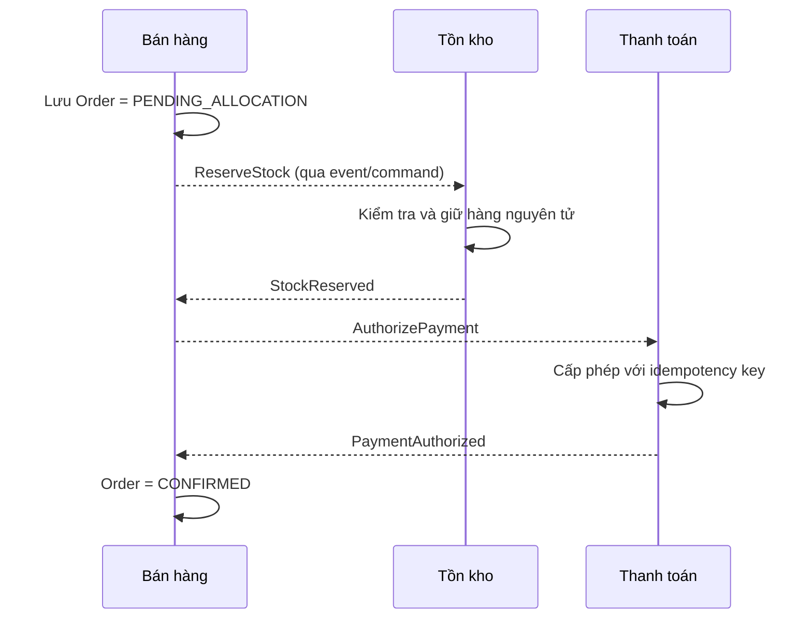

# Nhất quán mạnh và nhất quán cuối cùng theo yêu cầu nghiệp vụ

Trong Domain-Driven Design (DDD), mỗi bounded context sở hữu mô hình, dữ liệu và các quy tắc nghiệp vụ của mình. Một quy trình lớn có thể đi qua nhiều context, chẳng hạn Bán hàng, Tồn kho, Thanh toán và Vận chuyển. Khi một context thay đổi trạng thái, những context khác có thể cần biết để tiếp tục công việc. Câu hỏi quan trọng là: **các thay đổi đó phải cùng đúng ngay lập tức, hay hệ thống có thể chấp nhận trạng thái trung gian rồi hội tụ sau?**

Đây là quyết định về consistency (tính nhất quán), và nó phải xuất phát từ hậu quả nghiệp vụ. Số dư tài khoản, việc sử dụng một mã giảm giá chỉ được dùng một lần hoặc việc giữ đơn vị hàng cuối cùng có thể cần quyết định dựa trên trạng thái có thẩm quyền ngay tại thời điểm ghi. Ngược lại, chỉ mục tìm kiếm, dashboard, thông báo và trạng thái giao hàng tổng hợp thường có thể cập nhật trễ trong giới hạn chấp nhận được.

**Strong consistency (nhất quán mạnh)** thường được dùng trong thiết kế ứng dụng để chỉ việc một thao tác chỉ được xem là hoàn tất khi trạng thái có thẩm quyền đã được cập nhật và các lần đọc liên quan nhìn thấy kết quả theo bảo đảm đã chọn. **Eventual consistency (nhất quán cuối cùng)** cho phép các bản sao hoặc context khác tạm thời chưa phản ánh thay đổi, nhưng nếu không có cập nhật mới và thông điệp được xử lý thành công, chúng sẽ hội tụ về trạng thái phù hợp.

Hai lựa chọn đều có chi phí. Nhất quán mạnh có thể cần transaction, khóa hoặc phối hợp đồng bộ, làm tăng độ trễ và phụ thuộc khả dụng. Nhất quán cuối cùng giúp các context độc lập và chịu lỗi tốt hơn, nhưng đòi hỏi trạng thái chờ, retry, idempotency, hành động bù, quan sát vận hành và cách giải thích dữ liệu đang trễ cho người dùng.

## Sau bài học này

Bạn có thể:

- Phân biệt nhất quán mạnh và nhất quán cuối cùng trong bối cảnh nghiệp vụ.
- Không nhầm consistency với atomicity, isolation, durability hoặc việc tất cả bản sao luôn giống nhau.
- Xác định invariant nào cần được bảo vệ ngay và dữ liệu nào có thể cập nhật trễ.
- Chọn consistency boundary phù hợp với aggregate và bounded context.
- Thiết kế transaction cục bộ, reservation, Domain Event, Integration Event và Saga.
- Xử lý trạng thái trung gian, timeout, retry, message trùng lặp và hành động bù.
- Bảo đảm read model không bị dùng sai làm nguồn quyết định khi dữ liệu chưa cập nhật.
- Đặt mục tiêu độ trễ, reconciliation và monitoring cho quy trình liên context.

## 1. Consistency là yêu cầu nghiệp vụ trước khi là lựa chọn kỹ thuật

Hãy xét quy trình đặt hàng. Bán hàng nhận yêu cầu mua, Tồn kho giữ hàng, Thanh toán cấp phép và Vận chuyển chuẩn bị giao. Sau khi đơn được xác nhận, mỗi context có thể cập nhật dữ liệu ở thời điểm khác nhau.

Một số câu hỏi cần trả lời trước khi chọn kiến trúc:

- Nếu hai khách cùng mua đơn vị hàng cuối cùng, có được phép cả hai cùng thành công không?
- Nếu thanh toán đã được cấp phép nhưng Tồn kho chưa xác nhận giữ hàng, người dùng cần thấy trạng thái nào?
- Nếu đơn đã được xác nhận nhưng dashboard chưa cập nhật trong vài giây, có gây hậu quả không?
- Nếu thông báo email gửi chậm, nghiệp vụ có bị sai không?
- Nếu một bước thất bại sau khi bước trước đã thành công, có thể bù lại bằng hành động nghiệp vụ nào?
- Có thể chấp nhận chờ hệ thống sở hữu dữ liệu phản hồi hay phải đưa ra quyết định ngay?

Không nên chọn consistency chỉ vì một công nghệ hỗ trợ transaction hoặc message broker. Cần xác định điều gì phải luôn đúng, ai có thẩm quyền quyết định và hậu quả nếu dữ liệu chưa hội tụ.

### Một số ví dụ

| Tình huống | Yêu cầu thường gặp | Lý do |
| --- | --- | --- |
| Ghi nợ và ghi có trong sổ cái | Mạnh trong ranh giới giao dịch tài chính | Không được tạo ra một nửa giao dịch hoặc làm sai tổng số dư theo invariant. |
| Giữ đơn vị hàng cuối cùng | Mạnh tại context Tồn kho | Hai yêu cầu cạnh tranh không được cùng tiêu thụ một đơn vị hàng. |
| Sử dụng coupon một lần | Mạnh tại nơi sở hữu redemption | Tránh áp dụng cùng quyền lợi nhiều lần. |
| Dashboard doanh thu | Cuối cùng thường chấp nhận được | Trễ ngắn không làm thay đổi giao dịch gốc. |
| Chỉ mục tìm kiếm sản phẩm | Cuối cùng thường chấp nhận được | Chỉ mục có thể cập nhật sau dữ liệu nguồn. |
| Email xác nhận đơn | Bất đồng bộ thường phù hợp | Việc gửi email không nên giữ transaction đặt hàng mở. |
| Trạng thái vận chuyển tổng hợp | Cuối cùng thường phù hợp | Sự kiện từ nhà vận chuyển có thể đến trễ hoặc theo nhiều bước. |

Đây là gợi ý phổ biến, không phải quy tắc tuyệt đối. Ví dụ, một hệ thống đặt vé có thể cần consistency mạnh cho số ghế còn lại; một hệ thống bán hàng có thể cho phép oversell theo chính sách và xử lý sau. Chuyên gia nghiệp vụ phải xác nhận chính sách đó.

## 2. Hiểu đúng nhất quán mạnh

Trong ứng dụng nghiệp vụ, strong consistency thường có nghĩa là quyết định quan trọng được thực hiện trên trạng thái có thẩm quyền và kết quả được commit theo một ranh giới nguyên tử đã xác định. Sau khi thao tác báo thành công, các lần đọc qua cùng nguồn nhất quán phải nhìn thấy kết quả theo bảo đảm của hệ thống.

Trong lý thuyết hệ phân tán, một bảo đảm mạnh hơn là **linearizability**: mỗi thao tác đọc/ghi có thể được xem như xảy ra tại một thời điểm duy nhất giữa lúc bắt đầu và kết thúc, đồng thời tôn trọng thứ tự thời gian thực của các thao tác đã hoàn tất. Không phải mọi database transaction hoặc mọi lần đọc từ replica đều tự động cung cấp linearizability.

Vì vậy, khi nói “nhất quán mạnh”, đội cần nói rõ đang yêu cầu điều gì:

- Một transaction phải commit toàn bộ thay đổi hoặc rollback toàn bộ?
- Các thao tác cạnh tranh phải được tuần tự hóa để bảo vệ một invariant?
- Sau khi ghi thành công, đọc từ endpoint nào phải thấy dữ liệu mới?
- Có được đọc từ replica trễ hoặc cache không?
- Có cần bảo đảm thứ tự toàn cục hay chỉ trong một aggregate/account/order?

### Atomicity không đồng nghĩa với mọi bảo đảm consistency

ACID gồm Atomicity, Consistency, Isolation và Durability. Atomicity bảo đảm transaction được áp dụng toàn bộ hoặc không áp dụng. Isolation quyết định các transaction đồng thời tương tác như thế nào. Database consistency trong ACID nói rằng transaction phải đưa dữ liệu từ trạng thái hợp lệ sang trạng thái hợp lệ theo các constraint được định nghĩa.

Một transaction có tính atomic nhưng vẫn có thể cho kết quả nghiệp vụ sai nếu application đọc dữ liệu cũ, dùng isolation không đủ hoặc không đặt constraint cần thiết. Cũng cần phân biệt consistency của database với việc nhiều bounded context hoặc read replica đã cập nhật cùng lúc.

### Ví dụ giữ tồn kho

Giả sử `InventoryItem` có 5 đơn vị khả dụng. Hai request cùng yêu cầu giữ 4 đơn vị. Nếu cả hai đọc số lượng 5 rồi cập nhật theo cách ghi đè, cả hai có thể cùng nghĩ rằng thao tác thành công và tạo ra tổng lượng giữ là 8.

Aggregate cần bảo vệ invariant:

\[
available = onHand - reserved
\]

và:

\[
reserved + requested \leq onHand
\]

Nhưng kiểm tra trong Java đơn thuần chưa đủ nếu hai transaction chạy đồng thời. Cần cơ chế persistence như optimistic locking, pessimistic locking, atomic update có điều kiện hoặc một reservation record có ràng buộc duy nhất phù hợp.

Ví dụ hành vi miền:

```java
public final class InventoryItem {
    private final ProductId productId;
    private int onHand;
    private int reserved;

    public Reservation reserve(Quantity requested, ReservationId reservationId) {
        if (requested.isZeroOrNegative()) {
            throw new InvalidReservationQuantityException(requested);
        }
        if (reserved + requested.value() > onHand) {
            throw new InsufficientStockException(productId, requested);
        }

        reserved += requested.value();
        return new Reservation(reservationId, productId, requested);
    }
}
```

Đây là ví dụ rút gọn, giả định `Quantity` dùng đơn vị nguyên phù hợp với sản phẩm. Trong hệ thống thật, thao tác `reserve` phải được lưu bằng transaction có concurrency control; `ReservationId` cũng cần được xử lý idempotent để một command gửi lặp không giữ hàng lần thứ hai.

## 3. Hiểu đúng nhất quán cuối cùng

Eventual consistency cho phép các thành phần có bản sao hoặc mô hình đọc riêng cập nhật ở những thời điểm khác nhau. Sau khi một thay đổi được commit ở nguồn có thẩm quyền, event hoặc dữ liệu đồng bộ sẽ lan truyền đến các consumer. Nếu quá trình tiếp tục được retry và không còn lỗi vĩnh viễn, các mô hình liên quan sẽ hội tụ.

Ví dụ:

1. Bán hàng lưu đơn ở trạng thái `PENDING_ALLOCATION`.
2. Bán hàng công bố `OrderPlaced` qua outbox.
3. Tồn kho nhận event hoặc command tương ứng và giữ hàng.
4. Tồn kho công bố `StockReserved`.
5. Process manager tiếp tục yêu cầu Thanh toán cấp phép.
6. Khi thanh toán thành công, đơn được chuyển sang trạng thái tiếp theo.

Trong thời gian giữa các bước, các context có thể hiển thị trạng thái khác nhau. Điều đó không nhất thiết là lỗi nếu trạng thái trung gian đã được mô hình hóa và nghiệp vụ chấp nhận.

### Eventual consistency không có nghĩa “cứ chờ rồi sẽ đúng”

Hệ thống cần có cơ chế để hội tụ:

- Event được ghi bền vững sau transaction nguồn.
- Publisher có thể retry khi broker lỗi.
- Consumer xử lý idempotent để message lặp không tạo tác động lặp.
- Lỗi không thể retry được chuyển vào dead-letter hoặc quy trình xử lý.
- Có timeout và hành động bù cho bước không hoàn thành.
- Có reconciliation để phát hiện và sửa sai lệch còn tồn tại.
- Có monitoring để biết projection hoặc consumer đang chậm hay bị kẹt.

Nếu message bị mất vĩnh viễn, consumer lỗi liên tục hoặc không có người xử lý dead-letter, hệ thống có thể không bao giờ hội tụ. “Eventually” là mục tiêu có điều kiện và cần được vận hành bảo đảm.

### Eventual consistency không quy định một thời gian cố định

Một projection có thể trễ vài mili giây trong điều kiện bình thường nhưng trễ vài phút khi tải cao hoặc broker gặp sự cố. Vì vậy, nghiệp vụ và đội kỹ thuật nên xác định freshness target hoặc SLO, ví dụ 95% cập nhật trong vài giây, 99,9% trong một phút, cùng quy trình xử lý khi vượt ngưỡng.

Con số cụ thể phải dựa trên nhu cầu và năng lực hệ thống; không có một thời hạn chung cho mọi bounded context.

## 4. Consistency boundary: aggregate và bounded context

Aggregate xác định một ranh giới nhất quán trong mô hình miền. Aggregate root bảo vệ invariant của các đối tượng bên trong. Một transaction thường cập nhật một aggregate để giữ ranh giới nhỏ; đôi khi có thể cập nhật nhiều aggregate trong cùng một transaction cục bộ nếu nghiệp vụ cần và phạm vi được kiểm soát.

Bounded context xác định ranh giới mô hình và quyền sở hữu dữ liệu. Khi hai context có database hoặc service độc lập, mỗi context thường commit thay đổi trong transaction riêng. Một quy trình đi qua nhiều context vì vậy không tự động có một transaction ACID bao trùm tất cả.

### Đặt invariant tại nơi có thẩm quyền

Nếu invariant là “không được giữ quá số lượng tồn kho”, context Tồn kho phải là nơi có thẩm quyền kiểm tra và ghi nhận reservation. Bán hàng có thể có read model về số lượng khả dụng để hiển thị, nhưng không nên tự quyết định giữ hàng dựa trên bản sao đó.

Nếu invariant là “một coupon chỉ được redeem một lần”, context sở hữu coupon/redemption phải kiểm tra và ghi nhận việc redeem một cách nguyên tử. Một context khác không thể bảo vệ invariant này chỉ bằng cách đọc projection của coupon.

### Khi một invariant dường như trải qua nhiều context

Nếu nghiệp vụ yêu cầu hai context luôn thay đổi nguyên tử, hãy kiểm tra lại mô hình:

- Hai dữ liệu có thực sự thuộc hai bounded context khác nhau không?
- Có thể chuyển quyền sở hữu invariant về một context có thẩm quyền không?
- Có thể dùng một aggregate hoặc một transactional resource cho phần phải nhất quán tức thời không?
- Có thể dùng reservation hoặc trạng thái chờ để chia quy trình thành các bước không?
- Nếu cần distributed transaction, lợi ích nghiệp vụ có đủ lớn để chấp nhận coupling và ảnh hưởng khả dụng không?

Không nên tách dữ liệu thành nhiều context rồi mong một transaction đơn giản bảo vệ mọi invariant xuyên qua chúng. Ngược lại, cũng không nên gộp mọi thứ vào một context chỉ để né điều phối nếu các mô hình và quyền sở hữu thực sự khác nhau.

## 5. Chọn consistency theo hậu quả nghiệp vụ

Một quyết định thực tế có thể dùng ma trận sau:

| Câu hỏi | Nếu câu trả lời là “có” | Hướng thiết kế cần xem xét |
| --- | --- | --- |
| Hai request đồng thời có thể tạo ra tổn thất không thể chấp nhận? | Có | Quyết định tại nguồn có thẩm quyền với transaction/concurrency control mạnh. |
| Có invariant phải luôn đúng sau mỗi thao tác được báo thành công? | Có | Đặt invariant trong aggregate/transaction boundary phù hợp. |
| Dữ liệu chỉ phục vụ hiển thị hoặc phân tích? | Có | Projection và eventual consistency thường phù hợp. |
| Một bước có thể chờ hệ thống khác phản hồi? | Có | Mô hình hóa trạng thái pending và workflow bất đồng bộ. |
| Có hành động bù có ý nghĩa nghiệp vụ? | Có | Saga/process manager có thể phù hợp. |
| Không thể bù nếu bước sau thất bại? | Có | Cần xác nhận mạnh hơn trước khi bước không thể đảo ngược xảy ra. |
| Người dùng cần thấy kết quả ngay sau khi thao tác? | Có | Trả kết quả từ write side hoặc hỗ trợ read-your-writes. |

### Đánh giá chi phí của trạng thái sai

Hãy hỏi hậu quả nếu dữ liệu trễ hoặc hai quyết định cùng thành công:

- Có mất tiền, hàng, quyền lợi hoặc dữ liệu pháp lý không?
- Có thể sửa bằng một hành động nghiệp vụ có kiểm toán không?
- Người dùng có thể tiếp tục hành động dựa trên trạng thái cũ không?
- Sai lệch có thể phát hiện tự động không?
- Có cần chặn thao tác mới cho đến khi bước trước hoàn tất không?

Nếu hậu quả lớn và không thể bù, cần consistency mạnh tại nơi quyết định. Nếu sai lệch tạm thời có thể chấp nhận, quan sát và sửa được, eventual consistency có thể giảm coupling đáng kể.

## 6. Ví dụ: đặt hàng, giữ tồn kho và thanh toán

Giả sử quy trình đặt hàng có ba bounded context:

| Context | Dữ liệu sở hữu | Quyết định có thẩm quyền |
| --- | --- | --- |
| Bán hàng | Đơn hàng, dòng hàng, trạng thái đơn | Đơn có được xác nhận/hủy theo vòng đời đơn không? |
| Tồn kho | Số lượng thực tế, reservation | Có thể giữ số lượng yêu cầu không? |
| Thanh toán | Authorization, capture, refund | Giao dịch có được cấp phép/thu/hoàn không? |

### Phần cần consistency mạnh

Trong Tồn kho, thao tác giữ hàng phải kiểm tra số lượng hiện tại và ghi nhận reservation một cách nguyên tử. Trong Thanh toán, một payment operation cần idempotency và trạng thái giao dịch có thẩm quyền để không capture hai lần.

### Phần có thể eventual

Bán hàng có thể chưa biết ngay kết quả giữ hàng hoặc thanh toán. Đơn được tạo ở trạng thái `PENDING_FULFILLMENT` hoặc `AWAITING_PAYMENT`. Dashboard, email và chỉ mục tìm kiếm có thể cập nhật sau.

### Luồng thành công



Mỗi context commit trong transaction cục bộ của mình. Sự phối hợp giữa chúng là eventual; mỗi quyết định quan trọng vẫn được thực hiện mạnh tại context sở hữu dữ liệu.

### Luồng thất bại và hành động bù

Nếu Tồn kho từ chối giữ hàng, Bán hàng có thể từ chối đơn hoặc yêu cầu khách chọn phương án khác. Nếu hàng đã giữ nhưng thanh toán bị từ chối, quy trình có thể gửi `ReleaseStock` để giải phóng reservation và chuyển đơn sang `PAYMENT_REJECTED`.

Nếu thanh toán timeout, không được mặc định giao dịch thất bại. Nhà cung cấp có thể đã cấp phép nhưng phản hồi bị mất. Process manager cần tra cứu trạng thái theo payment reference hoặc gửi lại cùng idempotency key trước khi quyết định giải phóng hàng.

### Trạng thái trung gian phải được mô hình hóa

Đơn có thể trải qua:

```text
PENDING_ALLOCATION
    -> AWAITING_PAYMENT
        -> CONFIRMED
        -> PAYMENT_REJECTED
    -> STOCK_REJECTED
    -> REQUIRES_REVIEW
```

Tên và chuyển trạng thái phải phản ánh sự thật đã xảy ra. Không nên đánh dấu `CONFIRMED` ngay khi nhận request nếu hàng chưa được giữ hoặc thanh toán chưa đạt điều kiện theo chính sách.

## 7. Transaction cục bộ và distributed transaction

### Transaction cục bộ

Transaction cục bộ bảo vệ các thay đổi nằm trong một transactional resource hoặc một ranh giới transaction mà hệ thống kiểm soát. Ví dụ, cập nhật aggregate `InventoryItem` và tạo `StockReservation` trong cùng database transaction.

Ưu điểm:

- Atomicity và rollback rõ ràng trong phạm vi transaction.
- Có thể dùng constraint và concurrency control của database.
- Dễ kiểm thử và phục hồi hơn một giao dịch kéo dài qua nhiều hệ thống.

Giới hạn:

- Không tự bảo đảm thay đổi trong context khác cùng commit.
- Không nên giữ transaction mở trong lúc chờ mạng hoặc người dùng.
- Isolation level và locking vẫn cần được chọn theo invariant.

### Distributed transaction / two-phase commit

Một số hạ tầng hỗ trợ giao dịch phân tán như XA/two-phase commit để phối hợp nhiều resource. Cách này có thể cung cấp atomic commit trong phạm vi participant và coordinator hỗ trợ, nhưng làm các hệ thống phụ thuộc vào giao thức chung, tăng thời gian giữ tài nguyên và có thể giảm khả dụng khi một participant hoặc coordinator gặp sự cố.

Đây không phải lựa chọn mặc định cho mọi quy trình liên context. Cần xem xét khi nghiệp vụ thực sự yêu cầu atomic commit xuyên nhiều resource, các participant hỗ trợ giao thức, và chi phí vận hành được chấp nhận. Với quy trình dài hoặc có đối tác ngoài, Saga thường thực tế hơn.

### Không gọi Saga là rollback phân tán

Saga chia quy trình thành nhiều transaction cục bộ. Nếu một bước thất bại, hệ thống thực hiện hành động bù. Compensation là hành động nghiệp vụ mới, không xóa lịch sử đã xảy ra.

Ví dụ, `RefundPayment` không xóa giao dịch capture; `ReleaseStock` không làm như reservation chưa từng tồn tại. Các hành động bù có thể thất bại và cần retry hoặc can thiệp thủ công.

## 8. Saga và Process Manager

Saga/process manager điều phối một quy trình kéo dài qua nhiều aggregate hoặc bounded context. Nó theo dõi bước đã hoàn thành, bước đang chờ, timeout và hành động bù.

Một process manager cho đặt hàng có thể theo dõi:

- `orderId`, `reservationId`, `paymentId`.
- Số lượng reservation cần hoàn tất và kết quả từng reservation.
- Trạng thái cấp phép thanh toán.
- Các command đã gửi và event đã nhận.
- Thời điểm bắt đầu, deadline và số lần retry.
- Compensation đã chạy hoặc đang chờ.
- Kết quả cuối cùng hoặc trạng thái `REQUIRES_REVIEW`.

### Process manager không thay thế aggregate

Process manager quyết định bước tiếp theo của quy trình. Aggregate của Tồn kho vẫn kiểm tra có thể giữ hàng không; aggregate của Thanh toán vẫn kiểm tra có thể capture/refund không; aggregate của Bán hàng vẫn kiểm tra đơn có thể xác nhận/hủy không.

Không đưa mọi invariant của các context vào process manager. Nó là bộ điều phối, không phải một aggregate khổng lồ thay thế các mô hình sở hữu.

### Chọn choreography hay orchestration

- **Choreography:** các context phản ứng với event của nhau. Phù hợp với luồng ít bước, ít nhánh và không cần một nơi giữ trạng thái quy trình phức tạp.
- **Orchestration:** process manager gửi command và theo dõi kết quả. Phù hợp với quy trình có nhiều nhánh, timeout, retry và compensation.

Không có lựa chọn đúng cho mọi hệ thống. Khi choreography có quá nhiều event handler và khó biết ai chịu trách nhiệm cho bước tiếp theo, một orchestrator tường minh có thể làm luồng dễ hiểu hơn.

## 9. Outbox, Inbox và bảo đảm giao nhận

Khi một context commit thay đổi và cần phát Integration Event, không nên thực hiện hai thao tác độc lập “ghi database” rồi “gửi broker” mà không có cơ chế phối hợp. Nếu database commit nhưng publish thất bại, context khác không biết thay đổi đã xảy ra.

### Transactional Outbox

Trong cùng transaction, context ghi aggregate và bản ghi outbox. Publisher đọc outbox sau commit và gửi message. Nếu broker tạm thời lỗi, publisher retry.

Outbox giải quyết dual write giữa database và broker ở phía producer, nhưng không bảo đảm delivery đúng một lần. Publisher có thể gửi lại cùng message nếu không biết lần gửi trước đã được broker nhận hay chưa.

### Inbox / deduplication

Consumer lưu `eventId` đã xử lý cùng transaction với thay đổi aggregate của nó. Khi nhận lại cùng event, consumer nhận diện và không lặp tác động.

### Idempotency key cho command

Với command có tác động như giữ hàng hoặc cấp phép thanh toán, dùng idempotency key/reference ổn định. Gửi lại cùng yêu cầu phải trả kết quả đã có hoặc tiếp tục cùng operation, không tạo reservation/payment mới ngoài ý muốn.

### Ví dụ consumer idempotent

```java
public void handle(StockReserved event) {
    transactions.required(() -> {
        if (inbox.wasProcessed(event.eventId())) {
            return;
        }

        OrderProcess process = processes.findById(event.orderId())
            .orElseThrow(() -> new ProcessNotFoundException(event.orderId()));

        process.recordReservation(event.reservationId());
        processes.save(process);
        inbox.markProcessed(event.eventId());
    });
}
```

Ví dụ giả định Inbox và process state được lưu trong cùng transactional resource. Nếu hai thao tác không thể commit cùng nhau, cần một cơ chế idempotency tương đương để tránh đánh dấu đã xử lý nhưng chưa cập nhật tiến trình, hoặc cập nhật tiến trình rồi xử lý lại event gây tác động lặp.

## 10. Read model, cache và dữ liệu cũ

Read model có thể được cập nhật bất đồng bộ. Điều này phù hợp với màn hình tra cứu hoặc dashboard, nhưng có rủi ro nếu dùng projection trễ để đưa ra quyết định cần dữ liệu có thẩm quyền.

Ví dụ, trang sản phẩm hiển thị “còn 1 sản phẩm” từ cache. Hai khách cùng bấm mua. Không được để cả hai đơn xác nhận chỉ dựa trên cache. Command `ReserveStock` phải được gửi đến context Tồn kho để kiểm tra và giữ hàng theo trạng thái mới nhất.

### Đọc sau ghi (read-your-writes)

Sau khi một command thành công, người dùng thường mong thấy kết quả của chính thao tác đó. Một số cách hỗ trợ:

- Trả trạng thái mới từ write side trong command response.
- Trả `operationId` để UI theo dõi quy trình đang xử lý.
- Trả aggregate version hoặc projection position và cho query side chờ đến khi bắt kịp.
- Dùng truy vấn trực tiếp nguồn có thẩm quyền cho một số màn hình cần đọc ngay.
- Cập nhật giao diện lạc quan nhưng hiển thị rõ trạng thái đang đồng bộ.

### Monotonic reads và causal consistency

Trong một số trải nghiệm, người dùng không nên thấy dữ liệu quay ngược về phiên bản cũ sau khi đã nhìn thấy phiên bản mới hơn. Có thể cần bảo đảm monotonic reads hoặc truyền version/cursor để query side không trả kết quả cũ hơn.

Causal consistency giúp các thay đổi có quan hệ nhân quả được quan sát theo thứ tự phù hợp. Đây là các bảo đảm bổ sung có thể hữu ích trong hệ thống phân tán, nhưng cần được diễn đạt cụ thể thay vì chỉ nói chung chung “strong” hoặc “eventual”.

## 11. Timeout, retry và trạng thái không xác định

Timeout không chứng minh thao tác ở hệ thống đích thất bại. Request có thể đã được xử lý nhưng phản hồi bị mất trên đường về.

Ví dụ, Payment Provider nhận yêu cầu authorize, thực hiện thành công, nhưng client timeout trước khi nhận response. Nếu gửi một yêu cầu mới với idempotency key khác, có thể tạo authorization thứ hai.

Một quy trình an toàn cần:

1. Dùng idempotency key ổn định cho cùng một business operation.
2. Tra cứu trạng thái theo reference khi kết quả không xác định.
3. Retry có giới hạn và backoff cho lỗi tạm thời.
4. Không retry vô hạn lỗi dữ liệu hoặc lỗi nghiệp vụ.
5. Đưa message không xử lý được vào dead-letter queue.
6. Có quy trình vận hành để điều tra và replay có kiểm soát.

### Phân loại kết quả

| Kết quả | Ý nghĩa | Xử lý thường gặp |
| --- | --- | --- |
| Thành công | Hệ thống đích xác nhận đã thực hiện | Ghi nhận event/result và tiếp tục. |
| Từ chối nghiệp vụ | Điều kiện nghiệp vụ không thỏa | Không retry máy móc; chuyển nhánh từ chối hoặc bù. |
| Lỗi tạm thời | Có thể do mạng, broker hoặc database | Retry có giới hạn, idempotent. |
| Không xác định | Timeout hoặc mất phản hồi, chưa biết thao tác có thành công không | Tra cứu trạng thái hoặc retry cùng idempotency key. |
| Lỗi vĩnh viễn/schema | Consumer không thể hiểu payload hoặc dữ liệu sai | Dead-letter, cảnh báo và sửa hợp đồng/mapping. |

## 12. Reconciliation: phát hiện và sửa sai lệch

Ngay cả khi có outbox, retry và idempotency, hệ thống phân tán vẫn cần cách phát hiện các tiến trình bị kẹt hoặc dữ liệu không hội tụ.

Reconciliation (đối soát) là quy trình so sánh trạng thái giữa các nguồn có thẩm quyền và phát hiện sai lệch cần xử lý. Ví dụ:

- Đơn ở `PENDING_ALLOCATION` quá thời hạn nhưng không có reservation result.
- Reservation đã giữ hàng nhưng đơn đã bị từ chối và chưa được giải phóng.
- Payment đã authorize nhưng process manager không nhận được event.
- Outbox có message chưa publish quá ngưỡng thời gian.
- Projection không cập nhật version trong một khoảng thời gian bất thường.

### Đối soát không phải tự sửa mọi sai lệch một cách mù quáng

Một tác vụ reconciliation cần hiểu quyền sở hữu dữ liệu và trạng thái hợp lệ. Nó có thể:

- Tra cứu trạng thái từ context có thẩm quyền.
- Gửi lại command idempotent.
- Phát lại event từ outbox/archive.
- Tạo yêu cầu compensation đã được xác định.
- Đánh dấu `REQUIRES_REVIEW` để nhân viên xử lý.

Không nên sửa trực tiếp bảng của context khác hoặc tự đặt trạng thái cuối cùng chỉ vì một phép so sánh thấy khác nhau.

### Audit và khả năng truy vết

Lưu correlation ID, causation ID, event ID, aggregate ID, operation ID và thời điểm giúp liên kết các bước trong một quy trình. Với nghiệp vụ tài chính hoặc quyền lợi, cần lưu đủ dữ liệu để giải thích quyết định và truy vết hành động bù.

## 13. Đặt SLO và quan sát consistency

Nếu chọn eventual consistency, đội cần định nghĩa “đủ nhanh” theo nghiệp vụ và theo dõi được. Các chỉ số hữu ích gồm:

- Tuổi của bản ghi outbox chưa gửi lâu nhất.
- Độ trễ từ `occurredAt` đến thời điểm consumer áp dụng event.
- Consumer lag và số message đang chờ.
- Số lần retry theo loại lỗi.
- Số message trong dead-letter queue.
- Số process manager ở trạng thái pending quá thời hạn.
- Số reservation hoặc payment cần reconciliation.
- Tỷ lệ projection version bắt kịp write-side version.

Một SLO có thể quy định phần lớn event phải được áp dụng trong vài giây và mọi tiến trình quá hạn phải được cảnh báo. Mốc cụ thể phải do sản phẩm và vận hành thống nhất. Không nên chỉ đo throughput broker mà bỏ qua thời gian người dùng phải chờ một quy trình hoàn tất.

## 14. Khi nào cần thay đổi consistency boundary?

Nếu nhiều use case liên tục cần cập nhật hai aggregate hoặc hai context nguyên tử, có thể ranh giới hiện tại chưa phản ánh đúng quyền sở hữu invariant.

Hãy xem xét:

- Hai phần dữ liệu có cùng vòng đời và cùng chủ sở hữu nghiệp vụ không?
- Có một invariant luôn phải đúng giữa chúng sau mỗi command không?
- Việc tách context có dựa trên khác biệt mô hình thực sự hay chỉ theo cấu trúc team/database?
- Có thể chuyển một quyết định về context có thẩm quyền và cung cấp command/reservation không?
- Nếu gộp, aggregate hoặc context có trở nên quá lớn và khó thay đổi không?

Đôi khi giải pháp đúng là thay đổi mô hình hoặc quyền sở hữu, thay vì thêm nhiều retry và saga để bù cho một ranh giới sai. Nhưng không nên gộp context chỉ để làm mọi thứ đồng bộ nếu các mô hình có ngôn ngữ và vòng đời độc lập.

## 15. Kiểm thử consistency và quy trình liên context

Unit test cho từng aggregate chưa đủ để chứng minh một quy trình liên context hội tụ. Cần kiểm thử cả luồng thành công, thất bại và khôi phục.

### Kiểm thử transaction mạnh

- Hai request cạnh tranh giữ cùng lượng hàng không vượt tồn kho.
- Hai lần redeem coupon cùng lúc không tạo hai redemption.
- Optimistic locking phát hiện cập nhật từ version cũ.
- Rollback không để lại thay đổi một phần hoặc outbox không hợp lệ.

### Kiểm thử eventual consistency

- Outbox publish lại sau lỗi broker.
- Consumer nhận cùng event nhiều lần nhưng chỉ áp dụng tác động một lần.
- Event đến trễ hoặc sai thứ tự không làm lùi trạng thái.
- Process manager khởi động lại vẫn tiếp tục đúng bước.
- Timeout được tra cứu bằng operation reference hoặc idempotency key.
- Compensation thành công hoặc chuyển sang trạng thái cần người xử lý.
- Reconciliation phát hiện tiến trình bị kẹt.

### Kiểm thử contract và tích hợp

- Integration Event có schema tương thích với consumer.
- Consumer không phụ thuộc class nội bộ của producer.
- Version mới được xử lý hoặc cách ly đúng chính sách.
- Transactional Outbox và Inbox commit đúng ranh giới.
- Correlation ID giúp truy vết toàn bộ quy trình.

### Kiểm thử độ trễ

Có thể mô phỏng broker chậm, consumer dừng, database timeout hoặc message backlog để xác nhận hệ thống hiển thị trạng thái chờ đúng và cảnh báo khi vượt SLO.

## 16. Những sai lầm thường gặp

- **Yêu cầu strong consistency cho mọi dữ liệu:** tạo coupling đồng bộ và làm giảm khả dụng dù nhiều view chỉ cần cập nhật trễ.
- **Dùng eventual consistency cho invariant không thể vi phạm:** read model cũ có thể dẫn đến oversell hoặc giao dịch lặp.
- **Cho rằng ACID transaction tự giải quyết mọi consistency:** isolation, constraint và nguồn đọc vẫn cần được xác định.
- **Đọc từ cache/replica để đưa ra quyết định có thẩm quyền:** dữ liệu có thể đã cũ.
- **Đặt invariant xuyên context nhưng không có chủ sở hữu:** các context cùng nghĩ context khác sẽ kiểm tra.
- **Gọi Saga là rollback:** compensation là hành động nghiệp vụ mới và có thể thất bại.
- **Không mô hình hóa trạng thái trung gian:** người dùng không biết quy trình đang chờ, thất bại hay bị kẹt.
- **Coi timeout là thất bại:** retry với key mới có thể tạo tác động trùng.
- **Không dùng outbox/inbox hoặc cơ chế tương đương:** message có thể mất hoặc gây tác động lặp.
- **Retry vô hạn mọi lỗi:** lỗi dữ liệu và schema không tự biến mất, backlog tăng liên tục.
- **Không có reconciliation:** tiến trình bị kẹt tồn tại lâu mà không ai phát hiện.
- **Không đo độ trễ consistency:** sản phẩm không biết trạng thái trễ có vượt mức chấp nhận hay không.
- **Sửa trực tiếp dữ liệu context khác:** phá quyền sở hữu và làm sai nguồn có thẩm quyền.
- **Gộp mọi context để tránh eventual consistency:** tạo một mô hình và transaction boundary quá lớn.

## 17. Quy trình quyết định consistency cho một use case

Khi thiết kế một quy trình đi qua nhiều aggregate hoặc bounded context, hãy thực hiện theo các bước:

1. **Mô tả kết quả nghiệp vụ:** điều gì phải đúng khi use case báo thành công?
2. **Liệt kê invariant:** quy tắc nào không được vi phạm, và context nào sở hữu từng quy tắc?
3. **Đánh giá hậu quả:** chi phí của trạng thái sai, dữ liệu trễ hoặc thao tác trùng là gì?
4. **Chọn nguồn có thẩm quyền:** context/service nào được phép đưa ra quyết định cuối cùng?
5. **Chọn consistency boundary:** aggregate, transaction cục bộ hay quy trình nhiều bước?
6. **Xác định mức đọc:** endpoint nào cần read-your-writes, dữ liệu nào có thể đến từ projection trễ?
7. **Chọn cơ chế phối hợp:** transaction cục bộ, command/event, choreography, process manager hoặc distributed transaction khi thật sự cần.
8. **Thiết kế trạng thái trung gian:** pending, rejected, timed out, compensated và manual review.
9. **Thiết kế độ tin cậy:** outbox, inbox, idempotency, retry, version và dead-letter.
10. **Thiết kế compensation:** hành động nào có thể đảo ngược về mặt nghiệp vụ, hành động nào không thể?
11. **Đặt SLO và reconciliation:** bao lâu phải hội tụ, phát hiện tiến trình kẹt bằng cách nào?
12. **Kiểm thử cạnh tranh và lỗi:** message trùng, sai thứ tự, timeout, restart và cập nhật đồng thời.

## Checklist rà soát

- [ ] Mỗi invariant có một aggregate/context sở hữu rõ ràng.
- [ ] Strong consistency chỉ áp dụng cho quyết định thực sự cần trạng thái có thẩm quyền ngay.
- [ ] Đã xác định rõ transaction boundary và concurrency control.
- [ ] Không nhầm atomicity, isolation và linearizability.
- [ ] Dữ liệu dùng cho hiển thị được phép cập nhật eventual nếu nghiệp vụ chấp nhận.
- [ ] Read model/cache trễ không được dùng làm nguồn quyết định ghi quan trọng.
- [ ] Trạng thái pending và các chuyển tiếp được định nghĩa rõ.
- [ ] Quy trình liên context có process manager hoặc choreography phù hợp.
- [ ] Outbox/inbox và idempotency bảo vệ message/command lặp.
- [ ] Timeout và kết quả không xác định có cách tra cứu an toàn.
- [ ] Compensation có ý nghĩa nghiệp vụ và có thể retry.
- [ ] Có dead-letter, manual review và reconciliation.
- [ ] SLO về độ trễ consistency được xác định và theo dõi.
- [ ] Có test cho cạnh tranh, lỗi mạng, thứ tự event và phục hồi.

## Kết luận

Nhất quán mạnh và nhất quán cuối cùng không phải hai lựa chọn áp dụng cho toàn bộ hệ thống; chúng có thể cùng tồn tại ở những ranh giới khác nhau. Hãy bảo vệ invariant ngay tại aggregate hoặc bounded context sở hữu dữ liệu có thẩm quyền, dùng transaction và concurrency control cho quyết định không thể sai, đồng thời cho phép projection và các context liên quan cập nhật trễ khi nghiệp vụ chấp nhận. Với quy trình nhiều bước, mô hình hóa trạng thái trung gian, dùng event/outbox, idempotency, Saga, compensation và reconciliation để hệ thống có thể hội tụ và phục hồi. Quyết định consistency tốt bắt đầu từ hậu quả nghiệp vụ, quyền sở hữu và thời gian chấp nhận được, sau đó mới chọn cơ chế kỹ thuật.
