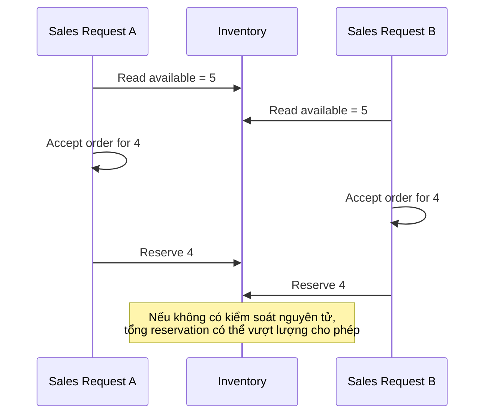
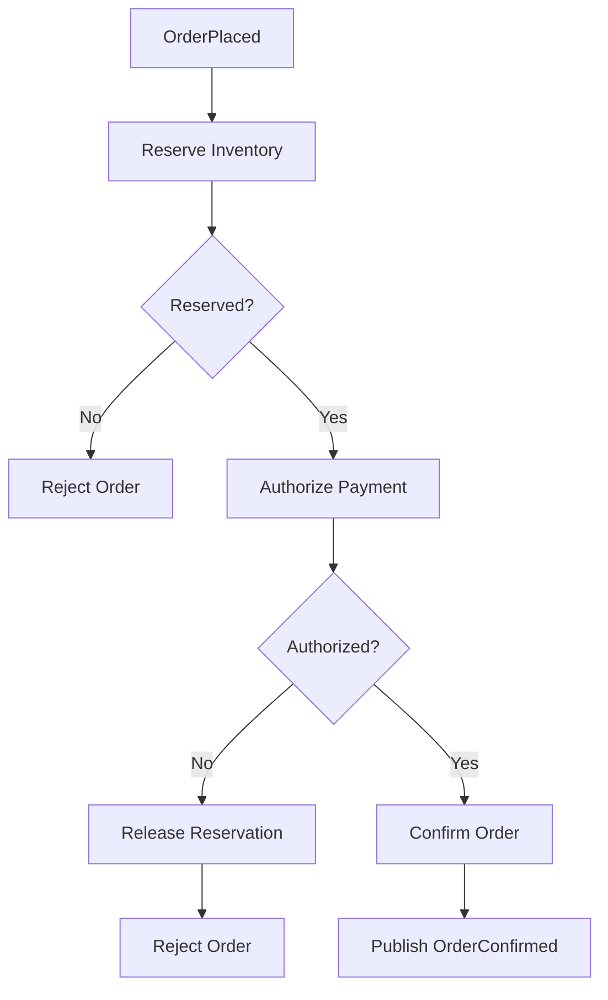

# Phân biệt bất biến cục bộ với cam kết qua nhiều ngữ cảnh

Trong Domain-Driven Design (DDD), mỗi Aggregate bảo vệ một nhóm bất biến cần đúng ngay sau khi một thao tác nghiệp vụ hoàn tất. Nhưng một hành trình nghiệp vụ có thể đi qua nhiều Bounded Context do các nhóm hoặc hệ thống khác nhau sở hữu. Khi đó, không thể mặc định mọi quy tắc đều được kiểm tra và commit trong cùng một transaction.

Ví dụ, Sales nhận một đơn hàng, Inventory giữ hàng, Billing xác thực thanh toán và Delivery lập kế hoạch giao. Mỗi ngữ cảnh sở hữu dữ liệu và quy tắc riêng. Sales có thể bảo đảm đơn hàng có ít nhất một dòng hàng và tổng tiền được tính đúng theo chính sách bán hàng. Inventory chịu trách nhiệm không phân bổ vượt quá lượng hàng có thể giữ. Billing quyết định một khoản thanh toán có được ủy quyền hay không. Cam kết “đơn chỉ được xác nhận khi hàng đã được giữ và thanh toán được chấp thuận” lại phụ thuộc kết quả của nhiều ngữ cảnh.

Cần phân biệt hai phạm vi: **bất biến cục bộ** được bảo vệ bên trong một Aggregate hoặc một ranh giới nhất quán; **cam kết liên ngữ cảnh** được hoàn thành qua một quy trình phối hợp, thường có trạng thái trung gian, sự kiện, retry và hành động bù trừ. Nhầm lẫn hai phạm vi này dễ tạo transaction quá lớn, phụ thuộc xuyên context hoặc trạng thái nghiệp vụ không thể giải thích.

Bài học này trình bày cách xác định chủ sở hữu của từng quy tắc, thiết kế cam kết có thời hạn, chọn orchestration hoặc choreography, và vận hành quy trình nhất quán cuối cùng mà vẫn giữ ranh giới của từng Bounded Context.

## Mục tiêu học tập

Sau bài này, bạn có thể:

- Phân biệt bất biến cục bộ với cam kết cần nhiều Bounded Context cùng tham gia.
- Xác định Aggregate hoặc context nào sở hữu dữ liệu và quyết định nghiệp vụ.
- Giải thích vì sao không nên kiểm tra một bất biến toàn cục bằng cách đọc dữ liệu từ nhiều context rồi cập nhật độc lập.
- Thiết kế trạng thái trung gian và cam kết có thời hạn như reservation hoặc payment authorization.
- Chọn giữa orchestration và choreography cho một quy trình nhiều bước.
- Dùng Saga và hành động bù trừ để xử lý thất bại sau khi một bước đã commit.
- Kết hợp Integration Event, Outbox, Inbox, idempotency và optimistic concurrency.
- Xử lý timeout, retry, sự kiện đến muộn, deadline và tiến trình bị kẹt.
- Quyết định khi nào cần consistency mạnh và khi nào eventual consistency là phù hợp.
- Thiết kế trải nghiệm người dùng và kiểm thử cho consistency window.

## 1. Bất biến cục bộ và cam kết liên ngữ cảnh là hai phạm vi khác nhau

### Bất biến cục bộ

Bất biến cục bộ là điều kiện phải đúng trong phạm vi mà một Aggregate hoặc một context có quyền kiểm soát. Nó được kiểm tra và bảo vệ cùng với thay đổi trạng thái trong ranh giới ghi tương ứng.

Ví dụ trong Sales:

- Một Order phải có ít nhất một OrderLine trước khi xác nhận.
- Số lượng mỗi dòng hàng phải lớn hơn 0.
- Các dòng hàng trong cùng Order dùng loại tiền nhất quán.
- Order đã giao không thể quay lại trạng thái DRAFT.

Ví dụ trong Inventory:

- Một SKU không được phân bổ vượt quá số lượng có thể giữ theo chính sách tồn kho.
- Một Reservation chỉ được giải phóng khi đang ở trạng thái cho phép.
- Một reservation đã hết hạn không thể được xác nhận như thể vẫn còn hiệu lực.

Những quy tắc này thuộc context sở hữu dữ liệu và được bảo vệ bằng Aggregate, transaction cục bộ, unique constraint, optimistic locking hoặc cơ chế tương ứng.

### Cam kết liên ngữ cảnh

Cam kết liên ngữ cảnh là kết quả nghiệp vụ phụ thuộc vào quyết định hoặc hành động của nhiều context. Không một Aggregate đơn lẻ nào có đủ quyền và dữ liệu để tự bảo đảm toàn bộ cam kết.

Ví dụ:

- Đơn chỉ được chuyển sang CONFIRMED khi Inventory đã giữ đủ hàng và Billing đã ủy quyền thanh toán.
- Một chuyến giao chỉ được lập khi đơn đã sẵn sàng và địa chỉ giao hàng được xác nhận.
- Một hợp đồng chỉ được kích hoạt sau khi khách hàng được thẩm định và khoản thanh toán ban đầu được ghi nhận.

Cam kết này cần một quy trình theo dõi tiến trình, trạng thái trung gian và cách xử lý khi một bước không thành công.

| Tiêu chí | Bất biến cục bộ | Cam kết liên ngữ cảnh |
| --- | --- | --- |
| Phạm vi | Một Aggregate hoặc ranh giới nhất quán của một context | Nhiều Aggregate/context |
| Chủ sở hữu | Một mô hình miền xác định | Mỗi context sở hữu một phần; workflow phối hợp kết quả |
| Bảo đảm | Kiểm tra trong transaction cục bộ | Qua thông điệp, phản hồi, trạng thái và retry |
| Trạng thái | Thường commit nguyên tử trong một lần ghi | Có thể có trạng thái PENDING/WAITING/COMPENSATING |
| Khi thất bại | Transaction cục bộ rollback hoặc từ chối | Retry, timeout, bù trừ hoặc chuyển xử lý thủ công |
| Ví dụ | Order không rỗng khi xác nhận | Order chỉ hoàn tất sau khi giữ hàng và ủy quyền thanh toán |

### Đừng biến mọi quy tắc thành cam kết toàn cục

Nếu một quy tắc chỉ liên quan đến dữ liệu trong Order, hãy giữ nó trong Order. Không cần gọi Inventory hoặc Billing chỉ để kiểm tra một bất biến mà Sales có thể bảo vệ độc lập.

Ngược lại, không nên để Sales tự quyết định số lượng tồn kho thực tế bằng cách đọc một bản sao dữ liệu Inventory. Sales không sở hữu sự thật đó. Nó có thể lưu kết quả giữ hàng hoặc một tham chiếu reservation, nhưng quyết định có thể giữ bao nhiêu hàng thuộc Inventory.

## 2. Xác định chủ sở hữu của dữ liệu và quyết định

Mỗi Bounded Context cần có quyền quyết định rõ ràng đối với dữ liệu và quy tắc của nó. Một context khác có thể cần thông tin để điều phối, nhưng không nên trực tiếp sửa dữ liệu nội bộ hoặc tái thực thi quy tắc của context sở hữu.

Ví dụ:

| Khái niệm | Context sở hữu | Context khác có thể biết |
| --- | --- | --- |
| Giá bán và chiết khấu | Sales/Pricing | Giá được chấp nhận trong Order |
| Trạng thái Order | Sales | Order đã đặt, đang chờ, đã xác nhận hoặc đã hủy |
| Lượng hàng có thể giữ | Inventory | Kết quả reservation và thời hạn |
| Payment authorization/capture | Billing/Payments | Kết quả thanh toán và payment reference |
| Lộ trình giao hàng | Delivery | Trạng thái giao và mã shipment |

Một context không nên truy cập trực tiếp database của context khác để kiểm tra rồi cập nhật dữ liệu theo quyết định riêng. Cách đó tạo coupling vào schema, bỏ qua quy tắc của chủ sở hữu và khiến hai nhóm có thể ghi đè nhau.

### Chia sẻ thông tin không đồng nghĩa chia sẻ quyền sở hữu

Sales có thể nhận Integration Event InventoryReserved và lưu reservationId cùng trạng thái quy trình. Điều này không làm Sales trở thành chủ sở hữu Reservation. Khi cần hủy giữ hàng, Sales gửi một yêu cầu đến Inventory hoặc phát command qua cơ chế tích hợp. Inventory xác nhận thao tác đó có hợp lệ hay không.

Tương tự, Billing có thể phát PaymentAuthorized với payment reference và số tiền được ủy quyền. Sales dùng kết quả này để tiếp tục workflow, nhưng không tự sửa trạng thái giao dịch trong Billing.

### Phân biệt Domain Event và Integration Event

Domain Event diễn tả sự thật bên trong mô hình miền của một context. Integration Event là hợp đồng được công bố để context khác có thể phản ứng. Integration Event thường được thiết kế ổn định hơn, có version và chỉ chứa dữ liệu cần chia sẻ.

Không nên buộc consumer bên ngoài phụ thuộc vào class nội bộ hoặc toàn bộ object graph của Domain Event. Context phát sự kiện chịu trách nhiệm chuyển đổi nó thành hợp đồng tích hợp phù hợp.

## 3. Vì sao không thể kiểm tra cam kết toàn cục bằng hai lần đọc độc lập?

Giả sử Sales đọc Inventory thấy còn 5 sản phẩm. Trước khi Sales tạo đơn, một đơn khác giữ hết 5 sản phẩm. Nếu Sales vẫn xác nhận dựa trên lần đọc cũ, hệ thống có thể bán vượt tồn.

Luồng kiểm tra rồi cập nhật tách rời này có race condition:



Vấn đề là hai lần đọc không tạo ra một cam kết. Chỉ Inventory mới có thể thực hiện thao tác reserve một cách nguyên tử trong ranh giới dữ liệu của nó.

Thay vì hỏi “còn hàng không?” rồi tự quyết định, Sales gửi yêu cầu giữ một số lượng cụ thể. Inventory kiểm tra và tạo Reservation trong cùng transaction cục bộ. Kết quả được trả về bằng response hoặc Integration Event.

### Check-then-act không thay thế được thao tác có điều kiện

Một API như getAvailableQuantity() chỉ cung cấp thông tin tại một thời điểm. Nó không bảo đảm số lượng đó vẫn còn khi caller hành động.

Một API như reserve(sku, quantity, reservationId, expiresAt) có thể bảo đảm:

- Số lượng còn có thể giữ đủ theo chính sách.
- Không có reservation trùng cho cùng request.
- Reservation được tạo hoặc từ chối nguyên tử.
- Kết quả có định danh và trạng thái để caller theo dõi.

Đây là khác biệt giữa đọc một sự thật và yêu cầu chủ sở hữu tạo một cam kết.

## 4. Reservation và cam kết có thời hạn

Một cách phổ biến để phối hợp nhiều context là tạo cam kết tạm thời có thời hạn. Reservation giữ một nguồn lực trong một khoảng thời gian; Payment Authorization giữ khả năng thu tiền trong giới hạn và điều kiện của provider.

Reservation không có nghĩa đơn hàng đã hoàn tất. Nó là trạng thái trung gian với thời hạn và quy tắc giải phóng.

Ví dụ vòng đời reservation:

- REQUESTED: yêu cầu đã được nhận.
- RESERVED: nguồn lực đã được giữ đến expiresAt.
- CONFIRMED: cam kết đã được chuyển thành phân bổ chính thức theo chính sách.
- RELEASED: nguồn lực đã được giải phóng.
- EXPIRED: thời hạn đã qua và reservation không còn hiệu lực.

Không phải hệ thống nào cũng cần đủ các trạng thái này. Chọn state machine tối thiểu phù hợp với nghiệp vụ.

### Thời hạn cần có ý nghĩa nghiệp vụ

Nếu reservation hết hạn sau 15 phút, workflow cần xác định:

- Thời điểm bắt đầu tính hạn.
- Context nào sở hữu expiresAt.
- Có thể gia hạn trong trường hợp nào.
- Khi hết hạn, Inventory giải phóng nguồn lực bằng cách nào.
- Consumer nhận event đến muộn sẽ phản ứng ra sao.
- Nếu Billing đã ủy quyền nhưng Reservation hết hạn, cần void authorization hay tạo quy trình xử lý khác.

Không nên để Sales tự sửa expiresAt trong Inventory. Sales có thể yêu cầu gia hạn; Inventory quyết định có chấp nhận hay không.

### Cam kết có thời hạn làm giảm nhu cầu giữ transaction lâu

Thay vì mở một transaction database trong suốt quá trình thanh toán và giữ hàng, mỗi context commit một bước cục bộ. Reservation và authorization bảo vệ nguồn lực hoặc quyền thực hiện trong một khoảng thời gian. Workflow kết hợp các kết quả và quyết định bước tiếp theo.

Điều này phù hợp với các quy trình có độ trễ mạng, retry hoặc nhiều hệ thống độc lập.

## 5. Eventual Consistency và consistency window

Eventual Consistency có nghĩa các bản sao hoặc trạng thái liên quan có thể tạm thời khác nhau sau một thay đổi, nhưng nếu các thông điệp được xử lý và không có lỗi kéo dài, chúng sẽ hội tụ theo quy tắc đã thiết kế.

Ví dụ, sau khi Sales tạo Order ở trạng thái PENDING_CONFIRMATION:

- Sales đã biết đơn được tiếp nhận.
- Inventory có thể chưa xử lý yêu cầu giữ hàng.
- Billing có thể chưa nhận yêu cầu ủy quyền.
- Màn hình tổng hợp có thể chưa nhận Integration Event mới.

Khoảng thời gian giữa lúc một thay đổi được commit và lúc các context liên quan phản ánh nó được gọi là consistency window. Hệ thống cần làm rõ trạng thái đang chờ để người dùng không hiểu nhầm rằng đơn đã được xác nhận.

### Eventual consistency không có nghĩa chấp nhận dữ liệu sai

Mỗi context vẫn phải bảo vệ bất biến cục bộ. Eventual consistency chỉ cho phép trạng thái liên context chưa hội tụ ngay lập tức; nó không cho phép Inventory phân bổ vượt giới hạn hoặc Billing ghi nhận một khoản tiền không hợp lệ.

Một quy trình tốt định nghĩa:

- Trạng thái trung gian có thể quan sát.
- Điều kiện chuyển bước.
- Deadline hoặc timeout.
- Cách retry.
- Hành động bù trừ nếu không thể tiếp tục.
- Cách đối soát nếu thông điệp bị mất hoặc trạng thái không rõ.

### Không dùng read model có độ trễ để bảo vệ bất biến quan trọng

Một dashboard có thể hiển thị lượng tồn dựa trên projection cập nhật bất đồng bộ. Giá trị đó hữu ích cho người dùng xem nhanh, nhưng không phải căn cứ cuối cùng để phân bổ hàng. Quyết định giữ hàng phải được Inventory kiểm tra tại thời điểm ghi.

Tương tự, báo cáo thanh toán có thể trễ vài giây; không dùng nó thay kết quả authorization chính thức cho một bước cần quyết định ngay.

## 6. Thiết kế Saga cho cam kết nhiều bước

Saga là một quy trình gồm nhiều transaction cục bộ. Mỗi bước commit trong context sở hữu dữ liệu; các bước tiếp theo được kích hoạt bằng command hoặc event. Nếu một bước thất bại sau khi bước trước đã commit, workflow có thể thực hiện hành động bù trừ để đưa nghiệp vụ về một trạng thái chấp nhận được.

Saga không phải một transaction database phân tán. Compensation cũng không phải rollback kỹ thuật: nó là một hành động nghiệp vụ mới, có thể thất bại và cần retry.

### Ví dụ quy trình đặt hàng

Một quy trình đơn giản có thể là:

1. Sales tạo Order ở trạng thái PENDING_CONFIRMATION.
2. Sales phát OrderPlaced.
3. Inventory nhận yêu cầu và giữ hàng.
4. Nếu giữ hàng thành công, Billing yêu cầu authorization.
5. Nếu authorization thành công, Sales chuyển Order sang CONFIRMED.
6. Nếu một bước thất bại, workflow yêu cầu giải phóng reservation và/hoặc void authorization theo những bước đã hoàn tất.
7. Sales cập nhật Order thành REJECTED hoặc CANCELLED theo kết quả cuối.



Sơ đồ là một ví dụ giản lược. Nếu bước confirm ở Sales thất bại vì version conflict hoặc order đã bị hủy, workflow cần kiểm tra lại trạng thái và có thể void authorization, release reservation hoặc chuyển sang xử lý ngoại lệ. Không được giả định bước cuối luôn thành công chỉ vì các bước trước đã thành công.

### Chọn thứ tự bước theo rủi ro và chi phí bù trừ

Thứ tự reserve trước hay authorize trước phụ thuộc chi phí, thời hạn và khả năng bù trừ:

- Giữ hàng trước có thể tạo reservation tạm thời rồi phải giải phóng nếu thanh toán bị từ chối.
- Ủy quyền thanh toán trước có thể tạo authorization cần void nếu hết hàng.
- Capture tiền thường có tác động mạnh hơn authorization; có thể trì hoãn capture đến khi các điều kiện khác đã đạt.

Hãy chọn thứ tự dựa trên chính sách nghiệp vụ và semantics của provider, không chỉ dựa trên số lượng lời gọi API.

## 7. Orchestration và Choreography

Hai cách phổ biến để điều phối Saga là orchestration và choreography.

### Orchestration: một coordinator quản lý tiến trình

Orchestrator theo dõi trạng thái Saga, gửi command đến từng context, nhận kết quả và quyết định bước tiếp theo.

Ưu điểm:

- Luồng nghiệp vụ tập trung, dễ nhìn thấy các bước và nhánh lỗi.
- Có một nơi quản lý deadline, retry và compensation.
- Dễ truy vấn trạng thái tổng thể của quy trình.

Đánh đổi:

- Orchestrator cần được thiết kế và vận hành như một thành phần có trạng thái.
- Nếu quá nhiều quy tắc của các context bị kéo vào coordinator, nó có thể trở thành nơi tập trung logic miền không thuộc sở hữu của nó.
- Cần xử lý khả năng coordinator restart, replay và xử lý command trùng.

### Choreography: các context phản ứng với event

Mỗi context phát event khi một sự thật cục bộ xảy ra. Context khác đăng ký và phản ứng theo hợp đồng tích hợp.

Ví dụ:

- Inventory phát InventoryReserved.
- Billing nhận event và phát PaymentAuthorized.
- Sales nhận PaymentAuthorized và xác nhận Order.

Ưu điểm:

- Các context ít phụ thuộc trực tiếp vào một coordinator.
- Producer không cần biết tất cả consumer.
- Phù hợp với các phản ứng sự kiện tương đối độc lập.

Đánh đổi:

- Luồng tổng thể khó quan sát khi số context và nhánh tăng.
- Vòng lặp event hoặc phụ thuộc ngầm có thể xuất hiện.
- Khó xác định ai chịu trách nhiệm timeout, compensation và trạng thái tiến trình cuối.

| Tiêu chí | Orchestration | Choreography |
| --- | --- | --- |
| Điều phối | Coordinator gửi command | Context phản ứng với event |
| Luồng tổng thể | Tập trung và tường minh | Phân tán qua subscription |
| Phù hợp | Quy trình nhiều bước, deadline và compensation phức tạp | Phản ứng độc lập, ít nhánh |
| Theo dõi tiến trình | Trạng thái tại orchestrator | Cần correlation và quan sát xuyên service |
| Rủi ro | Coordinator phình to | Luồng ngầm và event coupling |

Không có lựa chọn luôn đúng. Hãy chọn dựa trên độ phức tạp của quy trình và khả năng vận hành.

## 8. Compensation không phải rollback

Khi một transaction cục bộ commit, transaction khác không thể đơn giản rollback thay đổi đó như thể chưa xảy ra. Compensation là một hành động nghiệp vụ mới nhằm khôi phục một trạng thái chấp nhận được.

Ví dụ:

- Inventory đã giữ hàng; compensation là ReleaseReservation.
- Billing đã authorize; compensation là VoidAuthorization.
- Delivery đã tạo shipment; compensation có thể là CancelShipment nếu shipment chưa bàn giao.
- Một email đã gửi không thể “thu hồi” theo nghĩa kỹ thuật; có thể cần gửi thông báo đính chính hoặc xử lý hỗ trợ.

Compensation có thể không đảo ngược hoàn toàn tác động ban đầu. Một khoản thanh toán đã capture có thể cần refund, mất phí hoặc thời gian xử lý. Vì vậy, Saga cần phân biệt trạng thái thành công, thất bại, đang bù trừ và cần can thiệp thủ công.

### Compensation cần idempotent

Nếu workflow gửi ReleaseReservation hai lần do timeout, Inventory không nên giải phóng hai lần hoặc làm thay đổi reservation khác. Command bù trừ cần có định danh ổn định và được xử lý idempotent.

Tương tự, VoidAuthorization phải tham chiếu đúng authorizationId và có thể trả lại kết quả trước đó nếu command được gửi lại.

### Compensation cũng có thể thất bại

Nếu provider không khả dụng khi void authorization, Saga có thể ở trạng thái COMPENSATION_PENDING. Cần retry có giới hạn, cảnh báo vận hành và quy trình đối soát. Không đánh dấu Saga hoàn tất chỉ vì đã gửi command bù trừ; cần biết kết quả hoặc xác định rõ trạng thái chưa hoàn tất.

## 9. Outbox, Inbox và idempotency tại mỗi context

Một quy trình nhiều context phụ thuộc vào thông điệp được phát và nhận đáng tin cậy. Nhưng database commit và publish message là hai thao tác ở hai hệ thống khác nhau.

### Outbox ở phía phát

Context ghi thay đổi Aggregate và Integration Event vào Outbox trong cùng transaction cục bộ. Publisher đọc Outbox rồi gửi message đến broker. Điều này tránh tình huống database commit nhưng event bị mất do publisher lỗi ngay sau đó.

Outbox không bảo đảm message chỉ được publish một lần. Publisher có thể gửi thành công rồi crash trước khi đánh dấu record đã gửi, dẫn đến publish lại. Vì vậy, event cần eventId ổn định và consumer phải deduplicate.

### Inbox ở phía nhận

Consumer ghi eventId vào Inbox cùng transaction với thay đổi dữ liệu cục bộ. Unique constraint hoặc thao tác insert atomic giúp ngăn hai worker cùng áp dụng một event.

Nếu event đã được xử lý, consumer có thể trả kết quả trước đó hoặc bỏ qua tác động theo hợp đồng. Nếu transaction rollback, Inbox record cũng phải rollback để event có thể được xử lý lại.

### Idempotency key cho command

Khi orchestrator gửi command đến context khác, command nên có commandId hoặc idempotency key ổn định. Nếu timeout và orchestrator retry, context nhận biết đó là cùng một yêu cầu.

Một context không nên suy ra idempotency chỉ từ Aggregate ID vì cùng Aggregate có thể nhận nhiều command khác nhau hợp lệ.

## 10. Trạng thái workflow và thời hạn

Một quy trình liên ngữ cảnh cần lưu trạng thái đủ để có thể tiếp tục sau khi process restart. Không nên dựa vào biến trong bộ nhớ của một worker hoặc chuỗi callback tạm thời.

Ví dụ trạng thái của Order Fulfillment Saga:

- STARTED: quy trình đã bắt đầu.
- INVENTORY_PENDING: đang chờ kết quả giữ hàng.
- PAYMENT_PENDING: đang chờ authorization.
- CONFIRMING_ORDER: đã có các điều kiện cần và đang xác nhận Order.
- COMPLETED: cam kết đã hoàn tất.
- COMPENSATING: đang thực hiện hành động bù trừ.
- REJECTED: quy trình bị từ chối và các tài nguyên cần thiết đã được giải phóng.
- MANUAL_REVIEW: không thể tự động hội tụ và cần người xử lý.

Không phải mọi workflow cần tất cả trạng thái. Hãy đặt tên theo ngôn ngữ chung của quy trình.

### Deadline và timeout

Deadline khác timeout kỹ thuật:

- Timeout là giới hạn chờ một lời gọi hoặc một lần xử lý.
- Deadline là thời hạn nghiệp vụ mà một cam kết cần hoàn thành, ví dụ reservation chỉ giữ đến 14:30.

Khi hết deadline, workflow cần quyết định theo chính sách: hủy reservation, void authorization, tiếp tục với phê duyệt thủ công hoặc chuyển trạng thái khác. Không nên chỉ đánh dấu timeout ở message consumer rồi bỏ quên cam kết đã tạo ở context khác.

### Lưu trạng thái và lịch sử

Nên lưu:

- sagaId/processId.
- business reference như orderId.
- current state.
- step đã hoàn thành và kết quả.
- command/event IDs đã xử lý.
- deadline và thời điểm retry tiếp theo.
- lý do thất bại hoặc compensation.
- correlationId và causation metadata.

Không nhất thiết lưu toàn bộ payload nhạy cảm của mọi message. Có thể lưu reference, code và metadata cần thiết để tiếp tục hoặc điều tra.

## 11. Xử lý event đến muộn, trùng hoặc sai thứ tự

Trong môi trường bất đồng bộ, một kết quả có thể đến sau khi workflow đã chuyển trạng thái khác.

Ví dụ:

1. Saga gửi ReserveInventory.
2. Người dùng hủy đơn trong lúc chờ.
3. Sales chuyển Order sang CANCELLED.
4. InventoryReserved đến muộn.

Consumer hoặc orchestrator phải kiểm tra state hiện tại. Nếu reservation được tạo sau khi đơn đã hủy, workflow cần phát ReleaseReservation. Không được áp dụng event cũ để chuyển Order ngược lại sang trạng thái đang chờ xác nhận.

Các quy tắc quan trọng:

- Mọi message có định danh ổn định.
- Mỗi transition kiểm tra state/version hiện tại.
- Event trùng không tạo tác động lặp.
- Event đến muộn được xử lý theo state machine, không chỉ theo thứ tự thời gian.
- Nếu thiếu kết quả, workflow có thể truy vấn trạng thái từ context sở hữu hoặc retry theo chính sách.
- Không để event cũ ghi đè trạng thái mới hơn.

### Version check

Nếu Order đang ở version 12 và nhận kết quả gắn với version 10, application có thể nhận ra kết quả đã cũ. Nhưng version chỉ hữu ích nếu ý nghĩa và phạm vi version được định nghĩa rõ. Version của Order không phải sequence của Inventory hoặc Billing.

Mỗi context có version riêng cho Aggregate của nó. Correlation ID liên kết các bước của Saga; nó không tạo ra một thứ tự toàn cục.

## 12. Khi nào cần consistency mạnh?

Eventual consistency không phù hợp với mọi quy tắc. Có những quyết định cần được xác nhận ngay tại thời điểm ghi.

Ví dụ:

- Inventory không được giữ vượt lượng có thể phân bổ.
- Một mã coupon chỉ được đổi một lần theo chính sách.
- Một tài khoản không được chi vượt hạn mức được bảo vệ bởi một transaction.
- Một số thao tác thanh toán cần provider xác nhận trước khi trả kết quả đồng bộ.

Cách xử lý là đặt quyết định cần tính nguyên tử tại context sở hữu nó. Nếu quy tắc cần dữ liệu của nhiều context và không thể chấp nhận trạng thái trung gian, cần đánh giá lại mô hình và ranh giới:

1. Có phải các dữ liệu đó thực sự thuộc cùng một năng lực nghiệp vụ và nên ở cùng một context/Aggregate không?
2. Có thể chuyển quy tắc thành một reservation hoặc authorization cục bộ không?
3. Có thể chấp nhận một trạng thái PENDING và hoàn tất bất đồng bộ không?
4. Có cần một thao tác đồng bộ với context sở hữu để nhận quyết định ngay không?
5. Nếu bắt buộc giao dịch phân tán, chi phí vận hành và failure mode của distributed transaction có được chấp nhận không?

Đừng dùng eventual consistency để né một bất biến quan trọng. Cũng đừng gộp các context độc lập chỉ để tránh mọi trạng thái chờ. Hãy xác định điều gì phải đúng ngay và điều gì có thể trở thành cam kết đang tiến hành.

### Đọc dữ liệu chéo context không tạo ra quyền ghi chéo context

Một service tổng hợp có thể đọc projection từ nhiều context để hiển thị trạng thái. Nhưng projection đó có thể trễ. Nếu cần quyết định quan trọng, hãy gửi command đến context sở hữu và nhận kết quả từ nó.

### Đồng bộ không có nghĩa transaction chung

Một use case có thể gọi đồng bộ Inventory.reserve() qua API và chờ phản hồi. Điều này cho biết Inventory đã chấp nhận hoặc từ chối reservation tại thời điểm đó. Nhưng nếu Sales sau đó lỗi khi lưu Order, Inventory vẫn có reservation đã commit. Workflow vẫn cần release/compensation hoặc một quy trình phối hợp. Synchronous call không tự biến nhiều database thành một transaction nguyên tử.

## 13. Ví dụ Java: một bước giữ hàng có thể lặp an toàn

Ví dụ sau minh họa Inventory là context sở hữu Reservation. Application Service của Inventory nhận command, kiểm tra và tạo reservation trong transaction cục bộ. Các repository và kiểu miền được giản lược.

```java
public record ReserveStockCommand(
    UUID commandId,
    UUID orderId,
    String sku,
    int quantity,
    Instant expiresAt,
    String requestFingerprint
) {}

public sealed interface ReserveStockResult
    permits StockReserved, StockUnavailable, ReservationAlreadyExists,
            ReservationRequestInProgress {}

public record StockReserved(
    UUID reservationId,
    UUID orderId,
    Instant expiresAt
) implements ReserveStockResult {}

public record StockUnavailable(
    String sku,
    int requestedQuantity
) implements ReserveStockResult {}

public record ReservationAlreadyExists(
    UUID reservationId
) implements ReserveStockResult {}

public record ReservationRequestInProgress(UUID commandId)
    implements ReserveStockResult {}

public interface ProcessedCommandStore {
    // Atomic insert protected by a unique key. Reusing commandId with a
    // different fingerprint must raise an idempotency-key reuse error.
    boolean tryClaim(UUID commandId, String requestFingerprint);
    Optional<ReserveStockResult> findResult(
        UUID commandId,
        String requestFingerprint
    );
    void store(UUID commandId, String requestFingerprint,
               ReserveStockResult result);
}

public final class ReserveStockUseCase {
    private final InventoryRepository inventory;
    private final ReservationRepository reservations;
    private final ProcessedCommandStore processedCommands;
    private final Clock clock;

    public ReserveStockUseCase(
        InventoryRepository inventory,
        ReservationRepository reservations,
        ProcessedCommandStore processedCommands,
        Clock clock
    ) {
        this.inventory = inventory;
        this.reservations = reservations;
        this.processedCommands = processedCommands;
        this.clock = clock;
    }

    @Transactional
    public ReserveStockResult handle(ReserveStockCommand command) {
        var previous = processedCommands.findResult(
            command.commandId(), command.requestFingerprint());
        if (previous.isPresent()) {
            return previous.get();
        }
        if (!processedCommands.tryClaim(
                command.commandId(), command.requestFingerprint())) {
            return processedCommands.findResult(
                    command.commandId(), command.requestFingerprint())
                .orElseGet(() ->
                    new ReservationRequestInProgress(command.commandId()));
        }

        var existing = reservations.findByOrderId(command.orderId());
        if (existing.isPresent()) {
            var result = new ReservationAlreadyExists(existing.get().id());
            processedCommands.store(
                command.commandId(), command.requestFingerprint(), result);
            return result;
        }

        if (!command.expiresAt().isAfter(clock.instant())) {
            throw new IllegalArgumentException("Reservation deadline has passed");
        }

        InventoryItem item = inventory.findBySku(command.sku())
            .orElseThrow(() -> new UnknownSku(command.sku()));

        if (!item.canReserve(command.quantity())) {
            var result = new StockUnavailable(
                command.sku(),
                command.quantity()
            );
            processedCommands.store(
                command.commandId(), command.requestFingerprint(), result);
            return result;
        }

        Reservation reservation = item.reserve(
            command.orderId(),
            command.quantity(),
            command.expiresAt()
        );

        inventory.save(item);
        reservations.save(reservation);

        var result = new StockReserved(
            reservation.id(),
            command.orderId(),
            command.expiresAt()
        );
        processedCommands.store(
            command.commandId(), command.requestFingerprint(), result);
        return result;
    }
}
```

Ví dụ minh họa trách nhiệm chứ chưa phải implementation hoàn chỉnh. Trong hệ thống thực tế:

- commandId cần được claim atomically bằng unique constraint hoặc cơ chế tương đương; nếu key đang được xử lý, trả trạng thái đang xử lý thay vì thực hiện lần hai.
- Kết quả idempotency và thay đổi Inventory/Reservation phải cùng transaction.
- Kiểm tra available quantity và tạo reservation phải được bảo vệ bởi transaction isolation, optimistic/pessimistic locking hoặc update có điều kiện để tránh oversell.
- Reservation cần kiểm tra trạng thái và thời hạn trong mọi transition.
- Integration Event InventoryReserved cần được ghi vào Outbox cùng transaction.
- Cùng commandId nhưng payload khác phải bị từ chối bằng fingerprint, không trả kết quả cũ một cách mù quáng. Fingerprint phải được tính ở phía nhận từ các trường command đã chuẩn hóa.
- Một reservation đã hết hạn cần được giải phóng theo cơ chế có thể phục hồi sau restart.

### Tại sao Sales không tự giảm tồn kho?

Sales gửi command và chờ kết quả. Inventory tự kiểm tra bất biến tồn kho và commit Reservation. Sales chỉ lưu reservationId cùng trạng thái quy trình. Điều này giữ quyền sở hữu và trách nhiệm rõ ràng.

## 14. Quan sát và đối soát quy trình liên ngữ cảnh

Một quy trình có thể bị kẹt vì message không được publish, consumer ngừng chạy, provider timeout hoặc compensation thất bại. Nếu chỉ quan sát log của từng service riêng lẻ, khó biết một đơn đang chờ ở bước nào.

Cần quan sát xuyên workflow:

- Số Saga ở từng trạng thái.
- Tuổi của Saga lâu nhất đang chờ.
- Reservation sắp hết hạn hoặc đã hết hạn.
- Payment authorization chưa được capture/void theo chính sách.
- Message retry, DLQ và event lag.
- Compensation pending hoặc thất bại.
- Tỷ lệ Order chuyển từ PENDING sang CONFIRMED, REJECTED hoặc MANUAL_REVIEW.
- Các command/event trùng và version conflict.

Đối soát định kỳ có thể so sánh các reference đã chia sẻ với trạng thái do context sở hữu trả về. Ví dụ, workflow có thể kiểm tra reservationId còn RESERVED hay đã EXPIRED. Việc đối soát phải dùng API hoặc hợp đồng tích hợp của context sở hữu, không đọc trực tiếp bảng nội bộ của nó.

Một quy trình khôi phục cần cho phép replay hoặc gửi lại command với cùng định danh, ghi lại thao tác của người vận hành và giữ được lịch sử quyết định.

## 15. Những sai lầm thường gặp

- **Dùng một transaction cho toàn bộ workflow nhiều context:** giữ lock lâu và không thể rollback tác động đã xảy ra ở provider bên ngoài.
- **Để một context ghi trực tiếp database context khác:** phá vỡ quyền sở hữu và bỏ qua quy tắc miền.
- **Dùng dữ liệu read model trễ để quyết định reservation:** check-then-act có thể gây oversell.
- **Coi trạng thái PENDING là lỗi:** trạng thái chờ là một phần hợp lệ của quy trình bất đồng bộ.
- **Coi event đã publish là công việc đã hoàn tất:** consumer có thể chưa xử lý hoặc có thể từ chối.
- **Xem compensation như rollback:** hành động bù trừ là nghiệp vụ mới và có thể thất bại.
- **Không đặt deadline cho reservation:** nguồn lực có thể bị giữ vô thời hạn.
- **Không làm command/event idempotent:** retry có thể tạo reservation, payment hoặc thông báo trùng.
- **Không kiểm tra state khi nhận event muộn:** quy trình có thể chuyển ngược hoặc xác nhận một đơn đã hủy.
- **Đưa mọi logic vào orchestrator:** coordinator trở thành một domain model tập trung và lấn quyền sở hữu của các context.
- **Choreography không có correlation hoặc giám sát:** khó tìm tiến trình bị kẹt và xác định bước tiếp theo.
- **Dùng correlationId làm version toàn cục:** correlation chỉ liên kết một hành trình, không xác định thứ tự hay concurrency.
- **Giả định synchronous call tạo consistency nguyên tử:** context được gọi có thể commit dù caller lỗi sau đó.

## 16. Quy trình thiết kế cam kết liên ngữ cảnh

Khi thiết kế một quy trình đi qua nhiều Bounded Context, hãy thực hiện theo trình tự:

1. **Mô tả kết quả cuối.** Xác định điều gì được xem là cam kết đã hoàn tất đối với người dùng hoặc đối tác.
2. **Liệt kê bất biến cục bộ.** Xác định điều kiện nào phải luôn đúng trong từng Aggregate/context.
3. **Chỉ rõ chủ sở hữu.** Với mỗi dữ liệu và quyết định, xác định context chịu trách nhiệm.
4. **Xác định trạng thái trung gian.** Dùng PENDING, RESERVED, AUTHORIZED hoặc trạng thái miền có ý nghĩa tương đương.
5. **Thiết kế command/event contract.** Có ID ổn định, correlation, causation, version và deadline khi cần.
6. **Chọn orchestration hoặc choreography.** Xác định nơi theo dõi tiến trình, retry và compensation.
7. **Thiết kế hành động bù trừ.** Xác định bước nào có thể đảo ngược bằng nghiệp vụ và bước nào cần xử lý thủ công.
8. **Bảo vệ delivery.** Dùng Outbox/Inbox và idempotency tại từng context khi phù hợp.
9. **Định nghĩa consistency window.** Cho biết trạng thái chờ kéo dài bao lâu và khi nào cần cảnh báo.
10. **Thiết kế timeout và recovery.** Có deadline, retry policy, DLQ, replay và đối soát.
11. **Kiểm thử failure path.** Bao gồm event trùng, đến muộn, timeout sau commit, compensation fail và restart.
12. **Công bố trạng thái cho caller.** Phân biệt đã tiếp nhận, đang xử lý, hoàn tất, bị từ chối và cần can thiệp.

Checklist review:

- [ ] Mỗi bất biến có một Aggregate/context sở hữu rõ ràng?
- [ ] Không context nào tự ghi database của context khác?
- [ ] Quyết định quan trọng được thực hiện tại context sở hữu dữ liệu?
- [ ] Check-then-act đã được thay bằng command có tính nguyên tử ở owner?
- [ ] Trạng thái trung gian và consistency window được định nghĩa?
- [ ] Reservation/authorization có deadline và chính sách giải phóng?
- [ ] Orchestration/choreography có chủ sở hữu tiến trình rõ?
- [ ] Compensation là hành động nghiệp vụ có thể retry và theo dõi?
- [ ] Outbox/Inbox/idempotency bảo vệ các ranh giới cần thiết?
- [ ] Event muộn, trùng và sai thứ tự được xử lý theo state machine?
- [ ] Có cơ chế quan sát, đối soát và can thiệp thủ công?
- [ ] Người dùng biết công việc đã hoàn tất hay mới được tiếp nhận?

## Kết luận

Bất biến cục bộ và cam kết liên ngữ cảnh cần được thiết kế ở hai phạm vi khác nhau. Aggregate và Bounded Context bảo vệ dữ liệu cùng quy tắc mà chúng sở hữu trong transaction cục bộ. Một cam kết đi qua nhiều context được hoàn thành bằng quy trình phối hợp, trạng thái trung gian, Integration Event, retry và hành động bù trừ.

Hãy để mỗi context tự đưa ra quyết định về dữ liệu của nó, dùng reservation hoặc authorization khi cần giữ một nguồn lực tạm thời, và chọn orchestration hay choreography theo độ phức tạp của workflow. Eventual consistency cần có thời hạn, khả năng quan sát và cách phục hồi rõ ràng. Khi điều kiện bắt buộc phải đúng ngay, hãy bảo vệ nó tại context sở hữu hoặc xem xét lại ranh giới mô hình; đừng dựa vào một bản đọc chéo context đã cũ để tạo ra cam kết mà hệ thống chưa thực sự có.
