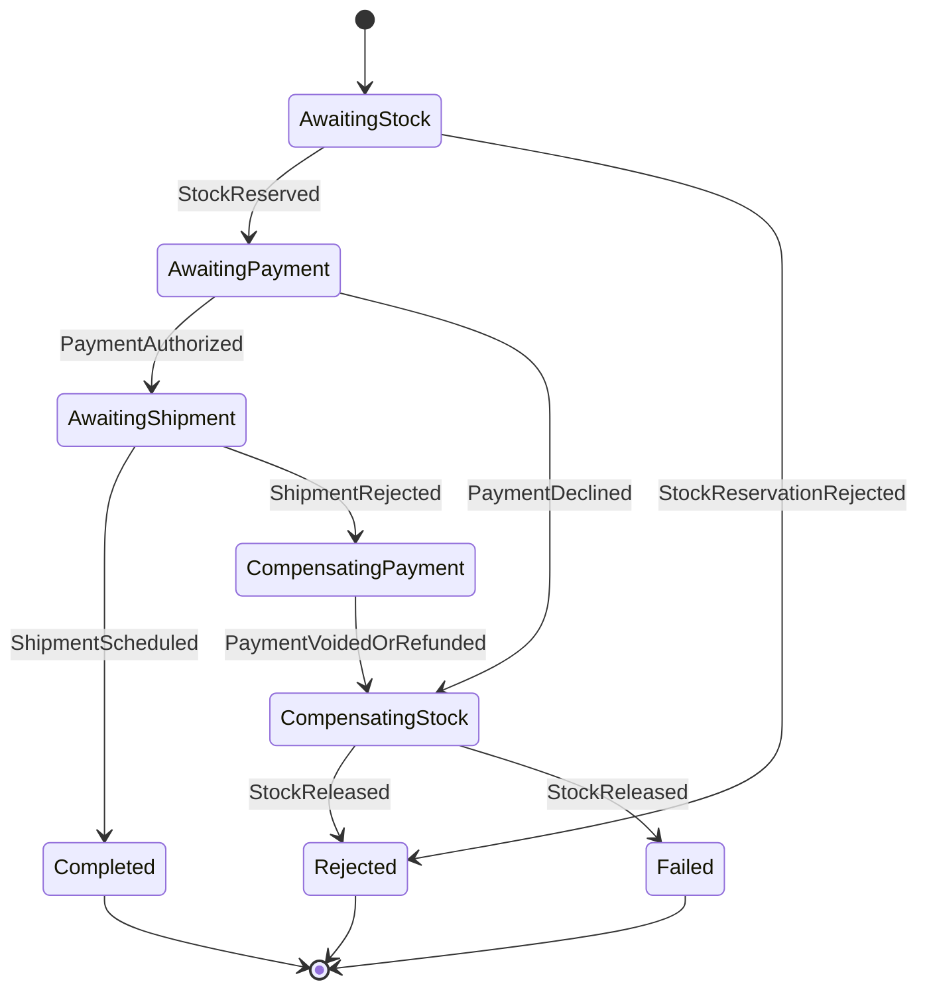
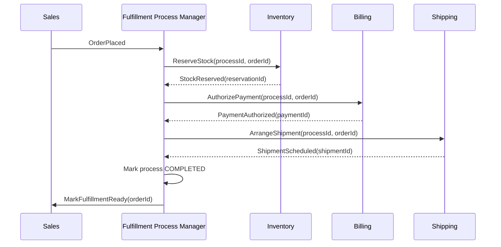

# Điều phối tiến trình dài hạn bằng Process Manager khi có nhu cầu

Trong một hệ thống DDD gồm nhiều bounded context, một quy trình nghiệp vụ có thể kéo dài qua nhiều phút, giờ hoặc ngày. Đặt hàng có thể cần giữ tồn kho, xác thực thanh toán, đóng gói và bàn giao vận chuyển. Mở tài khoản tín dụng có thể cần thẩm định, phê duyệt, ký hợp đồng và kích hoạt hạn mức. Mỗi bước thuộc một aggregate hoặc bounded context có quy tắc và vòng đời riêng.

Không thể giả định rằng toàn bộ quy trình sẽ nằm trong một transaction database duy nhất. Các bước có thể chạy bất đồng bộ, phản hồi đến trễ, được gửi lại hoặc thất bại sau khi một bước trước đã hoàn tất. Hệ thống cần nhớ quy trình đang ở đâu, sự kiện nào đã xảy ra, bước tiếp theo cần làm gì và khi nào phải xử lý timeout hoặc bù trừ.

**Process Manager** là một thành phần điều phối có trạng thái, theo dõi tiến trình nghiệp vụ qua nhiều bước và quyết định command tiếp theo dựa trên event hoặc kết quả nhận được. Nó lưu trạng thái của chính quy trình để có thể tiếp tục sau khi ứng dụng khởi động lại, xử lý sự kiện đến trễ và điều phối các bounded context độc lập.

Process Manager hữu ích khi luồng có nhiều bước, có nhánh, có thời gian chờ hoặc cần xử lý lỗi và bù trừ. Không phải quy trình nào cũng cần nó. Với một phản ứng đơn giản trước một event, một event handler hoặc policy có thể đủ. Bài học này trình bày cách nhận diện nhu cầu, mô hình hóa trạng thái, định danh tiến trình, gửi command, xử lý timeout/retry, bù trừ và kiểm thử một Process Manager.

## 1. Vì sao quy trình dài hạn cần được điều phối?

Hãy xét quy trình hoàn tất một đơn hàng trực tuyến:

1. Khách gửi yêu cầu đặt hàng.
2. Bán hàng xác nhận đơn ở trạng thái chờ xử lý.
3. Kho kiểm tra và giữ hàng.
4. Thanh toán ủy quyền hoặc thu tiền.
5. Kho chuẩn bị kiện hàng.
6. Vận chuyển nhận kiện và lên lịch giao.
7. Đơn được đánh dấu sẵn sàng hoặc hoàn tất theo quy trình.

Mỗi bước có thể thuộc một bounded context khác nhau. Kho không nên sửa trực tiếp aggregate `Order`; thanh toán không nên cập nhật bảng đơn hàng; vận chuyển không cần biết cấu trúc nội bộ của aggregate bán hàng. Các context trao đổi bằng command và event theo hợp đồng đã xác định.

Nếu chỉ nối các event handler đơn lẻ, luồng có thể khó hiểu khi có nhánh lỗi. Ví dụ:

- Kho hết hàng: cần từ chối đơn và có thể giải phóng các giữ chỗ khác.
- Thanh toán bị từ chối sau khi kho đã giữ hàng: cần yêu cầu kho giải phóng hàng.
- Thanh toán đã thu tiền nhưng vận chuyển không thể nhận kiện: có thể cần hoàn tiền hoặc chuyển sang xử lý thủ công.
- Một phản hồi không đến trước thời hạn: quy trình cần timeout, thử lại hoặc chuyển sang trạng thái chờ can thiệp.
- Một event được gửi lại: hệ thống không được thu tiền hoặc gửi yêu cầu giao hàng nhiều lần ngoài ý muốn.

Quy trình cần một nơi theo dõi tiến độ và điều phối các bước tiếp theo. Đó là vấn đề mà Process Manager giải quyết.

## 2. Process Manager là gì?

**Process Manager** là thành phần điều phối một tiến trình nghiệp vụ gồm nhiều bước, thường tương tác với nhiều aggregate hoặc bounded context. Nó nhận event hoặc kết quả từ các bước, cập nhật trạng thái tiến trình và phát command tiếp theo.

Một Process Manager thường có:

- **Process identity:** định danh riêng cho một lần chạy quy trình.
- **State:** trạng thái hiện tại, dữ liệu cần thiết và kết quả các bước đã hoàn tất.
- **Event handlers:** tiếp nhận những event liên quan đến tiến trình.
- **Decision logic:** quyết định bước tiếp theo dựa trên trạng thái và event.
- **Commands:** yêu cầu các aggregate hoặc context khác thực hiện hành vi.
- **Timeout/deadline:** giới hạn thời gian chờ cho một bước nếu nghiệp vụ cần.
- **Persistence:** lưu tiến trình để tiếp tục sau restart và xử lý message bất đồng bộ.

Process Manager không sở hữu dữ liệu nghiệp vụ của mọi context. Nó sở hữu **trạng thái điều phối**: tiến trình nào đang chạy, bước nào đã xong, đang chờ điều gì và phải làm gì tiếp theo. Aggregate `InventoryItem` vẫn sở hữu số lượng tồn; aggregate `Payment` vẫn sở hữu trạng thái giao dịch; aggregate `Order` vẫn sở hữu trạng thái đơn.

### 2.1. Process Manager không phải một service gọi tuần tự mọi hệ thống

Một lớp có tên `OrderWorkflowService` gọi HTTP đến kho, thanh toán và vận chuyển theo một chuỗi đồng bộ chưa chắc là Process Manager. Nếu nó giữ request mở trong suốt quy trình, không lưu trạng thái chờ và không thể phục hồi sau khi process chết, nó chưa giải quyết được bài toán dài hạn.

Process Manager cần có khả năng ghi nhận tiến trình, nhận kết quả ở thời điểm sau và tiếp tục từ trạng thái đã lưu. Nó thường hoạt động qua message/event bất đồng bộ và mỗi lần xử lý chỉ thực hiện một bước ngắn trong transaction riêng.

### 2.2. Process Manager có trạng thái, nhưng không thay thế aggregate nghiệp vụ

Process Manager có thể được lưu như một process instance hoặc một aggregate điều phối. Tuy nhiên, nó không nên trở thành nơi chứa tất cả invariant của đơn hàng, kho và thanh toán. Nó quyết định gửi command nào; aggregate nhận command sẽ tự kiểm tra invariant của mình.

## 3. Process Manager, Saga và Choreography

Các thuật ngữ này có liên quan và đôi khi được dùng khác nhau giữa các tài liệu hoặc nền tảng. Trong bài học này, Process Manager được dùng để chỉ thành phần điều phối có trạng thái; **Saga orchestration** là cách tổ chức một saga trong đó một orchestrator/process manager quyết định bước tiếp theo. **Choreography** là cách các participant phản ứng với event của nhau mà không có một bộ điều phối trung tâm quyết định toàn bộ luồng.

| Cách tiếp cận | Cách hoạt động | Phù hợp khi | Rủi ro cần lưu ý |
| --- | --- | --- | --- |
| Event handler đơn giản | Một event kích hoạt một hành động độc lập | Một phản ứng ngắn, ít nhánh và không cần theo dõi tiến trình | Nhiều handler nối tiếp có thể khiến luồng khó nhìn thấy |
| Choreography | Mỗi context phát event và context khác tự phản ứng | Luồng ít bước, quan hệ phản ứng đơn giản và các participant ít phụ thuộc | Luồng tổng thể bị phân tán, khó xác định ai chịu trách nhiệm tiến trình |
| Process Manager / Saga orchestration | Một process instance lưu state và phát command theo kết quả | Nhiều bước, nhánh, timeout, retry hoặc bù trừ | Orchestrator có thể phình to nếu ôm logic của mọi context |

### 3.1. Choreography

Trong choreography, context kho nhận `OrderPlaced`, giữ hàng rồi phát `StockReserved`. Context thanh toán nhận `StockReserved`, xử lý thanh toán rồi phát `PaymentAuthorized`. Context vận chuyển nhận `PaymentAuthorized` và tiếp tục.

Cách này ít thành phần điều phối trung tâm. Tuy nhiên, khi có nhiều nhánh lỗi, retry, timeout và bù trừ, quan hệ giữa các handler có thể trở nên khó theo dõi. Không có một nơi rõ ràng trả lời câu hỏi “tiến trình đặt hàng này đang chờ bước nào?”.

### 3.2. Orchestration với Process Manager

Process Manager nhận `OrderPlaced`, tạo process instance và gửi `ReserveStock`. Khi nhận `StockReserved`, nó gửi `AuthorizePayment`. Khi nhận `PaymentAuthorized`, nó gửi `ArrangeShipment`. Nếu có `StockReservationRejected` hoặc `PaymentDeclined`, nó chọn nhánh xử lý phù hợp.

Luồng tổng thể được thể hiện trong một mô hình có trạng thái. Các participant vẫn sở hữu quy tắc riêng và chỉ nhận command theo hợp đồng.

### 3.3. Không có lựa chọn luôn tốt hơn

Một quy trình ba bước đơn giản, không có nhánh hoặc thời gian chờ dài có thể dùng choreography. Một quy trình phê duyệt kéo dài nhiều ngày, có nhiều lần bổ sung hồ sơ và thời hạn phản hồi thường cần Process Manager. Chọn theo độ phức tạp điều phối thực tế, không chọn chỉ vì kiến trúc đang dùng message broker.

## 4. Khi nào nên dùng Process Manager?

Process Manager thường có giá trị khi một hoặc nhiều dấu hiệu sau xuất hiện:

- Quy trình gồm nhiều bước thuộc các aggregate hoặc bounded context khác nhau.
- Bước sau chỉ được thực hiện khi nhận kết quả của bước trước.
- Có nhánh thành công, từ chối, hết hạn hoặc cần xử lý thủ công.
- Quy trình có thể kéo dài lâu và phải tiếp tục sau khi ứng dụng restart.
- Cần theo dõi tiến trình theo một process ID.
- Có timeout, retry, lịch nhắc hoặc deadline nghiệp vụ.
- Cần thực hiện hành động bù khi một bước sau thất bại.
- Cần trả lời rõ tiến trình đang chờ điều gì và ai chịu trách nhiệm bước tiếp theo.

Ví dụ phù hợp:

- Hoàn tất đơn hàng qua kho, thanh toán và vận chuyển.
- Mở tài khoản qua xác minh danh tính, đánh giá rủi ro, phê duyệt và kích hoạt.
- Xử lý yêu cầu bồi thường qua tiếp nhận, thẩm định, phê duyệt và chi trả.
- Onboarding đối tác qua ký hợp đồng, xác minh, cấp quyền và đồng bộ dữ liệu.
- Hoàn tiền qua kiểm tra điều kiện, thu hồi giao dịch và xác nhận từ cổng thanh toán.

### 4.1. Khi chưa cần Process Manager

Không nhất thiết tạo Process Manager khi:

- Một command thay đổi một aggregate và hoàn tất trong một transaction.
- Một event chỉ cần kích hoạt một hành động độc lập.
- Không cần lưu tiến trình hoặc tiếp tục sau một khoảng chờ.
- Không có nhánh, deadline hoặc hành động bù đáng kể.
- Một application service ngắn có thể điều phối rõ ràng trong cùng một use case đồng bộ.

Thêm Process Manager quá sớm làm tăng số bảng, event, trạng thái và cơ chế vận hành mà không tạo giá trị tương xứng.

## 5. Mô hình hóa tiến trình như một state machine

Process Manager nên được mô tả bằng các trạng thái và chuyển trạng thái rõ ràng. Mỗi event được chấp nhận trong một trạng thái sẽ tạo ra kết quả xác định: cập nhật state, phát command, đặt deadline hoặc kết thúc tiến trình.

Ví dụ process hoàn tất đơn hàng:



Đây là state machine minh họa. Trạng thái và thứ tự bù trừ thực tế phải theo chính sách của doanh nghiệp. Ví dụ, nếu thanh toán mới chỉ được ủy quyền thì có thể void; nếu đã capture thì có thể phải refund. Không nên dùng một trạng thái chung `PaymentFailed` để che giấu các kết quả khác nhau.

### 5.1. Trạng thái phải mô tả điều đang chờ

Tên trạng thái như `PROCESSING` quá chung. Các trạng thái như `AWAITING_STOCK`, `AWAITING_PAYMENT`, `AWAITING_SHIPMENT` cho biết tiến trình đang chờ kết quả gì. Điều này hữu ích cho vận hành, timeout và hỗ trợ khách hàng.

Không cần tạo trạng thái cho mọi dòng code. Hãy lưu những trạng thái có ý nghĩa khi process tạm dừng, chờ bên ngoài hoặc cần được tiếp tục sau restart.

### 5.2. Event hợp lệ phụ thuộc trạng thái

`PaymentAuthorized` chỉ nên được chấp nhận nếu tiến trình đang chờ thanh toán hoặc một trạng thái tương thích đã được định nghĩa. Nếu event đến sau khi tiến trình đã bị hủy, Process Manager cần xác định đó là event đến muộn, event trùng hay một tình huống cần bù trừ.

Không nên xử lý mọi event chỉ bằng cách cập nhật trạng thái cuối cùng theo event đến sau cùng. Cần kiểm tra state transition và sequence/version nếu thứ tự quan trọng.

## 6. Định danh tiến trình và tương quan message

Một quy trình có thể phát sinh nhiều command và event, nhiều aggregate ID và nhiều message ID. Cần một định danh riêng cho lần chạy quy trình, thường gọi là `processId` hoặc `sagaId`.

Các định danh có vai trò khác nhau:

| Định danh | Ý nghĩa |
| --- | --- |
| `processId` / `sagaId` | Một lần chạy tiến trình dài hạn |
| `orderId` | Aggregate đơn hàng |
| `paymentId` | Aggregate hoặc giao dịch thanh toán |
| `eventId` | Một event cụ thể |
| `commandId` | Một command cụ thể |
| `correlationId` | Nhóm các message thuộc cùng luồng nghiệp vụ cấp cao |
| `causationId` | Message trực tiếp gây ra message hiện tại |

Không dùng `orderId` làm `processId` nếu một đơn có thể khởi chạy nhiều tiến trình khác nhau, chẳng hạn một tiến trình fulfillment và một tiến trình refund. Nếu mỗi đơn chỉ có đúng một lần chạy loại quy trình đó, có thể dùng một khóa tự nhiên kết hợp loại process, nhưng semantics phải rõ.

### 6.1. Gắn process ID vào command và event

Khi Process Manager gửi `ReserveStock`, command nên mang `processId` để context kho đưa ID đó vào kết quả `StockReserved` hoặc `StockReservationRejected`. Nhờ vậy, Process Manager có thể tìm đúng process instance khi event quay về.

Không nên chỉ tương quan bằng một trường tùy chọn như `orderId` nếu có thể có nhiều process cùng theo dõi một đơn. Dùng correlation key đủ chính xác và có ràng buộc duy nhất phù hợp.

### 6.2. Tách correlation khỏi business identity

Correlation ID phục vụ liên kết luồng message, không thay thế identity của aggregate. Một correlation có thể chứa nhiều aggregate và nhiều event. Consumer vẫn cần lưu các ID nghiệp vụ để biết đối tượng nào cần được tác động.

## 7. Trạng thái nào cần được Process Manager lưu?

Process Manager cần lưu đủ dữ liệu để tiếp tục tiến trình mà không phải suy đoán từ các hệ thống khác. Một process instance có thể chứa:

- Process ID và loại tiến trình.
- Aggregate/business IDs liên quan.
- Trạng thái hiện tại.
- Những bước đã hoàn thành và kết quả cần thiết.
- Các command hoặc action đang chờ phản hồi.
- Thời điểm bắt đầu, cập nhật, deadline và kết thúc.
- Correlation/causation metadata.
- Version để kiểm soát cập nhật đồng thời.
- Lý do thất bại hoặc thông tin cần cho xử lý thủ công.

Không nhất thiết lưu toàn bộ payload của mọi event. Chỉ giữ dữ liệu cần để quyết định bước tiếp theo, xử lý retry, giải thích trạng thái hoặc đáp ứng yêu cầu audit. Những dữ liệu lớn hoặc nhạy cảm có thể được tham chiếu bằng ID hoặc lưu ở kho có chính sách truy cập riêng.

### 7.1. Process state không phải bản sao của mọi aggregate

Process Manager có thể lưu `orderId`, `reservationId`, `paymentId` và `shipmentId`, nhưng không nên sao chép toàn bộ trạng thái tồn kho, số dư thanh toán và chi tiết đơn hàng. Các aggregate sở hữu dữ liệu đó và cung cấp kết quả qua event hoặc query phù hợp.

### 7.2. Lưu kết quả bước để tránh truy vấn lại không cần thiết

Nếu quyết định bước tiếp theo phụ thuộc vào kết quả đã được xác nhận, có thể lưu snapshot tối thiểu như `reservationId`, `authorizedAmount` hoặc `shipmentReference`. Không truy vấn lại trạng thái hiện tại rồi giả định nó phản ánh chính xác kết quả tại thời điểm event nếu dữ liệu có thể thay đổi.

## 8. Ví dụ quy trình: hoàn tất đơn hàng

Giả sử quy trình có các participant:

- **Sales:** sở hữu aggregate `Order`.
- **Inventory:** sở hữu tồn kho và reservation.
- **Billing:** sở hữu payment transaction.
- **Shipping:** sở hữu shipment.
- **Order Fulfillment Process Manager:** điều phối tiến trình giữa các participant.

Luồng thành công:

1. Sales phát `OrderPlaced` sau khi đơn được ghi nhận.
2. Process Manager tạo `FulfillmentProcess` ở trạng thái `AWAITING_STOCK` và gửi `ReserveStock`.
3. Inventory xử lý command và phát `StockReserved` cùng reservation reference.
4. Process Manager lưu kết quả giữ hàng, chuyển sang `AWAITING_PAYMENT` và gửi `AuthorizePayment`.
5. Billing xử lý và phát `PaymentAuthorized` cùng payment reference.
6. Process Manager chuyển sang `AWAITING_SHIPMENT` và gửi `ArrangeShipment`.
7. Shipping phát `ShipmentScheduled`.
8. Process Manager chuyển sang `COMPLETED` và gửi command cập nhật trạng thái fulfillment của đơn nếu use case yêu cầu.



Process Manager không tự giữ hàng, thu tiền hoặc tạo shipment bằng cách sửa database của participant. Nó gửi command; participant kiểm tra điều kiện và thực thi hành vi thuộc quyền sở hữu của mình.

## 9. Mô hình hóa command và event giữa các context

Command diễn đạt yêu cầu thực hiện một hành động; event diễn đạt kết quả hoặc fact đã xảy ra. Process Manager sử dụng cả hai:

| Command do Process Manager gửi | Event participant trả về |
| --- | --- |
| `ReserveStock` | `StockReserved` hoặc `StockReservationRejected` |
| `AuthorizePayment` | `PaymentAuthorized` hoặc `PaymentDeclined` |
| `ArrangeShipment` | `ShipmentScheduled` hoặc `ShipmentRejected` |
| `ReleaseStock` | `StockReleased` hoặc `StockReleaseFailed` |
| `VoidPayment` | `PaymentVoided` hoặc `PaymentVoidFailed` |
| `RefundPayment` | `PaymentRefunded` hoặc `PaymentRefundFailed` |

### 9.1. Command cần đủ dữ liệu và correlation

Command nên có command ID, process ID, business ID liên quan và dữ liệu cần thiết để participant xử lý. Không nên gửi cả process state hoặc object graph nội bộ sang participant.

### 9.2. Event cần chỉ ra kết quả và nguồn

Event phản hồi cần có event ID, process/correlation ID, aggregate identity của participant và dữ liệu kết quả cần thiết. Ví dụ `StockReserved` nên cho biết reservation nào đã được tạo và cho yêu cầu nào.

### 9.3. Không gửi command đến một context khác bằng cách gọi repository của nó

Process Manager không nên truy cập trực tiếp `InventoryRepository` hoặc `PaymentRepository` nếu các repository đó thuộc context khác. Hãy dùng message/port hoặc application contract của participant. Điều này giữ quyền sở hữu và invariant tại đúng bounded context.

## 10. Ví dụ Java: process state và quyết định chuyển trạng thái

Có thể mô hình hóa process state như một kiểu dữ liệu riêng. Ví dụ sau minh họa logic quyết định, không gắn với một message broker hoặc framework cụ thể.

```java
public enum FulfillmentStatus {
    AWAITING_STOCK,
    AWAITING_PAYMENT,
    AWAITING_SHIPMENT,
    COMPENSATING_STOCK,
    COMPENSATING_PAYMENT,
    COMPLETED,
    REJECTED,
    FAILED
}

public record FulfillmentProcessId(UUID value) {}
public record OrderId(UUID value) {}
public record ReservationId(String value) {}
public record PaymentId(String value) {}
public record ShipmentId(String value) {}

public final class FulfillmentProcess {
    private final FulfillmentProcessId id;
    private final OrderId orderId;
    private FulfillmentStatus status;
    private ReservationId reservationId;
    private PaymentId paymentId;
    private ShipmentId shipmentId;

    public FulfillmentProcess(
            FulfillmentProcessId id,
            OrderId orderId
    ) {
        this.id = Objects.requireNonNull(id);
        this.orderId = Objects.requireNonNull(orderId);
        this.status = FulfillmentStatus.AWAITING_STOCK;
    }

    public Command on(StockReserved event) {
        requireStatus(FulfillmentStatus.AWAITING_STOCK);
        this.reservationId = event.reservationId();
        this.status = FulfillmentStatus.AWAITING_PAYMENT;
        return new AuthorizePayment(id, orderId, reservationId);
    }

    public Command on(StockReservationRejected event) {
        requireStatus(FulfillmentStatus.AWAITING_STOCK);
        this.status = FulfillmentStatus.REJECTED;
        return new RejectOrder(orderId, event.reason());
    }

    public Command on(PaymentAuthorized event) {
        requireStatus(FulfillmentStatus.AWAITING_PAYMENT);
        this.paymentId = event.paymentId();
        this.status = FulfillmentStatus.AWAITING_SHIPMENT;
        return new ArrangeShipment(id, orderId, reservationId);
    }

    public Command on(PaymentDeclined event) {
        requireStatus(FulfillmentStatus.AWAITING_PAYMENT);
        this.status = FulfillmentStatus.COMPENSATING_STOCK;
        return new ReleaseStock(id, reservationId);
    }

    private void requireStatus(FulfillmentStatus expected) {
        if (status != expected) {
            throw new InvalidProcessTransitionException(status, expected);
        }
    }
}
```

Các kiểu command/event được lược bớt để tập trung vào state transition. Trong triển khai thực tế, cần định nghĩa cách xử lý duplicate, event đến muộn, timeout, trạng thái terminal, lỗi bù trừ, version và transaction. Không nên để exception chung làm message bị retry vô hạn nếu event không hợp lệ do tiến trình đã kết thúc.

### 10.1. Tách quyết định khỏi gửi message

Phương thức `on(event)` có thể trả về command hoặc danh sách hành động cần thực hiện. Application/worker layer chịu trách nhiệm lưu state và ghi command vào outbox. Cách tách này giúp kiểm thử quyết định một cách thuần túy và tránh gửi message trước khi state được commit.

### 10.2. Có thể phát nhiều command

Một event có thể yêu cầu nhiều hành động độc lập, ví dụ `OrderCancelled` khiến process manager gửi `ReleaseStock` và `VoidPayment`. Nếu các hành động có phụ thuộc thứ tự, hãy biểu diễn chúng thành trạng thái và bước riêng thay vì phát đồng thời một cách tùy tiện.

## 11. Compensation: bù trừ không phải rollback

Một quy trình dài hạn không thể thường xuyên giữ một database transaction mở trong suốt nhiều bước. Khi một bước đã commit, bước sau thất bại, hệ thống không thể rollback transaction trước đó như thể mọi thao tác nằm trong cùng một transaction ACID.

Thay vào đó, quy trình có thể thực hiện **compensating action (hành động bù trừ)** để đưa nghiệp vụ về một trạng thái chấp nhận được.

Ví dụ:

- Hàng đã được giữ nhưng thanh toán bị từ chối: gửi `ReleaseStock`.
- Thanh toán đã được ủy quyền nhưng không thể tạo shipment: gửi `VoidPayment` nếu giao dịch chưa capture.
- Thanh toán đã được capture nhưng giao hàng không thể tiếp tục: có thể gửi `RefundPayment` theo chính sách.
- Một phần hồ sơ đã được tạo nhưng phê duyệt cuối cùng bị từ chối: đóng hoặc thu hồi những phần đã tạo theo quy trình.

### 11.1. Bù trừ là hành vi nghiệp vụ mới

Compensation không xóa lịch sử bước trước. `StockReserved` vẫn là fact đã xảy ra; sau đó `StockReleased` ghi nhận việc giải phóng reservation. `PaymentCaptured` vẫn tồn tại; `PaymentRefunded` ghi nhận khoản tiền được hoàn.

Vì vậy, bù trừ cần command, event, quyền hạn và kết quả riêng. Nó có thể thất bại hoặc chỉ hoàn tất một phần. Process Manager phải theo dõi cả trạng thái bù trừ.

### 11.2. Không phải mọi lỗi đều cần bù trừ

Một số lỗi có thể retry cùng bước, một số lỗi cần chuyển sang xử lý thủ công, một số lỗi có thể tiếp tục theo nhánh thay thế. Chỉ bù trừ khi nghiệp vụ yêu cầu hủy hoặc đảo ngược tác động trước đó.

### 11.3. Compensation không nhất thiết khôi phục đúng trạng thái ban đầu

Một lệnh hoàn tiền có thể phát sinh phí, thời gian chờ hoặc một giao dịch mới. Việc giải phóng hàng có thể không đảm bảo sản phẩm vẫn còn. Compensation đưa quy trình đến trạng thái được nghiệp vụ chấp nhận, không phải lúc nào cũng đảo ngược mọi tác động vật lý.

## 12. Timeout và deadline cho bước đang chờ

Trong quy trình dài hạn, một event có thể không bao giờ đến. Ví dụ, kho không phản hồi giữ hàng trong thời hạn cho phép hoặc đối tác thanh toán không trả kết quả.

Process Manager có thể lưu deadline của bước hiện tại và yêu cầu một scheduler hoặc delayed-message mechanism phát `StepTimedOut` khi hết hạn.

Ví dụ:

| Trạng thái | Đang chờ | Deadline | Hành động khi timeout |
| --- | --- | --- | --- |
| `AWAITING_STOCK` | Kết quả giữ hàng | 2 phút | Retry theo chính sách hoặc hủy yêu cầu giữ |
| `AWAITING_PAYMENT` | Kết quả thanh toán | 5 phút | Đối soát trạng thái giao dịch trước khi thử lại |
| `AWAITING_SHIPMENT` | Xác nhận nhận kiện | 30 phút | Gửi lại yêu cầu hoặc chuyển xử lý thủ công |

Các thời hạn chỉ là ví dụ. Thời gian thực tế phải dựa trên SLA và chính sách nghiệp vụ.

### 12.1. Timeout không chứng minh thao tác đã thất bại

Một request timeout có thể xảy ra sau khi participant đã thực hiện thành công nhưng phản hồi bị mất. Nếu Process Manager gửi lại command một cách mù quáng, có thể tạo reservation hoặc giao dịch thanh toán trùng.

Khi timeout, cần xác định bước đó có idempotent không, có thể truy vấn trạng thái bằng operation ID không, hoặc cần gửi một command đối soát. Với thanh toán, không nên thử charge lại chỉ vì không nhận được response; cần kiểm tra giao dịch đã được provider ghi nhận chưa.

### 12.2. Dùng timer bền vững

Không dùng `Thread.sleep()` hoặc timer trong bộ nhớ làm cơ chế timeout cho tiến trình dài hạn. Process có thể restart, instance có thể bị thay thế hoặc message có thể được xử lý ở node khác. Deadline cần được lưu bền vững hoặc quản lý bởi một scheduler có khả năng phục hồi.

## 13. Retry, idempotency và message trùng

Hệ thống message thường có thể giao một event nhiều lần, nhất là khi consumer đã xử lý nhưng chưa kịp acknowledge. Process Manager phải chịu được việc nhận trùng.

Một thiết kế thường dùng:

- Mỗi event có `eventId` ổn định.
- Consumer lưu event ID đã xử lý trong inbox hoặc bảng deduplication.
- Cập nhật process state và ghi nhận event đã xử lý trong cùng transaction.
- Command gửi ra có command ID hoặc idempotency key ổn định.
- Participant xử lý command trùng theo semantics idempotent hoặc trả lại kết quả đã có.

### 13.1. Idempotent event handler

Nếu `StockReserved` được gửi lại, Process Manager không nên gửi `AuthorizePayment` lần nữa nếu bước thanh toán đã được tạo. Nó có thể nhận ra event ID đã xử lý hoặc nhận ra trạng thái hiện tại đã vượt qua bước đó.

Không nên chỉ bỏ qua mọi event khi process không ở trạng thái mong đợi. Có thể event đó là phản hồi hợp lệ đến muộn cần hành động bù, ví dụ `PaymentAuthorized` đến sau khi tiến trình đã bị hủy. Cần phân biệt duplicate với late event.

### 13.2. Retry có giới hạn

Retry nên có số lần tối đa, backoff và phân loại lỗi. Lỗi tạm thời như network unavailable có thể retry; lỗi nghiệp vụ như insufficient stock thường không nên retry cùng command vô hạn.

Khi vượt giới hạn, process cần chuyển sang trạng thái rõ như `REQUIRES_MANUAL_REVIEW` hoặc `FAILED`, lưu nguyên nhân và tạo cảnh báo vận hành.

## 14. Transactional Outbox và Inbox

Process Manager thường vừa cập nhật process state vừa cần gửi command. Nếu commit state thành công nhưng gửi message thất bại, tiến trình có thể bị kẹt. Nếu gửi message thành công nhưng transaction lưu state rollback, participant có thể thực hiện một bước mà Process Manager không ghi nhận.

**Transactional Outbox** giải quyết vấn đề ghi state và message bằng cách lưu cả hai trong cùng transaction database:

1. Nhận event và bắt đầu transaction.
2. Kiểm tra duplicate và tải process instance.
3. Cập nhật process state.
4. Ghi command/event cần gửi vào outbox.
5. Commit transaction.
6. Publisher riêng đọc outbox và gửi message.
7. Đánh dấu message đã gửi hoặc retry khi cần.

**Inbox** giúp consumer ghi nhận message đã nhận/xử lý. Việc lưu inbox record và cập nhật process state trong cùng transaction làm giảm nguy cơ xử lý cùng message nhiều lần.

Outbox không bảo đảm consumer chỉ nhận đúng một lần. Publisher có thể gửi lại nếu không biết lần gửi trước đã thành công hay chưa. Consumer vẫn cần idempotency.

## 15. Cạnh tranh cập nhật trên cùng process instance

Một process instance có thể nhận hai event gần như đồng thời. Ví dụ, `PaymentAuthorized` và `ShipmentRejected` có thể đến sát nhau; hoặc hai bản sao của cùng một event được xử lý trên hai consumer instance.

Nếu cả hai cùng đọc process version 5, mỗi bên có thể tính ra state mới khác nhau rồi ghi đè nhau. Vì vậy, process state cũng cần concurrency control.

Các cách thường dùng:

- Optimistic locking bằng version trên process instance.
- Partition message theo `processId` để cùng một tiến trình được xử lý tuần tự ở consumer phù hợp.
- Pessimistic lock ngắn trong transaction khi cần.
- Inbox unique constraint để ngăn cùng event được áp dụng nhiều lần.

Có thể kết hợp các cơ chế. Partitioning giúp giảm cạnh tranh nhưng không thay thế version check nếu cùng process vẫn có thể bị xử lý ở nhiều node hoặc từ nhiều nguồn.

### 15.1. Event đến sai thứ tự

Nếu process đang `AWAITING_PAYMENT` nhưng nhận `StockReserved` lần nữa, đó có thể là duplicate. Nếu đang `COMPLETED` mà nhận `ShipmentScheduled` trùng, có thể bỏ qua sau khi xác minh. Nhưng nếu process đã `CANCELLED` mà nhận `PaymentAuthorized`, cần có quy tắc bù hoặc đối soát.

State machine nên định nghĩa rõ event nào được chấp nhận, bỏ qua, lưu chờ hoặc chuyển sang xử lý lỗi ở từng trạng thái.

## 16. Lưu trữ, khôi phục và vòng đời Process Manager

Process Manager phải tồn tại lâu hơn một request hoặc một instance ứng dụng. Process state cần được lưu bền vững để hệ thống có thể tiếp tục sau restart.

Một bảng process instance có thể có các trường:

| Trường | Mục đích |
| --- | --- |
| `process_id` | Định danh tiến trình |
| `process_type` | Loại quy trình |
| `business_reference` | Đối tượng nghiệp vụ chính, ví dụ order ID |
| `status` | Trạng thái hiện tại |
| `state_data` | Các ID/kết quả tối thiểu cần cho bước tiếp theo |
| `deadline_at` | Deadline của bước đang chờ |
| `version` | Optimistic concurrency version |
| `started_at` | Thời điểm bắt đầu |
| `updated_at` | Thời điểm cập nhật gần nhất |
| `completed_at` | Thời điểm kết thúc nếu có |
| `failure_code` | Lý do lỗi có cấu trúc nếu cần |

`state_data` có thể được lưu dạng cột hoặc JSON tùy nhu cầu. Không nên biến nó thành một kho lưu trữ tùy tiện chứa mọi dữ liệu từ các context.

### 16.1. Trạng thái terminal

Các trạng thái như `COMPLETED`, `REJECTED`, `CANCELLED` hoặc `FAILED` có thể là terminal state. Khi process đã terminal, event mới cần được xử lý theo quy tắc late-event, không tự động mở lại tiến trình.

Một số quy trình có thể được mở lại bằng một process instance mới hoặc một hành vi nghiệp vụ riêng. Không nên âm thầm chuyển process cũ từ terminal về trạng thái đang chạy.

### 16.2. Lưu lịch sử chuyển trạng thái khi cần

Chỉ lưu trạng thái hiện tại có thể đủ cho quy trình đơn giản. Nếu cần audit hoặc điều tra, có thể lưu process history gồm event đầu vào, trạng thái trước/sau, command phát ra và kết quả. Cần cân nhắc dung lượng, retention và dữ liệu nhạy cảm.

## 17. Lỗi, dead-letter và can thiệp thủ công

Không phải mọi bước đều có thể tự phục hồi. Một đối tác có thể ngừng hoạt động, một khoản hoàn tiền có thể bị từ chối hoặc dữ liệu tham chiếu có thể không còn hợp lệ.

Process Manager cần phân biệt:

- **Lỗi tạm thời:** có thể retry theo backoff.
- **Lỗi nghiệp vụ:** điều kiện không được đáp ứng, cần nhánh từ chối hoặc bù trừ.
- **Lỗi không xác định:** timeout khiến chưa biết participant đã thực hiện hay chưa; cần đối soát.
- **Lỗi vận hành:** vượt giới hạn retry, message vào dead-letter queue hoặc cần người có thẩm quyền can thiệp.

Một trạng thái `REQUIRES_MANUAL_REVIEW` có thể phù hợp nếu quy trình cần người vận hành kiểm tra. Giao diện vận hành nên hiển thị process ID, business reference, bước đang chờ, lần thử gần nhất, lỗi và hành động được phép.

Không nên cho phép nhân viên sửa trực tiếp cột `status` trong database để “gỡ kẹt”. Cần command vận hành có audit, quyền hạn và kiểm tra invariant, ví dụ `ResumeProcess`, `RetryPaymentReconciliation` hoặc `ApproveManualContinuation`.

## 18. Quan sát và truy vết tiến trình

Khi quy trình trải qua nhiều context, log riêng lẻ của từng service không đủ để hiểu toàn bộ luồng. Cần mang `processId`, `correlationId`, `causationId` và business ID qua command/event.

Các thông tin hữu ích để theo dõi:

- Process ID và loại quy trình.
- Aggregate ID liên quan.
- Trạng thái hiện tại và thời điểm chuyển trạng thái.
- Command đã gửi, số lần retry và kết quả.
- Event đã nhận và event ID.
- Deadline, thời gian chờ và thời gian hoàn tất.
- Lý do chuyển sang failed hoặc manual review.

Metrics có thể gồm số process đang chờ theo trạng thái, thời gian trung bình ở mỗi bước, số timeout, số retry, tỷ lệ bù trừ thất bại và số process quá hạn. Không ghi payload nhạy cảm hoặc token vào log.

## 19. Bảo mật và quyền sở hữu dữ liệu

Process Manager thường điều phối dữ liệu từ nhiều context, nhưng điều đó không có nghĩa nó được phép truy cập mọi dữ liệu. Nó chỉ nên lưu những ID và kết quả tối thiểu cần cho điều phối.

Hãy xác định:

- Context nào sở hữu từng dữ liệu và quyết định.
- Process Manager được phép lưu snapshot nào.
- Ai được quyền khởi tạo, hủy hoặc can thiệp tiến trình.
- Event/command nào có thể chứa thông tin cá nhân hoặc tài chính.
- Dữ liệu process được giữ bao lâu và có cần ẩn danh không.
- Các thao tác vận hành có được audit hay không.

Nếu process state lưu thông tin cá nhân, yêu cầu retention và erasure cần được áp dụng cho cả bản ghi process, message, outbox, inbox và log theo chính sách đã xác nhận.

## 20. Tiến hóa quy trình đang chạy

Process Manager có thể tồn tại qua nhiều lần deploy. Một số process đã được tạo bởi phiên bản logic cũ nhưng vẫn đang chờ event. Nếu deploy phiên bản mới với state machine khác, tiến trình cũ có thể không còn được diễn giải đúng.

Ví dụ, phiên bản 1 có trạng thái `AWAITING_PAYMENT`; phiên bản 2 tách thành `AWAITING_AUTHORIZATION` và `AWAITING_CAPTURE`. Các process cũ vẫn có thể đang lưu trạng thái cũ.

Nhóm cần xác định chiến lược:

- Lưu `processVersion` hoặc `workflowVersion` khi tạo instance.
- Tiếp tục xử lý process cũ bằng logic tương thích cho đến khi kết thúc.
- Migrate state cũ sang state mới bằng migration có kiểm tra.
- Chạy nhiều handler/version song song trong giai đoạn chuyển tiếp.
- Không thay đổi semantics của event hoặc command cũ một cách âm thầm.

Nếu cần migrate process đang chạy, hãy kiểm thử các trạng thái trung gian và event đến muộn. Đây là một dạng schema/workflow evolution, không chỉ là đổi enum trong code.

## 21. Kiểm thử Process Manager

Process Manager có logic chuyển trạng thái và phát command, vì vậy có thể kiểm thử ở nhiều mức.

### 21.1. Unit test state transition

Với mỗi trạng thái, kiểm thử event hợp lệ và command/kết quả mong đợi. Ví dụ:

| Trạng thái trước | Event nhận được | Trạng thái sau | Command |
| --- | --- | --- | --- |
| `AWAITING_STOCK` | `StockReserved` | `AWAITING_PAYMENT` | `AuthorizePayment` |
| `AWAITING_STOCK` | `StockReservationRejected` | `REJECTED` | `RejectOrder` |
| `AWAITING_PAYMENT` | `PaymentAuthorized` | `AWAITING_SHIPMENT` | `ArrangeShipment` |
| `AWAITING_PAYMENT` | `PaymentDeclined` | `COMPENSATING_STOCK` | `ReleaseStock` |
| `AWAITING_SHIPMENT` | `ShipmentScheduled` | `COMPLETED` | `MarkFulfillmentReady` |

### 21.2. Kiểm thử duplicate và late event

Kiểm thử cùng event ID được gửi nhiều lần, event đến sai thứ tự, event đến sau terminal state và phản hồi đến sau timeout. Xác nhận không tạo tác dụng phụ trùng và không làm process quay về trạng thái sai.

### 21.3. Kiểm thử compensation

Kiểm thử cả đường bù thành công và bù thất bại. Ví dụ, thanh toán bị từ chối thì giải phóng hàng; nếu giải phóng hàng lỗi, process cần giữ trạng thái bù trừ hoặc chuyển manual review.

### 21.4. Kiểm thử timeout và retry

Kiểm thử deadline hết hạn, retry trong giới hạn, hết giới hạn retry và trường hợp timeout nhưng participant thực tế đã xử lý thành công.

### 21.5. Kiểm thử persistence và concurrency

Khởi tạo process, lưu state, restart worker rồi xử lý event tiếp theo. Chạy hai event đồng thời trên cùng process ID để xác nhận version/inbox/partition bảo vệ state.

### 21.6. Integration test với participant

Kiểm tra command/event contract, correlation ID, idempotency và hành vi participant. Có thể dùng test broker hoặc môi trường tích hợp phù hợp. Không chỉ kiểm thử happy path.

## 22. Những sai lầm thường gặp

| Sai lầm | Hệ quả | Cách cải thiện |
| --- | --- | --- |
| Dùng Process Manager cho mọi event | Tăng độ phức tạp không cần thiết | Chỉ dùng khi có tiến trình nhiều bước cần lưu trạng thái |
| Process Manager sửa trực tiếp database của context khác | Phá ownership và invariant của bounded context | Gửi command qua hợp đồng của participant |
| Không lưu process state | Không thể tiếp tục tin cậy sau restart | Persist process instance và version |
| Dùng một trạng thái `PROCESSING` chung | Không biết đang chờ bước nào và timeout ở đâu | Mô hình hóa trạng thái có ý nghĩa |
| Dùng business ID làm process ID trong mọi trường hợp | Nhiều tiến trình trên cùng business object có thể bị nhập nhằng | Tạo process identity riêng hoặc khóa kết hợp có semantics rõ |
| Xem compensation là rollback | Mất lịch sử hoặc không xử lý được tác dụng phụ đã xảy ra | Ghi nhận hành động bù như một hành vi mới |
| Retry command không có idempotency | Tạo reservation, charge hoặc shipment trùng | Dùng command ID/idempotency key và participant idempotent |
| Xem timeout là bằng chứng thất bại | Thực hiện lại thao tác đã thành công nhưng phản hồi bị mất | Đối soát bằng operation reference trước khi retry |
| Giữ transaction mở suốt quy trình | Khóa lâu, timeout và khó mở rộng | Transaction ngắn cho từng lần xử lý event/command |
| Bỏ qua event đến muộn | Trạng thái hoặc tác dụng phụ không được xử lý đúng | Định nghĩa late-event và compensation policy |
| Không kiểm soát cạnh tranh trên process instance | Hai event cùng ghi đè state | Version, partition, lock ngắn và inbox |
| Để orchestrator chứa quy tắc của mọi context | Process Manager phình to và vi phạm ranh giới | Participant tự bảo vệ invariant; orchestrator chỉ điều phối |
| Không theo dõi process quá hạn | Quy trình có thể kẹt mà không ai biết | Metrics, deadline, alert và manual review |
| Deploy state machine mới mà không xử lý process cũ | Instance đang chạy không thể tiếp tục | Version hóa workflow và có chiến lược migration |

## 23. Quy trình thiết kế Process Manager

Khi một quy trình cần điều phối nhiều bước, nhóm có thể thực hiện theo các bước sau.

### Bước 1: Mô tả mục tiêu và ranh giới quy trình

Xác định sự kiện khởi đầu, kết quả thành công, kết quả thất bại, chủ thể yêu cầu và bounded context tham gia. Không gom các quy trình có vòng đời khác nhau vào cùng một process chỉ vì chúng dùng chung một entity.

### Bước 2: Liệt kê participant và quyền sở hữu

Với mỗi bước, xác định aggregate/context nào sở hữu dữ liệu và invariant. Process Manager chỉ điều phối qua command/event, không chiếm quyền sở hữu.

### Bước 3: Vẽ happy path và các nhánh lỗi

Liệt kê event, command, kết quả từ chối, timeout, retry, bù trừ và can thiệp thủ công. Đừng chỉ thiết kế luồng thành công.

### Bước 4: Định nghĩa state machine

Chọn các trạng thái có ý nghĩa khi process chờ hoặc cần được tiếp tục. Định nghĩa event hợp lệ, chuyển trạng thái và trạng thái terminal.

### Bước 5: Xác định process identity và correlation

Tạo process ID riêng, xác định business reference, correlation/causation và cách participant trả ID trong event.

### Bước 6: Xác định process state cần lưu

Chỉ lưu dữ liệu cần cho quyết định tiếp theo, đối soát và vận hành. Tránh sao chép toàn bộ aggregate của các context.

### Bước 7: Định nghĩa command/event contract

Mỗi command nêu rõ hành động được yêu cầu; mỗi event nêu rõ kết quả đã xảy ra. Định nghĩa ID, schema, version và idempotency.

### Bước 8: Thiết kế timeout, retry và compensation

Với mỗi bước đang chờ, xác định deadline, số lần retry, lỗi tạm thời/lỗi nghiệp vụ và hành động bù. Phân biệt trạng thái chưa rõ do timeout với thất bại đã được xác nhận.

### Bước 9: Thiết kế persistence và concurrency

Lưu process state bền vững, dùng version hoặc cơ chế tuần tự hóa phù hợp, inbox để deduplicate và outbox để gửi command/event đáng tin cậy.

### Bước 10: Thiết kế quan sát và vận hành

Định nghĩa log/trace/metrics, trạng thái quá hạn, dead-letter, manual review và command vận hành có audit.

### Bước 11: Kiểm thử mọi nhánh quan trọng

Kiểm thử happy path, từ chối, duplicate, late event, timeout, retry, compensation, process restart, concurrency và contract với participant.

### Bước 12: Lập kế hoạch tiến hóa

Xác định cách xử lý process đang chạy khi state machine hoặc schema thay đổi. Version hóa process và duy trì logic tương thích hoặc migration có kiểm soát.

## 24. Nguyên tắc thực hành

Khi sử dụng Process Manager để điều phối tiến trình dài hạn, nhóm nên nhớ:

- **Chỉ dùng khi cần điều phối có trạng thái.** Một event handler đơn giản có thể đủ cho luồng ngắn.
- **Process Manager sở hữu process state.** Các aggregate vẫn sở hữu dữ liệu và invariant nghiệp vụ của chúng.
- **Mô hình hóa state machine rõ ràng.** Mỗi trạng thái cho biết process đang chờ hoặc đã hoàn tất điều gì.
- **Dùng process identity riêng.** Không nhầm process ID với aggregate ID, event ID hoặc correlation ID.
- **Gửi command, nhận event.** Participant tự quyết định có thực hiện được hành vi hay không.
- **Giữ transaction ngắn và bền vững.** Lưu state cùng outbox/inbox phù hợp để tiếp tục sau restart.
- **Xem compensation là hành vi mới.** Không giả định có thể rollback toàn bộ hệ thống phân tán.
- **Thiết kế timeout và retry có hiểu biết.** Timeout không chứng minh participant đã thất bại; cần idempotency và đối soát.
- **Xử lý duplicate, late và out-of-order event.** Định nghĩa rõ semantics ở từng trạng thái.
- **Bảo vệ process state trước concurrency.** Dùng version, partition hoặc lock ngắn phù hợp.
- **Theo dõi tiến trình.** Có metrics, deadline, alert và đường can thiệp thủ công.
- **Version hóa workflow.** Process đang chạy có thể tồn tại qua nhiều lần deploy.
- **Giữ ranh giới bounded context.** Orchestrator điều phối, participant thực thi quy tắc của mình.

Process Manager cung cấp một nơi có trạng thái để theo dõi và điều phối quy trình nghiệp vụ kéo dài qua nhiều aggregate hoặc bounded context. Khi state machine, process identity, command/event contract, timeout, retry và compensation được thiết kế rõ, hệ thống có thể tiếp tục tiến trình qua các lần restart và xử lý thất bại mà không cần một transaction xuyên suốt mọi dịch vụ. Giá trị của Process Manager nằm ở khả năng làm cho quy trình tổng thể có thể quan sát, phục hồi và giải thích được; nó chỉ nên được đưa vào khi độ phức tạp điều phối thực sự cần đến.

## 25. Câu hỏi tự kiểm tra

1. Process Manager giải quyết vấn đề gì trong một quy trình nghiệp vụ kéo dài qua nhiều bounded context?
2. Phân biệt Process Manager, Saga orchestration và choreography theo cách dùng trong bài.
3. Những dấu hiệu nào cho thấy một quy trình cần Process Manager thay vì event handler đơn giản?
4. Vì sao Process Manager lưu process state nhưng không sở hữu invariant của Inventory, Payment hoặc Order?
5. Phân biệt process ID, aggregate ID, event ID, command ID và correlation ID.
6. State machine giúp xử lý event đến sai thứ tự hoặc đến sau terminal state như thế nào?
7. Vì sao compensation không giống rollback của một database transaction?
8. Khi thanh toán timeout, vì sao không nên lập tức gửi lại lệnh charge mà chưa đối soát?
9. Inbox và Outbox giải quyết những rủi ro nào khi cập nhật process state và gửi message?
10. Những cơ chế nào giúp bảo vệ một process instance khi hai event đến đồng thời?
11. Vì sao cần version hóa workflow khi process instance có thể chạy qua nhiều lần deploy?
12. Hãy thiết kế Process Manager cho một quy trình mở tài khoản hoặc xử lý bồi thường: xác định participant, trạng thái, event/command, timeout, compensation và cách kiểm thử.
