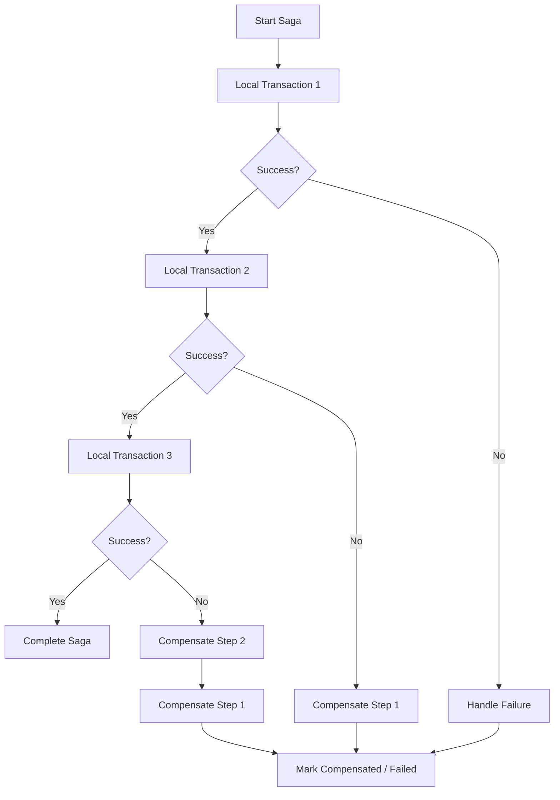
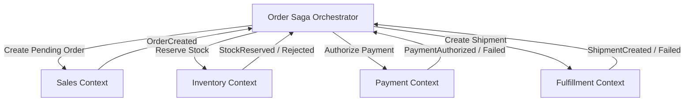
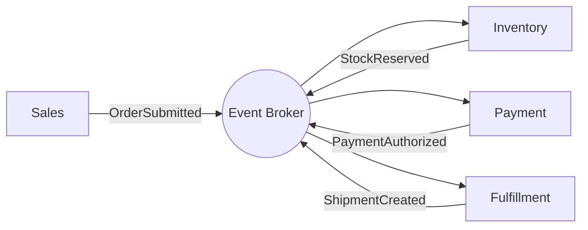
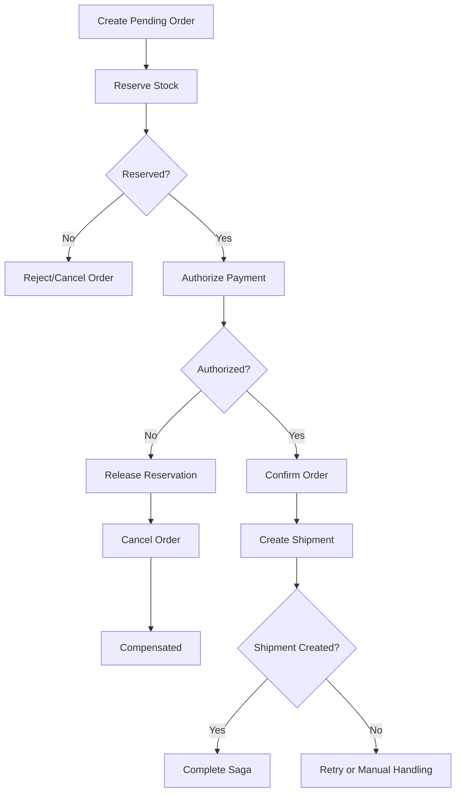

# Saga và thao tác bù: vai trò tại ranh giới nhiều giao dịch

Trong Domain-Driven Design (DDD), mỗi bounded context sở hữu dữ liệu và quy tắc của mình. Khi một use case cần phối hợp nhiều context, mỗi bên thường thực hiện thay đổi trong một **giao dịch cục bộ (local transaction)** riêng. Một transaction của Sales có thể tạo đơn; một transaction của Inventory có thể giữ hàng; một transaction của Payment có thể ghi nhận thanh toán. Không có một transaction database duy nhất bao trùm tất cả các hệ thống này.

**Saga** là mẫu phối hợp một quy trình nghiệp vụ gồm nhiều bước, trong đó mỗi bước thực hiện một local transaction và phát kết quả cho bước tiếp theo. Nếu một bước không thể tiếp tục, quy trình có thể thực hiện **thao tác bù (compensating action)** để đưa nghiệp vụ về một trạng thái được chấp nhận. Thao tác bù là một hành động nghiệp vụ mới, không phải rollback thời gian hay khôi phục nguyên trạng dữ liệu như thể các bước trước chưa từng xảy ra.

Saga hữu ích ở ranh giới nhiều giao dịch, đặc biệt khi một use case kéo dài qua nhiều bounded context, dịch vụ bên ngoài hoặc các bước không thể giữ chung một transaction. Bài học này giải thích local transaction, vòng đời saga, orchestration và choreography, cách thiết kế thao tác bù, xử lý lỗi và timeout, cùng ví dụ đặt hàng xuyên Sales, Inventory, Payment và Fulfillment.

## 1. Vì sao cần Saga?

Một quy trình nghiệp vụ thường vượt qua ranh giới của nhiều context. Ví dụ, để hoàn tất một đơn hàng trực tuyến, hệ thống có thể cần:

1. Sales ghi nhận yêu cầu đặt hàng.
2. Inventory giữ hàng cho đơn.
3. Payment xác thực hoặc thu tiền.
4. Sales xác nhận đơn.
5. Fulfillment tạo lệnh chuẩn bị và giao hàng.
6. Notification gửi thông báo cho khách hàng.

Mỗi context có database, mô hình và quy tắc riêng. Nếu Sales mở transaction database rồi gọi Inventory, Payment và Fulfillment qua mạng, transaction có thể kéo dài, giữ khóa lâu và vẫn không thể rollback các tác động đã commit ở hệ thống khác.

Một lời gọi mạng có thể timeout sau khi provider đã thực hiện xong. Payment có thể đã thu tiền dù Sales chưa nhận response. Inventory có thể đã giữ hàng dù caller nghĩ yêu cầu thất bại. Vì vậy, một transaction ACID cục bộ không thể tự đảm bảo toàn bộ quy trình nhiều context là nguyên tử.

Saga chia quy trình thành các local transaction. Mỗi bước commit dữ liệu trong context sở hữu nó rồi phát tín hiệu để saga tiếp tục. Nếu xảy ra lỗi, saga quyết định tiếp tục, retry, chờ đối soát hoặc khởi chạy các thao tác bù phù hợp.

## 2. Local Transaction và nhất quán liên ngữ cảnh

Một local transaction thay đổi dữ liệu trong phạm vi một context hoặc một resource transaction được quản lý. Ví dụ:

- Sales tạo `Order` ở trạng thái `PENDING`.
- Inventory tạo `Reservation` ở trạng thái `ACTIVE` và cập nhật lượng hàng đã giữ.
- Payment tạo `PaymentAttempt` ở trạng thái `AUTHORIZED`.
- Fulfillment tạo `Shipment` ở trạng thái `READY`.

Mỗi context bảo vệ invariant của mình trong transaction cục bộ. Sales không tự sửa bảng tồn kho; Inventory không tự sửa trạng thái đơn hàng; Payment không tự cập nhật aggregate của Sales.

### 2.1. Không có một transaction ACID toàn cục

Một saga thường không có rollback nguyên tử xuyên tất cả database. Nếu bước thứ ba thất bại, hai bước đầu có thể đã commit. Hệ thống phải xử lý trạng thái đã được ghi nhận thay vì giả định mọi thay đổi sẽ biến mất.

### 2.2. Eventual consistency

Trong lúc saga chạy, các context có thể nhìn thấy những trạng thái tạm thời khác nhau. Order có thể đang `PENDING`, reservation đã `ACTIVE`, payment đang `AUTHORIZED`. Sau khi saga hoàn tất hoặc bù, các context hội tụ về một trạng thái nghiệp vụ được chấp nhận.

Độ trễ này cần được mô hình hóa trong trạng thái và trải nghiệm người dùng. Không nên hiển thị “đơn hàng đã hoàn tất” khi saga mới chỉ ghi nhận yêu cầu.

### 2.3. Mỗi context vẫn sở hữu quy tắc riêng

Saga điều phối thứ tự và trạng thái của quy trình. Nó không thay thế domain model của các context. Inventory vẫn quyết định có thể giữ hàng hay không; Payment vẫn quyết định giao dịch được ủy quyền/thu tiền; Sales vẫn quyết định trạng thái đơn theo chính sách bán hàng.

## 3. Saga là gì?

Saga là một chuỗi các bước nghiệp vụ, mỗi bước thực hiện một local transaction. Khi cần, mỗi bước có thể có một thao tác bù tương ứng để xử lý trường hợp quy trình không thể tiếp tục.

Một saga thường có:

- **Bước (step):** một hành động nghiệp vụ được thực hiện tại một context.
- **Local transaction:** thay đổi dữ liệu và ghi nhận kết quả trong context sở hữu.
- **Kết quả:** event, response hoặc trạng thái cho biết bước thành công/thất bại.
- **Điều phối:** quyết định bước tiếp theo dựa trên trạng thái saga.
- **Compensation:** hành động nghiệp vụ để xử lý tác động của bước đã hoàn tất khi quy trình cần dừng hoặc đi theo nhánh khác.
- **Saga state:** trạng thái bền vững để tiếp tục sau restart, retry hoặc timeout.

Sơ đồ khái quát:



Sơ đồ chỉ thể hiện một nhánh đơn giản. Saga thực tế có thể có retry, timeout, bước song song, nhánh điều kiện, hành động bù thất bại và trạng thái cần con người can thiệp.

## 4. Thao tác bù không phải rollback

Đây là điểm quan trọng nhất khi thiết kế saga. Rollback database khôi phục trạng thái transaction chưa commit như thể thay đổi chưa xảy ra. Compensation là một hành động nghiệp vụ mới, được ghi nhận sau khi thay đổi trước đó đã commit.

Ví dụ:

- `ReserveStock` được bù bằng `ReleaseReservation`.
- `AuthorizePayment` có thể được bù bằng `VoidAuthorization`.
- `CapturePayment` có thể cần `RefundPayment`.
- `CreateShipment` có thể được bù bằng `CancelShipment` nếu hãng vận chuyển còn cho phép.
- Một email đã gửi không thể “thu hồi” khỏi hộp thư người nhận; hệ thống chỉ có thể gửi thông báo đính chính nếu nghiệp vụ yêu cầu.

Compensation không nhất thiết đưa hệ thống về đúng dữ liệu ban đầu. Ví dụ hoàn tiền tạo một giao dịch refund mới và lịch sử thanh toán vẫn ghi nhận khoản thu cùng khoản hoàn. Trạng thái cuối cùng có thể là `REFUNDED`, không phải xóa giao dịch `CAPTURED`.

### 4.1. Compensation có ngữ nghĩa nghiệp vụ

Một thao tác bù phải được chuyên gia nghiệp vụ xác nhận:

- Nó có thực sự khả thi không?
- Có giới hạn thời gian hoặc trạng thái nào không?
- Có phát sinh phí hoặc tác động mới không?
- Có cần người phê duyệt không?
- Nếu bù không thành công thì quy trình tiếp tục ra sao?
- Có cần thông báo cho khách hàng hoặc ghi audit không?

Không nên tự suy ra thao tác bù chỉ bằng cách đảo ngược tên method. `Charge` không phải lúc nào cũng được bù bằng `Uncharge`; nếu khoản tiền đã capture, có thể cần refund, còn nếu mới authorize thì có thể void authorization.

### 4.2. Không phải bước nào cũng bù được

Một số hành động không thể đảo ngược hoàn toàn:

- Email hoặc SMS đã gửi.
- Hàng đã được bàn giao cho hãng vận chuyển.
- Một thông báo đã được công bố ra bên ngoài.
- Một quyết định pháp lý hoặc phê duyệt đã có hiệu lực.
- Một dịch vụ vật lý đã được thực hiện.

Với các bước này, quy trình có thể cần hành động khắc phục, đền bù, điều chỉnh hoặc chuyển sang xử lý thủ công. Thiết kế saga phải xác định điểm nào còn có thể bù và điểm nào là cam kết không thể đảo ngược.

## 5. Phân loại bước: compensatable, pivot và retriable

Một cách phân tích hữu ích là chia các bước trong saga thành ba nhóm:

- **Compensatable transaction:** bước có thể được bù bằng một hành động nghiệp vụ khác. Ví dụ giữ hàng có thể được giải phóng.
- **Pivot transaction:** điểm quyết định mà sau đó quy trình khó hoặc không thể quay lại nhánh trước. Ví dụ hàng đã được bàn giao cho vận chuyển hoặc khoản tiền đã capture theo chính sách không thể void.
- **Retriable transaction:** bước sau pivot được thiết kế để có thể thử lại cho đến khi hoàn tất, trong giới hạn chính sách. Ví dụ tạo hồ sơ giao hàng nội bộ có idempotency.

Một saga thường cố gắng đặt các bước có thể bù trước pivot và các bước có thể retry sau pivot. Tuy nhiên, cách phân loại phụ thuộc nghiệp vụ; không phải mọi quy trình đều có một pivot đơn giản.

Ví dụ trong quy trình đặt hàng:

| Bước | Phân loại minh họa | Lý do |
|---|---|---|
| Tạo Order Pending | Có thể bù | Có thể hủy đơn đang chờ |
| Giữ hàng | Có thể bù | Có thể giải phóng reservation còn hiệu lực |
| Authorize payment | Có thể bù | Có thể void authorization nếu provider hỗ trợ và chưa capture |
| Capture payment | Pivot hoặc có compensation | Có thể cần refund, tạo giao dịch mới và chi phí liên quan |
| Tạo shipment label | Có thể bù có điều kiện | Có thể hủy label trước khi bàn giao, tùy carrier |
| Bàn giao hàng cho carrier | Thường là pivot | Không thể đơn giản thu hồi thao tác đã xảy ra; cần quy trình vận chuyển ngược nếu cần |

Phân loại giúp nhóm quyết định thứ tự bước, thời điểm cam kết với khách hàng và phương án phục hồi.

## 6. Orchestration và Choreography

Có hai cách tổ chức phối hợp saga thường gặp.

### 6.1. Orchestration — điều phối tập trung

Một thành phần điều phối (orchestrator/process manager) giữ trạng thái saga và gửi command tới các context. Nó nhận kết quả, quyết định bước tiếp theo hoặc yêu cầu bù.



Ưu điểm:

- Nhìn thấy toàn bộ trạng thái và thứ tự của quy trình tại một nơi.
- Quy tắc retry, timeout, compensation và nhánh lỗi được thể hiện rõ.
- Dễ trả lời “đơn đang mắc ở bước nào?” khi vận hành.
- Phù hợp với quy trình nhiều bước, nhiều nhánh và có yêu cầu audit.

Đánh đổi:

- Orchestrator có thể trở thành nơi chứa quá nhiều logic nghiệp vụ nếu thiết kế sai.
- Cần quản lý state và khả năng sẵn sàng của thành phần điều phối.
- Các context có thể bị phụ thuộc vào contract command/result của orchestrator.

Orchestrator nên điều phối quy trình, không sở hữu thay các context quy tắc nội bộ như cách tính tồn, xác thực thanh toán hoặc điều kiện giao hàng.

### 6.2. Choreography — phối hợp qua sự kiện

Trong choreography, mỗi context phản ứng với event mà nó quan tâm và phát event tiếp theo. Không có một orchestrator trung tâm ra lệnh cho toàn bộ chuỗi.



Ưu điểm:

- Các context ít phụ thuộc trực tiếp vào nhau về thời điểm.
- Dễ thêm consumer mới cho một event đã công bố.
- Mỗi context tự phản ứng theo mô hình và trách nhiệm của mình.

Đánh đổi:

- Luồng tổng thể khó nhìn thấy nếu sự kiện và subscription phân tán.
- Quy tắc điều phối có thể bị rải rác ở nhiều consumer.
- Khó xác định ai chịu trách nhiệm timeout, compensation và kết thúc quy trình.
- Nguy cơ tạo vòng lặp event hoặc chuỗi phụ thuộc khó theo dõi.

Choreography phù hợp với quy trình tương đối đơn giản, các phản ứng độc lập và ít nhánh bù. Khi quy trình nhiều bước, nhiều ngoại lệ hoặc cần trạng thái tổng thể, orchestration thường dễ kiểm soát hơn.

### 6.3. Không có lựa chọn tuyệt đối

Một hệ thống có thể dùng orchestration cho quy trình đặt hàng chính, nhưng dùng choreography cho thông báo, analytics hoặc đồng bộ read model. Hãy chọn theo độ phức tạp điều phối và khả năng quan sát, không theo xu hướng công nghệ.

## 7. Ví dụ xuyên suốt: đặt hàng qua nhiều bounded context

Giả sử một nền tảng bán lẻ có các context:

- **Sales:** sở hữu Order và trạng thái đơn hàng.
- **Inventory:** sở hữu Stock và Reservation.
- **Payment:** sở hữu Payment Attempt, authorization, capture và refund.
- **Fulfillment:** sở hữu Shipment và trạng thái bàn giao.

Mục tiêu là tạo đơn, giữ hàng, xác thực thanh toán và yêu cầu chuẩn bị giao hàng. Quy trình cần xử lý khi một bước thất bại.

### 7.1. Luồng thành công

1. Sales tạo Order ở trạng thái `PENDING`.
2. Inventory nhận command `ReserveStock` và tạo reservation.
3. Payment nhận command `AuthorizePayment` và trả kết quả authorization.
4. Sales chuyển Order sang `CONFIRMED` theo chính sách đã thống nhất.
5. Payment có thể capture tiền ở bước phù hợp với cam kết nghiệp vụ.
6. Fulfillment tạo shipment.
7. Saga chuyển sang `COMPLETED` khi các điều kiện kết thúc được thỏa mãn.

Thứ tự cụ thể phụ thuộc vào chính sách thanh toán và cam kết giao hàng. Một số doanh nghiệp chỉ authorize trước rồi capture khi chuẩn bị giao; số khác capture ngay khi xác nhận. Không nên xem một trình tự duy nhất là đúng cho mọi mô hình bán hàng.

### 7.2. Luồng lỗi và thao tác bù

Giả sử Inventory giữ hàng thành công nhưng Payment từ chối authorization:

1. Saga nhận `PaymentAuthorizationFailed`.
2. Saga yêu cầu Inventory `ReleaseReservation`.
3. Sales chuyển Order sang `REJECTED` hoặc `CANCELLED` theo chính sách.
4. Saga kết thúc với trạng thái `COMPENSATED` nếu các thao tác bù đã hoàn tất.

Nếu release reservation thất bại tạm thời, saga retry. Nếu reservation đã hết hạn hoặc đã được giải phóng trước đó, command cần idempotent và trả kết quả phù hợp để không tạo lỗi mới.

### 7.3. Sơ đồ luồng và compensation



Trong thực tế, nếu đã capture tiền hoặc đã bàn giao hàng, nhánh lỗi có thể cần refund, hủy vận chuyển hoặc quy trình hoàn trả. Compensation phải dựa trên trạng thái thực tế của từng context.

## 8. Thiết kế state machine cho Saga

Saga cần một trạng thái bền vững để biết đã hoàn tất bước nào, đang chờ gì và cần thực hiện hành động nào tiếp theo. Không nên chỉ dựa vào biến trong bộ nhớ của một process.

Một state machine minh họa:

```text
STARTED
  -> ORDER_CREATED
  -> WAITING_FOR_STOCK
  -> STOCK_RESERVED
  -> WAITING_FOR_PAYMENT
  -> PAYMENT_AUTHORIZED
  -> WAITING_FOR_SHIPMENT
  -> COMPLETED

Nhánh lỗi:
  -> COMPENSATING
  -> COMPENSATED
  -> FAILED_REQUIRES_ATTENTION
```

Trạng thái nên thể hiện sự thật về tiến trình, không chỉ tên kỹ thuật của message. Ví dụ `WAITING_FOR_PAYMENT` có thể lưu `paymentAttemptId`, thời điểm gửi command và deadline. Khi nhận event, saga kiểm tra event có khớp với operation đang chờ hay không.

### 8.1. Dữ liệu Saga cần lưu

Một saga instance có thể cần:

- `sagaId`: định danh duy nhất của một quy trình.
- `businessReference`: Order ID hoặc mã nghiệp vụ liên quan.
- `currentState`: trạng thái hiện tại.
- `completedSteps`: các bước đã hoàn tất và có thể cần bù.
- `pendingAction`: command đang chờ kết quả.
- `correlationId`/`causationId`: liên kết message và trace.
- `deadline`/`timeoutAt`: thời hạn xử lý bước hiện tại.
- `attemptCount`: số lần thử.
- `lastFailure`: lỗi gần nhất và phân loại lỗi.
- `version`: phiên bản để kiểm soát cập nhật đồng thời saga.
- `createdAt`, `updatedAt`, `completedAt`: thời điểm vòng đời.

Chỉ lưu thông tin cần thiết để tiếp tục và kiểm toán. Không sao chép toàn bộ dữ liệu của các Aggregate khác vào saga nếu không cần; lưu ID và snapshot tối thiểu có ý nghĩa cho quy trình.

### 8.2. Chuyển trạng thái có điều kiện

Mỗi event chỉ được áp dụng khi saga đang ở trạng thái phù hợp và tham chiếu đúng operation. Ví dụ `PaymentAuthorized` đến sau khi saga đã chuyển sang `CANCELLING` không nên tự động xác nhận đơn. Saga phải xác định cách xử lý race giữa thành công và hủy.

Có thể dùng optimistic version hoặc khóa trên saga record để tránh hai consumer cùng cập nhật một saga instance. Message trùng phải được deduplicate bằng message ID hoặc idempotency key.

## 9. Thiết kế thao tác bù

Một thao tác bù cần được thiết kế như một use case thực sự trong context sở hữu dữ liệu.

### 9.1. Bù theo trạng thái thực tế

Không nên gửi `ReleaseReservation` chỉ vì bước Payment thất bại mà không biết reservation đang ở trạng thái nào. Inventory cần kiểm tra reservation:

- `ACTIVE`: có thể giải phóng.
- `RELEASED`: đã giải phóng, lần gọi lặp có thể trả kết quả thành công theo idempotency.
- `EXPIRED`: đã hết hạn, không cần giảm lượng giữ thêm.
- `CONSUMED` hoặc đã xuất kho: cần quy trình khác, không thể giải phóng như reservation chưa sử dụng.

Tương tự, Payment cần phân biệt `AUTHORIZED`, `CAPTURED`, `VOIDED`, `REFUNDED` và `UNKNOWN`. Compensation phải chọn hành động phù hợp với trạng thái đã xác minh.

### 9.2. Bù không phải lúc nào cũng đối xứng

Một bước `CreateShipment` có thể có thao tác bù `CancelShipment`, nhưng hủy có thể bị từ chối nếu kiện hàng đã được carrier nhận. Khi đó cần hành động khác như yêu cầu intercept, tạo return hoặc chuyển cho nhân viên xử lý.

Một bước gửi email thường không thể bù bằng cách xóa email. Có thể cần gửi email đính chính, nhưng đó là hành động mới có chi phí và tác động riêng.

### 9.3. Compensation phải idempotent

Saga có thể gửi lại thao tác bù do timeout hoặc crash. Vì vậy, `ReleaseReservation` cần nhận `ReservationId` và đảm bảo gọi lặp không làm giảm lượng tồn nhiều lần. `RefundPayment` cần một refund operation ID để không hoàn tiền hai lần.

Idempotency key của thao tác bù nên ổn định cho cùng một compensation step. Không tạo key mới mỗi lần retry cùng thao tác bù.

### 9.4. Compensation có thể thất bại

Không thể giả định mọi thao tác bù đều thành công. Saga cần:

- Retry lỗi tạm thời có giới hạn hoặc theo chính sách.
- Tra cứu trạng thái khi kết quả chưa xác định.
- Phân biệt business rejection với lỗi hạ tầng.
- Ghi trạng thái `COMPENSATION_FAILED` hoặc `REQUIRES_MANUAL_ACTION`.
- Cảnh báo và cung cấp công cụ để nhân viên xử lý.
- Lưu lịch sử ai đã can thiệp và quyết định nào được thực hiện.

Nếu bù thất bại, không nên đánh dấu saga `COMPENSATED`. Trạng thái cuối phải phản ánh đúng điều đã xảy ra.

## 10. Forward Recovery và Backward Recovery

Khi một bước thất bại, saga có thể chọn một trong hai hướng chính:

- **Backward recovery:** bù các bước trước đó để hủy hoặc thu hồi quy trình theo chính sách.
- **Forward recovery:** giữ trạng thái hiện tại và tiếp tục thử bước bị lỗi cho đến khi hoàn tất hoặc chuyển sang phương án nghiệp vụ khác.

Ví dụ:

- Nếu không đủ hàng, có thể hủy đơn và giải phóng các tài nguyên đã giữ ở bước trước: backward recovery.
- Nếu dịch vụ phát hành hóa đơn tạm thời không sẵn sàng sau khi giao dịch đã hoàn tất, có thể retry phát hành hóa đơn thay vì hủy đơn và hoàn tiền: forward recovery.

Không phải lỗi kỹ thuật nào cũng nên kích hoạt compensation. Nếu một bước có thể retry an toàn và nghiệp vụ vẫn muốn hoàn tất, forward recovery thường hợp lý hơn. Nếu điều kiện nghiệp vụ đã bị từ chối hoặc quy trình không thể tiếp tục, compensation có thể cần thiết.

## 11. Timeout và kết quả chưa xác định

Timeout là tình huống đặc biệt nguy hiểm trong saga. Khi command timeout, saga không biết consumer đã xử lý hay chưa. Nếu lập tức gửi compensation, có thể bù một bước chưa xảy ra; nếu gửi lại command không idempotent, có thể tạo tác động lặp.

Một quy trình an toàn:

1. Gửi command với `commandId` hoặc idempotency key ổn định.
2. Ghi trạng thái chờ và deadline.
3. Nếu quá hạn, truy vấn trạng thái operation hoặc gửi lại cùng command ID.
4. Nếu xác định đã thành công, tiếp tục bước tiếp theo.
5. Nếu xác định thất bại, chọn retry hoặc compensation.
6. Nếu chưa thể xác định, giữ trạng thái `UNKNOWN`/`RECONCILING` và đối soát.

Không nên coi timeout là bằng chứng thất bại. Điều này đặc biệt quan trọng với thanh toán, giao hàng và thao tác có tác động vật lý.

## 12. Transactional Outbox và Inbox trong Saga

Saga thường giao tiếp qua message broker. Có hai khoảng trống cần xử lý:

- Context commit dữ liệu nhưng không publish được message.
- Consumer xử lý message nhưng crash trước khi acknowledge, khiến message được giao lại.

### 12.1. Outbox phía producer

Producer lưu thay đổi Aggregate và event/command outbox trong cùng transaction. Một publisher đọc outbox và gửi message. Như vậy, ý định phát message được lưu bền vững cùng thay đổi nghiệp vụ.

### 12.2. Inbox phía consumer

Consumer lưu message ID vào inbox và thay đổi Aggregate trong cùng transaction. Unique constraint trên `(consumer, messageId)` giúp bỏ qua message đã xử lý. Điều này cho phép hệ thống xử lý at-least-once delivery với consumer idempotent.

### 12.3. Outbox không tạo exactly-once end-to-end

Outbox/inbox giúp xử lý khoảng trống giữa database và broker, nhưng không biến toàn bộ saga thành một giao dịch exactly-once xuyên context. Message có thể được gửi lại; consumer và compensation vẫn cần idempotency. Cần thiết kế dựa trên retry, deduplication và trạng thái bền vững.

## 13. Orchestrator Java minh họa

Ví dụ dưới đây chỉ minh họa cách mô hình hóa quyết định điều phối. Trong ứng dụng thật, việc gửi command và lưu saga state cần được kết hợp với transaction/outbox; không gọi dịch vụ mạng trực tiếp bên trong transaction giữ khóa dài.

```java
public enum OrderSagaState {
    STARTED,
    WAITING_FOR_STOCK,
    WAITING_FOR_PAYMENT,
    WAITING_FOR_SHIPMENT,
    COMPENSATING,
    COMPLETED,
    COMPENSATED,
    REQUIRES_MANUAL_ACTION
}

public record OrderSaga(
        String sagaId,
        String orderId,
        OrderSagaState state,
        String reservationId,
        String paymentAttemptId,
        long version
) {}
```

Một handler nhận kết quả giữ hàng:

```java
public void onStockReserved(StockReserved event) {
    OrderSaga saga = sagaRepository.getForUpdate(event.sagaId());

    if (saga.state() != OrderSagaState.WAITING_FOR_STOCK) {
        handleUnexpectedOrDuplicate(event, saga);
        return;
    }

    OrderSaga updated = saga.withReservation(event.reservationId())
            .withState(OrderSagaState.WAITING_FOR_PAYMENT);

    sagaRepository.save(updated);
    outbox.append(new AuthorizePayment(
            newCommandId(saga.sagaId(), "authorize-payment"),
            saga.sagaId(),
            saga.orderId()));
}
```

Đoạn code cần các phương thức hỗ trợ như `withReservation`, `withState`, `getForUpdate` và `outbox.append` do ứng dụng định nghĩa. `sagaRepository.save` và ghi outbox cần commit cùng transaction. Việc nhận message nên đi qua inbox/deduplication trước khi handler cập nhật saga.

### 13.1. Handler khi thanh toán thất bại

```java
public void onPaymentAuthorizationFailed(PaymentAuthorizationFailed event) {
    OrderSaga saga = sagaRepository.getForUpdate(event.sagaId());

    if (saga.state() != OrderSagaState.WAITING_FOR_PAYMENT) {
        handleUnexpectedOrDuplicate(event, saga);
        return;
    }

    sagaRepository.save(saga.withState(OrderSagaState.COMPENSATING));
    outbox.append(new ReleaseReservation(
            newCommandId(saga.sagaId(), "release-reservation"),
            saga.sagaId(),
            saga.reservationId()));
}
```

Khi nhận `ReservationReleased`, saga mới chuyển sang `COMPENSATED` và có thể phát command cập nhật Order thành trạng thái bị hủy. Nếu release thất bại, saga giữ trạng thái compensation pending hoặc cần can thiệp; không được đánh dấu đã bù thành công.

## 14. Tránh race condition giữa tiến trình chính và compensation

Một saga có thể nhận các kết quả gần như đồng thời:

- Người dùng yêu cầu hủy đơn.
- Payment provider gửi callback thành công.
- Timeout handler cho rằng bước thanh toán đã quá hạn.
- Worker retry command cũ.

Nếu không kiểm soát, saga có thể vừa xác nhận đơn vừa giải phóng reservation, hoặc vừa hoàn tiền vừa tiếp tục giao hàng.

Các biện pháp:

- Dùng state transition có điều kiện và version/optimistic locking cho saga record.
- Gắn `sagaId`, `commandId`, `correlationId` và business reference vào message.
- Chỉ chấp nhận event phù hợp với trạng thái hiện tại và operation đang chờ.
- Thiết kế trạng thái trung gian như `CANCELLING`, `COMPENSATING`, `RECONCILING`.
- Định nghĩa rõ ưu tiên giữa yêu cầu hủy và kết quả thành công đến muộn.
- Đảm bảo command và compensation idempotent.
- Tra cứu trạng thái có thẩm quyền ở context sở hữu trước khi đưa ra quyết định không thể đảo ngược.

Không nên chỉ bỏ qua event đến muộn. Một `PaymentCaptured` đến sau khi saga chuyển sang `CANCELLING` có thể biểu thị tiền đã thực sự bị thu; cần xử lý refund hoặc đối soát thay vì im lặng bỏ message.

## 15. Compensation và lịch sử nghiệp vụ

Vì compensation là hành động mới, lịch sử phải phản ánh cả hành động ban đầu và hành động bù.

Ví dụ lịch sử Payment:

```text
PaymentAuthorizationRequested
PaymentAuthorized
PaymentVoidRequested
PaymentVoided
```

Hoặc:

```text
PaymentCaptureRequested
PaymentCaptured
RefundRequested
RefundCompleted
```

Không xóa `PaymentCaptured` để giả vờ giao dịch chưa từng xảy ra. Giữ lịch sử giúp đối soát, audit, giải thích với khách hàng và xử lý tranh chấp.

Tương tự, Inventory có thể ghi `StockReserved` rồi `ReservationReleased`. Hai sự kiện đều đúng và có ý nghĩa. Số lượng khả dụng hiện tại được tính theo trạng thái hiện hành, còn lịch sử thể hiện quá trình đã diễn ra.

## 16. Khi nào nên dùng Saga và khi nào không?

Saga phù hợp khi:

- Use case trải qua nhiều local transaction hoặc bounded context.
- Không thể hoặc không nên dùng một distributed transaction.
- Có trạng thái trung gian được nghiệp vụ chấp nhận.
- Các bước có thể retry hoặc có thao tác bù/khắc phục rõ.
- Quy trình có thời gian kéo dài và cần phục hồi sau restart.
- Cần audit tiến trình và kết quả từng bước.

Saga có thể không cần thiết khi:

- Tất cả dữ liệu thuộc cùng một bounded context và có thể thay đổi trong một transaction cục bộ.
- Một thao tác đọc đơn giản không tạo tác động xuyên context.
- Quy trình chỉ có một bước gọi idempotent và không cần state orchestration riêng.
- Chi phí điều phối, lưu trạng thái và vận hành lớn hơn lợi ích.

Không nên áp dụng saga chỉ vì hệ thống có microservices. Nếu một use case có thể được xử lý rõ ràng trong một local transaction của một context, hãy giữ nó đơn giản.

## 17. Quan sát và vận hành Saga

Saga là một quy trình sống lâu, có thể tồn tại qua nhiều request và nhiều lần deploy. Nó cần công cụ quan sát ở mức business process.

Các thông tin nên theo dõi:

- Số saga đang chạy theo loại và trạng thái.
- Thời gian ở mỗi trạng thái và tổng thời gian hoàn tất.
- Số lần retry từng command.
- Số timeout và operation có kết quả chưa xác định.
- Số compensation thành công/thất bại.
- Số saga cần can thiệp thủ công.
- Backlog message, consumer lag và DLQ.
- Saga quá hạn hoặc không có tiến triển.

Mỗi log/message nên có `sagaId`, `orderId` hoặc business reference, `commandId`, `eventId`, correlation/causation ID và tên bước. Tránh ghi dữ liệu cá nhân hoặc thông tin thanh toán nhạy cảm không cần thiết.

### 17.1. Công cụ vận hành

Với quy trình quan trọng, có thể cần màn hình tra cứu saga để nhân viên:

- Xem các bước đã hoàn tất và bước đang chờ.
- Xem lỗi gần nhất và lịch sử retry.
- Kiểm tra trạng thái thực tế ở context sở hữu.
- Yêu cầu retry một bước an toàn.
- Khởi chạy compensation được phê duyệt.
- Đánh dấu cần xử lý thủ công và ghi lý do.

Không nên cung cấp nút “retry tất cả” hoặc “compensate tất cả” mà không hiểu trạng thái từng context. Thao tác vận hành cũng cần audit và quyền hạn.

## 18. Kiểm thử Saga và thao tác bù

Kiểm thử không chỉ tập trung vào luồng thành công. Các lỗi xảy ra giữa các local transaction mới là nơi saga thể hiện giá trị.

### 18.1. Kiểm thử luồng thành công

- Order được tạo ở trạng thái chờ.
- Reservation thành công.
- Payment authorization thành công.
- Order được xác nhận.
- Shipment được tạo.
- Saga kết thúc `COMPLETED`.

### 18.2. Kiểm thử lỗi tại từng bước

Với mỗi bước, kiểm tra:

- Business rejection.
- Lỗi tạm thời và retry thành công.
- Timeout với kết quả chưa xác định.
- Consumer dừng sau khi commit nhưng trước acknowledge.
- Message đến trùng hoặc sai thứ tự.
- Compensation thành công và compensation thất bại.
- Saga restart giữa quy trình.

### 18.3. Kiểm thử idempotency

Gửi cùng command hoặc event nhiều lần và xác minh:

- Không tạo reservation hoặc payment attempt trùng.
- Compensation không giải phóng hoặc hoàn tiền hai lần.
- Event trùng không làm saga chuyển trạng thái sai.
- Kết quả replay nhất quán với contract.

### 18.4. Kiểm thử race giữa hủy và hoàn tất

Cho callback thanh toán thành công và yêu cầu hủy đến gần như đồng thời. Xác minh state transition có điều kiện chọn được một đường đi hợp lệ; nếu tiền đã capture thì saga tạo yêu cầu refund hoặc đối soát phù hợp, không đồng thời xác nhận giao hàng và giải phóng reservation.

### 18.5. Kiểm thử phục hồi

Khởi động lại worker/orchestrator sau mỗi điểm commit quan trọng. Saga phải tải lại state và tiếp tục từ bước phù hợp, không dựa vào biến trong bộ nhớ hoặc giả định message chỉ được giao một lần.

## 19. Các lỗi thường gặp khi thiết kế Saga

| Lỗi | Hệ quả | Cách cải thiện |
|---|---|---|
| Coi compensation là rollback | Xóa hoặc đảo lịch sử nghiệp vụ sai cách | Mô hình hóa compensation như hành động mới |
| Giả định mọi bước đều bù được | Quy trình bị kẹt ở tác động không thể đảo ngược | Xác định pivot và phương án xử lý thủ công |
| Compensation không idempotent | Retry có thể hoàn tiền/giải phóng nhiều lần | Dùng operation ID và kiểm tra trạng thái tại context sở hữu |
| Timeout bị xem là thất bại | Có thể bù một bước đã thành công hoặc lặp tác động | Tra cứu/đối soát trạng thái trước khi quyết định |
| Saga state chỉ nằm trong memory | Restart làm mất tiến trình | Lưu state bền vững và cập nhật cùng outbox |
| Event phát trước commit | Context khác phản ứng với thay đổi chưa tồn tại | Dùng transactional outbox |
| Consumer không deduplicate | Message giao lại tạo tác động lặp | Inbox và idempotent handler |
| Orchestrator chứa quy tắc của mọi context | Mất quyền sở hữu domain và tạo god service | Orchestrator chỉ điều phối, context tự quyết định quy tắc của mình |
| Choreography quá phân tán | Khó nhìn luồng và xử lý nhánh lỗi | Dùng process manager khi cần trạng thái tổng thể |
| Retry vô hạn | Tạo tải và che giấu lỗi vĩnh viễn | Retry có giới hạn, DLQ và manual intervention |
| Đánh dấu saga hoàn tất khi compensation chưa xong | Trạng thái báo cáo sai | Chỉ hoàn tất bù khi mọi bước cần thiết đã được xác nhận |
| Bỏ qua event đến muộn | Có thể bỏ lỡ tác động đã xảy ra như payment capture | Reconcile với context sở hữu và xử lý trạng thái thực tế |

## 20. Checklist thiết kế Saga

Trước khi đưa saga vào vận hành, hãy kiểm tra:

- [ ] Quy trình thực sự vượt qua nhiều local transaction hoặc bounded context.
- [ ] Mỗi bước có context sở hữu và contract rõ.
- [ ] Mỗi local transaction bảo vệ invariant của context đó.
- [ ] State machine có trạng thái trung gian, thành công, thất bại và bù.
- [ ] Đã chọn orchestration hoặc choreography theo độ phức tạp.
- [ ] Các bước compensatable, pivot và retriable đã được xác định.
- [ ] Mỗi compensation có ngữ nghĩa nghiệp vụ và được chuyên gia xác nhận.
- [ ] Compensation idempotent và dựa trên trạng thái thực tế.
- [ ] Timeout được phân biệt với business failure; unknown outcome có đối soát.
- [ ] Saga state được lưu bền vững và có version/concurrency control.
- [ ] Outbox/inbox bảo vệ khoảng trống database-message khi cần.
- [ ] Command/event có ID, correlation và causation phù hợp.
- [ ] Retry có giới hạn, backoff, DLQ và cơ chế can thiệp.
- [ ] Có xử lý event trùng, sai thứ tự và đến muộn.
- [ ] Có quy tắc xử lý race giữa hủy, hoàn tất và compensation.
- [ ] Có metric, tracing, dashboard và audit theo saga ID.
- [ ] Đã kiểm thử lỗi tại từng bước, crash recovery và compensation failure.

## 21. Kết nối với các khái niệm DDD khác

Saga kết nối nhiều Aggregate hoặc bounded context mà vẫn giữ quyền sở hữu dữ liệu tại từng nơi. Aggregate Root bảo vệ invariant trong local transaction; Repository lưu Aggregate; Domain Event công bố sự kiện đã xảy ra; Application Service hoặc Process Manager điều phối các bước của quy trình. Transactional Outbox và Inbox giúp truyền message bền vững và xử lý giao nhận lặp.

Context Map giúp hiểu quan hệ giữa các bounded context và các hợp đồng tích hợp. Saga là một cách hiện thực quy trình nghiệp vụ xuyên những ranh giới đó khi không thể dùng một transaction duy nhất. Nó không làm mất eventual consistency và cũng không tự bảo đảm mọi bước thành công; thay vào đó, nó làm rõ trạng thái, cách tiếp tục, cách bù và cách can thiệp khi cần.

Thiết kế saga tốt bắt đầu từ câu hỏi nghiệp vụ: điều gì đã xảy ra, điều gì có thể tiếp tục, điều gì cần bù và điều gì không thể đảo ngược? Khi mỗi bước có chủ sở hữu, trạng thái bền vững, idempotency và compensation được định nghĩa rõ, hệ thống có thể phối hợp nhiều giao dịch một cách có kiểm soát mà không giả vờ rằng chúng là một transaction toàn cục.
