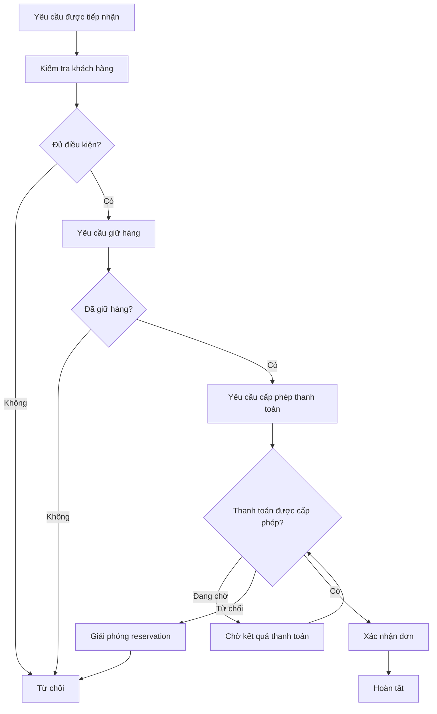

# Trạng thái trung gian và cách phản ánh cho người dùng

Trong Domain-Driven Design (DDD), một quy trình nghiệp vụ có thể đi qua nhiều Bounded Context trước khi hoàn tất. Ví dụ, xác nhận đơn hàng có thể cần kiểm tra khách hàng, giữ hàng trong Inventory, cấp phép thanh toán trong Payment rồi mới xác nhận đơn trong Order Management. Khi các bước được phối hợp bất đồng bộ, người dùng có thể nhận phản hồi rằng yêu cầu đã được tiếp nhận trong khi kết quả cuối cùng vẫn đang chờ.

Hệ thống cần mô hình hóa trạng thái trung gian một cách rõ ràng và công bố trạng thái đó bằng ngôn ngữ người dùng hiểu được. **Đã tiếp nhận**, **đang xử lý**, **đang chờ thanh toán**, **đã hoàn tất** và **không thể hoàn tất** là những kết quả khác nhau. Không nên hiển thị thành công chỉ vì một command đã được nhận, một message đã được gửi hoặc một bước trong quy trình đã hoàn thành.

## 1. Vì sao cần trạng thái trung gian?

Trong một thao tác đồng bộ đơn giản, server có thể xử lý xong trước khi trả response. Nhưng một quy trình liên ngữ cảnh có thể kéo dài từ vài giây đến vài giờ hoặc vài ngày vì:

- Một context cần xử lý bất đồng bộ qua message broker.
- Hệ thống bên ngoài cần thời gian xác nhận thanh toán hoặc vận chuyển.
- Quy trình cần chờ nhân viên phê duyệt hoặc bổ sung thông tin.
- Một bước phải retry sau lỗi tạm thời.
- Các context cập nhật projection theo eventual consistency.
- Quy trình có thể tạm dừng, bị từ chối, bị hủy hoặc cần can thiệp.

Ví dụ, khi người dùng đặt hàng, hệ thống có thể nhận lệnh và tạo một yêu cầu xử lý. Việc đó chưa chứng minh hàng đã được giữ hoặc thanh toán đã được cấp phép. Nếu giao diện hiển thị ngay "Đặt hàng thành công", người dùng có thể tưởng đơn đã được xác nhận và thực hiện hành động tiếp theo dựa trên thông tin sai.

Trạng thái trung gian giúp hệ thống nói chính xác điều đã biết tại thời điểm hiện tại, đồng thời cho người dùng biết họ nên chờ, kiểm tra lại hay thực hiện hành động khác.

## 2. Phân biệt tiếp nhận yêu cầu và hoàn tất nghiệp vụ

Command được tiếp nhận chỉ có nghĩa hệ thống đã nhận yêu cầu ở một ranh giới nào đó. Nó không đồng nghĩa tất cả điều kiện nghiệp vụ đã được thỏa mãn.

| Kết quả | Ý nghĩa | Ví dụ thông báo |
| --- | --- | --- |
| Received / Accepted | Hệ thống đã ghi nhận yêu cầu và sẽ xử lý | "Yêu cầu đặt hàng đã được tiếp nhận" |
| In progress | Quy trình đang thực hiện một hoặc nhiều bước | "Đang kiểm tra tồn kho và thanh toán" |
| Waiting | Quy trình đang chờ một điều kiện hoặc bên khác | "Đang chờ xác nhận thanh toán" |
| Completed | Kết quả nghiệp vụ cuối cùng đã đạt | "Đơn hàng đã được xác nhận" |
| Rejected | Yêu cầu bị từ chối theo quy tắc nghiệp vụ | "Không thể xác nhận đơn vì báo giá đã hết hạn" |
| Failed | Quy trình không thể tiếp tục sau lỗi | "Không thể hoàn tất yêu cầu lúc này" |
| Cancelled | Quy trình đã được hủy theo quy tắc cho phép | "Yêu cầu đã được hủy" |

Một HTTP `202 Accepted` thường phù hợp khi server đã tiếp nhận yêu cầu xử lý bất đồng bộ nhưng chưa có kết quả cuối. API nên trả định danh của operation để client tra cứu trạng thái. Nếu server đã hoàn tất nghiệp vụ ngay trong request, có thể trả response hoàn tất tương ứng thay vì dùng trạng thái chờ.

## 3. Mô hình hóa trạng thái của quy trình

Không nên dùng một cờ boolean như `done` để mô tả một quy trình có nhiều bước và nhiều kết quả. Một mô hình trạng thái cần thể hiện được tiến trình và các kết quả có thể xảy ra.

Ví dụ, một quy trình xác nhận đơn có thể dùng các trạng thái:

| Trạng thái | Ý nghĩa |
| --- | --- |
| `RECEIVED` | Đã ghi nhận yêu cầu xử lý |
| `VALIDATING` | Đang kiểm tra dữ kiện và điều kiện |
| `RESERVING_INVENTORY` | Đang yêu cầu giữ hàng |
| `AUTHORIZING_PAYMENT` | Đang yêu cầu cấp phép thanh toán |
| `AWAITING_CONFIRMATION` | Đang chờ phản hồi hoặc xác nhận cần thiết |
| `COMPLETED` | Đơn đã được xác nhận |
| `REJECTED` | Bị từ chối theo quy tắc nghiệp vụ |
| `FAILED` | Không thể tiếp tục do lỗi không phục hồi được |
| `CANCELLED` | Quy trình đã được hủy hợp lệ |

Các trạng thái trên là ví dụ cho một quy trình cụ thể. Không nên tạo một enum toàn cục áp dụng cho mọi bounded context. Payment, Inventory và Order Management có vòng đời riêng; process manager hoặc context điều phối có thể duy trì trạng thái tổng hợp phục vụ toàn quy trình.

## 4. Trạng thái của từng context và trạng thái tổng thể

Mỗi context chịu trách nhiệm cho trạng thái nghiệp vụ thuộc phạm vi của nó. Inventory biết reservation đang được giữ, đã xác nhận hay đã giải phóng. Payment biết giao dịch đang chờ, đã cấp phép, bị từ chối hay đã hoàn tiền. Order Management biết đơn đang chờ xác nhận, đã xác nhận hay đã hủy.

Trạng thái tổng thể là kết quả điều phối các bước theo quy tắc quy trình. Nó không nên thay thế hoặc ghi đè trạng thái nội bộ của các context tham gia.

Ví dụ:

| Context | Trạng thái cục bộ | Ý nghĩa với quy trình |
| --- | --- | --- |
| Customer Management | `ELIGIBLE` | Khách hàng đủ điều kiện đặt đơn |
| Inventory | `RESERVED` | Hàng đã được giữ |
| Payment | `AUTHORIZATION_PENDING` | Đang chờ cổng thanh toán |
| Order Management | `PENDING_CONFIRMATION` | Đơn chưa được xác nhận cuối cùng |
| Process Manager | `AWAITING_PAYMENT_RESULT` | Quy trình đang chờ kết quả thanh toán |

Process manager có thể duy trì một trạng thái tóm tắt để giao diện đọc. Nó không có quyền tự sửa dữ liệu nội bộ của Inventory hoặc Payment. Khi cần thay đổi, nó gửi command qua hợp đồng của context sở hữu.

## 5. Quy trình nhiều bước và Process Manager

Khi nhiều context tham gia một quy trình kéo dài, có thể dùng Saga hoặc Process Manager để theo dõi tiến trình và quyết định bước tiếp theo. Process Manager lưu trạng thái điều phối, nhận kết quả từ các context và phát command tiếp theo.



Process Manager cần ghi nhận bước hiện tại, định danh các operation liên quan, kết quả đã nhận và thông tin cần để tiếp tục hoặc bù trừ. Nếu process manager bị khởi động lại, nó phải khôi phục được tiến trình từ dữ liệu bền vững, không dựa vào trạng thái chỉ tồn tại trong bộ nhớ.

## 6. Mô hình trạng thái cần có chuyển đổi hợp lệ

Không phải trạng thái nào cũng có thể chuyển sang trạng thái bất kỳ. Ví dụ, `COMPLETED` là trạng thái kết thúc; một quy trình đã hoàn tất không nên quay lại `AUTHORIZING_PAYMENT` chỉ vì nhận một message trùng.

| Trạng thái hiện tại | Sự kiện/kết quả | Trạng thái tiếp theo |
| --- | --- | --- |
| `RECEIVED` | `CustomerEligibilityConfirmed` | `RESERVING_INVENTORY` |
| `RECEIVED` | `CustomerEligibilityRejected` | `REJECTED` |
| `RESERVING_INVENTORY` | `InventoryReserved` | `AUTHORIZING_PAYMENT` |
| `RESERVING_INVENTORY` | `InventoryReservationRejected` | `REJECTED` |
| `AUTHORIZING_PAYMENT` | `PaymentAuthorizationPending` | `AWAITING_PAYMENT_RESULT` |
| `AWAITING_PAYMENT_RESULT` | `PaymentAuthorized` | `CONFIRMING_ORDER` |
| `AWAITING_PAYMENT_RESULT` | `PaymentDeclined` | `COMPENSATING_INVENTORY` |
| `CONFIRMING_ORDER` | `OrderConfirmed` | `COMPLETED` |
| `COMPENSATING_INVENTORY` | `InventoryReleased` | `REJECTED` |

Chuyển đổi phải được kiểm tra theo trạng thái hiện tại và định danh quy trình. Message đến sai thứ tự hoặc message trùng cần được bỏ qua, ghi nhận để xử lý hoặc đưa vào quy trình đối soát theo chính sách đã định nghĩa.

## 7. Thiết kế trạng thái hiển thị cho người dùng

Trạng thái nội bộ có thể chi tiết hơn trạng thái giao diện. Người dùng thường không cần thấy tên queue, tên service, exception hoặc tên topic. Giao diện nên chuyển trạng thái kỹ thuật và nghiệp vụ thành thông điệp ngắn, chính xác và hướng hành động.

| Trạng thái nội bộ | Trạng thái hiển thị | Hành động gợi ý |
| --- | --- | --- |
| `RECEIVED` | Đã tiếp nhận | Có thể rời trang và tra cứu bằng mã yêu cầu |
| `VALIDATING` | Đang kiểm tra thông tin | Chờ kết quả |
| `RESERVING_INVENTORY` | Đang kiểm tra và giữ hàng | Chờ kết quả |
| `AWAITING_PAYMENT_RESULT` | Đang chờ xác nhận thanh toán | Kiểm tra phương thức thanh toán nếu được yêu cầu |
| `COMPENSATING_INVENTORY` | Đang hoàn tất các bước xử lý sau khi thanh toán bị từ chối | Chờ kết quả cuối |
| `COMPLETED` | Đã hoàn tất | Mở chi tiết đơn hàng |
| `REJECTED` | Không thể thực hiện yêu cầu | Hiển thị lý do nghiệp vụ và cách xử lý |
| `FAILED` | Có lỗi khi xử lý | Thử lại nếu được phép hoặc liên hệ hỗ trợ |

Thông điệp cần dựa trên sự thật đã biết. Nếu chỉ biết command đã được tiếp nhận, hãy hiển thị "Đã tiếp nhận yêu cầu". Không dùng "Thành công" hoặc "Đơn đã xác nhận" cho đến khi Order Management thực sự xác nhận đơn.

## 8. Phân biệt trạng thái nghiệp vụ với trạng thái kỹ thuật

Trạng thái nghiệp vụ mô tả điều người dùng quan tâm: đơn đã được xác nhận chưa, khoản thanh toán đã được cấp phép chưa, hàng đã được giao chưa. Trạng thái kỹ thuật mô tả hệ thống đang làm gì: message đang ở queue, worker đang retry, API đang timeout hoặc database đang bảo trì.

| Trạng thái nghiệp vụ | Trạng thái kỹ thuật có thể đi kèm |
| --- | --- |
| Đang chờ thanh toán | Đã publish command, đang chờ callback từ cổng thanh toán |
| Đang giữ hàng | Worker đang xử lý message reservation |
| Chưa có kết quả | API đối tác timeout, kết quả chưa xác định |
| Đã hoàn tất | Event đã được lưu và đang chờ publish đến consumer |

Không nên để lỗi kỹ thuật tạm thời tự động biến thành kết quả nghiệp vụ thất bại. Ví dụ, timeout khi gọi cổng thanh toán không chứng minh thanh toán bị từ chối. Hệ thống có thể cần tra cứu trạng thái giao dịch hoặc chờ callback trước khi kết luận.

Thông tin kỹ thuật chi tiết phù hợp với log, trace hoặc màn hình vận hành. Người dùng cuối chỉ nên nhận thông tin cần thiết để hiểu tình trạng và hành động tiếp theo.

## 9. Thiết kế Operation Resource để client tra cứu

Với quy trình bất đồng bộ, API có thể tạo một tài nguyên operation đại diện cho yêu cầu xử lý. Client nhận `operationId` rồi dùng ID đó để tra cứu.

Ví dụ response khi tiếp nhận:

```http
HTTP/1.1 202 Accepted
Location: /operations/op-7f31
Retry-After: 2
Content-Type: application/json

{
  "operationId": "op-7f31",
  "status": "RECEIVED",
  "statusUrl": "/operations/op-7f31"
}
```

Tài nguyên trạng thái có thể trả về:

```json
{
  "operationId": "op-7f31",
  "status": "AWAITING_PAYMENT_RESULT",
  "displayStatus": "Đang chờ xác nhận thanh toán",
  "currentStep": "PAYMENT",
  "updatedAt": "2026-11-18T03:20:00Z",
  "retryable": false,
  "resultUrl": null,
  "failure": null
}
```

Khi hoàn tất, response có thể chứa `resultUrl` hoặc định danh tài nguyên nghiệp vụ đã tạo. Khi thất bại, chỉ công bố `failureCode` và thông điệp an toàn, ổn định; không gửi stack trace, SQL hoặc thông tin nhạy cảm.

Operation resource là hợp đồng theo dõi quy trình. Nó có thể được lưu bởi Process Manager hoặc application context điều phối. Nó không thay thế Aggregate của từng context tham gia.

## 10. Polling, Server-Sent Events và WebSocket

Client có nhiều cách nhận cập nhật:

| Cách | Cách hoạt động | Phù hợp khi |
| --- | --- | --- |
| Polling | Client định kỳ gọi `GET /operations/{id}` | Đơn giản, số lượng operation và tần suất cập nhật vừa phải |
| Long polling | Request giữ mở đến khi có thay đổi hoặc hết thời gian | Muốn giảm số request nhưng chưa cần kết nối hai chiều |
| Server-Sent Events (SSE) | Server đẩy sự kiện một chiều qua HTTP | Theo dõi tiến trình từ server đến trình duyệt |
| WebSocket | Kết nối hai chiều liên tục | Ứng dụng cần trao đổi thời gian thực hai chiều |

Không cần dùng WebSocket cho mọi quy trình. Polling có thể đủ cho tác vụ mất vài giây hoặc vài phút. SSE hữu ích khi muốn đẩy cập nhật trạng thái từ server đến client mà không cần kênh gửi ngược.

Polling nên có khoảng chờ hợp lý, tôn trọng `Retry-After`, tăng dần thời gian giữa các lần gọi khi chưa có thay đổi và dừng khi đạt trạng thái kết thúc. Tránh polling mỗi vài chục mili giây vì sẽ tạo tải không cần thiết.

Kết nối SSE hoặc WebSocket có thể bị ngắt. Client cần có cách kết nối lại và đọc trạng thái hiện tại từ operation resource để không bỏ lỡ cập nhật. Push notification là tín hiệu cập nhật; trạng thái bền vững từ API vẫn là nguồn tra cứu đáng tin cậy.

## 11. Tiến độ phần trăm có ý nghĩa khi nào?

Không phải quy trình nào cũng có thể tính tiến độ phần trăm chính xác. Nếu các bước có thời lượng biến động lớn hoặc phụ thuộc bên ngoài, hiển thị `73%` có thể tạo cảm giác chính xác giả.

Chỉ hiển thị phần trăm khi:

- Có tổng số đơn vị công việc hoặc trọng số bước được xác định.
- Hệ thống đo được phần đã hoàn tất một cách đáng tin cậy.
- Phần trăm không bị lùi hoặc nhảy bất thường ngoài quy tắc đã giải thích.
- Người dùng hiểu phần trăm phản ánh công việc nào.

Nếu không đo được, hãy hiển thị bước hiện tại như "Đang giữ hàng", "Đang chờ ngân hàng xác nhận" hoặc "Đang chuẩn bị giao hàng". Một thông điệp đúng thường hữu ích hơn một con số phỏng đoán.

Nếu một bước có thể chờ lâu, cung cấp thông tin thời điểm cập nhật gần nhất hoặc thời gian dự kiến chỉ khi có cơ sở. Không đưa ra ETA giả định như cam kết.

## 12. Mô hình dữ liệu cho trạng thái quy trình

Một operation có thể cần các trường:

| Trường | Mục đích |
| --- | --- |
| `operationId` | Định danh duy nhất của quy trình |
| `businessReference` | Mã đơn, hồ sơ hoặc giao dịch liên quan |
| `status` | Trạng thái hiện tại của quy trình |
| `currentStep` | Bước đang chờ hoặc đang thực hiện |
| `version` | Phát hiện cập nhật cũ hoặc trùng |
| `createdAt` | Thời điểm tạo operation |
| `updatedAt` | Thời điểm trạng thái gần nhất thay đổi |
| `completedAt` | Thời điểm hoàn tất nếu có |
| `failureCode` | Mã lý do ổn định nếu kết thúc thất bại |
| `retryable` | Cho biết có thể thử lại theo quy trình hay không |
| `resultReference` | Tham chiếu đến tài nguyên kết quả nếu có |

Không nhất thiết lưu mọi trường trong một bảng hoặc công bố tất cả cho client. Mô hình persistence có thể khác Operation DTO. Cần lưu đủ dữ kiện để phục hồi quy trình, hiển thị trạng thái và hỗ trợ đối soát.

## 13. Ví dụ Java: Operation State

Một mô hình tối giản:

```java
public enum OperationStatus {
    RECEIVED,
    IN_PROGRESS,
    WAITING,
    COMPLETED,
    REJECTED,
    FAILED,
    CANCELLED
}

public final class CrossContextOperation {
    private final OperationId id;
    private OperationStatus status;
    private String currentStep;
    private String failureCode;
    private Instant updatedAt;

    public CrossContextOperation(OperationId id, Instant receivedAt) {
        this.id = Objects.requireNonNull(id);
        this.status = OperationStatus.RECEIVED;
        this.updatedAt = Objects.requireNonNull(receivedAt);
    }

    public void startStep(String step, Instant now) {
        requireNonTerminal();
        this.status = OperationStatus.IN_PROGRESS;
        this.currentStep = Objects.requireNonNull(step);
        this.updatedAt = Objects.requireNonNull(now);
    }

    public void waitFor(String step, Instant now) {
        requireNonTerminal();
        this.status = OperationStatus.WAITING;
        this.currentStep = Objects.requireNonNull(step);
        this.updatedAt = Objects.requireNonNull(now);
    }

    public void complete(Instant now) {
        requireNonTerminal();
        this.status = OperationStatus.COMPLETED;
        this.currentStep = null;
        this.updatedAt = Objects.requireNonNull(now);
    }

    public void reject(String reasonCode, Instant now) {
        requireNonTerminal();
        this.status = OperationStatus.REJECTED;
        this.failureCode = Objects.requireNonNull(reasonCode);
        this.updatedAt = Objects.requireNonNull(now);
    }

    private void requireNonTerminal() {
        if (status == OperationStatus.COMPLETED
                || status == OperationStatus.REJECTED
                || status == OperationStatus.FAILED
                || status == OperationStatus.CANCELLED) {
            throw new IllegalStateException("Operation is already terminal");
        }
    }
}
```

Đây là ví dụ rút gọn để minh họa rằng trạng thái được thay đổi qua hành vi, không phải setter công khai. Mô hình thực tế cần kiểm tra chuyển đổi cụ thể, định danh quy trình, quyền hủy, retry, version concurrency và lưu lịch sử thay đổi. `FAILED` và `CANCELLED` cũng cần phương thức tương ứng với quy tắc nghiệp vụ.

## 14. Cập nhật trạng thái từ event và chống message cũ

Process Manager thường nhận Integration Event từ các context. Message có thể bị gửi lặp, đến trễ hoặc sai thứ tự. Vì vậy, cập nhật trạng thái cần có điều kiện.

Ví dụ, operation đã chuyển sang `COMPLETED` thì một message `PaymentAuthorizationPending` đến muộn không được kéo nó quay lại `WAITING`. Có thể dùng:

- `eventId` để phát hiện message đã xử lý.
- `aggregateVersion` hoặc sequence để phát hiện message cũ.
- `operationId` và `correlationId` để xác định đúng quy trình.
- Quy tắc chuyển trạng thái để từ chối chuyển đổi không hợp lệ.
- Optimistic locking trên operation để xử lý nhiều consumer cùng cập nhật.

Nếu một event không khớp trạng thái mong đợi, không nên âm thầm bỏ qua mọi trường hợp. Có thể ghi log có cấu trúc, đưa vào hàng đợi xử lý lỗi hoặc kích hoạt đối soát tùy mức độ quan trọng. Consumer phải phân biệt message trùng có thể bỏ qua với message cho thấy quy trình đang thiếu một bước.

## 15. Lỗi, timeout và kết quả chưa xác định

Timeout không phải lúc nào cũng là thất bại nghiệp vụ. Ví dụ, Order Management gửi yêu cầu cấp phép thanh toán nhưng không nhận phản hồi đúng hạn. Payment Provider có thể đã xử lý thành công nhưng callback bị trễ.

Không nên chuyển ngay operation sang `FAILED` hoặc yêu cầu người dùng thanh toán lần nữa. Một trạng thái như `WAITING_FOR_PAYMENT_RESULT` hoặc `RECONCILING_PAYMENT` thể hiện đúng việc hệ thống chưa biết kết quả cuối.

Quy trình có thể:

1. Ghi nhận timeout như một tình trạng kỹ thuật.
2. Tra cứu trạng thái giao dịch bằng mã tham chiếu/idempotency key.
3. Chờ callback hoặc event xác nhận.
4. Retry truy vấn an toàn nếu cần.
5. Chỉ kết luận `COMPLETED`, `REJECTED` hoặc `FAILED` khi có bằng chứng phù hợp.

Thông báo cho người dùng có thể là "Đang xác minh kết quả thanh toán. Vui lòng không gửi lại yêu cầu." Nội dung cần phù hợp với khả năng thực tế của hệ thống và không hứa chắc khi chưa có kết quả.

## 16. Hủy quy trình và hành động bù trừ

Người dùng có thể yêu cầu hủy trong khi quy trình đang chạy. Khả năng hủy phụ thuộc vào bước hiện tại và quy tắc của từng context.

Ví dụ:

- Trước khi giữ hàng, có thể hủy operation ngay.
- Sau khi giữ hàng, cần yêu cầu Inventory giải phóng reservation.
- Sau khi thanh toán được cấp phép, có thể cần void authorization.
- Sau khi hàng đã giao, không thể đơn giản chuyển đơn về `CANCELLED`; cần quy trình trả hàng/hoàn tiền.

Do đó, command `CancelOperation` có thể được tiếp nhận nhưng operation chưa được xem là `CANCELLED` cho đến khi các bước cần thiết hoàn tất. Trong thời gian bù trừ, trạng thái có thể là `CANCELLING` hoặc `COMPENSATING`.

Thông báo nên phân biệt "Đang xử lý yêu cầu hủy" với "Đã hủy". Nếu một bước không thể bù trừ tự động, operation có thể chuyển sang `NEEDS_ATTENTION` để nhân viên hỗ trợ xử lý.

## 17. Thiết kế nội dung thông báo dễ hiểu và có thể hành động

Thông báo trạng thái tốt nên trả lời ba câu hỏi:

1. **Điều gì đã xảy ra?** Yêu cầu đã được tiếp nhận, đang chờ thanh toán hay đã hoàn tất?
2. **Hiện hệ thống đang làm gì hoặc chờ điều gì?** Đang kiểm tra tồn kho, chờ ngân hàng hay đang giải phóng reservation?
3. **Người dùng nên làm gì tiếp theo?** Chờ, kiểm tra phương thức thanh toán, tải lại, bổ sung thông tin hay liên hệ hỗ trợ?

Ví dụ:

| Tình huống | Thông báo nên dùng |
| --- | --- |
| Vừa tiếp nhận | "Yêu cầu đã được tiếp nhận. Mã theo dõi: OP-1234." |
| Đang xử lý | "Đang kiểm tra tồn kho cho đơn hàng của bạn." |
| Chờ bên ngoài | "Đang chờ ngân hàng xác nhận thanh toán. Bạn chưa cần gửi lại yêu cầu." |
| Bị từ chối | "Không thể xác nhận đơn vì báo giá đã hết hạn. Hãy tạo báo giá mới." |
| Lỗi tạm thời | "Hệ thống chưa nhận được kết quả. Chúng tôi đang kiểm tra lại." |
| Cần người dùng hành động | "Vui lòng cập nhật phương thức thanh toán để tiếp tục." |
| Hoàn tất | "Đơn hàng đã được xác nhận. Xem chi tiết đơn hàng." |

Tránh các thông báo chung chung như "Có lỗi", "Đang chạy" hoặc "Thành công" nếu chúng không nói rõ đối tượng và bước tiếp theo. Cũng không hiển thị mã exception, tên microservice, stack trace hoặc dữ liệu nội bộ cho người dùng cuối.

## 18. Tránh tiến độ giả và trạng thái chờ vô hạn

Một operation không nên ở `IN_PROGRESS` mãi mà không có thời hạn hoặc cơ chế phục hồi. Cần xác định:

- Thời gian xử lý dự kiến nếu có cơ sở.
- Timeout cho từng bước và timeout toàn quy trình.
- Số lần retry và khoảng chờ.
- Khi nào chuyển sang trạng thái cần đối soát hoặc can thiệp.
- Khi nào được xem là thất bại cuối cùng.
- Cách khôi phục operation sau khi worker hoặc process manager khởi động lại.

Nếu chưa có ETA đáng tin cậy, hãy cung cấp thời điểm cập nhật gần nhất hoặc thông báo rằng hệ thống sẽ gửi kết quả khi hoàn tất. Không hiển thị phần trăm tăng đều chỉ để tạo cảm giác có tiến triển.

Một quy trình kéo dài cần có cơ chế giám sát các operation quá hạn. Những operation bị kẹt có thể cần retry, truy vấn lại context liên quan hoặc đưa vào hàng đợi xử lý thủ công.

## 19. Bảo vệ quyền truy cập operation status

`operationId` không nên được coi là bí mật đủ để cho phép mọi người đọc trạng thái. Endpoint tra cứu cần xác thực và kiểm tra người dùng có quyền xem operation hoặc tài nguyên nghiệp vụ liên quan.

Hãy chú ý:

- Gắn operation với tenant, người dùng hoặc chủ thể nghiệp vụ phù hợp.
- Không để người dùng đoán ID tuần tự để xem operation của người khác.
- Không đưa thông tin cá nhân, dữ liệu thanh toán hoặc lỗi nội bộ không cần thiết vào status DTO.
- Áp dụng chính sách lưu giữ và xóa dữ liệu trạng thái theo yêu cầu nghiệp vụ.
- Kiểm soát quyền hủy hoặc retry; không phải người xem nào cũng được phép thay đổi operation.

Trạng thái tổng hợp cũng có thể tiết lộ thông tin về bên thứ ba. Chỉ công bố dữ kiện cần thiết cho người dùng và vai trò được phép.

## 20. Kiểm thử trạng thái trung gian và trải nghiệm người dùng

Kiểm thử cần bao phủ cả chuyển trạng thái và thông điệp hiển thị:

| Tình huống | Kết quả mong đợi |
| --- | --- |
| Command được tiếp nhận nhưng chưa có kết quả context khác | Hiển thị "Đã tiếp nhận", không hiển thị thành công |
| Inventory đã giữ hàng, Payment còn chờ | Operation ở trạng thái chờ thanh toán |
| Payment bị từ chối | Quy trình thực hiện bù trừ và chỉ kết thúc sau kết quả cần thiết |
| Event được gửi lặp | Trạng thái không bị áp dụng hai lần |
| Event đến sai thứ tự | Không làm lùi trạng thái đã đạt |
| API polling trả trạng thái kết thúc | Client dừng polling |
| Kết nối SSE bị ngắt | Client có thể kết nối lại và đọc trạng thái hiện tại |
| Timeout khi thanh toán | Không kết luận thanh toán thất bại khi chưa xác minh |
| Người dùng không có quyền | Không tiết lộ operation của người khác |
| Yêu cầu hủy đang bù trừ | Hiển thị "Đang xử lý yêu cầu hủy", chưa hiển thị "Đã hủy" |

Ngoài unit test cho state machine, nên có integration test cho message duplicate/out-of-order, process restart, timeout và việc đồng bộ operation projection. Kiểm thử giao diện cần xác nhận nội dung thông báo tương ứng với trạng thái thật.

## 21. Quy trình thiết kế trạng thái trung gian

1. **Xác định quy trình nghiệp vụ:** mô tả điểm bắt đầu, các bước, kết quả thành công và kết quả thất bại.
2. **Xác định owner của từng bước:** mỗi Bounded Context giữ trạng thái và bất biến của riêng mình.
3. **Thiết kế Process Manager/Saga:** lưu bước hiện tại, correlation và dữ kiện cần để tiếp tục hoặc bù trừ.
4. **Định nghĩa state machine:** liệt kê trạng thái, chuyển đổi hợp lệ và trạng thái kết thúc.
5. **Tách trạng thái nghiệp vụ và kỹ thuật:** timeout, retry hoặc queue lag không tự động đồng nghĩa thất bại nghiệp vụ.
6. **Thiết kế Operation Resource:** cung cấp ID, trạng thái, bước hiện tại, thời điểm cập nhật và tham chiếu kết quả.
7. **Thiết kế thông điệp người dùng:** ánh xạ trạng thái nội bộ sang nội dung chính xác, dễ hiểu và có hành động tiếp theo.
8. **Chọn cách cập nhật client:** polling, long polling, SSE hoặc WebSocket theo nhu cầu thực tế.
9. **Bảo vệ message và chuyển trạng thái:** idempotency, version, deduplication và xử lý event sai thứ tự.
10. **Xử lý timeout, hủy và phục hồi:** xác định retry, compensation, trạng thái cần can thiệp và giám sát operation quá hạn.
11. **Kiểm thử toàn quy trình:** kiểm tra trạng thái trung gian, kết quả cuối, thông báo và quyền truy cập.

## 22. Checklist rà soát

- Người dùng có phân biệt được yêu cầu đã tiếp nhận với nghiệp vụ đã hoàn tất không?
- Trạng thái tổng thể có phản ánh đúng kết quả của các context tham gia không?
- Mỗi trạng thái có ý nghĩa và chuyển đổi hợp lệ rõ ràng không?
- Process Manager có lưu tiến trình bền vững và phục hồi được không?
- Timeout có được phân biệt với thất bại nghiệp vụ không?
- Operation status có API tra cứu ổn định không?
- Client có cách cập nhật phù hợp và dừng khi trạng thái kết thúc không?
- Thông báo có nói rõ điều đã xảy ra và hành động tiếp theo không?
- Phần trăm/ETA có dựa trên dữ liệu đáng tin cậy không?
- Event trùng hoặc đến sai thứ tự có thể làm hỏng trạng thái không?
- Hủy quy trình có xử lý compensation trước khi báo đã hủy không?
- Endpoint status có kiểm tra quyền truy cập và giới hạn dữ liệu công bố không?
- Operation bị kẹt có cơ chế cảnh báo, retry hoặc can thiệp không?

## 23. Nguyên tắc cần ghi nhớ

Trong quy trình liên ngữ cảnh, việc một command được tiếp nhận không đồng nghĩa nghiệp vụ đã hoàn tất. Hãy mô hình hóa trạng thái trung gian của quy trình bằng state machine hoặc Process Manager, giữ trạng thái nội bộ của từng Bounded Context trong quyền sở hữu của nó và tổng hợp kết quả qua các hợp đồng/event.

Giao diện nên hiển thị đúng điều hệ thống đã biết: đã tiếp nhận, đang xử lý, đang chờ, cần hành động, đã hoàn tất hoặc không thể hoàn tất. Cung cấp operation ID để tra cứu, chọn polling hoặc push theo nhu cầu, xử lý timeout và hủy một cách rõ ràng, đồng thời tránh phần trăm hoặc thông báo thành công không có căn cứ. Khi trạng thái trung gian được mô hình hóa và công bố đúng, người dùng có thể tin vào thông tin hệ thống đưa ra ngay cả khi quy trình cần thời gian để hoàn thành.
