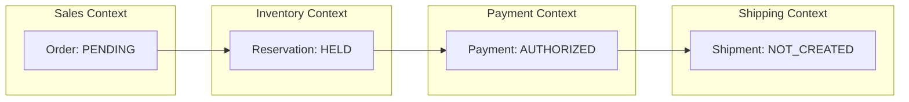
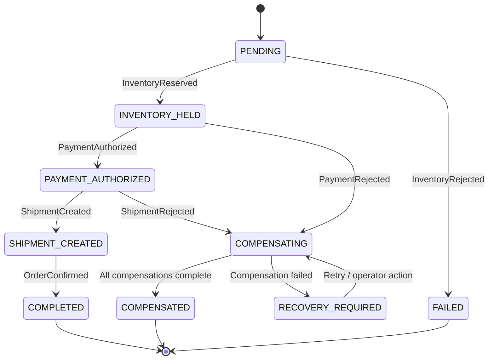
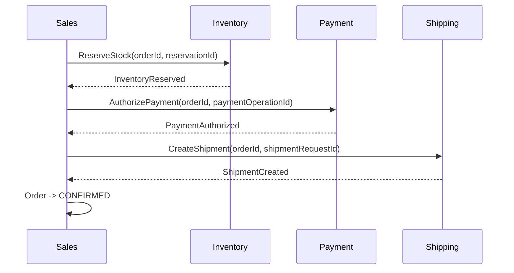
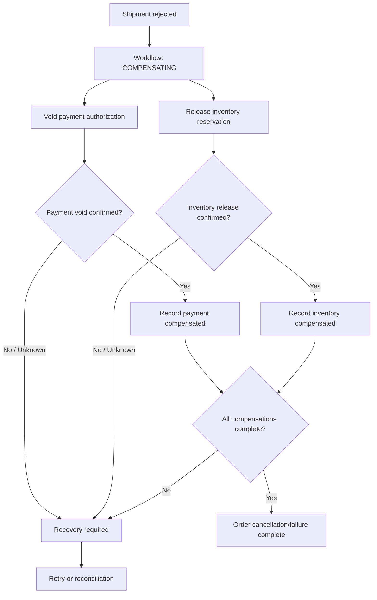

# Phục hồi và đối soát khi một phần quy trình thất bại

Trong một hệ thống gồm nhiều Bounded Context, một quy trình nghiệp vụ có thể cần phối hợp nhiều dịch vụ và nhiều database. Ví dụ, xác nhận đơn hàng có thể giữ tồn kho, ủy quyền thanh toán, tạo yêu cầu giao hàng và gửi thông báo. Mỗi context sở hữu dữ liệu và transaction riêng. Nếu một bước thành công nhưng bước tiếp theo thất bại, không có một lệnh rollback database duy nhất có thể hoàn tác toàn bộ quy trình.

Domain-Driven Design (DDD) yêu cầu mỗi context bảo vệ invariant trong phạm vi mình sở hữu. Khi một quy trình vượt qua nhiều context, nhóm cần mô hình hóa trạng thái trung gian, hành động bù trừ, retry, idempotency và đối soát. **Phục hồi (recovery)** đưa quy trình từ trạng thái lỗi hoặc chưa rõ kết quả về một trạng thái có thể tiếp tục hoặc kết thúc an toàn. **Đối soát (reconciliation)** so sánh trạng thái và bằng chứng giữa các hệ thống để phát hiện, giải thích và xử lý sai lệch.

Mục tiêu là bảo đảm hệ thống có thể tiếp tục sau lỗi tiến trình, timeout, message gửi lặp, sự cố nhà cung cấp hoặc lỗi con người; đồng thời có đủ dấu vết để biết điều gì đã xảy ra và hành động nào cần thực hiện tiếp theo.

## 1. Vì sao quy trình liên ngữ cảnh có thể thất bại một phần?

Giả sử khách hàng đặt một đơn hàng. Quy trình gồm:

1. Sales tạo đơn ở trạng thái `PENDING`.
2. Inventory giữ số lượng hàng.
3. Payment ủy quyền thanh toán.
4. Shipping tạo yêu cầu giao hàng.
5. Sales chuyển đơn sang `CONFIRMED`.

Mỗi bước có thể commit trong database của context riêng. Nếu Inventory đã giữ hàng và Payment đã ủy quyền nhưng Shipping không thể tạo shipment, quy trình đã ở trạng thái một phần thành công.

Một số nguyên nhân phổ biến:

- Service hoặc database dừng sau khi transaction cục bộ đã commit.
- Request đến upstream bị timeout; caller không biết thao tác đã commit hay chưa.
- Message được gửi nhưng publisher không nhận được xác nhận, dẫn đến gửi lại.
- Consumer xử lý thành công nhưng dừng trước khi acknowledge message.
- Nhà cung cấp bên ngoài phản hồi chậm hoặc trả kết quả không rõ ràng.
- Một bước bị từ chối do trạng thái nghiệp vụ đã thay đổi.
- Compensation thất bại hoặc chỉ hoàn thành một phần.
- Dữ liệu giữa hai context được cập nhật theo thời gian khác nhau.
- Nhân viên vận hành sửa dữ liệu trực tiếp mà không cập nhật workflow liên quan.

### 1.1. Không đồng nhất timeout với thất bại

Một timeout chỉ cho biết caller không nhận được phản hồi trong thời gian mong đợi. Nó không chứng minh thao tác phía nhận chưa xảy ra.

Ví dụ, Payment đã ủy quyền giao dịch thành công nhưng response bị mất trên mạng. Nếu Sales coi timeout là thất bại chắc chắn và gửi một yêu cầu ủy quyền mới với định danh khác, khách hàng có thể bị giữ tiền hai lần.

Vì vậy, cần phân biệt các kết quả:

| Kết quả quan sát | Ý nghĩa | Hành động phù hợp |
|---|---|---|
| Success được xác nhận | Bên nhận xác nhận thao tác đã hoàn tất | Ghi nhận kết quả và tiếp tục workflow |
| Business rejection | Bên nhận hiểu yêu cầu nhưng từ chối theo quy tắc | Chuyển sang nhánh từ chối hoặc compensation |
| Technical failure rõ ràng trước khi xử lý | Có bằng chứng thao tác chưa được thực hiện | Có thể retry theo chính sách |
| Timeout / connection reset | Không biết thao tác đã commit hay chưa | Tra cứu bằng operation ID hoặc gửi lại idempotently |
| Response không hợp lệ / không thể diễn giải | Chưa xác định được kết quả nghiệp vụ | Giữ trạng thái chưa rõ, điều tra hoặc reconciliation |

Không nên đổi một trạng thái `UNKNOWN` thành `FAILED` chỉ vì hết thời gian chờ. Trạng thái chưa rõ kết quả cần được lưu và xử lý như một tình huống riêng.

## 2. Nhất quán cục bộ và nhất quán liên ngữ cảnh

Mỗi Bounded Context nên bảo vệ dữ liệu và invariant của mình bằng transaction cục bộ. Ví dụ, Inventory có thể cập nhật số lượng khả dụng và tạo reservation trong cùng một transaction database. Payment có thể lưu trạng thái authorization cùng với một bản ghi outbox trong transaction của Payment.

Khi quy trình trải qua nhiều context, tổng thể thường đạt **eventual consistency (nhất quán cuối cùng)**: các context có thể tạm thời nhìn thấy trạng thái khác nhau, nhưng workflow và cơ chế phục hồi sẽ đưa chúng về trạng thái tương thích theo quy tắc nghiệp vụ.



Sơ đồ mô tả một thời điểm giữa quy trình. Trạng thái này chưa nhất thiết là sai: đơn có thể đang chờ bước Shipping. Nó chỉ trở thành vấn đề cần xử lý nếu workflow không thể tiếp tục, vượt thời hạn hoặc một invariant nghiệp vụ bị đe dọa.

### 2.1. Eventual consistency không có nghĩa là chấp nhận dữ liệu sai

Một số trạng thái trung gian được phép tồn tại, ví dụ `PAYMENT_PENDING` hoặc `INVENTORY_RESERVED`. Nhưng cần xác định:

- Trạng thái trung gian nào được phép?
- Có thể tồn tại tối đa bao lâu?
- Tài nguyên nào đang được giữ và khi nào hết hạn?
- Điều kiện nào cho phép chuyển sang bước tiếp theo?
- Khi nào cần bù trừ hoặc can thiệp vận hành?
- Người dùng nhìn thấy trạng thái nào trong thời gian chờ?

Nếu không có câu trả lời, eventual consistency dễ trở thành lý do để bỏ qua sai lệch kéo dài.

### 2.2. Mỗi context là nguồn có thẩm quyền cho dữ liệu của mình

Sales sở hữu trạng thái đơn bán; Inventory sở hữu lượng hàng và reservation; Payment sở hữu trạng thái giao dịch thanh toán; Shipping sở hữu shipment và tiến trình giao hàng. Sales có thể giữ một bản sao trạng thái thanh toán để hiển thị, nhưng bản sao đó không nên được xem là nguồn có thẩm quyền để sửa dữ liệu Payment.

Khi đối soát, phải xác định nguồn có thẩm quyền cho từng sự kiện và trường dữ liệu. Không nên lấy trạng thái mới nhất theo timestamp từ bất kỳ hệ thống nào rồi ghi đè lên tất cả hệ thống khác.

## 3. Mô hình hóa workflow có thể phục hồi

Một quy trình nhiều bước cần một định danh ổn định và trạng thái bền vững để có thể tiếp tục sau khi process restart.

Ví dụ `OrderFulfillmentProcess` hoặc `OrderSaga` có thể lưu:

- `processId` hoặc `orderId` làm định danh quy trình.
- Trạng thái hiện tại.
- Các bước đã hoàn thành và kết quả của chúng.
- Operation ID của reservation, payment authorization và shipment.
- Thời điểm bắt đầu, thời hạn và lần retry gần nhất.
- Lỗi cuối cùng và số lần thử.
- Các compensation đã được yêu cầu hoặc hoàn tất.
- Correlation ID để truy vết qua các context.

Không nên chỉ lưu trạng thái cuối cùng của đơn và suy đoán các bước trước đó. Khi một bước thất bại, hệ thống cần biết chính xác reservation nào đã được tạo, giao dịch nào đã ủy quyền và compensation nào còn thiếu.

### 3.1. Trạng thái workflow minh họa



Tên trạng thái và chuyển tiếp phải phản ánh nghiệp vụ thực tế. `RECOVERY_REQUIRED` không phải trạng thái kết thúc bình thường; nó cho biết quy trình cần retry có kiểm soát hoặc can thiệp.

### 3.2. Process Manager hoặc Saga Coordinator

Có thể dùng một **Saga/Process Manager** để điều phối chuỗi transaction cục bộ. Nó nhận kết quả từ từng context, cập nhật trạng thái workflow và quyết định bước tiếp theo.

Saga có thể theo hai kiểu:

- **Orchestration:** một coordinator gửi command đến các context và theo dõi kết quả. Luồng điều khiển tập trung, dễ nhìn thấy trạng thái tổng thể nhưng coordinator cần được thiết kế bền vững.
- **Choreography:** các context phản ứng với domain/integration event của nhau. Ít có một điều phối viên trung tâm, nhưng luồng phụ thuộc có thể khó theo dõi khi số bước tăng.

Chọn kiểu dựa trên độ phức tạp và khả năng quan sát. Với workflow nhiều nhánh, timeout, compensation và yêu cầu vận hành rõ ràng, orchestration thường giúp nhìn thấy tiến trình hơn. Choreography phù hợp với chuỗi phản ứng đơn giản và ít cần điều phối tập trung.

## 4. Compensation: hành động nghiệp vụ để bù trừ

Trong một transaction database, rollback có thể hoàn tác các thay đổi chưa commit. Trong Saga, một bước đã commit ở context khác không thể được rollback bằng transaction cục bộ của coordinator. Thay vào đó, hệ thống thực hiện một **compensating action (hành động bù trừ)**.

Ví dụ:

| Bước đã thực hiện | Compensation có thể tương ứng |
|---|---|
| Giữ hàng trong Inventory | Hủy reservation và trả số lượng về available |
| Ủy quyền thanh toán | Hủy authorization nếu nhà cung cấp hỗ trợ |
| Thu tiền | Tạo refund, có thể là một giao dịch tài chính mới |
| Tạo shipment chưa lấy hàng | Hủy shipment request |
| Gửi email xác nhận | Có thể gửi thông báo đính chính; không thể thu hồi email đã gửi |

Compensation không nhất thiết đưa hệ thống trở về trạng thái lịch sử y hệt trước đó. Ví dụ, hoàn tiền là một giao dịch mới có audit trail; email đã gửi không thể biến mất. Compensation đưa nghiệp vụ về một trạng thái được chấp nhận theo chính sách.

### 4.1. Xác định compensation trước khi triển khai bước forward

Với mỗi bước trong workflow, hãy trả lời:

- Bước này có thể đảo ngược không?
- Compensation là thao tác nào và do context nào sở hữu?
- Compensation có thể thất bại hoặc bị trì hoãn không?
- Có giới hạn thời gian để bù trừ không?
- Nếu bước đã tiến quá xa, có cần một quy trình khác thay vì hủy không?
- Ai chịu trách nhiệm khi không thể bù trừ tự động?

Ví dụ, shipment đã bàn giao cho hãng vận chuyển có thể không còn hủy được. Khi đó, quy trình cần yêu cầu thu hồi hoặc xử lý trả hàng thay vì gọi `cancelShipment()` và giả định thành công.

### 4.2. Compensation phải idempotent

Một compensation có thể được gửi nhiều lần do timeout hoặc worker restart. `ReleaseInventoryReservation` cần có `reservationId` và chỉ chuyển trạng thái `HELD` sang `RELEASED` một lần. Nếu reservation đã được giải phóng, lần gọi lại nên trả kết quả đã hoàn tất thay vì trừ/cộng tồn kho thêm lần nữa.

Ví dụ pseudo-code:

```java
public ReleaseResult release(ReservationId id) {
    Reservation reservation = reservations.findById(id)
        .orElseThrow(() -> new ReservationNotFoundException(id));

    if (reservation.status() == ReservationStatus.RELEASED) {
        return ReleaseResult.alreadyReleased(id);
    }
    if (reservation.status() != ReservationStatus.HELD) {
        return ReleaseResult.notReleasable(id, reservation.status());
    }

    reservation.release();
    inventoryRepository.restoreAvailable(reservation.sku(), reservation.quantity());
    reservations.save(reservation);
    return ReleaseResult.released(id);
}
```

Trong triển khai thực tế, thay đổi trạng thái reservation và số lượng tồn kho phải nằm trong cùng transaction cục bộ hoặc được bảo vệ bằng một cơ chế tương đương. Pseudo-code trên mô tả ý nghĩa, không thay thế việc thiết kế atomicity và concurrency.

### 4.3. Compensation có thể cần compensation khác

Một refund có thể bị từ chối hoặc nhà cung cấp thanh toán không phản hồi. Không nên coi lỗi compensation là lý do để xóa dấu vết hoặc đánh dấu quy trình đã hoàn tất. Ghi trạng thái `COMPENSATION_PENDING` hoặc `RECOVERY_REQUIRED`, lưu operation ID và lên lịch xử lý lại/đối soát.

## 5. Outbox và Inbox: bảo đảm thông điệp không bị thất lạc hoặc xử lý lặp

Một lỗi phổ biến là cập nhật database thành công nhưng publish event thất bại, hoặc publish event thành công rồi transaction database rollback. Hai thao tác database và message broker thường không nằm trong cùng một transaction nguyên tử.

### 5.1. Transactional Outbox

Outbox ghi thay đổi nghiệp vụ và event cần gửi trong cùng transaction cục bộ:

```sql
BEGIN;

UPDATE orders
SET status = 'CONFIRMED'
WHERE id = :order_id;

INSERT INTO outbox_event (
    event_id, aggregate_id, event_type, payload, occurred_at
) VALUES (
    :event_id, :order_id, 'OrderConfirmed', :payload, CURRENT_TIMESTAMP
);

COMMIT;
```

Một publisher đọc các bản ghi outbox chưa gửi, publish lên broker rồi đánh dấu đã gửi. Nếu publisher dừng sau khi broker nhận message nhưng trước khi đánh dấu outbox, message có thể được gửi lại. Vì vậy, outbox thường cung cấp khả năng phát ít nhất một lần (at-least-once), không tự bảo đảm consumer chỉ nhận đúng một lần.

### 5.2. Inbox và deduplication ở consumer

Consumer có thể nhận cùng event nhiều lần. Một bảng inbox hoặc processed-message lưu `eventId` đã xử lý với unique constraint. Consumer ghi nhận event đã xử lý cùng transaction với thay đổi domain của mình.

```text
BEGIN
  INSERT INTO inbox(event_id, received_at)
  nếu unique conflict: event đã xử lý, kết thúc an toàn
  áp dụng hành vi domain
  lưu aggregate và outbox event tiếp theo nếu có
COMMIT
ACK message
```

Nếu consumer commit thành công nhưng dừng trước khi ACK, broker có thể gửi lại. Inbox giúp lần xử lý sau nhận ra event trùng và không lặp side effect.

### 5.3. Idempotency key cho command và API ngoài

Với command như `AuthorizePayment`, dùng một operation ID ổn định, chẳng hạn `paymentAuthorizationId` hoặc idempotency key gắn với order/process. Khi retry, gửi lại cùng key và cùng payload logic.

Nếu cùng key nhưng payload khác, hệ thống nên từ chối hoặc báo xung đột thay vì coi là cùng thao tác. Cần xác định phạm vi uniqueness của key, thời gian lưu và cách tra cứu kết quả cũ.

Idempotency cần được triển khai ở nơi thực hiện side effect. Chỉ lưu key trong coordinator nhưng không ràng buộc ở Payment provider/adapter chưa đủ để ngăn nhà cung cấp xử lý lặp.

## 6. Retry: thử lại đúng việc, đúng thời điểm

Retry phù hợp khi lỗi có khả năng tạm thời và thao tác có thể thực hiện lặp an toàn. Không phải mọi lỗi đều nên retry.

### 6.1. Phân loại lỗi trước khi retry

| Loại lỗi | Ví dụ | Hành động thường phù hợp |
|---|---|---|
| Transient technical failure | Connection reset, 503, broker unavailable | Retry có backoff và giới hạn |
| Throttling | HTTP 429, quota exceeded | Tôn trọng `Retry-After`, giảm tốc độ |
| Business rejection | Hết hàng, không đủ hạn mức | Không retry cùng input vô hạn; chuyển nhánh nghiệp vụ |
| Permanent contract/data error | Schema không hợp lệ, currency không hỗ trợ | Quarantine/DLQ và sửa dữ liệu hoặc contract |
| Unknown outcome | Timeout sau khi gửi command | Tra cứu theo operation ID hoặc retry idempotently |
| Concurrency conflict | Optimistic lock conflict | Tải lại trạng thái và đánh giá lại nghiệp vụ; retry có giới hạn |

### 6.2. Exponential backoff và jitter

Retry liên tục ngay lập tức có thể làm hệ thống quá tải hơn khi upstream đang phục hồi. Exponential backoff tăng khoảng chờ sau mỗi lần thử; jitter thêm độ lệch ngẫu nhiên để nhiều worker không đồng loạt retry cùng thời điểm.

Ví dụ cấu hình minh họa:

```text
attempt 1: 1 second
attempt 2: 2 seconds
attempt 3: 4 seconds
attempt 4: 8 seconds
maximum attempts: 5
```

Giá trị thực tế cần dựa vào SLA, timeout, thời hạn nghiệp vụ và khả năng chịu tải của dependency. Có thể dùng full jitter hoặc equal jitter; tránh để mọi client có cùng lịch retry cố định.

### 6.3. Retry phải có deadline

Một reservation chỉ có thể giữ trong 15 phút; retry tạo shipment trong 2 giờ sẽ không còn ý nghĩa nếu đơn đã hết hạn. Mỗi workflow nên có deadline hoặc expiry policy. Khi vượt deadline, chuyển sang compensation hoặc recovery queue theo quy tắc.

Không để retry vô hạn chiếm tài nguyên, tạo hàng đợi tích tụ và che giấu lỗi lâu dài.

### 6.4. Circuit breaker không thay thế recovery

Circuit breaker tạm ngừng gọi một dependency đang lỗi để bảo vệ hệ thống và cho dependency thời gian phục hồi. Nó không giải quyết việc command trước đó đã thành công hay chưa, không bù trừ side effect và không đối soát dữ liệu. Kết hợp circuit breaker với operation ID, durable workflow state và retry policy.

## 7. Đối soát là gì và khi nào cần?

**Reconciliation (đối soát)** là quá trình so sánh trạng thái, bản ghi hoặc kết quả giữa các hệ thống có liên quan để phát hiện sai lệch và xác định hành động sửa chữa.

Đối soát cần thiết khi:

- Một API timeout khiến kết quả thao tác không rõ.
- Message bị dead-letter hoặc không được consumer xử lý.
- Workflow ở trạng thái chờ quá lâu.
- Compensation thất bại.
- Nhà cung cấp gửi callback trễ hoặc gửi nhiều lần.
- Hệ thống nội bộ và báo cáo của nhà cung cấp không khớp.
- Có thao tác thủ công hoặc batch import ngoài workflow chuẩn.

Đối soát không nên chỉ là câu lệnh cập nhật trạng thái cho khớp. Nó phải xác định dữ liệu nào là nguồn có thẩm quyền, sai lệch có ý nghĩa gì và hành động nào được phép.

### 7.1. Chọn nguồn có thẩm quyền cho từng dữ liệu

Ví dụ:

| Dữ liệu cần đối soát | Nguồn có thẩm quyền thường gặp |
|---|---|
| Trạng thái reservation và lượng hàng đã giữ | Inventory Context |
| Authorization, capture, refund | Payment Context hoặc bằng chứng chính thức từ payment provider theo mô hình sở hữu |
| Shipment, tracking và delivery outcome | Shipping Context / carrier evidence đã được xác minh |
| Trạng thái đơn bán và cam kết với khách hàng | Sales Context |
| Trạng thái workflow tổng thể | Saga/Process Manager, dựa trên kết quả đã xác nhận từ từng context |

Nguồn có thẩm quyền cần được xác định trong thiết kế. Ví dụ, Payment Context sở hữu bản ghi thanh toán nội bộ, nhưng khi đối soát giao dịch với nhà cung cấp, statement hoặc API tra cứu của provider có thể là bằng chứng bên ngoài cần đối chiếu. Không nên ghi đè dữ liệu nội bộ chỉ dựa trên một callback chưa xác thực.

### 7.2. Các loại sai lệch thường gặp

- **Missing record:** provider có giao dịch nhưng hệ thống nội bộ không có bản ghi tương ứng.
- **Orphan record:** hệ thống nội bộ có operation nhưng provider không tìm thấy.
- **Status mismatch:** một bên báo `CAPTURED`, bên kia còn `AUTHORIZED`.
- **Amount mismatch:** số tiền hoặc currency khác nhau.
- **Duplicate operation:** cùng một ý định tạo nhiều giao dịch.
- **Stale projection:** read model chưa nhận event mới.
- **Incomplete compensation:** reservation đã được giải phóng nhưng workflow chưa ghi nhận; hoặc ngược lại.
- **Unprocessed message:** event nằm trong DLQ hoặc inbox chưa hoàn tất.

### 7.3. Đối soát tự động và thủ công

Đối soát tự động phù hợp với sai lệch có quy tắc sửa rõ và rủi ro thấp, ví dụ cập nhật projection từ event đã xác nhận hoặc retry một query an toàn.

Đối soát thủ công phù hợp khi:

- Có nhiều kết quả hợp lệ nhưng cần người có thẩm quyền chọn.
- Số tiền lớn hoặc thao tác tài chính không thể đảo ngược dễ dàng.
- Bằng chứng từ các nguồn mâu thuẫn.
- Không xác định được nguồn có thẩm quyền.
- Compensation có thể ảnh hưởng quyền lợi khách hàng.

Thao tác thủ công phải có người thực hiện, lý do, thời điểm, dữ liệu trước/sau và phê duyệt nếu cần. Không nên sửa trực tiếp database mà không tạo audit trail.

## 8. Thiết kế một quy trình reconciliation

Một job đối soát thường đi qua các bước:

1. **Chọn phạm vi:** khoảng thời gian, tenant, provider, loại operation hoặc trạng thái workflow cần kiểm tra.
2. **Thu thập dữ liệu:** lấy bản ghi nội bộ và bằng chứng từ nguồn ngoài qua API/file/statement.
3. **Chuẩn hóa:** chuẩn hóa currency, timezone, reference, trạng thái và định dạng.
4. **Ghép cặp:** dùng operation ID, provider reference, order ID hoặc composite business key đã xác định.
5. **Phân loại sai lệch:** missing, duplicate, status mismatch, amount mismatch hoặc stale state.
6. **Đánh giá hành động:** retry query, replay event, tạo compensation, cập nhật projection hoặc chuyển review.
7. **Thực thi có kiểm soát:** mỗi hành động có idempotency key, quyền và giới hạn.
8. **Ghi kết quả:** lưu report, audit, correlation ID và trạng thái xử lý.
9. **Theo dõi ngoại lệ:** chuyển các trường hợp chưa giải quyết sang hàng đợi vận hành.

Không nên ghép cặp chỉ bằng tên khách hàng hoặc timestamp gần nhau nếu có thể dùng định danh ổn định. Một giao dịch có thể có nhiều giao dịch khác cùng số tiền và thời điểm.

### 8.1. Reconciliation report

Một bản ghi đối soát có thể gồm:

```text
reconciliationRunId
sourceSystem
targetSystem
periodStart / periodEnd
internalOperationId
externalReference
internalStatus / externalStatus
internalAmount / externalAmount / currency
discrepancyType
resolutionAction
resolutionStatus
resolvedBy / resolvedAt
correlationId
```

Lưu report giúp đội vận hành biết điều gì đã được so sánh và tại sao hệ thống thực hiện một hành động sửa chữa. Với dữ liệu nhạy cảm, chỉ lưu field cần thiết và áp dụng chính sách truy cập/retention phù hợp.

## 9. Ví dụ tổng hợp: đặt hàng, giữ kho, thanh toán và giao hàng

Giả sử một đơn hàng trị giá 2.000.000 VND. Quy trình gồm Sales, Inventory, Payment và Shipping.

### 9.1. Luồng thành công



Mỗi command có operation ID ổn định; mỗi context lưu trạng thái cục bộ và phát kết quả bằng event hoặc response. Sales cập nhật trạng thái tổng thể dựa trên kết quả được xác nhận.

### 9.2. Shipping từ chối sau khi Payment đã ủy quyền

Giả sử Shipping từ chối vì địa chỉ giao không phục vụ. Saga có thể:

1. Đánh dấu workflow `COMPENSATING`.
2. Gửi `VoidPaymentAuthorization` đến Payment bằng operation ID gắn với authorization ban đầu.
3. Gửi `ReleaseInventoryReservation` đến Inventory bằng reservation ID.
4. Chờ kết quả từng compensation.
5. Khi cả hai hoàn tất, chuyển đơn sang `FAILED` hoặc `CANCELLED` theo ngôn ngữ Sales.
6. Nếu một compensation thất bại, chuyển `RECOVERY_REQUIRED`, giữ bằng chứng và lên lịch retry/đối soát.



### 9.3. Timeout khi void payment

Nếu Payment không phản hồi, Sales không thể kết luận authorization vẫn còn hoặc đã được void. Workflow lưu `paymentCompensationStatus = UNKNOWN` và giữ operation ID. Recovery worker tra cứu trạng thái bằng provider reference hoặc retry cùng idempotency key.

- Nếu provider xác nhận void thành công, ghi nhận compensation hoàn tất.
- Nếu provider xác nhận authorization vẫn còn, gửi lại void theo chính sách.
- Nếu provider báo authorization đã capture, đây là trạng thái khác; cần quy trình refund hoặc xử lý tài chính phù hợp.
- Nếu provider vẫn không xác định được, chuyển reconciliation/manual review.

Không gửi một yêu cầu thanh toán mới để “sửa” trạng thái chưa rõ. Phải tra cứu và xử lý đúng operation gốc.

### 9.4. Đối soát định kỳ

Một job chạy định kỳ có thể so sánh:

- Các payment operation nội bộ đang `PENDING`, `UNKNOWN` hoặc `COMPENSATION_PENDING`.
- Giao dịch và trạng thái do provider cung cấp.
- Reservation còn `HELD` nhưng workflow đã kết thúc.
- Workflow đã `COMPLETED` nhưng thiếu shipment reference.
- Event outbox/inbox chưa xử lý quá thời hạn.

Job phân loại sai lệch và tạo action hoặc case vận hành. Nó không nên tự động sửa tất cả dữ liệu bằng cách ghi trạng thái provider vào Sales; mỗi context vẫn phải cập nhật dữ liệu thuộc quyền sở hữu của mình qua command/contract hợp lệ.

## 10. Replay và phục hồi message

Replay là phát lại event hoặc command đã lưu để tiếp tục xử lý. Replay hữu ích khi consumer đã được sửa lỗi, mapping được cập nhật hoặc dependency phục hồi.

### 10.1. Replay không phải gửi lại tùy tiện

Trước khi replay, cần biết:

- Message đã được xử lý một phần hay chưa?
- Consumer có inbox/deduplication không?
- Side effect trước đó có thể lặp không?
- Schema version có được hỗ trợ không?
- Thứ tự event có quan trọng không?
- Aggregate hiện tại còn phù hợp với event cũ không?

Một event `OrderConfirmed` được replay sau khi đơn đã hủy có thể không còn hợp lệ để tạo shipment. Consumer cần kiểm tra state machine và policy hiện tại; replay không có nghĩa bỏ qua quy tắc domain.

### 10.2. Dead-letter queue

DLQ giữ message không thể xử lý sau số lần thử hoặc do lỗi contract/permanent. DLQ cần có:

- Lý do lỗi và số lần thử.
- Original message, headers và event ID.
- Correlation ID và thời điểm nhận.
- Công cụ inspect/replay có phân quyền.
- Quy trình sửa dữ liệu hoặc contract trước khi replay.
- Retention và cảnh báo khi số lượng tăng.

Không nên tự động replay DLQ liên tục nếu nguyên nhân là schema không hỗ trợ hoặc dữ liệu nghiệp vụ sai. Điều đó chỉ tạo thêm tải và log nhiễu.

### 10.3. Replay cần giữ identity của thao tác

Khi replay một event cũ, giữ `eventId` gốc để inbox nhận ra duplicate nếu đã xử lý. Nếu tạo một command mới sau khi con người quyết định sửa quy trình, dùng command ID mới nhưng liên kết với event/process gốc qua `causationId` hoặc `correlationId`.

## 11. Quan sát và vận hành recovery

Một workflow có thể phục hồi chỉ khi đội vận hành nhìn thấy nó đang ở đâu và vì sao bị dừng.

Các thông tin nên theo dõi:

- Số workflow theo từng trạng thái.
- Workflow chờ lâu hơn SLA hoặc deadline.
- Retry count và retry age.
- Số compensation thành công/thất bại.
- Số operation ở trạng thái `UNKNOWN`.
- Outbox backlog, consumer lag và DLQ count.
- Số reservation hết hạn nhưng chưa giải phóng.
- Sai lệch reconciliation theo loại và độ tuổi.
- Thời gian từ khi phát hiện lỗi đến khi phục hồi.

### 11.1. Correlation ID và operation ID

Mỗi workflow nên có `correlationId` xuyên các context. Mỗi side effect có `operationId` riêng và ổn định. Hai loại ID giải quyết hai nhu cầu:

- Correlation ID liên kết log/event của cùng một quy trình.
- Operation ID nhận diện một hành động cụ thể để retry hoặc tra cứu idempotently.

Không dùng một ID chung cho mọi mục đích nếu nó làm mờ quan hệ giữa quy trình và từng thao tác.

### 11.2. Recovery dashboard

Một màn hình vận hành hữu ích có thể hiển thị:

- Process ID, order reference và trạng thái hiện tại.
- Các bước đã hoàn thành, đang chờ, thất bại hoặc chưa rõ.
- Operation ID và reference của provider.
- Lỗi cuối cùng, lần retry tiếp theo và deadline.
- Compensation đã hoàn tất và còn thiếu.
- Reconciliation case liên quan.
- Hành động được phép: retry, query status, replay, cancel hoặc escalate.

Các hành động thủ công phải được bảo vệ bằng quyền phù hợp, yêu cầu lý do và ghi audit. Không cung cấp nút “force complete” nếu không có quy tắc nghiệp vụ và bằng chứng cần thiết.

## 12. Thiết kế an toàn cho thao tác thủ công

Không phải sai lệch nào cũng có thể tự động sửa. Nhân viên vận hành đôi khi cần quyết định tiếp tục, hủy, hoàn tiền hoặc yêu cầu nhà cung cấp điều tra.

Một thao tác thủ công nên có:

- Actor được xác thực và vai trò được phép.
- Mã case và workflow liên quan.
- Trạng thái trước thao tác và bằng chứng được xem xét.
- Hành động cụ thể và lý do.
- Phê duyệt bổ sung với thao tác rủi ro cao.
- Idempotency/operation ID để tránh bấm lặp.
- Kết quả, thời gian và audit trail.

Không sửa trực tiếp database để ép hai context có cùng trạng thái. Hãy gửi command hoặc chạy use case quản trị thuộc context sở hữu dữ liệu, để invariant và audit vẫn được áp dụng.

## 13. Kiểm thử phục hồi và đối soát

Happy-path test không đủ cho một workflow phân tán. Cần kiểm tra các điểm lỗi sau mỗi side effect và khả năng tiếp tục từ trạng thái đã lưu.

### 13.1. Fault injection theo từng bước

Với quy trình Sales–Inventory–Payment–Shipping, hãy mô phỏng:

- Inventory commit thành công nhưng response bị mất.
- Payment provider đã authorize nhưng HTTP timeout.
- Publisher gửi event rồi dừng trước khi đánh dấu outbox.
- Consumer commit nhưng không ACK message.
- Shipping từ chối sau khi payment đã authorize.
- Void authorization timeout hoặc bị provider từ chối.
- Inventory release nhận lặp hai lần.
- Workflow worker restart giữa hai bước.
- DLQ replay một event đã xử lý trước đó.
- Reconciliation phát hiện provider và nội bộ lệch trạng thái hoặc số tiền.

### 13.2. Kiểm tra invariant cuối cùng

Sau mỗi kịch bản, xác minh:

- Không có reservation trùng hoặc tồn kho âm.
- Không có authorization/capture trùng cho cùng ý định thanh toán.
- Mọi side effect có operation ID và trạng thái có thể tra cứu.
- Workflow không báo `COMPLETED` khi còn bước bắt buộc chưa xác nhận.
- Compensation được ghi nhận và không chạy lặp gây tác động thêm.
- Sai lệch chưa giải quyết nằm trong recovery/reconciliation queue.
- Audit trail phản ánh đúng chuỗi hành động.

### 13.3. Test phục hồi sau restart

Khởi động lại process manager/worker sau khi một bước đã commit. Khi khởi động lại, nó phải tải trạng thái workflow đã lưu và tiếp tục từ bước phù hợp, không chạy lại mọi side effect một cách mù quáng.

### 13.4. Test contract và provider sandbox

Với payment/shipping provider, dùng sandbox hoặc contract test để xác minh idempotency key, trạng thái timeout, callback trễ, mã lỗi và cách query operation. Không chỉ mock response thành công; cần kiểm tra các trạng thái chưa rõ và phản hồi lặp.

## 14. Sai lầm thường gặp

**Coi timeout là thất bại chắc chắn.** Thao tác có thể đã commit ở bên nhận. Hãy query theo operation ID hoặc retry idempotently.

**Coi Saga là distributed rollback.** Compensation là hành động nghiệp vụ mới, có thể thất bại và không nhất thiết phục hồi trạng thái lịch sử giống hệt.

**Không lưu trạng thái workflow bền vững.** Sau restart, coordinator không biết bước nào đã hoàn thành và có thể lặp side effect.

**Retry mọi lỗi.** Business rejection và contract error không tự biến mất khi thử lại. Phân loại lỗi, giới hạn retry và có deadline.

**Không dùng idempotency cho compensation.** Release hoặc refund lặp có thể tạo sai lệch lớn hơn lỗi ban đầu.

**Chỉ dùng outbox mà bỏ qua inbox.** Publisher có thể gửi lặp; consumer cần deduplication và xử lý side effect trong transaction cục bộ.

**Đối soát bằng cách ghi đè trạng thái theo timestamp.** Mỗi context sở hữu dữ liệu riêng. Phải xác định nguồn có thẩm quyền và xử lý qua contract/use case.

**Replay DLQ mà không kiểm tra trạng thái hiện tại.** Event cũ có thể không còn hợp lệ. Consumer phải kiểm tra state machine và idempotency.

**Không có deadline cho reservation và retry.** Tài nguyên có thể bị giữ vô hạn và workflow chờ mãi.

**Đánh dấu completed khi compensation chưa xong.** Trạng thái tổng thể phải phản ánh các bước bắt buộc đã được xác nhận.

**Cho phép sửa database thủ công.** Thao tác ngoài domain có thể phá invariant và mất audit. Dùng công cụ vận hành gọi command được kiểm soát.

**Không có quan sát workflow.** Nếu không thấy retry age, trạng thái UNKNOWN, DLQ và compensation backlog, sự cố có thể tồn tại lâu mà không ai nhận ra.

## 15. Quy trình thiết kế recovery và reconciliation

1. **Vẽ workflow và xác định owner.** Liệt kê các context, dữ liệu có thẩm quyền và transaction cục bộ.
2. **Định nghĩa trạng thái bền vững.** Bao gồm pending, success, rejection, unknown, compensating và recovery required nếu cần.
3. **Gán operation ID cho side effect.** Mỗi command bên ngoài cần định danh ổn định để tra cứu và retry.
4. **Xác định compensation.** Ghi rõ thao tác bù trừ, điều kiện được phép, giới hạn và trường hợp không thể đảo ngược.
5. **Thiết kế outbox/inbox.** Bảo đảm event được phát cùng transaction và consumer xử lý lặp an toàn.
6. **Phân loại lỗi và retry.** Xác định transient, permanent, business rejection và unknown outcome; đặt backoff, giới hạn và deadline.
7. **Thiết kế reconciliation.** Chọn nguồn có thẩm quyền, cách ghép cặp, loại sai lệch và action được phép.
8. **Tạo đường xử lý thủ công.** Có quyền, lý do, audit và phê duyệt theo rủi ro.
9. **Bổ sung observability.** Theo dõi workflow age, retry, compensation, DLQ và mismatch.
10. **Kiểm thử lỗi ở mọi ranh giới.** Dừng process, làm mất response, gửi lặp, replay và phục hồi sau restart.

## 16. Checklist đánh giá

Trước khi phát hành một workflow liên ngữ cảnh, hãy kiểm tra:

- Mỗi context có transaction cục bộ và owner dữ liệu rõ ràng không?
- Workflow có lưu trạng thái bền vững và có thể tiếp tục sau restart không?
- Trạng thái `UNKNOWN` có được phân biệt với success/failure không?
- Mỗi side effect có operation ID hoặc idempotency key ổn định không?
- Compensation có được định nghĩa, kiểm thử và thực hiện idempotently không?
- Các bước không thể đảo ngược có nhánh xử lý nghiệp vụ riêng không?
- Outbox và inbox có xử lý publish/consume lặp không?
- Retry có phân loại lỗi, backoff, jitter, giới hạn và deadline không?
- DLQ có quy trình inspect, sửa và replay được kiểm soát không?
- Reconciliation có nguồn có thẩm quyền và quy tắc ghép cặp rõ không?
- Sai lệch tài chính/tài nguyên có được chuyển review khi cần không?
- Thao tác thủ công có quyền, lý do và audit trail không?
- Correlation ID và operation ID có giúp truy vết xuyên context không?
- Dashboard/alert có phát hiện workflow treo, compensation lỗi và mismatch không?
- Integration/fault-injection tests đã bao phủ các điểm thất bại quan trọng chưa?

## 17. Câu hỏi tự kiểm tra

1. Vì sao timeout không chứng minh command chưa được thực hiện?
2. Phân biệt transaction rollback với compensating action trong Saga.
3. Vì sao workflow cần trạng thái `UNKNOWN` và operation ID ổn định?
4. Transactional Outbox giải quyết khoảng trống nào và vì sao vẫn có thể gửi event lặp?
5. Inbox/deduplication cần được commit cùng thay đổi nào để tránh xử lý trùng?
6. Khi nào nên retry, khi nào nên chuyển business rejection hoặc contract error sang nhánh khác?
7. Reconciliation khác retry như thế nào?
8. Vì sao phải xác định nguồn có thẩm quyền cho từng dữ liệu trước khi đối soát?
9. Khi nào compensation không thể khôi phục trạng thái ban đầu và cần quy trình nghiệp vụ khác?
10. Những tình huống fault injection nào cần có để xác minh workflow phục hồi sau restart?

## Kết luận

Quy trình liên ngữ cảnh cần được thiết kế để chịu được thất bại một phần. Mỗi context bảo vệ dữ liệu của mình bằng transaction cục bộ; Saga hoặc Process Manager lưu trạng thái tiến trình và điều phối bước tiếp theo; compensation xử lý những side effect đã commit; outbox/inbox và idempotency giúp message cùng command có thể được gửi lại an toàn. Retry cần phân loại lỗi, có giới hạn và deadline. Reconciliation so sánh bằng chứng từ các nguồn có thẩm quyền để phát hiện và xử lý sai lệch, với audit và can thiệp thủ công khi cần. Khi trạng thái workflow, operation ID và quy trình phục hồi được mô hình hóa rõ, hệ thống có thể tiếp tục sau sự cố mà không che giấu các kết quả chưa xác định hoặc phá vỡ invariant của từng context.
