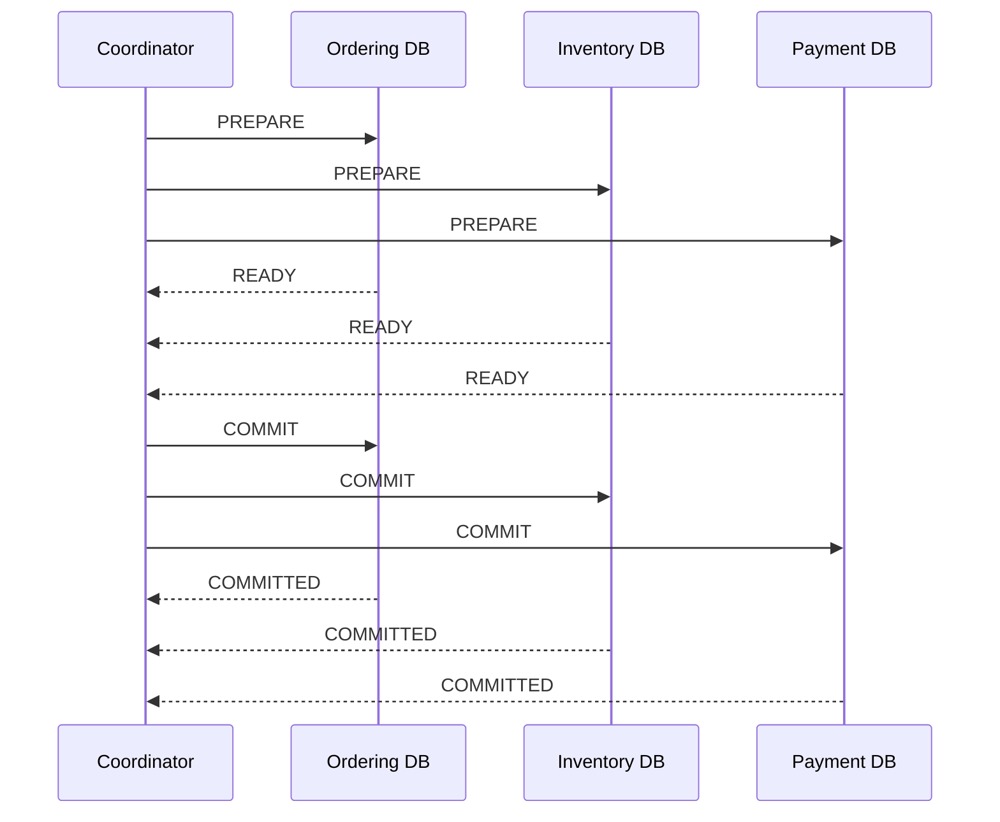
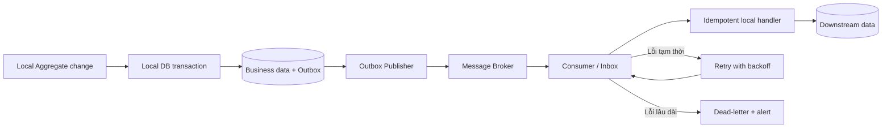
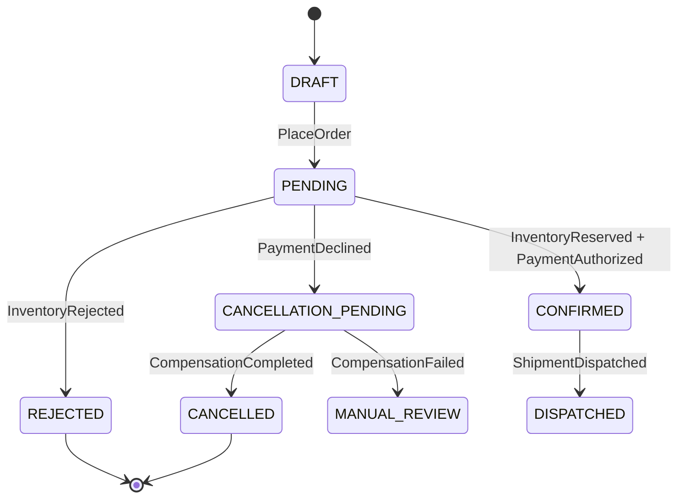
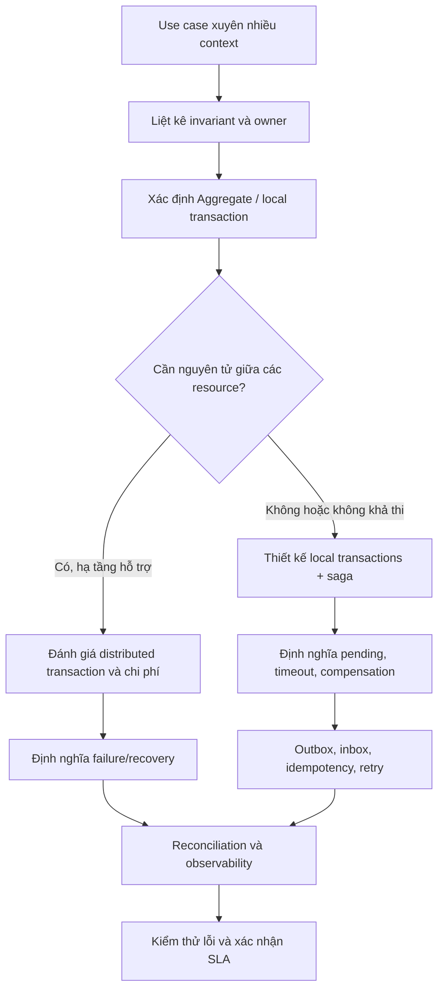

# Giới hạn cam kết nhất quán và tránh giả định giao dịch phân tán miễn phí

Trong Domain-Driven Design (DDD), mỗi Bounded Context sở hữu mô hình, dữ liệu và quy tắc nghiệp vụ của mình. Khi một quy trình đi qua nhiều context, chẳng hạn Ordering, Inventory và Payment, hệ thống phải phối hợp nhiều quyết định được lưu ở những nơi khác nhau. Một giao dịch database cục bộ có thể bảo vệ thay đổi trong một consistency boundary, nhưng nó không tự động biến nhiều context thành một đơn vị commit nguyên tử.

Nếu thiết kế giả định rằng mọi thay đổi xuyên context đều có thể commit hoặc rollback cùng lúc mà không có chi phí, hệ thống sẽ dễ gặp lỗi khi mạng chậm, dịch vụ ngừng hoạt động, message bị lặp hoặc một bước đã thành công trong khi bước khác thất bại. Distributed transaction có thể cung cấp một số bảo đảm trong những môi trường phù hợp, nhưng thường đòi hỏi phối hợp, khóa, timeout và phụ thuộc vận hành. Trong nhiều hệ thống DDD, một quy trình nhiều bước với eventual consistency, trạng thái trung gian và hành động bù trừ là lựa chọn thực tế hơn.

Bài học này giúp xác định consistency boundary, phân biệt local transaction với distributed transaction, chọn mức cam kết phù hợp cho từng quy tắc nghiệp vụ, và thiết kế quy trình liên context có thể phục hồi khi xảy ra lỗi.

## 1. Vì sao nhất quán liên context cần được thiết kế?

Giả sử khách đặt một đơn hàng. Quy trình cần:

1. Ordering ghi nhận đơn hàng.
2. Inventory giữ số lượng sản phẩm.
3. Payment ủy quyền thanh toán.
4. Ordering xác nhận đơn khi các điều kiện cần thiết đã thỏa mãn.

Mỗi context có thể sở hữu một Aggregate và một database transaction riêng. Khi Inventory giữ hàng thành công nhưng Payment từ chối, hệ thống đã có một thay đổi hợp lệ trong Inventory và một thất bại trong Payment. Không thể giả định một lệnh `rollback()` ở Ordering sẽ tự động xóa thay đổi đã commit ở Inventory.

```mermaid
sequenceDiagram
    participant O as Ordering
    participant I as Inventory
    participant P as Payment
    O->>O: Lưu đơn PENDING
    O->>I: ReserveInventory
    I->>I: Commit giữ hàng
    I-->>O: InventoryReserved
    O->>P: AuthorizePayment
    P->>P: Từ chối ủy quyền
    P-->>O: PaymentDeclined
    Note over O,I: Hàng đã được giữ; cần bước bù trừ
    O->>I: ReleaseInventory
    I->>I: Commit giải phóng hàng
    I-->>O: InventoryReleased
```

Đây không nhất thiết là một lỗi thiết kế. Nó là đặc tính của một quy trình phân tán nhiều bước. Thiết kế tốt cần mô hình hóa trạng thái trung gian, kết quả thất bại và cách phục hồi thay vì che giấu chúng bằng giả định nguyên tử.

## 2. Consistency Boundary và quyền sở hữu dữ liệu

Consistency boundary là phạm vi mà trong đó hệ thống có thể bảo vệ một nhóm invariant bằng một cơ chế nhất quán cụ thể. Trong DDD, Aggregate thường là consistency boundary ở cấp domain model: Aggregate Root kiểm tra các invariant của Aggregate trước khi thay đổi được lưu.

Ở cấp hệ thống, một bounded context thường sở hữu dữ liệu và transaction của nó. Context khác truy cập thông qua API, command, event hoặc hợp đồng tích hợp đã xác định.

Ví dụ:

| Context | Dữ liệu sở hữu | Invariant điển hình |
|---|---|---|
| Ordering | Đơn hàng, dòng hàng, trạng thái đơn | Đơn đã đặt có ít nhất một dòng hợp lệ; đơn đã xác nhận tuân theo điều kiện xác nhận |
| Inventory | Tồn kho và lượng đã giữ | Không giữ vượt lượng có thể cấp phát |
| Payment | Giao dịch và trạng thái thanh toán | Không thu vượt số tiền được phép; một yêu cầu thanh toán không bị thực hiện hai lần |
| Shipping | Lệnh giao hàng và trạng thái vận chuyển | Không giao một lệnh đã hủy; trạng thái chuyển theo quy trình hợp lệ |

Mỗi context chịu trách nhiệm bảo vệ invariant của dữ liệu mình sở hữu. Ordering không nên cập nhật trực tiếp cột tồn kho của Inventory hoặc tự sửa trạng thái giao dịch của Payment. Việc đó bỏ qua consistency boundary và khiến hai mô hình phụ thuộc vào schema của nhau.

### 2.1. Không phải mọi quan hệ đều cần một transaction chung

Một đơn hàng có thể tham chiếu `CustomerId` hoặc `Sku` mà không cần nạp và cập nhật toàn bộ Aggregate của Customer hoặc Catalog trong cùng transaction. Cần hỏi quy tắc nghiệp vụ nào phải được bảo vệ ngay, context nào sở hữu nó và dữ liệu nào chỉ được tham chiếu.

Nếu một invariant thực sự đòi hỏi nhiều dữ liệu phải thay đổi nguyên tử, đó là tín hiệu cần xem xét lại ranh giới Aggregate, quyền sở hữu dữ liệu hoặc cơ chế transaction. Đừng tạo transaction lớn chỉ vì object graph có nhiều quan hệ.

### 2.2. Một bounded context có thể chứa nhiều Aggregate

Bounded Context và Aggregate không phải cùng một loại ranh giới. Một context có thể có nhiều Aggregate với các transaction riêng. Một use case trong cùng context vẫn có thể cần phối hợp nhiều Aggregate; khi đó phải xác định quy tắc nào cần nhất quán ngay và liệu một local transaction có thể bao trùm thay đổi đó hay không.

## 3. Phân biệt các mức cam kết nhất quán

Không phải mọi màn hình hoặc quy trình đều cần cùng một mức nhất quán. Hãy xác định điều nghiệp vụ cần bảo đảm thay vì mặc định “mọi nơi phải thấy dữ liệu mới ngay lập tức”.

### 3.1. Strong consistency trong một transaction

Sau khi transaction commit, các thao tác đọc tuân theo isolation/consistency model của datastore sẽ thấy trạng thái đã commit theo những bảo đảm mà hệ quản trị cung cấp. Trong một Aggregate, đây thường là cách bảo vệ invariant quan trọng: kiểm tra điều kiện, cập nhật trạng thái và lưu trong một transaction.

Ví dụ, `Inventory.reserve()` kiểm tra lượng khả dụng và tăng lượng đã giữ trong cùng một transaction có concurrency control. Hai request đồng thời không được cùng dùng một số lượng khả dụng cũ để giữ vượt tồn kho.

Strong consistency không tự giải quyết mọi vấn đề đồng thời. Cần chọn isolation level, optimistic locking, pessimistic locking hoặc câu lệnh cập nhật có điều kiện phù hợp với database và invariant.

### 3.2. Eventual consistency giữa các context

Eventual consistency cho phép các bản sao hoặc read model cập nhật trễ. Nếu không có thay đổi mới và thông điệp được xử lý thành công, các phía sẽ hội tụ về trạng thái phù hợp theo quy trình đã thiết kế.

Ví dụ, sau khi đơn được đặt, một event có thể cập nhật read model phục vụ dashboard. Trong một khoảng ngắn, dashboard vẫn hiển thị trạng thái cũ. Điều đó có thể chấp nhận được nếu giao diện thể hiện thời điểm cập nhật và không dùng dashboard làm nguồn quyết định invariant.

Eventual consistency không có nghĩa là “có thể sai mãi mãi”. Hệ thống cần cơ chế retry, phát hiện message bị kẹt, xử lý lỗi, đối soát và phục hồi để tiến trình hội tụ.

### 3.3. Read-your-writes và trải nghiệm người dùng

Một người dùng vừa đặt đơn thường kỳ vọng màn hình của chính họ phản ánh kết quả vừa thực hiện. Nếu read model cập nhật trễ, có thể áp dụng một số cách:

- Trả trạng thái và dữ liệu cần thiết trực tiếp từ command response.
- Hiển thị trạng thái `PENDING` hoặc “Đang xử lý” cho đến khi quy trình hoàn tất.
- Sau command, truy vấn write model hoặc một nguồn đọc có bảo đảm read-your-writes khi nghiệp vụ yêu cầu.
- Gắn version hoặc timestamp để client biết dữ liệu đọc có mới hơn kết quả vừa ghi hay chưa.

Không nên buộc mọi query phải đọc đồng bộ từ tất cả context chỉ để tránh một khoảng trễ nhỏ ở dashboard. Hãy phân biệt trải nghiệm cần phản hồi tức thì với báo cáo có thể cập nhật sau.

### 3.4. Monotonic reads và dữ liệu theo phiên

Với hệ thống có nhiều replica, người dùng có thể đọc một phiên bản mới rồi sau đó lại thấy phiên bản cũ nếu các request đi đến replica có độ trễ khác nhau. Nếu trải nghiệm yêu cầu dữ liệu không lùi về trạng thái cũ, có thể cần session affinity, version token hoặc định tuyến tới replica đủ mới.

Đây là cam kết đọc ở cấp ứng dụng/hạ tầng. Không nên tuyên bố hệ thống có monotonic reads nếu chưa có cơ chế và kiểm thử chứng minh điều đó.

## 4. Local transaction: bảo vệ điều cần đúng ngay

Local transaction là transaction do một datastore hoặc một transaction manager sở hữu. Nó thường bao quanh việc tải Aggregate, kiểm tra invariant, thay đổi và lưu dữ liệu thuộc cùng consistency boundary.

Ví dụ với Inventory:

```java
public final class ReserveInventoryHandler {
    private final StockRepository stocks;
    private final UnitOfWork unitOfWork;

    public ReserveInventoryHandler(
            StockRepository stocks,
            UnitOfWork unitOfWork) {
        this.stocks = stocks;
        this.unitOfWork = unitOfWork;
    }

    public void handle(ReserveInventory command) {
        unitOfWork.inTransaction(() -> {
            StockItem stock = stocks.findBySku(command.sku())
                .orElseThrow(() -> new StockItemNotFound(command.sku()));

            InventoryReserved event = stock.reserve(
                command.reservationId(), command.quantity()
            );

            stocks.save(stock);
            // Ghi event vào outbox cùng transaction nếu cần công bố ra ngoài.
            unitOfWork.addOutboxEvent(event);
        });
    }
}
```

Ví dụ giả định `UnitOfWork` có thể lưu Aggregate và outbox record trong cùng transaction. Cấu trúc thật phụ thuộc persistence framework. Điểm cốt lõi là invariant tồn kho được kiểm tra tại nơi sở hữu stock và trước khi transaction commit.

### 4.1. Concurrency control là một phần của cam kết

Nếu hai request cùng đọc `available = 5`, rồi mỗi request giữ 4, chỉ kiểm tra trong Java object có thể chưa đủ nếu cả hai transaction không khóa hoặc kiểm soát version. Cần dùng cơ chế chống lost update hoặc overselling.

Một chiến lược optimistic locking dùng version:

```sql
UPDATE stock_item
SET reserved = reserved + :quantity,
    version = version + 1
WHERE sku = :sku
  AND on_hand - reserved >= :quantity
  AND version = :expectedVersion;
```

Nếu số dòng cập nhật bằng 0, có thể dữ liệu đã thay đổi hoặc lượng khả dụng không đủ. Ứng dụng cần tải lại và quyết định kết quả; không được mặc định lần cập nhật đã thành công.

## 5. Vì sao distributed transaction không miễn phí?

Distributed transaction cố gắng phối hợp nhiều resource manager để một giao dịch xuyên nhiều hệ thống có kết quả commit/rollback chung. Một giao thức quen thuộc là Two-Phase Commit (2PC), gồm giai đoạn prepare và commit.

Trong giai đoạn prepare, coordinator yêu cầu các participant xác nhận họ có thể commit và giữ trạng thái cần thiết. Sau khi tất cả participant sẵn sàng, coordinator quyết định commit; nếu có participant từ chối, coordinator có thể yêu cầu rollback.



2PC không phải lựa chọn miễn phí:

- Coordinator và participant cần hỗ trợ giao thức tương thích.
- Participant có thể phải giữ lock hoặc trạng thái prepared trong thời gian chờ quyết định.
- Sự cố mạng hoặc coordinator có thể khiến participant chờ xử lý recovery.
- Transaction kéo dài làm giảm throughput và tăng contention.
- Khó áp dụng xuyên các nhà cung cấp bên ngoài, API thanh toán hoặc hệ thống SaaS không hỗ trợ XA/2PC.
- Vận hành, quan sát và khôi phục phức tạp hơn local transaction.

2PC có thể phù hợp trong một số hệ thống được kiểm soát, với resource manager hỗ trợ và yêu cầu nguyên tử rõ ràng. Nhưng không nên giả định mọi REST API, message broker hoặc database độc lập đều có thể tham gia cùng một transaction phân tán.

### 5.1. HTTP call không tham gia transaction database một cách tự động

Nếu một transaction database gọi Payment API rồi sau đó rollback, giao dịch đã được nhà cung cấp Payment chấp nhận không tự động bị hoàn tác. Tương tự, nếu giữ hàng qua API thành công rồi database Ordering lỗi, hàng vẫn có thể đang được giữ.

Muốn đảo ngược một hành động bên ngoài, thường cần một command bù trừ riêng như `VoidAuthorization` hoặc `ReleaseInventory`. Đó là hành động nghiệp vụ mới, không phải rollback database.

### 5.2. Transaction phân tán không thay thế thiết kế nghiệp vụ

Ngay cả khi có 2PC, hệ thống vẫn cần xác định quy tắc nào thuộc context nào, trạng thái nào hợp lệ và cách xử lý timeout. Giao thức transaction không quyết định chính sách như “giữ hàng trong bao lâu” hoặc “thanh toán thất bại thì đơn ở trạng thái nào”.

## 6. Eventual consistency cần có quy trình phục hồi

Khi không dùng distributed transaction, mỗi context commit local transaction của nó rồi phát event hoặc trả kết quả cho process điều phối. Quy trình phải chịu được việc message đến trễ, đến lặp hoặc consumer tạm thời không hoạt động.

Các thành phần thường cần có:

- **Transactional Outbox:** ghi event cùng transaction với thay đổi dữ liệu nguồn.
- **Publisher:** gửi outbox record tới broker và đánh dấu trạng thái gửi theo cơ chế retry.
- **Inbox/Deduplication:** consumer ghi nhận message đã xử lý để tránh lặp tác động.
- **Idempotent handler:** xử lý cùng command/event nhiều lần mà không tạo thêm hiệu ứng ngoài ý muốn.
- **Retry policy:** thử lại lỗi tạm thời với giới hạn, backoff và deadline.
- **Dead-letter/Failure queue:** lưu thông điệp không thể xử lý tự động để điều tra.
- **Reconciliation:** đối soát trạng thái giữa các context khi có lỗi hoặc sai lệch.



Eventual consistency đòi hỏi thiết kế vận hành. Nếu message bị kẹt mãi mãi mà không có cảnh báo hoặc đối soát, hệ thống không có bảo đảm hội tụ thực tế.

## 7. Saga: phối hợp nhiều local transaction

Saga là một quy trình gồm nhiều local transaction, mỗi bước thực hiện một thay đổi trong context sở hữu dữ liệu. Khi bước tiếp theo thành công, saga tiến đến bước kế tiếp. Khi một bước thất bại sau khi các bước trước đã commit, saga có thể chạy compensation để giảm hoặc đảo ngược tác động nghiệp vụ.

Ví dụ quy trình đặt hàng:

| Bước | Context | Command | Kết quả/event |
|---|---|---|---|
| 1 | Ordering | `PlaceOrder` | `OrderPlaced`, trạng thái `PENDING` |
| 2 | Inventory | `ReserveInventory` | `InventoryReserved` hoặc `InventoryReservationRejected` |
| 3 | Payment | `AuthorizePayment` | `PaymentAuthorized` hoặc `PaymentDeclined` |
| 4 | Ordering | `ConfirmOrder` | `OrderConfirmed` khi đủ điều kiện |
| Bù trừ | Inventory | `ReleaseInventory` | `InventoryReleased` nếu payment thất bại sau khi giữ hàng |
| Bù trừ | Payment | `VoidAuthorization` hoặc `RefundPayment` | Kết quả bù trừ theo trạng thái payment thực tế |

Saga không nhất thiết chạy theo một chuỗi cứng. Process manager có thể theo dõi event, lưu trạng thái quy trình và phát command tiếp theo. Với quy trình đơn giản, một orchestrator chủ động điều phối; với quy trình thiên về sự kiện, các policy có thể phản ứng theo event. Dù chọn cách nào, quyền sở hữu invariant vẫn nằm ở từng context.

### 7.1. Orchestration và choreography

**Orchestration:** một process manager điều phối bước tiếp theo dựa trên kết quả đã nhận. Cách này làm trạng thái quy trình và luồng lỗi dễ nhìn thấy, phù hợp khi có nhiều nhánh hoặc timeout.

**Choreography:** các context phản ứng với event của nhau mà không có một coordinator trung tâm. Cách này giảm phụ thuộc vào một process manager, nhưng luồng tổng thể có thể khó lần theo khi nhiều consumer cùng phát event.

Không có lựa chọn luôn tốt hơn. Khi quy trình có nhiều nhánh, thời hạn, retry, compensation hoặc yêu cầu theo dõi trạng thái, orchestration thường dễ vận hành hơn. Khi luồng ngắn và quan hệ phản ứng rõ, choreography có thể đơn giản hơn.

### 7.2. Compensation là hành động nghiệp vụ mới

Rollback khôi phục transaction chưa commit. Compensation là một command mới nhằm bù trừ một thay đổi đã commit. Ví dụ, `ReleaseInventory` giải phóng lượng hàng đã giữ; nó không xóa lịch sử rằng hàng từng được giữ.

Compensation có thể thất bại, đến trễ hoặc cần retry. Vì vậy, saga cần trạng thái như `COMPENSATION_PENDING`, `COMPENSATION_FAILED` và cơ chế can thiệp thủ công nếu không thể tự phục hồi.

### 7.3. Không phải mọi hành động đều có thể bù trừ hoàn toàn

Gửi email, phát hành hàng hoặc thông báo cho đối tác có thể không thể thu hồi. Với các hành động không thể đảo ngược, cần sắp xếp thứ tự hợp lý, trì hoãn hành động cho đến khi đủ điều kiện, hoặc dùng một hành động sửa sai có ý nghĩa nghiệp vụ thay vì giả định có thể rollback.

## 8. Mô hình trạng thái trung gian một cách trung thực

Nếu một quy trình cần thời gian để hoàn tất, trạng thái phải thể hiện điều đó. Đừng gán `CONFIRMED` ngay khi mới nhận yêu cầu giữ hàng hoặc mới gửi yêu cầu thanh toán.

Một vòng đời đơn giản có thể là:



Đây là ví dụ minh họa; trạng thái thật cần phản ánh chính sách hủy, thanh toán, giữ hàng và giao vận. Một số hệ thống có thể phân biệt `PAYMENT_PENDING`, `INVENTORY_PENDING` hoặc `PARTIALLY_RESERVED` để người vận hành hiểu chính xác quy trình đang ở đâu.

### 8.1. Đặt thời hạn cho trạng thái chờ

Trạng thái `PENDING` không nên tồn tại vô thời hạn. Cần xác định:

- Thời gian tối đa chờ giữ hàng hoặc thanh toán.
- Điều gì xảy ra khi hết hạn.
- Ai phát command timeout hoặc compensation.
- Làm sao tránh xử lý timeout đồng thời với kết quả thành công đến muộn.
- Cách đối soát nếu không rõ phía ngoài đã xử lý command hay chưa.

Timeout không chứng minh thao tác thất bại. Một request có thể đã được xử lý ở upstream nhưng response bị mất. Trước khi gửi lại một lệnh ghi, cần idempotency key hoặc truy vấn trạng thái theo mã tham chiếu để tránh tạo tác động trùng.

### 8.2. Kết quả không xác định (unknown outcome)

Giả sử Ordering gửi `AuthorizePayment`, Payment xử lý và commit, nhưng kết nối đứt trước khi response về. Ordering không biết payment đã được ủy quyền hay chưa. Không được tự kết luận thất bại và gửi một lệnh mới với ID khác.

Hãy dùng một `paymentRequestId` ổn định, cho phép truy vấn trạng thái hoặc retry cùng idempotency key. Khi có kết quả xác thực, process manager mới quyết định bước tiếp theo.

## 9. Idempotency, duplicate và thứ tự message

Broker có thể giao một message nhiều lần. Consumer phải được thiết kế để việc xử lý lặp không tạo ra nhiều thay đổi ngoài ý muốn.

Một handler idempotent có thể:

- Dùng `eventId` hoặc `commandId` làm khóa duy nhất.
- Lưu message đã xử lý trong Inbox cùng transaction với thay đổi local.
- Dùng `reservationId` để bảo đảm cùng một yêu cầu giữ hàng chỉ tạo một reservation.
- Kiểm tra trạng thái hiện tại trước khi áp dụng chuyển trạng thái.
- Trả lại kết quả trước đó khi nhận cùng một request idempotency.

Ví dụ bảng inbox:

```sql
CREATE TABLE processed_messages (
    consumer_name VARCHAR(100) NOT NULL,
    message_id VARCHAR(100) NOT NULL,
    processed_at TIMESTAMP NOT NULL,
    PRIMARY KEY (consumer_name, message_id)
);
```

Consumer có thể bắt đầu transaction, insert `message_id`, thực hiện thay đổi local và commit cùng nhau. Nếu khóa chính đã tồn tại, message đã được xử lý và không nên áp dụng lại. Cách xử lý xung đột insert phụ thuộc database và cần tránh để lỗi duplicate làm mất các message hợp lệ khác.

### 9.1. Idempotency không giải quyết mọi vấn đề thứ tự

Hai event khác nhau có thể đến sai thứ tự. Ví dụ, `InventoryReserved` đến sau `InventoryReleased` do retry hoặc nhiều partition. Consumer cần version, sequence hoặc quy tắc chuyển trạng thái để phát hiện event cũ.

Có thể dùng `aggregateVersion` hoặc sequence number trong event. Consumer so sánh version với trạng thái đã xử lý và từ chối hoặc cách ly event lạc hậu theo chính sách. Không nên dựa hoàn toàn vào thời gian máy vì clock giữa các hệ thống có thể lệch.

## 10. Chọn mức nhất quán theo yêu cầu nghiệp vụ

Không nên chọn eventual consistency chỉ vì dễ triển khai, cũng không nên ép strong consistency cho mọi dữ liệu chỉ vì muốn mọi màn hình luôn mới. Hãy đánh giá hậu quả nếu dữ liệu tạm thời chưa đồng bộ.

| Dữ liệu/quy tắc | Cam kết thường phù hợp | Lý do |
|---|---|---|
| Số lượng tồn kho được giữ | Nhất quán trong Inventory transaction | Tránh giữ vượt lượng khả dụng |
| Trạng thái thanh toán và số tiền đã thu | Nhất quán trong Payment | Tránh thu/hoàn sai hoặc trùng giao dịch |
| Đơn đã đủ điều kiện xác nhận | Ordering kiểm tra kết quả đã xác thực trước khi commit `CONFIRMED` | Trạng thái đơn phải phản ánh điều kiện nghiệp vụ |
| Dashboard doanh thu | Eventual consistency thường chấp nhận được | Báo cáo có thể trễ một khoảng ngắn |
| Email xác nhận | Xử lý bất đồng bộ sau khi đơn được xác nhận | Gửi email không cần nằm trong transaction tạo đơn |
| Bộ đếm phân tích | Eventual consistency | Có thể cập nhật dần và đối soát |
| Quyền truy cập nhạy cảm | Kiểm tra tại thời điểm thao tác có thẩm quyền | Không thể dựa vào projection cũ để cấp quyền |

Các lựa chọn trong bảng là định hướng. Quyết định cuối cùng phụ thuộc rủi ro, SLA, quy định pháp lý, khả năng datastore và kỳ vọng người dùng.

## 11. Không dùng read model trễ làm nguồn quyết định ghi

Read model thường được tối ưu cho truy vấn và có thể cập nhật bất đồng bộ. Nó phù hợp để hiển thị, tìm kiếm hoặc tổng hợp. Nhưng nếu read model trễ, nó có thể không phản ánh trạng thái mới nhất ở nơi sở hữu invariant.

Ví dụ, màn hình hiển thị còn 3 sản phẩm. Một request khác vừa giữ 2 sản phẩm nhưng projection chưa cập nhật. Nếu command tiếp theo dựa vào con số 3 để quyết định giữ thêm 3, Inventory có thể bán vượt tồn kho.

Query side có thể hiển thị ước lượng hoặc số liệu gần nhất. Quyết định ghi phải được kiểm tra lại trong context sở hữu dữ liệu, bằng transaction và concurrency control thích hợp.

## 12. Đối soát và vận hành nhất quán cuối cùng

Eventual consistency cần khả năng phát hiện sai lệch. Ngoài retry, hệ thống nên có reconciliation job hoặc quy trình vận hành để so sánh trạng thái giữa các context.

Ví dụ đối soát đơn hàng:

- Đơn ở Ordering đang `PENDING` quá thời hạn.
- Inventory có reservation tương ứng nhưng Payment không có giao dịch.
- Payment đã authorize nhưng Ordering chưa ghi nhận `PaymentAuthorized`.
- Reservation đã hết hạn nhưng Ordering vẫn đang chờ.

Một quy trình đối soát có thể truy vấn theo `orderId`, `reservationId` và `paymentRequestId`, sau đó:

- Tự phát lại event hoặc yêu cầu đồng bộ trạng thái khi kết quả đã rõ.
- Phát command bù trừ nếu chính sách cho phép và trạng thái thực tế xác nhận cần bù trừ.
- Đưa trường hợp mơ hồ vào hàng đợi kiểm tra thủ công.
- Ghi nhận audit trail để giải thích vì sao trạng thái được sửa.

Không nên tự động “sửa cho khớp” bằng cách ghi đè dữ liệu context khác. Mỗi context vẫn là chủ sở hữu dữ liệu của mình; reconciliation nên yêu cầu context sở hữu thực hiện hành động qua hợp đồng đã định nghĩa.

## 13. Quan sát quy trình phân tán

Để vận hành một quy trình liên context, cần có thông tin xuyên suốt:

- `correlationId` để nhóm các hoạt động của cùng một use case.
- `causationId` để biết message nào gây ra message hiện tại.
- `orderId`, `reservationId`, `paymentRequestId` làm định danh nghiệp vụ.
- Event type, schema version và aggregate version.
- Thời điểm tạo, publish, nhận, bắt đầu xử lý và hoàn tất.
- Số lần retry, thời gian nằm trong queue và lỗi cuối cùng.
- Trạng thái saga/process manager và deadline của từng bước.

Metric hữu ích gồm số quy trình `PENDING` quá hạn, tuổi message lâu nhất, tỷ lệ retry, số dead-letter, tỷ lệ compensation thất bại và độ trễ cập nhật read model. Log không nên chứa thông tin thanh toán hoặc dữ liệu cá nhân nhạy cảm ngoài nhu cầu được phép.

## 14. Những sai lầm thường gặp

- **Giả định nhiều database có một transaction chung:** API hoặc message broker không tự tham gia transaction của database.
- **Mở transaction lâu để gọi nhiều dịch vụ ngoài:** giữ lock trong lúc chờ mạng làm giảm throughput và tăng nguy cơ timeout.
- **Dùng distributed transaction cho mọi use case:** chi phí phối hợp và vận hành có thể lớn hơn lợi ích.
- **Dùng eventual consistency cho invariant bắt buộc:** trạng thái sai có thể tồn tại và gây hậu quả trước khi được sửa.
- **Coi timeout là thất bại chắc chắn:** upstream có thể đã commit dù response bị mất.
- **Không có trạng thái trung gian:** hệ thống báo `CONFIRMED` khi quy trình chưa hoàn tất.
- **Saga không có compensation hoặc timeout:** quy trình có thể mắc kẹt sau một bước đã commit.
- **Cho rằng compensation là rollback:** bù trừ là hành động nghiệp vụ mới và có thể thất bại.
- **Consumer không idempotent:** message lặp tạo reservation, charge hoặc notification trùng.
- **Không kiểm soát thứ tự/version:** event cũ ghi đè trạng thái mới.
- **Read model trễ được dùng để quyết định ghi:** quyết định dựa trên dữ liệu đã lỗi thời.
- **Không có reconciliation:** sai lệch hoặc message bị kẹt tồn tại mà không ai phát hiện.
- **Không theo dõi correlation:** khó truy vết một quy trình qua nhiều context.
- **Dùng một SLA nhất quán cho mọi dữ liệu:** làm tăng chi phí ở nơi không cần và thiếu bảo vệ ở nơi quan trọng.

## 15. Quy trình thiết kế cam kết nhất quán liên context

Khi thiết kế một use case xuyên nhiều context, hãy đi theo các bước:

1. **Liệt kê invariant:** điều gì tuyệt đối không được vi phạm và ai sở hữu từng quy tắc?
2. **Xác định consistency boundary:** Aggregate và transaction nào có thể bảo vệ invariant cục bộ?
3. **Tách điều kiện tức thời và công việc sau commit:** điều gì phải đúng trước khi trả thành công, điều gì có thể hoàn tất sau?
4. **Chọn mức cam kết cho query:** strong, read-your-writes hoặc eventual consistency theo nhu cầu màn hình.
5. **Thiết kế trạng thái trung gian:** pending, rejected, compensation pending, manual review nếu cần.
6. **Chọn cơ chế phối hợp:** event, outbox, saga/process manager hoặc distributed transaction khi thực sự phù hợp.
7. **Thiết kế idempotency và xử lý thứ tự:** xác định ID, version và cách chống message lặp.
8. **Xác định timeout và unknown outcome:** không coi timeout là bằng chứng thất bại; có cách truy vấn kết quả hoặc retry an toàn.
9. **Thiết kế compensation:** xác định hành động bù trừ và trường hợp cần can thiệp thủ công.
10. **Thiết kế reconciliation và observability:** theo dõi quy trình quá hạn, sai lệch, retry và dead-letter.
11. **Kiểm thử lỗi:** mô phỏng mất kết nối, duplicate, delay, out-of-order và process restart.



## 16. Checklist

Trước khi hoàn thiện thiết kế nhất quán liên context, hãy kiểm tra:

- [ ] Mỗi invariant có một context hoặc Aggregate sở hữu rõ ràng.
- [ ] Invariant bắt buộc được bảo vệ trước commit ở consistency boundary phù hợp.
- [ ] Không cập nhật trực tiếp dữ liệu do context khác sở hữu.
- [ ] Local transaction có phạm vi ngắn và không giữ lock trong lúc chờ mạng nếu có thể tránh.
- [ ] Mức nhất quán của từng read model và màn hình được công bố rõ.
- [ ] Trạng thái pending phản ánh đúng quy trình chưa hoàn tất.
- [ ] Distributed transaction chỉ được chọn khi participant hỗ trợ và lợi ích vượt chi phí.
- [ ] Saga có timeout, retry và compensation được mô hình hóa.
- [ ] Timeout/unknown outcome có cơ chế tra cứu hoặc retry bằng idempotency key.
- [ ] Outbox/inbox hoặc cơ chế tương đương bảo vệ việc trao đổi message.
- [ ] Consumer xử lý duplicate và out-of-order theo version/sequence.
- [ ] Có reconciliation cho quy trình quá hạn hoặc sai lệch.
- [ ] Có correlation ID, metric, log và cảnh báo vận hành.
- [ ] Đã kiểm thử mất kết nối, restart, message trễ, lặp và lỗi bù trừ.

## 17. Câu hỏi tự kiểm tra

1. Consistency boundary là gì và Aggregate bảo vệ invariant nào?
2. Vì sao một local transaction không thể tự rollback thay đổi đã commit ở context khác?
3. Strong consistency và eventual consistency phù hợp với những loại dữ liệu nào?
4. Read-your-writes giúp giải quyết kỳ vọng gì của người dùng?
5. Những chi phí và giới hạn vận hành nào đi kèm 2PC?
6. Vì sao HTTP call không tự tham gia transaction database?
7. Saga khác distributed transaction ở cách commit và phục hồi như thế nào?
8. Compensation khác rollback ra sao và vì sao compensation có thể thất bại?
9. Làm thế nào để xử lý timeout khi không biết upstream đã commit hay chưa?
10. Vì sao consumer cần idempotency và kiểm soát thứ tự event?
11. Khi nào nên dùng read model eventual consistency và khi nào phải kiểm tra lại ở write model?
12. Reconciliation và observability giúp hệ thống hội tụ như thế nào?

## Kết luận

Nhất quán liên context cần được thiết kế theo quyền sở hữu dữ liệu, invariant và hậu quả nghiệp vụ của độ trễ. Aggregate và local transaction bảo vệ những điều kiện phải đúng ngay trong consistency boundary. Event, outbox và saga phối hợp các bước ở nhiều context khi nghiệp vụ chấp nhận trạng thái trung gian. Distributed transaction có thể phù hợp trong một số môi trường nhưng đi kèm chi phí về hỗ trợ giao thức, khóa, độ sẵn sàng và vận hành.

Hãy xác định điều gì phải đúng trước commit, điều gì có thể hoàn tất dần và người dùng cần nhìn thấy trạng thái nào. Mô hình hóa pending, timeout, unknown outcome, retry, idempotency, compensation và reconciliation ngay từ đầu. Khi cam kết nhất quán được diễn đạt rõ, hệ thống có thể phục hồi sau lỗi mà không giả định một giao dịch phân tán miễn phí.
