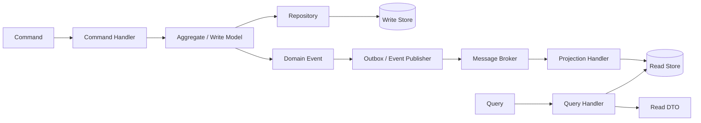
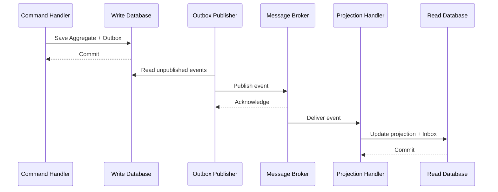

# CQRS: tách mô hình thay đổi trạng thái và mô hình truy vấn

Trong một ứng dụng CRUD truyền thống, cùng một mô hình đối tượng thường được dùng để đọc dữ liệu, cập nhật dữ liệu và trả kết quả cho giao diện. Cách làm này đơn giản và phù hợp với nhiều hệ thống. Nhưng khi nghiệp vụ ghi có nhiều quy tắc, còn truy vấn cần tổng hợp dữ liệu từ nhiều nguồn hoặc phục vụ nhiều kiểu màn hình, một mô hình duy nhất có thể trở nên khó tổ chức và tối ưu.

**CQRS (Command Query Responsibility Segregation)** là cách tách trách nhiệm giữa hai loại thao tác: command làm thay đổi trạng thái và query chỉ đọc dữ liệu. Mỗi phía có thể dùng mô hình, API và cách lưu trữ phù hợp với mục đích của nó. Phía ghi tập trung bảo vệ quy tắc nghiệp vụ; phía đọc tập trung trả dữ liệu thuận tiện và hiệu quả cho nhu cầu truy vấn.

CQRS không bắt buộc phải dùng hai database, microservices hay Event Sourcing. Có thể bắt đầu bằng hai mô hình trong cùng một ứng dụng và cùng một database. Mức độ tách biệt nên xuất phát từ nhu cầu thực tế của hệ thống.

## Mục tiêu học tập

Sau bài này, bạn có thể:

- Giải thích nguyên tắc Command Query Responsibility Segregation.
- Phân biệt command với query và hiểu vì sao query không nên thay đổi trạng thái nghiệp vụ.
- Thiết kế write model dựa trên Aggregate và quy tắc miền.
- Thiết kế read model/projection phù hợp với màn hình hoặc báo cáo.
- Mô tả luồng command, domain event, projection và query.
- Phân biệt CQRS với CRUD, Repository và Event Sourcing.
- Hiểu các lựa chọn đồng bộ/bất đồng bộ và consistency lag.
- Xử lý read-your-writes, retry, idempotency và cập nhật projection.
- Nhận biết khi nào CQRS hữu ích và khi nào tạo thêm độ phức tạp không cần thiết.

## 1. Command và Query là hai loại trách nhiệm khác nhau

CQRS dựa trên một phân biệt rõ ràng:

- **Command** diễn đạt ý định yêu cầu hệ thống thay đổi trạng thái. Ví dụ: PlaceOrder, ConfirmOrder, CancelSubscription.
- **Query** yêu cầu dữ liệu mà không làm thay đổi trạng thái nghiệp vụ. Ví dụ: GetOrderDetails, SearchOrders, GetMonthlyRevenue.

Một command có thể được chấp nhận hoặc từ chối theo quy tắc miền. Một query trả dữ liệu hoặc cho biết không tìm thấy dữ liệu. Hai loại thao tác có mục tiêu và hợp đồng khác nhau.

| Tiêu chí | Command | Query |
| --- | --- | --- |
| Mục đích | Thay đổi trạng thái | Đọc và trình bày dữ liệu |
| Ví dụ | ConfirmOrder, CancelOrder | GetOrder, SearchOrders |
| Kết quả | Kết quả xử lý, ID, trạng thái hoặc lỗi nghiệp vụ | DTO, projection, trang dữ liệu |
| Quy tắc chính | Bảo vệ bất biến và chính sách miền | Trả đúng dữ liệu theo tiêu chí truy vấn |
| Có ghi dữ liệu nghiệp vụ? | Có thể có | Không |
| Mô hình phù hợp | Aggregate, Entity, Value Object, Domain Service | Read model, projection, query model |
| Tối ưu | Tính đúng đắn của thay đổi | Tốc độ, lọc, phân trang, tổng hợp |

Một query có thể cập nhật cache hoặc metric kỹ thuật, nhưng không nên tạo thay đổi nghiệp vụ như xác nhận đơn hoặc trừ tồn kho. Nếu một thao tác vừa trả dữ liệu vừa làm thay đổi trạng thái, hãy xem xét tách thành command và query riêng.

### Command không phải một câu SQL

Tên command nên diễn đạt ý định nghiệp vụ, không chỉ mô tả thao tác lưu trữ. Ví dụ, ConfirmOrder thể hiện mục đích và quy tắc cần thực thi rõ hơn UpdateOrderStatus.

Command thường mang dữ liệu tối thiểu để xác định đối tượng và yêu cầu hành động. Nó không nên cho caller quyền gửi toàn bộ trạng thái mới rồi ghi đè Aggregate.

### Query không nên trả Aggregate chỉ để hiển thị

Màn hình danh sách đơn có thể cần order number, tên khách hàng, trạng thái, tổng tiền và ngày đặt. Nó không cần toàn bộ Aggregate Order cùng các hành vi miền. Một read model gọn phù hợp hơn.

Query model có thể được tối ưu cho việc đọc, kể cả khi cấu trúc của nó khác với write model. Đây là một điểm quan trọng của CQRS: không cần ép cả hai phía dùng cùng một object graph.

## 2. Write Model: bảo vệ quy tắc khi thay đổi trạng thái

Write model là mô hình được dùng để xử lý command. Trong DDD, write model thường gồm Aggregate Root, Entity, Value Object, Domain Service và Repository.

Khi nhận ConfirmOrder:

1. Application layer nhận command.
2. Tải Aggregate Order qua Repository.
3. Gọi hành vi nghiệp vụ trên Aggregate.
4. Aggregate kiểm tra trạng thái và bất biến.
5. Lưu thay đổi trong transaction.
6. Ghi nhận Domain Event hoặc Integration Event nếu có.
7. Trả kết quả cho caller.

Write model không cần được thiết kế để phục vụ mọi kiểu màn hình. Nó cần diễn đạt và bảo vệ các quy tắc khi dữ liệu thay đổi.

### Ví dụ Aggregate Order

```java
public final class Order {
    private final OrderId id;
    private OrderStatus status;
    private final List<OrderLine> lines;
    private long version;

    public Order(OrderId id, List<OrderLine> lines) {
        this.id = id;
        this.lines = new ArrayList<>(lines);
        this.status = OrderStatus.DRAFT;
    }

    public void confirm() {
        if (status != OrderStatus.DRAFT) {
            throw new OrderCannotBeConfirmed(id, status);
        }
        if (lines.isEmpty()) {
            throw new EmptyOrderCannotBeConfirmed(id);
        }

        status = OrderStatus.CONFIRMED;
    }

    public OrderId id() {
        return id;
    }

    public OrderStatus status() {
        return status;
    }

    public long version() {
        return version;
    }
}
```

Aggregate sở hữu quy tắc xác nhận đơn. Controller, query handler hoặc một client khác không được cập nhật trực tiếp cột status để bỏ qua hành vi này.

### Command và handler

Command là dữ liệu bất biến diễn đạt yêu cầu:

```java
public record ConfirmOrderCommand(
    UUID orderId,
    long expectedVersion,
    UUID actorId
) {}

public record ConfirmOrderResult(
    UUID orderId,
    String status,
    long version
) {}
```

Handler/application service điều phối:

```java
public final class ConfirmOrderHandler {
    private final OrderRepository orders;
    private final OrderAuthorizer authorizer;

    public ConfirmOrderHandler(
        OrderRepository orders,
        OrderAuthorizer authorizer
    ) {
        this.orders = orders;
        this.authorizer = authorizer;
    }

    public ConfirmOrderResult handle(ConfirmOrderCommand command) {
        OrderId id = new OrderId(command.orderId());

        Order order = orders.findById(id)
            .orElseThrow(() -> new OrderNotFound(id));

        if (!authorizer.canConfirm(command.actorId(), order)) {
            throw new OrderConfirmationForbidden(id);
        }

        if (order.version() != command.expectedVersion()) {
            throw new OrderVersionConflict(id);
        }

        order.confirm();
        Order saved = orders.save(order);

        return new ConfirmOrderResult(
            command.orderId(),
            saved.status().name(),
            saved.version()
        );
    }
}

public interface OrderRepository {
    Optional<Order> findById(OrderId id);
    Order save(Order order);
}

public interface OrderAuthorizer {
    boolean canConfirm(UUID actorId, Order order);
}
```

Đây là ví dụ rút gọn. Trong hệ thống thực tế, cần bảo vệ version bằng optimistic locking ở persistence layer và ghi Outbox cùng transaction nếu command phát Integration Event. Việc so sánh version trong code là kiểm tra sớm để diễn đạt kết quả dễ hiểu, không thay thế atomic concurrency control tại nơi lưu.

## 3. Read Model: trả dữ liệu theo nhu cầu truy vấn

Read model là cấu trúc dữ liệu được tổ chức để trả lời query. Nó có thể là DTO, projection, bảng denormalized, document hoặc view được tạo từ write model và các sự kiện.

Ví dụ màn hình quản lý đơn có thể cần:

- orderId và orderNumber.
- customerName.
- status.
- totalAmount và currency.
- createdAt.
- số lượng dòng hàng.

Read model có thể lưu sẵn customerName và totalAmount để không cần join nhiều bảng mỗi lần truy vấn. Cấu trúc này có thể trùng lặp dữ liệu có chủ đích để tối ưu đọc.

```java
public record OrderSummaryView(
    UUID orderId,
    String orderNumber,
    String customerName,
    String status,
    BigDecimal totalAmount,
    String currency,
    Instant createdAt,
    int lineCount
) {}
```

Query handler chỉ đọc read model:

```java
public final class GetOrderSummaryHandler {
    private final OrderSummaryQueries queries;

    public GetOrderSummaryHandler(OrderSummaryQueries queries) {
        this.queries = queries;
    }

    public Optional<OrderSummaryView> handle(UUID orderId) {
        return queries.findSummary(orderId);
    }
}

public interface OrderSummaryQueries {
    Optional<OrderSummaryView> findSummary(UUID orderId);
}
```

Query handler không cần tải Aggregate Order rồi chuyển từng field sang response. Nó đọc đúng projection cần cho use case truy vấn.

### Một write model có thể có nhiều read model

Cùng một dữ liệu Order có thể được hiển thị theo nhiều cách:

| Nhu cầu | Read model phù hợp |
| --- | --- |
| Trang chi tiết đơn | OrderDetailsView |
| Danh sách đơn theo khách hàng | CustomerOrderList |
| Dashboard doanh thu | DailySalesSummary |
| Theo dõi giao hàng | OrderFulfillmentView |
| Báo cáo sản phẩm bán chạy | ProductSalesRanking |

Không cần tạo một read model duy nhất chứa mọi field cho mọi màn hình. Mỗi projection nên phục vụ một nhóm truy vấn có ý nghĩa và có thể được tối ưu độc lập.

## 4. Luồng CQRS: từ command đến projection

Một luồng CQRS thường có hai đường:

- Đường ghi: command → handler → Aggregate → Repository/database.
- Đường đọc: query → query handler → read model → response.

Nếu read model được cập nhật bất đồng bộ, Domain Event hoặc Integration Event được dùng để thông báo thay đổi. Projection handler tiêu thụ event và cập nhật cấu trúc đọc.



Sơ đồ là một cách triển khai phổ biến, không phải cấu trúc bắt buộc. Với ứng dụng nhỏ, write model và read model có thể dùng cùng database. Event broker và Outbox chỉ cần khi nhu cầu cập nhật projection bất đồng bộ hoặc tích hợp yêu cầu chúng.

### Cập nhật projection

Projection handler chuyển event thành dữ liệu đọc. Ví dụ khi OrderConfirmed được phát, projection có thể cập nhật trạng thái trong OrderSummaryView.

```java
public final class OrderSummaryProjection {
    private final OrderSummaryStore store;

    public OrderSummaryProjection(OrderSummaryStore store) {
        this.store = store;
    }

    public void on(OrderConfirmed event) {
        store.applyIfNewer(
            event.eventId(),
            event.orderId(),
            "CONFIRMED",
            event.aggregateVersion()
        );
    }
}

public interface OrderSummaryStore {
    // Atomically deduplicate eventId and apply only a newer aggregate version.
    boolean applyIfNewer(
        UUID eventId,
        UUID orderId,
        String status,
        long aggregateVersion
    );
}
```

Projection handler cần xử lý duplicate và event đến sai thứ tự. Store phải thực hiện deduplication và so sánh version một cách atomic; nếu tách thành bước kiểm tra rồi cập nhật, hai worker đồng thời vẫn có thể áp dụng cùng event hoặc ghi đè trạng thái mới hơn. Kiểm tra aggregateVersion phù hợp với projection chỉ cần trạng thái mới nhất. Nếu projection cần áp dụng mọi sự kiện theo thứ tự, cần event sequence và cơ chế phát hiện gap. Cơ chế cụ thể phụ thuộc projection có nhận đầy đủ stream hay chỉ một số loại event.

## 5. Hai cách triển khai CQRS

CQRS mô tả sự tách biệt trách nhiệm; mức độ tách vật lý có thể khác nhau.

### CQRS logic trong cùng một ứng dụng

Write model và read model được tách bằng code và interface nhưng có thể cùng process và database.

Ví dụ:

- Command handler dùng Aggregate và Repository.
- Query handler dùng SQL projection hoặc query service.
- Cả hai dùng chung database nhưng truy cập theo hợp đồng khác nhau.

Ưu điểm:

- Dễ triển khai và vận hành hơn.
- Không cần broker để đồng bộ projection.
- Có thể dùng transaction database chung khi phù hợp.
- Phù hợp để tách trách nhiệm trong một modular monolith.

Đánh đổi là hai mô hình vẫn chia sẻ tài nguyên database và có thể cần phối hợp schema/migration.

### CQRS vật lý với read store riêng

Write side và read side có thể dùng database hoặc công nghệ khác nhau. Ví dụ write side dùng relational database để bảo vệ transaction; read side dùng search engine hoặc document store để phục vụ truy vấn.

Ưu điểm:

- Tối ưu độc lập cho tải ghi và tải đọc.
- Read model có thể denormalize hoặc index theo nhu cầu.
- Có thể scale read side độc lập.
- Có thể cô lập workload báo cáo nặng khỏi transaction ghi.

Đánh đổi:

- Cần cơ chế cập nhật và rebuild projection.
- Có consistency lag.
- Phải vận hành broker, Outbox/Inbox và retry nếu dùng event-driven projection.
- Cần xử lý duplicate, event ordering và schema evolution.

| Tiêu chí | CQRS logic | CQRS vật lý |
| --- | --- | --- |
| Process | Có thể cùng ứng dụng | Có thể tách service/process |
| Database | Có thể dùng chung | Thường có read store riêng |
| Đồng bộ | Có thể trực tiếp trong transaction | Thường qua event/message |
| Consistency | Có thể đọc ngay sau ghi | Có thể eventual consistency |
| Vận hành | Đơn giản hơn | Nhiều thành phần hơn |
| Khi phù hợp | Cần tách trách nhiệm code | Có yêu cầu scale/shape dữ liệu khác biệt rõ |

Không nên bắt đầu bằng hai database chỉ vì CQRS cho phép. Hãy bắt đầu từ sự khác nhau giữa nhu cầu ghi và đọc, sau đó tách vật lý khi có lý do đo được.

## 6. Consistency và độ trễ của read model

Khi projection được cập nhật bất đồng bộ, command có thể thành công trước khi read model phản ánh thay đổi. Đây là consistency lag.

Ví dụ:

1. Client gửi ConfirmOrder.
2. Write model lưu Order ở trạng thái CONFIRMED.
3. Command handler trả thành công.
4. Event được publish và consumer cập nhật OrderSummary.
5. Query ngay lập tức có thể vẫn thấy trạng thái PENDING trong một khoảng ngắn.

Đây không nhất thiết là lỗi nếu API contract đã xác định read model có độ trễ. Nhưng trải nghiệm người dùng cần được thiết kế để không gây hiểu nhầm.

### Read-your-writes

Một số cách hỗ trợ caller nhìn thấy thay đổi vừa thực hiện:

- Trả trạng thái mới trong response của command, dùng dữ liệu từ write side.
- Trả version hoặc projection checkpoint để client biết cần chờ đến đâu.
- Cho phép query theo consistency token hoặc minimum version.
- Với một số màn hình, đọc tạm từ write side sau khi ghi thành công.
- Cập nhật giao diện lạc quan nhưng có khả năng điều chỉnh khi projection phản hồi.

Không nên giả định query read store luôn phản ánh ngay command vừa thành công nếu projection chạy bất đồng bộ.

### Version/checkpoint cho projection

Projection có thể lưu version cuối đã áp dụng cho mỗi Aggregate. Khi query cần đọc ít nhất version 12, query handler có thể đợi đến khi projection đạt version đó, trả trạng thái đang cập nhật hoặc dùng fallback phù hợp.

Cần giới hạn thời gian chờ; không nên biến query thành một request treo vô hạn. Nếu yêu cầu read-your-writes là bắt buộc và thường xuyên, có thể cần chọn một mô hình đọc đồng bộ hơn cho use case đó.

### Không dùng read model để bảo vệ bất biến ghi

Read model có thể trễ hoặc được tổng hợp từ nhiều nguồn. Không dùng nó làm nguồn quyết định cuối cùng cho quy tắc cần đúng tại thời điểm ghi, như giữ hàng hoặc giới hạn số dư. Command phải được xử lý bởi write model và context sở hữu dữ liệu.

## 7. Transaction, Outbox và xử lý projection đáng tin cậy

Nếu command thay đổi Aggregate và cần phát event để cập nhật projection, có nguy cơ dual-write: database commit nhưng publish thất bại, hoặc message được publish trong khi database rollback.

Transactional Outbox giải quyết bằng cách ghi trạng thái Aggregate và Outbox record trong cùng transaction. Publisher đọc Outbox sau commit và gửi event.



Outbox tránh mất event giữa commit và publish nhưng publisher có thể gửi lặp. Projection handler cần idempotent: ghi Inbox hoặc eventId cùng transaction với projection update. Nếu event đã được xử lý, consumer bỏ qua tác động lặp.

### Rebuild projection

Read model thường có thể được tạo lại từ nguồn dữ liệu có thẩm quyền:

- Nếu dùng event store, replay event stream để dựng projection.
- Nếu dùng relational write store, chạy batch/query để tái tạo projection.
- Nếu chỉ lưu Integration Event trong thời gian ngắn, cần có nguồn snapshot hoặc dữ liệu khác đủ để rebuild.

Cần xác định rõ nguồn sự thật và thời gian lưu event. Không thể giả định mọi CQRS system đều có event log đầy đủ.

Khi rebuild, projection cần quản lý checkpoint, version và việc chuyển traffic sang bản mới. Nếu event mới tiếp tục đến trong lúc rebuild, cần cơ chế bắt kịp để không bỏ sót cập nhật.

## 8. CQRS không đồng nghĩa với Event Sourcing

Hai khái niệm thường được kết hợp nhưng giải quyết hai vấn đề khác nhau.

- **CQRS** tách mô hình xử lý thay đổi trạng thái khỏi mô hình truy vấn.
- **Event Sourcing** lưu các sự kiện đã xảy ra làm nguồn dữ liệu chính để tái dựng trạng thái.

Một hệ thống có thể dùng CQRS mà write side vẫn lưu trạng thái hiện tại trong relational database. Sau khi command thành công, nó phát Domain Event hoặc Integration Event để cập nhật read model.

Một hệ thống Event Sourcing thường có lợi khi kết hợp CQRS vì event stream có thể phục vụ write-side rehydration và read-side projections. Nhưng Event Sourcing có thêm chi phí về event schema evolution, replay, upcasting, snapshot, concurrency và vận hành event store.

| Câu hỏi | CQRS | Event Sourcing |
| --- | --- | --- |
| Vấn đề giải quyết | Tách trách nhiệm ghi và đọc | Lưu lịch sử thay đổi như nguồn sự thật |
| Write persistence | Có thể lưu trạng thái hiện tại | Lưu event stream |
| Read model | Có thể có projection riêng | Thường được dựng từ event stream |
| Có bắt buộc event store? | Không | Có |
| Có bắt buộc broker? | Không | Không nhất thiết |
| Có thể dùng riêng? | Có | Có, dù thường kết hợp với CQRS |

Đừng gọi một ứng dụng phát Integration Event là Event Sourcing nếu nó vẫn lấy trạng thái hiện tại trong database làm nguồn sự thật.

## 9. Thiết kế command/query contract và quyền truy cập

Tách trách nhiệm cũng có nghĩa mỗi loại API nên có hợp đồng phù hợp.

Command contract nên:

- Thể hiện hành động cụ thể.
- Chỉ chứa dữ liệu caller được phép cung cấp.
- Có định danh hoặc idempotency key khi thao tác có thể gửi lại.
- Có expected version/ETag nếu cần kiểm soát cạnh tranh.
- Trả kết quả xử lý, không nhất thiết trả toàn bộ Aggregate.

Query contract nên:

- Thể hiện tiêu chí lọc, sắp xếp và phân trang.
- Trả DTO/read model phù hợp với màn hình.
- Kiểm tra quyền truy cập dữ liệu, không chỉ quyền gọi endpoint.
- Không gây thay đổi nghiệp vụ.
- Có giới hạn kích thước và chi phí truy vấn.

Ví dụ:

```java
public record SearchOrdersQuery(
    UUID customerId,
    String status,
    Instant createdAfter,
    Instant createdBefore,
    int page,
    int pageSize
) {}

public record OrderListItem(
    UUID orderId,
    String orderNumber,
    String status,
    BigDecimal total,
    String currency
) {}

public record PageResult<T>(
    List<T> items,
    int page,
    int pageSize,
    long totalItems
) {}
```

Không trả dữ liệu nhạy cảm chỉ vì read store có chứa nó. Query side cần áp dụng authorization, tenant scope và data filtering tương tự write side.

## 10. Khi nào CQRS hữu ích?

CQRS có thể phù hợp khi:

- Mô hình ghi có nhiều quy tắc và hành vi, trong khi truy vấn có hình dạng rất khác.
- Một số màn hình cần tổng hợp dữ liệu từ nhiều Aggregate hoặc Bounded Context.
- Workload đọc lớn hơn nhiều so với workload ghi và cần scale riêng.
- Báo cáo nặng làm ảnh hưởng transaction ghi.
- Cần nhiều projection cho các mục đích đọc khác nhau.
- Write model cần giữ ngôn ngữ miền trong khi query cần DTO tối ưu.

CQRS có thể không cần thiết khi:

- Ứng dụng CRUD nhỏ, mô hình ghi và đọc đơn giản.
- Một database và một mô hình đã đáp ứng hiệu năng.
- Không có nhu cầu truy vấn khác biệt hoặc tải đọc/ghi đáng kể.
- Đội ngũ chưa có khả năng vận hành projection, message delivery và consistency lag.
- Chi phí đồng bộ, retry và rebuild lớn hơn lợi ích.

CQRS là một lựa chọn kiến trúc, không phải yêu cầu bắt buộc của DDD. Có thể áp dụng tách logic trước, đo hiệu năng và độ phức tạp rồi mới tách database hoặc process.

## 11. Những sai lầm thường gặp

- **Tách hai database quá sớm:** tăng chi phí vận hành và đồng bộ khi chưa có nhu cầu.
- **Cho query handler gọi Aggregate rồi duyệt object graph:** bỏ lỡ lợi ích của read model chuyên biệt.
- **Cho command handler ghi trực tiếp read model:** tạo hai nguồn thay đổi khó đồng bộ.
- **Để query làm thay đổi trạng thái nghiệp vụ:** phá vỡ phân biệt command/query.
- **Dùng projection làm nguồn sự thật cho write:** projection có thể trễ hoặc được rebuild.
- **Không xử lý consistency lag:** người dùng thấy dữ liệu cũ sau khi command đã thành công.
- **Không deduplicate event:** projection có thể cộng hoặc cập nhật lặp.
- **Không kiểm tra event version:** event cũ có thể ghi đè trạng thái mới.
- **Coi Outbox là exactly-once:** publisher vẫn có thể giao lặp.
- **Coi CQRS là Event Sourcing:** tăng độ phức tạp không cần thiết và nhầm nguồn sự thật.
- **Tạo quá nhiều command/query nhỏ:** API nội bộ trở nên vụn vặt mà không tăng rõ ràng.
- **Bỏ qua authorization ở query side:** read model có thể làm lộ dữ liệu giữa tenant hoặc người dùng.

## 12. Quy trình áp dụng CQRS

Khi xem xét CQRS cho một use case, hãy thực hiện theo trình tự:

1. **Liệt kê command và query.** Xác định thao tác nào thay đổi trạng thái và thao tác nào chỉ đọc.
2. **Xác định write model.** Chỉ rõ Aggregate và quy tắc cần bảo vệ.
3. **Xác định nhu cầu đọc.** Liệt kê màn hình, báo cáo, bộ lọc và dữ liệu tổng hợp.
4. **Thiết kế read model.** Tạo projection vừa đủ cho từng nhu cầu đọc có ý nghĩa.
5. **Chọn mức độ tách.** Bắt đầu cùng process/database nếu phù hợp; tách vật lý khi có nhu cầu.
6. **Chọn cách cập nhật projection.** Đồng bộ trong transaction hoặc bất đồng bộ qua event.
7. **Thiết kế consistency.** Xác định consistency lag, read-your-writes và cách hiển thị trạng thái đang cập nhật.
8. **Bảo vệ delivery.** Dùng Outbox/Inbox, idempotency và version check khi cần.
9. **Thiết kế rebuild.** Xác định nguồn sự thật, checkpoint và cách tái tạo projection.
10. **Đo lường.** Theo dõi command latency, query latency, projection lag, retry, duplicate và lỗi đồng bộ.
11. **Review độ phức tạp.** Xác nhận lợi ích thực tế lớn hơn chi phí vận hành và bảo trì.

Checklist review:

- [ ] Command diễn đạt ý định thay đổi trạng thái rõ ràng?
- [ ] Aggregate/write model bảo vệ bất biến?
- [ ] Query chỉ đọc và trả đúng read model?
- [ ] Read model được tối ưu theo nhu cầu truy vấn?
- [ ] Query side có authorization và tenant filtering?
- [ ] Mức độ tách logic/vật lý phù hợp với nhu cầu?
- [ ] Consistency lag và read-your-writes được định nghĩa?
- [ ] Outbox/Inbox và idempotency được dùng khi cần?
- [ ] Projection có thể rebuild và bắt kịp event mới?
- [ ] CQRS được phân biệt rõ với Event Sourcing?
- [ ] Có số liệu chứng minh lợi ích và theo dõi chi phí vận hành?

## Kết luận

CQRS tách trách nhiệm thay đổi trạng thái và truy vấn dữ liệu để mỗi phía có thể dùng mô hình phù hợp. Write model tập trung bảo vệ quy tắc miền qua Aggregate và command handler; read model tập trung trả DTO/projection hiệu quả cho query. Hai phía có thể cùng process và database hoặc tách vật lý khi có nhu cầu thực tế.

Nếu projection được cập nhật bất đồng bộ, hệ thống cần chấp nhận và quản lý consistency lag, hỗ trợ read-your-writes, xử lý duplicate và có khả năng rebuild. CQRS không đồng nghĩa Event Sourcing: có thể tách command/query mà vẫn lưu trạng thái hiện tại như thông thường. Hãy bắt đầu từ sự khác biệt thật sự giữa nhu cầu ghi và đọc, sau đó chọn mức độ tách nhỏ nhất đáp ứng được yêu cầu của hệ thống.
