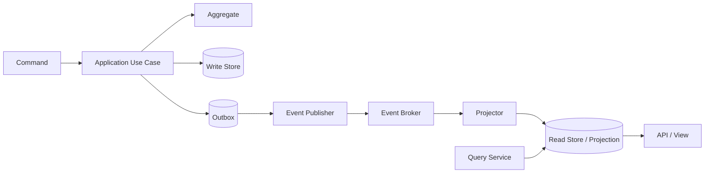

# Thiết kế projection phục vụ truy vấn và chấp nhận độ trễ

Trong Domain-Driven Design (DDD), mô hình ghi cần bảo vệ quy tắc nghiệp vụ và tính nhất quán của Aggregate. Nhưng nhu cầu đọc của ứng dụng thường đa dạng hơn: màn hình danh sách cần lọc và phân trang, dashboard cần số liệu tổng hợp, trang theo dõi cần ghép trạng thái đơn hàng với thanh toán và giao vận. Một mô hình được thiết kế tốt cho việc ghi không nhất thiết là mô hình thuận tiện cho mọi truy vấn.

CQRS (Command Query Responsibility Segregation) tách trách nhiệm xử lý lệnh thay đổi trạng thái khỏi trách nhiệm phục vụ truy vấn. Trong kiến trúc này, **projection** là quá trình chuyển các sự kiện hoặc thay đổi đã được ghi nhận thành một mô hình đọc được tổ chức theo nhu cầu truy vấn. Projection có thể tạo bảng tóm tắt đơn hàng, chỉ mục tìm kiếm hoặc read model tổng hợp từ nhiều nguồn.

Khi projection được cập nhật bất đồng bộ, dữ liệu đọc có thể chậm hơn write model trong một khoảng thời gian. Đây là sự đánh đổi về độ nhất quán: hệ thống có thể phục vụ truy vấn nhanh và độc lập hơn, nhưng người dùng đôi khi nhìn thấy trạng thái cũ ngay sau thao tác. Đội phát triển cần thiết kế rõ độ trễ chấp nhận được, cách quan sát backlog, cách xử lý lỗi và trải nghiệm khi dữ liệu chưa kịp cập nhật.

Bài viết trình bày cách chọn và thiết kế projection, xây dựng projector có thể replay và xử lý event trùng/thứ tự, đo độ trễ, hỗ trợ read-your-writes và kiểm thử read model. Mục tiêu là chọn mức nhất quán phù hợp với từng use case thay vì mặc định mọi truy vấn phải thấy dữ liệu mới ngay lập tức.

## 1. Vì sao cần projection trong CQRS?

Một Aggregate được tổ chức để bảo vệ invariant tại ranh giới nhất quán. Ví dụ, Order quản lý trạng thái đặt hàng, các dòng hàng, địa chỉ và quy tắc chuyển trạng thái. Cách tổ chức này phù hợp cho các lệnh như đặt đơn, hủy đơn hoặc thay đổi số lượng.

Nhưng màn hình danh sách đơn hàng thường cần một hình dạng dữ liệu khác:

- Lọc theo khách hàng, trạng thái và khoảng thời gian.
- Sắp xếp theo thời điểm tạo hoặc tổng tiền.
- Hiển thị tên khách hàng, số dòng và tổng tiền.
- Phân trang hàng nghìn hoặc hàng triệu đơn.
- Kết hợp thông tin giao vận hoặc thanh toán.

Nếu mọi truy vấn đều tải đầy đủ Aggregate rồi ghép dữ liệu trong bộ nhớ, ứng dụng có thể đọc quá nhiều dữ liệu, tạo nhiều truy vấn và phụ thuộc vào cấu trúc write model. Projection cho phép chuẩn bị trước dữ liệu theo cách truy vấn thường dùng.

### 1.1. Phân biệt Command Model và Query Model

| Thành phần | Mục tiêu | Ví dụ |
|---|---|---|
| Command Model / Write Model | Thực hiện thay đổi và bảo vệ invariant | Order Aggregate |
| Query Model / Read Model | Trả dữ liệu theo nhu cầu đọc | OrderSummaryProjection |
| Projector | Chuyển sự kiện hoặc thay đổi thành read model | OrderProjectionHandler |
| Query Service | Truy vấn read model và trả kết quả | SearchOrdersQueryService |

Write model tập trung vào tính đúng đắn của nghiệp vụ. Read model tập trung vào cách truy xuất và trình bày dữ liệu. Hai mô hình có thể dùng chung database hoặc tách database; CQRS không bắt buộc phải có hai hệ quản trị dữ liệu riêng.

### 1.2. Projection không phải bản sao nguyên trạng của Aggregate

Projection nên chứa dữ liệu cần cho một hoặc một nhóm truy vấn. Ví dụ, read model cho danh sách đơn có thể lưu:

- Order ID.
- Customer ID và tên khách tại thời điểm cần hiển thị.
- Trạng thái đơn.
- Tổng tiền và tiền tệ.
- Số dòng hàng.
- Thời điểm tạo và đặt đơn.
- Trạng thái giao vận đã được tổng hợp nếu màn hình cần.

Projection có thể làm phẳng dữ liệu từ nhiều Aggregate, đổi tên field theo ngôn ngữ truy vấn hoặc lưu các giá trị tổng hợp. Nó không cần giữ đầy đủ hành vi, phương thức hay object graph của Aggregate.

### 1.3. CQRS không đồng nghĩa với Event Sourcing

CQRS và Event Sourcing thường được dùng cùng nhau nhưng là hai quyết định kiến trúc khác nhau:

- CQRS tách trách nhiệm ghi và đọc.
- Event Sourcing lưu trạng thái nghiệp vụ bằng chuỗi sự kiện làm nguồn sự thật.
- Projection có thể được xây từ event log của Event Sourcing, nhưng cũng có thể được xây từ Domain Event, Integration Event, transactional outbox hoặc CDC trong hệ thống dùng lưu trữ trạng thái thông thường.

Một hệ thống có thể dùng CQRS với bảng quan hệ làm write store và event/outbox để cập nhật read model. Một hệ thống khác có thể dùng Event Sourcing nhưng vẫn có nhiều projection cho các truy vấn khác nhau. Không cần triển khai Event Sourcing chỉ để có projection.

## 2. Projection hình thành như thế nào?

Projection thường gồm ba phần:

1. Nguồn thay đổi: sự kiện hoặc bản ghi thay đổi đã được commit.
2. Projector: thành phần đọc thay đổi, áp dụng quy tắc chuyển đổi và cập nhật read model.
3. Read store: nơi lưu dữ liệu đã được tối ưu cho truy vấn.

Luồng bất đồng bộ điển hình:



Trong mô hình này, write store và outbox được ghi trong cùng transaction. Publisher chuyển event trong outbox đến broker; projector nhận event và cập nhật read store. Query Service đọc projection để phục vụ client.

Không phải kiến trúc nào cũng cần broker. Một ứng dụng nhỏ có thể dùng bảng outbox và worker nền. Một hệ thống có thể dùng CDC để phát hiện thay đổi từ database. Dù chọn cơ chế nào, cần bảo đảm projector chỉ xử lý dữ liệu đã được ghi nhận bền vững.

### 2.1. Event được tạo ở thời điểm nào?

Một sự kiện như OrderPlaced nên mô tả sự việc đã xảy ra, không phải ý định chưa được xác nhận. Sự kiện cần được ghi nhận cùng transaction thay đổi Order hoặc bằng cơ chế bảo đảm tương đương.

Nếu ứng dụng publish message trước khi transaction database commit, projector có thể cập nhật read model trong khi write transaction sau đó rollback. Khi đó read model phản ánh một sự việc chưa thực sự xảy ra.

Transactional Outbox là một cách phổ biến để tránh vấn đề này:

- Cập nhật Aggregate.
- Ghi bản ghi outbox trong cùng transaction.
- Commit transaction.
- Publisher đọc outbox và phát message.
- Projector nhận message và cập nhật projection.

Outbox không tự bảo đảm message chỉ được gửi đúng một lần. Publisher có thể gửi lại nếu gặp lỗi sau khi broker nhận message nhưng trước khi outbox được đánh dấu đã gửi. Vì vậy, projector vẫn cần xử lý idempotency.

### 2.2. Domain Event, Integration Event và projection event

Không phải mọi event đều phù hợp để đưa trực tiếp vào read model công khai.

- Domain Event diễn đạt sự việc trong mô hình nội bộ của một Bounded Context.
- Integration Event là hợp đồng ổn định được công bố cho context hoặc hệ thống khác.
- Projection event là event hoặc record mà projector tiêu thụ để cập nhật một read model cụ thể.

Một projector trong cùng context có thể đọc Domain Event nội bộ. Projector ở context khác nên phụ thuộc vào Integration Event hoặc contract được công bố, không nên phụ thuộc class nội bộ của context nguồn.

### 2.3. Event nên mang dữ liệu nào?

Projector cần đủ dữ liệu để cập nhật projection. Có hai cách phổ biến:

- Event mang snapshot các giá trị cần thiết tại thời điểm sự kiện xảy ra.
- Event chỉ mang ID và projector truy vấn thêm dữ liệu từ nguồn khác.

Event giàu dữ liệu giúp projector ít phải gọi ngược write model và tránh việc dữ liệu hiện tại đã khác thời điểm event xảy ra. Tuy nhiên, payload lớn làm tăng chi phí lưu trữ, truyền tải và versioning.

Event chỉ mang ID có payload nhỏ hơn nhưng projector phải truy vấn nguồn dữ liệu. Nếu Aggregate đã thay đổi nhiều lần trước khi projector đọc, truy vấn hiện tại có thể không tái tạo được trạng thái tại thời điểm event.

Hãy chọn theo semantics. Nếu projection cần lịch sử chính xác theo từng thay đổi, event cần mang đủ dữ liệu lịch sử. Nếu projection chỉ cần trạng thái mới nhất, projector có thể nạp snapshot hiện tại và cần cơ chế chống ghi đè bởi event cũ.

## 3. Chọn projection theo truy vấn thực tế

Không nên tạo projection chỉ vì một Aggregate có nhiều field. Hãy bắt đầu từ truy vấn người dùng hoặc hệ thống cần thực hiện.

Ví dụ, một hệ thống quản lý đơn có các truy vấn:

| Nhu cầu | Dữ liệu cần | Projection có thể phù hợp |
|---|---|---|
| Danh sách đơn của khách | Trạng thái, ngày tạo, tổng tiền | CustomerOrderList |
| Theo dõi giao hàng | Trạng thái đơn, thanh toán, vận đơn | OrderTrackingView |
| Dashboard vận hành | Đếm đơn theo trạng thái và ngày | DailyOrderMetrics |
| Tìm kiếm đơn | Mã đơn, khách hàng, từ khóa, thời gian | OrderSearchIndex |
| Báo cáo doanh thu | Tổng tiền theo ngày, kênh và tiền tệ | RevenueByDay |

Một projection có thể phục vụ nhiều truy vấn nếu chúng có cấu trúc và vòng đời tương tự. Nhưng nếu hai màn hình có yêu cầu dữ liệu, tần suất cập nhật hoặc chính sách truy cập khác nhau đáng kể, tách projection có thể giúp đơn giản hóa.

### 3.1. Thiết kế theo access pattern

Cần biết trước:

- Người dùng lọc theo field nào?
- Trường nào cần sắp xếp?
- Có cần phân trang hay cursor?
- Có cần tìm kiếm toàn văn?
- Dữ liệu có cần tổng hợp theo ngày hoặc nhóm không?
- Mức trễ nào chấp nhận được?
- Dữ liệu có cần lọc theo tenant hoặc quyền truy cập không?

Ví dụ, nếu danh sách đơn luôn lọc theo customer ID và sắp xếp theo createdAt giảm dần, read store có thể có index tương ứng. Nếu dashboard cần đếm đơn theo ngày, projector có thể duy trì counter thay vì quét toàn bộ đơn mỗi lần truy vấn.

### 3.2. Không tạo một projection khổng lồ cho mọi màn hình

Một read model duy nhất chứa mọi field từ Order, Customer, Payment, Shipment và Inventory có thể trở thành một mô hình khó bảo trì. Mỗi context có thể thay đổi theo nhịp riêng, trong khi projection khổng lồ buộc projector hiểu quá nhiều khái niệm.

Tách theo nhu cầu truy vấn và quyền sở hữu dữ liệu. Một màn hình tổng hợp có thể có read model riêng, nhưng cần xác định nguồn dữ liệu nào là có thẩm quyền cho từng field.

### 3.3. Projection là dữ liệu dẫn xuất

Read model có thể được tạo lại từ nguồn sự thật nếu lịch sử event hoặc nguồn thay đổi vẫn còn. Vì vậy, không nên coi projection là nơi duy nhất lưu dữ liệu nghiệp vụ quan trọng nếu kiến trúc chưa xác định rõ nó là nguồn sự thật.

Nếu projection bị xóa, hệ thống cần có kế hoạch rebuild. Nếu không thể tái tạo projection từ nguồn còn lại, dữ liệu đó có thể thực chất là dữ liệu gốc và cần được quản lý như write model hoặc nguồn dữ liệu riêng.

## 4. Thiết kế cấu trúc read model

Read model cần phản ánh truy vấn, nhưng vẫn phải có semantics rõ để tránh dữ liệu sai hoặc khó nâng cấp.

Ví dụ, projection cho danh sách đơn:

```java
public record OrderSummaryProjection(
    String orderId,
    String customerId,
    String customerName,
    String status,
    BigDecimal totalAmount,
    String currency,
    int lineCount,
    Instant createdAt,
    Instant placedAt,
    long aggregateVersion
) {}
```

Đây là cấu trúc đọc. Nó có thể được lưu thành một document, một hàng trong bảng hoặc một bản ghi trong search index.

### 4.1. Chọn khóa của projection

Thông thường, projection theo một Aggregate có thể dùng Aggregate ID làm khóa:

```sql
CREATE TABLE order_summary (
    order_id VARCHAR(64) PRIMARY KEY,
    customer_id VARCHAR(64) NOT NULL,
    customer_name VARCHAR(200),
    status VARCHAR(32) NOT NULL,
    total_amount DECIMAL(19, 2) NOT NULL,
    currency CHAR(3) NOT NULL,
    line_count INTEGER NOT NULL,
    created_at TIMESTAMP NOT NULL,
    placed_at TIMESTAMP NULL,
    aggregate_version BIGINT NOT NULL
);
```

Khóa ổn định giúp projector cập nhật một dòng bằng upsert. Nếu projection là số liệu tổng hợp, khóa có thể là tổ hợp như ngày, cửa hàng và tiền tệ.

### 4.2. Denormalization có chủ đích

Projection có thể lưu customerName thay vì chỉ customerId để tránh join mỗi lần hiển thị danh sách. Đây là denormalization: dữ liệu được sao chép có chọn lọc để truy vấn nhanh hơn.

Đổi lại, khi tên khách hàng thay đổi, projection cần được cập nhật theo chính sách đã định. Cần xác định tên được hiển thị là:

- Tên hiện tại từ Customer Context.
- Tên snapshot tại thời điểm đặt đơn.
- Tên đã được đồng bộ gần nhất.

Ba ý nghĩa này khác nhau. Ví dụ, hóa đơn hoặc lịch sử giao dịch thường cần snapshot tại thời điểm giao dịch; danh sách hồ sơ khách hàng có thể cần tên hiện tại.

### 4.3. Định nghĩa rõ null, xóa và dữ liệu không còn hiệu lực

Projection cần quy định:

- Field nào có thể null.
- Event xóa Aggregate sẽ xóa projection hay đánh dấu tombstone.
- Dữ liệu đã bị ẩn hoặc xóa theo yêu cầu riêng tư được xử lý ra sao.
- Projection có giữ bản ghi lịch sử hay chỉ trạng thái hiện tại.
- Một event đến muộn có thể khôi phục dữ liệu đã bị xóa hay không.

Nếu xóa vật lý projection, event cũ đến trễ có thể tạo lại bản ghi. Tombstone hoặc version kiểm soát có thể giúp projector nhận biết rằng Aggregate đã bị xóa ở version mới hơn.

### 4.4. Lưu metadata phục vụ đồng bộ

Projection thường cần một số metadata kỹ thuật:

- Aggregate ID.
- Aggregate version hoặc sequence number.
- Event ID đã xử lý.
- Thời điểm event xảy ra.
- Thời điểm projection được cập nhật.
- Schema version nếu cần chuyển đổi payload.

Metadata này giúp projector phát hiện event trùng, event cũ và đo độ trễ. Không nên đưa mọi metadata nội bộ vào API response nếu client không cần.

## 5. Xây dựng projector có tính idempotent

Trong hệ thống message bất đồng bộ, một event có thể được giao nhiều lần. Broker hoặc publisher có thể retry khi không nhận được acknowledgement. Projector vì vậy phải chịu được việc nhận lại cùng một event.

**Idempotent** nghĩa là xử lý cùng một event nhiều lần không làm read model thay đổi sai hoặc nhân đôi kết quả.

Ví dụ, nếu OrderPlaced được gửi hai lần, projection không được cộng tổng tiền hai lần hoặc tăng số đơn lên hai lần.

### 5.1. Dùng event ID để nhận diện bản tin đã xử lý

Một bảng inbox có thể lưu event ID:

```sql
CREATE TABLE processed_event (
    event_id VARCHAR(100) PRIMARY KEY,
    processed_at TIMESTAMP NOT NULL
);
```

Trong cùng transaction cập nhật projection, projector ghi event ID vào bảng này. Nếu event ID đã tồn tại, nó bỏ qua xử lý.

Luồng khái niệm:

1. Bắt đầu transaction của read store.
2. Kiểm tra hoặc ghi event ID vào inbox.
3. Nếu event đã được xử lý, kết thúc mà không cập nhật projection.
4. Nếu là event mới, cập nhật read model.
5. Commit cả projection và inbox.
6. Chỉ acknowledgement message sau khi transaction thành công.

Nếu inbox và projection nằm ở hai database không cùng transaction, cần chiến lược khác để tránh ghi một bên thành công, bên còn lại thất bại. Có thể dùng upsert idempotent, checkpoint theo partition hoặc lưu trạng thái xử lý trong cùng read store.

### 5.2. Cập nhật projection theo Aggregate version

Event ID giúp nhận diện trùng chính xác, nhưng không tự giải quyết event đến sai thứ tự.

Giả sử Order phát ra:

- Version 5: OrderPlaced.
- Version 6: AddressChanged.
- Version 7: OrderCancelled.

Nếu projector nhận version 7 trước rồi mới nhận version 6, nó không nên để event cũ ghi đè trạng thái mới hơn.

Một quy tắc cơ bản là chỉ áp dụng event có version lớn hơn version hiện tại của projection:

```java
if (event.aggregateVersion() <= projection.aggregateVersion()) {
    return;
}

apply(event, projection);
projection.setAggregateVersion(event.aggregateVersion());
```

Quy tắc này phù hợp khi mỗi event chứa đủ dữ liệu để đưa projection đến trạng thái tương ứng hoặc khi chỉ cần trạng thái mới nhất. Nếu event là delta cần áp dụng tuần tự, bỏ qua version bị thiếu có thể làm sai dữ liệu. Khi đó projector cần phát hiện gap và chờ, retry hoặc nạp snapshot mới.

### 5.3. Phân biệt event snapshot và event delta

Event snapshot mang trạng thái hoặc các field đủ để cập nhật trực tiếp:

```java
public record OrderPlaced(
    UUID eventId,
    String orderId,
    long aggregateVersion,
    String customerId,
    BigDecimal totalAmount,
    String currency,
    Instant occurredAt
) {}
```

Event delta chỉ mô tả thay đổi:

```java
public record OrderLineQuantityChanged(
    UUID eventId,
    String orderId,
    long aggregateVersion,
    UUID lineId,
    int newQuantity,
    Instant occurredAt
) {}
```

Với event delta, projector cần có trạng thái trước đó và phải xử lý đúng thứ tự. Với event snapshot, projector có thể thay thế một phần hoặc toàn bộ trạng thái đọc bằng snapshot mới hơn.

Không nên dùng một điều kiện version đơn giản để bỏ qua event delta nếu projection cần áp dụng tất cả thay đổi trung gian, chẳng hạn cộng/trừ số dư hoặc duy trì lịch sử. Hãy xác định semantics của event trước khi chọn thuật toán.

## 6. Xử lý thứ tự event và cập nhật đồng thời

Event broker thường chỉ bảo đảm thứ tự trong một phạm vi nhất định, chẳng hạn một partition. Nếu event của cùng Aggregate có thể đi qua các partition khác nhau, projector có thể nhận chúng sai thứ tự.

### 6.1. Dùng Aggregate ID làm partition key khi cần thứ tự

Nếu mọi event của cùng Order cần được xử lý tuần tự, có thể dùng Order ID làm partition key. Điều này giúp broker giữ thứ tự trong partition tương ứng, miễn là publisher phát event theo đúng thứ tự.

Tuy nhiên, thứ tự trong broker không thay thế version check. Retry, nhiều publisher hoặc replay vẫn có thể tạo tình huống cần phát hiện event cũ.

### 6.2. Không dùng timestamp làm thứ tự tuyệt đối

Timestamp có thể trùng nhau, lệch đồng hồ hoặc phản ánh thời điểm phát thay vì thứ tự commit. Aggregate version hoặc sequence number thường đáng tin cậy hơn để xác định thứ tự thay đổi trong một Aggregate.

Nếu projection tổng hợp nhiều Aggregate, không có một version toàn cục tự nhiên. Có thể cần checkpoint riêng theo partition hoặc nguồn, tùy cách đọc dữ liệu.

### 6.3. Tránh lost update khi nhiều projector cùng cập nhật một projection

Nếu nhiều event từ các Aggregate khác nhau cập nhật cùng một dòng tổng hợp, hai projector có thể đọc cùng giá trị rồi ghi đè kết quả của nhau.

Ví dụ, hai đơn được đặt đồng thời cùng cập nhật số lượng đơn trong một ngày. Nếu cả hai đọc counter là 10 rồi cùng ghi 11, kết quả cuối có thể sai.

Các cách xử lý có thể gồm:

- Dùng phép tăng nguyên tử trong database.
- Dùng transaction và khóa phù hợp.
- Chia counter theo bucket rồi tổng hợp khi đọc.
- Tuần tự hóa xử lý theo khóa tổng hợp.
- Tính lại metric từ tập dữ liệu nguồn thay vì cập nhật counter trực tiếp.

Lựa chọn phụ thuộc throughput, độ chính xác và độ trễ cho phép.

## 7. Chấp nhận và quản lý độ trễ nhất quán

Khi projector chạy bất đồng bộ, write model có thể đã commit nhưng read model chưa cập nhật. Đây là eventual consistency: nếu không còn thay đổi mới và hệ thống xử lý thành công các event đang chờ, read model cuối cùng sẽ hội tụ với dữ liệu nguồn theo quy tắc projection.

Eventual consistency không có nghĩa dữ liệu luôn tự động chính xác sau một khoảng thời gian cố định. Lỗi projector, event bị kẹt, schema không tương thích hoặc event bị bỏ qua có thể khiến projection không bao giờ bắt kịp nếu không có cơ chế phát hiện và phục hồi.

### 7.1. Độ trễ projection đến từ đâu?

Các nguyên nhân thường gặp:

- Publisher đọc outbox chậm.
- Broker backlog tăng cao.
- Consumer thiếu tài nguyên hoặc số lượng worker không đủ.
- Projector xử lý một event quá lâu.
- Read store bị chậm hoặc khóa tranh chấp.
- Retry liên tục do payload lỗi hoặc schema mismatch.
- Một partition có lượng event lớn hơn các partition khác.
- Rebuild projection cạnh tranh tài nguyên với xử lý event mới.

Cần phân biệt độ trễ của publisher, broker và projector để tìm đúng nút thắt.

### 7.2. Đo projection lag

Một số chỉ số hữu ích:

| Chỉ số | Ý nghĩa |
|---|---|
| Event age | Tuổi của event cũ nhất chưa được xử lý |
| End-to-end projection lag | Thời gian từ lúc event được ghi nhận đến lúc projection cập nhật |
| Consumer lag | Khoảng cách giữa vị trí consumer và vị trí mới nhất của broker |
| Processing duration | Thời gian xử lý một event |
| Retry count | Số lần event phải xử lý lại |
| Dead-letter count | Số event không thể xử lý bình thường |
| Projection checkpoint | Vị trí hoặc version đã xử lý gần nhất |

Nếu event có thời điểm occurredAt, projector có thể ghi projectedAt và tính chênh lệch. Cần lưu ý đồng hồ giữa các máy có thể lệch; đo bằng timestamp từ nhiều hệ thống cần đồng bộ clock hoặc dùng thêm thời gian nhận event tại cùng một thành phần.

### 7.3. Đặt SLO cho độ trễ theo use case

Không phải mọi projection đều cần cùng một mức tươi mới.

Ví dụ minh họa:

- Trang theo dõi đơn có thể chấp nhận cập nhật trong vài giây.
- Dashboard vận hành có thể chấp nhận trễ một phút.
- Báo cáo tổng hợp cuối ngày có thể cập nhật theo batch.
- Kiểm tra hạn mức hoặc tồn kho trước khi chấp nhận lệnh có thể cần đọc nguồn có thẩm quyền thay vì dựa vào projection chậm.

Các con số cụ thể phải dựa trên nhu cầu nghiệp vụ và khả năng vận hành. Hãy định nghĩa SLO như percentile hoặc ngưỡng lag, ví dụ 95% event được phản ánh trong 3 giây và cảnh báo khi event cũ nhất vượt 30 giây. Đó là ví dụ cấu hình, không phải giá trị mặc định cho mọi hệ thống.

### 7.4. Độ trễ không chỉ là vấn đề kỹ thuật

Người dùng có thể vừa đặt đơn xong nhưng quay lại trang danh sách và chưa thấy đơn mới. Nếu giao diện không giải thích, họ có thể nhấn nút nhiều lần hoặc nghĩ thao tác thất bại.

Thiết kế sản phẩm cần xác định cách biểu đạt trạng thái:

- Hiển thị kết quả command ngay sau khi write model commit.
- Hiển thị nhãn “Đang cập nhật” khi read model chưa bắt kịp.
- Tạm giữ kết quả vừa tạo ở client cho đến khi projection xuất hiện.
- Tự làm mới trong một khoảng thời gian có giới hạn.
- Cho phép người dùng tiếp tục công việc dù danh sách chưa đồng bộ.

Không nên che giấu sự trễ bằng cách giả vờ dữ liệu đọc đã mới.

## 8. Các chiến lược read-your-writes

Read-your-writes là kỳ vọng rằng sau khi người dùng ghi thành công, họ có thể nhìn thấy kết quả của chính thao tác đó. Projection bất đồng bộ khiến kỳ vọng này cần được xử lý có chủ đích.

### 8.1. Trả kết quả từ write use case

Sau khi command thành công, use case có thể trả Order ID, trạng thái và dữ liệu xác nhận từ write model. Client hiển thị kết quả ngay mà không phải đọc lại projection tức thì.

Cách này đơn giản khi màn hình chỉ cần xác nhận hành động vừa thực hiện. Với response đầy đủ, application có thể tạo DTO từ kết quả use case hoặc từ Aggregate đã thay đổi.

### 8.2. Giữ dữ liệu vừa ghi ở client

Client có thể thêm kết quả command vào giao diện hiện tại như một item tạm thời. Khi projection cập nhật, dữ liệu từ read API thay thế item tạm.

Cách này hữu ích với danh sách đơn, bình luận hoặc thao tác tạo tài nguyên. Cần xử lý khi command thất bại hoặc khi dữ liệu server sau cùng khác với dữ liệu tạm.

### 8.3. Dùng causal token hoặc version để chờ projection

Command response có thể trả Aggregate version hoặc một token thể hiện vị trí event đã commit. Client gửi token đó trong truy vấn tiếp theo; Query Service chỉ trả khi projection đã xử lý đến vị trí tương ứng, hoặc báo rằng dữ liệu vẫn đang đồng bộ.

Ví dụ về hợp đồng:

```json
{
  "orderId": "ORD-2048",
  "acceptedVersion": 12,
  "projectionStatus": "PENDING"
}
```

Client có thể gọi endpoint trạng thái đồng bộ hoặc query với tham số minVersion bằng 12. Read side kiểm tra projection đã đạt version yêu cầu chưa.

Cách này cần có quan hệ đáng tin cậy giữa command commit và event/checkpoint. Version của Aggregate chỉ có ý nghĩa trong phạm vi Aggregate đó; với projection tổng hợp nhiều nguồn, có thể cần token theo partition hoặc một cơ chế watermark riêng.

### 8.4. Chờ đồng bộ trong giới hạn thời gian

Một API có thể chờ projection cập nhật trong một khoảng ngắn rồi mới trả response. Nếu vượt timeout, API trả kết quả command thành công kèm trạng thái projection đang chờ.

Không nên chờ vô hạn. Việc chờ đồng bộ làm tăng latency và giữ tài nguyên request. Nếu projection đang backlog, nhiều request cùng chờ có thể làm hệ thống quá tải thêm.

### 8.5. Đọc trực tiếp write model cho một số truy vấn

Với truy vấn cần tính nhất quán ngay sau một command, có thể đọc trực tiếp write store hoặc Aggregate trong một thời gian ngắn. Đây là một lựa chọn có chủ đích.

Ví dụ, sau khi cập nhật địa chỉ giao hàng, màn hình xác nhận có thể lấy địa chỉ từ kết quả use case. Trang lịch sử hoặc dashboard vẫn đọc projection.

Không nên chuyển mọi truy vấn sang write model chỉ để tránh vài giây trễ, vì như vậy sẽ mất lợi ích tách biệt và có thể làm write database chịu tải đọc lớn.

## 9. Xử lý lỗi và phục hồi projector

Projection là dữ liệu dẫn xuất, nhưng vẫn cần độ tin cậy vận hành. Một projector dừng hoặc xử lý sai có thể làm query trả kết quả cũ trong thời gian dài.

### 9.1. Retry lỗi tạm thời

Lỗi kết nối read store, timeout hoặc broker tạm thời có thể được retry với backoff và jitter. Giới hạn số lần retry trong một khoảng thời gian để tránh tạo vòng lặp nóng.

Nếu projector đã commit read model nhưng chưa acknowledge event, broker có thể gửi lại. Idempotency sẽ bảo vệ khỏi việc áp dụng lần hai.

### 9.2. Dead-letter queue cho event không thể xử lý

Một event sai schema hoặc vi phạm giả định của projector có thể thất bại liên tục. Sau số lần retry được cấu hình, event có thể được chuyển sang dead-letter queue (DLQ) cùng thông tin lỗi và metadata cần thiết.

DLQ cần có quy trình vận hành:

- Cảnh báo khi có event mới.
- Ghi nhận event ID, aggregate ID, version và exception.
- Phân loại lỗi dữ liệu, lỗi code hay lỗi hạ tầng.
- Sửa projector hoặc dữ liệu chuyển đổi.
- Replay event sau khi đã khắc phục.
- Theo dõi projection có bắt kịp sau replay không.

Không nên âm thầm bỏ event lỗi. Nếu một event bị bỏ qua, read model có thể sai vĩnh viễn mà dashboard lag vẫn trông bình thường.

### 9.3. Checkpoint phải được cập nhật cùng dữ liệu projection

Nếu projector lưu checkpoint trước rồi mới ghi read model, crash giữa hai bước có thể khiến event bị coi là đã xử lý dù projection chưa cập nhật.

Nếu ghi projection trước rồi checkpoint thất bại, event sẽ được xử lý lại. Điều đó an toàn khi projector idempotent.

Tốt nhất, nếu cùng một database có thể chứa projection và checkpoint, hãy cập nhật chúng trong cùng transaction. Nếu checkpoint nằm ở broker hoặc hệ thống khác, cần thiết kế theo hướng at-least-once và dùng idempotency.

### 9.4. Reconciliation để phát hiện sai lệch

Ngoài lag, cần có cách đối chiếu read model với nguồn dữ liệu:

- Đếm số Aggregate nguồn và số bản ghi projection theo phạm vi.
- So sánh tổng tiền hoặc số lượng theo nhóm.
- Kiểm tra các Aggregate mới nhất có projection tương ứng.
- Chọn mẫu bản ghi và so sánh field quan trọng.
- Phát hiện version projection thấp hơn version nguồn quá lâu.

Đối chiếu không nhất thiết chạy liên tục trên toàn bộ dữ liệu. Có thể chạy định kỳ hoặc theo phạm vi quan trọng. Khi phát hiện sai lệch, cần biết có thể rebuild toàn projection hay chỉ một phần.

## 10. Rebuild và version hóa projection

Khi thay đổi cấu trúc read model hoặc sửa lỗi projector, có thể cần dựng lại projection từ event history hoặc nguồn dữ liệu có thể replay.

### 10.1. Khi nào cần rebuild?

Các tình huống thường gặp:

- Thêm field mới vào read model.
- Thay đổi cách tính tổng hoặc phân nhóm.
- Sửa lỗi projector đã ghi dữ liệu sai.
- Thay đổi schema hoặc index.
- Tạo projection mới cho một truy vấn mới.
- Phục hồi sau khi read store bị mất dữ liệu.

Khả năng rebuild phụ thuộc vào nguồn dữ liệu. Nếu chỉ có event hiện tại mà không có lịch sử đầy đủ, có thể cần snapshot hoặc đọc lại write store để tạo trạng thái hiện tại.

### 10.2. Rebuild trực tiếp có thể làm gián đoạn truy vấn

Nếu xóa projection đang dùng rồi replay hàng triệu event, client có thể thấy dữ liệu trống hoặc rất cũ trong thời gian rebuild.

Một cách an toàn hơn là tạo projection version mới:

1. Tạo read store hoặc bảng mới, ví dụ order_summary_v2.
2. Replay event hoặc snapshot vào v2.
3. Tiếp tục áp dụng event mới cho v2.
4. Kiểm tra số liệu, version và lag của v2.
5. Chuyển query sang v2.
6. Giữ v1 trong khoảng thời gian rollback phù hợp rồi mới xóa.

Cách triển khai có thể dùng bảng song song, collection mới, index mới hoặc blue-green read model.

### 10.3. Replay phải an toàn với event hiện tại

Trong lúc rebuild, event mới vẫn tiếp tục phát sinh. Cần xác định điểm bắt đầu replay và cách bắt kịp event đến sau điểm đó.

Một chiến lược:

- Chụp lại offset hoặc watermark tại thời điểm bắt đầu.
- Replay lịch sử đến watermark.
- Tiếp tục tiêu thụ event sau watermark.
- Khi lag về mức thấp và dữ liệu đã đối chiếu, chuyển traffic sang projection mới.

Nếu replay và consumer mới cùng ghi một projection, cần kiểm soát version và idempotency để tránh event cũ ghi đè event mới.

### 10.4. Version schema của event và projection

Event có thể tồn tại lâu hơn một phiên bản ứng dụng. Projector cần biết cách đọc schema cũ.

Có thể dùng:

- Schema version trong event envelope.
- Upcaster hoặc adapter chuyển payload cũ sang cấu trúc nội bộ mới.
- Version riêng cho projection.
- Chính sách tương thích khi thêm field, đổi enum hoặc thay semantics.

Không nên đổi ý nghĩa field cũ mà không version hóa hoặc có bước chuyển đổi. Event đã lưu là dữ liệu lịch sử; code mới cần có khả năng hiểu chúng.

## 11. Ví dụ Java: projector cập nhật Order Summary

Giả sử hệ thống phát event OrderPlaced và OrderCancelled. Read model chỉ cần trạng thái hiện tại, tổng tiền và thời điểm đặt.

### 11.1. Event contract

```java
public record OrderPlaced(
    UUID eventId,
    String orderId,
    String customerId,
    String customerName,
    BigDecimal totalAmount,
    String currency,
    int lineCount,
    long aggregateVersion,
    Instant occurredAt
) {}

public record OrderCancelled(
    UUID eventId,
    String orderId,
    long aggregateVersion,
    Instant occurredAt
) {}
```

Event chứa đủ dữ liệu để cập nhật summary mà không phải tải lại Order. Nếu customerName là snapshot tại thời điểm đặt, nó sẽ giữ nguyên trong lịch sử đơn ngay cả khi hồ sơ khách hàng đổi tên.

### 11.2. Projection record

```java
public record OrderSummary(
    String orderId,
    String customerId,
    String customerName,
    String status,
    BigDecimal totalAmount,
    String currency,
    int lineCount,
    Instant placedAt,
    long aggregateVersion
) {}
```

Read store có thể lưu record này trong bảng hoặc document. Trong ví dụ, repository projection cung cấp thao tác đọc và ghi:

```java
public interface OrderSummaryStore {
    Optional<OrderSummary> findById(String orderId);
    void upsert(OrderSummary summary);
    boolean markEventProcessed(UUID eventId);
}
```

Trong implementation thực tế, đánh dấu event đã xử lý và upsert phải nằm trong cùng transaction nếu cả hai dùng chung database.

### 11.3. Projector cho OrderPlaced

```java
public final class OrderPlacedProjector {
    private final OrderSummaryStore store;

    public OrderPlacedProjector(OrderSummaryStore store) {
        this.store = store;
    }

    public void handle(OrderPlaced event) {
        if (!store.markEventProcessed(event.eventId())) {
            return;
        }

        OrderSummary current = store.findById(event.orderId())
            .orElse(null);

        if (current != null &&
            current.aggregateVersion() >= event.aggregateVersion()) {
            return;
        }

        OrderSummary updated = new OrderSummary(
            event.orderId(),
            event.customerId(),
            event.customerName(),
            "PLACED",
            event.totalAmount(),
            event.currency(),
            event.lineCount(),
            event.occurredAt(),
            event.aggregateVersion()
        );

        store.upsert(updated);
    }
}
```

Đây là mã minh họa luồng. Trong production, kiểm tra event đã xử lý và upsert phải nguyên tử. Cũng cần xem xét việc ghi event ID trước khi phát hiện version cũ: nếu event cũ bị bỏ qua có chủ đích thì đánh dấu processed là hợp lý; nếu event còn thiếu version trước đó, không được đánh dấu hoàn tất khi cần chờ event bị thiếu.

### 11.4. Projector cho trạng thái hủy

```java
public final class OrderCancelledProjector {
    private final OrderSummaryStore store;

    public OrderCancelledProjector(OrderSummaryStore store) {
        this.store = store;
    }

    public void handle(OrderCancelled event) {
        OrderSummary current = store.findById(event.orderId())
            .orElseThrow(() ->
                new ProjectionDataMissingException(event.orderId())
            );

        if (event.aggregateVersion() <= current.aggregateVersion()) {
            return;
        }

        OrderSummary updated = new OrderSummary(
            current.orderId(),
            current.customerId(),
            current.customerName(),
            "CANCELLED",
            current.totalAmount(),
            current.currency(),
            current.lineCount(),
            current.placedAt(),
            event.aggregateVersion()
        );

        store.upsert(updated);
    }
}
```

Ví dụ cho thấy event delta cần đọc projection hiện tại và giữ các field không thay đổi. Nếu OrderCancelled đến trước OrderPlaced, projector không nên tự tạo một bản ghi thiếu dữ liệu hoặc đánh dấu hoàn tất một cách mù quáng. Nó cần retry, lưu event chờ hoặc nạp snapshot có version đủ mới.

### 11.5. Query Service đọc projection

```java
public final class SearchOrdersQueryService {
    private final OrderSummaryQueryRepository summaries;

    public SearchOrdersQueryService(
            OrderSummaryQueryRepository summaries) {
        this.summaries = summaries;
    }

    public Page<OrderSummaryResponse> handle(
            SearchOrdersQuery query) {

        Page<OrderSummary> page = summaries.search(
            query.customerId(),
            query.status(),
            query.from(),
            query.to(),
            query.pageable()
        );

        return page.map(order -> new OrderSummaryResponse(
            order.orderId(),
            order.customerName(),
            order.status(),
            order.totalAmount(),
            order.currency(),
            order.placedAt()
        ));
    }
}
```

Query Service không tải Aggregate Order để chạy hành vi. Nó đọc mô hình đã được tối ưu cho tìm kiếm và chuyển thành response DTO.

## 12. Kiểm thử projection

Projection cần được kiểm thử ở nhiều mức vì lỗi có thể xuất hiện trong logic chuyển đổi, thứ tự event, transaction hoặc cơ chế replay.

### 12.1. Unit test cho projector

Kiểm tra một event tạo hoặc cập nhật projection đúng:

- Event OrderPlaced tạo summary có trạng thái Placed.
- Tổng tiền, tiền tệ và số dòng được ánh xạ đúng.
- Event trùng không làm tăng số liệu lần thứ hai.
- Event có version cũ không ghi đè trạng thái mới.
- Event không hợp lệ được xử lý theo chính sách lỗi.

Nếu projector dùng repository abstraction, có thể dùng fake để kiểm tra quy tắc chuyển đổi.

### 12.2. Integration test cho tính nguyên tử

Cần xác minh event ID và projection được ghi cùng transaction. Tạo tình huống lỗi sau khi một thao tác ghi thành công nhưng trước khi transaction kết thúc; sau rollback, cả hai phải ở trạng thái nhất quán.

Nếu dùng broker, kiểm tra acknowledgement chỉ diễn ra sau khi read store commit. Điều này giúp tránh mất event khi consumer dừng đột ngột.

### 12.3. Test event trùng và sai thứ tự

Tạo chuỗi event:

- Version 4: OrderPlaced.
- Version 5: AddressChanged.
- Version 6: OrderCancelled.

Sau đó gửi theo thứ tự 4, 6, 5 và kiểm tra projection không quay lại trạng thái cũ. Kết quả mong đợi phụ thuộc event là snapshot hay delta. Với delta cần tuần tự hóa hoặc phát hiện gap; không thể đơn giản bỏ qua mọi event có version thấp hơn nếu event đó chứa thay đổi cần cộng dồn.

### 12.4. Replay test

Chạy cùng một tập event hai lần và xác minh projection cuối không bị nhân đôi hoặc sai lệch. Nếu projector được thiết kế để rebuild từ đầu, test có thể tạo read store rỗng rồi replay toàn bộ event và so sánh với trạng thái kỳ vọng.

### 12.5. Kiểm thử độ trễ và khả năng phục hồi

Không chỉ kiểm tra kết quả cuối. Cần thử:

- Projector bị dừng trong khi event tiếp tục đến.
- Read store tạm thời không kết nối được.
- Event bị đưa vào DLQ.
- Consumer khởi động lại từ checkpoint.
- Lag tăng rồi giảm sau khi scale worker.
- Projection mới được rebuild trong khi event mới vẫn phát sinh.

Những test này giúp xác nhận hệ thống có thể hội tụ trở lại sau gián đoạn.

## 13. Chọn mức nhất quán theo từng use case

Không phải mọi truy vấn đều cần dữ liệu mới nhất ở cùng thời điểm. Hãy phân loại theo hậu quả nghiệp vụ nếu người dùng nhìn thấy dữ liệu cũ.

| Use case | Mức nhất quán thường phù hợp | Lý do |
|---|---|---|
| Xác nhận command vừa thực hiện | Kết quả trực tiếp từ write use case | Người dùng cần biết thao tác đã commit |
| Danh sách đơn hàng | Eventual consistency với lag có SLO | Trễ ngắn thường chấp nhận được |
| Dashboard tổng hợp | Eventual consistency hoặc batch | Ưu tiên tổng hợp và truy vấn nhanh |
| Kiểm tra hạn mức trước khi chấp nhận lệnh | Nguồn có thẩm quyền hoặc cơ chế nhất quán mạnh | Dữ liệu cũ có thể gây quyết định sai |
| Theo dõi vận chuyển | Eventual consistency theo cập nhật từ đối tác | Nguồn ngoài vốn cập nhật theo chu kỳ |
| Báo cáo lịch sử | Read model hoặc kho phân tích | Có thể ưu tiên khả năng tổng hợp |

Một projection có thể phù hợp cho màn hình đọc nhưng không phù hợp làm căn cứ cho quyết định ghi quan trọng. Ví dụ, số lượng tồn kho trong read model có thể chậm hơn Inventory Aggregate. Không nên dựa vào nó để xác nhận giữ hàng nếu quy tắc yêu cầu bảo vệ số lượng tức thời.

### 13.1. Đặt giới hạn độ trễ theo tác động

Hãy hỏi chuyên gia nghiệp vụ:

- Người dùng có thể chờ bao lâu trước khi thấy thay đổi?
- Nếu dữ liệu cũ, quyết định tiếp theo có thể sai ở mức nào?
- Có thể hiển thị trạng thái đang đồng bộ không?
- Có thể dùng kết quả command trực tiếp trong một khoảng thời gian không?
- Có cần khóa hoặc từ chối thao tác tiếp theo đến khi projection cập nhật không?

Câu trả lời giúp quyết định dùng eventual consistency, read-your-writes, đọc write store hoặc một transaction mạnh hơn.

### 13.2. Không hứa một độ trễ cố định nếu hệ thống không bảo đảm

Nếu kiến trúc chỉ cung cấp xử lý bất đồng bộ best-effort, không nên ghi trong tài liệu sản phẩm rằng projection luôn cập nhật trong hai giây. Hãy định nghĩa SLO, cảnh báo và cách xử lý khi vượt ngưỡng. Một SLO là mục tiêu vận hành có thể đo, không phải cam kết tuyệt đối rằng mọi event đều hoàn tất đúng thời hạn.

## 14. Những sai lầm thường gặp

**Coi projection là nguồn dữ liệu gốc.** Projection là dữ liệu dẫn xuất trong mô hình phổ biến. Cần biết nguồn sự thật và cách rebuild.

**Cho rằng CQRS bắt buộc phải có Event Sourcing.** Hai mẫu giải quyết hai vấn đề khác nhau. Projection có thể được cập nhật từ outbox hoặc CDC.

**Dùng một projection khổng lồ cho mọi màn hình.** Mô hình đọc sẽ tích lũy nhiều trách nhiệm và phụ thuộc. Thiết kế theo access pattern có liên quan.

**Publish event trước khi write transaction commit.** Read model có thể phản ánh thay đổi chưa tồn tại. Dùng Outbox hoặc cơ chế bảo đảm tương đương.

**Giả định broker chỉ gửi một lần.** Retry và redelivery là bình thường. Projector cần idempotency.

**Chỉ dùng timestamp để sắp thứ tự.** Timestamp có thể trùng hoặc lệch. Dùng Aggregate version hoặc sequence trong phạm vi phù hợp.

**Bỏ qua event cũ mà không hiểu semantics.** Với event snapshot có thể chọn trạng thái mới hơn; với event delta, bỏ qua event bị thiếu có thể làm sai kết quả.

**Đánh dấu checkpoint trước khi ghi projection.** Crash có thể làm mất thay đổi. Cập nhật checkpoint cùng transaction hoặc thiết kế xử lý at-least-once an toàn.

**Không theo dõi projection lag.** Người dùng có thể thấy dữ liệu cũ mà hệ thống không phát cảnh báo. Đo event age, consumer lag, processing duration và DLQ.

**Chờ projection vô hạn trong HTTP request.** Điều này giữ tài nguyên và có thể khuếch đại backlog. Chờ có giới hạn hoặc trả trạng thái pending.

**Dùng projection chậm cho quyết định nghiệp vụ nhạy cảm.** Tồn kho, hạn mức hoặc trạng thái cần bảo vệ tức thời phải đọc nguồn có thẩm quyền hoặc dùng cơ chế nhất quán phù hợp.

**Rebuild bằng cách xóa read store đang phục vụ.** Client có thể thấy dữ liệu trống. Cân nhắc projection version mới và chuyển đổi sau khi đối chiếu.

**Không kiểm tra replay và duplicate.** Projector có thể chạy đúng với một event đơn nhưng sai khi nhận lại hoặc phục hồi. Cần test các chuỗi event thực tế.

## 15. Checklist thiết kế projection và độ trễ

**Nhu cầu truy vấn**

- Projection phục vụ truy vấn hoặc màn hình nào?
- Các field, filter, sort và pagination đã được xác định chưa?
- Có cần tổng hợp hoặc denormalization không?
- Projection có đang chứa quá nhiều trách nhiệm không?
- Nguồn có thẩm quyền cho từng field là gì?

**Nguồn event và projector**

- Event chỉ được phát sau khi write transaction commit chưa?
- Có dùng Outbox hoặc cơ chế bảo đảm tương đương không?
- Event có ID, Aggregate ID và version/sequence không?
- Payload là snapshot hay delta?
- Projector có idempotent khi nhận event trùng không?
- Event sai thứ tự hoặc thiếu version được xử lý thế nào?
- Projection và checkpoint có được cập nhật nguyên tử không?

**Độ trễ và trải nghiệm**

- Use case chấp nhận trễ bao lâu?
- Có SLO cho projection lag không?
- Có đo event age, consumer lag, processing duration và DLQ không?
- Client có hiển thị trạng thái đang đồng bộ không?
- Có chiến lược read-your-writes không?
- Có giới hạn thời gian chờ projection không?
- Truy vấn nào phải đọc nguồn có thẩm quyền?

**Phục hồi và tiến hóa**

- Có thể rebuild projection từ nguồn còn lại không?
- Replay có idempotent không?
- Event schema cũ được hỗ trợ thế nào?
- Có thể rebuild projection version mới song song không?
- Có reconciliation để phát hiện sai lệch không?
- Có quy trình xử lý và replay DLQ không?

**Kiểm thử**

- Unit test kiểm tra ánh xạ event và quy tắc projection chưa?
- Test duplicate, out-of-order và version gap chưa?
- Integration test kiểm tra transaction/checkpoint chưa?
- Replay test xác minh trạng thái cuối chưa?
- Đã thử projector dừng, retry và phục hồi lag chưa?

## 16. Kết luận

Projection cho phép tổ chức dữ liệu đọc theo nhu cầu truy vấn mà không làm write model phải gánh mọi kiểu truy xuất. Trong CQRS, write model bảo vệ invariant và xử lý command; projector chuyển các thay đổi đã được ghi nhận thành read model; Query Service đọc projection để phục vụ API hoặc giao diện.

Khi projection cập nhật bất đồng bộ, độ trễ là một phần của hợp đồng vận hành và trải nghiệm người dùng. Cần xác định mức trễ chấp nhận được theo từng use case, đo lag, xử lý duplicate và event sai thứ tự, bảo đảm checkpoint nhất quán, có cơ chế retry/DLQ và khả năng rebuild. Với thao tác cần read-your-writes, có thể trả kết quả từ write use case, giữ kết quả tạm ở client, dùng causal token hoặc đọc nguồn có thẩm quyền trong phạm vi phù hợp.

Không phải truy vấn nào cũng cần projection, và không phải projection nào cũng đủ mới để quyết định nghiệp vụ. Thiết kế tốt bắt đầu từ access pattern và hậu quả của dữ liệu cũ, sau đó chọn mô hình đọc, chiến lược đồng bộ và mức nhất quán đáp ứng đúng nhu cầu đó.

