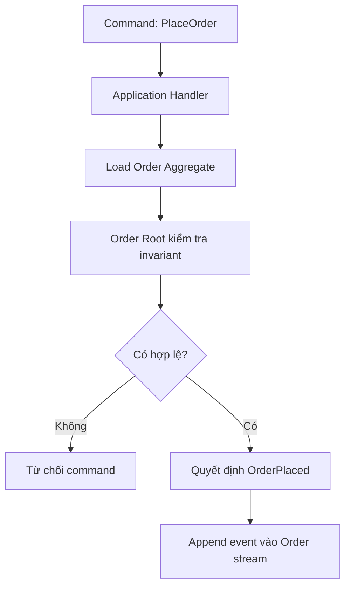
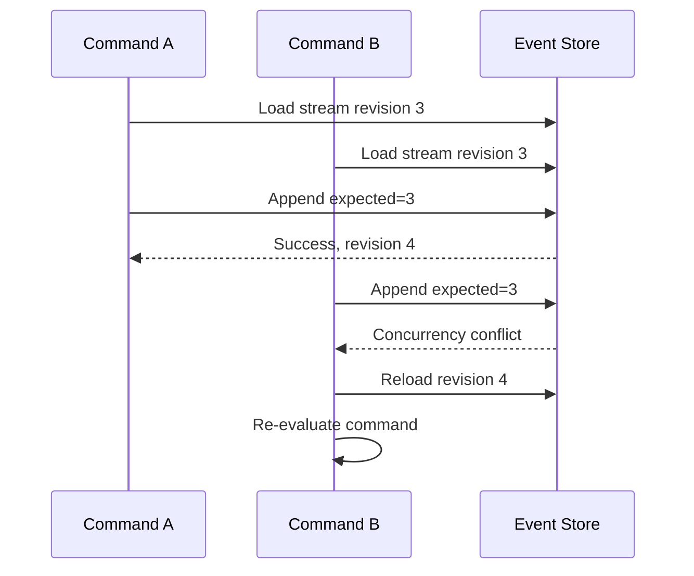
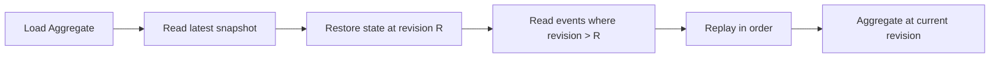
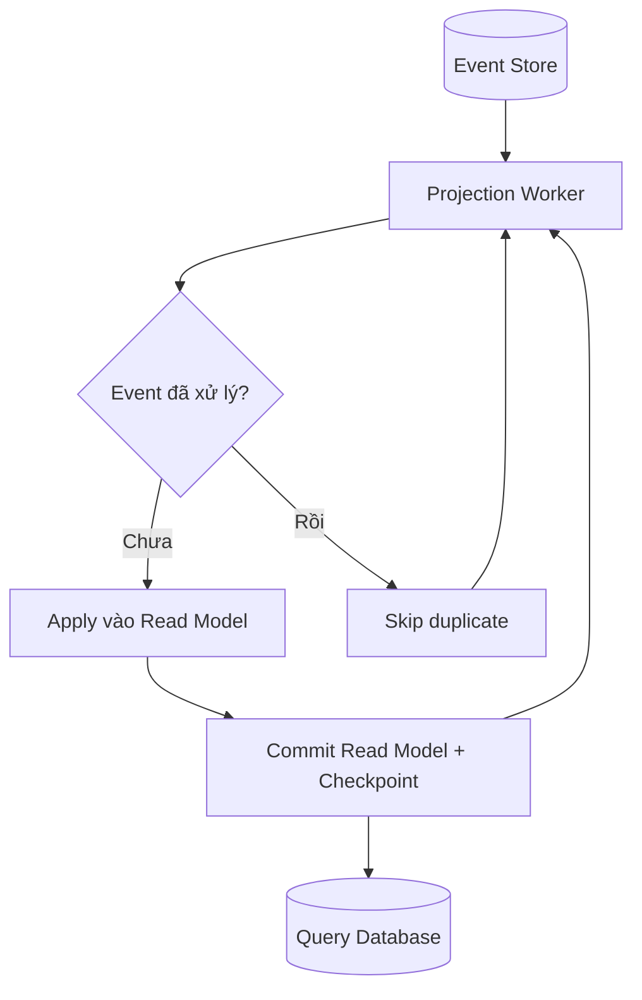
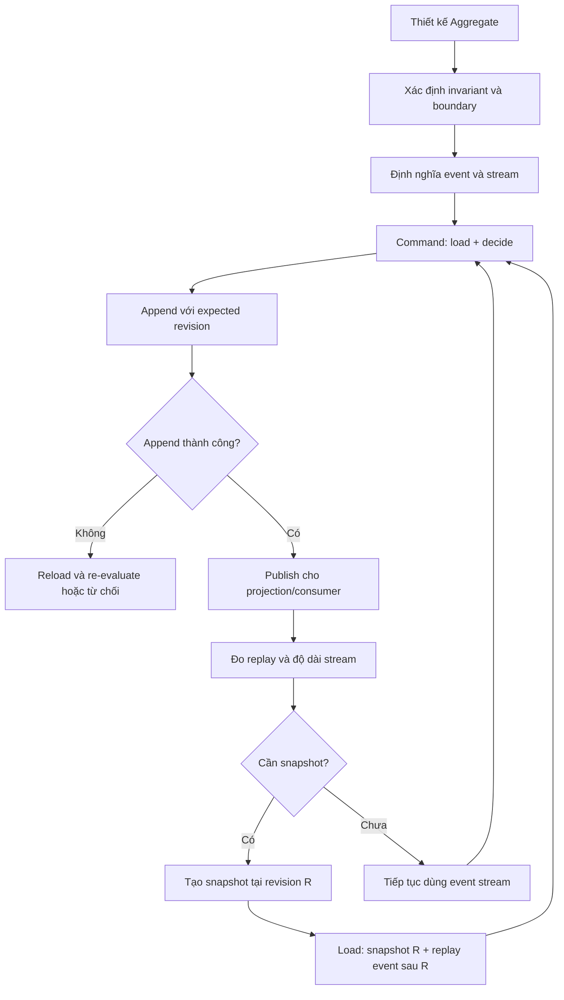

# Vai trò của Aggregate, phiên bản sự kiện và ảnh chụp trạng thái

Trong Domain-Driven Design (DDD), Aggregate là ranh giới nhất quán của một nhóm đối tượng miền. Aggregate Root tiếp nhận command, kiểm tra invariant và quyết định hành vi nào được phép xảy ra. Khi kết hợp với Event Sourcing, trạng thái hiện tại của Aggregate được tái tạo từ chuỗi sự kiện đã ghi nhận thay vì chỉ lưu một bản trạng thái mới nhất.

Để cách làm này hoạt động an toàn, cần quản lý ba vấn đề liên quan chặt chẽ: Aggregate nào sở hữu một event stream, phiên bản nào dùng để bảo vệ thứ tự và cập nhật đồng thời, và snapshot được dùng ra sao để giảm chi phí khôi phục trạng thái. Cần phân biệt phiên bản của vị trí sự kiện trong stream với phiên bản schema của payload; hai khái niệm này giải quyết hai vấn đề khác nhau.

Bài học này trình bày vai trò của Aggregate trong CQRS và Event Sourcing, cách xử lý command và append event có optimistic concurrency, cách replay để khôi phục trạng thái, cách thiết kế snapshot, và cách tiến hóa event schema mà vẫn đọc được lịch sử.

## 1. Aggregate là ranh giới quyết định nghiệp vụ

Aggregate là một cụm Entity và Value Object được xử lý như một đơn vị nhất quán. Aggregate Root là đối tượng duy nhất mà code bên ngoài dùng để yêu cầu thay đổi trạng thái của cụm đó. Nó chịu trách nhiệm bảo vệ invariant của Aggregate.

Ví dụ, Aggregate `Order` có thể chứa:

- `OrderId` để định danh đơn hàng.
- Trạng thái đơn như `DRAFT`, `PLACED`, `CONFIRMED`.
- Các dòng hàng `OrderLine`.
- Tổng tiền và thông tin giao hàng.
- Quy tắc không cho đặt một đơn rỗng, không cho sửa đơn đã xác nhận và không cho số lượng dòng hàng nhỏ hơn hoặc bằng 0.

Khi có command `PlaceOrder`, Aggregate Root kiểm tra trạng thái và các dòng hàng trước khi quyết định có thể đặt đơn hay không. Application Service điều phối use case, còn Aggregate quyết định thay đổi nghiệp vụ hợp lệ.



### 1.1. Vì sao Event Sourcing vẫn cần Aggregate?

Event Sourcing không loại bỏ domain model hoặc invariant. Nó thay đổi cách lưu trạng thái và cách ghi nhận thay đổi. Aggregate vẫn cần:

- Nhận command và kiểm tra trạng thái hiện tại.
- Bảo vệ invariant trước khi event được append.
- Quyết định event nào diễn đạt sự thật nghiệp vụ vừa xảy ra.
- Giữ logic chuyển trạng thái nhất quán khi replay lịch sử.

Không nên để controller hoặc event store tự quyết định một command có hợp lệ hay không. Event store chịu trách nhiệm lưu event theo stream và kiểm soát phiên bản; nó không thay thế logic nghiệp vụ của Aggregate.

### 1.2. Một Aggregate Root thường tương ứng với một event stream

Trong thiết kế Event Sourcing phổ biến, mỗi Aggregate Root có một stream được nhận diện bằng loại Aggregate và ID, ví dụ `Order-ORD-1001`. Stream chứa các event theo thứ tự đã ghi cho Aggregate đó.

```text
Order-ORD-1001
  revision 0: OrderCreated
  revision 1: OrderLineAdded
  revision 2: OrderLineAdded
  revision 3: OrderPlaced
  revision 4: OrderConfirmed
```

Các event trong stream cho biết lịch sử thay đổi của một Aggregate. Stream không phải log toàn cục bảo đảm thứ tự nghiệp vụ giữa tất cả Aggregate. Nếu một quy trình liên quan Order, Inventory và Payment, mỗi Aggregate có thể có stream riêng; việc phối hợp giữa chúng cần event, process manager hoặc saga.

## 2. Phân biệt CQRS và Event Sourcing

CQRS (Command Query Responsibility Segregation) tách mô hình xử lý thay đổi (command) khỏi mô hình đọc (query). Event Sourcing lưu các sự kiện thay đổi như nguồn dữ liệu chính để tái tạo trạng thái.

Hai khái niệm có thể kết hợp, nhưng không đồng nghĩa:

| Tiêu chí | CQRS | Event Sourcing |
|---|---|---|
| Ý tưởng chính | Tách trách nhiệm ghi và đọc | Lưu lịch sử thay đổi dưới dạng event bất biến |
| Mô hình ghi | Xử lý command và bảo vệ invariant | Aggregate quyết định event để append |
| Mô hình đọc | Có thể dùng bảng, view hoặc projection riêng | Thường xây projection từ event stream |
| Nguồn dữ liệu chính | Có thể là bảng trạng thái hiện tại | Event stream là nguồn sự thật |
| Có bắt buộc đi cùng nhau? | Không | Không |

Có thể dùng CQRS với database quan hệ thông thường: command cập nhật Aggregate, query đọc projection. Cũng có thể dùng Event Sourcing nhưng chỉ có một số query trực tiếp từ trạng thái được tái tạo. Khi kết hợp cả hai, event stream là nguồn ghi và các read model được xây từ event.

### 2.1. Event Sourcing không chỉ là phát event thông báo

Một ứng dụng CRUD có thể cập nhật bảng `orders` rồi phát `OrderUpdated` qua message broker. Nếu message chỉ phục vụ thông báo và bảng hiện tại vẫn là nguồn dữ liệu chính, đó không phải Event Sourcing đầy đủ.

Trong Event Sourcing, event stream lưu các sự kiện nghiệp vụ làm căn cứ tái tạo trạng thái. Nếu mất projection hoặc bảng đọc, hệ thống có thể xây lại chúng từ event history (trong giới hạn retention và dữ liệu được lưu). Message broker có thể vận chuyển event, nhưng broker không tự động là event store.

### 2.2. Event store khác message broker

Event store thường cần các khả năng như:

- Append event vào một stream.
- Đọc event theo stream và theo thứ tự.
- Kiểm tra expected revision để chống ghi đồng thời sai.
- Lưu metadata, event ID, loại event và schema version.
- Cung cấp subscription hoặc cơ chế phát event cho projection.
- Lưu trữ bền vững và hỗ trợ khôi phục lịch sử.

Message broker tập trung vận chuyển message tới consumer, hỗ trợ delivery, partition, retry hoặc retention theo cấu hình. Một broker có thể tham gia kiến trúc Event Sourcing, nhưng không phải mọi broker đều cung cấp semantics của event store như append theo stream với expected revision.

## 3. Aggregate quyết định event, không nhận event như command

Command diễn đạt yêu cầu cần được xem xét, ví dụ `AddOrderLine` hoặc `PlaceOrder`. Event diễn đạt sự thật đã xảy ra, ví dụ `OrderLineAdded` hoặc `OrderPlaced`.

Luồng xử lý:

1. Application Handler nhận command.
2. Repository/Event Store tải stream của Aggregate.
3. Aggregate được tái tạo từ snapshot (nếu có) và các event tiếp theo.
4. Aggregate kiểm tra command dựa trên trạng thái hiện tại.
5. Aggregate trả về một hoặc nhiều event được quyết định.
6. Event Store append event với expected revision.
7. Projection và các consumer cập nhật sau khi event được lưu thành công.

Ví dụ command và event:

| Command (ý định) | Event (sự thật đã xảy ra) |
|---|---|
| `CreateOrder` | `OrderCreated` |
| `AddOrderLine` | `OrderLineAdded` |
| `ChangeOrderQuantity` | `OrderLineQuantityChanged` |
| `PlaceOrder` | `OrderPlaced` |
| `ConfirmOrder` | `OrderConfirmed` |
| `CancelOrder` | `OrderCancelled` |

Không nên đặt tên event như `ConfirmOrder` vì đó là yêu cầu. `OrderConfirmed` chỉ được ghi khi Aggregate đã chấp nhận yêu cầu và điều kiện nghiệp vụ đã thỏa mãn.

## 4. Event stream và phiên bản của Aggregate

Mỗi event trong một stream thường có vị trí hoặc revision tăng dần. Revision cho biết event nằm ở vị trí nào trong lịch sử của Aggregate. Khi stream mới tạo, hệ thống có thể quy ước revision đầu tiên là `0` hoặc `1`; điều quan trọng là nhất quán trong toàn bộ event store.

Ví dụ:

| Revision | Event | Ý nghĩa |
|---:|---|---|
| 0 | `OrderCreated` | Tạo đơn |
| 1 | `OrderLineAdded` | Thêm dòng hàng đầu tiên |
| 2 | `OrderLineAdded` | Thêm dòng hàng thứ hai |
| 3 | `OrderPlaced` | Đặt đơn |
| 4 | `OrderConfirmed` | Xác nhận đơn |

Aggregate có thể giữ `version` bằng revision cuối cùng đã áp dụng. Khi append, caller gửi `expectedRevision` để Event Store xác nhận stream chưa bị thay đổi kể từ lúc Aggregate được tải.

### 4.1. Optimistic concurrency bằng expected revision

Giả sử hai request cùng tải `Order-ORD-1001` tại revision 3. Request A quyết định `OrderConfirmed`; request B quyết định `OrderCancelled`. Nếu cả hai cùng append mà không kiểm tra phiên bản, stream có thể chứa hai sự kiện xung đột theo thứ tự không được nghiệp vụ dự kiến.

Với optimistic concurrency:

- A append với `expectedRevision = 3` và thành công, stream lên revision 4.
- B cũng append với `expectedRevision = 3`, nhưng Event Store phát hiện stream đã ở revision 4 và từ chối.
- B phải tải lại Aggregate, đánh giá lại command theo trạng thái mới rồi quyết định từ chối hoặc tạo event khác.



Optimistic concurrency không chỉ là kỹ thuật tránh ghi đè. Nó giúp bảo vệ invariant khi nhiều command cạnh tranh thay đổi cùng một Aggregate.

### 4.2. Không tự động retry mọi conflict

Khi gặp conflict, có thể tải lại và thử đánh giá command lần nữa nếu command vẫn còn ý nghĩa. Nhưng không phải command nào cũng được retry vô điều kiện. Ví dụ, command `CancelOrder` có thể không còn hợp lệ sau khi đơn đã được bàn giao. Aggregate phải quyết định lại theo trạng thái mới.

Với command tạo tác động bên ngoài như thu tiền hoặc gửi yêu cầu tới nhà cung cấp, cần idempotency key để tránh thực hiện trùng khi caller không biết lần append trước đã thành công hay chưa.

## 5. Phân biệt các loại version

Trong CQRS và Event Sourcing, từ “version” có thể chỉ nhiều thứ khác nhau. Không nên dùng chung một field mà không ghi rõ ý nghĩa.

| Loại version | Ý nghĩa | Dùng để giải quyết |
|---|---|---|
| Stream revision / Aggregate version | Vị trí event trong stream hoặc trạng thái Aggregate đã áp dụng đến đâu | Thứ tự, expected revision và optimistic concurrency |
| Event schema version | Phiên bản cấu trúc payload của một loại event | Đọc event cũ khi schema thay đổi |
| Snapshot revision | Revision cuối cùng đã được đưa vào snapshot | Biết cần replay từ vị trí nào |
| Snapshot schema version | Phiên bản cấu trúc của snapshot | Chuyển đổi snapshot khi định dạng thay đổi |
| Projection checkpoint | Vị trí event mà read model đã xử lý đến | Theo dõi tiến độ projection và resume |

Ví dụ, `OrderConfirmed` có thể có `schemaVersion = 2`, nhưng được ghi ở `streamRevision = 17`. Số 2 mô tả cấu trúc payload; số 17 mô tả vị trí của sự kiện trong lịch sử đơn hàng. Chúng không thể thay thế nhau.

### 5.1. Event envelope

Một event được lưu thường có phần payload và metadata. Metadata giúp định danh, sắp xếp, truy vết và diễn giải schema:

```json
{
  "eventId": "8b1d...",
  "aggregateType": "Order",
  "aggregateId": "ORD-1001",
  "streamRevision": 17,
  "eventType": "OrderConfirmed",
  "schemaVersion": 2,
  "occurredAt": "2026-11-18T10:15:30Z",
  "correlationId": "checkout-781",
  "causationId": "command-992",
  "payload": {
    "confirmedAt": "2026-11-18T10:15:30Z",
    "confirmationReference": "CNF-42"
  }
}
```

Đây là envelope minh họa. Event store có thể lưu metadata riêng với payload, dùng binary format hoặc schema registry. Không nên đưa thông tin nhạy cảm không cần thiết vào event vì event thường được giữ lâu và có thể được replay hoặc cấp cho nhiều consumer.

## 6. Tái tạo Aggregate bằng replay

Replay là quá trình dựng lại trạng thái Aggregate bằng cách áp dụng các event theo đúng thứ tự đã ghi. Mỗi event mô tả một thay đổi; hàm áp dụng event cập nhật trạng thái nội bộ.

Ví dụ:

```java
final class Order {
    private final OrderId id;
    private OrderStatus status;
    private final List<OrderLine> lines = new ArrayList<>();
    private long version = -1;

    private Order(OrderId id) {
        this.id = id;
        this.status = OrderStatus.DRAFT;
    }

    static Order rehydrate(OrderId id, List<StoredEvent> history) {
        Order order = new Order(id);
        for (StoredEvent stored : history) {
            order.apply(stored.event());
            order.version = stored.streamRevision();
        }
        return order;
    }

    private void apply(DomainEvent event) {
        switch (event) {
            case OrderCreated e -> status = OrderStatus.DRAFT;
            case OrderLineAdded e -> lines.add(e.line());
            case OrderPlaced e -> status = OrderStatus.PLACED;
            case OrderConfirmed e -> status = OrderStatus.CONFIRMED;
            case OrderCancelled e -> status = OrderStatus.CANCELLED;
        }
    }

    long version() {
        return version;
    }
}
```

Đoạn code minh họa cách replay; các kiểu `OrderId`, `StoredEvent`, `DomainEvent` và event record cần được định nghĩa trong ứng dụng. Với Java version chưa hỗ trợ pattern matching cho switch như trên, có thể dùng `instanceof` hoặc dispatcher tương đương.

### 6.1. `decide` và `apply` có trách nhiệm khác nhau

Một cách tổ chức rõ ràng là tách hai thao tác:

- `decide(command)`: đọc trạng thái hiện tại, kiểm tra invariant và tạo danh sách event nếu command hợp lệ.
- `apply(event)`: áp dụng một sự kiện đã được chấp nhận để cập nhật trạng thái nội bộ.

`decide` trả lời “được phép xảy ra điều gì?”. `apply` trả lời “sự kiện này làm trạng thái thay đổi ra sao?”. Khi replay lịch sử, hệ thống chỉ gọi `apply`, không chạy lại validation của command hoặc gọi dịch vụ bên ngoài.

### 6.2. Replay cần tính xác định

Khi áp dụng cùng một chuỗi event theo cùng thứ tự, Aggregate phải tạo ra cùng trạng thái. Vì vậy, logic `apply` không nên:

- Gọi API bên ngoài hoặc truy vấn dữ liệu hiện tại từ context khác.
- Dùng `Instant.now()` để tính lại giá trị lịch sử.
- Sinh số ngẫu nhiên hoặc ID mới.
- Dựa vào cấu hình hiện tại nếu cấu hình đó có thể thay đổi kết quả replay.
- Gửi email, charge payment hoặc thực hiện side effect.

Nếu một quyết định lúc phát sinh phụ thuộc tỷ giá, thuế, tên sản phẩm hoặc chính sách tại thời điểm đó, hãy ghi lại dữ liệu hoặc kết quả cần thiết trong event. Replay cần tái hiện quyết định đã xảy ra, không tính lại theo dữ liệu hiện tại.

### 6.3. Event là sự thật, không phải lệnh

Event `OrderLineAdded` nên chứa dữ liệu đủ để khôi phục dòng hàng đã thêm, ví dụ SKU, tên và đơn giá đã chốt tại thời điểm đó. Khi replay, hệ thống không nên gọi Catalog để lấy giá hiện tại rồi thay thế giá lịch sử.

Tương tự, `PaymentAuthorized` ghi nhận kết quả đã xác thực từ Payment. Replay không được gọi lại Payment API.

## 7. Snapshot là gì và giải quyết vấn đề nào?

Khi một Aggregate có hàng nghìn hoặc hàng triệu event, tải toàn bộ stream và replay từ đầu mỗi lần có command có thể tốn thời gian và tài nguyên. Snapshot (ảnh chụp trạng thái) lưu trạng thái Aggregate tại một revision cụ thể để lần khôi phục tiếp theo không phải áp dụng lại toàn bộ lịch sử.

Ví dụ:

```text
Event stream Order-ORD-1001:
  revision 0 ... 99    -> đã được bao gồm trong snapshot
  revision 100 ... 124 -> cần replay sau snapshot

Snapshot:
  aggregateId = ORD-1001
  streamRevision = 99
  state = trạng thái Order sau khi áp dụng đến revision 99
```

Khi load Aggregate:

1. Tìm snapshot hợp lệ mới nhất của Aggregate.
2. Khôi phục trạng thái từ snapshot.
3. Đọc các event có revision lớn hơn `snapshotRevision`.
4. Áp dụng các event còn lại theo thứ tự.
5. Đặt Aggregate version bằng revision cuối cùng đã áp dụng.



### 7.1. Snapshot là tối ưu, không phải nguồn sự thật

Event stream vẫn là lịch sử có thẩm quyền. Snapshot là một checkpoint có thể được tạo lại từ stream. Nếu snapshot hỏng, không tương thích hoặc bị mất, hệ thống có thể bỏ nó và replay từ một snapshot cũ hơn hoặc từ đầu.

Không nên xóa event cũ chỉ vì đã có snapshot, trừ khi hệ thống có chính sách lưu trữ/retention riêng đã được đánh giá kỹ. Xóa lịch sử có thể làm mất khả năng audit, replay projection hoặc đáp ứng yêu cầu nghiệp vụ/pháp lý.

### 7.2. Snapshot phải ghi rõ revision đã bao gồm

Snapshot cần lưu ít nhất:

- Aggregate type và Aggregate ID.
- Revision cuối cùng đã được snapshot bao gồm.
- Trạng thái được serialize.
- Snapshot schema version.
- Thời điểm tạo và metadata cần thiết để kiểm tra.

Nếu snapshot ghi sai revision, hệ thống có thể replay thiếu event hoặc áp dụng lặp event. Ví dụ snapshot đã chứa trạng thái đến revision 50 nhưng metadata ghi 49; replay revision 50 lần nữa có thể làm tăng số lượng hai lần.

### 7.3. Snapshot phải nhất quán với stream

Snapshot cần phản ánh đúng trạng thái sau khi áp dụng tất cả event đến revision được ghi trong snapshot. Có thể tạo snapshot trong lúc đọc stream, hoặc từ một Aggregate đã replay đến revision xác định. Nếu stream tiếp tục nhận event trong khi snapshot đang tạo, cần lưu checkpoint rõ và không gắn snapshot với revision mới hơn trạng thái thực tế.

Snapshot không cần ngăn event append mới. Nó chỉ cần là một trạng thái hợp lệ tại một revision cụ thể. Event sau revision đó sẽ được replay khi load.

## 8. Khi nào nên tạo snapshot?

Không nên snapshot sau mỗi event nếu chi phí serialize và ghi snapshot lớn hơn chi phí replay. Cũng không nên đợi đến khi stream có hàng triệu event mới đánh giá hiệu năng.

Một số tín hiệu:

- Thời gian load Aggregate tăng theo độ dài stream.
- Số event cần replay vượt ngưỡng đã đặt.
- Command có yêu cầu latency chặt và thường xuyên tải Aggregate lâu đời.
- CPU và I/O của replay chiếm tỷ lệ đáng kể.
- Một số Aggregate có lịch sử dài bất thường so với phần còn lại.

Chiến lược có thể dựa trên số event, thời gian replay, kích thước stream hoặc kết hợp. Ví dụ, snapshot sau mỗi 500 event là một ngưỡng khởi đầu để đo, không phải con số đúng cho mọi hệ thống.

### 8.1. Snapshot định kỳ hay theo ngưỡng?

| Chiến lược | Ưu điểm | Hạn chế |
|---|---|---|
| Sau mỗi N event | Dễ dự đoán số event tối đa cần replay | Aggregate ít hoạt động vẫn có thể tạo snapshot không cần thiết |
| Theo thời gian | Dễ lập lịch và vận hành | Stream có thể tăng nhanh giữa hai lần snapshot |
| Theo thời gian replay | Bám sát mục tiêu latency | Cần đo và có thể dao động theo tải |
| Theo kích thước stream | Kiểm soát dung lượng và chi phí đọc | Kích thước không luôn phản ánh độ phức tạp replay |

Hãy đo latency load, số event replay, kích thước snapshot, thời gian tạo snapshot và tần suất lỗi trước khi chọn ngưỡng.

## 9. Snapshot không phải Read Model

Snapshot và read model đều có thể là dữ liệu được tạo từ event, nhưng phục vụ mục tiêu khác nhau.

| Tiêu chí | Snapshot | Read Model / Projection |
|---|---|---|
| Mục tiêu | Tăng tốc khôi phục một Aggregate | Trả lời truy vấn và hiển thị |
| Hình dạng | Trạng thái đủ để tiếp tục Aggregate | Dữ liệu được tổ chức theo màn hình/câu hỏi |
| Phạm vi | Thường một Aggregate stream | Có thể tổng hợp nhiều Aggregate |
| Cập nhật | Checkpoint tại revision cụ thể | Xử lý event theo checkpoint của projection |
| Có thể xây lại từ event? | Có | Có, nếu lịch sử và logic projection còn đủ |
| Có dùng để kiểm tra command thay cho Aggregate? | Snapshot là điểm khôi phục Aggregate, sau đó replay phần còn lại | Không; read model có thể trễ và không bảo vệ invariant |

Ví dụ, snapshot `Order` chứa các dòng hàng, trạng thái và tổng tiền cần thiết để tiếp tục xử lý command. Read model `OrderListItem` chỉ chứa mã đơn, tên khách, tổng tiền và trạng thái để hiển thị danh sách. Không nên dùng `OrderListItem` làm snapshot của Aggregate vì nó thiếu trạng thái cần thiết để bảo vệ invariant.

## 10. Phiên bản schema của event và tiến hóa lịch sử

Theo thời gian, domain model thay đổi. Một event cũ có thể thiếu field mà code mới cần, hoặc một field được đổi kiểu. Không thể giả định rằng mọi event trong lịch sử đều có cấu trúc giống phiên bản code hiện tại.

Ví dụ event cũ:

```json
{
  "eventType": "OrderPlaced",
  "schemaVersion": 1,
  "payload": {
    "orderId": "ORD-1001",
    "total": 129900
  }
}
```

Phiên bản mới cần lưu cả currency và số tiền chính xác:

```json
{
  "eventType": "OrderPlaced",
  "schemaVersion": 2,
  "payload": {
    "orderId": "ORD-1001",
    "totalAmount": "129900.00",
    "currencyCode": "VND"
  }
}
```

Event schema version là phiên bản cấu trúc và ý nghĩa payload. Nó không phải stream revision. Một stream có thể chứa revision 0 với schema version 1, revision 1 với schema version 2, revision 2 với schema version 2.

### 10.1. Upcaster

Upcaster chuyển event payload từ schema cũ sang biểu diễn mà code hiện tại hiểu được trong lúc đọc. Ví dụ, upcaster có thể chuyển `total` thành `totalAmount` và bổ sung `currencyCode` theo quy tắc đã xác minh.

```java
public interface EventUpcaster {
    boolean supports(String eventType, int schemaVersion);

    UpcastedEvent upcast(StoredEvent event);
}
```

Upcaster nên xác định, có thể kiểm thử và không làm thay đổi event gốc đã lưu. Nếu thiếu dữ liệu không thể suy ra an toàn, không nên tự điền giá trị đoán. Cần một chính sách migration hoặc cách xử lý event lịch sử rõ ràng.

### 10.2. Các chiến lược tiến hóa event

- **Tolerant reader:** consumer bỏ qua field không dùng và chấp nhận field bổ sung khi an toàn.
- **Upcasting:** chuyển payload cũ sang schema nội bộ mới khi đọc.
- **Event type versioning:** tạo tên event mới khi ngữ nghĩa thay đổi đáng kể, ví dụ `OrderPlacedV2`.
- **In-place migration:** chuyển đổi dữ liệu event lịch sử bằng quy trình migration có kiểm soát, audit và backup; cách này làm thay đổi lịch sử lưu trữ nên cần cân nhắc đặc biệt.
- **Dual handling:** hỗ trợ song song schema cũ và mới trong một giai đoạn chuyển tiếp.

Không có chiến lược duy nhất cho mọi hệ thống. Nếu chỉ thêm một field tùy chọn, tolerant reader có thể đủ. Nếu ý nghĩa event thay đổi, đổi tên hoặc version event rõ ràng thường an toàn hơn việc giả vờ payload mới và cũ có cùng semantics.

### 10.3. Không thay đổi ý nghĩa event cũ

Event là sự thật đã xảy ra. Nếu `OrderPlaced` trong quá khứ có nghĩa là đơn được đặt theo chính sách cũ, không nên thay đổi cách diễn giải để nó mang ý nghĩa của chính sách hiện tại. Nếu nghiệp vụ cần ghi nhận một sự thật mới, hãy tạo event mới hoặc migration được phê duyệt và có thể kiểm toán.

## 11. Projection và checkpoint trong CQRS

Projection đọc event stream và xây read model. Projection có thể cập nhật một bảng danh sách đơn hàng, dashboard doanh thu hoặc báo cáo theo khách hàng.

Một projection thường cần lưu checkpoint để biết đã xử lý đến vị trí nào. Khi consumer dừng giữa chừng, nó có thể tiếp tục từ checkpoint sau khi xử lý an toàn các event chưa hoàn tất.



### 11.1. Projection cần idempotency

Nếu worker cập nhật read model rồi dừng trước khi lưu checkpoint, event có thể được xử lý lại. Cần thiết kế cập nhật projection và checkpoint trong cùng transaction khi cùng datastore, hoặc dùng event ID/version để deduplicate.

### 11.2. Projection có thể được xây lại

Nếu read model bị hỏng hoặc thay đổi cấu trúc, có thể tạo projection mới từ event history. Cần có quy trình rebuild không làm gián đoạn query quá lâu, ví dụ xây bảng mới rồi chuyển traffic sau khi checkpoint bắt kịp.

### 11.3. Snapshot không thay thế projection checkpoint

Snapshot ghi revision của Aggregate đã được bao gồm trong trạng thái Aggregate. Projection checkpoint ghi vị trí mà một read model đã xử lý. Chúng thuộc hai tiến trình khác nhau và không nên dùng chung một field version.

## 12. Ví dụ luồng command, append và replay

Một event-sourced command handler có thể được diễn đạt bằng pseudo-Java sau:

```java
public final class PlaceOrderHandler {
    private final OrderRepository orders;
    private final EventStore eventStore;

    public void handle(PlaceOrder command) {
        Order order = orders.load(command.orderId());

        // Aggregate quyết định event dựa trên trạng thái đã replay.
        List<DomainEvent> newEvents = order.decide(command);

        // Append phải kiểm tra expected revision một cách nguyên tử.
        eventStore.append(
            order.id(),
            order.version(),
            newEvents
        );
    }
}
```

Ở đây, `OrderRepository.load()` đọc snapshot và event stream để tạo Aggregate. `decide()` kiểm tra invariant nhưng chưa ghi dữ liệu. `append()` lưu event nếu stream vẫn ở version mà Aggregate đã đọc. Nếu version đã đổi, event store trả concurrency conflict và handler phải tải lại, đánh giá lại command.

### 12.1. Event Store append theo expected revision

```java
public interface EventStore {
    List<StoredEvent> readStream(AggregateId id, long afterRevision);

    AppendResult append(
        AggregateId id,
        long expectedRevision,
        List<DomainEvent> events
    );
}
```

`append()` phải bảo đảm việc kiểm tra revision và ghi event là một thao tác nguyên tử trong event store. Không được thực hiện `read current revision` rồi `insert` bằng hai thao tác không có khóa hoặc constraint, vì hai command đồng thời có thể cùng vượt qua kiểm tra.

### 12.2. Event append thành công mới là thay đổi đã được ghi nhận

Aggregate có thể tạo event trong bộ nhớ, nhưng cho đến khi Event Store xác nhận append thành công, event chưa trở thành lịch sử có thẩm quyền. Nếu append thất bại, command không được trả thành công như thể thay đổi đã commit.

Sau khi append thành công, event có thể được publish tới projection và consumer. Cơ chế publish phải bảo đảm không mất event khi process dừng; event store có thể cung cấp subscription bền vững hoặc dùng cơ chế outbox tương ứng.

## 13. Snapshot lifecycle và phục hồi

Snapshot cần có lifecycle rõ ràng:

1. Aggregate được replay đến revision R.
2. Snapshot worker serialize trạng thái tại R.
3. Snapshot được ghi kèm Aggregate ID, revision R và snapshot schema version.
4. Lần load sau dùng snapshot nếu hợp lệ, rồi replay event từ R+1.
5. Nếu snapshot lỗi hoặc không hỗ trợ schema, hệ thống bỏ qua và dùng snapshot cũ hơn hoặc replay từ đầu.

Không nên tạo snapshot từ một Aggregate mutable đang tiếp tục thay đổi mà không chốt revision. Cần bảo đảm trạng thái serialize tương ứng đúng với revision ghi trong metadata.

### 13.1. Snapshot có thể bị lỗi hoặc không tương thích

Các nguyên nhân thường gặp:

- Schema của Aggregate thay đổi.
- Serializer thay đổi cách biểu diễn kiểu dữ liệu.
- Snapshot bị ghi thiếu hoặc hỏng.
- Snapshot metadata không khớp revision.
- Một bug trong code replay trước đây tạo ra trạng thái sai.

Nên có snapshot schema version, kiểm tra integrity nếu cần, log khi bỏ snapshot và khả năng rebuild. Không nên xem snapshot là bản dữ liệu duy nhất của Aggregate.

### 13.2. Snapshot không phải nơi sửa lịch sử

Nếu replay event history cho kết quả khác với snapshot, cần điều tra nguyên nhân. Không nên tự động tin snapshot rồi bỏ qua event stream. Snapshot là kết quả dẫn xuất; event history là nguồn để tái tạo. Nếu lịch sử có bug, hãy thiết kế upcaster, migration hoặc event correction có kiểm soát và lưu audit trail.

## 14. Thiết kế Aggregate để stream không tăng vô hạn

Snapshot giảm chi phí replay nhưng không chữa được mọi vấn đề của một Aggregate quá lớn. Nếu một Aggregate chứa quá nhiều dữ liệu hoặc mọi thao tác đều append vào một stream duy nhất, có thể xuất hiện:

- Stream tăng liên tục và snapshot ngày càng lớn.
- Nhiều command cạnh tranh cùng một revision.
- Tải Aggregate tốn nhiều bộ nhớ.
- Invariant của các phần không liên quan bị khóa chung.
- Khó phân vùng và mở rộng xử lý.

Hãy xem lại Aggregate Boundary. Một Aggregate nên gom các trạng thái cần thay đổi nhất quán cùng nhau. Những đối tượng có identity và vòng đời độc lập có thể là Aggregate khác, được tham chiếu bằng ID và phối hợp qua event/process manager khi cần.

### 14.1. Không đưa toàn bộ lịch sử vào Aggregate state

Aggregate thường chỉ cần trạng thái hiện tại đủ để quyết định command. Không nhất thiết phải giữ toàn bộ danh sách audit hoặc mọi event đã xảy ra trong bộ nhớ. Lịch sử đầy đủ nằm trong event store; query lịch sử có thể dùng projection riêng.

### 14.2. Không dùng snapshot để che giấu Aggregate Boundary sai

Nếu snapshot phải lưu một object graph khổng lồ, hoặc command thường xuyên tải và thay đổi dữ liệu không liên quan, vấn đề có thể nằm ở ranh giới Aggregate. Trước khi tăng tần suất snapshot, hãy kiểm tra lại invariant và quyền sở hữu dữ liệu.

## 15. Bảo mật và quyền riêng tư của event history

Event thường được lưu lâu, có thể được replay và phân phối tới nhiều consumer. Vì vậy, không nên ghi mọi dữ liệu nhận được vào event một cách tùy tiện.

Một số nguyên tắc:

- Chỉ lưu dữ liệu cần để tái tạo trạng thái hoặc đáp ứng mục đích nghiệp vụ đã xác định.
- Tránh lưu mật khẩu, token, số thẻ đầy đủ hoặc bí mật xác thực.
- Xác định cách xử lý dữ liệu cá nhân theo chính sách retention và quy định áp dụng.
- Hạn chế quyền đọc event stream; event store thường chứa lịch sử nghiệp vụ nhạy cảm.
- Log và metadata cần tránh sao chép payload nhạy cảm không cần thiết.
- Nếu phải xóa hoặc ẩn dữ liệu cá nhân, thiết kế chiến lược từ đầu vì event append-only làm việc xóa lịch sử phức tạp.

Có thể lưu reference tới dữ liệu nhạy cảm ở kho được kiểm soát riêng, hoặc mã hóa field phù hợp. Nhưng nếu key bị xóa hoặc dữ liệu không còn truy cập được, cần xác định liệu replay còn có thể tái tạo trạng thái nghiệp vụ hay không.

## 16. Những sai lầm thường gặp

- **Cho rằng Event Sourcing tự động thay thế Aggregate:** không có nơi bảo vệ invariant thì command có thể tạo event sai.
- **Dùng event như command:** event phải diễn đạt sự thật đã xảy ra, không phải yêu cầu đang chờ.
- **Không có expected revision:** hai command đồng thời có thể append các thay đổi xung đột.
- **Nhầm stream revision với event schema version:** một số chỉ vị trí trong lịch sử, số còn lại chỉ cấu trúc payload.
- **Coi message broker là event store:** broker không nhất thiết cung cấp append theo stream và optimistic concurrency.
- **Replay có side effect:** gọi API, gửi email hoặc dùng thời gian hiện tại làm kết quả lịch sử thay đổi.
- **Tính lại dữ liệu lịch sử từ nguồn hiện tại:** giá, tỷ giá hoặc chính sách hiện tại có thể khác thời điểm event xảy ra.
- **Snapshot bị coi là nguồn sự thật:** snapshot hỏng hoặc cũ có thể làm mất khả năng tái tạo chính xác.
- **Không lưu snapshot revision:** replay có thể bỏ sót hoặc áp dụng lặp event.
- **Nhầm snapshot với read model:** snapshot phục hồi Aggregate; projection phục vụ query.
- **Không version event schema:** code mới không đọc được event cũ hoặc diễn giải sai ý nghĩa.
- **Sửa trực tiếp event cũ mà không có migration/audit:** lịch sử nghiệp vụ mất tính tin cậy.
- **Snapshot quá thường xuyên:** chi phí serialize và lưu trữ có thể lớn hơn lợi ích.
- **Dùng snapshot để che Aggregate quá lớn:** ranh giới nhất quán vẫn không hợp lý.
- **Không kiểm soát dữ liệu nhạy cảm:** event history có thể lưu thông tin lâu hơn dự định.

## 17. Quy trình thiết kế Aggregate, version và snapshot

Khi thiết kế một Aggregate trong Event Sourcing, hãy đi theo các bước:

1. **Xác định invariant:** điều kiện nào phải được bảo vệ khi nhận command?
2. **Chọn Aggregate Boundary:** trạng thái nào cần thay đổi nhất quán cùng nhau?
3. **Thiết kế event:** event diễn đạt sự thật đã xảy ra và chứa đủ dữ liệu để replay.
4. **Thiết kế stream identity:** xác định Aggregate type, ID và quy ước revision.
5. **Bảo vệ concurrency:** append với expected revision và xử lý conflict bằng cách tải lại, đánh giá lại.
6. **Tách decide/apply:** command tạo event; replay chỉ áp dụng event, không gọi side effect.
7. **Định nghĩa version rõ ràng:** stream revision, event schema version, snapshot schema version và projection checkpoint.
8. **Xây projection:** tạo read model phù hợp với query và hỗ trợ rebuild.
9. **Đo replay:** xác định ngưỡng snapshot dựa trên latency, số event và kích thước stream.
10. **Thiết kế snapshot:** lưu Aggregate ID, revision và schema version; có thể bỏ và tạo lại.
11. **Lập chiến lược event evolution:** tolerant reader, upcaster, event type versioning hoặc migration.
12. **Kiểm thử lỗi:** concurrency conflict, replay, snapshot hỏng, event cũ, projection duplicate và process restart.



## 18. Checklist

Trước khi hoàn thiện thiết kế Aggregate/Event Sourcing, hãy kiểm tra:

- [ ] Aggregate Root là nơi tiếp nhận command và bảo vệ invariant.
- [ ] Mỗi Aggregate có stream identity ổn định.
- [ ] Event diễn đạt sự thật đã xảy ra và có đủ dữ liệu cần để replay.
- [ ] Stream revision được tăng theo thứ tự và có quy ước rõ.
- [ ] Append dùng expected revision được kiểm tra nguyên tử.
- [ ] Concurrency conflict dẫn tới tải lại và đánh giá lại command, không retry mù.
- [ ] `decide` và `apply` có trách nhiệm tách biệt.
- [ ] Replay xác định, không gọi API hoặc tạo side effect.
- [ ] Event schema version tách biệt với stream revision.
- [ ] Snapshot lưu Aggregate ID, revision và snapshot schema version.
- [ ] Snapshot chỉ là checkpoint tối ưu và có thể rebuild.
- [ ] Projection checkpoint tách biệt với snapshot revision.
- [ ] Read model không được dùng thay Aggregate để bảo vệ invariant.
- [ ] Có chiến lược upcast/version event lịch sử.
- [ ] Có tiêu chí đo lường để quyết định tần suất snapshot.
- [ ] Aggregate Boundary không bị mở rộng chỉ để tránh phối hợp event.
- [ ] Event history không lưu dữ liệu nhạy cảm ngoài nhu cầu đã xác định.
- [ ] Đã kiểm thử replay, concurrency, snapshot, schema evolution và projection rebuild.

## 19. Câu hỏi tự kiểm tra

1. Aggregate Root đóng vai trò gì trong CQRS và Event Sourcing?
2. Vì sao một Aggregate thường có một event stream riêng?
3. CQRS và Event Sourcing khác nhau thế nào? Có thể dùng riêng từng khái niệm không?
4. Event Store khác message broker ở những khả năng nào?
5. Expected revision bảo vệ Aggregate trước cập nhật đồng thời ra sao?
6. Stream revision khác event schema version như thế nào?
7. Vì sao `decide(command)` và `apply(event)` nên được tách riêng?
8. Replay cần tính xác định và tránh side effect như thế nào?
9. Snapshot giúp giảm chi phí gì và vì sao không phải nguồn sự thật?
10. Snapshot cần lưu revision nào để tránh bỏ sót hoặc áp dụng lặp event?
11. Snapshot khác Read Model và projection checkpoint ra sao?
12. Upcaster giải quyết vấn đề gì khi event schema thay đổi?
13. Khi nào cần xem lại Aggregate Boundary thay vì tăng tần suất snapshot?
14. Vì sao cần cân nhắc dữ liệu nhạy cảm trong event history?

## Kết luận

Aggregate là nơi quyết định command có hợp lệ và event nào được tạo; event stream lưu lại các sự thật đã xảy ra theo thứ tự của từng Aggregate. Stream revision hỗ trợ concurrency và xác định vị trí lịch sử, trong khi event schema version mô tả cấu trúc payload. Replay tái tạo trạng thái từ event, còn snapshot là checkpoint giúp giảm số event phải đọc khi khôi phục.

Hãy giữ rõ vai trò của từng thành phần: Aggregate bảo vệ invariant, Event Store lưu lịch sử và kiểm tra expected revision, projection phục vụ query, snapshot tối ưu việc load, còn upcaster giúp đọc event cũ theo mô hình hiện tại. Khi các ranh giới và version được định nghĩa chính xác, Event Sourcing có thể hỗ trợ audit và tái tạo trạng thái mà vẫn kiểm soát được concurrency, hiệu năng và thay đổi schema.
