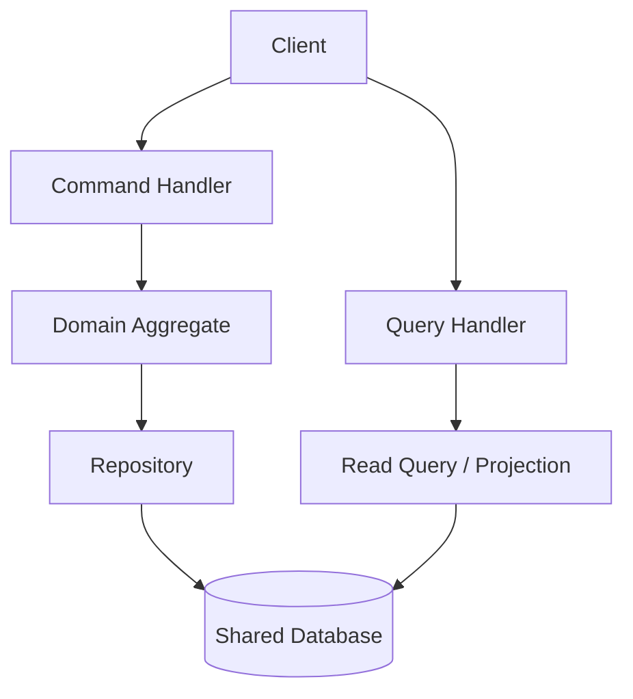
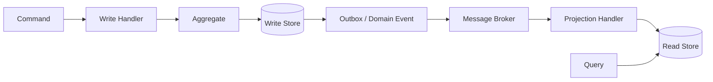
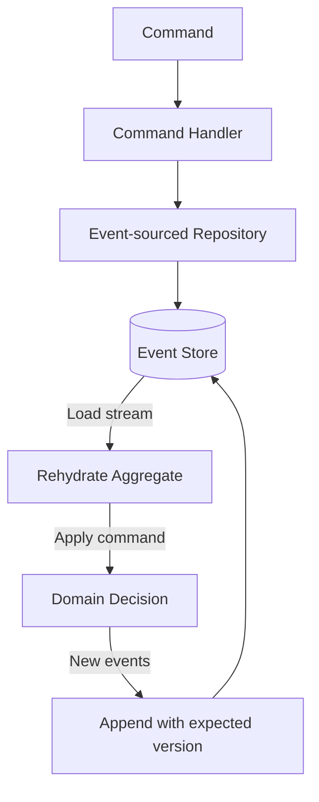

# Đánh giá hai kỹ thuật độc lập, không coi là điều kiện bắt buộc của DDD

Domain-Driven Design (DDD) giúp đội phát triển mô hình hóa nghiệp vụ bằng ngôn ngữ chung, xác định ranh giới Bounded Context và bảo vệ quy tắc trong Entity, Value Object, Aggregate, Repository và Domain Service. DDD không quy định mọi hệ thống phải dùng một kiểu lưu trữ hoặc một kiến trúc triển khai duy nhất.

**CQRS (Command Query Responsibility Segregation)** và **Event Sourcing** là hai kỹ thuật kiến trúc có thể kết hợp với DDD, nhưng chúng giải quyết hai vấn đề khác nhau. CQRS tách mô hình xử lý thay đổi trạng thái khỏi mô hình đọc dữ liệu. Event Sourcing lưu các sự kiện đã xảy ra làm nguồn dữ liệu có thẩm quyền để tái dựng trạng thái. Có thể dùng CQRS mà không dùng Event Sourcing; cũng có thể dùng Event Sourcing mà không áp dụng CQRS một cách nghiêm ngặt. Cả hai đều có chi phí và chỉ nên được chọn khi nhu cầu nghiệp vụ, truy vấn, kiểm toán hoặc khả năng mở rộng đủ rõ.

Bài viết đánh giá hai kỹ thuật một cách độc lập, chỉ ra cách chúng liên hệ với DDD, các mức triển khai, trade-off, ví dụ và tiêu chí lựa chọn. Một hệ thống DDD vẫn có thể dùng CRUD, relational database và repository thông thường nếu cách đó đáp ứng tốt nghiệp vụ.

## 1. DDD không đồng nghĩa với CQRS hoặc Event Sourcing

DDD là cách tiếp cận phân tích và thiết kế phần mềm tập trung vào domain. Nó cung cấp chiến lược để xác định Bounded Context và chiến thuật để mô hình hóa hành vi, trạng thái và invariant.

CQRS và Event Sourcing là những lựa chọn kiến trúc cho cách xử lý và lưu trữ dữ liệu:

- DDD trả lời: hệ thống cần mô hình hóa nghiệp vụ nào, thuật ngữ có nghĩa gì, ranh giới và invariant nằm ở đâu?
- CQRS trả lời: có nên tách đường xử lý command làm thay đổi trạng thái khỏi đường query phục vụ đọc không?
- Event Sourcing trả lời: có nên lưu chuỗi sự kiện bất biến làm nguồn sự thật để tái dựng trạng thái thay vì chỉ lưu trạng thái hiện tại không?

Ba câu hỏi có liên quan nhưng không thay thế nhau. DDD không bắt buộc CQRS; CQRS không bắt buộc Event Sourcing; Event Sourcing không tự động tạo ra một domain model tốt.

### 1.1. Một hệ thống DDD đơn giản vẫn có thể dùng CRUD

Giả sử một ứng dụng quản lý đặt lịch có:

- Aggregate `Appointment` bảo vệ quy tắc thời gian và trạng thái.
- Repository tải và lưu aggregate.
- Application service điều phối use case đặt, đổi hoặc hủy lịch.
- Relational database lưu trạng thái hiện tại.

Một transaction có thể tải aggregate, gọi hành vi domain rồi cập nhật các hàng trong database. Màn hình có thể query cùng database bằng repository hoặc query service. Cách này hoàn toàn tương thích với DDD nếu mô hình và ranh giới được thiết kế đúng.

Không cần đưa event store hoặc read database riêng vào một ứng dụng chỉ vì đang học DDD. Hãy bắt đầu từ độ phức tạp nghiệp vụ và yêu cầu thực tế.

### 1.2. Không nhầm Domain Event với Event Sourcing

Domain Event biểu đạt một điều có ý nghĩa đã xảy ra trong domain, ví dụ `AppointmentBooked` hoặc `OrderCancelled`. Một ứng dụng có thể ghi nhận domain event trong bộ nhớ, lưu cùng transaction vào outbox rồi publish ra broker, trong khi trạng thái aggregate vẫn được lưu bằng cách cập nhật các hàng hiện tại.

Đó là sử dụng Domain Event, nhưng chưa phải Event Sourcing. Event Sourcing yêu cầu chuỗi sự kiện được lưu bền vững làm nguồn dữ liệu có thẩm quyền để tái dựng trạng thái.

## 2. CQRS là gì?

CQRS là viết tắt của Command Query Responsibility Segregation. Ý tưởng cốt lõi là tách hai loại thao tác:

- **Command:** yêu cầu thay đổi trạng thái hoặc yêu cầu hệ thống thực hiện một hành động nghiệp vụ.
- **Query:** yêu cầu đọc dữ liệu mà không làm thay đổi trạng thái nghiệp vụ.

Command có thể bị từ chối vì vi phạm quy tắc, thiếu quyền hoặc trạng thái hiện tại không phù hợp. Query trả dữ liệu theo nhu cầu của caller và thường được tối ưu cho cách hiển thị hoặc phân tích.

### 2.1. Command và Query có hợp đồng khác nhau

Ví dụ trong hệ thống bán hàng:

| Thao tác | Loại | Ý nghĩa |
|---|---|---|
| `PlaceOrder` | Command | Yêu cầu tạo đơn hàng mới |
| `CancelOrder` | Command | Yêu cầu hủy đơn nếu trạng thái cho phép |
| `ChangeDeliveryAddress` | Command | Yêu cầu thay đổi địa chỉ giao |
| `GetOrderDetails` | Query | Đọc chi tiết đơn để hiển thị |
| `SearchOrders` | Query | Tìm đơn theo filter và phân trang |
| `GetSalesSummary` | Query | Đọc số liệu tổng hợp doanh thu |

Command thường có một kết quả như accepted, rejected, identifier hoặc decision result. Query trả DTO, projection hoặc read model. Query không nên thực hiện thay đổi nghiệp vụ như một side effect ẩn.

```java
public record PlaceOrderCommand(
    CustomerId customerId,
    List<OrderLineInput> lines
) {}

public interface PlaceOrderUseCase {
    OrderId execute(PlaceOrderCommand command);
}

public record OrderDetailsView(
    String orderNumber,
    String customerName,
    String status,
    List<OrderLineView> lines,
    MoneyView total
) {}

public interface GetOrderDetailsQuery {
    Optional<OrderDetailsView> execute(OrderId id);
}
```

Command và query có thể dùng kiểu dữ liệu khác nhau vì mục tiêu khác nhau. `PlaceOrderCommand` thể hiện ý định nghiệp vụ; `OrderDetailsView` được thiết kế cho màn hình đọc.

### 2.2. Tách trách nhiệm không nhất thiết tách database

CQRS có nhiều mức áp dụng:

1. Tách command handler và query handler trong code nhưng cùng một database.
2. Tách domain write model khỏi read projection trong cùng database.
3. Dùng schema hoặc database riêng cho read model và write model.
4. Tách process/service riêng cho command và query khi tải, công nghệ hoặc khả năng triển khai thực sự cần.

CQRS không bắt buộc có hai database, hai microservice hay message broker. Một codebase modular monolith với hai loại handler rõ ràng đã có thể áp dụng nguyên tắc CQRS.

### 2.3. Write model và Read model

**Write model** chịu trách nhiệm thực thi quy tắc và thay đổi trạng thái. Nó thường được thiết kế quanh aggregate và invariant.

**Read model** được thiết kế để trả lời truy vấn. Nó có thể denormalize, kết hợp dữ liệu từ nhiều aggregate hoặc context, lưu sẵn giá trị tính toán và có cấu trúc khác write model.

Ví dụ `Order` aggregate có thể được tối ưu để bảo vệ quy tắc đặt/hủy đơn. Màn hình quản trị lại cần một bảng hiển thị gồm mã đơn, tên khách, trạng thái thanh toán, trạng thái giao hàng và tổng tiền. Read model có thể tổng hợp dữ liệu từ nhiều nguồn để trả màn hình bằng một query.

Không nên đưa tất cả field hiển thị vào aggregate chỉ để làm query dễ hơn. Ngược lại, không nên dùng read projection làm nơi quyết định invariant của command vì projection có thể cập nhật trễ.

## 3. CQRS ở mức đơn giản: một database, hai đường xử lý

Một cách bắt đầu ít phức tạp là tách handler nhưng vẫn dùng cùng relational database.



Command handler tải aggregate qua repository, gọi hành vi domain và lưu thay đổi. Query handler có thể dùng SQL projection hoặc query adapter để lấy đúng dữ liệu cần thiết. Cùng một database không làm mất đi sự phân biệt về trách nhiệm.

### 3.1. Command handler

```java
public final class CancelOrderHandler {
    private final OrderRepository orders;

    public CancelOrderHandler(OrderRepository orders) {
        this.orders = orders;
    }

    public void handle(CancelOrderCommand command) {
        Order order = orders.findById(command.orderId())
            .orElseThrow(() -> new OrderNotFoundException(command.orderId()));

        order.cancel(command.reason());
        orders.save(order);
    }
}
```

Handler điều phối hành động; aggregate `Order` vẫn là nơi bảo vệ invariant về trạng thái hủy. Không nên chuyển toàn bộ quy tắc vào handler chỉ vì CQRS tách command khỏi query.

### 3.2. Query handler

```java
public final class SearchOrdersHandler {
    private final OrderReadDao readDao;

    public SearchOrdersHandler(OrderReadDao readDao) {
        this.readDao = readDao;
    }

    public PageResult<OrderListItem> handle(SearchOrdersQuery query) {
        return readDao.search(
            query.customerId(),
            query.status(),
            query.pageRequest()
        );
    }
}
```

Query handler có thể đọc projection trực tiếp, không cần tải aggregate nếu không thực hiện hành vi nghiệp vụ. Điều này giảm chi phí nạp object graph và cho phép query có cấu trúc phù hợp với giao diện.

### 3.3. Khi nào mức đơn giản đã đủ?

Mức này thường đủ khi:

- Command và query có cấu trúc khác nhau nhưng tải chưa cần tách database.
- Có thể giữ một transaction cục bộ cho thay đổi nghiệp vụ.
- Read query cần projection hoặc SQL riêng nhưng không cần cập nhật bất đồng bộ.
- Đội muốn tách trách nhiệm và test mà không muốn vận hành thêm hạ tầng.

Đây thường là bước thử nghiệm hợp lý trước khi đưa read model sang database riêng.

## 4. CQRS với read projection riêng

Khi read workload lớn hoặc có cấu trúc rất khác write model, có thể xây read projection riêng. Write side ghi thay đổi vào nguồn dữ liệu chính và phát event; projection handler cập nhật read store.



Read store có thể là relational schema được denormalize, document database, search index hoặc cache. Việc chọn công nghệ phải dựa trên mẫu truy vấn và vận hành, không phải CQRS yêu cầu một database cụ thể.

### 4.1. Projection là gì?

Projection là logic chuyển đổi một hoặc nhiều sự kiện/thay đổi thành cấu trúc đọc phù hợp. Ví dụ khi nhận `OrderPlaced`, projection tạo dòng trong `OrderListView`; khi nhận `PaymentCaptured`, nó cập nhật `paymentStatus`; khi nhận `ShipmentDelivered`, nó cập nhật `deliveryStatus`.

Một read model có thể được xây bằng cách:

- Cập nhật từng field theo event.
- Rebuild từ một snapshot hoặc tập event lịch sử.
- Chạy batch query từ write store.
- Kết hợp nhiều nguồn dữ liệu theo một contract rõ ràng.

Projection phải xử lý message lặp, thứ tự event và khả năng rebuild. Không được giả định event luôn đến đúng một lần hoặc đúng thứ tự nếu hạ tầng không bảo đảm điều đó.

### 4.2. Eventual consistency của read side

Khi read model được cập nhật bất đồng bộ, command có thể đã commit nhưng query ngay sau đó vẫn thấy dữ liệu cũ. Đây là eventual consistency.

Ví dụ:

1. Người dùng đặt đơn.
2. Write transaction commit và trả `OrderId`.
3. Event `OrderPlaced` được publish.
4. Projection handler chưa xử lý event.
5. Người dùng mở danh sách đơn và chưa thấy đơn mới.

Hệ thống cần quyết định cách xử lý trải nghiệm này:

- Trả trạng thái command và thông báo “đang cập nhật”.
- Query write model cho màn hình cần đọc ngay sau khi ghi.
- Dùng read-your-writes token hoặc version để chờ projection đạt mức cần thiết.
- Cập nhật một phần read model đồng bộ nếu phạm vi nhỏ và yêu cầu rõ.

Không nên hứa read-after-write tức thời nếu kiến trúc projection có độ trễ và không có cơ chế bảo đảm.

### 4.3. Đo và vận hành projection lag

Read side cần metric như:

- Độ trễ từ event commit đến projection update.
- Consumer lag và số message chờ.
- Số lần retry và dead-letter.
- Version/event position đã xử lý cuối cùng.
- Số bản ghi projection sai lệch khi so sánh với nguồn.

Nếu projection lag tăng, người dùng có thể thấy dữ liệu cũ dù command đã thành công. Cần có khả năng rebuild hoặc replay projection và cách thông báo tình trạng cho caller.

## 5. Event Sourcing là gì?

Event Sourcing lưu các sự kiện nghiệp vụ đã xảy ra làm nguồn dữ liệu có thẩm quyền. Trạng thái hiện tại của aggregate được tái dựng bằng cách áp dụng chuỗi event theo thứ tự.

Trong mô hình CRUD truyền thống, ứng dụng thường ghi trạng thái mới vào hàng dữ liệu, ví dụ `status = 'CANCELLED'`. Lịch sử trước đó có thể bị ghi đè hoặc lưu ở bảng audit riêng.

Trong Event Sourcing, ứng dụng append event mới như `OrderPlaced`, `OrderPaid`, `OrderCancelled`. Event cũ không bị cập nhật để thay đổi lịch sử. Trạng thái hiện tại được tính từ event stream.

### 5.1. Event là sự kiện đã xảy ra

Event nên được đặt tên ở thì quá khứ và biểu đạt một fact:

- `OrderPlaced` – đơn đã được đặt.
- `PaymentAuthorized` – khoản thanh toán đã được ủy quyền.
- `PaymentCaptured` – khoản thanh toán đã được thu.
- `OrderCancelled` – đơn đã bị hủy.

Event không phải command. `CancelOrder` là yêu cầu; `OrderCancelled` là kết quả đã xảy ra sau khi quy tắc được kiểm tra và thay đổi được chấp nhận.

### 5.2. Event stream theo aggregate

Một aggregate thường có một stream event được nhận diện bằng aggregate ID. Event store append các event mới vào stream, kèm sequence/version.

Ví dụ stream của đơn hàng:

```text
Order-100
  v1 OrderPlaced
  v2 PaymentAuthorized
  v3 OrderConfirmed
  v4 ShipmentRequested
```

Trạng thái hiện tại được tái dựng bằng cách áp dụng event theo thứ tự:

```java
public static Order rehydrate(List<DomainEvent> history) {
    Order order = new Order();
    history.forEach(order::apply);
    return order;
}
```

Đây là pseudo-code. Trong một triển khai thật, cần kiểm soát loại event, phiên bản schema, stream version, event metadata và quy tắc khởi tạo aggregate.

### 5.3. Event store không phải message broker

Event store lưu event stream làm nguồn sự thật của trạng thái aggregate. Message broker truyền thông điệp giữa các process và consumer.

Hai thành phần có thể được kết nối nhưng không có cùng trách nhiệm:

| Thành phần | Trách nhiệm chính |
|---|---|
| Event Store | Append và đọc event stream, bảo đảm thứ tự/version theo stream |
| Message Broker | Phân phối message đến consumer, hỗ trợ retry/partition/retention theo cấu hình |
| Outbox | Ghi event cần publish cùng transaction cục bộ |
| Projection Store | Lưu read model được xây từ event hoặc dữ liệu nguồn |

Không phải mọi broker đều là event store và không phải mọi event store đều cung cấp đầy đủ khả năng phân phối message.

## 6. Event Sourcing thay đổi cách ghi và đọc dữ liệu

Với Event Sourcing, repository thường tải event stream, tái dựng aggregate, áp dụng command và append event mới nếu hợp lệ.



Luồng điển hình:

1. Tải event stream của aggregate theo ID.
2. Tái dựng trạng thái aggregate bằng cách áp dụng event.
3. Gửi command vào aggregate.
4. Aggregate kiểm tra invariant và quyết định event mới.
5. Append event với expected stream version.
6. Nếu version không còn đúng, xử lý concurrency conflict.
7. Publish event hoặc cập nhật projection qua pipeline riêng.

### 6.1. Aggregate quyết định event, không để caller tự ghi fact

Không nên để application service tự tạo event `OrderCancelled` chỉ vì nhận command `CancelOrder`. Aggregate cần kiểm tra trạng thái và quyết định có thể hủy hay không.

```java
public List<DomainEvent> decide(CancelOrder command) {
    if (status == OrderStatus.SHIPPED) {
        throw new OrderCannotBeCancelledException(id);
    }
    return List.of(new OrderCancelled(id, command.reason(), command.requestedAt()));
}
```

Ví dụ rút gọn. Trong Event Sourcing, event biểu đạt fact sau khi command được chấp nhận. Nếu command bị từ chối, không append event nghiệp vụ giả như thể thao tác đã xảy ra. Có thể ghi audit/security log riêng cho lần thử bị từ chối.

### 6.2. Append-only và optimistic concurrency

Hai command có thể cùng tải stream version 12 và cùng quyết định thay đổi. Khi append, event store cần kiểm tra expected version. Chỉ một command có thể append thành công ở version tiếp theo; command còn lại gặp conflict và phải tải lại trạng thái, đánh giá lại nghiệp vụ.

```text
append(streamId, expectedVersion = 12, events = [OrderCancelled])
```

Nếu stream đã lên version 13, append với expected version 12 phải thất bại. Cơ chế này ngăn hai writer ghi đè hoặc tạo thứ tự event không hợp lệ trong cùng stream.

Không nên tự động retry append event cũ trên trạng thái mới mà không chạy lại command. Quy tắc có thể đã thay đổi sau khi event khác được ghi.

## 7. CQRS và Event Sourcing độc lập như thế nào?

Hai kỹ thuật thường xuất hiện cùng nhau vì event stream thuận tiện để xây read projection. Nhưng không nên coi chúng là một pattern duy nhất.

| Tổ hợp | Mô tả | Khi có thể phù hợp |
|---|---|---|
| CRUD, không CQRS, không Event Sourcing | Một mô hình ghi/đọc, lưu trạng thái hiện tại | Nghiệp vụ và truy vấn tương đối đơn giản |
| CQRS, không Event Sourcing | Command và query tách trách nhiệm; write side vẫn cập nhật trạng thái hiện tại | Read model khác write model hoặc read workload khác biệt |
| Event Sourcing, không CQRS nghiêm ngặt | Trạng thái được tái dựng từ event; query có thể đọc/replay stream hoặc dùng projection đơn giản | Cần lịch sử sự kiện làm nguồn sự thật nhưng chưa cần tách hẳn query architecture |
| CQRS + Event Sourcing | Write side append event; read side xây projection riêng | Cần cả lịch sử có thể tái dựng và nhiều mô hình đọc chuyên biệt |

Trong thực tế, một hệ thống Event Sourcing thường có một số dạng read projection để query hiệu quả. Tuy nhiên, điều đó không có nghĩa phải triển khai toàn bộ CQRS như hai service/database tách biệt. Tương tự, CQRS có thể dùng cùng relational database và không cần event store.

### 7.1. CQRS không đòi hỏi event log làm nguồn sự thật

Write side có thể cập nhật bảng `orders` thông thường. Khi commit, outbox ghi event `OrderStatusChanged` để projection cập nhật read store. Đây là CQRS với trạng thái hiện tại làm nguồn sự thật, không phải Event Sourcing.

### 7.2. Event Sourcing không buộc mọi query phải dùng read database riêng

Một ứng dụng có thể tải stream và tính một trạng thái nhỏ cho use case đọc hoặc có thể tạo một projection trong cùng database. Nếu query phức tạp và cần hiệu năng, read model riêng sẽ hữu ích hơn; nhưng đó là quyết định bổ sung.

### 7.3. Domain Event không buộc Event Sourcing

Ứng dụng CRUD có thể phát `OrderPlaced` sau khi transaction cập nhật trạng thái commit. Event có thể được ghi qua outbox để tích hợp. Nếu trạng thái hiện tại vẫn là nguồn sự thật và event chỉ phục vụ thông báo/tích hợp, hệ thống chưa dùng Event Sourcing.

## 8. Event Sourcing và lịch sử nghiệp vụ

Một lý do thường gặp để cân nhắc Event Sourcing là cần biết không chỉ trạng thái hiện tại mà cả chuỗi sự kiện đã dẫn đến trạng thái đó.

Ví dụ một tài khoản tín dụng:

```text
CreditAccountOpened(limit = 100000000 VND)
CreditReserved(order = SO-100, amount = 20000000 VND)
CreditCaptured(order = SO-100, amount = 20000000 VND)
CreditReleased(order = SO-100, amount = 5000000 VND)
CreditLimitChanged(old = 100000000, new = 80000000 VND)
```

Từ chuỗi event, hệ thống có thể tái dựng exposure và giải thích thay đổi theo thời gian. Tuy nhiên, Event Sourcing không tự bảo đảm dữ liệu đầu vào đúng, event đầy đủ hoặc quyết định nghiệp vụ có thể giải thích nếu event schema và metadata thiết kế kém.

### 8.1. Event log khác audit log đơn giản

Audit log thường ghi ai đã làm gì, khi nào và giá trị trước/sau để phục vụ kiểm tra. Event Sourcing dùng event làm nguồn sự thật để tái dựng trạng thái domain.

Một hệ thống có thể có audit log đầy đủ nhưng vẫn dùng CRUD. Ngược lại, Event Sourcing cần event được thiết kế đủ thông tin để replay aggregate và quản lý version, không chỉ là log text phục vụ điều tra.

### 8.2. Event phải chứa dữ liệu cần để tái dựng

Event `CustomerTierChanged` chỉ chứa `customerId` có thể không đủ để tái dựng trạng thái nếu lúc replay hệ thống phải gọi một API ngoài để biết tier mới. Event nên chứa fact cần thiết, ví dụ tier cũ/mới hoặc tier mới và metadata cần thiết.

Không nên yêu cầu replay lịch sử phụ thuộc dữ liệu hiện tại từ một hệ thống khác, vì dữ liệu đó có thể đã thay đổi. Nếu cần reference ngoài, hãy xác định rõ dữ liệu nào là snapshot, dữ liệu nào chỉ là tham chiếu và cách xử lý khi nguồn ngoài không còn sẵn sàng.

## 9. Snapshot và hiệu năng replay

Nếu aggregate có hàng triệu event, tải toàn bộ stream mỗi lần command có thể tốn thời gian. Snapshot lưu trạng thái đã tái dựng tại một version để giảm số event cần replay.

Ví dụ:

```text
Event stream:
  v1 ... v10000

Snapshot:
  version = 9500
  state = OrderStateSnapshot(...)

Load:
  restore snapshot at v9500
  replay events v9501..v10000
```

Snapshot là tối ưu hiệu năng, không phải nguồn sự thật thay thế event stream. Nếu snapshot hỏng hoặc schema thay đổi, có thể rebuild từ event theo chiến lược đã kiểm thử.

### 9.1. Khi nào tạo snapshot?

Không nên snapshot theo một con số tùy tiện. Hãy đo thời gian replay, kích thước stream, tần suất tải aggregate và yêu cầu latency. Có thể snapshot theo số event, thời gian hoặc khi aggregate được lưu sau một ngưỡng.

### 9.2. Snapshot phải có version/schema

Snapshot cần biết event version đã áp dụng và schema của snapshot. Khi thay đổi cấu trúc aggregate, cần có cách migrate hoặc bỏ snapshot cũ và replay lại. Đừng để snapshot trở thành một nguồn dữ liệu khó nâng cấp hơn event stream.

## 10. Versioning và evolution của event

Event được lưu lâu dài nên schema có thể tồn tại qua nhiều phiên bản phần mềm. Khi domain thay đổi, event cũ vẫn phải được đọc hoặc chuyển đổi theo chiến lược tương thích.

Các hướng thường dùng:

- **Upcasting:** chuyển event cũ sang cấu trúc mới khi đọc.
- **Versioned event types:** tạo event type/version mới và giữ handler cho event cũ.
- **In-place tolerant deserialization:** bổ sung field optional với default rõ nếu semantics tương thích.
- **Projection rebuild:** xây lại read model khi logic projection thay đổi.

Ví dụ event cũ:

```json
{
  "eventType": "OrderPlaced",
  "version": 1,
  "data": {
    "orderId": "ORD-1",
    "total": 100000
  }
}
```

Event version mới có currency:

```json
{
  "eventType": "OrderPlaced",
  "version": 2,
  "data": {
    "orderId": "ORD-1",
    "total": 100000,
    "currency": "VND"
  }
}
```

Không nên tự suy ra currency cho event cũ nếu hệ thống từng hỗ trợ nhiều currency. Default chỉ an toàn khi domain xác nhận rõ semantics lịch sử.

### 10.1. Thay đổi nghĩa nguy hiểm hơn thay đổi cấu trúc

Một field `total` từng có nghĩa là tổng trước thuế nhưng sau này được hiểu là tổng sau thuế. Payload vẫn parse nhưng replay sẽ cho kết quả khác. Khi semantics thay đổi, hãy dùng event type/version mới hoặc upcaster có quy tắc rõ, không âm thầm đổi cách diễn giải lịch sử.

### 10.2. Không dùng event nội bộ như integration contract mặc định

Event phục vụ tái dựng aggregate có thể chứa chi tiết nội bộ. Integration event phục vụ context khác cần contract ổn định và ngôn ngữ phù hợp. Có thể publish integration event được chuyển đổi từ domain event sau commit, thay vì cho consumer ngoài đọc trực tiếp event store.

## 11. Bảo mật, dữ liệu cá nhân và retention

Event thường bất biến và được giữ lâu, điều này tạo thách thức với dữ liệu cá nhân hoặc dữ liệu cần xóa/sửa theo quy định.

Trước khi chọn Event Sourcing, cần xác định:

- Event có chứa dữ liệu cá nhân hoặc bí mật không?
- Có thể tránh ghi dữ liệu nhạy cảm vào event bằng reference/token không?
- Nếu phải xóa dữ liệu, có thể xóa/ẩn payload theo chính sách mà vẫn giữ tính toàn vẹn event không?
- Có cần crypto-shredding, mã hóa field hoặc tách dữ liệu định danh khỏi event không?
- Retention và quyền truy cập event store được quản lý thế nào?
- Ai được replay hoặc đọc lịch sử và mọi truy cập có audit không?

Không nên ghi thông tin nhạy cảm vào event với giả định sau này có thể sửa như một hàng CRUD. Nếu dữ liệu phải thay đổi hoặc xóa, cần thiết kế ngay từ đầu cách lưu và liên kết dữ liệu đó. Yêu cầu pháp lý cụ thể cần được xác minh với bộ phận có thẩm quyền.

## 12. Tính nhất quán, concurrency và idempotency

Event Sourcing không loại bỏ concurrency. Hai command có thể cùng đọc một stream version và cùng cố append. Event store cần kiểm tra expected version hoặc một cơ chế compare-and-swap tương đương.

### 12.1. Optimistic concurrency theo stream

Mỗi event trong stream có sequence/version. Khi append, caller nêu version mà nó đã đọc. Nếu version hiện tại đã khác, append bị từ chối.

```text
read stream Order-100 at version 7
decide command -> OrderCancelled
append expectedVersion=7
```

Nếu một command khác đã append version 8, thao tác trên conflict. Caller cần tải stream mới và đánh giá lại command. Không được append event cũ như thể trạng thái chưa đổi.

### 12.2. Idempotency cho command

Client có thể gửi command lặp do timeout. Dùng `commandId` hoặc idempotency key và lưu kết quả xử lý để cùng một ý định không tạo side effect lặp. Phạm vi key và thời gian lưu phải phù hợp với nghiệp vụ.

### 12.3. Event consumer cũng cần idempotency

Một event có thể được publish nhiều lần. Consumer cần lưu event ID đã xử lý hoặc thiết kế phép cập nhật projection idempotent. Nếu projection tăng counter, áp dụng cùng event hai lần sẽ làm sai số liệu nếu không có deduplication.

### 12.4. Aggregate boundary vẫn quan trọng

Event stream thường gắn với một aggregate. Nếu một invariant cần cập nhật nhiều aggregate hoặc nhiều context cùng lúc, Event Sourcing không tự cung cấp transaction toàn cục. Cần xác định aggregate boundary, reservation, process manager/Saga và consistency model tương ứng.

## 13. CQRS/Event Sourcing và DDD tactical patterns

Hai kỹ thuật có thể hỗ trợ các tactical pattern nhưng không thay thế chúng.

| DDD pattern | Quan hệ với CQRS/Event Sourcing |
|---|---|
| Aggregate | Write model có thể dùng aggregate để bảo vệ invariant; Event Sourcing có thể lưu event stream theo aggregate |
| Repository | Repository CRUD tải/lưu aggregate; event-sourced repository tải/replay/append event stream |
| Domain Event | Có thể publish qua outbox trong CRUD; với Event Sourcing, event stream là nguồn dữ liệu có thẩm quyền |
| Value Object | Dùng bình thường trong cả hai cách tiếp cận |
| Domain Service | Chứa hành vi nghiệp vụ không thuộc tự nhiên về một entity; không phụ thuộc CQRS hay ES |
| Bounded Context | Mỗi context có thể chọn mức CQRS/ES riêng; không cần toàn hệ thống dùng cùng một kỹ thuật |

Một context xử lý thanh toán có thể cần event history vì yêu cầu audit, trong khi context quản lý danh mục sản phẩm dùng CRUD đơn giản. DDD khuyến khích lựa chọn theo độ phức tạp và yêu cầu của từng context.

## 14. Lợi ích và chi phí của CQRS

### 14.1. Lợi ích có thể đạt được

- Write model tập trung bảo vệ invariant và xử lý command.
- Read model được thiết kế theo truy vấn, màn hình hoặc báo cáo.
- Có thể scale read side độc lập khi read workload lớn.
- Query không phải tải aggregate graph phức tạp.
- Có thể dùng nhiều read store phù hợp với nhu cầu khác nhau.
- Ranh giới command/query giúp API và test rõ trách nhiệm.

### 14.2. Chi phí và rủi ro

- Nhiều model và mapping hơn.
- Projection phải được cập nhật, replay và giám sát.
- Có thể xuất hiện dữ liệu cũ do eventual consistency.
- Cần xử lý duplicate/out-of-order event.
- Read store phải có chiến lược rebuild và migration.
- Debug xuyên write/read path phức tạp hơn.
- Tăng hạ tầng nếu tách database hoặc process.

### 14.3. Dấu hiệu CQRS có thể đáng cân nhắc

- Read workload lớn hơn nhiều so với write hoặc có profile tài nguyên khác biệt.
- Query cần denormalization hoặc kết hợp dữ liệu nhiều context.
- Write model cần bảo vệ invariant phức tạp trong khi query model cần cấu trúc rất khác.
- Nhiều màn hình/report cần các projection chuyên biệt.
- Có nhu cầu scale hoặc triển khai read side độc lập.

### 14.4. Dấu hiệu chưa cần CQRS

- CRUD đơn giản, ít quy tắc và query không phức tạp.
- Một schema có thể phục vụ cả đọc và ghi với hiệu năng tốt.
- Đội chưa có nhu cầu vận hành projection/event pipeline.
- Eventual consistency sẽ làm trải nghiệm khó chấp nhận.
- Việc tách model chỉ tạo mapping và boilerplate mà không giải quyết vấn đề cụ thể.

## 15. Lợi ích và chi phí của Event Sourcing

### 15.1. Lợi ích có thể đạt được

- Lưu lịch sử sự kiện nghiệp vụ thay vì chỉ trạng thái cuối.
- Có thể tái dựng trạng thái tại một thời điểm nếu event và semantics được giữ đầy đủ.
- Có thể audit cách trạng thái thay đổi.
- Có thể xây projection mới từ lịch sử event.
- Hỗ trợ phân tích và điều tra chuỗi hành động.
- Cho phép mô hình hóa nghiệp vụ theo sự kiện đã xảy ra.

### 15.2. Chi phí và rủi ro

- Thiết kế event schema và versioning lâu dài.
- Replay có thể tốn tài nguyên; cần snapshot và kiểm soát stream growth.
- Query trực tiếp trên event stream thường không phù hợp với báo cáo phức tạp.
- Event bất biến gây khó khăn với dữ liệu cá nhân cần xóa/sửa.
- Cần xử lý concurrency theo stream version.
- Cần quản lý duplicate command/event và projection rebuild.
- Debug, migration và vận hành đòi hỏi kỹ năng chuyên sâu hơn.
- Event store và pipeline có thể tạo thêm điểm lỗi.

### 15.3. Dấu hiệu Event Sourcing có thể đáng cân nhắc

- Lịch sử thay đổi là một phần cốt lõi của nghiệp vụ, không chỉ là audit phụ.
- Cần tái dựng trạng thái theo thời điểm hoặc giải thích quyết định lịch sử.
- Các sự kiện có ý nghĩa rõ, ổn định và có thể được lưu như fact.
- Có nhiều read model cần xây lại từ lịch sử.
- Domain có quy trình thay đổi trạng thái phức tạp và event là cách biểu đạt tự nhiên.
- Đội có khả năng quản lý schema evolution, replay, concurrency, privacy và vận hành event store.

### 15.4. Dấu hiệu chưa cần Event Sourcing

- Chỉ cần trạng thái hiện tại và audit log cơ bản là đủ.
- Lịch sử không có giá trị nghiệp vụ đáng kể.
- Dữ liệu thay đổi thường xuyên nhưng event semantics chưa rõ.
- Quy định xóa/sửa dữ liệu cá nhân khó đáp ứng với event bất biến.
- Đội chưa có năng lực vận hành event store và projection.
- Lợi ích replay không bù được chi phí versioning và migration.

## 16. Ví dụ chọn kỹ thuật theo bối cảnh

| Bối cảnh | CQRS? | Event Sourcing? | Lý do |
|---|---|---|---|
| Ứng dụng quản lý danh mục nhỏ | Thường chưa cần | Thường chưa cần | CRUD và query đơn giản đáp ứng tốt |
| Màn hình quản trị đọc nhiều, báo cáo phức tạp | Có thể tách query model | Không bắt buộc | Read model riêng giải quyết query mà không cần lưu event làm nguồn sự thật |
| Ví điện tử cần lịch sử giao dịch chi tiết và tái dựng số dư | Có thể hữu ích | Có thể phù hợp | Event history có giá trị nghiệp vụ và audit cao; cần thiết kế chặt chẽ |
| Hệ thống đặt lịch có invariant sức chứa nhưng ít query | Có thể chưa cần | Không nhất thiết | Aggregate, transaction và constraint có thể đủ |
| Nền tảng phân tích cần nhiều projection từ luồng sự kiện | Thường hữu ích | Tùy nguồn dữ liệu | Có thể dùng event integration và CQRS mà write store vẫn là CRUD |
| Quy trình hợp đồng cần biết mọi thay đổi và thời điểm hiệu lực | Có thể hữu ích | Có thể phù hợp | Lịch sử là một phần của nghiệp vụ, nhưng cần đánh giá retention/privacy |

Không chọn kỹ thuật chỉ dựa trên tên ngành. Hai hệ thống tài chính có thể có yêu cầu khác nhau; một ứng dụng thương mại điện tử có thể dùng CRUD ở nhiều context và Event Sourcing ở một context đặc thù.

## 17. Một lộ trình áp dụng có kiểm soát

Không cần chuyển toàn bộ hệ thống sang CQRS hoặc Event Sourcing cùng lúc.

1. **Mô hình hóa domain trước.** Xác định aggregate, invariant, use case và Bounded Context.
2. **Đo read/write workload.** Xác định query nào chậm, tải nào chiếm tài nguyên và mô hình nào đang gây khó khăn.
3. **Tách command/query ở code nếu có lợi.** Giữ chung database ban đầu để giảm số thay đổi.
4. **Tạo read projection có mục tiêu.** Chọn một màn hình/report có query phức tạp và đo hiệu quả.
5. **Thiết kế cập nhật projection.** Dùng transaction/outbox và consumer idempotent nếu cập nhật bất đồng bộ.
6. **Đánh giá nhu cầu lịch sử.** Xác định có thật sự cần event làm nguồn sự thật hay audit log là đủ.
7. **Thử Event Sourcing ở một aggregate phù hợp.** Định nghĩa event, stream version, command concurrency, replay và schema evolution.
8. **Kiểm thử phục hồi và migration.** Bao gồm duplicate, out-of-order, projection rebuild, snapshot và event version cũ.
9. **Đánh giá vận hành và privacy.** Theo dõi lag, stream growth, retention, quyền truy cập và quy trình xóa dữ liệu.
10. **Mở rộng khi có bằng chứng.** Chỉ tách database/process hoặc thêm pattern khi nhu cầu và số liệu chứng minh lợi ích.

## 18. Kiểm thử cho CQRS và Event Sourcing

### 18.1. Test command/domain

- Command hợp lệ tạo đúng thay đổi hoặc event.
- Command vi phạm invariant bị từ chối.
- Command không được phép không tạo event nghiệp vụ.
- Concurrency conflict được xử lý bằng cách tải lại và đánh giá lại.
- Idempotency key ngăn cùng ý định tạo side effect lặp.

### 18.2. Test projection/query

- Projection áp dụng đúng event.
- Xử lý cùng event hai lần không làm tăng dữ liệu sai.
- Event đến trễ hoặc sai thứ tự được xử lý theo chính sách.
- Projection rebuild từ đầu cho kết quả tương đương.
- Query filter, sort, pagination và read model mapping đúng.
- Projection lag được đo và có thể phát hiện.

### 18.3. Test Event Sourcing

- Rehydrate stream tạo đúng trạng thái.
- Event version cũ được upcast hoặc xử lý đúng.
- Expected version ngăn append xung đột.
- Snapshot và replay cho kết quả giống nhau.
- Event thiếu/không hợp lệ được xử lý an toàn.
- Thay đổi logic aggregate không làm replay lịch sử cũ sai ngoài dự kiến.

### 18.4. Test tích hợp và phục hồi

- Outbox ghi cùng transaction với thay đổi write side.
- Consumer nhận lặp không lặp side effect.
- Broker/database dừng giữa các bước không làm mất trạng thái có thể phục hồi.
- Projection có thể rebuild sau khi xóa read store.
- Read-your-writes behavior đúng với hợp đồng đã công bố.
- Event chứa dữ liệu nhạy cảm tuân theo chính sách retention/access.

## 19. Checklist quyết định

Trước khi chọn CQRS hoặc Event Sourcing, hãy trả lời:

- Vấn đề cụ thể nào đang cần giải quyết: query, throughput, lịch sử hay audit?
- Có bằng chứng đo lường cho thấy mô hình hiện tại không đáp ứng không?
- CQRS ở mức tách handler trong cùng database đã đủ chưa?
- Read model có thực sự cần schema/store riêng không?
- Hệ thống chấp nhận được độ trễ read projection không?
- Có cần read-your-writes hoặc snapshot consistency không?
- Lịch sử event có phải dữ liệu nghiệp vụ có thẩm quyền hay chỉ cần audit log?
- Event có đủ thông tin để replay mà không phụ thuộc trạng thái ngoài đã thay đổi không?
- Có chiến lược event versioning, upcasting và snapshot không?
- Concurrency theo aggregate stream được bảo vệ thế nào?
- Command và consumer có idempotent không?
- Projection có thể rebuild và đối soát không?
- Dữ liệu cá nhân, retention và quyền truy cập được xử lý thế nào?
- Đội có thể vận hành event store, broker, monitoring và recovery không?
- Lợi ích đo được có lớn hơn chi phí phát triển và vận hành không?

## 20. Câu hỏi tự kiểm tra

1. DDD, CQRS và Event Sourcing giải quyết những câu hỏi khác nhau như thế nào?
2. Phân biệt Command với Query và vì sao hai loại thao tác có thể cần model khác nhau?
3. CQRS có bắt buộc hai database hoặc hai microservice không?
4. Read model khác write model ở mục tiêu và cấu trúc như thế nào?
5. Eventual consistency có thể ảnh hưởng trải nghiệm read-after-write ra sao?
6. Event Sourcing khác audit log và Domain Event trong ứng dụng CRUD như thế nào?
7. Vì sao event store khác message broker?
8. Aggregate quyết định event mới như thế nào khi xử lý command?
9. Expected stream version bảo vệ concurrency ra sao?
10. Vì sao CQRS có thể dùng mà không cần Event Sourcing, và Event Sourcing không bắt buộc CQRS tách biệt hoàn toàn?
11. Snapshot có vai trò gì và vì sao không thay thế event stream?
12. Những rủi ro nào cần cân nhắc với event versioning, privacy và retention?
13. Khi nào một hệ thống DDD chỉ cần CRUD và repository thông thường?
14. Hãy đề xuất một lộ trình áp dụng từng phần dựa trên vấn đề thực tế của một Bounded Context.

## Kết luận

DDD tập trung vào mô hình và quy tắc nghiệp vụ; CQRS tách trách nhiệm thay đổi trạng thái khỏi truy vấn; Event Sourcing dùng chuỗi sự kiện làm nguồn sự thật để tái dựng trạng thái. CQRS có thể dùng chung database và không cần Event Sourcing. Event Sourcing có thể kết hợp với nhiều kiểu query, nhưng thường cần projection để đọc hiệu quả. Cả hai kỹ thuật đều đem lại lợi ích trong những bối cảnh cụ thể và cũng tạo thêm chi phí về model, versioning, consistency, replay, monitoring và vận hành. Hãy bắt đầu từ domain, invariant và nhu cầu đo được; chọn từng kỹ thuật cho đúng Bounded Context và chỉ mở rộng khi lợi ích rõ ràng hơn độ phức tạp mà nó mang lại.
