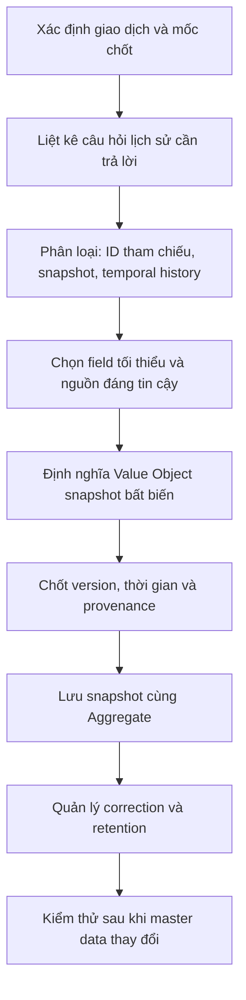

# Ảnh chụp thông tin tại thời điểm phát sinh giao dịch

Trong một hệ thống nghiệp vụ, nhiều thông tin thay đổi theo thời gian. Tên và mô tả sản phẩm có thể được chỉnh sửa, giá bán có thể tăng hoặc giảm, địa chỉ khách hàng có thể thay đổi, thuế suất có thể được cập nhật và điều khoản dịch vụ có thể được thay thế. Nhưng một giao dịch đã phát sinh thường phải giữ được ý nghĩa của nó tại thời điểm được xác lập.

Nếu một đơn hàng chỉ lưu `ProductId` rồi mỗi lần xem lại đều lấy tên và giá hiện tại từ Catalog, đơn hàng cũ có thể hiển thị một mức giá khác với mức khách đã chấp nhận. Nếu hóa đơn chỉ tham chiếu địa chỉ hiện tại của khách hàng, việc khách đổi địa chỉ có thể làm lịch sử giao hàng trở nên sai. Đây là lý do cần **ảnh chụp thông tin tại thời điểm phát sinh giao dịch (transaction-time snapshot)**: lưu lại những giá trị có ý nghĩa đối với giao dịch, để chúng không bị thay đổi khi dữ liệu nguồn được cập nhật về sau.

Trong Domain-Driven Design (DDD), snapshot thường là một phần của trạng thái Aggregate hoặc một Value Object bất biến. Nó bảo vệ ý nghĩa lịch sử của giao dịch, trong khi ID tham chiếu vẫn giúp truy về đối tượng nguồn khi cần. Bài này trình bày cách quyết định dữ liệu nào cần snapshot, cách thiết kế snapshot cho giá, sản phẩm, địa chỉ và thuế, phân biệt thời gian hiệu lực với thời gian ghi nhận, cùng cách lưu trữ, migration và kiểm thử.

`DOMAIN_DRIVEN_DESIGN` dùng Entity, Value Object, Aggregate, Repository và Domain Event để mô hình hóa vòng đời nghiệp vụ. Snapshot kết nối các khái niệm đó với thời gian: nó ghi lại những sự kiện hoặc điều kiện quan trọng đã đúng tại một thời điểm, giúp hệ thống hiện tại diễn giải đúng giao dịch trong quá khứ.

## 1. Vì sao giao dịch cần giữ lại thông tin tại thời điểm phát sinh?

### 1.1. Dữ liệu nguồn tiếp tục thay đổi

Giả sử khách hàng đặt một sản phẩm vào ngày 10 tháng 3:

| Thông tin | Tại ngày đặt hàng | Sau khi dữ liệu nguồn thay đổi |
|---|---|---|
| Tên sản phẩm | Bình giữ nhiệt 500 ml | Bình giữ nhiệt phiên bản mới |
| Đơn giá | 125.000 VND | 149.000 VND |
| Địa chỉ giao hàng | 12 Nguyễn Huệ | 88 Lê Lợi |
| Thuế suất | 8% | 10% |
| Điều khoản đổi trả | 30 ngày | 14 ngày |

Nếu Order chỉ giữ các ID tham chiếu, khi xem lại đơn cũ, hệ thống có thể hiển thị tên, giá, địa chỉ hoặc điều khoản mới. Dữ liệu mới có thể hoàn toàn đúng với hiện tại nhưng lại sai khi dùng để diễn giải giao dịch trong quá khứ.

### 1.2. Lịch sử phải phản ánh điều các bên đã đồng ý

Giao dịch thường xác lập một số sự thật tại thời điểm cụ thể:

- Khách đã mua sản phẩm nào và với mô tả nào?
- Giá và loại tiền nào đã được chấp nhận?
- Thuế, chiết khấu, phí và điều kiện nào đã được áp dụng?
- Giao hàng đến người nhận và địa chỉ nào?
- Điều khoản hoặc phiên bản báo giá nào đã được sử dụng?

Những dữ kiện này có thể ảnh hưởng đến hóa đơn, hoàn tiền, bảo hành, khiếu nại, đối soát và báo cáo. Chúng không nên bị thay đổi chỉ vì một hồ sơ nguồn được chỉnh sửa.

### 1.3. Snapshot bảo vệ ý nghĩa, không phải sao chép toàn bộ đối tượng

Snapshot không có nghĩa là sao chép tất cả field của Product, Customer hoặc một Aggregate khác vào giao dịch. Chỉ lưu những giá trị cần thiết để giữ lại ý nghĩa và kết quả nghiệp vụ.

Ví dụ, Order có thể cần snapshot tên sản phẩm, SKU, đơn giá, currency, thuế và điều khoản áp dụng. Nó thường không cần sao chép toàn bộ gallery ảnh, nội dung SEO, lịch sử chỉnh sửa nội bộ hoặc các thuộc tính tìm kiếm của Catalog.

## 2. Snapshot khác với tham chiếu đến dữ liệu hiện tại

### 2.1. Tham chiếu bằng ID trả lời “đối tượng nào?”

Một `ProductId` cho biết dòng hàng có liên quan đến sản phẩm nào trong Catalog. Nó hữu ích để:

- Truy vết nguồn dữ liệu.
- Mở trang sản phẩm hiện tại.
- Đối chiếu với hệ thống Catalog.
- Phân tích doanh số theo sản phẩm.
- Liên kết với bảo hành hoặc quy trình hỗ trợ.

Nhưng ID không giữ lại tên, giá hoặc trạng thái của sản phẩm tại thời điểm giao dịch.

### 2.2. Snapshot trả lời “điều gì đã được ghi nhận lúc đó?”

Snapshot lưu những giá trị được chốt cho giao dịch:

```text
OrderLine
  productId: SKU-42                 -> tham chiếu sản phẩm nguồn
  purchasedProductSnapshot:
    sku: SKU-42
    name: Bình giữ nhiệt 500 ml      -> tên tại thời điểm mua
    unitPrice: 125000 VND            -> giá đã chốt
    taxRate: 8%                      -> thuế suất đã áp dụng
    capturedAt: 2026-03-10T09:15Z
```

Khi Catalog đổi tên hoặc giá, snapshot trong Order vẫn giữ nguyên. `productId` vẫn giúp truy vết sản phẩm hiện tại.

### 2.3. Dùng cả ID và snapshot khi hai nhu cầu đều tồn tại

Trong nhiều giao dịch, thiết kế phù hợp là lưu cả hai:

| Dữ liệu | Dùng để làm gì? | Có thay đổi theo nguồn hiện tại không? |
|---|---|---|
| `ProductId` | Liên kết và truy vết sản phẩm | ID ổn định; đối tượng nguồn có thể thay đổi |
| `ProductSnapshot.name` | Hiển thị tên đã mua | Không |
| `ProductSnapshot.unitPrice` | Tính toán và giải thích giá đã chốt | Không |
| `CustomerId` | Liên kết hồ sơ khách hàng | ID ổn định; hồ sơ có thể thay đổi |
| `DeliveryAddressSnapshot` | Chứng minh địa chỉ dùng cho lần giao này | Không |

Không nên chọn một trong hai theo kiểu tuyệt đối. Tham chiếu hỗ trợ kết nối với hiện tại; snapshot giữ lại sự thật lịch sử.

### 2.4. Snapshot không phải cache

Cache lưu bản sao tạm thời để tăng tốc truy cập và thường có thể hết hạn hoặc được làm mới từ nguồn. Snapshot giao dịch lưu giá trị đã được chốt như một phần của lịch sử nghiệp vụ. Nó không được tự động refresh khi dữ liệu nguồn thay đổi.

Nếu snapshot được cập nhật âm thầm từ Catalog hiện tại, hệ thống đã phá vỡ ý nghĩa lịch sử mà snapshot cần bảo vệ.

## 3. Quyết định thông tin nào cần snapshot

### 3.1. Bắt đầu từ câu hỏi nghiệp vụ trong tương lai

Hãy hỏi: sau vài tháng hoặc vài năm, khi dữ liệu nguồn đã thay đổi, hệ thống cần biết điều gì để giải thích giao dịch?

Ví dụ:

- Khi hoàn tiền, cần biết số tiền và currency ban đầu.
- Khi phát hành hóa đơn, cần biết tên hàng, đơn giá, thuế và thông tin người mua theo chứng từ.
- Khi xử lý tranh chấp giao hàng, cần biết người nhận và địa chỉ đã được xác nhận.
- Khi xử lý bảo hành, cần biết model, serial hoặc điều kiện bảo hành đã áp dụng.
- Khi kiểm tra hợp đồng, cần biết phiên bản điều khoản khách đã chấp nhận.

Nếu một field không ảnh hưởng đến tính đúng đắn, audit hoặc cách giải thích giao dịch, có thể chỉ cần tham chiếu nguồn hiện tại hoặc không cần lưu.

### 3.2. Phân loại dữ liệu

| Loại thông tin | Cách lưu thường phù hợp | Ví dụ |
|---|---|---|
| Identity của đối tượng nguồn | ID tham chiếu | `ProductId`, `CustomerId` |
| Giá trị đã được chốt | Snapshot bất biến | Đơn giá, currency, chiết khấu |
| Thông tin liên hệ dùng cho một giao dịch | Snapshot theo giao dịch | Tên người nhận, địa chỉ giao hàng |
| Trạng thái hiện tại của đối tượng khác | Truy vấn nguồn hoặc read model | Sản phẩm đang được bán hay không |
| Phiên bản quy tắc đã áp dụng | Version hoặc policy reference kèm snapshot kết quả | Phiên bản thuế, điều khoản |
| Lịch sử mọi lần thay đổi | Event log hoặc temporal history | Các lần đổi địa chỉ, đổi giá |

### 3.3. Snapshot đúng phạm vi Aggregate

Nếu Order cần giữ tên và giá tại thời điểm đặt, các giá trị đó có thể thuộc `OrderLine` hoặc một Value Object được Order sở hữu. Order không cần nạp toàn bộ Product Aggregate để tính tổng tiền.

Nếu Billing Context cần một bản sao dữ liệu hóa đơn theo quy định riêng, Billing có thể có snapshot của chính nó. Một context không nên phụ thuộc vào snapshot nội bộ của context khác như thể đó là mô hình dùng chung; hãy trao đổi qua contract có ý nghĩa.

### 3.4. Không snapshot dữ liệu chỉ để tiện lập trình

Sao chép quá nhiều dữ liệu dẫn đến:

- Trùng lặp và khó xác định nguồn sự thật.
- Tăng chi phí lưu trữ và migration.
- Lưu thông tin cá nhân lâu hơn nhu cầu.
- Dễ nhầm snapshot với dữ liệu hiện tại.
- Tạo ra nhiều phiên bản dữ liệu không có quy tắc quản lý.

Hãy nêu rõ mục đích, owner và thời hạn lưu cho từng nhóm snapshot quan trọng.

## 4. Snapshot trong Entity, Value Object và Aggregate

### 4.1. Snapshot thường phù hợp với Value Object bất biến

Snapshot biểu diễn một tập giá trị có ý nghĩa tại một thời điểm và thường không có identity độc lập. Vì vậy, có thể mô hình hóa nó như Value Object bất biến:

```java
public record ProductSnapshot(
    String sku,
    String name,
    String description,
    Instant capturedAt
) {
    public ProductSnapshot {
        Objects.requireNonNull(sku);
        Objects.requireNonNull(name);
        Objects.requireNonNull(capturedAt);
    }
}
```

Record Java giúp các field là final và biểu diễn giá trị theo nội dung. Trong hệ thống thực tế, chỉ đưa `description` vào nếu giao dịch cần giữ mô tả đó; không nên thêm field chỉ vì Catalog có sẵn.

### 4.2. Aggregate sở hữu snapshot

`OrderLine` có thể giữ `ProductId` và `ProductSnapshot`. Root quản lý vòng đời của dòng hàng và bảo vệ quy tắc liên quan đến số lượng, giá và tổng đơn.

```java
public final class OrderLine {
    private final OrderLineId id;
    private final ProductId productId;
    private final ProductSnapshot product;
    private final Money unitPrice;
    private final Quantity quantity;

    public OrderLine(
        OrderLineId id,
        ProductId productId,
        ProductSnapshot product,
        Money unitPrice,
        Quantity quantity
    ) {
        this.id = Objects.requireNonNull(id);
        this.productId = Objects.requireNonNull(productId);
        this.product = Objects.requireNonNull(product);
        this.unitPrice = Objects.requireNonNull(unitPrice);
        this.quantity = Objects.requireNonNull(quantity);
    }
}
```

Ví dụ rút gọn này cho thấy snapshot nằm trong trạng thái dòng hàng. Không nên cung cấp setter để thay tên hoặc giá lịch sử sau khi đơn đã được đặt. Nếu nghiệp vụ có điều chỉnh, hãy ghi nhận adjustment hoặc correction riêng có lý do và thời điểm.

### 4.3. Snapshot không làm đối tượng nguồn thành bất biến

Product trong Catalog vẫn có thể đổi tên, giá hoặc trạng thái. Snapshot trong Order chỉ bất biến đối với giao dịch đó. Hai vòng đời khác nhau:

```text
Catalog Product
  name/price/status thay đổi theo thời gian
          |
          | lấy dữ liệu và chốt tại thời điểm đặt
          v
OrderLine Snapshot
  name/price/tax giữ nguyên theo giao dịch
```

### 4.4. Khi cần điều chỉnh lịch sử, không âm thầm sửa snapshot

Có những trường hợp phải sửa chứng từ hoặc giao dịch do sai sót. Thay vì ghi đè snapshot cũ, có thể tạo:

- Credit note hoặc debit note.
- Price adjustment.
- Correction record.
- Replacement document có liên kết tới chứng từ trước.
- Audit entry ghi giá trị cũ, giá trị mới, lý do và người thực hiện.

Quy trình cụ thể phụ thuộc nghiệp vụ và quy định áp dụng. Nguyên tắc là giữ khả năng truy vết điều đã được ghi nhận trước đó và lý do thay đổi.

## 5. Snapshot giá và điều kiện thương mại

### 5.1. Giá hiện tại khác giá đã chấp nhận

Giá Catalog có thể thay đổi theo thời gian, khách hàng, số lượng, chiến dịch hoặc kênh bán. Khi đơn được xác lập, cần lưu giá đã được chấp nhận cùng currency và các thành phần ảnh hưởng đến số tiền cuối cùng.

Một snapshot giá có thể gồm:

- Đơn giá trước điều chỉnh.
- Currency.
- Chiết khấu và lý do/loại chương trình.
- Thuế suất hoặc số tiền thuế đã áp dụng.
- Phí và phụ phí.
- Số lượng dùng để tính.
- Tổng tiền dòng hàng.
- Quote ID hoặc pricing version.
- Thời điểm báo giá và thời điểm chốt.

Không phải mọi hệ thống cần lưu tất cả thành phần này. Hãy xác định dữ liệu nào cần để tính lại, giải thích và đối soát số tiền đã chốt.

### 5.2. Ví dụ Price Snapshot

```java
public record PriceSnapshot(
    Money unitPrice,
    String priceListId,
    String pricingVersion,
    Instant quotedAt,
    Instant acceptedAt
) {
    public PriceSnapshot {
        Objects.requireNonNull(unitPrice);
        Objects.requireNonNull(quotedAt);
        Objects.requireNonNull(acceptedAt);
        if (acceptedAt.isBefore(quotedAt)) {
            throw new IllegalArgumentException(
                "Acceptance cannot precede quote time"
            );
        }
    }
}
```

Đây là một mô hình minh họa. Nếu quote có thời hạn, cần lưu `validUntil` hoặc `expiresAt` và xác minh quote còn hiệu lực khi Order chấp nhận. `pricingVersion` giúp truy lại quy tắc đã tính giá, nhưng bản thân version không thay thế snapshot số tiền nếu kết quả phải giữ nguyên.

### 5.3. Không tính lại đơn hàng cũ bằng giá hiện tại

Giả sử khách mua 2 sản phẩm với đơn giá 125.000 VND. Một tuần sau giá tăng lên 149.000 VND. Tổng tiền của Order cũ phải dựa trên snapshot 125.000 VND, trừ khi có một hành động điều chỉnh riêng theo quy tắc nghiệp vụ.

```java
Money lineTotal = priceSnapshot.unitPrice().multiply(quantity.value());
```

Phép tính thực tế cần xử lý precision, rounding, discount, tax và chính sách tiền tệ. Không nên lấy `currentProduct.price()` để tính lại tổng của một giao dịch đã chốt.

### 5.4. Quote và snapshot có vai trò khác nhau

Quote có thể là một đối tượng có vòng đời và thời hạn riêng, cho phép khách xem giá trước khi đặt. Snapshot trong Order ghi lại kết quả quote đã được chấp nhận.

Nếu quote bị hết hạn hoặc giá thay đổi trước khi khách xác nhận, hệ thống có thể yêu cầu báo giá lại. Khi Order được tạo, nó cần lưu quote/version và giá trị đã chốt theo chính sách.

### 5.5. Tránh đọc giá và thuế từ hai thời điểm khác nhau

Một lỗi thường gặp là gọi Catalog lấy giá, rồi gọi Tax Service sau đó lấy thuế suất hiện tại. Nếu quy tắc thay đổi giữa hai lần gọi, snapshot có thể kết hợp dữ liệu không thuộc cùng một lần tính.

Có thể dùng một quote hoặc pricing result có version, chứa đủ các thành phần cần thiết và được xác nhận trong một luồng nhất quán. Nếu nhiều service tham gia, contract cần xác định thời điểm hiệu lực, version và thời hạn của kết quả.

## 6. Snapshot địa chỉ và thông tin người nhận

### 6.1. Địa chỉ trong hồ sơ khác địa chỉ của giao dịch

Customer có thể lưu địa chỉ mặc định để dùng cho các đơn tiếp theo. Nhưng Order cần lưu địa chỉ giao hàng đã được khách xác nhận cho chính đơn đó.

```java
public record DeliveryAddressSnapshot(
    String recipientName,
    String phoneNumber,
    String addressLine,
    String ward,
    String district,
    String province,
    String countryCode,
    Instant capturedAt
) {}
```

Nếu Customer đổi địa chỉ mặc định, `DeliveryAddressSnapshot` của đơn cũ vẫn giữ nguyên. Một lần đổi địa chỉ giao hàng sau khi đặt cần là một hành động nghiệp vụ riêng, có thể ghi lịch sử thay đổi và kiểm tra trạng thái giao hàng.

### 6.2. Snapshot không phải bản sao hồ sơ khách hàng

Chỉ lưu dữ liệu cần cho giao hàng, hóa đơn hoặc nghĩa vụ cụ thể. Không sao chép toàn bộ hồ sơ cá nhân, sở thích, lịch sử đăng nhập hoặc dữ liệu không liên quan vào mọi Order.

Địa chỉ và số điện thoại là dữ liệu cá nhân. Cần xác định mục đích, quyền truy cập, retention, masking và quy trình xử lý yêu cầu bảo vệ dữ liệu theo chính sách và quy định áp dụng.

### 6.3. Địa chỉ chuẩn hóa và địa chỉ hiển thị

Có thể lưu các thành phần địa chỉ đã chuẩn hóa để tích hợp hãng vận chuyển và một chuỗi hiển thị để tái hiện chứng từ. Nếu hệ thống địa giới hoặc tên địa danh thay đổi, snapshot cần giữ dữ liệu đã xác nhận tại thời điểm giao dịch theo mục đích của nó.

Không nên tái dựng địa chỉ cũ bằng cách join với danh mục hành chính hiện tại nếu các mã hoặc tên đã thay đổi và điều đó làm sai lịch sử.

## 7. Snapshot thuế, điều khoản và quy tắc đã áp dụng

### 7.1. Lưu kết quả và dấu vết quy tắc

Khi một giao dịch áp dụng thuế hoặc chiết khấu, cần xác định dữ liệu nào phải giữ:

- Taxable base.
- Tax rate.
- Tax amount.
- Loại thuế hoặc mã chính sách.
- Jurisdiction hoặc phạm vi áp dụng nếu cần.
- Phiên bản rule hoặc thời điểm hiệu lực.
- Cách làm tròn đã dùng.

Chỉ lưu `taxRate` có thể chưa đủ để tái hiện số tiền nếu cách tính, cơ sở tính hoặc rounding rule thay đổi. Với nghiệp vụ tài chính, thường cần lưu cả kết quả đã tính và metadata đủ để giải thích kết quả.

### 7.2. Điều khoản đã chấp nhận

Một Subscription có thể tham chiếu `TermsAndConditionsVersion`, đồng thời lưu version/hash và thời điểm người dùng chấp nhận. Nếu nội dung điều khoản phải được chứng minh, cần lưu bản nội dung hoặc một kho phiên bản bất biến có thể truy xuất lâu dài; chỉ lưu số version không đủ nếu nội dung tương ứng có thể bị ghi đè.

### 7.3. Snapshot kết quả không thay thế lịch sử quy tắc

Snapshot giữ kết quả áp dụng cho một giao dịch. Nếu doanh nghiệp cần biết toàn bộ quy tắc từng có hiệu lực trong quá khứ, cần mô hình lịch sử quy tắc hoặc temporal data riêng. Không nên suy ra mọi giao dịch lịch sử chỉ từ phiên bản policy hiện tại.

## 8. Thời gian hiệu lực và thời gian ghi nhận

### 8.1. Hai loại thời gian có ý nghĩa khác nhau

Trong hệ thống lịch sử, cần phân biệt:

- **Valid time (thời gian hiệu lực):** khoảng thời gian sự thật được xem là đúng trong nghiệp vụ.
- **Transaction/recorded time (thời gian ghi nhận):** thời điểm hệ thống lưu hoặc biết đến sự thật đó.

Ví dụ, một mức giá có hiệu lực từ 1 tháng 4 nhưng được nhập vào hệ thống ngày 3 tháng 4. Valid time bắt đầu ngày 1 tháng 4; recorded time là ngày 3 tháng 4.

Hai thời điểm này giúp trả lời hai câu hỏi khác nhau: “Giá nào có hiệu lực vào ngày 2 tháng 4?” và “Ngày 2 tháng 4 hệ thống đã biết giá nào?”.

### 8.2. Bitemporal data

Một số nghiệp vụ cần lưu cả valid time và recorded time. Mô hình bitemporal cho phép truy vấn theo hai trục thời gian:

| Câu hỏi | Trục thời gian |
|---|---|
| Mức giá có hiệu lực vào ngày khách đặt hàng? | Valid time |
| Hệ thống ghi nhận mức giá đó từ khi nào? | Recorded time |
| Sau khi phát hiện nhập sai, hệ thống đã biết gì tại ngày báo cáo? | Recorded time kết hợp valid time |

Ví dụ bảng lịch sử:

```sql
CREATE TABLE product_prices (
    product_id VARCHAR(80) NOT NULL,
    amount DECIMAL(18, 2) NOT NULL,
    currency_code CHAR(3) NOT NULL,
    valid_from TIMESTAMP NOT NULL,
    valid_to TIMESTAMP,
    recorded_from TIMESTAMP NOT NULL,
    recorded_to TIMESTAMP
);
```

Schema trên chỉ minh họa. Cần định nghĩa rõ khoảng thời gian đóng/mở, timezone, cách xử lý các khoảng chồng lấn và ràng buộc một mức giá có hiệu lực tại cùng thời điểm.

### 8.3. Snapshot và bitemporal history không thay thế nhau

Snapshot trả lời giao dịch đã chốt giá trị nào. Bitemporal history trả lời dữ liệu nguồn có hiệu lực và được ghi nhận ra sao qua thời gian. Một hệ thống có thể cần cả hai:

- Product Price History quản lý các mức giá theo hiệu lực và thời điểm ghi nhận.
- Order Line lưu giá thực tế đã chấp nhận.

Nếu lịch sử giá được sửa do nhập sai, Order cũ vẫn giữ số tiền đã được chốt, trong khi lịch sử giá có thể ghi nhận một correction với thời gian hiệu lực và thời gian biết đến.

### 8.4. OccurredAt, RecordedAt và CapturedAt

Các timestamp nên có tên thể hiện ý nghĩa:

- `occurredAt`: thời điểm sự kiện nghiệp vụ xảy ra theo định nghĩa miền.
- `recordedAt`: thời điểm hệ thống ghi nhận sự kiện.
- `capturedAt`: thời điểm snapshot được lấy/chốt.
- `validFrom`/`validTo`: khoảng hiệu lực của một sự thật.

Không dùng một field `timestamp` chung cho mọi mục đích. Điều đó dễ làm báo cáo và xử lý lịch sử nhầm lẫn.

### 8.5. Clock, timezone và độ chính xác

Trong ứng dụng phân tán, clock giữa các máy có thể lệch. Hãy xác định nguồn thời gian và độ chính xác phù hợp. Với thời điểm tuyệt đối, thường lưu Instant/UTC; với lịch làm việc hoặc ngày hóa đơn theo múi giờ địa phương, cần lưu timezone hoặc business date tương ứng.

Inject `Clock` vào domain/application service giúp kiểm thử xác định. Không gọi `Instant.now()` tùy tiện ở nhiều nơi trong cùng một hành động nếu các timestamp phải cùng biểu diễn một thời điểm nghiệp vụ.

## 9. Snapshot, Event History và Event Sourcing

### 9.1. Snapshot không đồng nghĩa Event Sourcing

Snapshot giao dịch lưu một tập giá trị đã chốt trong Aggregate. Event history lưu những sự kiện hoặc thay đổi đã xảy ra. Event Sourcing dùng event stream làm nguồn dữ liệu chính để tái tạo trạng thái hiện tại.

Ba khái niệm có thể phối hợp nhưng không đồng nghĩa:

| Cách lưu | Trả lời câu hỏi | Ví dụ |
|---|---|---|
| Transaction snapshot | Giao dịch đã dùng dữ liệu nào? | Giá và địa chỉ của Order |
| Audit/history log | Ai thay đổi điều gì, khi nào? | Đổi địa chỉ giao hàng |
| Event Sourcing | Trạng thái Aggregate được hình thành từ chuỗi event nào? | `OrderPlaced`, `LineAdded`, `OrderCancelled` |

Một hệ thống CRUD với database quan hệ vẫn có thể cần snapshot mà không dùng Event Sourcing.

### 9.2. Domain Event có thể mang snapshot cần thiết

Một `OrderPlaced` Integration Event có thể chứa tên hàng và giá đã chốt nếu consumer cần thông tin đó. Event payload cần giữ semantics ổn định và chỉ công bố dữ liệu cần thiết.

Không nên phát event chỉ chứa `productId` rồi yêu cầu consumer đọc Catalog hiện tại để tái dựng giá lịch sử. Nếu consumer cần giá đã chốt, event nên chứa giá trị đó hoặc một reference tới nguồn lịch sử bất biến có thể truy cập.

### 9.3. Event không nhất thiết là bản sao toàn bộ Aggregate

Event mô tả điều đã xảy ra và dữ liệu cần cho consumer. Nó không cần serialize mọi field nội bộ. Snapshot trong Aggregate và payload của Integration Event có thể khác nhau vì phục vụ các mục đích khác nhau.

### 9.4. Correction cần event hoặc record riêng

Nếu một giao dịch cần điều chỉnh, hãy ghi nhận hành động điều chỉnh với reference tới giao dịch gốc, giá trị chênh lệch, lý do và thời điểm. Không sửa payload lịch sử đã phát hoặc âm thầm thay snapshot gốc, trừ khi có quy trình correction được kiểm soát và audit đầy đủ.

## 10. Thiết kế quy trình tạo snapshot nhất quán

### 10.1. Chốt dữ liệu từ một nguồn có phiên bản

Nếu Order lấy tên từ Catalog, giá từ Pricing và thuế từ Tax Service, các dữ liệu có thể thay đổi giữa các lần gọi. Nên có một quote/pricing result hoặc tập kết quả được gắn version và thời điểm rõ ràng.

Application service có thể điều phối:

1. Nhận yêu cầu đặt hàng.
2. Lấy quote còn hiệu lực với sản phẩm, giá, currency và điều kiện áp dụng.
3. Lấy hoặc xác nhận kết quả thuế/chiết khấu theo hợp đồng đã định nghĩa.
4. Kiểm tra quote còn hiệu lực và đúng customer/quantity/context.
5. Tạo Order cùng snapshot đã chốt.
6. Lưu Aggregate và ghi nhận event theo transaction.

Không nên tự ghép các giá trị từ nhiều lần đọc không có version hoặc thời điểm liên hệ nếu chúng phải tạo thành một quyết định thương mại thống nhất.

### 10.2. Ví dụ application service

```java
public OrderId placeOrder(PlaceOrderCommand command) {
    Instant acceptedAt = clock.instant();

    PricingQuote quote = pricingClient.getValidQuote(
        command.quoteId(),
        command.customerId(),
        acceptedAt
    );

    if (!quote.isValidFor(command.items(), acceptedAt)) {
        throw new QuoteExpiredOrChanged();
    }

    List<OrderLine> lines = command.items().stream()
        .map(item -> {
            QuotedItem quoted = quote.requireItem(item.productId());
            return OrderLine.fromSnapshot(
                item.productId(),
                quoted.productSnapshot(),
                quoted.priceSnapshot(),
                item.quantity()
            );
        })
        .toList();

    Order order = Order.place(
        OrderId.newId(),
        command.customerId(),
        lines,
        command.deliveryAddress(),
        acceptedAt
    );

    orderRepository.save(order);
    return order.id();
}
```

Đây là ví dụ rút gọn. Việc xác nhận quote, tạo Order và lưu cần nằm trong một quy trình có kiểm soát lỗi và concurrency. Nếu Pricing thuộc service khác, không thể giả định transaction database của Order bao trùm cả Pricing; quote cần có semantics về thời hạn, version và khả năng chấp nhận độc lập.

### 10.3. Snapshot phải được tạo tại business boundary rõ ràng

“Thời điểm phát sinh giao dịch” có thể là lúc khách bấm xác nhận, lúc hệ thống chấp nhận đơn, lúc payment được capture hoặc lúc hợp đồng có hiệu lực. Các mốc này không nhất thiết trùng nhau.

Hãy xác định sự kiện nào làm snapshot trở thành chính thức. Ví dụ:

- Giá được chốt khi quote được chấp nhận.
- Địa chỉ được chốt khi Order được đặt, nhưng có thể thay đổi bằng use case sửa địa chỉ trước khi bàn giao.
- Điều khoản được chốt khi khách xác nhận đồng ý.
- Thuế được xác định theo thời điểm cung cấp hàng/dịch vụ nếu quy tắc nghiệp vụ/pháp lý yêu cầu.

Không dùng `createdAt` của database làm đại diện cho mọi mốc nghiệp vụ nếu chúng có ý nghĩa khác nhau.

## 11. Lưu snapshot trong database và ORM

### 11.1. Lưu thành các cột rõ ràng

Với các field cần query, filter, index hoặc constraint, lưu thành cột riêng thường thuận tiện:

```sql
CREATE TABLE order_lines (
    id VARCHAR(80) PRIMARY KEY,
    order_id VARCHAR(80) NOT NULL,
    product_id VARCHAR(80) NOT NULL,
    product_sku_snapshot VARCHAR(80) NOT NULL,
    product_name_snapshot VARCHAR(300) NOT NULL,
    unit_price_amount DECIMAL(18, 2) NOT NULL,
    unit_price_currency CHAR(3) NOT NULL,
    quantity INTEGER NOT NULL,
    captured_at TIMESTAMP NOT NULL
);
```

Tên cột có hậu tố `_snapshot` giúp phân biệt dữ liệu lịch sử với field tham chiếu hoặc dữ liệu hiện tại. Đây là quy ước hữu ích, không phải yêu cầu bắt buộc.

### 11.2. Embedded Value Object

JPA có thể ánh xạ snapshot thành `@Embeddable` hoặc dùng converter/mapper:

```java
@Embeddable
public class ProductSnapshotEmbeddable {
    @Column(name = "product_sku_snapshot")
    private String sku;

    @Column(name = "product_name_snapshot")
    private String name;

    @Column(name = "product_description_snapshot")
    private String description;

    @Column(name = "product_captured_at")
    private Instant capturedAt;

    protected ProductSnapshotEmbeddable() {
        // ORM constructor
    }

    public ProductSnapshot toDomain() {
        return new ProductSnapshot(sku, name, description, capturedAt);
    }
}
```

Ví dụ này chỉ minh họa mapping. Nếu snapshot không lưu mô tả, hãy dùng một kiểu persistence/domain phù hợp thay vì truyền `null` vào field được xem là bắt buộc. Nếu ORM cần constructor mặc định, hãy giới hạn phạm vi truy cập và không mở setter công khai làm mất tính bất biến của domain object.

### 11.3. JSON column khi snapshot có cấu trúc thay đổi

JSON column có thể phù hợp khi snapshot là payload ít được query theo từng field và cấu trúc cần lưu theo phiên bản. Tuy nhiên:

- Cần schema/version cho payload.
- Cần migration hoặc upcaster khi đọc version cũ.
- Khó tạo constraint và index trên mọi field hơn so với cột riêng.
- Cần kiểm tra dữ liệu JSON có đủ field bắt buộc.
- Không nên dùng JSON để né thiết kế khi field có ý nghĩa truy vấn quan trọng.

### 11.4. Không dùng quan hệ ORM tới đối tượng nguồn để hiển thị snapshot

Nếu `OrderLine` có `@ManyToOne Product`, việc render đơn hàng cũ bằng `product.getName()` sẽ lấy tên hiện tại. Nếu muốn giữ lịch sử, hãy đọc `productNameSnapshot` trong OrderLine. Quan hệ tới Product chỉ phục vụ truy vết hoặc hành động cần dữ liệu hiện tại.

### 11.5. Cascade và quyền sở hữu

Snapshot là trạng thái thuộc giao dịch và thường được lưu/xóa cùng Aggregate sở hữu nó theo vòng đời miền. ORM cascade có thể hỗ trợ persistence, nhưng không phải định nghĩa của Aggregate. Không cascade xóa Product hoặc Customer chỉ vì Order có snapshot và ID tham chiếu tới họ.

## 12. Thay đổi snapshot và quản lý correction

### 12.1. Snapshot thường bất biến sau mốc chốt

Sau khi Order được đặt, tên sản phẩm và đơn giá đã chốt không nên bị sửa bởi một tác vụ đồng bộ Catalog. Nếu địa chỉ được thay đổi theo quy trình cho phép, hãy ghi nhận một hành động nghiệp vụ `ChangeDeliveryAddress` và quyết định giữ cả địa chỉ ban đầu lẫn địa chỉ mới hay chỉ giữ phiên bản hiện hành kèm audit.

### 12.2. Phân biệt lỗi nhập liệu và thay đổi có hiệu lực

Nếu tên sản phẩm bị typo tại thời điểm mua, có thể cần correction. Nếu tên sản phẩm được đổi vì tái định vị thương hiệu sau đó, đó là thay đổi hiện tại và không nhất thiết phải sửa đơn cũ.

Quyết định correction cần xác định:

- Giá trị gốc đã được xác nhận.
- Giá trị sửa và lý do.
- Người hoặc hệ thống yêu cầu.
- Thời điểm correction và thời điểm có hiệu lực.
- Chứng từ/sự kiện phát sinh từ correction.
- Có cần thông báo cho consumer hoặc đối tác không.

### 12.3. Không cập nhật hàng loạt snapshot khi master data đổi

Một job đồng bộ tên/giá từ Catalog sang mọi Order cũ sẽ làm lịch sử thay đổi theo hiện tại. Nếu mục tiêu là hiển thị thông tin mới nhất, hãy truy vấn Catalog hoặc tạo read model hiện tại riêng; đừng ghi đè snapshot giao dịch.

## 13. Dữ liệu cũ khi hệ thống bắt đầu lưu snapshot

### 13.1. Không thể suy ra lịch sử từ dữ liệu hiện tại một cách chắc chắn

Giả sử Order cũ chỉ có `productId` và không có tên hoặc giá snapshot. Catalog hiện tại cho biết giá 149.000 VND, nhưng không chứng minh đơn hàng đã được đặt với giá đó. Có thể lúc đặt giá là 125.000 VND hoặc có chiết khấu riêng.

Không nên backfill snapshot lịch sử bằng giá hiện tại rồi coi đó là sự thật đã xảy ra. Điều đó tạo dữ liệu trông đầy đủ nhưng sai nguồn gốc.

### 13.2. Tìm nguồn lịch sử đáng tin cậy

Có thể khôi phục snapshot từ:

- Bảng giá có version và valid time.
- Quote hoặc checkout record đã lưu.
- Invoice/receipt đã phát hành.
- Event hoặc audit log bất biến.
- Bản sao dữ liệu được lưu tại thời điểm giao dịch.
- Hệ thống kế toán hoặc nguồn lưu trữ chính thức khác.

Mỗi nguồn cần được đánh giá về tính đầy đủ, tính nhất quán và khả năng chứng minh. Không mặc định một bản log kỹ thuật là nguồn sự thật nghiệp vụ.

### 13.3. Đánh dấu mức độ tin cậy và nguồn gốc

Nếu phải chuyển dữ liệu lịch sử, có thể lưu provenance:

```text
snapshotSource = INVOICE_ARCHIVE
sourceReference = INV-2024-0042
reconstructedAt = 2026-11-18T08:00:00Z
confidence = VERIFIED
```

Với bản ghi không thể khôi phục, dùng trạng thái rõ như `LEGACY_UNAVAILABLE` ở persistence/read model hoặc một kiểu kết quả riêng. Không tạo `Money(0, VND)` để biểu diễn giá chưa biết.

### 13.4. Migration không được giả mạo lịch sử

Backfill có thể chuyển đổi format nếu giá trị cũ đã có đủ dữ liệu. Nhưng nếu snapshot chưa từng được ghi, migration không thể biến dữ liệu hiện tại thành bằng chứng lịch sử. Cần giữ sự khác biệt giữa:

- Snapshot được ghi tại thời điểm giao dịch.
- Snapshot được khôi phục từ nguồn lịch sử đáng tin cậy.
- Dữ liệu lịch sử không thể khôi phục.

## 14. Snapshot, privacy và retention

### 14.1. Lưu đủ cho mục đích, không lưu vô hạn theo mặc định

Snapshot địa chỉ, số điện thoại, tên người nhận hoặc thông tin định danh có thể là dữ liệu cá nhân. Việc cần giữ lịch sử giao dịch không đồng nghĩa mọi field phải được giữ mãi mãi.

Hãy xác định:

- Mục đích nghiệp vụ hoặc nghĩa vụ lưu trữ.
- Field tối thiểu cần giữ.
- Ai có quyền xem snapshot.
- Thời hạn retention theo loại giao dịch.
- Quy tắc masking hoặc hạn chế hiển thị.
- Cách xử lý yêu cầu xóa/ẩn danh khi được phép.
- Ảnh hưởng của việc xóa tới hóa đơn, audit và nghĩa vụ pháp lý.

### 14.2. Tách dữ liệu nhạy cảm khỏi snapshot ít nhạy cảm khi cần

Nếu địa chỉ và số điện thoại có chính sách retention khác với giá, SKU hoặc currency, có thể lưu chúng ở cấu trúc có quyền truy cập và lifecycle riêng. Không để một quyền đọc Order summary tự động cho phép xem mọi dữ liệu cá nhân.

### 14.3. Masking không được phá hủy dữ liệu cần cho xử lý hợp lệ

Màn hình hỗ trợ có thể hiển thị số điện thoại đã che bớt; hệ thống giao hàng hoặc xử lý khiếu nại có thể cần truy cập đầy đủ theo quyền. Hãy tách representation hiển thị và quyền truy cập dữ liệu gốc.

## 15. Những sai lầm thường gặp

**Chỉ lưu ID và luôn join dữ liệu hiện tại.** Lịch sử giao dịch sẽ thay đổi theo master data. Lưu snapshot cho các giá trị đã chốt.

**Sao chép toàn bộ Aggregate nguồn.** Snapshot phình to, tạo coupling và lưu dữ liệu không cần thiết. Chỉ giữ field cần để giải thích giao dịch.

**Dùng snapshot như cache.** Snapshot giao dịch không được refresh tự động khi nguồn thay đổi.

**Tính lại giao dịch cũ bằng giá hoặc thuế hiện tại.** Kết quả có thể khác điều đã chấp nhận. Dùng giá trị đã chốt và correction riêng khi cần.

**Lấy dữ liệu từ nhiều nguồn ở những thời điểm không liên hệ.** Có thể tạo snapshot pha trộn nhiều phiên bản giá/thuế. Dùng quote/version hoặc quy trình chốt có semantics rõ.

**Dùng một timestamp cho mọi thời điểm.** `occurredAt`, `recordedAt`, `capturedAt` và `validFrom` có ý nghĩa khác nhau.

**Dùng thời gian local không có timezone.** Báo cáo và đối soát có thể sai khi đổi múi giờ hoặc qua vùng thời gian khác. Lưu Instant/UTC và timezone/business date khi cần.

**Sửa snapshot lịch sử khi master data đổi.** Điều đó phá vỡ khả năng giải thích giao dịch cũ. Ghi correction hoặc adjustment riêng.

**Backfill snapshot cũ bằng dữ liệu hiện tại.** Giá trị được tạo ra không có bằng chứng lịch sử. Tìm nguồn đáng tin cậy hoặc đánh dấu không thể khôi phục.

**Snapshot mọi dữ liệu cá nhân không có retention.** Tăng rủi ro riêng tư và chi phí lưu trữ. Áp dụng data minimization, access control và retention.

**Nhầm snapshot với Event Sourcing.** Snapshot là dữ liệu đã chốt; event history và event sourcing là các cơ chế lịch sử khác nhau.

## 16. Quy trình thiết kế Snapshot cho giao dịch



Các bước thực hiện:

1. Xác định hành động nghiệp vụ làm giao dịch được chốt.
2. Liệt kê những câu hỏi mà hệ thống cần trả lời khi xem lại giao dịch.
3. Phân biệt dữ liệu cần tham chiếu hiện tại với dữ liệu cần giữ nguyên lịch sử.
4. Chọn field tối thiểu, nguồn dữ liệu và version đáng tin cậy.
5. Định nghĩa snapshot thành Value Object hoặc cấu trúc bất biến thuộc Aggregate.
6. Ghi rõ `capturedAt`, `occurredAt`, `recordedAt` hoặc valid time theo đúng ý nghĩa.
7. Lưu snapshot trong cùng transaction với Aggregate đã chốt.
8. Định nghĩa correction, audit, provenance và retention.
9. Xử lý dữ liệu cũ theo nguồn lịch sử; không suy đoán từ dữ liệu hiện tại.
10. Kiểm thử lịch sử sau khi dữ liệu nguồn thay đổi.

## 17. Checklist

Trước khi hoàn thiện snapshot cho một giao dịch, hãy kiểm tra:

- [ ] Đã xác định mốc nghiệp vụ mà thông tin được chốt.
- [ ] Đã xác định câu hỏi lịch sử cần trả lời.
- [ ] Có ID tham chiếu để truy vết đối tượng nguồn khi cần.
- [ ] Giá trị cần giữ nguyên được lưu trong snapshot riêng.
- [ ] Snapshot chỉ chứa dữ liệu cần thiết cho giao dịch.
- [ ] Snapshot được biểu diễn bằng Value Object bất biến hoặc cấu trúc tương đương.
- [ ] Giá có currency, precision, discount/tax và rounding cần thiết.
- [ ] Quote/version và thời điểm hiệu lực được lưu khi cần.
- [ ] Địa chỉ/người nhận phản ánh dữ liệu đã xác nhận cho giao dịch.
- [ ] Thời gian hiệu lực được phân biệt với thời gian ghi nhận/chụp.
- [ ] Nguồn và provenance của dữ liệu có thể truy vết.
- [ ] Snapshot được lưu nguyên tử cùng giao dịch theo transaction boundary.
- [ ] Thay đổi master data không ghi đè snapshot lịch sử.
- [ ] Correction có lý do, actor, thời điểm và liên kết tới bản gốc.
- [ ] Legacy data không được backfill bằng giá trị hiện tại nếu thiếu bằng chứng.
- [ ] Dữ liệu cá nhân có quyền truy cập, retention và masking phù hợp.
- [ ] Có kiểm thử sau khi Product, Customer, Price hoặc Tax thay đổi.

## 18. Câu hỏi tự kiểm tra

1. Vì sao Order chỉ lưu `ProductId` có thể không đủ để tái hiện giao dịch cũ?
2. Snapshot khác cache ở điểm nào?
3. Khi nào nên lưu cả ID tham chiếu và snapshot?
4. Vì sao `OrderLine` có thể sở hữu `ProductSnapshot` như một Value Object?
5. Khi giá và thuế lấy từ hai service, rủi ro gì xảy ra nếu chúng được đọc ở các thời điểm khác nhau?
6. Valid time khác recorded time như thế nào?
7. Snapshot có đồng nghĩa với Event Sourcing không?
8. Khi cần sửa thông tin lịch sử, vì sao không nên âm thầm ghi đè snapshot?
9. Có thể backfill giá của đơn cũ bằng giá Catalog hiện tại không?
10. Vì sao snapshot địa chỉ cần chính sách privacy và retention riêng?

**Gợi ý trả lời:**

- Câu 1: ID chỉ nhận diện sản phẩm; tên, giá, currency, thuế và trạng thái có thể đã thay đổi. Đơn cũ cần giữ các giá trị đã được chốt.
- Câu 2: Cache là bản sao tạm thời có thể refresh; snapshot giao dịch là dữ liệu lịch sử bất biến theo mốc chốt và không tự cập nhật từ nguồn.
- Câu 3: Khi cần vừa truy vết đối tượng hiện tại vừa tái hiện giá trị đã dùng cho giao dịch.
- Câu 4: Snapshot là tập giá trị không có identity riêng, thuộc vòng đời dòng hàng và cần giữ nguyên sau khi Order được đặt.
- Câu 5: Snapshot có thể pha trộn giá của một phiên bản và thuế của phiên bản khác, tạo kết quả thương mại không nhất quán. Dùng quote/version hoặc một quy trình chốt có thời điểm rõ.
- Câu 6: Valid time là lúc sự thật có hiệu lực trong nghiệp vụ; recorded time là lúc hệ thống ghi nhận/biết đến sự thật đó.
- Câu 7: Không. Snapshot lưu giá trị đã chốt; Event Sourcing dùng chuỗi event làm nguồn để tái tạo trạng thái.
- Câu 8: Ghi đè làm mất khả năng biết trước đó hệ thống đã ghi nhận điều gì. Correction riêng giữ lại giá trị gốc, lý do và dấu vết thay đổi.
- Câu 9: Không, trừ khi có bằng chứng giá hiện tại chính là giá lịch sử. Cần nguồn quote, invoice, event hoặc lịch sử giá đáng tin cậy; nếu không có thì đánh dấu không thể khôi phục.
- Câu 10: Địa chỉ và số điện thoại là dữ liệu cá nhân; cần giới hạn mục đích, quyền xem, thời hạn lưu và cách ẩn danh/xóa theo quy định áp dụng.

## Kết luận

Snapshot giúp giao dịch giữ lại những giá trị có ý nghĩa tại thời điểm được xác lập, ngay cả khi dữ liệu nguồn tiếp tục thay đổi. Thiết kế tốt thường kết hợp ID tham chiếu để truy vết và Value Object snapshot bất biến để bảo toàn giá, sản phẩm, địa chỉ, thuế hoặc điều khoản đã áp dụng. Cần xác định rõ mốc chốt, nguồn và version dữ liệu, phân biệt valid time với recorded time, quản lý correction có audit và không tái tạo lịch sử bằng dữ liệu hiện tại khi thiếu bằng chứng. Snapshot được đặt đúng trong Aggregate sẽ giúp hóa đơn, hoàn tiền, bảo hành và đối soát diễn giải đúng giao dịch theo thời gian.
