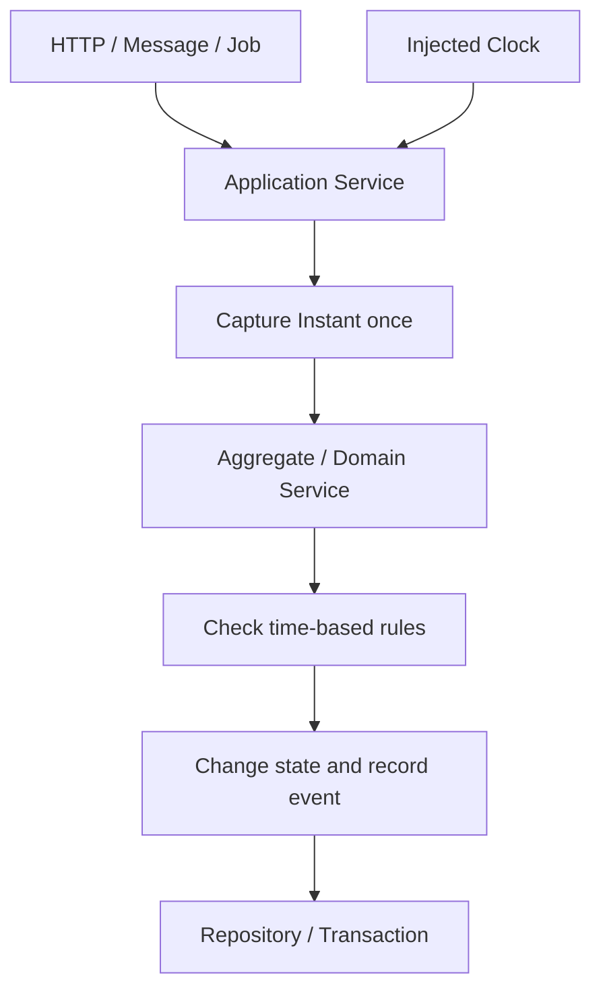

# Tiêm Clock để kiểm soát thời gian trong mô hình và kiểm thử

Nhiều quy tắc nghiệp vụ phụ thuộc vào thời điểm hiện tại: reservation hết hạn sau 15 phút, đơn hàng chỉ được xác nhận trước một deadline, hợp đồng có hiệu lực từ một ngày nhất định, hoặc chương trình khuyến mãi chỉ áp dụng trong một khoảng thời gian. Nếu code gọi trực tiếp `Instant.now()`, `LocalDate.now()` hoặc `System.currentTimeMillis()` ở nhiều nơi, thời gian trở thành một phụ thuộc ẩn. Hành vi khó kiểm soát, kiểm thử dễ chập chờn và các thành phần có thể đọc những thời điểm hơi khác nhau trong cùng một use case.

Java cung cấp `java.time.Clock` để biểu diễn nguồn cung cấp thời gian có thể thay thế. Ứng dụng có thể dùng `Clock.systemUTC()` khi chạy thật, `Clock.fixed(...)` trong kiểm thử hoặc một Clock có thể dịch chuyển khi cần mô phỏng thời gian. Trong DDD, một cách tổ chức hiệu quả là tiêm Clock ở application boundary, lấy một `Instant` cho lần xử lý rồi truyền thời điểm đó vào hành vi miền. Nhờ vậy, domain model vẫn diễn đạt quy tắc bằng dữ liệu thời gian tường minh và không phải tự đọc đồng hồ hệ thống.

Bài học này trình bày cách sử dụng Clock, vị trí tiêm phụ thuộc trong kiến trúc DDD, cách thiết kế Aggregate và Domain Event có timestamp xác định, cách kiểm thử thời gian cố định/di chuyển, cùng những lưu ý về múi giờ, deadline, scheduled job và đồng hồ phân tán.

## 1. Thời gian hiện tại là một phụ thuộc của ứng dụng

Một lời gọi như `Instant.now()` trông đơn giản, nhưng nó đọc trạng thái bên ngoài tiến trình: đồng hồ hệ điều hành trên máy đang chạy. Hai lần gọi liên tiếp có thể trả về hai giá trị khác nhau. Kết quả còn phụ thuộc vào thời điểm test chạy, múi giờ mặc định và độ chính xác của hệ thống.

Ví dụ:

```java
public boolean isExpired(Instant expiresAt) {
    return Instant.now().isAfter(expiresAt);
}
```

Method này không chỉ phụ thuộc vào `expiresAt`; nó còn phụ thuộc vào thời điểm thật lúc method được gọi. Một unit test khó kiểm soát chính xác điều kiện tại biên deadline. Test có thể qua ở máy này nhưng thất bại ở máy khác nếu chạy chậm vài mili giây.

Nếu nhiều class tự gọi `now()`, cùng một use case có thể dùng nhiều mốc thời gian khác nhau:

- Order kiểm tra deadline tại thời điểm A.
- Reservation kiểm tra hết hạn tại thời điểm B.
- Domain Event ghi timestamp tại thời điểm C.

Khoảng chênh nhỏ có thể làm kết quả khó giải thích, đặc biệt khi các quy tắc nằm đúng tại biên thời gian. Thay vì để từng nơi tự đọc đồng hồ, hãy đưa nguồn thời gian thành một phụ thuộc rõ ràng.

## 2. `java.time.Clock` là gì?

`Clock` thuộc package `java.time`. Nó cung cấp một nguồn thời gian có thể được truy vấn và thay thế. Các factory method thường dùng:

| Factory | Ý nghĩa | Trường hợp sử dụng |
|---|---|---|
| `Clock.systemUTC()` | Đồng hồ hệ thống với zone UTC | Timestamp tuyệt đối, backend service |
| `Clock.system(zone)` | Đồng hồ hệ thống gắn với `ZoneId` | Khi cần ngày/giờ lịch tại một vùng cụ thể |
| `Clock.fixed(instant, zone)` | Đồng hồ luôn trả cùng một Instant | Unit test xác định |
| `Clock.offset(base, duration)` | Đồng hồ lệch một khoảng so với Clock gốc | Mô phỏng thời gian ở tương lai/quá khứ |
| `Clock.tick(base, duration)` | Clock làm tròn theo nhịp được chỉ định | Trường hợp cần độ phân giải theo tick |

Các API thời gian có thể nhận Clock:

```java
Instant now = Instant.now(clock);
LocalDate today = LocalDate.now(clock);
LocalDateTime localNow = LocalDateTime.now(clock);
ZonedDateTime zonedNow = ZonedDateTime.now(clock);
```

Clock không phải một bộ hẹn giờ và cũng không bảo đảm thời gian luôn tăng. Nó cung cấp thời gian theo lịch (wall-clock time) dựa trên nguồn được cấu hình.

## 3. Vì sao nên tiêm Clock?

Tiêm Clock (Clock injection) biến việc đọc thời gian thành một dependency có thể cấu hình ở composition root và thay thế trong test.

Lợi ích chính:

- **Kiểm thử xác định:** test chọn chính xác thời điểm cần kiểm tra.
- **Kiểm tra biên:** dễ test ngay trước, đúng tại và ngay sau deadline.
- **Một mốc thời gian nhất quán:** một use case có thể lấy một `Instant` rồi dùng xuyên suốt các quyết định.
- **Ít phụ thuộc ẩn:** class khai báo rõ rằng nó cần nguồn thời gian.
- **Mô phỏng thời gian:** có thể dịch Clock về quá khứ/tương lai hoặc tiến nó trong test.
- **Dễ thay đổi chính sách thời gian:** cấu hình UTC hoặc zone nghiệp vụ tại một điểm.

Tiêm Clock không tự giải quyết clock skew giữa nhiều máy, độ chính xác timestamp của database hay thứ tự sự kiện phân tán. Nó giải quyết việc kiểm soát nguồn thời gian trong một thành phần và làm rõ nơi lấy mốc thời gian.

## 4. Đặt Clock ở đâu trong kiến trúc DDD?

`Clock` thường nên được cung cấp ở application boundary hoặc một domain service thực sự cần nguồn thời gian. Không cần truyền Clock vào mọi Entity hay Value Object.

Một hướng thiết kế thường dễ hiểu:

1. Application Service nhận Clock qua constructor.
2. Khi xử lý command, application lấy một `Instant now`.
3. Application truyền `now` vào Aggregate hoặc Domain Service cần đánh giá thời gian.
4. Aggregate kiểm tra invariant và thực hiện hành vi dựa trên thời điểm được truyền vào.
5. Event domain được ghi nhận cùng mốc thời gian đó nếu phù hợp.



Domain model nhận một giá trị thời gian tường minh. Nó không cần biết giá trị đó đến từ đồng hồ hệ điều hành, test fixture hay một nguồn thời gian khác.

### 4.1. Không tiêm Clock vào mọi Entity

Nếu mỗi Entity giữ một `Clock`, mô hình dễ bị phụ thuộc hạ tầng hơn mức cần thiết và các object có thể đọc thời gian ở những thời điểm khác nhau. Thay vào đó, truyền `Instant` hoặc một giá trị thời gian miền vào hành vi cần nó.

Ví dụ:

```java
reservation.isExpiredAt(now);
order.confirmAt(now);
contract.isEffectiveAt(now);
```

Tên method cho biết rõ thời điểm được dùng để đánh giá. Đây cũng là cách test đơn giản vì chỉ cần truyền một Instant cụ thể.

### 4.2. Khi nào Domain Service có thể nhận Clock?

Nếu một Domain Service thực sự thực hiện quyết định nghiệp vụ cần đọc thời gian và không có application boundary phù hợp để truyền mốc thời gian, có thể tiêm một abstraction thời gian vào service. Tuy nhiên, nhiều trường hợp vẫn rõ ràng hơn nếu application lấy `now` rồi truyền vào service.

Hãy chọn một quy ước nhất quán cho module. Tránh để một số Aggregate tự gọi đồng hồ hệ thống trong khi các Aggregate khác nhận timestamp từ application.

## 5. Cấu hình Clock trong ứng dụng Spring

Clock có thể được đăng ký như một bean để các application service dùng chung nguồn thời gian.

```java
import java.time.Clock;
import org.springframework.context.annotation.Bean;
import org.springframework.context.annotation.Configuration;

@Configuration
public class TimeConfiguration {
    @Bean
    Clock clock() {
        return Clock.systemUTC();
    }
}
```

Application service nhận Clock qua constructor:

```java
import java.time.Clock;
import java.time.Instant;
import org.springframework.stereotype.Service;
import org.springframework.transaction.annotation.Transactional;

@Service
public class ConfirmOrderHandler {
    private final OrderRepository orders;
    private final Clock clock;

    public ConfirmOrderHandler(OrderRepository orders, Clock clock) {
        this.orders = orders;
        this.clock = clock;
    }

    @Transactional
    public void handle(ConfirmOrderCommand command) {
        Order order = orders.get(command.orderId());
        Instant now = clock.instant();

        order.confirmAt(now);
        orders.save(order);
    }
}
```

Trong production, `Clock.systemUTC()` là lựa chọn mặc định phù hợp cho timestamp tuyệt đối. Nếu nghiệp vụ cần ngày địa phương, hãy dùng `ZoneId` rõ ràng khi chuyển `Instant` thành `LocalDate` hoặc cấu hình Clock theo zone được chỉ định.

## 6. Dùng một mốc thời gian cho một use case

Nên lấy `Instant` một lần tại ranh giới xử lý khi nhiều quyết định trong cùng use case cần cùng một khái niệm “thời điểm hiện tại”.

Không nên:

```java
if (order.canBeConfirmedAt(clock.instant())) {
    order.confirmAt(clock.instant());
    eventPublisher.publish(new OrderConfirmed(order.id(), clock.instant()));
}
```

Ba lần đọc Clock có thể tạo ba timestamp khác nhau. Tốt hơn:

```java
Instant now = clock.instant();

if (order.canBeConfirmedAt(now)) {
    order.confirmAt(now);
    // Event được ghi nhận với cùng mốc thời gian nghiệp vụ.
}
```

Việc dùng một mốc không có nghĩa toàn bộ transaction hoặc network workflow kéo dài đều phải xem như xảy ra tại đúng một instant. Nó có nghĩa các quyết định thuộc cùng một command được đánh giá nhất quán theo một thời điểm nghiệp vụ đã chọn. Nếu quy trình có nhiều bước cách nhau vài phút, mỗi bước có thể cần mốc thời gian riêng.

### 6.1. Chọn thời điểm lấy Clock

Thông thường lấy thời điểm sau khi request đã được xác thực và ngay trước khi thực hiện hành vi cần nó. Nếu transaction phải chờ khóa lâu, `now` được lấy trước khi chờ có thể không còn phù hợp với chính sách “thời điểm quyết định sau khi có quyền cập nhật”. Trong trường hợp đó, lấy `now` sau khi tải/khóa Aggregate có thể hợp lý hơn.

Hãy xác định ý nghĩa nghiệp vụ: thời điểm nhận request, thời điểm bắt đầu xử lý, thời điểm quyết định hay thời điểm commit. Chúng không luôn giống nhau. Nếu cần lưu nhiều mốc, hãy đặt tên riêng thay vì dùng một field `timestamp` chung.

## 7. Truyền thời điểm vào hành vi Aggregate

Giả sử Order chỉ được xác nhận trước deadline. Quy tắc có thể được thể hiện trực tiếp trong Aggregate:

```java
import java.time.Instant;
import java.util.Objects;

public final class Order {
    private final OrderId id;
    private final Instant confirmationDeadline;
    private OrderStatus status;

    public Order(OrderId id, Instant confirmationDeadline) {
        this.id = Objects.requireNonNull(id);
        this.confirmationDeadline = Objects.requireNonNull(confirmationDeadline);
        this.status = OrderStatus.DRAFT;
    }

    public void confirmAt(Instant now) {
        Objects.requireNonNull(now, "now");

        if (status != OrderStatus.DRAFT) {
            throw new IllegalStateException("Order is not awaiting confirmation");
        }
        if (!now.isBefore(confirmationDeadline)) {
            throw new OrderConfirmationExpiredException(id);
        }

        status = OrderStatus.CONFIRMED;
    }
}
```

Ở đây deadline là biên mở: đơn phải được xác nhận trước `confirmationDeadline`. Tại đúng thời điểm deadline, hành động đã hết hạn vì điều kiện là `now < deadline`. Nếu nghiệp vụ cho phép xác nhận đúng tại deadline, điều kiện phải thay đổi và được ghi rõ trong contract.

Aggregate không tự gọi `Instant.now()`. Cùng một hành vi có thể được kiểm thử với bất kỳ mốc thời gian nào.

## 8. Ghi timestamp cho Domain Event

Event thường cần thời điểm sự kiện xảy ra hoặc được ghi nhận. Có thể truyền cùng `now` vào hành vi Aggregate và dùng nó khi tạo event:

```java
public record OrderConfirmed(
        OrderId orderId,
        Instant occurredAt
) {}

public void confirmAt(Instant now) {
    // Kiểm tra trạng thái và deadline...
    status = OrderStatus.CONFIRMED;
    domainEvents.add(new OrderConfirmed(id, now));
}
```

`occurredAt` nên được định nghĩa rõ là thời điểm nghiệp vụ được xác nhận theo clock của ứng dụng hay một mốc khác. Khi event được publish muộn qua outbox, `occurredAt` không phải thời điểm broker nhận message. Có thể cần thêm `publishedAt` hoặc `receivedAt` ở hạ tầng nếu muốn quan sát độ trễ.

Không dùng timestamp để thay thế event ID hoặc sequence number. Hai event có thể có cùng timestamp do độ chính xác của clock; thứ tự nghiệp vụ cần được biểu diễn bằng version, sequence hoặc một quy tắc khác khi cần.

## 9. Kiểm thử với `Clock.fixed`

`Clock.fixed` giúp test luôn chạy tại một thời điểm xác định, không phụ thuộc đồng hồ máy.

```java
import static org.junit.jupiter.api.Assertions.*;
import java.time.Clock;
import java.time.Instant;
import java.time.ZoneOffset;
import org.junit.jupiter.api.Test;

class OrderTest {
    @Test
    void confirmsBeforeDeadline() {
        Instant now = Instant.parse("2026-06-30T09:00:00Z");
        Clock clock = Clock.fixed(now, ZoneOffset.UTC);
        Instant deadline = Instant.parse("2026-06-30T10:00:00Z");

        Order order = anOrderWithDeadline(deadline);
        order.confirmAt(clock.instant());

        assertEquals(OrderStatus.CONFIRMED, order.status());
    }
}
```

Trong unit test cho Aggregate đã nhận `Instant`, thậm chí không cần Clock:

```java
@Test
void rejectsConfirmationAtExclusiveDeadline() {
    Instant deadline = Instant.parse("2026-06-30T10:00:00Z");
    Order order = anOrderWithDeadline(deadline);

    assertThrows(
            OrderConfirmationExpiredException.class,
            () -> order.confirmAt(deadline)
    );
}
```

Test thứ hai kiểm tra trực tiếp quy tắc miền tại biên. Đây là một ưu điểm của việc truyền thời điểm tường minh: domain test tập trung vào hành vi và invariant, không cần khởi tạo Spring hay mock đồng hồ hệ thống.

## 10. Kiểm thử thời gian trước, đúng tại và sau biên

Với deadline `D`, nên kiểm tra ít nhất ba thời điểm:

| Thời điểm | Điều kiện với deadline exclusive | Kết quả |
|---|---|---|
| `D - 1ns` | `now < D` | Còn hiệu lực |
| `D` | `now == D` | Hết hiệu lực |
| `D + 1ns` | `now > D` | Hết hiệu lực |

Ví dụ:

```java
@Test
void deadlineBoundaryIsExclusive() {
    Instant deadline = Instant.parse("2026-06-30T10:00:00Z");

    Order before = anOrderWithDeadline(deadline);
    before.confirmAt(deadline.minusNanos(1));
    assertEquals(OrderStatus.CONFIRMED, before.status());

    Order at = anOrderWithDeadline(deadline);
    assertThrows(
            OrderConfirmationExpiredException.class,
            () -> at.confirmAt(deadline)
    );

    Order after = anOrderWithDeadline(deadline);
    assertThrows(
            OrderConfirmationExpiredException.class,
            () -> after.confirmAt(deadline.plusNanos(1))
    );
}
```

Nếu database chỉ lưu milliseconds hoặc microseconds, cần kiểm thử theo precision thực tế và chuẩn hóa thời gian trước khi so sánh. Không nên giả định `minusNanos(1)` luôn khác giá trị sau khi round-trip qua persistence.

## 11. Kiểm thử dịch chuyển thời gian với `Clock.offset`

`Clock.offset` tạo Clock mới có thời điểm lệch so với Clock gốc một `Duration`.

```java
Instant baseInstant = Instant.parse("2026-06-30T09:00:00Z");
Clock base = Clock.fixed(baseInstant, ZoneOffset.UTC);

Clock fiveMinutesLater = Clock.offset(base, Duration.ofMinutes(5));
Clock oneHourEarlier = Clock.offset(base, Duration.ofHours(-1));

assertEquals(baseInstant.plusSeconds(300), fiveMinutesLater.instant());
assertEquals(baseInstant.minusSeconds(3600), oneHourEarlier.instant());
```

Đây là cách thuận tiện để kiểm tra quy tắc “sau 5 phút”, “trước deadline 1 giờ” hoặc các nhánh phụ thuộc thời gian mà không phải chờ thật.

## 12. Tạo MutableClock cho kiểm thử tiến thời gian

Đôi khi test cần tiến Clock qua nhiều bước trong cùng một kịch bản, chẳng hạn tạo reservation, tiến 14 phút, kiểm tra còn hiệu lực, rồi tiến thêm 1 phút và kiểm tra hết hạn. Có thể dùng một Clock test tùy chỉnh.

```java
import java.time.Clock;
import java.time.Duration;
import java.time.Instant;
import java.time.ZoneId;
import java.util.Objects;
import java.util.concurrent.atomic.AtomicReference;

public final class MutableClock extends Clock {
    private final AtomicReference<Instant> current;
    private final ZoneId zone;

    public MutableClock(Instant initial, ZoneId zone) {
        this.current = new AtomicReference<>(Objects.requireNonNull(initial));
        this.zone = Objects.requireNonNull(zone);
    }

    @Override
    public ZoneId getZone() {
        return zone;
    }

    @Override
    public Clock withZone(ZoneId newZone) {
        return new MutableClock(instant(), newZone);
    }

    @Override
    public Instant instant() {
        return current.get();
    }

    public void advance(Duration duration) {
        current.updateAndGet(value -> value.plus(duration));
    }

    public void set(Instant instant) {
        current.set(Objects.requireNonNull(instant));
    }
}
```

Ví dụ sử dụng:

```java
MutableClock clock = new MutableClock(
        Instant.parse("2026-06-30T09:00:00Z"),
        ZoneOffset.UTC
);

Reservation reservation = Reservation.create(clock.instant(), Duration.ofMinutes(15));
clock.advance(Duration.ofMinutes(14));
assertFalse(reservation.isExpiredAt(clock.instant()));

clock.advance(Duration.ofMinutes(1));
assertTrue(reservation.isExpiredAt(clock.instant()));
```

MutableClock chỉ nên dùng trong test. `withZone` ở ví dụ tạo Clock mới tại cùng instant với zone mới; hai instance không chia sẻ trạng thái tiến thời gian. Nếu test cần nhiều view zone cùng một nguồn có thể dịch chuyển, có thể thiết kế wrapper chia sẻ cùng `AtomicReference`.

## 13. Kiểm thử Application Service với Clock

Khi application service nhận Clock qua constructor, unit test có thể cung cấp `Clock.fixed` mà không cần mock static method.

```java
@Test
void handlerUsesInjectedClock() {
    Instant fixedNow = Instant.parse("2026-06-30T09:00:00Z");
    Clock clock = Clock.fixed(fixedNow, ZoneOffset.UTC);

    OrderRepository repository = new InMemoryOrderRepository();
    Order order = anOrderWithDeadline(fixedNow.plusSeconds(600));
    repository.save(order);

    ConfirmOrderHandler handler = new ConfirmOrderHandler(repository, clock);
    handler.handle(new ConfirmOrderCommand(order.id()));

    assertEquals(OrderStatus.CONFIRMED, repository.get(order.id()).status());
}
```

Test có thể xác minh timestamp được truyền vào event hoặc entity bằng đúng `fixedNow`. Điều này tốt hơn việc chờ đồng hồ thật rồi kiểm tra một khoảng thời gian tương đối.

Với Spring integration test, có thể khai báo bean Clock test cố định trong test configuration hoặc cung cấp bean thay thế. Cần bảo đảm cấu hình test không bị dùng nhầm trong production.

## 14. Phân biệt Instant, LocalDate và múi giờ khi dùng Clock

Clock chứa một `ZoneId`, nhưng điều đó không có nghĩa mọi dữ liệu thời gian trong domain nên dùng zone mặc định của Clock.

### 14.1. Timestamp tuyệt đối

Với sự kiện đã xảy ra, deadline tuyệt đối hoặc thời điểm commit, dùng `Instant`:

```java
Instant occurredAt = clock.instant();
```

`Instant` không phụ thuộc múi giờ hiển thị. Khi hiển thị cho người dùng, chuyển nó sang zone phù hợp.

### 14.2. Ngày lịch tại một vùng nghiệp vụ

Nếu chính sách nói “ngày hiện tại tại chi nhánh”, cần zone của chi nhánh:

```java
ZoneId branchZone = ZoneId.of("Asia/Ho_Chi_Minh");
LocalDate businessDate = LocalDate.now(clock.withZone(branchZone));
```

Không nên dùng `LocalDate.now()` không đối số vì nó dùng múi giờ mặc định của máy chạy ứng dụng. Khi triển khai trên nhiều vùng hoặc container có cấu hình khác nhau, kết quả có thể khác.

### 14.3. Không lưu LocalDateTime thay cho Instant khi cần thời điểm duy nhất

`LocalDateTime` không chứa offset hoặc zone. Hai hệ thống có thể hiểu cùng một local datetime thành hai instant khác nhau. Nếu dữ liệu đại diện một thời điểm đã xảy ra, dùng `Instant` hoặc kiểu có offset phù hợp. Nếu dữ liệu đại diện lịch địa phương trong tương lai, lưu thêm `ZoneId` và chính sách xử lý DST.

## 15. Thời gian hết hạn và reservation

Một use case phổ biến là tạo reservation có thời hạn. Nên tính `expiresAt` một lần khi tạo reservation rồi lưu lại, thay vì mỗi lần đọc lại tự cộng TTL theo một nguồn thời gian khác.

```java
public record Reservation(
        ReservationId id,
        Instant createdAt,
        Instant expiresAt,
        ReservationStatus status
) {
    public static Reservation create(
            ReservationId id,
            Instant now,
            Duration ttl) {
        if (ttl.isZero() || ttl.isNegative()) {
            throw new IllegalArgumentException("TTL must be positive");
        }
        return new Reservation(
                id,
                now,
                now.plus(ttl),
                ReservationStatus.ACTIVE
        );
    }

    public boolean isExpiredAt(Instant now) {
        return !now.isBefore(expiresAt);
    }
}
```

Ở đây `expiresAt` là biên exclusive: reservation còn hiệu lực khi `now < expiresAt`; tại đúng `expiresAt`, reservation đã hết hạn. Nếu nghiệp vụ quy định khác, phải thay điều kiện và ghi rõ.

### 15.1. Không tính TTL lại từ thời điểm hiện tại

Không nên mỗi lần load reservation lại gán `expiresAt = clock.instant().plus(ttl)`, vì thời hạn sẽ liên tục bị kéo dài. Thời điểm hết hạn là một phần dữ liệu nghiệp vụ được xác lập lúc tạo hoặc gia hạn có chủ đích.

### 15.2. Gia hạn là một hành vi nghiệp vụ

Nếu reservation được phép gia hạn, hãy có method như `extendUntil(newExpiry, now)` với điều kiện rõ: reservation còn active, chưa được tiêu thụ, số lần gia hạn hoặc giới hạn tối đa được tôn trọng. Không âm thầm cập nhật deadline chỉ vì một lần đọc.

## 16. Clock và scheduled job

Scheduled job thường kiểm tra các đối tượng đã đến hạn, chẳng hạn reservation hết hạn hoặc hợp đồng cần chuyển trạng thái. Có thể dùng Clock để xác định mốc `now` trong lần chạy:

```java
@Component
public class ExpireReservationsJob {
    private final Clock clock;
    private final ReservationRepository reservations;

    public ExpireReservationsJob(Clock clock,
                                 ReservationRepository reservations) {
        this.clock = clock;
        this.reservations = reservations;
    }

    @Scheduled(fixedDelayString = "PT30S")
    public void run() {
        Instant now = clock.instant();
        reservations.findActiveExpiringAtOrBefore(now)
                .forEach(reservation -> expire(reservation, now));
    }

    private void expire(Reservation reservation, Instant now) {
        reservation.expireAt(now);
        reservations.save(reservation);
    }
}
```

Đây là ví dụ minh họa; job thật cần xử lý batch, phân trang, locking/claim để nhiều instance không cùng xử lý một reservation, idempotency và transaction. Việc truy vấn “đến hạn” nên dùng điều kiện nhất quán với biên `expiresAt <= now`.

### 16.1. Job chạy lặp và nhiều instance

Một scheduled job có thể chạy lại sau restart hoặc chạy đồng thời trên nhiều instance. Domain method `expireAt` nên idempotent hoặc kiểm tra trạng thái trước khi đổi. Có thể dùng optimistic locking, claim batch, distributed scheduler lock hoặc cơ chế queue phù hợp.

Clock injection giúp test điều kiện thời gian, nhưng không tự ngăn hai worker cùng xử lý. Concurrency control vẫn cần được thiết kế riêng.

### 16.2. Không dùng Clock để thay thế scheduler

Clock cho biết “bây giờ là lúc nào”; scheduler quyết định “khi nào chạy công việc”. Hai trách nhiệm khác nhau. Một test có thể tiến MutableClock nhưng scheduler thật không tự chạy theo Clock đó nếu scheduler không được thiết kế để dùng cùng time source.

## 17. Wall-clock time và monotonic time

`Clock` đại diện cho wall-clock time: thời gian lịch mà hệ thống hiển thị, có thể được điều chỉnh bởi đồng bộ NTP, quản trị viên hoặc môi trường ảo hóa. Vì vậy, thời gian có thể nhảy tiến hoặc lùi.

Với timestamp nghiệp vụ, `Instant` từ Clock là phù hợp. Nhưng để đo thời lượng thực thi trong một tiến trình, như “method chạy mất bao nhiêu mili giây”, không nên trừ hai lần đọc Clock nếu cần đo chính xác elapsed time.

Trong Java, dùng `System.nanoTime()` cho đo thời lượng tương đối trong cùng một tiến trình:

```java
long started = System.nanoTime();
performWork();
long elapsedNanos = System.nanoTime() - started;
```

`nanoTime()` không phải timestamp lịch và không thể lưu làm thời điểm nghiệp vụ. Nó chỉ dùng để đo khoảng thời gian đã trôi qua. Trong test, có thể trừu tượng hóa ticker/monotonic source riêng nếu cần kiểm soát thời lượng mà không chờ thật.

## 18. Đồng hồ phân tán và clock skew

Tiêm Clock giúp một service kiểm soát nguồn thời gian của chính nó, nhưng nhiều service vẫn có thể có đồng hồ lệch nhau. Một node có thể nhanh hơn node khác vài giây; NTP thường giảm lệch nhưng không tạo ra một đồng hồ toàn cục hoàn hảo.

Khi một quy tắc xuyên context phụ thuộc thời gian:

- Xác định context nào là nguồn có thẩm quyền về thời điểm hoặc deadline.
- Dùng timestamp do owner phát hành khi phù hợp, thay vì để mỗi consumer tự tính lại.
- Thiết kế tolerance/skew nếu nghiệp vụ cho phép.
- Dùng sequence/version hoặc trạng thái có thẩm quyền khi thứ tự quan trọng, không chỉ dựa vào timestamp.
- Với lease/lock cần nhất quán cao, cân nhắc thời gian database hoặc cơ chế lease có fencing token.
- Không giả định timestamp lớn hơn luôn có nghĩa event xảy ra sau trong mọi node.

Ví dụ, Inventory tạo `expiresAt` cho reservation và lưu giá trị đó. Sales không tự cộng 15 phút theo Clock của Sales để suy ra cùng deadline. Inventory là owner của reservation và là nơi quyết định reservation đã hết hạn hay chưa.

## 19. Dùng thời gian database khi phù hợp

Một số quyết định cần thời gian nhất quán với database đang thực hiện transaction. Ví dụ, cập nhật bản ghi với điều kiện `expires_at <= CURRENT_TIMESTAMP` có thể dùng clock của database trong câu lệnh để tránh lệch giữa application node và database.

```sql
UPDATE reservation
SET status = 'EXPIRED', expired_at = CURRENT_TIMESTAMP
WHERE reservation_id = :id
  AND status = 'ACTIVE'
  AND expires_at <= CURRENT_TIMESTAMP;
```

Nếu cần đưa cùng timestamp vào domain event hoặc audit record, cần chọn nguồn thời gian nhất quán và hiểu semantics của database timestamp. Một số database phân biệt transaction timestamp, statement timestamp và wall-clock timestamp. Hãy kiểm tra hệ quản trị cụ thể.

Không nên trộn ngẫu nhiên `Clock.instant()` ở application với `CURRENT_TIMESTAMP` ở database trong cùng một quy tắc biên mà không xác định nguồn có thẩm quyền. Chênh lệch nhỏ có thể làm hai nơi đưa ra quyết định khác nhau.

## 20. Những lỗi thường gặp khi dùng Clock

| Lỗi | Hệ quả | Cách cải thiện |
|---|---|---|
| Gọi `Instant.now()` ở nhiều lớp | Phụ thuộc thời gian ẩn, test khó ổn định | Tiêm Clock ở boundary và truyền Instant |
| Tiêm Clock vào mọi Entity | Domain object phụ thuộc không cần thiết | Truyền mốc thời gian vào hành vi cần nó |
| Lấy Clock nhiều lần trong một command | Các quy tắc dùng mốc khác nhau | Capture một `Instant` cho quyết định nhất quán |
| Dùng `LocalDate.now()` mặc định | Phụ thuộc timezone của máy | Dùng `LocalDate.now(clock.withZone(zone))` |
| Dùng Clock để đo elapsed time | Wall clock có thể nhảy tiến/lùi | Dùng `System.nanoTime()` hoặc monotonic ticker |
| Test bằng `Thread.sleep()` | Test chậm và dễ flaky | Dùng `Clock.fixed`, `Clock.offset` hoặc MutableClock |
| Cộng TTL mỗi lần đọc | Deadline liên tục bị kéo dài | Tính và lưu `expiresAt` khi tạo/gia hạn |
| Coi timeout là hết hạn nghiệp vụ | Nhầm timeout kỹ thuật với deadline miền | Mô hình hóa hai khái niệm riêng |
| Dùng timezone mặc định | Khác biệt giữa môi trường triển khai | Dùng ZoneId tường minh |
| Dựa vào timestamp để sắp thứ tự event phân tán | Clock skew làm thứ tự sai | Dùng version/sequence hoặc owner state |
| Dùng Clock.fixed trong production | Thời gian không tiến | Chỉ cấu hình Clock.fixed trong test |
| Cho rằng Clock giải quyết concurrency | Nhiều worker vẫn có thể cập nhật cùng bản ghi | Dùng transaction, lock, version hoặc claim |

## 21. Kiểm thử các tình huống thời gian quan trọng

Một bộ test tốt nên bao gồm:

### 21.1. Kiểm thử biên

- Ngay trước thời điểm bắt đầu.
- Đúng tại thời điểm bắt đầu.
- Ngay trước thời điểm kết thúc.
- Đúng tại thời điểm kết thúc.
- Ngay sau thời điểm kết thúc.

Quy tắc `[start, end)` thường yêu cầu `start` được bao gồm và `end` bị loại trừ.

### 21.2. Kiểm thử tiến thời gian

- Reservation còn hiệu lực trước `expiresAt`.
- Reservation hết hạn tại `expiresAt` theo quy tắc end-exclusive.
- Gia hạn chỉ thành công trong trạng thái được phép.
- Job chạy nhiều lần không tạo tác động lặp.

### 21.3. Kiểm thử ngày lịch và múi giờ

- Ngày chuyển tháng và năm nhuận.
- Cuối ngày theo ZoneId nghiệp vụ.
- DST gap/overlap ở vùng có thay đổi giờ.
- Cùng một Instant hiển thị thành LocalDate khác nhau ở các zone khác nhau.

### 21.4. Kiểm thử persistence

- Round-trip timestamp qua database giữ precision đã cam kết.
- So sánh deadline dùng cùng quy tắc biên.
- Query hết hạn khớp với domain method `isExpiredAt`.
- Hai worker đồng thời không làm trạng thái chuyển sai.

## 22. Quy trình đưa Clock vào một codebase hiện có

Khi hệ thống đã có nhiều lời gọi trực tiếp đến đồng hồ hệ thống, có thể chuyển dần:

1. Tìm các lời gọi `Instant.now()`, `LocalDate.now()`, `LocalDateTime.now()` và `System.currentTimeMillis()` trong code nghiệp vụ.
2. Phân loại mục đích: timestamp nghiệp vụ, ngày địa phương, deadline hay đo elapsed time.
3. Tạo bean hoặc dependency Clock tại composition root.
4. Tiêm Clock vào application service hoặc domain service cần nó.
5. Capture một mốc thời gian cho mỗi command khi phù hợp.
6. Chuyển domain method sang nhận `Instant`/`LocalDate` tường minh.
7. Dùng Clock.fixed trong test và bổ sung test tại biên.
8. Kiểm tra persistence precision, timezone và các truy vấn liên quan.
9. Giữ `System.nanoTime()` cho đo thời lượng tương đối.
10. Loại bỏ các lời gọi system clock trực tiếp còn sót trong domain logic.

Không cần thay mọi lời gọi thời gian trong codebase bằng Clock một cách máy móc. Ví dụ telemetry hoặc logging có thể dùng timestamp của framework. Tập trung vào các quyết định nghiệp vụ và logic cần kiểm thử xác định.

## 23. Checklist thiết kế và kiểm thử Clock

- [ ] Nguồn thời gian được khai báo rõ qua dependency injection.
- [ ] Production dùng Clock hệ thống phù hợp, thường là UTC cho timestamp tuyệt đối.
- [ ] Test dùng `Clock.fixed` hoặc Clock có thể dịch chuyển.
- [ ] Domain method nhận thời điểm tường minh khi quy tắc phụ thuộc thời gian.
- [ ] Không tiêm Clock vào mọi Entity nếu chỉ cần truyền một Instant.
- [ ] Một use case dùng cùng mốc thời gian cho các quyết định cần nhất quán.
- [ ] Ý nghĩa của thời điểm (received, decided, occurred, committed) được đặt tên rõ.
- [ ] Múi giờ nghiệp vụ được chỉ định bằng `ZoneId`, không phụ thuộc default timezone.
- [ ] Phân biệt Instant, LocalDate, Duration và Period.
- [ ] Deadline và TTL được tính một lần, lưu thành dữ liệu nghiệp vụ.
- [ ] Quy tắc biên được test trước, tại và sau deadline.
- [ ] Không dùng Clock để đo elapsed time cần monotonicity.
- [ ] Clock skew và nguồn thời gian có thẩm quyền được xem xét ở hệ phân tán.
- [ ] Scheduled job có locking/claim/idempotency khi chạy nhiều instance.
- [ ] Query database và domain method dùng cùng semantics về thời gian.
- [ ] Không có test phụ thuộc `Thread.sleep()` khi có thể điều khiển Clock.

## 24. Kết nối với các khái niệm DDD khác

Clock giúp application kiểm soát nguồn thời gian khi điều phối use case. Aggregate nhận thời điểm tường minh để bảo vệ invariant như deadline xác nhận, thời hạn reservation hoặc khoảng hiệu lực. Value Object có thể biểu diễn `ValidityPeriod`, `ReservationWindow` hoặc `Deadline`; Domain Event lưu thời điểm nghiệp vụ đã xảy ra; Repository lưu timestamp cùng trạng thái Aggregate.

Khi tích hợp giữa bounded context, cần xác định context nào sở hữu deadline và phát hành thời điểm có thẩm quyền. Context khác nên dùng timestamp hoặc event contract được công bố thay vì tự tính lại theo đồng hồ cục bộ. Với quy trình dài, Saga/Process Manager có thể dùng Clock để xác định timeout của từng bước, nhưng vẫn cần state bền vững, idempotency và xử lý kết quả chưa xác định.

Tiêm Clock làm cho thời gian trở thành một phụ thuộc rõ ràng và có thể kiểm soát. Khi kết hợp với Value Object bất biến, hành vi Aggregate nhận thời điểm tường minh và test tại biên, mô hình miền sẽ dễ hiểu, dễ tái hiện và đáng tin cậy hơn khi các quy tắc nghiệp vụ phụ thuộc vào thời gian.
