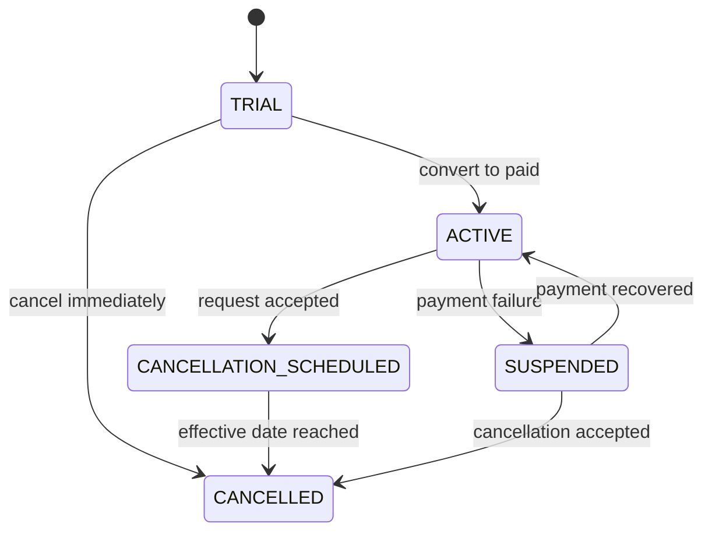

# Phát hiện khái niệm ngầm từ quy tắc và ngoại lệ lặp lại

Một mô hình miền ban đầu thường bắt đầu bằng những khái niệm dễ nhìn thấy như Customer, Order, Product hoặc Subscription. Khi nghiệp vụ được khám phá sâu hơn, đội phát triển thường gặp những điều kiện lặp lại ở nhiều nơi: cùng một nhóm kiểm tra trạng thái, thời hạn, loại hợp đồng, quyền lợi hoặc ngoại lệ. Nếu chỉ thêm từng câu lệnh if vào các service, mô hình dần trở thành tập hợp các trường dữ liệu và nhánh điều kiện rời rạc.

Trong Domain-Driven Design (DDD), những quy tắc và ngoại lệ lặp lại có thể là dấu hiệu cho thấy một khái niệm miền chưa được gọi tên. Khái niệm đó có thể là một chính sách, khoảng thời gian, điều kiện đủ tư cách, vòng đời, cách phân loại hoặc một quyết định nghiệp vụ. Khi được mô hình hóa đúng, nó gom các quy tắc có cùng ý nghĩa vào một nơi, giúp chuyên gia nghiệp vụ và đội phát triển cùng hiểu một khái niệm, đồng thời làm cho mô hình thể hiện được lý do đằng sau quyết định.

Bài học này dùng quy trình hủy thuê bao để minh họa cách phát hiện khái niệm ngầm từ các quy tắc và ngoại lệ lặp lại, đặt tên cho chúng, chọn cách biểu diễn phù hợp và kiểm chứng mô hình với chuyên gia nghiệp vụ. Các chính sách trong ví dụ chỉ nhằm minh họa kỹ thuật mô hình hóa; quy tắc thực tế phải được xác nhận với chủ sở hữu nghiệp vụ.

## Mục tiêu học tập

Sau bài này, bạn có thể:

- Nhận biết quy tắc và ngoại lệ lặp lại đang che giấu một khái niệm miền.
- Phân biệt việc trùng lặp câu lệnh với việc thật sự có cùng ý nghĩa nghiệp vụ.
- Khám phá thuật ngữ bằng ví dụ, phản ví dụ và câu hỏi cho chuyên gia nghiệp vụ.
- Chuyển nhóm điều kiện rời rạc thành Value Object, Policy, Specification, Domain Service hoặc state machine phù hợp.
- Thiết kế mô hình diễn đạt được cả quyết định và lý do của quyết định.
- Đặt khái niệm vào đúng Aggregate và Bounded Context.
- Tránh tạo abstraction quá sớm hoặc một lớp policy tổng quát không có ý nghĩa.
- Kiểm chứng mô hình bằng decision table, unit test và ví dụ nghiệp vụ.
- Nhận biết khi nào mô hình đã đủ sâu để đơn giản hóa cách diễn đạt nghiệp vụ.

## 1. Khái niệm ngầm là gì?

Khái niệm ngầm (implicit concept) là một ý niệm nghiệp vụ đang ảnh hưởng đến nhiều quyết định nhưng chưa được biểu diễn rõ trong mô hình hoặc ngôn ngữ chung.

Nó thường xuất hiện dưới dạng:

- Nhiều service cùng kiểm tra một nhóm điều kiện.
- Một số nhánh ngoại lệ lặp lại theo loại hợp đồng, khách hàng hoặc thời điểm.
- Nhiều field primitive phải được kết hợp mới tạo thành một ý nghĩa.
- Một nhóm trạng thái và chuyển tiếp được xử lý rải rác.
- Một quyết định cần giải thích bằng nhiều câu nhưng trong code chỉ còn một boolean.
- Chuyên gia nghiệp vụ thường dùng một từ để mô tả nhiều quy tắc liên quan, trong khi code không có khái niệm tương ứng.

Ví dụ, hệ thống thuê bao có thể kiểm tra:

- Thuê bao đang dùng thử hay đã trả phí.
- Khách hàng đang ở gói tháng, gói năm hay hợp đồng doanh nghiệp.
- Yêu cầu hủy được gửi trước hay sau ngày gia hạn.
- Có đang trong thời hạn thông báo hủy hay không.
- Có được hoàn tiền cho phần dịch vụ chưa sử dụng hay không.
- Hủy có hiệu lực ngay hay vào cuối chu kỳ thanh toán.

Nếu các kiểm tra này xuất hiện trong controller, billing service, support tool và batch job, có thể hệ thống đang thiếu một khái niệm như **Cancellation Terms** (điều khoản hủy) hoặc **Cancellation Policy** (chính sách hủy).

Khái niệm ngầm không nhất thiết là một Entity mới. Nó có thể là một Value Object, một chính sách, một quy tắc chuyển trạng thái hoặc một Domain Service. Mục tiêu là tìm đúng ý nghĩa nghiệp vụ, không phải tăng số lượng class.

## 2. Dấu hiệu từ quy tắc và ngoại lệ lặp lại

Không phải cứ thấy hai đoạn code giống nhau là phải tạo abstraction. Điều đáng quan tâm là các đoạn code có cùng lý do nghiệp vụ và cùng cách thay đổi hay không.

### Quy tắc giống nhau xuất hiện ở nhiều nơi

Ví dụ:

```java
// SubscriptionController
if (subscription.isTrial()
        || subscription.planType() == PlanType.MONTHLY) {
    // cancel now or at period end
}

// BillingService
if (subscription.isTrial()
        || subscription.planType() == PlanType.MONTHLY) {
    // calculate refund
}

// SupportCancellationTool
if (subscription.isTrial()
        || subscription.planType() == PlanType.MONTHLY) {
    // show available cancellation option
}
```

Đoạn code có vẻ giống nhau, nhưng chưa đủ dữ kiện để biết cả ba nơi đang diễn đạt cùng một quy tắc. Một nơi có thể quyết định thời điểm kết thúc dịch vụ; nơi khác tính số tiền hoàn; nơi thứ ba quyết định quyền của nhân viên hỗ trợ. Cần hỏi xem chúng đang dùng cùng một chính sách hay chỉ tình cờ kiểm tra cùng hai field.

### Ngoại lệ liên tục được thêm vào

Một dấu hiệu mạnh hơn là mỗi lần có loại khách hàng hoặc hợp đồng mới, nhiều nhánh if phải được sửa cùng lúc:

- Gói dùng thử được hủy ngay.
- Gói tháng kết thúc vào cuối chu kỳ đã trả tiền.
- Gói năm có thời hạn xem xét sau gia hạn.
- Hợp đồng doanh nghiệp cần báo trước.
- Một số hợp đồng có điều khoản riêng được phê duyệt.

Khi ngoại lệ xuất hiện thường xuyên, câu hỏi không còn là “thêm if ở đâu?” mà là “đang có một khái niệm hoặc chính sách nào quyết định các trường hợp này?”.

### Boolean và primitive bắt đầu mang ý nghĩa quá lớn

Các field như `isTrial`, `isEnterprise`, `daysSinceRenewal`, `hasRefund`, `cancelImmediately` có thể là dấu hiệu mô hình chưa diễn đạt đủ khái niệm.

Ví dụ, một boolean `cancelImmediately` không giải thích vì sao hủy ngay, có hiệu lực từ thời điểm nào, ai được phép chọn và có cần hoàn tiền không. Một `CancellationDecision` có cấu trúc rõ sẽ biểu đạt được nhiều thông tin hơn.

### Một quy tắc cần nhiều dữ kiện để giải thích

Nếu chuyên gia phải nói “trong trường hợp khách hàng đang ở gói năm, nếu yêu cầu được gửi trong khoảng thời gian sau gia hạn và hợp đồng không thuộc nhóm ngoại lệ...” thì có thể đang mô tả một cửa sổ hoặc điều khoản có tên riêng.

Hãy lắng nghe danh từ và cụm từ mà chuyên gia thường dùng: thời hạn thông báo, thời gian gia hạn, thời gian xem xét, ngày hiệu lực, quyền hoàn tiền, điều khoản đặc biệt. Những cụm từ đó có thể dẫn đến Value Object hoặc Policy cụ thể.

## 3. Khám phá khái niệm qua ví dụ và phản ví dụ

Không nên bắt đầu bằng việc chọn design pattern. Hãy bắt đầu bằng cách thu thập tình huống thực tế và hiểu lý do của từng quyết định.

### Lập bảng tình huống

Giả sử chuyên gia mô tả chính sách hủy thuê bao minh họa như sau:

| Tình huống | Thời điểm hủy có hiệu lực | Hoàn tiền | Lý do |
| --- | --- | --- | --- |
| Đang dùng thử | Ngay khi yêu cầu được chấp nhận | Không cần hoàn khoản chưa thu | Có thể dừng thử nghiệm ngay |
| Gói tháng đã thanh toán | Cuối chu kỳ hiện tại | Không hoàn phần chu kỳ còn lại | Quyền sử dụng đã được cấp cho chu kỳ |
| Gói năm trong cửa sổ sau gia hạn | Ngay sau khi chấp nhận | Có thể hoàn phần chưa sử dụng theo điều khoản | Có thời hạn xem xét riêng |
| Hợp đồng doanh nghiệp | Sau thời hạn báo trước | Theo điều khoản hợp đồng | Cần thời gian chuyển giao dịch vụ |
| Hợp đồng có ngoại lệ được phê duyệt | Theo quyết định đã phê duyệt | Theo quyết định đã phê duyệt | Điều khoản riêng có chủ sở hữu |

Bảng này không phải mô hình cuối cùng. Nó là công cụ để khám phá những điểm chưa rõ.

### Hỏi về lý do, ranh giới và ngoại lệ

Với mỗi dòng, hãy hỏi chuyên gia:

- Vì sao trường hợp này được xử lý khác?
- Ai có quyền quyết định ngoại lệ?
- Thời hạn bắt đầu từ sự kiện nào: ngày đăng ký, ngày kích hoạt hay ngày gia hạn?
- Ngày cuối cùng có được tính không?
- Thời điểm hủy là lúc yêu cầu được nhận hay lúc chu kỳ kết thúc?
- Nếu yêu cầu đến đúng thời điểm ranh giới thì áp dụng quy tắc nào?
- Nếu khách hàng đổi gói giữa chu kỳ thì điều khoản nào có hiệu lực?
- Điều khoản có thay đổi theo thời gian không?
- Có cần lưu lại phiên bản chính sách đã dùng cho quyết định trước đây không?

Các câu trả lời giúp phát hiện các khái niệm như Billing Period, Renewal Window, Notice Period, Refund Entitlement và Approved Exception.

### Tìm phản ví dụ

Một mô hình chỉ giải thích trường hợp thành công là chưa đủ. Hãy tìm trường hợp gần giống nhưng kết quả khác:

- Hai khách hàng cùng gói năm, nhưng một người vừa gia hạn còn người kia đã qua cửa sổ xem xét.
- Hai yêu cầu được gửi cùng ngày, nhưng một yêu cầu đến trước thời điểm chốt theo múi giờ hợp đồng.
- Một thuê bao dùng thử nhưng đã chuyển sang gói trả phí.
- Một hợp đồng doanh nghiệp có phụ lục thay đổi thời hạn báo trước.
- Một yêu cầu hủy được chấp nhận nhưng khoản hoàn tiền đang chờ kiểm tra.

Phản ví dụ giúp xác định chính xác điều kiện nào tạo nên khác biệt. Nếu không có phản ví dụ, đội phát triển dễ gom các trường hợp khác nghĩa vào một abstraction chung.

## 4. Từ điều kiện rời rạc đến khái niệm Cancellation Terms

Sau khi thu thập tình huống, có thể nhận thấy nhiều quyết định đều dựa trên một nhóm điều khoản có liên hệ:

- Loại hợp đồng.
- Thời hạn báo trước.
- Cửa sổ xem xét sau gia hạn.
- Thời điểm có hiệu lực.
- Quy tắc hoàn tiền.
- Phiên bản điều khoản được áp dụng.

Nhóm này có thể được mô hình hóa thành **Cancellation Terms**. Đây là một khái niệm có cấu trúc và ý nghĩa riêng, thay vì một tập field rời rạc.

Ví dụ:

```java
public record CancellationTerms(
    PlanKind planKind,
    NoticePeriod noticePeriod,
    RenewalReviewWindow renewalReviewWindow,
    RefundRule refundRule,
    ZoneId contractTimeZone,
    int policyVersion
) {}

public enum RefundRule {
    NO_REFUND,
    UNUSED_SERVICE,
    CONTRACT_DEFINED
}
```

Các kiểu thành phần cũng diễn đạt ý nghĩa miền:

```java
public record NoticePeriod(Period value) {
    public NoticePeriod {
        if (value.isNegative()) {
            throw new IllegalArgumentException(
                "Notice period cannot be negative"
            );
        }
    }

    public Instant effectiveAt(Instant requestedAt, ZoneId contractZone) {
        return requestedAt.atZone(contractZone)
            .plus(value)
            .toInstant();
    }
}

public record RenewalReviewWindow(Duration value) {
    public RenewalReviewWindow {
        if (value.isNegative()) {
            throw new IllegalArgumentException(
                "Review window cannot be negative"
            );
        }
    }

    public boolean contains(Instant renewedAt, Instant requestedAt) {
        Instant windowEndsAt = renewedAt.plus(value);
        return !requestedAt.isBefore(renewedAt)
            && requestedAt.isBefore(windowEndsAt);
    }
}
```

Thay vì truyền `int noticeDays`, `long reviewHours` và một `String timezone` qua nhiều hàm, mô hình có thể diễn đạt rõ đây là thời hạn thông báo, cửa sổ xem xét và múi giờ hợp đồng.

Value Object nên bất biến và bảo vệ điều kiện hợp lệ của chính nó. Tuy nhiên, không nên tạo wrapper cho mọi primitive nếu nó không mang ý nghĩa miền hoặc không có quy tắc cần bảo vệ.

### Khái niệm mới có thể làm thay đổi ngôn ngữ

Sau khi mô hình hóa, cuộc trao đổi có thể chuyển từ:

“Gói Enterprise thì cộng thêm 30 ngày, trừ khi khách hàng có ngoại lệ.”

sang:

“Thuê bao này áp dụng Notice Period theo Cancellation Terms của hợp đồng; trường hợp ngoại lệ phải có Approved Cancellation Exception.”

Cách diễn đạt thứ hai cho thấy các khái niệm và trách nhiệm rõ hơn. Nó giúp chuyên gia kiểm tra xem mô hình có đúng ý nghĩa hay không.

## 5. Mô hình hóa quyết định bằng Policy

Cancellation Terms mô tả điều khoản. Nhưng use case vẫn cần quyết định áp dụng điều khoản đó cho một thuê bao và một yêu cầu cụ thể.

Đây là nơi một **Policy** có thể phù hợp. Policy biểu diễn một quy tắc hoặc chiến lược quyết định có tên trong ngôn ngữ miền.

Một policy có thể trả về quyết định đầy đủ:

```java
public record CancellationRequest(
    Instant requestedAt,
    CancellationReason reason,
    UserId requestedBy
) {}

public sealed interface CancellationDecision
    permits CancellationApproved, CancellationDenied {}

public record CancellationApproved(
    Instant effectiveAt,
    Money refundAmount,
    String reasonCode,
    int policyVersion
) implements CancellationDecision {}

public record CancellationDenied(
    String reasonCode,
    int policyVersion
) implements CancellationDecision {}
```

Hợp đồng policy:

```java
public interface CancellationPolicy {
    CancellationDecision decide(
        Subscription subscription,
        CancellationRequest request
    );
}

public interface RefundCalculator {
    Money unusedAmount(
        Subscription subscription,
        Instant requestedAt,
        CancellationTerms terms
    );
}
```

Một implementation minh họa:

```java
public final class StandardCancellationPolicy
        implements CancellationPolicy {

    private final RefundCalculator refunds;

    public StandardCancellationPolicy(
        RefundCalculator refunds
    ) {
        this.refunds = refunds;
    }

    @Override
    public CancellationDecision decide(
        Subscription subscription,
        CancellationRequest request
    ) {
        CancellationTerms terms = subscription.cancellationTerms();
        if (!subscription.isActive()) {
            return rejected(
                "SUBSCRIPTION_NOT_ACTIVE",
                terms.policyVersion()
            );
        }

        if (subscription.isTrialAt(request.requestedAt())) {
            return accepted(
                request.requestedAt(),
                Money.zero(subscription.currency()),
                terms.policyVersion(),
                "TRIAL_CANCELS_IMMEDIATELY"
            );
        }

        if (terms.renewalReviewWindow().contains(
                subscription.lastRenewalAt(),
                request.requestedAt())) {
            Money refund = refunds.unusedAmount(
                subscription,
                request.requestedAt(),
                terms
            );

            return accepted(
                request.requestedAt(),
                refund,
                terms.policyVersion(),
                "WITHIN_RENEWAL_REVIEW_WINDOW"
            );
        }

        if (terms.planKind() == PlanKind.ENTERPRISE) {
            Instant effectiveAt = terms.noticePeriod()
                .effectiveAt(request.requestedAt(),
                             terms.contractTimeZone());

            return accepted(
                effectiveAt,
                Money.zero(subscription.currency()),
                terms.policyVersion(),
                "NOTICE_PERIOD_APPLIES"
            );
        }

        return accepted(
            subscription.currentPeriodEndsAt(),
            Money.zero(subscription.currency()),
            terms.policyVersion(),
            "END_OF_PAID_PERIOD"
        );
    }

    private CancellationDecision rejected(String code, int version) {
        return new CancellationDenied(code, version);
    }

    private CancellationDecision accepted(
        Instant effectiveAt,
        Money refund,
        int version,
        String code
    ) {
        return new CancellationApproved(effectiveAt, refund, code, version);
    }
}
```

Đây là code minh họa cấu trúc, các hàm tính thời gian và hoàn tiền cần được triển khai theo chính sách thực tế. Trong production, không nên hard-code mọi loại gói trong một lớp nếu các điều khoản có thể được cấu hình, thay đổi độc lập hoặc do những nhóm nghiệp vụ khác nhau sở hữu.

### Vì sao policy trả về quyết định thay vì boolean?

Một hàm `canCancel()` chỉ trả lời có hoặc không. Nhưng nghiệp vụ cần biết thêm:

- Hủy có hiệu lực lúc nào?
- Có khoản hoàn nào không?
- Điều khoản nào được áp dụng?
- Vì sao yêu cầu được chấp nhận hoặc từ chối?
- Phiên bản chính sách nào tạo ra kết quả?

`CancellationDecision` lưu kết quả có ý nghĩa, giúp application layer thực thi đúng bước tiếp theo và giúp audit giải thích quyết định.

## 6. Phân biệt Policy, Specification và Domain Service

Các mẫu này có thể cùng tham gia mô hình hóa nhưng trả lời những câu hỏi khác nhau.

| Mẫu | Câu hỏi chính | Kết quả điển hình |
| --- | --- | --- |
| Value Object | Khái niệm hoặc giá trị này có ý nghĩa và quy tắc gì? | Một giá trị bất biến, ví dụ NoticePeriod |
| Policy | Theo quy tắc nào cần ra quyết định? | Decision, terms hoặc hành động được chọn |
| Specification | Đối tượng có thỏa một điều kiện xác định không? | true/false, có thể kết hợp |
| Domain Service | Hành vi miền nào cần phối hợp nhiều đối tượng và không thuộc tự nhiên về một Entity? | Kết quả hoặc thay đổi miền |
| State Machine | Trạng thái nào được phép chuyển sang trạng thái nào? | Transition hợp lệ hoặc bị từ chối |

### Khi nào dùng Specification?

Nếu một điều kiện có tên và có thể được tái sử dụng độc lập, Specification có thể phù hợp:

```java
public interface Specification<T> {
    boolean isSatisfiedBy(T candidate);
}

public final class WithinRenewalReviewWindow
        implements Specification<Subscription> {

    private final Clock clock;

    public WithinRenewalReviewWindow(Clock clock) {
        this.clock = clock;
    }

    @Override
    public boolean isSatisfiedBy(Subscription subscription) {
        return subscription.cancellationTerms()
            .renewalReviewWindow()
            .contains(subscription.lastRenewalAt(), clock.instant());
    }
}
```

Specification trả lời một câu hỏi. Nó không nhất thiết phải tính refund, chọn effective date hoặc quyết định bước tiếp theo. Nếu code bắt đầu ghép hàng chục specification thành một policy phức tạp mà không có ngôn ngữ nghiệp vụ rõ, hãy xem lại abstraction.

### Khi nào dùng Domain Service?

Nếu việc tính quyết định cần phối hợp Subscription, lịch thanh toán, điều khoản hợp đồng và lịch sử giao dịch, một Domain Service có thể phù hợp. Nó vẫn phải sử dụng các khái niệm miền có tên, không biến thành lớp tiện ích chứa các hàm if tổng quát.

### Khi nào dùng state machine?

Nếu các ngoại lệ liên quan đến trạng thái và chuyển tiếp, hãy mô hình hóa vòng đời thay vì chỉ thêm điều kiện vào policy.

Ví dụ:



State machine giúp trả lời trạng thái nào được phép chuyển tiếp. Policy quyết định điều khoản và thời điểm; Aggregate bảo vệ transition. Không nên để cả ba cùng sở hữu một quy tắc theo những cách khác nhau.

## 7. Đặt khái niệm vào đúng Aggregate và Bounded Context

Khi phát hiện khái niệm ngầm, cần xác định ai sở hữu nó.

Trong Subscription Context:

- Subscription sở hữu vòng đời thuê bao.
- Cancellation Terms xác định điều khoản hủy được áp dụng.
- Cancellation Policy quyết định thời điểm và kết quả theo điều khoản.
- Subscription Aggregate bảo vệ việc chuyển sang CANCELLATION_SCHEDULED hoặc CANCELLED.

Billing Context có thể có Refund Policy riêng để quyết định cách thực hiện khoản hoàn tiền. Dù hai context cùng dùng từ “refund”, quy tắc và ý nghĩa có thể khác nhau. Subscription quyết định quyền lợi theo hợp đồng; Billing thực hiện và ghi nhận giao dịch hoàn tiền.

Không nên tạo một `UniversalPolicy` hoặc một thư viện domain dùng chung chỉ vì hai context có field tên giống nhau. Chia sẻ thuật ngữ ở mức cần thiết qua Integration Contract, nhưng để mỗi context giữ mô hình và quyền quyết định của nó.

### Một khái niệm có thể là Entity, Value Object hoặc Policy tùy vòng đời

- Nếu điều khoản có identity, lịch sử sửa đổi và được quản lý độc lập, nó có thể là Entity hoặc Aggregate riêng.
- Nếu điều khoản là tập giá trị bất biến gắn với hợp đồng, nó có thể là Value Object.
- Nếu khái niệm mô tả cách đưa ra quyết định, nó có thể là Policy.
- Nếu nó chỉ biểu diễn điều kiện đủ/không đủ, nó có thể là Specification.

Không quyết định kiểu đối tượng chỉ dựa trên tên. Hãy hỏi nó có identity không, ai thay đổi nó, vòng đời ra sao và bất biến nào cần bảo vệ.

## 8. Giữ lại phiên bản chính sách đã tạo ra quyết định

Một quy tắc có thể thay đổi theo thời gian. Ví dụ, Notice Period của hợp đồng mới là 30 ngày, còn hợp đồng cũ là 45 ngày. Nếu hệ thống chỉ đọc cấu hình hiện tại khi xử lý một yêu cầu cũ, nó có thể áp dụng sai điều khoản.

Có hai cách thường gặp:

- Lưu snapshot các điều khoản có hiệu lực trên Subscription/Contract khi ký hoặc kích hoạt.
- Lưu policyVersion và các tham chiếu đủ để tái dựng chính xác chính sách đã áp dụng.

Một quyết định nên có dữ liệu giải thích:

- subscriptionId.
- requestedAt.
- effectiveAt.
- policyVersion.
- reasonCode.
- refund decision/reference.
- actor hoặc nguồn yêu cầu.
- thời điểm quyết định được ghi nhận.

Thời điểm yêu cầu nên được application layer ghi nhận từ một `Clock` đáng tin cậy rồi truyền vào domain request; không mặc định tin timestamp tùy ý do client gửi. Nếu điều khoản có hiệu lực theo ngày, cần phân biệt ngày nghiệp vụ với thời điểm hệ thống ghi nhận. Không dùng `LocalDate.now()` hoặc timezone mặc định của server cho mọi hợp đồng. Dùng `Clock` được inject để kiểm thử và xác định múi giờ theo điều khoản.

### Khoảng thời gian cần quy ước ranh giới

Một cửa sổ từ thời điểm A đến B nên quy định rõ có bao gồm B hay không. Có thể dùng khoảng nửa mở `[A, B)` để một thời điểm chỉ thuộc một khoảng, tránh hai policy cùng áp dụng ở ranh giới.

```java
public record TimeWindow(Instant startsAt, Instant endsAt) {
    public TimeWindow {
        if (!startsAt.isBefore(endsAt)) {
            throw new IllegalArgumentException("Invalid time window");
        }
    }

    public boolean contains(Instant instant) {
        return !instant.isBefore(startsAt)
            && instant.isBefore(endsAt);
    }
}
```

Quy tắc thời gian cần được chuyên gia xác nhận, đặc biệt khi hợp đồng dùng ngày lịch, múi giờ địa phương, ngày nghỉ hoặc thời điểm chốt thanh toán.

## 9. Từ mô hình nông đến mô hình sâu

Một mô hình nông thường phản ánh dữ liệu nhưng để quy tắc quan trọng nằm ở service bên ngoài:

```java
public void cancel(Subscription subscription, Instant now) {
    if (subscription.status() != ACTIVE) {
        throw new IllegalStateException();
    }

    if (subscription.isTrial()) {
        subscription.setStatus(CANCELLED);
    } else if (subscription.planType() == ENTERPRISE) {
        subscription.setCancellationDate(now.plus(30, DAYS));
        subscription.setStatus(CANCELLATION_SCHEDULED);
    } else if (subscription.planType() == ANNUAL
            && daysSinceRenewal(subscription, now) <= 14) {
        subscription.setStatus(CANCELLED);
        refundService.refundUnusedPeriod(subscription);
    } else {
        subscription.setCancellationDate(
            subscription.currentPeriodEndsAt()
        );
        subscription.setStatus(CANCELLATION_SCHEDULED);
    }
}
```

Đoạn code trộn nhiều quyết định: điều kiện được hủy, thời điểm hiệu lực, trạng thái, hoàn tiền và tích hợp thanh toán. Khi có thêm ngoại lệ, phương thức sẽ tiếp tục dài ra và khó kiểm thử.

Mô hình sâu làm rõ các khái niệm:

```java
CancellationDecision decision =
    cancellationPolicy.decide(subscription, request);

if (decision instanceof CancellationDenied denied) {
    return CancellationRejected.of(denied.reasonCode());
}

CancellationApproved approved = (CancellationApproved) decision;
subscription.scheduleCancellation(approved);

repository.save(subscription);
```

Application layer điều phối; Policy diễn đạt cách ra quyết định; Subscription Aggregate bảo vệ transition. Việc thực hiện refund có thể được chuyển thành command hoặc event cho Billing sau khi quyết định được commit, theo quy trình phù hợp.

Mô hình sâu không nhất thiết có nhiều class hơn. Nó sâu khi một lời gọi thể hiện được nhiều ý nghĩa miền và các quy tắc quan trọng đã được đặt đúng chỗ.

## 10. Dùng ngoại lệ để tìm khái niệm, không để nhân bản nhánh if

Ngoại lệ thường bộc lộ một chiều phân loại chưa được mô hình hóa. Ví dụ, “hợp đồng doanh nghiệp được xử lý khác” có thể cho thấy hệ thống cần khái niệm Contract Terms. Nhưng không nên tạo một subclass cho mỗi khách hàng đặc biệt nếu ngoại lệ chỉ là dữ liệu được phê duyệt.

Hãy phân loại ngoại lệ:

- **Khác biệt ổn định theo loại nghiệp vụ:** có thể là loại policy hoặc chiến lược.
- **Khác biệt theo dữ liệu hợp đồng:** có thể là Value Object/Entity chứa terms.
- **Khác biệt theo trạng thái:** có thể là state transition hoặc invariant.
- **Ngoại lệ được phê duyệt:** có thể là Approved Exception với identity, người duyệt, lý do và thời hạn.
- **Khác biệt do thời điểm:** có thể là Time Window, Effective Date hoặc Temporal Policy.
- **Khác biệt do nguồn sự kiện:** có thể là quy tắc xử lý command từ actor khác nhau.

Một ngoại lệ chỉ nên trở thành một khái niệm riêng khi có ý nghĩa, chủ sở hữu và vòng đời đủ rõ. Nếu không, nó có thể chỉ là một tham số hoặc một điều kiện của policy hiện tại.

## 11. Kiểm chứng khái niệm với chuyên gia nghiệp vụ

Sau khi tạo mô hình, hãy quay lại các tình huống ban đầu và nhờ chuyên gia xác nhận:

- Tên Cancellation Terms có đúng cách họ gọi điều khoản không?
- Notice Period có cùng ý nghĩa cho hợp đồng tháng và doanh nghiệp không?
- Renewal Review Window bắt đầu từ thời điểm nào?
- Refund Rule có thuộc quyết định hủy hay thuộc quy trình Billing?
- Ai được phê duyệt Approved Exception?
- Khi policy thay đổi, hợp đồng hiện tại có giữ điều khoản cũ không?
- Có trường hợp nào trong bảng ví dụ mà mô hình chưa giải thích được?

Nếu chuyên gia phải giải thích lại bằng những thuật ngữ khác hoàn toàn với mô hình, có thể nhóm đang áp đặt tên kỹ thuật thay vì khám phá ngôn ngữ miền.

Một mô hình tốt làm cho cuộc hội thoại ngắn hơn và chính xác hơn. Chuyên gia có thể nói “thuê bao này đang trong Notice Period” hoặc “yêu cầu nằm ngoài Renewal Review Window”, còn đội phát triển hiểu được quyết định và trạng thái tương ứng.

## 12. Kiểm thử quy tắc và ngoại lệ

Các quy tắc được khám phá từ ví dụ nên trở thành test case. Một decision table giúp bảo đảm các nhánh không bị bỏ sót:

| Plan | Trạng thái | Thời điểm yêu cầu | Kết quả mong đợi |
| --- | --- | --- | --- |
| Trial | TRIAL | Trước trial end | Hủy ngay |
| Monthly | ACTIVE | Trong chu kỳ đã trả | Hủy cuối chu kỳ |
| Annual | ACTIVE | Trong renewal window | Áp dụng refund rule |
| Annual | ACTIVE | Ngoài renewal window | Hủy theo điều khoản cuối chu kỳ |
| Enterprise | ACTIVE | Bất kỳ lúc hợp lệ | Áp dụng notice period |
| Bất kỳ | CANCELLED | Sau khi đã hủy | Từ chối hoặc trả kết quả idempotent theo use case |

Ví dụ test cho khoảng thời gian:

```java
class TimeWindowTest {
    @Test
    void includesStartButExcludesEnd() {
        Instant start = Instant.parse("2026-01-01T00:00:00Z");
        Instant end = Instant.parse("2026-01-15T00:00:00Z");
        TimeWindow window = new TimeWindow(start, end);

        assertTrue(window.contains(start));
        assertTrue(window.contains(
            Instant.parse("2026-01-14T23:59:59Z")
        ));
        assertFalse(window.contains(end));
    }
}
```

Các loại kiểm thử hữu ích:

- **Example-based tests:** xác nhận từng trường hợp và ngoại lệ đã thống nhất.
- **Boundary tests:** thời điểm ngay trước, đúng tại và ngay sau ranh giới.
- **Property-based tests:** các thuộc tính luôn đúng, ví dụ effectiveAt không sớm hơn requestedAt nếu chính sách yêu cầu.
- **Aggregate tests:** trạng thái không thể chuyển sang CANCELLED khi transition không được phép.
- **Policy tests:** cùng input và cùng policy version cho cùng quyết định.
- **Contract tests:** kết quả tích hợp và error code được công bố đúng.
- **Regression tests:** ngoại lệ cũ vẫn giữ đúng hành vi sau khi thêm policy mới.

Test không thay thế việc xác nhận quy tắc với chuyên gia. Một test có thể cố định một hiểu lầm nếu ví dụ ban đầu sai.

## 13. Những sai lầm thường gặp

- **Tạo abstraction chỉ vì code trùng nhau:** hai đoạn điều kiện giống nhau có thể mang ý nghĩa nghiệp vụ khác nhau.
- **Đặt tên khái niệm theo cấu trúc code:** tên như `ConditionGroup2` hoặc `CommonValidator` không giúp chuyên gia hiểu mô hình.
- **Dùng một boolean cho quyết định nhiều chiều:** `canCancel` không nói thời điểm hiệu lực, hoàn tiền hoặc lý do.
- **Để mọi quy tắc trong Application Service:** Aggregate và Policy mất vai trò bảo vệ, quy tắc dễ bị bỏ qua bởi caller khác.
- **Tạo một God Policy:** một lớp xử lý mọi loại hợp đồng và mọi ngoại lệ sẽ trở thành nơi tập trung logic khó thay đổi.
- **Tạo subclass cho từng ngoại lệ dữ liệu:** điều khoản theo hợp đồng có thể phù hợp hơn với Value Object hoặc cấu hình có phiên bản.
- **Dùng Specification cho mọi if:** không phải điều kiện nào cũng cần một class riêng.
- **Nhầm Policy với Specification:** Specification kiểm tra điều kiện; Policy có thể đưa ra quyết định và kết quả phong phú hơn.
- **Bỏ qua thời gian và timezone:** quy tắc đúng ngày nhưng sai múi giờ có thể tạo quyết định sai.
- **Không lưu policy version:** khó giải thích vì sao cùng một yêu cầu ở hai thời điểm có kết quả khác nhau.
- **Dùng một mô hình chung cho mọi Bounded Context:** cùng từ “Cancellation” có thể mang ý nghĩa khác trong Subscription, Billing và Support.
- **Mô hình hóa quá sớm:** chưa có đủ ví dụ và phản ví dụ đã tạo một abstraction cứng sẽ khiến mô hình khó thay đổi.

## 14. Quy trình phát hiện và làm sâu mô hình

Khi thấy quy tắc hoặc ngoại lệ lặp lại, hãy thực hiện theo trình tự:

1. **Thu thập tình huống thật.** Ghi lại các ví dụ thành công, thất bại và ngoại lệ.
2. **Nhóm theo lý do nghiệp vụ.** Phân biệt đoạn code giống nhau với quyết định có cùng ý nghĩa.
3. **Tìm thuật ngữ của chuyên gia.** Hỏi họ gọi quy tắc, thời hạn, điều khoản hoặc quyết định đó là gì.
4. **Tìm phản ví dụ.** Xác định ranh giới khiến hai trường hợp gần giống có kết quả khác.
5. **Xác định chủ sở hữu.** Làm rõ Aggregate và Bounded Context nào chịu trách nhiệm.
6. **Chọn dạng mô hình.** Value Object cho giá trị có ý nghĩa; Policy cho quyết định; Specification cho điều kiện; Domain Service cho hành vi phối hợp; state machine cho vòng đời.
7. **Đặt tên bằng ngôn ngữ miền.** Tên phải giúp chuyên gia và developer cùng hiểu.
8. **Viết decision table.** Liệt kê input, điều kiện, kết quả, lý do và thời điểm.
9. **Kiểm chứng với chuyên gia.** Đi qua cả ví dụ và phản ví dụ.
10. **Đưa quy tắc vào mô hình.** Bảo đảm caller không thể bỏ qua bất biến.
11. **Viết test và quan sát.** Kiểm thử ranh giới, policy version và các ngoại lệ.
12. **Điều chỉnh khi hiểu biết mới xuất hiện.** Mô hình miền tiến hóa theo khám phá, không phải bản thiết kế cố định một lần.

Checklist review:

- [ ] Có quy tắc hoặc ngoại lệ lặp lại với cùng ý nghĩa nghiệp vụ?
- [ ] Đã xác nhận bằng ví dụ và phản ví dụ?
- [ ] Khái niệm mới có tên trong ngôn ngữ của chuyên gia?
- [ ] Có xác định rõ chủ sở hữu và Bounded Context?
- [ ] Dạng mô hình được chọn phù hợp với identity, vòng đời và trách nhiệm?
- [ ] Quy tắc không bị sao chép ở nhiều application service?
- [ ] Quyết định có thể giải thích bằng reason code và policy version?
- [ ] Quy tắc thời gian có ranh giới và timezone rõ?
- [ ] Aggregate bảo vệ transition và invariant?
- [ ] Có test cho ngoại lệ và thời điểm biên?
- [ ] Mô hình có đơn giản hóa cách diễn đạt nghiệp vụ?
- [ ] Không tạo abstraction chỉ để làm code trông đồng nhất?

## Kết luận

Quy tắc và ngoại lệ lặp lại thường là manh mối cho một khái niệm miền chưa được gọi tên. Hãy dùng tình huống thực tế, phản ví dụ và hội thoại với chuyên gia để khám phá ý nghĩa trước khi chọn cách triển khai. Một nhóm điều kiện có thể trở thành Value Object, Policy, Specification, Domain Service hoặc state machine tùy vào câu hỏi mà nó trả lời và vòng đời mà nó sở hữu.

Mô hình sâu không được đo bằng số lượng lớp hay pattern. Nó được nhận biết qua khả năng diễn đạt rõ quyết định nghiệp vụ, giữ quy tắc ở đúng Aggregate/Bounded Context và làm cho ngoại lệ trở nên có tên, có lý do, có thể kiểm thử. Khi code chuyển từ những nhánh if rời rạc sang các khái niệm mà chuyên gia thực sự sử dụng, mô hình trở thành công cụ để hiểu và thay đổi nghiệp vụ an toàn hơn.
