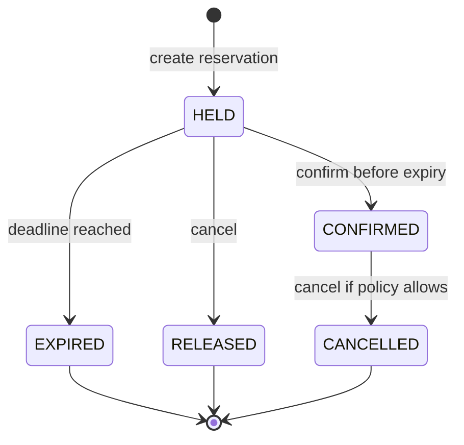
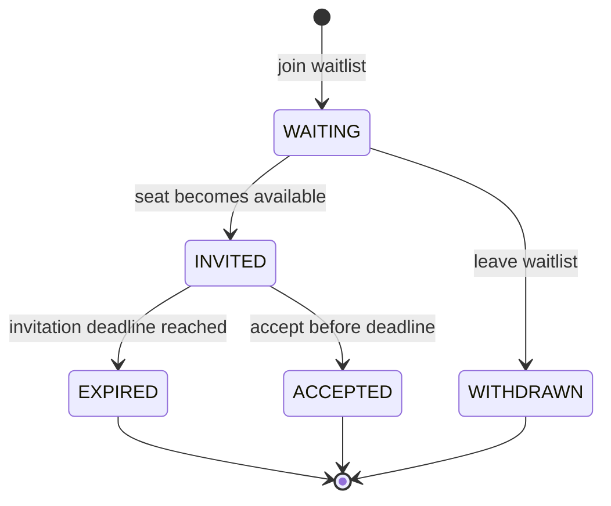

# Nhận diện bước đột phá khi mô hình mới làm đơn giản nhiều quy tắc

Trong Domain-Driven Design (DDD), mô hình miền không chỉ là tập hợp class phản ánh các bảng dữ liệu. Mô hình tốt diễn đạt cách doanh nghiệp hiểu và vận hành nghiệp vụ: những khái niệm nào quan trọng, chúng liên hệ ra sao, hành vi nào hợp lệ và vì sao một quyết định được đưa ra.

Một **deep model (mô hình sâu)** thể hiện được những hiểu biết quan trọng nằm bên dưới các tình huống bề mặt. Khi nhóm phát hiện một cách mô hình hóa mới làm nhiều quy tắc vốn rời rạc trở nên tự nhiên, dễ diễn đạt và dễ kiểm soát, đó có thể là một **breakthrough (bước đột phá trong mô hình)**. Bước đột phá không nhất thiết là một thuật toán mới hay một kiến trúc lớn. Đôi khi chỉ cần nhận ra một khái niệm nghiệp vụ bị bỏ sót, phân biệt hai trạng thái trước đây bị gộp chung hoặc thay một tập hợp cờ boolean bằng một vòng đời có ý nghĩa.

Điểm quan trọng là mô hình mới phải giúp domain expert giải thích nghiệp vụ tốt hơn, giúp developer đặt quy tắc đúng chỗ và làm cho nhiều trường hợp trở nên đơn giản hơn. Một mô hình có nhiều class hoặc thuật ngữ phức tạp chưa chắc là mô hình sâu. Độ sâu đến từ insight và khả năng giải thích, dự đoán hành vi nghiệp vụ.

## 1. Deep Model và bước đột phá trong mô hình là gì?

Một mô hình ban đầu thường bắt đầu từ những gì nhóm nhìn thấy: màn hình, biểu mẫu, bảng dữ liệu, quy trình hiện tại hoặc yêu cầu được ghi thành câu. Cách mô hình hóa đầu tiên có thể giải quyết được happy path, nhưng khi thêm ngoại lệ, thời hạn, quyền hạn và các trạng thái trung gian, logic bắt đầu phân tán.

Mô hình sâu xuất hiện khi nhóm hiểu rõ hơn bản chất của nghiệp vụ và tìm được cấu trúc diễn đạt bản chất đó. Thay vì bổ sung thêm một điều kiện cho từng trường hợp, nhóm phát hiện một khái niệm hoặc quan hệ có thể giải thích nhiều trường hợp cùng lúc.

**Breakthrough model** là một mô hình mới tạo ra sự thay đổi đáng kể trong cách hiểu và triển khai nghiệp vụ. Nó thường có những dấu hiệu:

- Một khái niệm mới giải thích được nhiều quy tắc trước đây bị rải rác.
- Các trường hợp ngoại lệ trở thành những chuyển trạng thái hoặc điều kiện có tên rõ ràng.
- Quy tắc được đặt gần dữ liệu và hành vi mà nó bảo vệ.
- Domain expert thấy mô hình phản ánh đúng cách họ suy nghĩ và có thể dùng nó để giải thích tình huống mới.
- Code ít phải phối hợp các cờ, trạng thái và điều kiện độc lập.
- Test có thể diễn đạt bằng các tình huống nghiệp vụ, không phải mô phỏng hàng loạt chi tiết kỹ thuật.

### 1.1. Deep không đồng nghĩa với phức tạp

Một mô hình có hàng chục interface, generic type và abstraction lồng nhau có thể chỉ làm tăng số khái niệm mà developer phải hiểu. Ngược lại, một value object hoặc một trạng thái trung gian được đặt tên đúng có thể làm hàng loạt điều kiện trở nên dễ hiểu.

Hãy phân biệt:

| Mô hình nông hoặc phức tạp giả tạo | Mô hình sâu có ích |
|---|---|
| Mô tả lại field của database | Diễn đạt khái niệm và quy tắc nghiệp vụ |
| Có nhiều boolean và nhánh điều kiện rải rác | Có trạng thái, hành vi và chuyển tiếp có ý nghĩa |
| Tạo class cho mọi danh từ trong tài liệu | Chỉ tạo abstraction khi nó có trách nhiệm và ngữ nghĩa rõ |
| Mỗi ngoại lệ thêm một `if` mới | Nhiều trường hợp được giải thích bởi cùng một quy tắc tổng quát |
| Developer phải nhớ thứ tự gọi method | Mô hình hạn chế các thao tác sai bằng API và invariant |
| Khó dự đoán kết quả ở tình huống mới | Có thể suy ra hành vi từ khái niệm và quy tắc đã xác định |

### 1.2. Breakthrough là sự cải thiện trong hiểu biết, không chỉ là refactor

Refactor có thể làm code dễ đọc hơn mà không thay đổi cách nhóm hiểu nghiệp vụ. Một bước đột phá trong mô hình đi xa hơn: nó làm lộ ra một cách diễn giải mới về domain.

Ví dụ, trước đây nhóm coi “giữ chỗ” là một cờ `isReserved` trên đăng ký học. Sau khi trao đổi với bộ phận vận hành, nhóm nhận ra giữ chỗ là một cam kết có thời hạn, có thể được xác nhận, giải phóng hoặc hết hạn. Khái niệm `SeatReservation` giải thích được thời hạn, xử lý timeout, hủy đăng ký, chống giữ chỗ trùng và cấp chỗ cho người trong danh sách chờ. Đây là thay đổi trong mô hình nghiệp vụ, không chỉ là đổi tên một field.

## 2. Dấu hiệu mô hình hiện tại đang nông

Không phải mọi `if` đều là vấn đề. Quy tắc nghiệp vụ có thể có ngoại lệ chính đáng. Điều đáng chú ý là các dấu hiệu cho thấy nhóm chưa tìm ra khái niệm hoặc ranh giới thích hợp.

### 2.1. Cùng một quy tắc xuất hiện ở nhiều nơi

Controller kiểm tra khóa học còn chỗ, batch job lại kiểm tra theo cách khác, message consumer quên kiểm tra trạng thái đăng ký. Một thay đổi nghiệp vụ buộc phải tìm và sửa nhiều nhánh code.

Đây có thể là dấu hiệu quy tắc chưa có owner rõ ràng. Hãy xác định invariant thuộc aggregate nào, policy nào đưa ra quyết định và use case nào điều phối hành động.

### 2.2. Nhiều boolean tạo ra tổ hợp trạng thái không hợp lệ

Một entity có thể có:

```java
boolean isReserved;
boolean isConfirmed;
boolean isCancelled;
boolean isExpired;
boolean isOnWaitlist;
```

Năm cờ boolean tạo ra 32 tổ hợp có thể biểu diễn, trong khi nghiệp vụ chỉ cho phép một số trạng thái. Ví dụ một đăng ký có thể vừa `isConfirmed = true` vừa `isExpired = true`, hoặc vừa `isCancelled = true` vừa `isReserved = true`.

Nếu các cờ đại diện cho những trạng thái loại trừ nhau, một state machine hoặc enum trạng thái có thể phù hợp hơn. Nếu chúng là các chiều độc lập thực sự, không nên ép tất cả vào một enum; cần phân biệt đúng bản chất của chúng.

### 2.3. Tên field không diễn đạt được ngữ nghĩa

Những field như `active`, `valid`, `processed`, `done` hoặc `status = 2` thường không nói rõ:

- Ai đã thực hiện hành động?
- Điều kiện nào làm trạng thái thay đổi?
- Trạng thái có thời hạn không?
- Có thể quay lại trạng thái trước không?
- Một trạng thái đã đạt có tạo cam kết hay quyền lợi gì không?

Nếu domain expert phải giải thích thêm mỗi khi developer hỏi một field nghĩa là gì, mô hình có thể đang thiếu một khái niệm được đặt tên đúng.

### 2.4. Một thao tác phải cập nhật nhiều object theo thứ tự dễ quên

Ví dụ, khi hủy đăng ký, caller phải:

1. Đổi `Enrollment.status` sang cancelled.
2. Giảm số chỗ đã dùng.
3. Xóa cờ giữ chỗ.
4. Cập nhật thời điểm hết hạn.
5. Chọn người tiếp theo trong waitlist.

Nếu một caller quên bước 2 hoặc 5, dữ liệu không nhất quán. Có thể nhóm chưa mô hình hóa `Reservation` như một khái niệm có vòng đời và chưa xác định aggregate nào sở hữu sức chứa.

### 2.5. Mỗi trường hợp mới lại tạo thêm ngoại lệ

Nếu code ngày càng có những nhánh như `if (isCorporate && isPriority && !isTrial && hasManualApproval...)`, hãy kiểm tra xem các điều kiện đang đại diện cho vai trò, loại cam kết, policy hay trạng thái nào. Đừng chỉ tiếp tục thêm cờ nếu cách phân loại ban đầu không còn phản ánh nghiệp vụ.

### 2.6. Domain expert và developer dùng cùng từ nhưng hiểu khác nhau

Developer nói “đã đăng ký” nhưng chuyên viên vận hành chỉ gọi là “đã giữ chỗ”; bộ phận đào tạo chỉ coi là “đã ghi danh” sau khi thanh toán hoặc phê duyệt. Một từ đang bị dùng cho nhiều sự kiện khác nhau. Đây là dấu hiệu cần phân biệt khái niệm và thời điểm trong mô hình.

## 3. Dấu hiệu một mô hình mới có thể là breakthrough

Một mô hình mới đáng xem xét khi nó làm giảm số quy tắc phải nhớ và giải thích được các tình huống thật.

### 3.1. Nhiều quy tắc được suy ra từ một khái niệm

Trước đây, nhóm phải kiểm tra thủ công thời hạn giữ chỗ ở nhiều use case. Sau khi mô hình hóa `SeatReservation` với `expiresAt`, các quy tắc như xác nhận trước hạn, giải phóng sau khi hết hạn và không xác nhận reservation đã hết hạn trở thành hành vi tự nhiên của một đối tượng có vòng đời.

### 3.2. Quy tắc được diễn đạt bằng ngôn ngữ của domain expert

Một chuyên viên có thể nói “reservation hết hạn”, “chỗ được giải phóng” hoặc “học viên trong waitlist được mời giữ chỗ”. Những cụm từ đó có thể trở thành tên event, trạng thái, hành vi và test.

### 3.3. Mô hình dự đoán được trường hợp chưa từng gặp

Một mô hình tốt không chỉ giải thích ví dụ đã biết. Khi domain expert hỏi “nếu học viên thanh toán đúng lúc reservation hết hạn thì sao?”, nhóm có thể xác định quy tắc bằng trạng thái và thời điểm đã mô hình hóa, thay vì tạo thêm một nhánh không liên quan.

### 3.4. Invariant và quyền sở hữu trở nên rõ

Mô hình cho biết ai được phép thay đổi trạng thái, ai bảo vệ sức chứa, và khi nào chỗ được coi là đã cam kết. Các use case khác nhau không cần tự phối hợp một loạt setter.

### 3.5. Số trường hợp đặc biệt giảm

Một abstraction tốt làm nhiều trường hợp trở thành biến thể của cùng một quy trình. Ví dụ, hủy reservation và hết hạn reservation đều có thể dẫn tới hành vi giải phóng chỗ, nhưng có nguyên nhân và event khác nhau. Mô hình có thể dùng chung cơ chế giải phóng mà vẫn giữ lý do nghiệp vụ riêng.

### 3.6. Mô hình làm lộ câu hỏi nghiệp vụ còn thiếu

Khi vẽ vòng đời reservation, nhóm nhận ra chưa biết thời điểm bắt đầu tính hạn, có cho gia hạn không, ai được gia hạn, thanh toán chậm được xử lý thế nào và người trong waitlist có bao lâu để phản hồi. Một mô hình tốt làm lộ câu hỏi cần domain expert quyết định, thay vì che chúng dưới một boolean.

## 4. Quy trình tìm kiếm bước đột phá

Breakthrough thường đến từ nhiều vòng trao đổi, thử mô hình và kiểm chứng. Không có công thức tự động tạo ra mô hình sâu, nhưng có thể tổ chức quá trình khám phá có kỷ luật.

### Bước 1: Thu thập tình huống thực tế

Đừng bắt đầu bằng danh sách class. Hãy thu thập các tình huống mà người làm nghiệp vụ thực sự xử lý:

- Luồng bình thường.
- Trường hợp bị từ chối.
- Trường hợp thay đổi hoặc hủy.
- Trường hợp đến muộn hoặc hết hạn.
- Trường hợp có hai người cùng yêu cầu một tài nguyên.
- Trường hợp có dữ liệu thiếu hoặc quyết định thủ công.
- Trường hợp cần sửa sai sau khi đã hoàn tất.

Hỏi domain expert về hành động, mục tiêu, bằng chứng, thời điểm và hệ quả. Tránh chỉ hỏi “có những field nào?” vì field thường phản ánh cách lưu trữ hiện tại hơn là cấu trúc nghiệp vụ.

### Bước 2: Tìm quy tắc lặp lại và ngoại lệ

Ghi các quy tắc dưới dạng câu rõ ràng:

- Chỉ reservation còn hiệu lực mới được xác nhận.
- Một chỗ không thể được giữ cho hai người cùng lúc.
- Reservation phải được xác nhận trước thời hạn.
- Khi reservation được giải phóng, người tiếp theo trong waitlist có thể được mời.
- Một lời mời waitlist cũng có thời hạn riêng.

Đánh dấu quy tắc xuất hiện ở nhiều use case và các quy tắc thường bị quên. Đây là nơi có thể đang thiếu một khái niệm hoặc một owner.

### Bước 3: Phân biệt các khái niệm đang bị gộp

Hãy hỏi liệu các từ đang dùng có thực sự đồng nghĩa:

- Yêu cầu đăng ký có phải là ghi danh không?
- Giữ chỗ có phải là xác nhận chỗ không?
- Thanh toán thành công có đồng nghĩa với đủ điều kiện tham gia không?
- Hủy đăng ký có giống reservation hết hạn không?
- Người trong waitlist đã có chỗ hay chỉ có quyền được mời?

Nếu câu trả lời khác nhau, đừng dùng một field hoặc trạng thái để đại diện tất cả.

### Bước 4: Tìm khái niệm có thể gom nhiều quy tắc

Tìm một danh từ nghiệp vụ hoặc một quan hệ có vòng đời riêng. Ví dụ:

- Reservation: một chỗ được giữ cho một chủ thể trong khoảng thời gian.
- Entitlement: quyền được sử dụng một dịch vụ hoặc tài nguyên.
- Commitment: cam kết đã được chấp nhận và có điều kiện thực hiện.
- Allocation: phần tài nguyên được phân bổ cho một nhu cầu.
- Settlement: quá trình đối chiếu và hoàn tất nghĩa vụ tài chính.

Đây chỉ là ứng viên. Domain expert phải xác nhận khái niệm có thực sự tồn tại trong nghiệp vụ hay chỉ là tên do developer nghĩ ra.

### Bước 5: Xác định identity, trạng thái và vòng đời

Với khái niệm mới, hãy làm rõ:

- Nó có identity riêng không?
- Khi nào nó được tạo và bởi ai?
- Những trạng thái nào có ý nghĩa?
- Chuyển trạng thái nào được phép và điều kiện gì?
- Có thời hạn hoặc thời điểm hiệu lực không?
- Khi nào nó kết thúc?
- Lịch sử có cần được giữ lại không?

Không phải khái niệm nào cũng là Entity. Nếu nó chỉ được xác định bằng giá trị và không có vòng đời độc lập, Value Object có thể phù hợp hơn.

### Bước 6: Đặt invariant vào đúng ranh giới

Xác định invariant nào phải đúng trong một transaction. Nếu sức chứa của một khóa học không được vượt quá giới hạn, hãy xác định aggregate hoặc cơ chế lưu trữ nào bảo vệ điều đó.

Nếu một quy tắc đòi hỏi phối hợp nhiều aggregate hoặc context, đừng giả định một aggregate có thể tự bảo vệ mọi thứ. Cần phân tích consistency boundary, reservation, policy hoặc process manager phù hợp.

### Bước 7: Thử mô hình trên cả tình huống quen thuộc và bất thường

Đưa mô hình mới qua các tình huống đã thu thập. Hỏi:

- Có thể diễn đạt mọi bước bằng hành vi có tên không?
- Có trạng thái nào không thể đạt tới hoặc không thể thoát ra không?
- Có quy tắc nào vẫn phải lặp ở nhiều caller không?
- Trường hợp ngoại lệ có cần một khái niệm riêng không?
- Có thể giải thích kết quả mà không dựa vào chi tiết kỹ thuật không?

Nếu mô hình chỉ hoạt động với happy path, chưa thể coi là breakthrough.

### Bước 8: So sánh mô hình cũ và mới

Đừng chỉ đánh giá bằng cảm giác code mới đẹp hơn. Hãy so sánh số quy tắc bị lặp, số trạng thái không hợp lệ có thể biểu diễn, số nơi phải thay đổi khi policy đổi, khả năng truy vết và độ rõ của test.

### Bước 9: Xác nhận lại với domain expert

Trình bày mô hình bằng ví dụ, trạng thái và hành vi. Yêu cầu chuyên gia xác nhận cả trường hợp bình thường lẫn ngoại lệ. Nếu họ không nhận ra thuật ngữ hoặc không thể dùng mô hình để giải thích công việc, cần điều chỉnh ngôn ngữ và cấu trúc.

### Bước 10: Refactor từng phần và quan sát

Thay đổi mô hình theo phạm vi có thể kiểm soát. Cập nhật test, dữ liệu, mapping và tích hợp. Sau khi triển khai, quan sát xem các trường hợp mới có thật sự được xử lý đơn giản hơn hay chỉ chuyển độ phức tạp sang nơi khác.

## 5. Ví dụ xuyên suốt: từ các cờ đăng ký đến Seat Reservation

Một nền tảng đào tạo tổ chức các lớp có sức chứa giới hạn. Học viên có thể yêu cầu tham gia, thanh toán, được giữ chỗ, xác nhận ghi danh hoặc chờ trong danh sách ưu tiên.

### 5.1. Mô hình ban đầu

Một cách triển khai đơn giản có thể lưu:

```java
class Enrollment {
    Long id;
    Long studentId;
    Long courseId;
    boolean reserved;
    boolean confirmed;
    boolean cancelled;
    boolean expired;
    boolean waitlisted;
    Instant reservedAt;
    Instant paidAt;
}
```

Các use case tự kiểm tra và cập nhật field:

```java
if (!enrollment.isCancelled()
        && !enrollment.isExpired()
        && !enrollment.isConfirmed()
        && course.getAvailableSeats() > 0) {
    enrollment.setReserved(true);
    enrollment.setReservedAt(clock.instant());
}
```

Khi thanh toán thành công, một handler khác kiểm tra `reserved`, `expired`, `cancelled` rồi đặt `confirmed = true`. Job hết hạn lại kiểm tra `reservedAt`. Luồng hủy phải giải phóng chỗ và xem xét waitlist. Nhiều nơi cần nhớ cùng một tập điều kiện.

### 5.2. Khám phá insight

Qua trao đổi với nhân viên vận hành, nhóm phát hiện:

- “Giữ chỗ” là cam kết tạm thời, không phải ghi danh chính thức.
- Chỗ được giữ cho một học viên đến một thời điểm cụ thể.
- Nếu không xác nhận trước hạn, chỗ được giải phóng.
- Hủy một reservation đã xác nhận khác với để reservation hết hạn.
- Người trong waitlist chưa sở hữu chỗ; họ chỉ được mời khi có chỗ trống.
- Lời mời waitlist có thời hạn riêng và có thể bị bỏ qua.

Insight là **reservation có identity và vòng đời riêng**. Nó không chỉ là một cờ trên Enrollment. Khái niệm này có thể giải thích thời hạn, quyền giữ chỗ, xác nhận, giải phóng và lời mời.

### 5.3. Mô hình mới



Waitlist được mô hình hóa riêng:



Hai vòng đời này liên quan nhưng không đồng nhất. Waitlist invitation có thể dẫn đến việc tạo một reservation mới; nó không tự động biến thành reservation đã xác nhận.

### 5.4. Hành vi được đặt tên

```java
public final class SeatReservation {
    private final ReservationId id;
    private final StudentId studentId;
    private final CourseOfferingId offeringId;
    private final Instant expiresAt;
    private ReservationStatus status;

    private SeatReservation(
            ReservationId id,
            StudentId studentId,
            CourseOfferingId offeringId,
            Instant expiresAt) {
        this.id = Objects.requireNonNull(id);
        this.studentId = Objects.requireNonNull(studentId);
        this.offeringId = Objects.requireNonNull(offeringId);
        this.expiresAt = Objects.requireNonNull(expiresAt);
        this.status = ReservationStatus.HELD;
    }

    public static SeatReservation hold(
            ReservationId id,
            StudentId studentId,
            CourseOfferingId offeringId,
            Instant now,
            Duration holdDuration) {
        if (holdDuration.isZero() || holdDuration.isNegative()) {
            throw new InvalidHoldDurationException(holdDuration);
        }
        return new SeatReservation(
            id, studentId, offeringId, now.plus(holdDuration));
    }

    public void confirm(Instant now) {
        if (status != ReservationStatus.HELD) {
            throw new ReservationNotHeldException(id);
        }
        if (!now.isBefore(expiresAt)) {
            status = ReservationStatus.EXPIRED;
            throw new ReservationExpiredException(id);
        }
        status = ReservationStatus.CONFIRMED;
    }

    public void release() {
        if (status == ReservationStatus.RELEASED) {
            return;
        }
        if (status != ReservationStatus.HELD) {
            throw new ReservationCannotBeReleasedException(id, status);
        }
        status = ReservationStatus.RELEASED;
    }
}
```

Code minh họa các hành vi và điều kiện cơ bản. Triển khai thật cần quyết định cách ghi nhận event khi chuyển sang `EXPIRED` rồi trả lỗi, cách xử lý thời gian bằng `Clock`, và transaction để trạng thái reservation cùng số chỗ được cập nhật nhất quán. Không nên để caller tự sửa `status`.

### 5.5. Những quy tắc được gom lại

| Quy tắc cũ | Cách mô hình mới diễn đạt |
|---|---|
| Không xác nhận reservation đã hết hạn | `SeatReservation.confirm(now)` kiểm tra `expiresAt` và trạng thái |
| Không xác nhận reservation đã hủy | Chỉ trạng thái `HELD` được chuyển sang `CONFIRMED` |
| Hủy giữ chỗ phải giải phóng chỗ | Hành vi `release()` cùng use case điều phối cập nhật sức chứa |
| Job phải tìm các bản ghi chưa xác nhận quá hạn | Query tìm reservation `HELD` có `expiresAt <= now` |
| Không xử lý một reservation hai lần | State transition và idempotency theo `ReservationId` |
| Người trong waitlist chưa có chỗ | `WaitlistEntry` có vòng đời riêng, chỉ tạo invitation khi có chỗ |
| Lời mời waitlist có hạn | `WaitlistInvitation` có deadline và hành vi accept/expire |
| Hủy enrollment đã xác nhận có policy khác | Hành vi hủy sau xác nhận kiểm tra policy riêng |

Điểm đột phá không phải là chuyển năm boolean thành một enum. Insight nằm ở việc nhận ra reservation là một cam kết tạm thời có identity, thời hạn và vòng đời; waitlist invitation là một khái niệm khác. Từ đó, nhiều quy tắc có owner và tên gọi rõ ràng.

### 5.6. Cần phân tích consistency boundary

Nếu `CourseOffering` sở hữu sức chứa và `SeatReservation` là entity con trong cùng aggregate, aggregate có thể bảo vệ invariant số chỗ trong một transaction. Nếu mỗi reservation là aggregate riêng để xử lý tải cao, invariant “không vượt sức chứa” có thể trải qua nhiều aggregate và cần cơ chế atomic allocation, counter/version hoặc database constraint phù hợp.

Không nên tách aggregate chỉ vì class đã lớn, cũng không nên gom mọi reservation vào một aggregate khổng lồ nếu contention quá cao. Mô hình sâu phải đi cùng ranh giới nhất quán khả thi.

## 6. Đo xem mô hình mới có thật sự đơn giản hóa không

Một breakthrough không được xác nhận chỉ vì nhóm thích tên mới. Hãy dùng bằng chứng từ quy tắc, code, test và phản hồi của người làm nghiệp vụ.

### 6.1. So sánh độ phân tán của quy tắc

Ghi lại mỗi quy tắc đang được triển khai ở đâu. Sau khi refactor, kiểm tra liệu quy tắc có một owner rõ hay vẫn phải lặp ở controller, job và consumer.

### 6.2. Đếm tổ hợp trạng thái không hợp lệ

Với các boolean loại trừ nhau, mô hình có thể biểu diễn nhiều tổ hợp sai. Một state machine thu hẹp các trạng thái hợp lệ và chuyển tiếp được phép. Tuy nhiên, đừng ép những chiều độc lập vào một enum chỉ để giảm số trạng thái.

### 6.3. Kiểm tra khả năng giải thích tình huống mới

Hãy đưa ra tình huống chưa dùng khi thiết kế, ví dụ thanh toán đến đúng thời điểm reservation hết hạn hoặc học viên rời waitlist khi đã được mời. Domain expert và developer có thể dùng mô hình để xác định hành vi không? Nếu cần thêm nhiều ngoại lệ không liên quan, mô hình có thể chưa đủ sâu.

### 6.4. Đánh giá thay đổi khi policy đổi

Nếu thời hạn giữ chỗ đổi từ 10 phút sang 15 phút, có thể cập nhật policy hoặc cấu hình tại một nơi không? Nếu quy tắc mới cần thay đổi trạng thái và vòng đời, mô hình có biểu đạt được mà không phá vỡ các use case khác không?

### 6.5. Đo độ phức tạp chuyển đi đâu

Một mô hình mới có thể làm aggregate đơn giản hơn nhưng đẩy nhiều logic sang mapper, factory hoặc process manager. Hãy xem tổng thể hệ thống, không chỉ một class. Mục tiêu là làm rõ và kiểm soát độ phức tạp, không che giấu nó ở một lớp khác.

### 6.6. Dùng bảng đánh giá

| Tiêu chí | Trước mô hình mới | Sau mô hình mới |
|---|---|---|
| Quy tắc giữ chỗ | Nhiều nhánh tại nhiều use case | Hành vi và invariant của Reservation |
| Hết hạn | Job cập nhật nhiều cờ | Chuyển trạng thái theo deadline |
| Hủy | Caller tự giải phóng chỗ | Use case gọi hành vi release có kiểm soát |
| Waitlist | Boolean trên Enrollment | Khái niệm và vòng đời riêng |
| Truy vết | Dựa vào field hiện tại | Có thể ghi event và thời điểm chuyển trạng thái |
| Test | Setup nhiều tổ hợp cờ | Test các trạng thái và chuyển tiếp có tên |

Không cần đặt một chỉ số số học duy nhất cho “độ sâu”. Bảng so sánh buộc nhóm nêu rõ điều gì đã được đơn giản hóa và điều gì vẫn còn phức tạp.

## 7. Vai trò của Domain Expert và Ubiquitous Language

Developer không thể tự quyết định rằng một abstraction mới là khái niệm nghiệp vụ chỉ vì nó làm code đẹp. Domain expert cần xác nhận từ ngữ, ranh giới và hệ quả của khái niệm.

Trong buổi khám phá mô hình, hãy:

- Dùng ví dụ thật và yêu cầu chuyên gia kể lại điều đã xảy ra.
- Hỏi vì sao một quyết định được đưa ra, ai có quyền và bằng chứng nào được dùng.
- Tách từ đồng âm hoặc từ đang được dùng không nhất quán.
- Đề xuất một thuật ngữ rồi yêu cầu chuyên gia dùng nó trong tình huống khác.
- Kiểm tra xem thuật ngữ mới có làm rõ hay khiến họ phải học một ngôn ngữ kỹ thuật xa lạ.
- Ghi lại câu hỏi chưa được trả lời thay vì tự điền bằng giả định.

Một dấu hiệu tốt là domain expert bắt đầu dùng khái niệm mới để giải thích tình huống mà trước đây họ phải kể một chuỗi thao tác dài. Khi thuật ngữ đi vào cuộc hội thoại tự nhiên, nó có thể đã trở thành một phần của Ubiquitous Language trong context đó.

### 7.1. Dùng Event Storming hoặc Example Mapping

Event Storming có thể giúp nhóm nhìn thấy command, domain event, actor, policy và hệ thống liên quan trên dòng thời gian. Example Mapping giúp tách story, rule, example và câu hỏi. Cả hai kỹ thuật hỗ trợ khám phá nhưng không tự tạo ra mô hình sâu; insight vẫn cần được kiểm chứng và chuyển thành model có hành vi.

### 7.2. Hỏi về điều kiện biên và ngoại lệ

Các câu hỏi hữu ích:

- Điều gì khiến nghiệp vụ coi một yêu cầu là đã được chấp nhận?
- Khi nào một lời hứa hoặc quyền lợi bắt đầu có hiệu lực?
- Điều gì làm cam kết hết hiệu lực?
- Có thể đảo ngược hành động không? Nếu có, đến thời điểm nào?
- Hai người cùng yêu cầu một tài nguyên thì ai được ưu tiên?
- Ai có quyền ngoại lệ và ngoại lệ được ghi nhận ra sao?
- Nếu hệ thống không biết kết quả của một thao tác, nhân viên sẽ kiểm tra bằng chứng nào?

Những câu hỏi này thường giúp tìm ra khái niệm như reservation, entitlement, allocation, settlement hoặc approval thay vì chỉ thêm field.

## 8. Mô hình sâu có thể xuất hiện từ nhiều loại insight

Không phải mọi breakthrough đều là một Entity mới. Một số dạng insight phổ biến:

### 8.1. Phân biệt hai khái niệm trước đây bị gộp

Ví dụ `OrderPlaced` khác `OrderAccepted`; `PaymentAuthorized` khác `PaymentCaptured`; `Customer` khác `Recipient`. Khi phân biệt, các quy tắc trước đây mơ hồ có thể được gắn với đúng khái niệm.

### 8.2. Nhận ra vòng đời ẩn

Một trạng thái có thời hạn hoặc chuyển qua nhiều bước có thể cần identity và lifecycle riêng. Reservation, approval, claim và subscription là những ví dụ có thể có vòng đời độc lập.

### 8.3. Nhận ra chính sách hoặc chiến lược

Một tập điều kiện ra quyết định có thể thực ra là `EligibilityPolicy`, `PricingPolicy` hoặc `AllocationPolicy`. Khi policy có tên, nhóm có thể kiểm thử, version và trao đổi với người có thẩm quyền.

### 8.4. Nhận ra thời gian là một phần của domain

`expiresAt`, `effectiveFrom`, `gracePeriod`, `cutoffTime` hoặc `settlementDate` không chỉ là timestamp. Chúng có thể quyết định quyền, nghĩa vụ hoặc trạng thái. Một mô hình thời gian rõ ràng thường loại bỏ nhiều điều kiện “nếu đã quá ngày...” bị rải rác.

### 8.5. Nhận ra quan hệ thay vì field

Một `CustomerTier` có thể là kết quả của một quan hệ membership có thời hạn; một `ProductAvailability` có thể phụ thuộc allocation theo kho và thời điểm. Khi quan hệ được mô hình hóa, các field boolean có thể được thay bằng khái niệm có quy tắc.

### 8.6. Nhận ra ranh giới trách nhiệm

Một mô hình có thể trở nên sâu hơn khi tách các khái niệm thuộc các Bounded Context khác nhau. Ví dụ Sales sở hữu cam kết bán, Inventory sở hữu reservation hàng, Shipping sở hữu shipment. Không nên gom chúng vào một aggregate chỉ vì chúng xuất hiện trong cùng màn hình.

## 9. Phân biệt breakthrough với over-modeling

Tìm mô hình sâu không có nghĩa tạo abstraction cho mọi chi tiết.

### 9.1. Dấu hiệu over-modeling

- Mỗi field được bọc trong một class dù không có ngữ nghĩa hoặc invariant riêng.
- Interface chỉ có một implementation và không có lý do thay thế hay ranh giới cần bảo vệ.
- Một khái niệm kỹ thuật được đặt tên như thuật ngữ nghiệp vụ dù domain expert không dùng nó.
- State machine có nhiều trạng thái nhưng không tương ứng với quyết định hoặc quyền lợi thực tế.
- Một framework rule engine được đưa vào dù số quy tắc ít và ổn định.
- Model tổng quát đến mức phải truyền nhiều flag để biểu đạt trường hợp cụ thể.

### 9.2. Không trừu tượng hóa quá sớm

Nếu chỉ có một trường hợp đã biết, hãy ghi nhận giả thuyết và quan sát thêm. Có thể một phép tính đơn giản trong aggregate là đủ. Chỉ tách policy, entity hoặc service khi có ý nghĩa riêng, nhiều biến thể thực tế hoặc ranh giới thay đổi rõ.

### 9.3. Không ép mọi quy tắc thành một abstraction

Hai quy tắc có vẻ giống nhau về code có thể có ý nghĩa khác nhau. Ví dụ, hủy reservation do người dùng yêu cầu và hết hạn tự động đều giải phóng chỗ, nhưng nguyên nhân, thông báo, audit và quyền khôi phục có thể khác. Có thể dùng chung cơ chế kỹ thuật nhưng giữ event và ngôn ngữ nghiệp vụ riêng.

## 10. Từ insight đến code: giữ model expressive

Khi insight đã được xác nhận, hãy chuyển nó thành API domain dễ đọc.

### 10.1. Dùng method diễn đạt hành vi

Thay vì:

```java
reservation.setStatus("CONFIRMED");
reservation.setConfirmedAt(now);
reservation.setExpired(false);
```

hãy dùng:

```java
reservation.confirm(now);
```

Method có thể kiểm tra trạng thái hiện tại, thời hạn và điều kiện xác nhận. Caller diễn đạt ý định, không tự cấu hình các field.

### 10.2. Dùng Value Object cho quy tắc giá trị

Ví dụ `HoldDuration`, `ReservationId`, `CourseOfferingId` hoặc `SeatNumber` có thể mang validation và semantics riêng. Không để số nguyên hoặc chuỗi tự do xuất hiện khắp nơi nếu chúng đại diện cho khái niệm có quy tắc.

### 10.3. Dùng Domain Event để ghi nhận sự kiện có ý nghĩa

Các event như `SeatReserved`, `ReservationConfirmed`, `ReservationExpired` và `ReservationReleased` có thể giúp audit và tích hợp. Tuy nhiên, Domain Event không thay thế aggregate hoặc invariant. Event được ghi nhận sau khi domain chấp nhận hành động và cần được publish theo cơ chế transaction phù hợp.

### 10.4. Giữ Application Service ở vai trò điều phối

Application service tải aggregate, lấy dữ liệu cần thiết, gọi policy/domain behavior, lưu thay đổi và điều phối side effect. Nó không nên chứa toàn bộ quy tắc về reservation hoặc tự sửa các field nội bộ.

## 11. Kiểm chứng mô hình qua test

Test là cách biến insight thành các ví dụ có thể thực thi. Test tốt nên dùng ngôn ngữ nghiệp vụ và tập trung vào hành vi.

Ví dụ:

```java
class SeatReservationTest {
    @Test
    void cannotConfirmAfterExpiry() {
        Instant now = Instant.parse("2026-05-01T10:00:00Z");
        SeatReservation reservation = SeatReservation.hold(
            ReservationId.newId(),
            StudentId.of("STU-10"),
            CourseOfferingId.of("JAVA-101"),
            now,
            Duration.ofMinutes(10)
        );

        assertThrows(ReservationExpiredException.class,
            () -> reservation.confirm(now.plus(Duration.ofMinutes(10))));
    }

    @Test
    void cannotReleaseConfirmedReservationThroughHoldReleaseOperation() {
        SeatReservation reservation = confirmedReservation();

        assertThrows(ReservationCannotBeReleasedException.class,
            reservation::release);
    }
}
```

Các helper trong ví dụ cần được định nghĩa theo dự án. Test còn cần bao phủ:

- Xác nhận trước thời hạn thành công.
- Xác nhận đúng thời điểm hết hạn theo quy tắc boundary đã thống nhất.
- Hủy reservation đang giữ chỗ.
- Hết hạn và giải phóng chỗ đúng một lần.
- Reservation đã xác nhận không bị xử lý như reservation tạm.
- Waitlist invitation có thời hạn riêng.
- Hai yêu cầu đồng thời không vượt sức chứa.
- Replay command hoặc job không tạo side effect trùng.

### 11.1. Test theo ví dụ nghiệp vụ

Thay vì đặt tên test `testStatusUpdate2`, hãy dùng tên như `reservationExpiresWhenConfirmationDeadlineIsReached`. Tên test cho biết quy tắc và giúp domain expert tham gia review.

### 11.2. Test invariant ở đúng cấp

Unit test aggregate kiểm tra logic nội tại. Integration test với database kiểm tra locking, unique constraint và atomic allocation. Test application service kiểm tra thứ tự điều phối. Không dùng unit test để tuyên bố đã giải quyết concurrency nếu chưa kiểm tra persistence boundary.

## 12. Những câu hỏi giúp nhận diện insight

Trong workshop hoặc buổi modeling, có thể dùng các câu hỏi sau:

- Có từ nào đang được dùng để chỉ nhiều sự kiện khác nhau không?
- Có quy tắc nào mà mọi người phải nhớ nhưng không có object hoặc policy nào sở hữu không?
- Có trạng thái nào chỉ hợp lệ trong một khoảng thời gian không?
- Có cam kết hoặc quyền lợi nào được tạo ra, chuyển giao, hết hạn hoặc thu hồi không?
- Có field nào thực chất là một khái niệm có identity hoặc lifecycle riêng không?
- Có quan hệ nào đang bị biểu diễn bằng nhiều foreign key hoặc boolean mà chưa được gọi tên không?
- Vì sao ngoại lệ này xảy ra? Nó có phải một trường hợp của cùng một quy tắc sâu hơn không?
- Khi một quyết định bị thay đổi, ai có quyền và lịch sử cần giữ lại điều gì?
- Nếu thêm một loại actor hoặc một kênh giao tiếp mới, quy tắc nào sẽ bị lặp?
- Mô hình hiện tại có giúp dự đoán kết quả cho một tình huống mới không?
- Domain expert có thể dùng thuật ngữ mới mà không cần dịch sang ngôn ngữ kỹ thuật không?
- Mô hình mới làm giảm số trường hợp đặc biệt hay chỉ chuyển chúng sang class khác?

## 13. Checklist đánh giá một breakthrough model

Trước khi chấp nhận mô hình mới, hãy kiểm tra:

- Có insight nghiệp vụ cụ thể đứng sau mô hình không?
- Domain expert đã xác nhận thuật ngữ và semantics chưa?
- Mô hình mới giải thích được nhiều quy tắc hoặc tình huống hơn mô hình cũ không?
- Những khái niệm trước đây bị gộp có được phân biệt đúng không?
- Identity, lifecycle, thời hạn và quyền sở hữu đã rõ chưa?
- Invariant có được bảo vệ ở đúng aggregate/value object hoặc consistency boundary không?
- Các use case có thể diễn đạt bằng hành vi có tên không?
- Số boolean và tổ hợp trạng thái không hợp lệ có giảm không?
- Quy tắc có thôi bị lặp ở controller, job và message consumer không?
- Trường hợp mới hoặc ngoại lệ có thể được giải thích bằng mô hình không?
- Mô hình có làm giảm độ phức tạp tổng thể thay vì chuyển nó sang nơi khác không?
- Có test thể hiện các ví dụ nghiệp vụ và các điều kiện biên không?
- Mô hình có đủ đơn giản để người mới hiểu và đủ linh hoạt cho thay đổi đã biết không?
- Có bằng chứng nào cho thấy abstraction đang bị tạo quá sớm hoặc quá rộng không?

## 14. Câu hỏi tự kiểm tra

1. Deep Model khác một mô hình có nhiều class và abstraction ở điểm nào?
2. Vì sao một bước đột phá trong mô hình là thay đổi về hiểu biết nghiệp vụ chứ không chỉ là refactor?
3. Những dấu hiệu nào cho thấy quy tắc đang bị phân tán vì mô hình còn nông?
4. Vì sao nhiều boolean có thể biểu diễn các tổ hợp trạng thái không hợp lệ?
5. Làm thế nào nhận ra một field thực chất là một khái niệm có identity hoặc vòng đời riêng?
6. Trong ví dụ đăng ký khóa học, insight nào dẫn đến việc mô hình hóa `SeatReservation`?
7. Vì sao `WaitlistInvitation` không nên bị gộp với `SeatReservation`?
8. Làm thế nào xác nhận mô hình mới thực sự đơn giản hóa thay vì chuyển độ phức tạp sang nơi khác?
9. Vai trò của domain expert và Ubiquitous Language trong việc xác nhận breakthrough là gì?
10. Phân biệt breakthrough model với over-modeling bằng những tiêu chí nào?

## Kết luận

Một bước đột phá trong mô hình xuất hiện khi nhóm nhìn ra cấu trúc nghiệp vụ sâu hơn và dùng nó để giải thích nhiều quy tắc vốn rời rạc. Dấu hiệu quan trọng là khái niệm mới có tên đúng, có identity hoặc lifecycle khi cần, bảo vệ invariant rõ ràng và giúp các tình huống bình thường lẫn ngoại lệ trở nên dễ diễn đạt. Để tìm ra mô hình như vậy, hãy bắt đầu từ tình huống thật, trao đổi với domain expert, phân biệt các khái niệm đang bị gộp, thử mô hình trên trường hợp biên và so sánh với cách cũ. Mô hình sâu không phải mô hình phức tạp hơn; nó là mô hình giúp hiểu và kiểm soát nghiệp vụ tốt hơn, đồng thời làm cho nhiều quy tắc trở nên tự nhiên thay vì phải ghi nhớ riêng lẻ.
