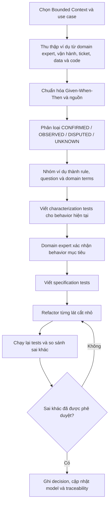

# Giữ ví dụ nghiệp vụ làm bằng chứng trong quá trình tái cấu trúc

Tái cấu trúc (refactoring) một mô hình nghiệp vụ thường làm thay đổi cách code biểu diễn quy tắc, phân chia trách nhiệm hoặc tổ chức Aggregate. Mục tiêu là làm cho mô hình dễ hiểu và dễ thay đổi hơn trong khi hành vi nghiệp vụ đã được xác nhận vẫn đúng. Nhưng với hệ thống lâu năm, nhiều quy tắc chỉ tồn tại trong code, dữ liệu lịch sử, thao tác của người dùng hoặc kinh nghiệm của chuyên gia nghiệp vụ. Nếu bắt đầu di chuyển class và đổi tên method trước khi hiểu những quy tắc đó, nhóm có thể vô tình xóa một ngoại lệ quan trọng hoặc giữ lại một lỗi cũ như thể đó là chính sách.

**Ví dụ nghiệp vụ là bằng chứng để hiểu và kiểm tra hành vi trong quá trình tái cấu trúc.** Một ví dụ tốt mô tả hoàn cảnh, dữ liệu đầu vào, hành động và kết quả được mong đợi, kèm lý do nghiệp vụ và nguồn xác nhận. Các ví dụ được giữ lại thành bộ tình huống có thể chạy tự động, giúp nhóm so sánh hành vi trước và sau khi thay đổi mô hình.

Trong Domain-Driven Design (DDD), ví dụ cụ thể giúp chuyên gia nghiệp vụ và đội phát triển làm rõ ngôn ngữ chung, khám phá invariant, nhận diện ngoại lệ và xác định ranh giới mô hình. Bài này trình bày cách thu thập, xác nhận, lưu trữ và biến ví dụ thành bằng chứng kiểm thử; cách phân biệt hành vi được chấp nhận với hành vi legacy chưa rõ; và cách dùng bằng chứng đó để tái cấu trúc từng bước mà không đánh mất kiến thức nghiệp vụ.

`DOMAIN_DRIVEN_DESIGN` kết hợp strategic design qua subdomain, Bounded Context và Context Map với tactical design qua Entity, Value Object, Aggregate, Repository và Domain Event. Ví dụ nghiệp vụ cần được đặt trong đúng context và thuật ngữ của nó: cùng một từ có thể mang nghĩa khác ở hai context, và một kết quả đúng trong một quy trình chưa chắc đúng trong quy trình khác.

## 1. Vì sao cần giữ ví dụ trong quá trình tái cấu trúc?

### 1.1. Code hiện tại không phải lúc nào cũng là đặc tả đúng

Một hàm cũ có thể chứa:

- Quy tắc nghiệp vụ đã được xác nhận.
- Ngoại lệ được thêm sau một sự cố thực tế.
- Cách xử lý dữ liệu lịch sử.
- Workaround cho một hệ thống tích hợp cũ.
- Lỗi chưa từng được phát hiện.
- Hành vi ngẫu nhiên do thứ tự query hoặc thời điểm hệ thống.

Nếu chỉ đọc code, rất khó biết nhánh `if` nào là chính sách thật, nhánh nào là workaround và nhánh nào là bug. Ngược lại, nếu chỉ hỏi chuyên gia nghiệp vụ về quy trình lý tưởng, nhóm có thể bỏ qua những trường hợp đang xảy ra trong production.

Ví dụ cụ thể giúp đặt câu hỏi đúng: “Với yêu cầu chi phí 10 triệu đồng, người quản lý cùng phòng ban có thể duyệt không?”, “Nếu người yêu cầu chính là người duyệt thì sao?”, “Nếu khoản chi đã được thanh toán thì quy trình còn cho phép sửa không?”. Câu trả lời có thể làm lộ ra các ranh giới và invariant chưa được mô tả trong code.

### 1.2. Tái cấu trúc thay đổi cấu trúc, không được tự ý đổi ý nghĩa

Khi chuyển logic từ một service lớn sang Domain Policy và Aggregate, nhóm có thể đổi:

- Tên class và method.
- Cách biểu diễn trạng thái.
- Vị trí của quy tắc.
- Cách tính hoặc truyền dữ liệu.
- Cách lưu trữ và truy xuất.

Trong một đợt refactor thuần túy, kết quả quan sát được của các tình huống đã được xác nhận cần giữ nguyên. Nếu nghiệp vụ muốn thay đổi kết quả, đó là thay đổi hành vi có chủ đích và cần được ghi nhận riêng, không nên trộn lẫn với việc làm sạch cấu trúc code.

### 1.3. Ví dụ tạo cầu nối giữa ngôn ngữ và code

Một câu như “quản lý có thể duyệt khoản chi hợp lệ” quá rộng. Một ví dụ có thể cụ thể hóa:

> Khi nhân viên thuộc phòng Sales gửi khoản chi 8 triệu đồng, người quản lý Sales có hạn mức 10 triệu đồng và không phải người tạo yêu cầu, hệ thống cho phép phê duyệt nếu yêu cầu đang ở trạng thái đã gửi.

Từ ví dụ này, nhóm có thể nhận diện các khái niệm `Expense`, `Approver`, `Department`, `ApprovalLimit`, `Submitted` và hành vi `approve`. Đây là nguyên liệu để xây dựng mô hình miền, không phải chỉ là một dòng test.

## 2. Ví dụ nghiệp vụ là gì và cần ghi lại những gì?

### 2.1. Một ví dụ phải đủ ngữ cảnh để người khác hiểu

Một ví dụ nghiệp vụ hữu ích thường trả lời:

1. Nó thuộc Bounded Context hoặc quy trình nào?
2. Ai tham gia và họ đang giữ vai trò gì?
3. Trạng thái ban đầu của đối tượng là gì?
4. Dữ liệu hoặc điều kiện liên quan nào đang có?
5. Hành động nào được thực hiện?
6. Kết quả mong đợi là gì?
7. Vì sao kết quả đó đúng theo nghiệp vụ?
8. Ai xác nhận và xác nhận vào thời điểm nào?

Nếu thiếu ngữ cảnh, cùng một đầu vào có thể cho kết quả khác nhau mà không ai biết lý do. Ví dụ, hạn mức 10 triệu đồng có thể áp dụng cho một cấp quản lý, một tenant hoặc một loại chi phí cụ thể.

### 2.2. Ghi ví dụ theo cấu trúc Given–When–Then

Một cấu trúc dễ đọc:

```text
Given:
  Expense E-101 đã được gửi.
  Người yêu cầu thuộc phòng Sales.
  Approver M-10 thuộc phòng Sales.
  M-10 có hạn mức 10.000.000 VND.
  M-10 không phải người tạo yêu cầu.
  Số tiền của E-101 là 8.000.000 VND.

When:
  M-10 phê duyệt E-101.

Then:
  E-101 chuyển sang trạng thái APPROVED.
  Người phê duyệt được ghi nhận là M-10.
  Hệ thống ghi nhận thời điểm phê duyệt.

Because:
  Khoản chi nằm trong hạn mức và đáp ứng quy tắc tách nhiệm vụ.
```

`Because` hoặc phần giải thích giúp giữ lại lý do nghiệp vụ. Khi quy tắc được thảo luận lại, nhóm có thể xem tại sao kết quả cũ từng được chọn.

### 2.3. Một ví dụ không chỉ là bộ dữ liệu đầu vào và đầu ra

Đầu vào/đầu ra là cần thiết cho test, nhưng một ví dụ nghiệp vụ còn cần ngữ cảnh và ý nghĩa. Ví dụ “8.000.000 trả về true” không nói được:

- Đây là tiền tệ nào?
- Đang kiểm tra quyền duyệt hay đang tính tổng?
- Hạn mức được tính theo từng khoản hay tổng theo tháng?
- Có cần cùng phòng ban không?
- Người duyệt có được là người yêu cầu không?

Hãy giữ ví dụ ở mức mà chuyên gia nghiệp vụ có thể đọc và xác nhận, sau đó ánh xạ nó sang dữ liệu test.

### 2.4. Metadata tối thiểu cho kho ví dụ

Có thể lưu mỗi ví dụ cùng các thông tin:

| Trường | Ý nghĩa |
|---|---|
| `exampleId` | Định danh ổn định để liên kết tài liệu và test |
| `context` | Bounded Context hoặc quy trình sở hữu ví dụ |
| `scenario` | Tên tình huống ngắn, dùng ngôn ngữ nghiệp vụ |
| `given/when/then` | Hoàn cảnh, hành động và kết quả |
| `because` | Lý do nghiệp vụ |
| `source` | Workshop, chuyên gia, ticket, hồ sơ hoặc quan sát production |
| `owner` | Người chịu trách nhiệm xác nhận |
| `confidence` | Đã xác nhận, chỉ quan sát, còn tranh luận hoặc chưa rõ |
| `decisionDate` | Ngày chốt kết quả |
| `modelVersion` | Phiên bản quy tắc hoặc mô hình áp dụng nếu cần |

Không nhất thiết phải tạo một nền tảng quản lý ví dụ riêng. Tài liệu, test source và issue tracker có thể đủ nếu nhóm giữ được liên kết và lịch sử quyết định.

## 3. Thu thập ví dụ từ nhiều nguồn

### 3.1. Chuyên gia nghiệp vụ và người trực tiếp vận hành

Workshop với domain expert giúp làm rõ quy trình chính thức, ngoại lệ và ngôn ngữ. Tuy nhiên, người trực tiếp xử lý hồ sơ, hỗ trợ khách hàng hoặc vận hành hệ thống có thể biết những trường hợp hiếm mà tài liệu quy trình không đề cập.

Hãy hỏi về tình huống cụ thể đã xảy ra, thay vì chỉ hỏi “quy tắc là gì?”. Ví dụ:

- Lần gần nhất yêu cầu bị từ chối vì lý do nào?
- Có trường hợp nào người dùng nghĩ rằng họ được phép nhưng hệ thống từ chối không?
- Có trường hợp ngoại lệ nào được quản lý chấp thuận?
- Khi dữ liệu thiếu hoặc đến muộn, nhân viên xử lý ra sao?
- Có trường hợp nào phải sửa lại quyết định sau khi đã hoàn tất không?

### 3.2. Ticket, khiếu nại và incident

Support ticket và incident thường cung cấp bằng chứng về hành vi thực tế:

- Người dùng nhập dữ liệu nào?
- Hệ thống trả kết quả gì?
- Kết quả đó đúng hay sai?
- Có workaround nào được áp dụng?
- Một thay đổi trước đây đã gây ra lỗi nào?

Không mặc định mọi kết quả production đều là quy tắc đúng. Một incident có thể chính là bằng chứng cho thấy hệ thống đang vi phạm mong muốn nghiệp vụ.

### 3.3. Dữ liệu lịch sử và audit log

Log, database record, event và lịch sử xử lý có thể giúp tìm tần suất và dạng ngoại lệ. Chúng cho biết hệ thống đã làm gì, nhưng không tự chứng minh tại sao điều đó đúng.

Khi dùng dữ liệu thực tế làm ví dụ, cần ẩn danh thông tin cá nhân, loại bỏ secret và giới hạn quyền truy cập. Chỉ giữ những thuộc tính cần thiết để hiểu quy tắc.

### 3.4. Code hiện tại và test cũ

Code, test và tài liệu kỹ thuật giúp xác định behavior hiện tại. Hãy dùng chúng như nguồn quan sát, sau đó hỏi domain expert xem behavior đó có phải chính sách được chấp nhận không.

Test cũ có thể đã được viết để phù hợp với implementation, không phải để xác nhận nghiệp vụ. Tên test như `shouldReturnTrueForTypeA` thường cung cấp ít ngữ cảnh hơn `managerCannotApproveOwnExpense`.

### 3.5. Kết hợp nguồn để tăng độ tin cậy

Một ví dụ mạnh có thể được hỗ trợ bởi nhiều nguồn:

```text
Example EX-AP-014
  Source 1: Workshop với Finance Lead
  Source 2: Ticket FIN-283 về tự phê duyệt
  Source 3: Audit record của một yêu cầu bị từ chối
  Decision: người tạo không được tự phê duyệt
  Confidence: CONFIRMED
```

Khi nguồn mâu thuẫn, hãy ghi rõ mâu thuẫn và mở câu hỏi. Không chọn một nguồn chỉ vì nó dễ chuyển thành code.

## 4. Phân loại ví dụ trước khi dùng làm bằng chứng

### 4.1. Bốn trạng thái quan trọng

Không phải mọi ví dụ thu thập được đều có cùng mức độ tin cậy:

| Trạng thái | Ý nghĩa | Cách dùng khi refactor |
|---|---|---|
| `CONFIRMED` | Domain expert hoặc owner có thẩm quyền đã xác nhận | Dùng làm đặc tả hành vi mục tiêu |
| `OBSERVED` | Đã thấy trong code, log hoặc production nhưng chưa xác nhận là đúng | Dùng để đóng băng và tìm hiểu behavior hiện tại |
| `DISPUTED` | Các bên đưa ra cách hiểu khác nhau | Giữ lại, chưa tự chọn một kết quả |
| `UNKNOWN` | Thiếu dữ kiện hoặc không xác định được nguồn | Tạo câu hỏi và tìm thêm bằng chứng |

Có thể bổ sung `REJECTED` cho một hành vi đã được xác nhận là sai hoặc `DEPRECATED` cho ví dụ không còn thuộc chính sách hiện tại. Điều quan trọng là không đánh đồng “đã xảy ra” với “được phép xảy ra”.

### 4.2. Phân biệt behavior hiện tại và behavior mục tiêu

Với một tình huống, có thể tồn tại hai kết quả:

- **Observed behavior:** hệ thống cũ thực sự trả về điều gì?
- **Expected business behavior:** doanh nghiệp xác nhận hệ thống nên làm gì?

Nếu hai kết quả khác nhau, ghi nhận chênh lệch như một bug hoặc thay đổi nghiệp vụ cần phê duyệt. Không sửa test characterization để làm cho code mới pass mà không có quyết định.

### 4.3. Không dùng ngoại lệ đơn lẻ làm quy tắc phổ quát

Một quản lý từng được cho phép duyệt khoản chi vượt hạn mức có thể là trường hợp ủy quyền đặc biệt, không phải chính sách chung. Hãy ghi lại điều kiện ủy quyền, thời hạn, phạm vi và người phê duyệt ngoại lệ.

Một ví dụ biên có giá trị cao, nhưng chỉ có thể trở thành quy tắc sau khi xác định nó đại diện cho chính sách nào.

## 5. Từ ví dụ đến quy tắc và mô hình miền

### 5.1. Nhóm ví dụ theo quy tắc chung

Nhiều ví dụ có thể biểu hiện cùng một quy tắc. Ví dụ:

| Ví dụ | Dữ kiện thay đổi | Kết quả | Quy tắc có thể rút ra |
|---|---|---|---|
| EX-01 | 8 triệu, cùng phòng, người duyệt khác người yêu cầu | Cho phép bước duyệt cấp 1 | Trong hạn mức và đúng phạm vi |
| EX-02 | 12 triệu, hạn mức 10 triệu | Cần cấp duyệt tiếp theo | Vượt hạn mức không thể được cấp này tự duyệt |
| EX-03 | Người duyệt cũng là người yêu cầu | Từ chối | Tách nhiệm vụ |
| EX-04 | Yêu cầu chưa được gửi | Không cho duyệt | Chỉ trạng thái `SUBMITTED` mới có thể duyệt |

Đây là ví dụ minh họa; ngưỡng và kết quả thực tế phải do domain expert xác nhận. Nhóm ví dụ giúp tách quy tắc tổng quát khỏi các con số hoặc nhân vật cụ thể.

### 5.2. Dùng Example Mapping để khám phá quy tắc

Example Mapping là một kỹ thuật workshop giúp làm rõ một user story qua:

- **Story:** hành động hoặc nhu cầu đang thảo luận.
- **Rules:** các quy tắc áp dụng.
- **Examples:** ví dụ cụ thể minh họa từng quy tắc.
- **Questions:** điều chưa rõ hoặc cần người có thẩm quyền quyết định.

Ví dụ với story “Quản lý phê duyệt khoản chi”:

```text
Story: Phê duyệt khoản chi

Rule 1: Chỉ yêu cầu đã gửi mới được phê duyệt.
  Example: SUBMITTED -> có thể tiếp tục kiểm tra quyền.
  Example: DRAFT -> từ chối vì chưa gửi.

Rule 2: Người yêu cầu không được tự phê duyệt.
  Example: requesterId == approverId -> DENY.

Rule 3: Khoản chi vượt hạn mức cần cấp phê duyệt khác.
  Example: amount <= limit -> cấp hiện tại đủ điều kiện.
  Example: amount > limit -> chuyển cấp tiếp theo.

Question: Hạn mức tính theo từng khoản hay tổng theo tháng?
Question: Khoản chi ngoại tệ quy đổi theo tỷ giá tại ngày nào?
```

Các câu hỏi chưa được trả lời cần được giữ lại như việc cần làm, không biến thành giả định trong code.

### 5.3. Tìm khái niệm và thuật ngữ từ ví dụ

Ví dụ có thể làm rõ rằng “hạn mức” không phải chỉ là một con số. Nó có thể là `ApprovalLimit` gắn với cấp bậc, loại chi phí, đơn vị, thời gian hiệu lực và currency.

Tương tự, “được duyệt” có thể có nhiều trạng thái: đủ điều kiện duyệt cấp một, đã được một cấp duyệt, đã được duyệt cuối cùng. Mô hình sâu xuất hiện khi nhóm tìm được các khái niệm và quy tắc giải thích được nhiều ví dụ mà không cần những nhánh `if` rời rạc.

### 5.4. Giữ ngôn ngữ theo Bounded Context

Một từ như `Approved` trong Expense Context có thể nghĩa là khoản chi đã được người có thẩm quyền duyệt; trong Payment Context, `Approved` có thể nghĩa là tổ chức phát hành thẻ chấp thuận giao dịch thanh toán.

Không dùng chung một định nghĩa chỉ vì hai context dùng cùng tên. Gắn ví dụ với context sở hữu và ghi rõ thuật ngữ theo ngữ cảnh.

## 6. Biến ví dụ thành bộ kiểm thử trước khi tái cấu trúc

### 6.1. Characterization Test ghi lại hành vi hiện tại

Characterization test (test đặc tả hành vi hiện tại) được viết để quan sát và ghi nhận hệ thống đang hoạt động ra sao. Nó đặc biệt hữu ích khi refactor code legacy mà tài liệu không đầy đủ.

Quy trình:

1. Chọn một tình huống thực tế.
2. Thiết lập dữ liệu và trạng thái đầu vào.
3. Gọi implementation hiện tại.
4. Ghi lại kết quả quan sát được.
5. Đặt tên test theo tình huống nghiệp vụ.
6. Đối chiếu kết quả với domain expert để xác định có phải behavior mong muốn không.

Characterization test ban đầu trả lời “code cũ đang làm gì?”, chưa tự trả lời “code nên làm gì?”.

### 6.2. Specification Test ghi lại hành vi mục tiêu

Sau khi ví dụ được xác nhận, tạo test đặc tả quy tắc mong muốn. Test này trở thành tiêu chí chấp nhận cho mô hình mới.

Có thể giữ cả hai nhóm:

- `legacy-characterization`: đóng băng observed behavior để phục vụ điều tra.
- `domain-specification`: xác nhận behavior đã được duyệt.

Nếu observed behavior là bug, không nên giữ assertion bug như tiêu chí cuối cùng của mô hình mới. Có thể giữ test trong một nhóm mô tả legacy hoặc cập nhật test sau khi bug được ghi nhận và có quyết định sửa rõ ràng.

### 6.3. Test phải đi qua hành vi miền có ý nghĩa

Không chỉ test private helper hoặc cấu trúc class. Hãy gọi use case, domain service hoặc hành vi Aggregate mà người dùng/nghiệp vụ thực sự yêu cầu.

Ví dụ tên test tốt:

- `managerCannotApproveOwnExpense`
- `expenseAboveApprovalLimitRequiresHigherApproval`
- `draftExpenseCannotBeApproved`
- `approvalRecordsActorAndDecisionTime`

Tên như `testCalculate2` hoặc `shouldReturnFalse` không giúp người đọc hiểu chính sách.

## 7. Ví dụ xuyên suốt: tái cấu trúc quy trình phê duyệt chi phí

### 7.1. Bối cảnh code legacy

Giả sử hệ thống cũ có một service lớn:

```java
public boolean approve(ExpenseRow row, UserRow user) {
    if (!"SUBMITTED".equals(row.status)) return false;
    if (row.requesterId.equals(user.id)) return false;
    if (!row.departmentId.equals(user.departmentId)) return false;
    if (row.amount.compareTo(user.limit) > 0) return false;

    row.status = "APPROVED";
    row.approvedBy = user.id;
    row.approvedAt = Instant.now();
    return true;
}
```

Đoạn code này trộn truy cập dữ liệu, quyết định quyền, quy tắc nghiệp vụ và thay đổi trạng thái. Nó cũng có thể thiếu quy tắc về tenant, ngoại lệ ủy quyền, loại tiền hoặc cấp phê duyệt.

Không nên lập tức chia hàm này thành năm class chỉ dựa trên cảm giác. Trước hết hãy tìm và xác nhận các ví dụ đang chứng minh hành vi cần bảo toàn.

### 7.2. Tạo bảng ví dụ đã xác nhận

Giả sử domain expert xác nhận các quy tắc sau cho phạm vi minh họa:

| ID | Trạng thái ban đầu | Người yêu cầu / người duyệt | Phòng ban | Số tiền / hạn mức | Kết quả mục tiêu |
|---|---|---|---|---|---|
| EX-AP-01 | SUBMITTED | Khác nhau | Cùng | 8 triệu / 10 triệu | Được duyệt cấp hiện tại |
| EX-AP-02 | SUBMITTED | Khác nhau | Cùng | 12 triệu / 10 triệu | Cần cấp duyệt cao hơn |
| EX-AP-03 | SUBMITTED | Trùng nhau | Cùng | 5 triệu / 10 triệu | Từ chối tự phê duyệt |
| EX-AP-04 | DRAFT | Khác nhau | Cùng | 5 triệu / 10 triệu | Từ chối do chưa gửi |
| EX-AP-05 | SUBMITTED | Khác nhau | Khác | 5 triệu / 10 triệu | Từ chối do sai phạm vi |

Các ví dụ này phải gắn với tenant, currency và loại chi phí nếu những thuộc tính đó ảnh hưởng đến policy thực tế. Bảng đơn giản chỉ là tập ví dụ cốt lõi đã được xác nhận cho bài toán minh họa.

### 7.3. Characterization test trước khi đổi code

Trước tiên, chạy các tình huống trên implementation cũ và ghi kết quả thực tế. Nếu EX-AP-02 đang trả `false`, cần hỏi: đó là đúng vì cấp này không được duyệt, hay sai vì hệ thống phải tạo bước chuyển cấp? Kết quả `false` có thể không đủ để phân biệt `DENIED` với `REQUIRES_ESCALATION`.

Nếu phát hiện chênh lệch, ghi lại:

```text
EX-AP-02
Observed legacy result: DENIED
Expected business result: REQUIRES_HIGHER_APPROVAL
Classification: CONFIRMED LEGACY DEFECT
Decision: Refactor phải biểu diễn rõ trạng thái cần chuyển cấp.
```

Nhờ vậy, nhóm không nhầm việc bảo toàn behavior với bảo toàn bug.

### 7.4. Rút ra mô hình sâu hơn

Từ các ví dụ, có thể nhận ra các khái niệm:

- `Expense`: Aggregate Root quản lý vòng đời yêu cầu.
- `ExpenseStatus`: trạng thái miền thay cho chuỗi tự do.
- `Approver`: vai trò nghiệp vụ có phạm vi.
- `ApprovalLimit`: Value Object chứa số tiền và currency.
- `ApprovalPolicy`: chính sách xác định cấp duyệt phù hợp.
- `ApprovalDecision`: kết quả có ý nghĩa như `APPROVED`, `DENIED`, `REQUIRES_ESCALATION`.
- `ApprovalRecord`: bằng chứng ai đã duyệt và vào thời điểm nào.

Một kiểu quyết định rõ ràng có thể là:

```java
public enum ApprovalOutcome {
    APPROVED,
    DENIED,
    REQUIRES_HIGHER_APPROVAL
}
```

Không nên dùng boolean nếu ba kết quả có ý nghĩa nghiệp vụ khác nhau. Tên và ranh giới cuối cùng cần được xác nhận với domain expert.

### 7.5. Viết specification test cho model mới

Ví dụ JUnit minh họa:

```java
@Test
void expenseWithinLimitCanBeApprovedByEligibleManager() {
    Expense expense = submittedExpense(
        "EX-AP-01", "employee-1", "sales", "8000000", "VND"
    );
    Approver manager = approver(
        "manager-1", "sales", "10000000", "VND"
    );

    ApprovalOutcome outcome = policy.evaluate(expense, manager);

    assertEquals(ApprovalOutcome.APPROVED, outcome);
}

@Test
void expenseAboveLimitRequiresHigherApproval() {
    Expense expense = submittedExpense(
        "EX-AP-02", "employee-1", "sales", "12000000", "VND"
    );
    Approver manager = approver(
        "manager-1", "sales", "10000000", "VND"
    );

    ApprovalOutcome outcome = policy.evaluate(expense, manager);

    assertEquals(ApprovalOutcome.REQUIRES_HIGHER_APPROVAL, outcome);
}
```

Đoạn code dùng helper tạo fixture để tập trung vào tình huống. Trong codebase thật, fixture phải tạo trạng thái Aggregate hợp lệ và không bỏ qua constructor/factory có trách nhiệm bảo vệ invariant.

### 7.6. Refactor từng bước và giữ bằng chứng

Một trình tự an toàn:

1. Thêm characterization tests cho các trường hợp đang quan sát được.
2. Domain expert phân loại từng kết quả: đúng, bug, ngoại lệ hoặc chưa rõ.
3. Viết specification tests cho behavior đã được xác nhận.
4. Tạo kiểu miền như `ApprovalLimit`, `ApprovalOutcome` và `ExpenseStatus`.
5. Chuyển một quy tắc khỏi service lớn vào policy hoặc Aggregate phù hợp.
6. Chạy lại toàn bộ ví dụ đã xác nhận sau mỗi bước.
7. So sánh kết quả cũ/mới và xử lý mọi sai khác bằng quyết định rõ ràng.
8. Loại bỏ code legacy khi không còn consumer và bằng chứng đã được chuyển sang test phù hợp.

## 8. Chọn tập ví dụ có độ bao phủ tốt

### 8.1. Ví dụ bình thường (happy path)

Cho thấy quy trình chính hoạt động như thế nào. Đây là điểm bắt đầu, không phải tập kiểm thử hoàn chỉnh.

### 8.2. Ví dụ biên (boundary)

Nếu hạn mức là 10 triệu, cần ít nhất các trường hợp:

- 9.999.999.
- 10.000.000.
- 10.000.001.

Chúng làm rõ điều kiện là `less than`, `less than or equal` hay một cách diễn giải khác. Không suy ra ranh giới từ tên biến; cần domain expert xác nhận.

### 8.3. Ví dụ âm (negative)

Cho thấy điều kiện nào khiến hành động bị từ chối:

- Sai trạng thái.
- Không đúng tenant hoặc đơn vị.
- Không đủ quyền.
- Thiếu dữ liệu bắt buộc.
- Giá trị ngoài miền hợp lệ.

### 8.4. Ví dụ ngoại lệ (exception)

Ghi lại quy trình đặc biệt như người được ủy quyền, khoản chi khẩn cấp hoặc hồ sơ có quyết định cấp cao. Phải nêu rõ điều kiện, người có quyền, phạm vi và thời hạn.

### 8.5. Ví dụ theo thời gian và lịch sử

Một policy có thể thay đổi theo ngày hiệu lực. Cần ví dụ trước, tại và sau thời điểm chuyển chính sách; đồng thời phân biệt thời điểm nghiệp vụ với thời điểm hệ thống ghi nhận.

### 8.6. Ví dụ dữ liệu không hoàn hảo

Hệ thống lâu năm có thể gặp dữ liệu thiếu, trạng thái không còn hỗ trợ, duplicate hoặc dữ liệu từ hệ thống ngoài. Ví dụ phải thể hiện hệ thống nên từ chối, cách ly, sửa hay tiếp tục xử lý như thế nào.

### 8.7. Dùng phân vùng và property-based testing bổ sung

Ví dụ cụ thể không thể liệt kê mọi tổ hợp. Hãy phân vùng đầu vào theo những yếu tố ảnh hưởng đến quy tắc và dùng property-based test cho invariant có thể diễn đạt tổng quát.

Ví dụ, với mọi số lượng hợp lệ:

- Số lượng của dòng hàng luôn lớn hơn 0.
- Tổng đơn bằng tổng các dòng theo cùng chính sách rounding.
- Một khoản đã được phê duyệt không thể được phê duyệt lần hai nếu nghiệp vụ không cho phép.

Ví dụ nghiệp vụ giải thích tình huống quan trọng; property test giúp khám phá nhiều giá trị hơn ngoài những ví dụ đã viết.

## 9. Giữ liên kết giữa ví dụ, quy tắc, test và code

### 9.1. Traceability

Một ví dụ nên có thể truy ra:

```text
Example ID
   |
   +--> Business rule
   |
   +--> Domain term / model element
   |
   +--> Specification or characterization test
   |
   +--> Use case / Aggregate / Policy
   |
   +--> Decision record and owner
```

Ví dụ `EX-AP-03` có thể liên kết với rule “người yêu cầu không tự phê duyệt”, test `managerCannotApproveOwnExpense` và hành vi `Expense.approve` hoặc policy tương ứng.

### 9.2. Đặt ID ổn định trong test

Có thể dùng ID trong tên test, display name hoặc tag:

```java
@Test
@DisplayName("EX-AP-03: requester cannot approve their own expense")
void requesterCannotApproveOwnExpense() {
    // Arrange, act, assert
}
```

ID giúp tìm ngược tài liệu workshop hoặc decision record. Không cần đưa mọi metadata vào tên method; giữ phần giải thích dài trong tài liệu hoặc fixture.

### 9.3. Ghi nhận quyết định thay đổi behavior

Nếu refactor làm thay đổi kết quả, lưu decision record ngắn:

- Ví dụ liên quan.
- Behavior cũ và mới.
- Lý do thay đổi.
- Người có thẩm quyền xác nhận.
- Thời điểm có hiệu lực.
- Migration hoặc rollout cần thiết.
- Test được thêm/sửa.

Điều này giúp người bảo trì sau này hiểu vì sao test không còn khớp với output cũ.

### 9.4. Cập nhật ví dụ khi nghiệp vụ thay đổi

Ví dụ không phải tài liệu bất biến mãi mãi. Khi chính sách thay đổi, giữ phiên bản cũ hoặc decision history nếu cần audit, đồng thời đánh dấu rõ ví dụ nào áp dụng cho phiên bản mới. Không sửa nội dung cũ rồi làm mất dấu vết tại sao hành vi từng khác.

## 10. Characterization Test, Golden Master và Specification Test

### 10.1. Characterization Test

Ghi lại output hiện tại của code legacy cho đầu vào cụ thể. Phù hợp khi chưa hiểu hết behavior hoặc cần thay đổi cấu trúc mà chưa muốn thay behavior.

### 10.2. Golden Master Test

Golden Master (hoặc approval test) lưu một output tham chiếu lớn rồi so sánh output sau thay đổi. Nó hữu ích cho báo cáo, tài liệu, tính toán phức tạp hoặc kết quả khó mô tả từng field.

Nhưng golden master có thể chứa dữ liệu biến động không thuộc semantics như ID ngẫu nhiên, timestamp hiện tại, thứ tự không ổn định hoặc đường dẫn máy local. Cần chuẩn hóa có chủ đích các field không mang ý nghĩa, đồng thời không loại bỏ field thực sự cần kiểm tra.

Không chấp nhận mọi output cũ chỉ vì nó được lưu trước đó. Golden master là ảnh chụp behavior hiện tại; domain expert vẫn cần xác nhận đó là kết quả mong muốn.

### 10.3. Specification Test

Kiểm tra hành vi mục tiêu đã được thống nhất. Test thường được đặt theo quy tắc hoặc ví dụ đã xác nhận và có thể được dùng lâu dài như executable specification.

### 10.4. So sánh ba loại

| Loại test | Điều nó chứng minh | Giới hạn |
|---|---|---|
| Characterization | Implementation hiện tại cho kết quả gì với input đã chọn | Không chứng minh kết quả đó đúng nghiệp vụ |
| Golden Master | Output hiện tại có giống output tham chiếu không | Dễ brittle nếu output chứa chi tiết không ổn định |
| Specification | Implementation đáp ứng behavior mục tiêu đã xác nhận | Tập ví dụ hữu hạn không bao phủ mọi trường hợp |

Kết hợp chúng theo mục đích. Không dùng một loại test để thay thế hoàn toàn các loại còn lại.

## 11. Kiểm soát thay đổi trong quá trình refactor

### 11.1. Tách refactor cấu trúc khỏi thay đổi hành vi

Một thay đổi cấu trúc nên có diff dễ hiểu và giữ nguyên kết quả cho tập behavior đã xác nhận. Nếu cần thay behavior, hãy tạo thay đổi riêng với decision và acceptance criteria.

Việc tách này giúp khi test fail, nhóm biết đó là lỗi do refactor hay do quy tắc mới.

### 11.2. Refactor theo lát cắt dọc

Thay vì đổi toàn bộ module trong một lần, chọn một use case hoặc một nhóm quy tắc có ví dụ rõ. Di chuyển hành vi qua các bước nhỏ:

1. Bảo vệ behavior bằng test.
2. Tạo Value Object hoặc domain type cần thiết.
3. Chuyển một quy tắc vào Domain Policy hoặc Aggregate.
4. Cập nhật adapter/application service.
5. Chạy test và kiểm tra persistence/integration.
6. Loại bỏ code cũ đã không còn được gọi.

### 11.3. Differential testing khi có thể chạy hai implementation

Trong một số hệ thống, có thể chạy implementation cũ và mới trên cùng input đã kiểm soát rồi so sánh kết quả. Đây là cách phát hiện sai khác nhanh, nhưng cần:

- Không thực hiện side effect hai lần.
- Cố định thời gian, random và external response.
- Chuẩn hóa field không mang ý nghĩa.
- Ghi rõ các sai khác đã được phê duyệt.
- Không để implementation cũ quyết định kết quả production chỉ vì nó là baseline.

### 11.4. Dùng feature flag hoặc shadow mode có kiểm soát

Với thay đổi rủi ro cao, có thể chạy logic mới ở shadow mode để so sánh quyết định mà không thực hiện side effect. Kết quả shadow cần được log an toàn và phân tích theo ví dụ. Feature flag giúp rollout dần, nhưng không thay thế kiểm thử và quyết định nghiệp vụ.

## 12. Khi ví dụ mâu thuẫn hoặc chưa đủ

### 12.1. Ghi câu hỏi thay vì tự suy đoán

Ví dụ:

```text
Question Q-AP-07:
  Hạn mức phê duyệt được tính trên từng hóa đơn hay tổng chi phí tháng?

Evidence:
  EX-AP-02 cho thấy một hóa đơn vượt 10 triệu cần cấp cao hơn.
  Báo cáo tháng có nhiều khoản nhỏ chưa đủ dữ kiện xác nhận cách cộng gộp.

Owner: Finance Policy Owner
Status: OPEN
```

Khi chưa có câu trả lời, không nên viết policy tổng hợp tháng chỉ dựa trên tên `monthlyLimit` trong một bảng cũ.

### 12.2. Phân biệt mâu thuẫn do thời điểm

Hai ví dụ có thể khác kết quả vì policy đã thay đổi. Hãy kiểm tra ngày hiệu lực, tenant, loại giao dịch, version hợp đồng và trạng thái trước khi kết luận chúng mâu thuẫn.

### 12.3. Phân biệt mâu thuẫn do context

“Hủy” trong Order Context có thể có nghĩa yêu cầu hủy đơn; trong Fulfillment Context có thể có nghĩa dừng một lệnh giao hàng; trong Payment Context có thể là void authorization hoặc refund. Cần gắn ví dụ với context và thuật ngữ sở hữu.

### 12.4. Khi chưa thể xác nhận, giới hạn phạm vi refactor

Nếu một nhánh code có behavior chưa rõ và ảnh hưởng rủi ro cao, có thể giữ adapter hoặc policy cũ trong phạm vi hẹp trong khi thu thập thêm bằng chứng. Không cần tái cấu trúc mọi nhánh trong cùng một lần phát hành.

## 13. Những sai lầm thường gặp

**Coi output của code cũ là đặc tả nghiệp vụ.** Nó có thể là bug hoặc workaround. Phân loại observed và confirmed trước khi đặt assertion cuối cùng.

**Chỉ dùng ví dụ happy path.** Các lỗi thường xuất hiện ở ranh giới, ngoại lệ, thời điểm và dữ liệu không hoàn hảo. Thêm boundary, negative, exception và historical examples.

**Ví dụ thiếu ngữ cảnh.** Một con số hoặc boolean không nói được actor, tenant, currency, trạng thái hay thời điểm. Ghi Given–When–Then và lý do.

**Để test phản ánh cấu trúc code.** Test private method hoặc tên class có thể cản refactor. Kiểm tra hành vi miền và use case có ý nghĩa.

**Khóa chặt mọi chi tiết output trong golden master.** Timestamp, ID và thứ tự không ổn định làm test brittle. Chuẩn hóa chỉ các field không mang semantics.

**Sửa test cho pass mà không có quyết định.** Test fail có thể là bằng chứng refactor làm thay đổi behavior. Điều tra và ghi quyết định trước khi cập nhật expectation.

**Không ghi nguồn và người xác nhận.** Người đọc sau này không biết ví dụ là giả định, quan sát hay chính sách đã duyệt. Lưu provenance và confidence.

**Gộp thay đổi nghiệp vụ vào refactor.** Khó xác định nguyên nhân khi behavior thay đổi. Tách commit/PR hoặc decision theo từng mục tiêu.

**Giữ mọi behavior legacy vĩnh viễn.** Một số behavior là bug đã được xác nhận. Đánh dấu và lên kế hoạch loại bỏ có kiểm soát.

**Cho rằng vài ví dụ chứng minh toàn bộ quy tắc.** Ví dụ hữu hạn không bao phủ mọi tổ hợp. Bổ sung invariant, boundary analysis và property-based tests.

**Không phân biệt Bounded Context.** Cùng một từ có thể có nghĩa khác nhau. Gắn ví dụ với context và Published Language tương ứng.

## 14. Quy trình dùng ví dụ làm bằng chứng khi refactor



Các bước thực hiện:

1. Chọn một use case có ranh giới và owner rõ.
2. Thu thập tình huống thực tế từ domain expert, vận hành, ticket, dữ liệu và code.
3. Ghi Given–When–Then, lý do, nguồn và thời điểm.
4. Phân loại ví dụ theo mức độ xác nhận.
5. Dùng Example Mapping để nhóm thành rules, examples và questions.
6. Tạo characterization tests cho behavior hiện tại.
7. Xác nhận behavior mục tiêu và ghi nhận bug/ngoại lệ.
8. Viết specification tests gắn với ví dụ đã xác nhận.
9. Refactor từng bước nhỏ và chạy lại bộ test sau mỗi thay đổi.
10. Phân tích mọi sai khác, ghi decision và cập nhật traceability.
11. Giữ bộ ví dụ đại diện cùng mô hình mới để hỗ trợ thay đổi tiếp theo.

## 15. Checklist

Trước và trong khi tái cấu trúc một mô hình nghiệp vụ, hãy kiểm tra:

- [ ] Ví dụ được gắn với Bounded Context và use case cụ thể.
- [ ] Có Given, When, Then và lý do nghiệp vụ.
- [ ] Có nguồn, người xác nhận, thời điểm và mức độ tin cậy.
- [ ] Đã phân biệt behavior quan sát được với behavior được chấp nhận.
- [ ] Ví dụ mâu thuẫn hoặc chưa rõ được ghi thành câu hỏi.
- [ ] Có ví dụ happy path, boundary, negative, exception và historical.
- [ ] Các ví dụ được nhóm thành rule và domain terms.
- [ ] Characterization test được dùng để ghi nhận behavior legacy.
- [ ] Specification test phản ánh behavior mục tiêu đã xác nhận.
- [ ] Test kiểm tra hành vi miền, không phụ thuộc chi tiết implementation.
- [ ] Golden master đã loại bỏ có chủ đích các field không ổn định.
- [ ] Các thay đổi behavior có decision và owner phê duyệt.
- [ ] Refactor được chia thành các bước nhỏ có thể kiểm tra.
- [ ] Invariant và property-based tests bổ sung cho ví dụ hữu hạn.
- [ ] Có liên kết từ example ID tới rule, test và model element.
- [ ] Dữ liệu thực tế dùng làm fixture đã được ẩn danh và bảo vệ.
- [ ] Ví dụ cũ được version/retire có kiểm soát khi chính sách thay đổi.

## 16. Câu hỏi tự kiểm tra

1. Vì sao output của code legacy không tự động là đặc tả nghiệp vụ?
2. Một ví dụ Given–When–Then nên chứa những thông tin nào ngoài input và output?
3. Characterization test khác specification test như thế nào?
4. Khi một characterization test ghi nhận behavior sai, nhóm nên xử lý ra sao?
5. Example Mapping giúp khám phá mô hình miền bằng cách nào?
6. Vì sao cần có ví dụ boundary và exception bên cạnh happy path?
7. Golden Master có rủi ro gì khi output chứa timestamp hoặc ID ngẫu nhiên?
8. Làm thế nào để biết một từ trong ví dụ có nghĩa giống nhau ở hai Bounded Context?
9. Khi refactor, vì sao nên tách thay đổi cấu trúc khỏi thay đổi behavior?
10. Ví dụ nghiệp vụ cần liên kết với test và model element ra sao?

**Gợi ý trả lời:**

- Câu 1: Code cũ có thể chứa bug, workaround hoặc behavior chưa được xác nhận. Nó chỉ chứng minh hệ thống đã làm gì, không chứng minh nghiệp vụ muốn gì.
- Câu 2: Context, actor/role, trạng thái ban đầu, dữ kiện liên quan, hành động, kết quả, lý do và nguồn xác nhận.
- Câu 3: Characterization ghi lại behavior hiện tại; specification kiểm tra behavior mục tiêu đã được xác nhận.
- Câu 4: Giữ lại bằng chứng observed, phân loại bug, hỏi owner/domain expert, ghi quyết định rồi tạo hoặc cập nhật specification test cho behavior đúng.
- Câu 5: Nó nhóm Story, Rules, Examples và Questions để làm rõ quy tắc, ngoại lệ và thuật ngữ trước khi thiết kế model.
- Câu 6: Quy tắc thường sai ở ranh giới, ngoại lệ và trạng thái hiếm; chỉ happy path không thể làm rõ các điều kiện đó.
- Câu 7: Test có thể fail do dữ liệu không mang semantics thay đổi. Cần normalize có chủ đích, nhưng giữ nguyên các field thực sự có ý nghĩa.
- Câu 8: Gắn ví dụ với context sở hữu, định nghĩa thuật ngữ và contract của context đó; không suy ra nghĩa chung chỉ từ tên giống nhau.
- Câu 9: Tách biệt giúp xác định test fail do refactor làm sai behavior hay do chính sách mới được phê duyệt.
- Câu 10: Dùng example ID liên kết tới rule, test name/tag, Aggregate/Policy hoặc use case và decision record có owner.

## Kết luận

Ví dụ nghiệp vụ là bằng chứng giúp đội phát triển hiểu điều hệ thống cần làm và bảo toàn kiến thức khi mô hình thay đổi. Hãy thu thập ví dụ từ domain expert, vận hành, dữ liệu và code; ghi đủ ngữ cảnh, lý do và nguồn; phân biệt behavior đã quan sát với behavior được xác nhận. Characterization tests bảo vệ hiểu biết về hệ thống cũ, specification tests bảo vệ quy tắc mục tiêu, còn invariant và property-based tests mở rộng phạm vi kiểm tra. Khi mỗi ví dụ được liên kết với rule, thuật ngữ, test và quyết định, nhóm có thể tái cấu trúc từng bước, phát hiện bug cũ và làm sâu mô hình miền mà không vô tình đánh mất những điều nghiệp vụ đã học được.
