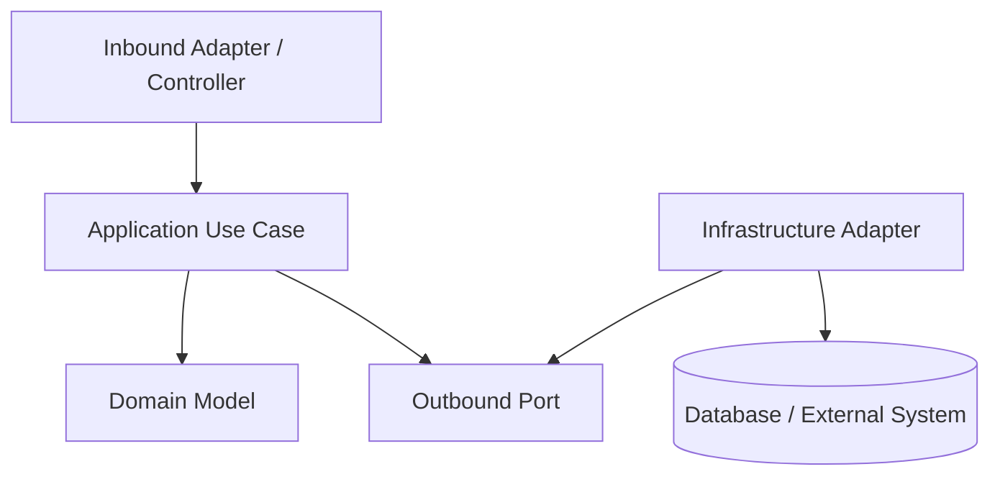
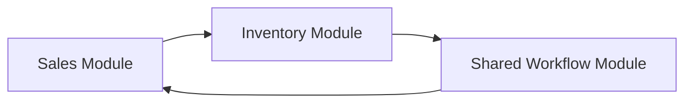

# Mô-đun có độ gắn kết cao và ranh giới phụ thuộc minh bạch

Một hệ thống phần mềm dễ thay đổi không chỉ cần các class được viết tốt. Nó còn cần được chia thành những mô-đun có trách nhiệm rõ ràng, trong đó các thành phần bên trong cùng phục vụ một mục đích và các phụ thuộc đi qua những hợp đồng được kiểm soát. Khi một thay đổi nghiệp vụ chỉ tác động đến một khu vực có liên quan, đội phát triển có thể hiểu, sửa và kiểm thử khu vực đó mà không phải lần theo một mạng lưới phụ thuộc khó đoán.

Hai thuộc tính quan trọng của thiết kế mô-đun là **độ gắn kết cao (high cohesion)** và **phụ thuộc lỏng, minh bạch (low and explicit coupling)**. Gắn kết cao nghĩa là các thành phần trong một mô-đun cùng đóng góp vào một trách nhiệm hoặc năng lực nghiệp vụ có ý nghĩa. Phụ thuộc minh bạch nghĩa là mô-đun chỉ dựa vào những hợp đồng cần thiết, biết rõ ai sở hữu dữ liệu và quy tắc, đồng thời không truy cập tùy tiện vào chi tiết nội bộ của mô-đun khác.

Trong Domain-Driven Design (DDD), việc xác định mô-đun cần bắt đầu từ hiểu biết nghiệp vụ, bounded context và quyền sở hữu mô hình. Package, namespace, thư viện hoặc module của ngôn ngữ lập trình là cách hiện thực các ranh giới đó. Bài học này trình bày cách nhận diện cohesion, đánh giá coupling, tổ chức module theo năng lực nghiệp vụ, thiết kế hướng phụ thuộc, kiểm soát API nội bộ và kiểm thử kiến trúc để hệ thống có thể tiến hóa an toàn.

## 1. Mô-đun là gì?

Mô-đun là một đơn vị tổ chức phần mềm có trách nhiệm và ranh giới được xác định. Tùy quy mô, nó có thể là:

- Một package hoặc namespace trong codebase.
- Một thư viện nội bộ có API riêng.
- Một module của hệ thống build như Maven hoặc Gradle.
- Một module Java Platform Module System (JPMS).
- Một dịch vụ triển khai độc lập.
- Một nhóm package cùng sở hữu một năng lực nghiệp vụ.

Các mức này không đồng nghĩa. Một bounded context có thể gồm nhiều package và module triển khai; một service có thể chứa nhiều module nội bộ; một package không tự động trở thành bounded context chỉ vì có tên riêng.

Điều quan trọng là mô-đun phải trả lời được:

- Nó chịu trách nhiệm về năng lực hoặc quy tắc nào?
- Dữ liệu và mô hình nào thuộc quyền sở hữu của nó?
- Nó công bố hợp đồng nào cho bên ngoài?
- Nó phụ thuộc vào những mô-đun nào và vì sao?
- Những chi tiết nào phải được giữ kín?

Nếu không trả lời được các câu hỏi này, ranh giới có thể chỉ là cách chia thư mục chứ chưa phải một ranh giới thiết kế thực sự.

## 2. High Cohesion — độ gắn kết cao

**Cohesion** mô tả mức độ các thành phần trong cùng một mô-đun liên quan và phối hợp với nhau để hoàn thành một mục đích có ý nghĩa. Mô-đun có cohesion cao tập trung vào một nhóm trách nhiệm gần nhau, thường thay đổi vì cùng một lý do nghiệp vụ.

Ví dụ, một `Inventory` module có thể sở hữu:

- Quy tắc tồn kho khả dụng.
- Reservation và giải phóng reservation.
- Điều chỉnh số lượng tồn.
- Kiểm tra khả năng đáp ứng yêu cầu giữ hàng.
- Repository và domain event của Inventory.

Các thành phần này cùng phục vụ năng lực quản lý tồn kho. Chúng có lý do nghiệp vụ để thay đổi cùng nhau và cần hiểu cùng một mô hình.

Ngược lại, nếu `Inventory` module chứa cả logic gửi email, tính điểm khách hàng, tạo hóa đơn và quản lý tài khoản người dùng chỉ vì các class này được gọi trong quy trình đặt hàng, cohesion sẽ thấp. Chúng thuộc những trách nhiệm khác nhau và có nhịp thay đổi khác nhau.

### 2.1. Dấu hiệu của cohesion cao

- Tên mô-đun thể hiện được một năng lực hoặc khái niệm nghiệp vụ.
- Các class bên trong cùng đóng góp vào một nhóm use case hoặc quy tắc liên quan.
- Dữ liệu được sở hữu tại một nơi có thẩm quyền.
- Thay đổi một quy tắc thường chỉ yêu cầu sửa một vùng có liên quan.
- Public API của mô-đun nhỏ và có ngữ nghĩa rõ.
- Người đọc có thể hiểu mục đích mô-đun mà không phải biết toàn bộ hệ thống.

### 2.2. Cohesion không có nghĩa chỉ có một class hoặc một chức năng

Một mô-đun có thể chứa nhiều loại thành phần: Aggregate, Value Object, Repository, Domain Service, Application Service, adapter và test. Chúng vẫn có cohesion cao nếu cùng phục vụ một năng lực và tuân theo cùng một quyền sở hữu.

Ví dụ, `Order` Aggregate, `OrderRepository`, `SubmitOrderHandler` và `OrderSubmitted` event có vai trò khác nhau nhưng có thể thuộc cùng Sales/Ordering module vì chúng phối hợp để thực hiện và bảo vệ quy tắc đặt hàng.

### 2.3. Cohesion được đánh giá theo lý do thay đổi

Một cách hữu ích để đánh giá ranh giới là hỏi: “Những thành phần này có thường thay đổi vì cùng một yêu cầu nghiệp vụ không?” Nếu hai nhóm code thay đổi vì những quyết định kinh doanh khác nhau, chúng có thể nên ở các mô-đun khác nhau.

Không nên chỉ dựa vào việc các class gọi nhau nhiều hay cùng dùng một bảng database. Quan hệ kỹ thuật có thể thay đổi; trách nhiệm nghiệp vụ và quyền sở hữu mới là cơ sở quan trọng hơn.

## 3. Low Coupling — giảm phụ thuộc không cần thiết

**Coupling** là mức độ một mô-đun phụ thuộc vào cấu trúc, hành vi hoặc quyết định của mô-đun khác. Một thay đổi ở mô-đun A có thể buộc mô-đun B phải sửa, kiểm thử lại hoặc triển khai cùng lúc nếu B phụ thuộc quá sâu vào A.

Coupling không thể và cũng không cần loại bỏ hoàn toàn. Các mô-đun trong một hệ thống phải hợp tác. Mục tiêu là giữ phụ thuộc ở mức cần thiết, đi qua hợp đồng ổn định và tránh để một mô-đun biết quá nhiều về chi tiết nội bộ của mô-đun khác.

Ví dụ coupling cao:

- Sales truy cập trực tiếp bảng `inventory_stock` để tính lượng hàng khả dụng.
- Sales import Entity JPA nội bộ của Inventory và tự sửa field.
- Một module gọi private implementation thông qua reflection.
- Nhiều module cùng ghi vào một bảng mà không có owner rõ ràng.
- Module A và B import qua lại các package nội bộ của nhau.

Ví dụ coupling được kiểm soát:

- Sales gửi command `ReserveStock` qua API của Inventory.
- Inventory trả về `ReservationId` và kết quả nghiệp vụ.
- Sales lưu tham chiếu đến reservation, không sở hữu số lượng tồn.
- Inventory có thể thay đổi cách lưu trữ nội bộ mà không buộc Sales thay đổi, miễn contract được giữ.

## 4. Cohesion cao và coupling thấp bổ trợ cho nhau

Hai thuộc tính này nên được xem cùng nhau. Nếu gom tất cả code vào một module duy nhất, có thể giảm coupling giữa các module vì chỉ còn một module, nhưng cohesion sẽ rất thấp và trách nhiệm bị trộn lẫn. Nếu chia mọi class thành module riêng, cohesion của từng module có vẻ đơn giản nhưng số lượng phụ thuộc và chi phí phối hợp tăng mạnh.

Mục tiêu không phải tạo nhiều module nhất hoặc ít module nhất. Mục tiêu là tìm các ranh giới mà bên trong có quan hệ nghiệp vụ chặt chẽ, còn bên ngoài chỉ cần biết một hợp đồng nhỏ.

| Thiết kế | Cohesion | Coupling | Hệ quả thường gặp |
|---|---|---|---|
| Một module chứa mọi năng lực | Thấp | Ít ranh giới rõ nhưng phụ thuộc nội bộ rộng | Thay đổi khó khoanh vùng |
| Mỗi class là một module | Khó tạo nhóm trách nhiệm có ý nghĩa | Cao do nhiều quan hệ nhỏ | Quá nhiều phối hợp và cấu hình |
| Module theo năng lực nghiệp vụ | Cao hơn | Có thể kiểm soát qua contract | Dễ hiểu ownership và thay đổi |
| Chia module theo layer toàn cục | Có thể bị phân tán theo trách nhiệm | Dependency xuyên layer rộng | Quy tắc một use case nằm ở nhiều nơi |

## 5. Bắt đầu phân mô-đun từ domain và bounded context

DDD cung cấp cơ sở để xác định các vùng trách nhiệm: subdomain, bounded context và context map. Các khái niệm này giúp hiểu nơi nào có mô hình và ngôn ngữ riêng, ai sở hữu quy tắc và cách các bên hợp tác.

Ví dụ một hệ thống thương mại có thể có:

- **Sales:** quản lý đơn hàng, xác nhận, hủy và chính sách bán hàng.
- **Inventory:** quản lý tồn kho, reservation và điều chỉnh số lượng.
- **Payment:** quản lý giao dịch, authorization, capture và refund.
- **Fulfillment:** quản lý đóng gói, shipment và bàn giao.
- **Customer:** quản lý hồ sơ và quan hệ khách hàng.

Mỗi vùng có thể trở thành một module hoặc một nhóm module. Các ranh giới cần phản ánh ngôn ngữ và quy tắc riêng, không chỉ tên bảng hoặc nhóm API.

### 5.1. Bounded Context và module không phải một-một bắt buộc

Một bounded context là ranh giới mô hình/ngôn ngữ. Một module là cơ chế tổ chức code. Trong một ứng dụng modular monolith, một bounded context có thể được hiện thực bằng một module lớn gồm nhiều package. Trong một hệ thống phân tán, một bounded context có thể trải qua nhiều deployment component vì lý do vận hành, nhưng quyền sở hữu mô hình vẫn cần rõ.

Ngược lại, một module kỹ thuật như `shared-kernel` có thể được dùng bởi nhiều context nhưng cần rất nhỏ và chỉ chứa những khái niệm thực sự được chia sẻ. Nếu nó trở thành nơi tập trung mọi Entity, DTO và helper, các context sẽ bị gắn chặt vào một mô hình chung không phù hợp.

### 5.2. Context Map định hướng phụ thuộc

Context Map cho biết quan hệ giữa các bounded context, ví dụ Customer-Supplier, Conformist, Anti-Corruption Layer hoặc Open Host Service. Quan hệ này giúp xác định contract và hướng phụ thuộc hợp lý.

Ví dụ, Sales cần biết kết quả giữ hàng từ Inventory. Sales phụ thuộc vào contract do Inventory công bố, nhưng không nên phụ thuộc vào class persistence nội bộ của Inventory. Nếu ngôn ngữ của Inventory khác với mô hình Sales, Sales có thể dùng Anti-Corruption Layer để chuyển đổi.

## 6. Tổ chức module theo năng lực nghiệp vụ

Một cách tổ chức phổ biến là đặt code theo feature/capability hoặc bounded context thay vì gom tất cả class cùng loại vào package toàn cục.

Ví dụ cấu trúc theo layer toàn cục:

```text
src/main/java/
  com/example/
    controllers/
      OrderController.java
      StockController.java
    services/
      OrderService.java
      StockService.java
    repositories/
      OrderRepository.java
      StockRepository.java
    entities/
      OrderEntity.java
      StockEntity.java
```

Với cấu trúc này, một thay đổi trong use case đặt hàng có thể phải đi qua nhiều package chung. Package `services` dễ trở thành nơi chứa logic của nhiều domain khác nhau.

Cấu trúc theo capability:

```text
src/main/java/
  com/example/
    sales/
      api/
      application/
      domain/
      infrastructure/
    inventory/
      api/
      application/
      domain/
      infrastructure/
    payment/
      api/
      application/
      domain/
      infrastructure/
```

Mỗi vùng có thể nhìn thấy các thành phần cần thiết cho năng lực của nó. Người phát triển làm việc với một use case có thể bắt đầu từ module sở hữu use case và theo dõi các phụ thuộc được công bố.

### 6.1. Không biến cấu trúc package thành công thức cứng

Package theo capability là một lựa chọn, không phải quy tắc bắt buộc cho mọi hệ thống. Với module nhỏ, có thể không cần chia `api`, `application`, `domain`, `infrastructure` thành nhiều package con. Với domain phức tạp, mỗi capability có thể cần thêm package nội bộ.

Điều quan trọng là ranh giới phải được bảo vệ. Nếu package `sales` vẫn import tùy ý mọi class trong `inventory.infrastructure`, cấu trúc thư mục chưa tạo ra module độc lập thực sự.

## 7. Thiết kế API công khai nhỏ và ổn định

Mỗi module nên công bố đúng những thao tác và kiểu dữ liệu mà consumer cần. Các class còn lại nên được giữ ở phạm vi nội bộ.

Ví dụ API Inventory có thể công bố:

```java
public interface InventoryService {
    ReservationResult reserve(ReserveStockCommand command);
    void release(ReleaseReservationCommand command);
}

public record ReserveStockCommand(
        String orderReference,
        String sku,
        int quantity,
        String locationId
) {}

public record ReservationResult(
        String reservationId,
        ReservationStatus status
) {
    public boolean accepted() {
        return status == ReservationStatus.ACCEPTED;
    }
}

public enum ReservationStatus {
    ACCEPTED,
    REJECTED
}
```

Consumer biết cách yêu cầu giữ hàng và đọc kết quả. Nó không cần biết Inventory dùng JPA, SQL, cache hay cách tổ chức Aggregate bên trong.

### 7.1. API module là hợp đồng, không phải bản sao toàn bộ domain model

Không nên công khai mọi Entity, Repository và Value Object nội bộ chỉ để module khác gọi được. Public API cần phản ánh nhu cầu tích hợp, không phơi bày cấu trúc triển khai.

Ví dụ không tốt:

```java
public interface InventoryRepository {
    StockJpaEntity findBySku(String sku);
    void save(StockJpaEntity entity);
}
```

Consumer giờ phụ thuộc vào Entity JPA và cách lưu trữ của Inventory. Nếu schema hoặc ORM thay đổi, consumer có thể phải sửa dù ngữ nghĩa giữ hàng không đổi.

Tốt hơn là công bố command/query contract có ý nghĩa nghiệp vụ, còn Repository chỉ được dùng bên trong module sở hữu Aggregate.

### 7.2. Phân biệt API nội bộ và API tích hợp từ xa

Một interface Java trong cùng tiến trình có thể là public contract nội bộ. Khi module được tách thành service, contract cần có schema, versioning, serialization, error semantics và quy tắc tương thích. Không nên xem một Java interface tự động là API phân tán hoàn chỉnh.

## 8. Hướng phụ thuộc phải minh bạch

Một module cần biết đến contract mà nó sử dụng. Hướng phụ thuộc nên được lựa chọn có chủ đích để các chi tiết triển khai không kéo ngược vào domain.

Một cách tổ chức thường gặp:



Application điều phối use case và gọi các port cần thiết. Infrastructure adapter triển khai port. Domain model không phụ thuộc vào framework hoặc database chỉ vì cần truy cập dữ liệu.

### 8.1. Dependency Inversion

Dependency Inversion Principle (DIP) khuyến khích chính sách cấp cao không phụ thuộc trực tiếp vào chi tiết cấp thấp. Cả hai nên phụ thuộc vào abstraction có ý nghĩa.

Ví dụ:

```java
public interface OrderRepository {
    Optional<Order> findById(OrderId id);
    void save(Order order);
}
```

Application/domain-facing code sử dụng interface này. Adapter JPA hoặc SQL triển khai interface ở infrastructure. Chi tiết database có thể thay đổi mà không buộc Aggregate biết về ORM.

### 8.2. Đừng tạo abstraction chỉ để đảo mũi tên

Interface không có ý nghĩa nghiệp vụ, chỉ được tạo để bọc một class duy nhất mà không mang lại ranh giới hay khả năng thay thế thực tế, có thể làm code phức tạp hơn. Abstraction nên biểu đạt một vai trò hoặc contract ổn định, không phải mục tiêu tự thân.

## 9. Tránh phụ thuộc vòng

Phụ thuộc vòng xuất hiện khi A phụ thuộc B và B lại phụ thuộc A, trực tiếp hoặc qua một chuỗi module.



Vòng phụ thuộc làm khó việc khởi tạo, build, kiểm thử và thay đổi độc lập. Nó cũng thường báo hiệu trách nhiệm chưa được phân chia đúng hoặc một contract đang đặt sai nơi.

### 9.1. Cách phá vòng

- Đưa một abstraction có ngữ nghĩa ổn định về phía consumer cần nó.
- Tạo module contract nhỏ chỉ chứa DTO/port thực sự cần chia sẻ.
- Dùng event để thông báo sự kiện đã xảy ra thay vì gọi ngược trực tiếp.
- Dùng application/process manager làm nơi điều phối khi một use case cần phối hợp hai module.
- Tách phần trách nhiệm chung thực sự thành một module thứ ba có ownership rõ.

Không nên tạo `common` hoặc `shared` package rồi chuyển mọi thứ vào đó. Nếu module mới phụ thuộc vào cả A và B, vòng có thể chỉ bị che đi chứ chưa được giải quyết.

### 9.2. Event không phải cách chữa mọi vòng phụ thuộc

Event phù hợp khi consumer phản ứng với một sự kiện đã xảy ra và có thể xử lý sau. Nếu caller cần một quyết định ngay, event bất đồng bộ có thể không đáp ứng use case. Hãy chọn contract đồng bộ hoặc tách use case theo đúng cam kết nghiệp vụ.

## 10. Phân biệt phụ thuộc compile-time, runtime và dữ liệu

Một sơ đồ module chỉ thể hiện một phần coupling. Cần xem nhiều loại phụ thuộc:

| Loại phụ thuộc | Ví dụ | Câu hỏi cần kiểm soát |
|---|---|---|
| Compile-time | `import com.example.inventory.StockEntity` | Consumer có import nội bộ của module khác không? |
| Runtime | Sales gọi Inventory qua HTTP | Điều gì xảy ra khi provider chậm hoặc ngừng hoạt động? |
| Data/schema | Sales query trực tiếp bảng Inventory | Ai sở hữu schema và migration? |
| Deployment | Hai module luôn phải release cùng lúc | Chúng có thực sự cần triển khai độc lập không? |
| Semantic | Cùng từ “Customer” nhưng nghĩa khác nhau | Hai context có đang dùng nhầm một mô hình chung? |
| Temporal | Consumer cần event ngay sau producer commit | Độ trễ và thứ tự có được xác định không? |

Một hệ thống có thể có ít compile-time dependency nhưng coupling dữ liệu rất cao nếu nhiều module cùng ghi một schema. Ngược lại, hai service có thể không chia sẻ database nhưng vẫn coupling mạnh nếu contract của chúng thay đổi cùng lúc.

## 11. Quyền sở hữu dữ liệu là một phần của ranh giới module

Module có cohesion cao thường sở hữu dữ liệu mà nó chịu trách nhiệm bảo vệ. Các module khác không nên cập nhật trực tiếp dữ liệu đó.

Ví dụ:

- Inventory sở hữu `StockItem` và `Reservation`.
- Sales sở hữu `Order` và `OrderLine`.
- Payment sở hữu `PaymentAttempt` và `Refund`.

Sales có thể lưu `ReservationId` hoặc tham chiếu kết quả giữ hàng. Nó không tự sửa `reserved_quantity` trong bảng Inventory.

### 11.1. Chia sẻ database không đồng nghĩa chia sẻ ownership

Một modular monolith có thể dùng chung một database vật lý nhưng vẫn cần tách quyền sở hữu bảng và quyền ghi. Module khác có thể đọc qua query API được công bố hoặc read model phù hợp, nhưng không nên phụ thuộc vào schema nội bộ như một contract ngầm.

### 11.2. Database schema và migration

Nếu mỗi module sở hữu một schema hoặc nhóm bảng, cần xác định rõ ai tạo migration, ai có quyền ghi và cách consumer đọc dữ liệu. Việc đổi tên cột nội bộ không nên buộc module khác sửa nếu không có contract công khai phụ thuộc vào cột đó.

## 12. Anti-Corruption Layer bảo vệ mô hình consumer

Khi một module tích hợp với hệ thống có ngôn ngữ hoặc mô hình khác, Anti-Corruption Layer (ACL) chuyển đổi dữ liệu bên ngoài sang mô hình nội bộ. ACL giúp consumer tránh để khái niệm, trạng thái hoặc cấu trúc của provider lan vào domain model.

Ví dụ Payment Provider trả trạng thái:

```json
{
  "transaction_state": "CAPTURED_OK",
  "provider_ref": "PX-77821"
}
```

Payment Context có thể chuyển thành kiểu miền:

```java
public enum PaymentStatus {
    AUTHORIZED,
    CAPTURED,
    DECLINED,
    REFUNDED,
    UNKNOWN
}
```

Consumer sử dụng `PaymentStatus.CAPTURED` thay vì phụ thuộc trực tiếp vào chuỗi `CAPTURED_OK` của provider. Khi provider đổi contract, adapter/ACL là nơi chịu phần lớn thay đổi.

ACL không phải lớp mapping vô nghĩa cho mọi field. Nó cần chuyển đổi ngữ nghĩa, xử lý khác biệt trạng thái, đơn vị, mã lỗi và quy tắc có ý nghĩa.

## 13. Tránh Shared Model quá lớn

Một thư viện `common-domain` có thể hữu ích nếu chứa khái niệm thật sự chung, ổn định và có cùng ý nghĩa ở các context. Nhưng nếu nó chứa `Customer`, `Order`, `Address`, `Status`, `Repository` và DTO của mọi module, các context sẽ bị buộc dùng chung mô hình.

Một khái niệm có cùng tên không nhất thiết có cùng ngữ nghĩa. `Customer` trong Sales có thể là người mua; `Customer` trong Billing có thể là chủ thể nhận hóa đơn; `Customer` trong Support có thể là người liên hệ của một tài khoản. Chúng có thể chia sẻ một số identity hoặc dữ liệu tham chiếu nhưng không cần chung một Aggregate.

### 13.1. Khi nào Shared Kernel phù hợp?

Shared Kernel là một phần mô hình được hai context thống nhất chia sẻ có chủ đích. Nó cần:

- Phạm vi nhỏ.
- Ownership và quy trình thay đổi rõ.
- Cùng ngữ nghĩa trong các context sử dụng.
- Contract và versioning được quản lý.
- Kiểm thử tương thích cho các consumer.

Nếu các nhóm không thể phối hợp thay đổi, shared kernel có thể tạo coupling tổ chức và kỹ thuật lớn hơn lợi ích.

## 14. Thiết kế package Java để bảo vệ ranh giới

Trong Java, package và visibility là công cụ đầu tiên để giới hạn chi tiết nội bộ.

Ví dụ:

```text
com.example.inventory
  api
    InventoryService.java
    ReserveStockCommand.java
    ReservationResult.java
  application
    ReserveStockHandler.java
  domain
    StockItem.java
    Reservation.java
    StockPolicy.java
  infrastructure
    JpaStockItemRepository.java
    StockItemEntity.java
```

Consumer chỉ cần phụ thuộc vào `com.example.inventory.api`. Các class domain và infrastructure có thể được giữ package-private hoặc không được export ra module khác theo cách tổ chức phù hợp.

### 14.1. Package-private giúp đóng gói nội bộ

Java mặc định cho phép class hoặc member không có modifier truy cập trong cùng package. Điều này hữu ích để giữ implementation nội bộ:

```java
public interface InventoryService {
    ReservationResult reserve(ReserveStockCommand command);
}

final class DefaultInventoryService implements InventoryService {
    // Implementation chỉ dùng nội bộ package.
}
```

Không cần khai báo `public` cho mọi class. Public surface càng lớn thì càng nhiều thứ trở thành contract mà module có thể phải duy trì.

### 14.2. JPMS exports có chọn lọc

Nếu dùng Java Platform Module System, `module-info.java` có thể công bố package API và giữ package implementation không được export:

```java
module com.example.inventory {
    exports com.example.inventory.api;
}
```

Đây là ví dụ minh họa. JPMS có quy tắc riêng về `requires`, `exports`, `opens` và reflection. Việc dùng JPMS không tự tạo ra bounded context; nó chỉ giúp thực thi một phần ranh giới module ở compile/runtime.

### 14.3. Không để framework định nghĩa domain boundary

Package không nên được chia chỉ vì Spring yêu cầu controller, service và repository. Hãy để năng lực nghiệp vụ định hình module, sau đó tổ chức layer nội bộ theo nhu cầu. Framework là chi tiết triển khai, không phải ngôn ngữ chính để xác định ownership.

## 15. Ví dụ dependency direction giữa Sales và Inventory

Sales cần giữ hàng nhưng Inventory sở hữu quy tắc tồn kho. Có thể định nghĩa contract tại ranh giới Inventory:

```java
package com.example.inventory.api;

public interface InventoryOperations {
    ReservationResult reserve(ReserveStockCommand command);
}
```

Application handler của Sales phụ thuộc vào contract:

```java
package com.example.sales.application;

public final class SubmitOrderHandler {
    private final OrderRepository orders;
    private final InventoryOperations inventory;

    public SubmitOrderHandler(
            OrderRepository orders,
            InventoryOperations inventory) {
        this.orders = orders;
        this.inventory = inventory;
    }

    public void handle(SubmitOrderCommand command) {
        Order order = orders.get(command.orderId());
        ReservationResult result = inventory.reserve(
                ReserveStockCommand.from(order));

        if (!result.accepted()) {
            throw new StockReservationRejectedException(order.id());
        }

        order.markSubmitted(result.reservationId());
        orders.save(order);
    }
}
```

Ví dụ minh họa dependency ở cùng tiến trình. Nếu Inventory là service từ xa, implementation của `InventoryOperations` có thể là HTTP/gRPC adapter. Khi đó cần xử lý timeout, idempotency, lỗi chưa xác định và transaction boundary. Sales không nên giả định lời gọi mạng là một phần của transaction database cục bộ.

### 15.1. Contract cần ổn định theo ngữ nghĩa

Nếu Inventory thay đổi cách lưu tồn từ một bảng sang event-sourced store, contract `reserve` vẫn có thể giữ nguyên. Consumer không cần biết chi tiết đó. Nếu chính sách reservation thay đổi, contract có thể cần version hoặc bổ sung trường; thay đổi phải được quản lý vì ảnh hưởng consumer.

## 16. Dependency Injection giúp thay thế implementation

Dependency Injection (DI) cho phép module nhận implementation qua constructor hoặc composition root. Consumer phụ thuộc vào abstraction có ý nghĩa, còn ứng dụng cấu hình implementation cụ thể.

```java
public final class ReserveStockHandler {
    private final StockRepository repository;

    public ReserveStockHandler(StockRepository repository) {
        this.repository = repository;
    }
}
```

Trong production, composition root cung cấp `JpaStockRepository`. Trong test, có thể cung cấp in-memory repository hoặc fake phù hợp.

DI không tự động làm coupling thấp. Nếu interface công khai quá nhiều chi tiết hoặc nằm ở sai module, consumer vẫn phụ thuộc vào mô hình không ổn định. Chất lượng abstraction và vị trí ownership quan trọng hơn việc có dùng framework DI hay không.

## 17. Tránh module kiểu God Module và Shared Utility

Một `CoreModule`, `CommonModule` hoặc `UtilsModule` có thể dần trở thành nơi chứa mọi thứ mà các nhóm không biết đặt ở đâu. Khi nhiều module phụ thuộc vào nó, một thay đổi nhỏ có thể ảnh hưởng toàn hệ thống.

Dấu hiệu cần xem xét:

- Module có hàng trăm class không cùng một mục đích.
- Tên package chỉ là `common`, `misc`, `helpers`, `manager`.
- Nhiều module import các class domain từ module chung.
- Mọi thay đổi đều phải release module chung trước.
- Module chung chứa business rule của nhiều bounded context.

Không phải mọi utility đều cần module riêng. Hàm thuần, kỹ thuật và thực sự dùng chung có thể đặt trong thư viện nhỏ. Nhưng quy tắc nghiệp vụ nên ở context sở hữu nó, kể cả khi nhiều context có quy tắc trông giống nhau.

## 18. Đo lường và nhận diện coupling

Không cần một con số duy nhất để quyết định chất lượng module. Có thể kết hợp code review, đồ thị phụ thuộc và một số chỉ số:

- **Afferent coupling (Ca):** số module bên ngoài phụ thuộc vào module này.
- **Efferent coupling (Ce):** số module mà module này phụ thuộc vào.
- **Instability (I):** thường được tính `Ce / (Ca + Ce)` khi mẫu số khác zero.
- **Cycle count:** số chu trình trong đồ thị phụ thuộc.
- **Public API size:** số kiểu/thành phần công khai.
- **Change coupling:** số module thường phải thay đổi cùng nhau trong các commit hoặc pull request.

Các chỉ số này chỉ là tín hiệu, không phải điểm chất lượng tuyệt đối. Một module domain nền tảng có nhiều consumer (Ca cao) có thể ổn định và cần ít phụ thuộc ra ngoài. Một adapter ở rìa hệ thống có thể phụ thuộc nhiều abstraction (Ce cao) nhưng không nhất thiết có thiết kế sai.

### 18.1. Câu hỏi review hữu ích

- Khi thay đổi quy tắc này, module nào thực sự cần thay đổi?
- Consumer có import class nội bộ hoặc truy cập database của provider không?
- Contract có chứa kiểu framework hoặc persistence không?
- Có phụ thuộc vòng trực tiếp hoặc gián tiếp không?
- Có module nào chỉ là nơi chuyển tiếp call mà không sở hữu trách nhiệm?
- Có thay đổi nào buộc nhiều nhóm release đồng thời không?
- Tên và API có diễn đạt ngôn ngữ của domain owner không?

## 19. Kiểm thử ranh giới kiến trúc

Unit test kiểm tra hành vi bên trong module nhưng không tự chứng minh các module tôn trọng ranh giới. Có thể thêm architecture test để phát hiện dependency không hợp lệ.

### 19.1. Kiểm tra package dependency

Với ArchUnit, có thể viết quy tắc minh họa:

```java
@AnalyzeClasses(packages = "com.example")
class ModuleBoundaryTest {

    @ArchTest
    static final ArchRule salesMustNotDependOnInventoryInfrastructure =
            noClasses()
                    .that().resideInAPackage("..sales..")
                    .should().dependOnClassesThat()
                    .resideInAPackage("..inventory.infrastructure..");
}
```

Quy tắc này ngăn Sales phụ thuộc trực tiếp vào package infrastructure của Inventory. Có thể bổ sung rule cho dependency vòng, access vào package nội bộ hoặc hướng phụ thuộc layer.

### 19.2. Contract test

Nếu module giao tiếp qua API hoặc message schema, contract test xác minh provider vẫn đáp ứng contract mà consumer dựa vào. Nó giúp phát hiện thay đổi breaking trước khi tích hợp hoặc triển khai.

### 19.3. Integration test tại ranh giới

Kiểm thử adapter và module API để xác minh mapping, transaction, serialization, lỗi và timeout. Không nên chỉ mock mọi dependency trong tất cả test; một số lỗi chỉ xuất hiện khi contract và infrastructure thực sự tương tác.

## 20. Tiến hóa ranh giới khi hiểu biết nghiệp vụ thay đổi

Ranh giới module không phải quyết định bất biến. Khi nghiệp vụ phát triển, nhóm có thể phát hiện hai module nên gộp, một module cần tách hoặc ownership đã chuyển sang context khác.

Các dấu hiệu nên xem xét tái cấu trúc:

- Hai module luôn thay đổi cùng nhau vì cùng một quy tắc nghiệp vụ.
- Một module phải gọi module khác quá nhiều lần để hoàn thành một hành vi nhỏ.
- Consumer cần nhiều dữ liệu nội bộ vì contract không phản ánh đúng use case.
- Một module sở hữu nhiều lý do thay đổi không liên quan.
- Phụ thuộc vòng xuất hiện sau nhiều lần bổ sung tính năng.
- Một bounded context mới hình thành với ngôn ngữ và quy tắc riêng.

### 20.1. Tách module an toàn

Một quy trình có thể gồm:

1. Xác định năng lực và dữ liệu sẽ chuyển ownership.
2. Chọn API/event contract giữa module cũ và mới.
3. Tạo module mới và chuyển một phần code theo từng bước.
4. Chuyển các call site sang contract mới.
5. Thêm architecture test để giữ ranh giới.
6. Chuyển quyền ghi dữ liệu và migration theo kế hoạch.
7. Xóa đường truy cập nội bộ cũ sau khi mọi consumer đã chuyển.

Không nên chỉ di chuyển file rồi giữ nguyên các import xuyên module. Khi đó cấu trúc thư mục thay đổi nhưng coupling không đổi.

### 20.2. Gộp module khi ranh giới không tạo giá trị

Nếu hai module nhỏ luôn được phát triển, triển khai và kiểm thử cùng nhau, có thể chúng chưa cần ranh giới độc lập. Gộp có thể giảm ceremony và số contract phải duy trì. Tuy nhiên, cần giữ các package hoặc API nội bộ có ý nghĩa nếu chúng vẫn giúp tổ chức trách nhiệm.

## 21. Modular Monolith và Microservices

High cohesion và explicit dependency hữu ích ở cả modular monolith lẫn microservices.

**Modular monolith** giữ các module trong một tiến trình hoặc một đơn vị triển khai. Nó cho phép giao tiếp nội bộ nhanh, transaction cục bộ thuận tiện và ít chi phí vận hành hơn. Nhưng nếu các module truy cập tùy tiện vào nội bộ của nhau, monolith sẽ trở thành một khối khó tách.

**Microservices** triển khai các phần độc lập qua network. Chúng làm rõ ranh giới runtime và ownership nhưng tăng chi phí về timeout, retry, eventual consistency, observability, deployment và vận hành.

Một modular monolith có ranh giới tốt thường là nền tảng hữu ích để cân nhắc tách service khi có nhu cầu thực tế. Không cần tách thành microservices chỉ để chứng minh module đã độc lập.

## 22. Checklist thiết kế mô-đun

- [ ] Mỗi module có mục đích nghiệp vụ hoặc kỹ thuật rõ ràng.
- [ ] Các thành phần bên trong có cohesion cao và cùng phục vụ một nhóm trách nhiệm.
- [ ] Ownership của Aggregate, dữ liệu và quy tắc được xác định.
- [ ] Public API nhỏ, ổn định và thể hiện ngôn ngữ của module.
- [ ] Consumer không phụ thuộc vào class persistence hoặc implementation nội bộ.
- [ ] Hướng phụ thuộc được xác định và không có cycle.
- [ ] Abstraction được đặt tại ranh giới có ý nghĩa, không tạo chỉ để đủ pattern.
- [ ] Contract đồng bộ/bất đồng bộ có timeout, lỗi, version và idempotency khi cần.
- [ ] Shared Kernel/common module nhỏ và có quy trình thay đổi rõ.
- [ ] ACL được dùng khi mô hình bên ngoài khác ngôn ngữ nội bộ.
- [ ] Package visibility hoặc JPMS được dùng để thực thi encapsulation khi phù hợp.
- [ ] Database schema có owner và consumer không ghi trực tiếp vào dữ liệu của module khác.
- [ ] Architecture test ngăn dependency không hợp lệ.
- [ ] Contract/integration test bảo vệ giao diện module.
- [ ] Có tiêu chí xem xét tách hoặc gộp module khi nghiệp vụ thay đổi.

## 23. Kết nối với các khái niệm DDD khác

Bounded Context giúp xác định ranh giới của mô hình và ngôn ngữ; Context Map mô tả quan hệ và cách các context hợp tác. Module hiện thực một phần các ranh giới đó trong code. Aggregate và Repository bảo vệ quyền sở hữu dữ liệu bên trong context; Domain Event và Published Language giúp công bố những thay đổi có ý nghĩa; Anti-Corruption Layer bảo vệ mô hình nội bộ khỏi contract bên ngoài.

High cohesion giúp các thành phần có cùng trách nhiệm ở gần nhau và thay đổi có kiểm soát. Explicit dependency giúp consumer chỉ biết hợp đồng cần thiết, còn provider giữ quyền tự do thay đổi implementation. Khi kết hợp với kiểm thử kiến trúc và quy trình tiến hóa ranh giới, các mô-đun trở thành đơn vị có thể hiểu, kiểm thử và thay đổi độc lập hơn.

Thiết kế mô-đun tốt không được đo bằng số package hoặc số interface. Nó được thể hiện qua việc mỗi mô-đun có trách nhiệm dễ giải thích, sở hữu quy tắc rõ ràng và chỉ phụ thuộc vào những hợp đồng cần thiết. Đó là nền tảng để hệ thống DDD tiếp tục phát triển mà không biến mỗi thay đổi thành một cuộc sửa chữa trên toàn bộ codebase.
