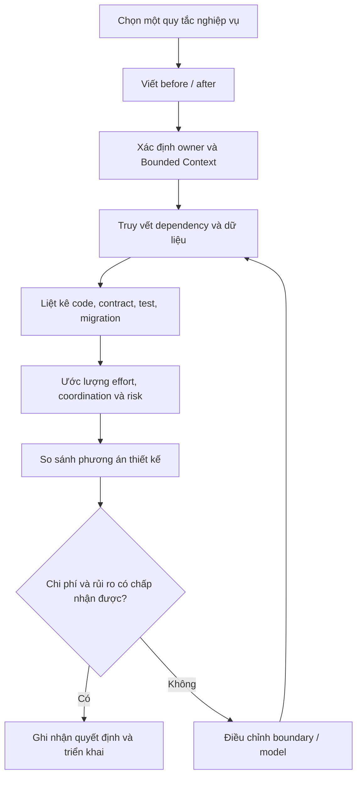

# Đánh giá thiết kế bằng chi phí thay đổi một quy tắc cụ thể

Trong Domain-Driven Design (DDD), thiết kế tốt cần giúp mô hình phản ánh đúng nghiệp vụ hôm nay và có thể thích nghi khi quy tắc thay đổi ngày mai. Không thể đánh giá khả năng thay đổi chỉ bằng số lượng class, interface, pattern hoặc mức độ trừu tượng. Một thiết kế có nhiều abstraction vẫn có thể khiến một thay đổi nhỏ lan qua nhiều module; một thiết kế đơn giản có thể rất dễ sửa nếu quy tắc có owner rõ ràng và các phụ thuộc được kiểm soát.

Một cách đánh giá thực tế là chọn **một quy tắc nghiệp vụ cụ thể có khả năng thay đổi**, sau đó lần theo toàn bộ công việc cần làm để triển khai thay đổi đó. Ta xem quy tắc được định nghĩa ở đâu, dữ liệu nào ảnh hưởng, những use case nào phụ thuộc, cần sửa và kiểm thử những thành phần nào, có phải thay đổi hợp đồng giữa các Bounded Context hay migration dữ liệu không, và rủi ro hồi quy nằm ở đâu.

Chi phí thay đổi không chỉ là thời gian sửa code. Nó còn gồm thời gian hiểu hệ thống, số nơi phải phối hợp, công sức kiểm thử, rủi ro phát hành, thay đổi dữ liệu, ảnh hưởng đến người dùng và chi phí vận hành sau triển khai. Đánh giá theo một kịch bản cụ thể giúp nhóm nhìn thấy chất lượng thiết kế qua công việc thật thay vì tranh luận trừu tượng.

## 1. Vì sao đánh giá thiết kế bằng một thay đổi cụ thể?

Các nhận xét như “code dễ mở rộng”, “module có tính tái sử dụng cao” hoặc “thiết kế tuân thủ SOLID” chưa cho biết nhóm sẽ mất bao nhiêu công sức khi nghiệp vụ thay đổi. Một thiết kế chỉ chứng minh được khả năng tiến hóa khi ta thử nó với một thay đổi có ý nghĩa.

Ví dụ, một hệ thống thương mại điện tử đang tính phí giao hàng cố định 30.000 VND cho mọi đơn. Doanh nghiệp muốn thay đổi quy tắc:

- Phí phụ thuộc khu vực giao hàng.
- Kiện hàng nặng có phụ phí.
- Thành viên Gold được miễn phí trong một số khu vực.
- Đơn vượt ngưỡng giá trị được giảm phí.
- Một số mặt hàng cồng kềnh không được miễn phí.

Đây là một thay đổi cụ thể. Ta có thể dùng nó để đánh giá hai thiết kế:

- Thiết kế A: điều kiện tính phí nằm rải rác trong controller, checkout service, order service và batch job.
- Thiết kế B: quyết định tính phí được sở hữu bởi `ShippingFeePolicy`, nhận context rõ ràng và trả kết quả có lý do.

Ta không kết luận B tốt hơn chỉ vì có một class tên `ShippingFeePolicy`. Ta phải xem thay đổi mới có thật sự được triển khai tại một nơi có trách nhiệm rõ ràng không, dữ liệu đầu vào có sẵn không, các caller có cần sửa không, và test có thể xác nhận quy tắc mà không cần khởi động toàn bộ hệ thống không.

### 1.1. Thiết kế là giả thuyết về các thay đổi tương lai

Khi thiết kế, nhóm đưa ra các giả thuyết:

- Quy tắc chiết khấu có thể thay đổi độc lập với thanh toán.
- Cách giao hàng có thể khác theo quốc gia.
- Một context có thể cần một read model mới.
- Nhà cung cấp thanh toán có thể được thay thế.
- Trạng thái đơn có thể có thêm bước kiểm duyệt.

Mỗi abstraction, boundary và dependency là một quyết định dựa trên giả thuyết đó. Nếu thay đổi thật xảy ra, ta kiểm tra giả thuyết có đúng không. Nếu mọi thay đổi đều phải sửa cùng một module, abstraction có thể chưa đặt đúng ranh giới. Nếu mỗi thay đổi phải tạo nhiều interface và mapping nhưng không giảm rủi ro hay công sức, thiết kế có thể đang trừu tượng hóa quá mức.

### 1.2. Một quy tắc cụ thể tốt hơn câu hỏi “thiết kế có mở rộng được không?”

Câu hỏi chung thường tạo ra câu trả lời chủ quan. Kịch bản cụ thể buộc nhóm làm rõ:

- Quy tắc nào thay đổi?
- Ai sở hữu quy tắc?
- Dữ liệu nào cần thêm hoặc thay đổi?
- Hành vi nào bị ảnh hưởng?
- Hợp đồng nào cần thay đổi?
- Test nào chứng minh kết quả đúng?
- Có thể triển khai an toàn theo từng bước không?

Khi các câu trả lời rõ, nhóm có thể so sánh thiết kế bằng bằng chứng.

## 2. Chi phí thay đổi gồm những gì?

Không nên chỉ đếm số file sửa. Một thay đổi sửa một file nhưng đòi hỏi hiểu một module khổng lồ, chạy test lâu và phát hành đồng loạt nhiều dịch vụ có thể đắt hơn thay đổi sửa vài file trong một module độc lập.

Các thành phần chi phí thường gặp:

| Thành phần | Câu hỏi đánh giá | Ví dụ |
|---|---|---|
| Chi phí hiểu (comprehension) | Developer cần lần theo bao nhiêu khái niệm và phụ thuộc để hiểu quy tắc? | Quy tắc phí giao hàng bị ẩn trong nhiều service |
| Phạm vi sửa đổi (change surface) | Bao nhiêu module, class, contract hoặc cấu hình cần thay? | Checkout, Order, Shipping và API đều phải sửa |
| Chi phí phối hợp | Có cần nhiều team hoặc owner cùng thay đổi không? | Sales và Shipping phải phát hành đồng thời |
| Chi phí kiểm thử | Cần kiểm tra bao nhiêu lớp và kịch bản? | Phải chạy toàn bộ integration suite để kiểm tra một mức phí |
| Rủi ro hồi quy | Thay đổi có thể làm sai use case nào khác? | Sửa phí giao hàng ảnh hưởng hoàn tiền và báo giá |
| Chi phí dữ liệu | Có cần backfill, migration hoặc chuyển đổi dữ liệu lịch sử không? | Đơn cũ chưa lưu vùng phí hoặc phiên bản policy |
| Chi phí triển khai | Có cần đồng bộ phiên bản giữa các dịch vụ không? | Producer phát field mới trước khi consumer hỗ trợ |
| Chi phí vận hành | Có cần dashboard, alert, xử lý lỗi hoặc hỗ trợ thủ công mới không? | Quy tắc mới tạo trạng thái chờ duyệt chưa có màn hình vận hành |
| Chi phí thay đổi hợp đồng | Có API, event schema hoặc dữ liệu công khai cần version không? | Thêm `deliveryZone` vào integration event |

### 2.1. Không cộng các con số thiếu ngữ cảnh

Số file sửa, số dòng code hoặc số class có thể giúp mô tả phạm vi, nhưng không phải thước đo chất lượng độc lập. Một thay đổi 10 file có thể rẻ nếu các file nằm trong cùng một module, có trách nhiệm rõ và test nhanh. Một thay đổi 2 file có thể đắt nếu buộc phối hợp nhiều nhóm, migration production và downtime.

Hãy ghi nhận cả định lượng lẫn định tính:

- Thời gian từ lúc hiểu yêu cầu đến khi có bản thay đổi an toàn.
- Số module/team phải phối hợp.
- Số hợp đồng công khai bị ảnh hưởng.
- Test nào cần chạy và thời gian phản hồi.
- Có cần migration hoặc backfill không.
- Mức độ rủi ro và khả năng rollback.

Không cần tạo một điểm số duy nhất nếu các thành phần có trọng số khác nhau. Bảng so sánh và lý do thường hữu ích hơn một con số tổng hợp không giải thích được.

## 3. Chọn kịch bản thay đổi có giá trị

Một kịch bản tốt đại diện cho một thay đổi nghiệp vụ có thể xảy ra và đủ cụ thể để truy vết.

### 3.1. Kịch bản phải nói rõ quy tắc cũ và quy tắc mới

Tránh mô tả như “hỗ trợ thêm nhiều loại phí”. Hãy viết rõ:

**Trước:** mọi đơn có phí giao hàng cố định 30.000 VND.

**Sau:** phí phụ thuộc khu vực và trọng lượng; thành viên Gold được miễn phí nếu đơn không chứa hàng cồng kềnh và được giao trong khu vực đủ điều kiện.

Đồng thời ghi các điều kiện không đổi, ví dụ:

- Tổng tiền đơn không âm.
- Phí giao hàng phải cùng currency với đơn.
- Đơn đã xác nhận không tự động thay đổi phí đã cam kết.
- Đơn lịch sử phải giữ được cách tính phí tại thời điểm đặt.

Các điều kiện không đổi giúp phát hiện thay đổi có thể vô tình phá vỡ invariant hoặc cam kết cũ.

### 3.2. Chọn thay đổi vừa đủ nhỏ

Nếu kịch bản đồng thời thay đổi thuế, phí giao hàng, thanh toán, kho và trải nghiệm UI, rất khó xác định thiết kế nào làm tăng chi phí. Chọn một quy tắc chính, rồi ghi các tác động phụ bắt buộc.

### 3.3. Chọn cả thay đổi thường gặp và thay đổi bất thường

Một thiết kế có thể xử lý tốt việc đổi mức phí nhưng thất bại khi thêm quốc gia mới hoặc thay đổi cách làm tròn. Nên chọn:

- Một thay đổi có khả năng xảy ra thường xuyên.
- Một thay đổi về phạm vi hoặc biến thể nghiệp vụ.
- Một thay đổi ảnh hưởng dữ liệu lịch sử hoặc hợp đồng nếu đó là rủi ro quan trọng.

Không cần kiểm tra mọi khả năng tưởng tượng. Tập trung vào những thay đổi được domain expert và roadmap xác nhận có khả năng xảy ra.

## 4. Quy trình đánh giá chi phí thay đổi

Có thể thực hiện đánh giá theo các bước sau:

1. Viết quy tắc hiện tại và quy tắc mới bằng ngôn ngữ nghiệp vụ.
2. Xác định Bounded Context và owner của quy tắc.
3. Truy vết từ entry point đến nơi quyết định và nơi lưu kết quả.
4. Liệt kê dữ liệu, policy, aggregate và integration contract liên quan.
5. Ghi rõ các thành phần phải sửa và lý do.
6. Xác định test cần thêm hoặc thay đổi.
7. Đánh giá migration, compatibility, rollout và rollback.
8. So sánh với một thiết kế thay thế nếu cần.
9. Ghi lại giả định, rủi ro và chi phí còn lại.
10. Dùng kết quả để điều chỉnh boundary hoặc abstraction khi có bằng chứng.



## 5. Truy vết một quy tắc qua thiết kế

Khi một quy tắc thay đổi, hãy lần theo toàn bộ đường đi của nó.

### 5.1. Từ đầu vào đến quyết định

Xác định:

- Quy tắc được kích hoạt bởi command, query, event hay batch job nào?
- Input được parse và validate ở đâu?
- Dữ liệu cần thiết đến từ aggregate, repository, policy hay context khác?
- Nơi nào đưa ra quyết định cuối cùng?
- Có bao nhiêu caller tự thực hiện một phần quy tắc?

Nếu controller, message consumer và scheduled job đều có logic quyết định riêng, thay đổi có thể cần cập nhật nhiều nơi và dễ tạo hành vi không nhất quán.

### 5.2. Từ quyết định đến trạng thái được lưu

Xác định:

- Quyết định được áp dụng vào aggregate nào?
- Invariant nào phải luôn đúng?
- Có lưu snapshot kết quả hoặc policy version không?
- Có phát domain/integration event không?
- Read model nào cần cập nhật?
- Dữ liệu lịch sử có phải giữ nguyên semantics cũ không?

Một thay đổi phí giao hàng có thể không chỉ ảnh hưởng phép tính. Nó có thể ảnh hưởng `Order`, invoice, refund, báo cáo và sự kiện gửi sang Shipping.

### 5.3. Từ trạng thái đến người sử dụng

Kiểm tra:

- API response có thay đổi không?
- Màn hình và báo cáo có cần field mới không?
- Người vận hành có cần giải thích cách tính không?
- Đối tác có tiêu thụ event hoặc API liên quan không?
- Có thông báo hoặc tài liệu nghiệp vụ cần cập nhật không?

Đây là phần thường bị bỏ sót khi đánh giá thiết kế chỉ từ source code.

## 6. Ví dụ: đổi Shipping Fee Policy

Giả sử ứng dụng hiện tính phí giao hàng bằng một điều kiện đơn giản:

```java
public Money calculateShippingFee(Order order) {
    if (order.total().isGreaterThanOrEqualTo(Money.of(500_000, "VND"))) {
        return Money.zero("VND");
    }
    return Money.of(30_000, "VND");
}
```

Quy tắc mới:

- Khu vực nội thành: 20.000 VND.
- Khu vực ngoại thành: 35.000 VND.
- Mỗi kg vượt 2 kg cộng 5.000 VND.
- Thành viên Gold được miễn phí ở nội thành nếu không có hàng cồng kềnh.
- Đơn đã xác nhận giữ nguyên phí đã báo.

### 6.1. Thiết kế phân tán

Giả sử quy tắc hiện tại được sao chép trong:

- Checkout controller để hiển thị phí trước khi đặt.
- `OrderService` để lưu phí.
- `RecalculateOrderJob` để tính lại đơn nháp.
- Refund service để xác định phần phí được hoàn.
- Một API đối tác để cung cấp phí giao hàng.

Mỗi nơi có thể hiểu khác nhau về khu vực, trọng lượng, hàng cồng kềnh hoặc hạng thành viên. Khi quy tắc đổi, nhóm phải tìm và sửa tất cả các nhánh. Nếu một caller quên cập nhật, khách hàng có thể thấy phí ở checkout khác với phí được lưu trong đơn.

### 6.2. Xác định khái niệm và owner

Nhóm làm rõ:

- `ShippingFeePolicy` sở hữu cách xác định mức phí.
- `DeliveryZone` là khái niệm khu vực theo mô hình giao vận.
- `ParcelWeight` biểu diễn trọng lượng tính phí với đơn vị rõ ràng.
- `BulkyItem` hoặc thuộc tính phân loại hàng cồng kềnh được xác định từ catalog/fulfillment contract.
- `CustomerTier` được lấy từ Customer/Loyalty context theo contract phù hợp.
- `Order` lưu phí đã chấp nhận cùng policy version hoặc snapshot cần thiết.

Không có nghĩa mọi khái niệm trên phải trở thành Entity riêng. `DeliveryZone`, `ParcelWeight` có thể là Value Object; `ShippingFeePolicy` có thể là domain service/policy; dữ liệu khách hàng có thể được truyền vào dưới dạng snapshot.

### 6.3. Thiết kế policy

```java
public record ShippingFeeContext(
    DeliveryZone zone,
    ParcelWeight weight,
    CustomerTier customerTier,
    boolean containsBulkyItem,
    Instant decisionTime
) {}

public record ShippingFeeDecision(
    Money fee,
    String policyCode,
    String policyVersion,
    List<String> reasonCodes
) {}

public interface ShippingFeePolicy {
    ShippingFeeDecision decide(ShippingFeeContext context);
}
```

Implementation minh họa:

```java
public final class StandardShippingFeePolicy implements ShippingFeePolicy {
    @Override
    public ShippingFeeDecision decide(ShippingFeeContext context) {
        if (context.customerTier() == CustomerTier.GOLD
                && context.zone() == DeliveryZone.INNER_CITY
                && !context.containsBulkyItem()) {
            return new ShippingFeeDecision(
                Money.zero("VND"),
                "STANDARD_SHIPPING_FEE",
                "V2",
                List.of("GOLD_INNER_CITY_FREE_SHIPPING")
            );
        }

        Money base = switch (context.zone()) {
            case INNER_CITY -> Money.of(20_000, "VND");
            case OUTER_CITY -> Money.of(35_000, "VND");
        };

        int extraKg = Math.max(0, context.weight().wholeKgRoundedUp() - 2);
        Money surcharge = Money.of(extraKg * 5_000L, "VND");

        return new ShippingFeeDecision(
            base.add(surcharge),
            "STANDARD_SHIPPING_FEE",
            "V2",
            List.of("ZONE_BASE_FEE", "WEIGHT_SURCHARGE")
        );
    }
}
```

Đây là code minh họa. Quy tắc làm tròn trọng lượng, giới hạn phụ phí, vùng chưa hỗ trợ và xử lý currency cần được domain expert xác nhận. Một implementation thực tế cũng cần kiểm tra đầu vào và trả lỗi rõ khi không có khu vực hoặc dữ liệu trọng lượng hợp lệ.

### 6.4. Giữ nguyên giá đã cam kết

Khi tạo đơn, application gọi policy và lưu kết quả:

```java
ShippingFeeDecision decision = shippingFeePolicy.decide(context);
order.confirmPricing(decision.fee(), decision.policyCode(), decision.policyVersion());
```

Đơn đã xác nhận không nên tự động tính lại bằng policy mới khi người dùng xem lịch sử. Nếu cần điều chỉnh, đó phải là một hành vi nghiệp vụ riêng có quyền và lý do.

### 6.5. So sánh chi phí thay đổi

| Hạng mục | Thiết kế phân tán | Thiết kế có ShippingFeePolicy |
|---|---|---|
| Nơi quyết định phí | Nhiều service và controller | Một policy owner rõ |
| Thêm khu vực | Tìm và sửa các nhánh ở nhiều nơi | Cập nhật mapping/value và policy tại boundary phù hợp |
| Thêm ngoại lệ Gold | Có thể phải sửa checkout, order, job và refund | Thêm rule và test trong policy; caller dùng chung decision |
| Lưu lịch sử cách tính | Có thể chỉ lưu số tiền | Lưu fee, policy code/version và reason cần thiết |
| Kiểm thử quy tắc | Test qua nhiều luồng end-to-end | Unit test policy, integration test nơi áp dụng và contract liên quan |
| Rủi ro không nhất quán | Cao nếu có caller bị bỏ sót | Thấp hơn nếu mọi caller dùng cùng owner và snapshot |
| Chi phí ban đầu | Thấp hơn, ít cấu trúc | Cao hơn do context, policy, mapping và decision object |

Policy chỉ giảm chi phí nếu các caller thật sự dùng chung quyết định và dữ liệu đầu vào được chuẩn bị nhất quán. Nếu mỗi service vẫn tự tính phí hoặc policy cần gọi hàng loạt API bên ngoài, abstraction chưa giải quyết được nguyên nhân.

## 7. Change Surface: phạm vi lan truyền của một thay đổi

Change surface là tập hợp thành phần cần hiểu, sửa, kiểm tra hoặc phối hợp khi một quy tắc thay đổi.

Có thể phân loại:

- **Local change:** thay đổi nằm trong một module và không làm đổi hợp đồng bên ngoài.
- **Internal cross-module change:** cần thay đổi nhiều module trong cùng một bounded context hoặc modular monolith.
- **Cross-context change:** cần thay đổi contract hoặc hành vi giữa các bounded context.
- **Operational/data change:** cần migration, backfill, replay, cấu hình, dashboard hoặc quy trình vận hành.

Không phải thay đổi xuyên module luôn xấu. Một thay đổi nghiệp vụ có thể thực sự liên quan nhiều context. Điều cần đánh giá là sự lan truyền có phản ánh đúng quan hệ nghiệp vụ hay xuất phát từ coupling vô tình.

### 7.1. Dùng ma trận tác động

| Thành phần | Có bị ảnh hưởng? | Vì sao? | Owner |
|---|---|---|---|
| Domain policy | Có | Quy tắc tính phí mới | Shipping/Pricing owner theo domain boundary |
| Order aggregate | Có thể | Lưu phí và policy version khi xác nhận | Sales |
| Checkout query | Có thể | Hiển thị phí mới trước khi đặt | Sales/Checkout |
| Shipping API/event | Tùy contract | Cần zone/weight nếu downstream chịu trách nhiệm tính phí | Contract owner |
| Refund | Có thể | Quy tắc hoàn phí cần biết phần phí đã cam kết | Sales/Payment theo trách nhiệm |
| Read model | Có thể | Hiển thị breakdown và reason | Query owner |
| Database migration | Có thể | Bổ sung policy version hoặc fee breakdown cho đơn mới | Data owner |
| Operations | Có thể | Cấu hình vùng, kiểm tra phí bất thường | Operations |

Ma trận buộc nhóm nêu lý do cho mỗi thay đổi. Một thành phần không nên được sửa chỉ vì nó đang import class của module khác; hãy kiểm tra dependency đó có cần thiết theo nghiệp vụ không.

### 7.2. Phân biệt thay đổi lan truyền hợp lý và coupling không cần thiết

Nếu Sales cần thêm thông tin địa chỉ giao để Shipping tính vùng, contract giữa hai context có thể cần thay đổi. Đây là tác động hợp lý nếu contract chưa mang dữ liệu cần thiết.

Nếu thay đổi thuật toán tính phí trong Shipping buộc Billing phải import một class `ShippingFeePolicy`, đó có thể là coupling sai. Billing có thể chỉ cần nhận phí đã được chấp nhận hoặc một integration event có nghĩa rõ, không cần biết cách Shipping tính phí.

## 8. DDD giúp giảm chi phí thay đổi như thế nào?

DDD không tự động làm mọi thay đổi rẻ hơn. Các pattern có giá trị khi chúng đặt đúng ranh giới và diễn đạt đúng quy tắc.

### 8.1. Bounded Context giới hạn phạm vi ngữ nghĩa

Một quy tắc thuộc Shipping không nên làm mọi context dùng chung mô hình phí giao hàng. Context khác có thể nhận một kết quả hoặc contract đã công bố mà không phụ thuộc vào implementation nội bộ.

Khi quy tắc thay đổi bên trong context, phạm vi sửa đổi có thể được giữ ở context đó nếu contract không đổi.

### 8.2. Aggregate bảo vệ invariant

Aggregate đặt hành vi và invariant tại nơi có thể bảo vệ chúng trong consistency boundary. Caller yêu cầu `order.cancel()` thay vì tự sửa trạng thái, số tiền và event liên quan.

Khi quy tắc thay đổi, nhóm có một nơi rõ để cập nhật và test hành vi. Nếu invariant trải qua nhiều aggregate, cần đánh giá lại boundary hoặc dùng workflow/consistency mechanism phù hợp.

### 8.3. Value Object gom quy tắc giá trị

`Money`, `Weight`, `DeliveryZone` hoặc `DateRange` có thể đóng gói validation, so sánh và phép tính. Thay đổi semantics của một giá trị có owner rõ hơn việc sửa nhiều phép toán trên primitive.

Không tạo Value Object chỉ để bọc một primitive nếu không có ngữ nghĩa hoặc quy tắc riêng.

### 8.4. Domain Policy tập trung quyết định có ý nghĩa

Policy phù hợp khi quy tắc có thể thay đổi độc lập, có nhiều biến thể hoặc cần được giải thích. Nó không nên trở thành `RuleEngine` tổng quát cho mọi điều kiện.

### 8.5. Repository và query model tách mục đích

Repository phục vụ tải/lưu aggregate; query service phục vụ đọc projection. Thay đổi cách hiển thị hoặc báo cáo không nhất thiết phải sửa aggregate hoặc schema write model.

### 8.6. Domain Event và integration contract giảm phụ thuộc trực tiếp

Event có thể thông báo một điều đã xảy ra để context khác phản ứng. Producer không cần gọi trực tiếp mọi consumer. Tuy nhiên, event contract cần được version và consumer cần xử lý lặp, trễ và sai thứ tự theo yêu cầu.

## 9. Dependency và chi phí phối hợp

Một thay đổi có thể rẻ trong code nhưng đắt trong tổ chức nếu nhiều team phải phối hợp phát hành.

### 9.1. Hướng phụ thuộc

Các module nên phụ thuộc vào abstraction và contract có ownership rõ. Domain model không nên phụ thuộc vào framework web, ORM hoặc API của một context khác chỉ để thực hiện quy tắc.

Ví dụ, `ShippingFeePolicy` không nên import `SalesOrderJpaEntity`. Application có thể chuẩn bị `ShippingFeeContext` từ các dữ liệu đã được xác thực qua port, sau đó gọi policy.

### 9.2. Contract ổn định làm giảm đồng bộ phát hành

Nếu mỗi thay đổi nội bộ buộc consumer thay đổi cùng lúc, hai context đang bị ghép chặt. Published Language, API versioning và adapter có thể giảm nhu cầu phát hành đồng thời.

Không phải mọi breaking change đều có thể tránh. Khi semantics thực sự đổi, cần kế hoạch tương thích, thời gian chuyển tiếp và kiểm thử producer/consumer.

### 9.3. Ownership quan trọng hơn vị trí file

Một quy tắc có thể nằm trong package `shipping` nhưng được nhiều team sửa không kiểm soát. Hãy xác định ai sở hữu quy tắc, ai phê duyệt thay đổi và ai chịu trách nhiệm khi kết quả sai. Boundary kỹ thuật cần phản ánh boundary trách nhiệm.

## 10. Chi phí kiểm thử là một phần của thiết kế

Thiết kế dễ thay đổi cho phép nhóm xác minh hành vi với mức test phù hợp.

### 10.1. Unit test cho quy tắc cục bộ

Policy thuần có thể được test bằng các input/output rõ ràng:

```java
@Test
void goldCustomerGetsFreeShippingInEligibleInnerCity() {
    ShippingFeeContext context = new ShippingFeeContext(
        DeliveryZone.INNER_CITY,
        ParcelWeight.ofKilograms("1.5"),
        CustomerTier.GOLD,
        false,
        Instant.parse("2026-06-01T10:00:00Z")
    );

    ShippingFeeDecision decision = policy.decide(context);

    assertEquals(Money.zero("VND"), decision.fee());
    assertTrue(decision.reasonCodes().contains("GOLD_INNER_CITY_FREE_SHIPPING"));
}
```

Unit test nhanh giúp developer thử nhiều ranh giới mà không cần database hoặc HTTP server.

### 10.2. Integration test cho nơi áp dụng quyết định

Vẫn cần xác minh:

- Order lưu đúng fee và policy version.
- Transaction không lưu một phần khi xác nhận thất bại.
- API trả breakdown đúng contract.
- Refund dùng đúng phí đã cam kết.
- Event chứa thông tin cần thiết cho consumer.

Không nên chỉ test policy rồi kết luận toàn bộ use case đã đúng. Ranh giới lưu trữ và tích hợp vẫn cần kiểm tra.

### 10.3. Contract test khi thay đổi giữa context

Nếu thay đổi `DeliveryZone` hoặc `ShippingFeeDecision` làm đổi contract, cần kiểm thử producer và consumer. Consumer không nên phụ thuộc vào enum nội bộ hoặc field không được công bố.

### 10.4. Test không được khóa chặt implementation

Test nên xác nhận hành vi nghiệp vụ thay vì kiểm tra class được gọi theo một thứ tự kỹ thuật không cần thiết. Nếu một refactor nội bộ giữ nguyên hành vi nhưng buộc sửa hàng loạt test mock chi tiết, test có thể đang gắn quá chặt với implementation.

## 11. Chi phí dữ liệu và lịch sử

Một thay đổi quy tắc đôi khi làm dữ liệu cũ cần được diễn giải lại. Đây là chi phí quan trọng cần đưa vào đánh giá.

### 11.1. Phân biệt dữ liệu lịch sử với quyết định mới

Nếu phí giao hàng của đơn đã xác nhận được tính theo `V1`, không nên tự động áp dụng `V2` khi người dùng mở lại đơn. Cần lưu snapshot hoặc version đủ để giải thích quyết định cũ.

### 11.2. Migration và backfill

Khi thêm `policyVersion`, có thể cần:

- Cho phép giá trị null hoặc `LEGACY` cho đơn cũ.
- Backfill theo dữ liệu có thể xác minh.
- Không tự suy ra version nếu không có bằng chứng.
- Triển khai schema theo hướng tương thích trước/sau.
- Theo dõi bản ghi chưa được chuyển đổi.

### 11.3. Thay đổi schema không phải lúc nào cũng cần backfill

Nếu field mới chỉ dùng cho đơn phát sinh từ ngày hiệu lực, có thể giữ dữ liệu cũ theo trạng thái legacy và chỉ ghi field mới cho đơn mới. Quyết định phụ thuộc truy vấn, báo cáo, audit và yêu cầu sản phẩm.

### 11.4. Thời điểm hiệu lực phải rõ

Quy tắc có thể bắt đầu có hiệu lực theo thời gian tạo đơn, thời gian xác nhận, thời gian giao hoặc thời gian xử lý. Hãy xác định event nào là mốc nghiệp vụ. Dùng `now()` ở nhiều nơi có thể khiến cùng một đơn được tính theo các phiên bản khác nhau.

## 12. Rollout và khả năng rollback

Một thiết kế dễ thay đổi không chỉ dễ viết code mà còn hỗ trợ phát hành an toàn.

### 12.1. Tách deploy khỏi activate khi phù hợp

Policy mới có thể được triển khai trước nhưng chỉ kích hoạt từ một effective date hoặc feature flag. Điều này giúp nhóm kiểm tra dữ liệu và vận hành trước khi áp dụng cho khách hàng.

Feature flag nên có owner, ngày hết hạn và hành vi mặc định rõ. Không để nhiều flag tồn tại vô thời hạn khiến mọi thay đổi phải kiểm tra hàng chục tổ hợp.

### 12.2. Rollback code không nhất thiết rollback dữ liệu

Nếu đơn mới đã lưu policy version V2, rollback ứng dụng về code cũ có thể không đọc được dữ liệu mới. Cần thiết kế tương thích đọc/ghi, migration expand-contract và kế hoạch xử lý dữ liệu đã phát sinh.

### 12.3. Shadow evaluation

Với quy tắc quan trọng, có thể chạy policy mới ở chế độ shadow: tính kết quả mới nhưng chưa áp dụng, rồi so sánh với kết quả đang dùng. Điều này giúp phát hiện khác biệt trước khi kích hoạt, nhưng cần tránh tạo side effect và bảo vệ dữ liệu.

Ví dụ, log có thể ghi `oldFee`, `candidateFee`, `policyVersion` và reason codes để nhóm phân tích. Không lưu dữ liệu nhạy cảm không cần thiết.

## 13. Khi nào nên thay đổi thiết kế?

Không nên refactor chỉ vì một thay đổi đã chạm nhiều file. Hãy xem chi phí đó có lặp lại và có thể giảm bằng một boundary hoặc abstraction có ý nghĩa không.

### 13.1. Nên cân nhắc refactor khi

- Cùng một quy tắc phải sửa ở nhiều caller.
- Các module tự diễn giải cùng dữ liệu theo cách khác nhau.
- Thay đổi nhỏ thường gây regression ở use case không liên quan.
- Test phải dựng toàn bộ hệ thống để xác minh một quy tắc cục bộ.
- Một module phải hiểu quá nhiều chi tiết nội bộ của module khác.
- Thay đổi nội bộ buộc phát hành đồng thời nhiều context.
- Không thể xác định owner của quy tắc hoặc dữ liệu.
- Lịch sử quyết định không thể giải thích sau khi policy đổi.

### 13.2. Chưa nên refactor khi

- Kịch bản thay đổi hiếm và chi phí hiện tại chấp nhận được.
- Chưa hiểu đủ semantics nghiệp vụ.
- Abstraction mới chỉ phục vụ một giả định chưa được xác nhận.
- Chi phí mapping/coordination mới lớn hơn lợi ích dự kiến.
- Thay đổi có thể xử lý bằng một sửa đổi cục bộ đơn giản và test phù hợp.

### 13.3. Đừng tối ưu cho mọi thay đổi tưởng tượng

Thiết kế cho khả năng thay đổi không có nghĩa là phải dự đoán mọi biến thể. Tập trung vào thay đổi có xác suất, tác động và chi phí đáng kể. Khi một quy tắc thật sự thay đổi, dùng bằng chứng từ lần thay đổi đó để điều chỉnh thiết kế tiếp theo.

## 14. Một cách ghi nhận đánh giá có thể review

Có thể dùng một bản ghi ngắn trong Architecture Decision Record hoặc design review:

```text
Change scenario:
  Shipping fee changes from flat fee to zone + weight + member eligibility.

Business owner:
  Shipping/Pricing domain owner.

Current change surface:
  Checkout, OrderService, recalculation job, refund, partner API.

Required changes:
  Introduce ShippingFeeContext and ShippingFeePolicy;
  persist accepted fee and policy version; update relevant read view.

Contracts:
  No external contract change for initial rollout.

Data:
  Existing confirmed orders remain legacy; new orders store V2.

Tests:
  Policy unit tests, order confirmation integration tests,
  refund regression tests, API contract tests.

Risks:
  Weight normalization and bulky-item classification need confirmation.

Rollout:
  Shadow evaluation, then activate by effective date.
```

Đây không phải biểu mẫu bắt buộc. Nó giúp reviewer hiểu lý do thay đổi, phạm vi, rủi ro và cách xác minh.

## 15. So sánh hai phương án thiết kế

Khi có nhiều phương án, hãy so sánh bằng cùng một kịch bản và cùng giả định.

| Tiêu chí | Phương án A: quy tắc phân tán | Phương án B: policy có owner |
|---|---|---|
| Chi phí thay đổi rule | Có thể cao do nhiều nơi sao chép | Thường thấp hơn nếu mọi caller dùng policy |
| Chi phí hiểu ban đầu | Ít abstraction, nhưng phải tìm logic | Có thêm khái niệm context/decision cần hiểu |
| Kiểm thử cục bộ | Khó nếu logic gắn với service/framework | Dễ nếu policy có input/output rõ và thuần |
| Tái sử dụng | Dễ tạo các bản sao không đồng nhất | Có thể dùng chung đúng decision trong cùng semantics |
| Tính linh hoạt | Sửa nhanh ban đầu, khó khi biến thể tăng | Dễ thay implementation nếu nhu cầu thật sự có |
| Chi phí vận hành | Có thể khó truy vết cách tính ở từng luồng | Có thể lưu policy code/version/reason |
| Rủi ro over-engineering | Thấp ở giai đoạn đơn giản | Có nếu tạo abstraction trước khi có nhu cầu |

Phương án B chỉ thắng khi policy có semantics ổn định và owner rõ. Nếu phí giao hàng chỉ là một phép tính đơn giản, hiếm khi thay đổi, việc tạo nhiều interface, factory, registry và rule engine có thể làm thiết kế đắt hơn.

## 16. Những chỉ số nên theo dõi sau thay đổi

Sau khi triển khai, kiểm tra xem kỳ vọng về chi phí thay đổi có đúng không:

- Thời gian từ yêu cầu nghiệp vụ đến bản thay đổi được review.
- Số module/team cần phối hợp.
- Số lỗi hồi quy liên quan đến quy tắc.
- Tỷ lệ test cục bộ so với test phải chạy qua toàn hệ thống.
- Thời gian chạy test và thời gian feedback cho developer.
- Số contract breaking change và số lần cần phát hành đồng bộ.
- Số migration/backfill và lỗi dữ liệu.
- Số lần vận hành phải sửa thủ công do quy tắc không rõ.
- Khả năng giải thích quyết định đã được áp dụng cho dữ liệu lịch sử.

Đo trong một khoảng thời gian đủ dài và so sánh các thay đổi tương tự. Không dùng một chỉ số để đánh giá cá nhân hoặc khuyến khích giảm số file sửa bằng cách gom mọi thứ vào một module lớn.

## 17. Sai lầm thường gặp

**Đếm số class để kết luận thiết kế tốt.** Nhiều class không đồng nghĩa dễ thay đổi. Hãy xem quy tắc có owner, test và boundary rõ không.

**Đếm số file sửa như chỉ số duy nhất.** Một file có thể chứa logic khổng lồ; nhiều file có thể nằm trong một module có cohesion tốt. Xem cả coordination, test, data và risk.

**Đánh giá bằng một kịch bản quá chung.** “Thêm phương thức thanh toán mới” chưa đủ. Cần nêu loại phương thức, trạng thái, lỗi, hợp đồng và dữ liệu ảnh hưởng.

**Tạo abstraction cho mọi khả năng tương lai.** Điều này làm chi phí hiểu và mapping tăng. Chỉ trừu tượng hóa khi có semantics hoặc biến thể thực tế.

**Chỉ xem code mà bỏ qua dữ liệu và vận hành.** Migration, versioning, replay, dashboard và hỗ trợ người dùng có thể là phần đắt nhất của thay đổi.

**Cho rằng Bounded Context phải thay đổi độc lập tuyệt đối.** Một thay đổi nghiệp vụ thật có thể cần nhiều context. Mục tiêu là giảm coupling vô tình và làm rõ contract, không phủ nhận phụ thuộc cần thiết.

**Để policy gọi mọi service bên ngoài.** Policy bị biến thành orchestrator, khó test và khó xác định transaction. Application chuẩn bị input; policy đưa ra quyết định domain.

**Không lưu phiên bản quyết định.** Quy tắc mới có thể làm thay đổi cách hiểu đơn lịch sử. Lưu snapshot/version khi nghiệp vụ cần tái hiện quyết định cũ.

**Bỏ qua caller ít được dùng.** Batch job, admin tool và message consumer có thể vẫn dùng logic cũ. Truy vết mọi entry point có liên quan.

**Refactor mà không có bằng chứng.** Nếu không xác định chi phí hiện tại và kịch bản thay đổi, nhóm không biết refactor có giải quyết vấn đề hay chỉ đổi cấu trúc.

## 18. Quy trình review thiết kế theo chi phí thay đổi

Trong một buổi design review, có thể tiến hành:

1. Chọn một quy tắc có khả năng thay đổi dựa trên yêu cầu hoặc roadmap.
2. Viết before/after và các invariant không đổi.
3. Domain expert xác nhận thuật ngữ và semantics.
4. Developer truy vết rule qua command, aggregate, policy, repository, event và query.
5. Lập ma trận các module, context, contract và data bị ảnh hưởng.
6. Ước lượng công sức hiểu, sửa, test, phối hợp, migration và rollout.
7. Đề xuất phương án giữ nguyên và phương án refactor; so sánh cùng kịch bản.
8. Ghi giả định, rủi ro và điều chưa biết.
9. Chọn phương án nhỏ nhất đáp ứng yêu cầu và bảo vệ invariant.
10. Sau triển khai, so sánh chi phí thực tế với dự đoán để cải thiện cách thiết kế.

## 19. Checklist đánh giá

Trước khi kết luận một thiết kế dễ thay đổi, hãy kiểm tra:

- Đã chọn một quy tắc nghiệp vụ cụ thể, có before/after rõ chưa?
- Domain expert đã xác nhận semantics và các trường hợp biên chưa?
- Owner của quy tắc và dữ liệu có rõ không?
- Đã truy vết mọi entry point liên quan, bao gồm API, message và batch chưa?
- Quy tắc có bị sao chép ở nhiều nơi không?
- Aggregate, Value Object hoặc Policy có bảo vệ đúng invariant không?
- Change surface có phản ánh quan hệ nghiệp vụ hay coupling vô tình?
- Có phải thay đổi contract hoặc phối hợp nhiều team không?
- Test có thể xác minh quy tắc ở mức phù hợp và feedback đủ nhanh không?
- Có cần migration, backfill hoặc giữ semantics dữ liệu lịch sử không?
- Có policy version, effective date hoặc snapshot khi cần không?
- Rollout và rollback có tương thích với dữ liệu đã ghi không?
- Chi phí vận hành và khả năng giải thích quyết định đã được tính chưa?
- Abstraction mới có giảm tổng chi phí hay chỉ chuyển độ phức tạp sang nơi khác?
- Có kế hoạch đo kết quả sau khi triển khai không?

## 20. Câu hỏi tự kiểm tra

1. Vì sao nên đánh giá khả năng tiến hóa bằng một quy tắc nghiệp vụ cụ thể?
2. Những thành phần nào tạo nên chi phí thay đổi ngoài thời gian sửa code?
3. Change surface là gì và vì sao số file sửa không phải thước đo duy nhất?
4. Làm thế nào chọn một kịch bản thay đổi có giá trị để review thiết kế?
5. Truy vết quy tắc từ input đến quyết định, persistence và presentation cần xem những gì?
6. Trong ví dụ Shipping Fee, `ShippingFeePolicy` giảm chi phí thay đổi bằng cơ chế nào?
7. Khi nào thay đổi xuyên nhiều Bounded Context là hợp lý và khi nào đó là coupling không cần thiết?
8. Vì sao cần lưu policy version hoặc snapshot cho quyết định đã cam kết?
9. Test, migration, rollout và vận hành ảnh hưởng chi phí thay đổi như thế nào?
10. Làm thế nào phân biệt một abstraction có ích với over-engineering?

## Kết luận

Khả năng tiến hóa của thiết kế nên được đánh giá bằng cách thử một thay đổi nghiệp vụ có thật hoặc có khả năng xảy ra. Hãy xác định quy tắc cũ và mới, truy vết nơi sở hữu, các phụ thuộc, dữ liệu, hợp đồng, test và quy trình phát hành. Chi phí thay đổi gồm công sức hiểu, phạm vi sửa, phối hợp, kiểm thử, migration, rủi ro và vận hành. DDD giúp giảm chi phí khi Bounded Context giới hạn ngữ nghĩa, Aggregate bảo vệ invariant, Value Object gom quy tắc giá trị và Policy tập trung quyết định có owner rõ. Không phải mọi thay đổi đều phải nằm trong một module; điều quan trọng là các tác động xuyên context phản ánh phụ thuộc nghiệp vụ có chủ đích. Chọn abstraction dựa trên bằng chứng từ thay đổi thực tế, rồi đo lại sau triển khai để thiết kế ngày càng phù hợp với cách domain phát triển.
