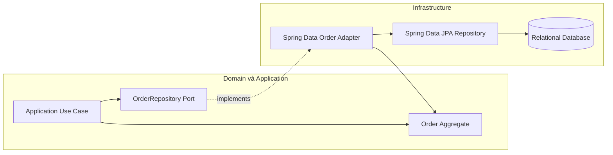
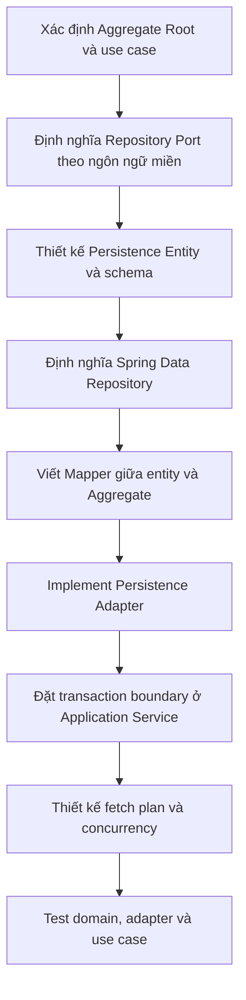

# Cổng Repository và bộ chuyển đổi Spring Data

Trong Domain-Driven Design (DDD), Repository cung cấp cách truy xuất và lưu Aggregate mà không buộc mô hình miền phụ thuộc vào database hoặc framework persistence. Với Java và Spring, Spring Data JPA giúp giảm lượng code truy vấn và triển khai thao tác lưu trữ. Tuy nhiên, nếu cho domain model kế thừa trực tiếp `JpaRepository`, dùng `Pageable` trong interface miền hoặc để entity JPA lan khắp ứng dụng, ranh giới giữa nghiệp vụ và hạ tầng sẽ nhanh chóng bị mờ.

Một cách tổ chức rõ ràng là định nghĩa **cổng Repository (repository port)** theo nhu cầu của mô hình hoặc use case, sau đó triển khai cổng đó bằng **bộ chuyển đổi persistence (Spring Data adapter)**. Adapter dùng Spring Data JPA để truy vấn database, ánh xạ dữ liệu sang Aggregate và lưu thay đổi trở lại. Application service điều phối use case và transaction; Aggregate bảo vệ invariant; Spring Data thực hiện chi tiết lưu trữ.

Bài này trình bày vai trò Repository trong DDD, cách phân chia port và adapter, thiết kế interface miền, triển khai bằng Spring Data JPA, ánh xạ Aggregate, quản lý transaction và concurrency, tách truy vấn đọc, cùng cách kiểm thử. Ví dụ dùng Java và Spring Data JPA theo phong cách phổ biến; package, ID và mapping cần điều chỉnh theo domain thực tế.

`DOMAIN_DRIVEN_DESIGN` sử dụng Entity, Value Object, Aggregate, Repository và Domain Event để mô hình hóa nghiệp vụ. Repository phục vụ Aggregate Root, còn Spring Data là một cơ chế hạ tầng để thực hiện việc lưu và truy xuất. Mô hình miền cần diễn đạt ngôn ngữ nghiệp vụ; adapter chịu trách nhiệm chuyển đổi giữa ngôn ngữ đó và cấu trúc lưu trữ.

## 1. Repository trong Domain-Driven Design

### 1.1. Repository cung cấp tập hợp Aggregate có thể truy xuất

Repository tạo cảm giác như đang làm việc với một tập hợp các Aggregate trong miền. Application service có thể yêu cầu tìm một đơn hàng theo ID hoặc lưu một đơn hàng sau khi thay đổi, mà không cần biết dữ liệu nằm trong bảng nào, query SQL ra sao hoặc ORM dùng cơ chế nào.

```java
public interface OrderRepository {
    Optional<Order> findById(OrderId id);

    void save(Order order);
}
```

Interface trên mô tả nhu cầu nghiệp vụ ở mức Aggregate `Order`. Nó không để lộ `EntityManager`, `JpaRepository`, `Pageable` hoặc class entity persistence.

### 1.2. Repository thường được định nghĩa cho Aggregate Root

Một Aggregate là ranh giới nhất quán của một nhóm đối tượng. Repository thường được cung cấp cho Aggregate Root vì root là cổng truy cập và bảo vệ invariant của toàn bộ Aggregate.

Ví dụ:

```text
Order Aggregate
  Order (root)
    OrderLine
    ShippingAddress (Value Object)
    Money (Value Object)
```

Ứng dụng tải `Order` qua `OrderRepository`, sau đó thay đổi `OrderLine` thông qua hành vi của root. Thông thường không cần `OrderLineRepository` độc lập nếu `OrderLine` chỉ có vòng đời bên trong `Order`.

### 1.3. Repository không phải nơi đặt quy tắc nghiệp vụ

Repository chịu trách nhiệm truy xuất và lưu trạng thái. Nó không nên quyết định một đơn hàng có được hủy hay không, giá nào được áp dụng hoặc khách hàng có đủ điều kiện nhận ưu đãi không.

Những quy tắc đó thuộc Aggregate, Domain Service hoặc Domain Policy. Repository có thể cung cấp dữ liệu để policy đánh giá, nhưng không thay thế hành vi miền.

### 1.4. Repository khác DAO và Spring Data Repository

Các khái niệm có liên quan nhưng không đồng nhất:

| Khái niệm | Trách nhiệm chính |
|---|---|
| DDD Repository | Trừu tượng hóa việc truy xuất/lưu Aggregate theo ngôn ngữ miền |
| DAO (Data Access Object) | Đóng gói thao tác truy cập dữ liệu ở mức kỹ thuật |
| Spring Data Repository | Cơ chế framework sinh triển khai truy vấn và thao tác persistence |
| Persistence Adapter | Hiện thực cổng của ứng dụng/miền bằng DAO, Spring Data, SQL hoặc API lưu trữ |

Một interface Spring Data có thể được dùng trực tiếp trong ứng dụng đơn giản. Nhưng khi cần giữ dependency direction và tách domain model khỏi JPA, thường nên đặt một cổng riêng và dùng adapter để nối với Spring Data.

## 2. Cổng Repository và bộ chuyển đổi Persistence

### 2.1. Dependency direction

Trong kiến trúc Ports and Adapters (Hexagonal Architecture), application hoặc domain định nghĩa port mô tả khả năng cần có. Infrastructure cung cấp adapter thực hiện khả năng đó.



Domain/Application định nghĩa abstraction; adapter phụ thuộc vào abstraction đó. Chi tiết Spring Data không cần được import vào Aggregate.

### 2.2. Port đặt ở Domain hay Application?

Có hai cách tổ chức phổ biến:

- Đặt `OrderRepository` trong domain layer khi nó là một khái niệm của mô hình miền và ngôn ngữ của domain expert.
- Đặt port trong application layer khi nó chỉ diễn tả nhu cầu truy xuất cụ thể của một use case hoặc một nhóm use case.

Không có quy tắc cứng buộc mọi dự án phải chọn cùng một package. Điều quan trọng là domain/application không phụ thuộc ngược vào Spring Data hoặc database implementation.

### 2.3. Adapter chuyển đổi giữa hai mô hình

Adapter có thể ánh xạ:

- `OrderJpaEntity` sang `Order` khi đọc.
- `Order` sang `OrderJpaEntity` khi ghi.
- Kiểu dữ liệu database sang Value Object.
- Persistence exception sang lỗi phù hợp với application boundary.

Việc có hai mô hình (domain và persistence) làm tăng code mapping, nhưng giúp mỗi mô hình phục vụ đúng mục tiêu. Với hệ thống nhỏ, có thể dùng chung class nếu trade-off được chấp nhận; cần tránh để annotation và lifecycle ORM chi phối thiết kế miền.

## 3. Thiết kế interface Repository theo nhu cầu miền

### 3.1. Dùng kiểu ID và kiểu miền rõ ràng

Thay vì truyền chuỗi tùy ý:

```java
public interface OrderRepository {
    Optional<Order> findById(OrderId id);
}
```

`OrderId` giúp tránh nhầm ID đơn hàng với `CustomerId`, `ProductId` hoặc ID của context khác. Nó cũng cho phép kiểm soát định dạng và equality tại một nơi.

```java
public record OrderId(UUID value) {
    public OrderId {
        Objects.requireNonNull(value);
    }
}
```

### 3.2. Chọn tên method theo ngôn ngữ nghiệp vụ

Tên method nên diễn đạt điều use case cần:

```java
public interface OrderRepository {
    Optional<Order> findById(OrderId id);

    Optional<Order> findByCustomerAndId(
        CustomerId customerId,
        OrderId orderId
    );

    void save(Order order);
}
```

Tránh đưa tên bảng, tên cột hoặc cấu trúc query vào interface miền như `selectOrderByStatusAndCreatedAtDescFromOrdersTable`. Chi tiết đó thuộc adapter.

### 3.3. Không đưa API framework vào port miền

Không nên để domain repository phụ thuộc vào:

- `JpaRepository` hoặc `CrudRepository`.
- `Pageable`, `Page` hoặc `Sort`.
- `Specification`, `EntityGraph` hoặc `EntityManager`.
- `PageableExecutionUtils` hoặc projection nội bộ Spring.
- `DataAccessException` hoặc Hibernate exception.

Các kiểu này gắn port với framework hoặc persistence. Nếu use case cần phân trang, hãy định nghĩa một kiểu truy vấn/response ở application layer, rồi adapter chuyển nó sang API Spring Data.

### 3.4. Trả kết quả phù hợp với ý nghĩa

`Optional<Order>` diễn đạt khả năng không tìm thấy. Nếu use case yêu cầu bắt buộc phải tồn tại, application service có thể chuyển trường hợp rỗng thành `OrderNotFound`.

Không nên trả `null` để biểu diễn không tìm thấy. Cũng không nên trả `Optional` cho method `save` nếu thao tác lưu luôn phải tạo hoặc cập nhật một Aggregate theo contract.

### 3.5. Tránh Repository tổng quát quá mức

Interface kiểu `GenericRepository<T, ID>` với hàng chục method `findAll`, `save`, `delete`, `findByExample`, `search` có thể khiến domain không diễn đạt được nhu cầu thực tế. Một Repository cụ thể theo Aggregate thường rõ ràng hơn.

Tạo abstraction chung chỉ khi nhiều Repository thực sự chia sẻ semantics và abstraction đó làm code đơn giản hơn, không chỉ để giảm vài dòng khai báo.

## 4. Spring Data JPA nằm ở đâu?

### 4.1. Spring Data sinh triển khai cho interface persistence

Spring Data JPA cho phép khai báo interface kế thừa `JpaRepository`:

```java
public interface SpringDataOrderRepository
        extends JpaRepository<OrderJpaEntity, UUID> {

    Optional<OrderJpaEntity> findByCustomerIdAndId(
        UUID customerId,
        UUID orderId
    );
}
```

Spring Data tạo implementation lúc runtime dựa trên interface và metadata mapping. Method query có thể được suy ra từ tên, khai báo bằng `@Query`, Criteria/Specification hoặc custom repository fragment tùy nhu cầu.

Interface này là chi tiết persistence vì nó thao tác `OrderJpaEntity`, UUID và các API Spring Data.

### 4.2. Không nhất thiết phải tạo adapter nếu domain model và persistence model được dùng chung

Một ứng dụng CRUD nhỏ có thể cho service dùng trực tiếp `JpaRepository<OrderEntity, UUID>`. Đây là lựa chọn đơn giản, có thể phù hợp khi domain model không cần tách biệt và coupling framework được chấp nhận.

Khi mô hình có Aggregate phức tạp, nhiều invariant, nhiều persistence technology hoặc cần test domain độc lập, adapter riêng giúp bảo vệ ranh giới tốt hơn.

### 4.3. Cấu trúc package tham khảo

```text
com.example.orders
  domain
    model
      Order.java
      OrderLine.java
      OrderId.java
      Money.java
    repository
      OrderRepository.java

  application
    PlaceOrderService.java
    FindOrderService.java

  infrastructure
    persistence
      jpa
        OrderJpaEntity.java
        OrderLineJpaEntity.java
        SpringDataOrderRepository.java
        OrderRepositoryAdapter.java
        OrderPersistenceMapper.java
```

Đây là một cách bố trí tham khảo. Có dự án đặt port trong `application.port.out`, có dự án gom theo feature hoặc bounded context. Hãy giữ dependency direction rõ và không để package structure trở thành mục tiêu tự thân.

## 5. Ví dụ Domain Model và Persistence Model

### 5.1. Value Object và Aggregate miền

Một mô hình rút gọn:

```java
public record OrderId(UUID value) {
    public OrderId {
        Objects.requireNonNull(value);
    }
}

public record CustomerId(UUID value) {
    public CustomerId {
        Objects.requireNonNull(value);
    }
}

public record ProductId(UUID value) {
    public ProductId {
        Objects.requireNonNull(value);
    }
}

public record OrderLineId(UUID value) {
    public OrderLineId {
        Objects.requireNonNull(value);
    }
}

public record Money(BigDecimal amount, Currency currency) {
    public Money {
        Objects.requireNonNull(amount);
        Objects.requireNonNull(currency);
    }
}

public enum OrderStatus {
    DRAFT, PLACED, CANCELLED
}

public record OrderLine(
    OrderLineId id,
    ProductId productId,
    int quantity,
    Money unitPrice
) {
    public OrderLine {
        Objects.requireNonNull(id);
        Objects.requireNonNull(productId);
        Objects.requireNonNull(unitPrice);
        if (quantity <= 0) {
            throw new IllegalArgumentException("Quantity must be positive");
        }
    }
}
```

Aggregate root:

```java
public final class Order {
    private final OrderId id;
    private final CustomerId customerId;
    private final List<OrderLine> lines;
    private OrderStatus status;

    public Order(
        OrderId id,
        CustomerId customerId,
        List<OrderLine> lines,
        OrderStatus status
    ) {
        this.id = Objects.requireNonNull(id);
        this.customerId = Objects.requireNonNull(customerId);
        this.lines = new ArrayList<>(lines);
        this.status = Objects.requireNonNull(status);
        if (this.lines.isEmpty()) {
            throw new IllegalArgumentException("Order requires at least one line");
        }
    }

    public void cancel() {
        if (status != OrderStatus.PLACED) {
            throw new IllegalStateException("Only placed orders can be cancelled");
        }
        status = OrderStatus.CANCELLED;
    }

    public OrderId id() { return id; }
    public CustomerId customerId() { return customerId; }
    public List<OrderLine> lines() { return List.copyOf(lines); }
    public OrderStatus status() { return status; }
}
```

Đoạn code tập trung vào minh họa Aggregate và invariant. Trong dự án thật, cần factory, hành vi thêm/xóa dòng hàng, event và kiểm soát sửa đổi collection phù hợp.

### 5.2. JPA Entity là mô hình lưu trữ

Persistence entity có thể được thiết kế để phù hợp ORM và schema:

```java
@Entity
@Table(name = "orders")
public class OrderJpaEntity {
    @Id
    private UUID id;

    @Column(name = "customer_id", nullable = false)
    private UUID customerId;

    @Column(name = "status_code", nullable = false)
    private String statusCode;

    @Version
    private Long version;

    @OneToMany(
        mappedBy = "order",
        cascade = CascadeType.ALL,
        orphanRemoval = true
    )
    private List<OrderLineJpaEntity> lines = new ArrayList<>();

    protected OrderJpaEntity() {}

    public OrderJpaEntity(UUID id, UUID customerId, String statusCode) {
        this.id = id;
        this.customerId = customerId;
        this.statusCode = statusCode;
    }

    public UUID getId() { return id; }
    public UUID getCustomerId() { return customerId; }
    public String getStatusCode() { return statusCode; }
    public List<OrderLineJpaEntity> getLines() { return lines; }

    public void setCustomerId(UUID customerId) { this.customerId = customerId; }
    public void setStatusCode(String statusCode) { this.statusCode = statusCode; }

    public void addLine(OrderLineJpaEntity line) {
        line.setOrder(this);
        lines.add(line);
    }

    public void removeLine(OrderLineJpaEntity line) {
        lines.remove(line);
        line.setOrder(null);
    }
}
```

`OrderLineJpaEntity` sẽ giữ foreign key `order_id` và các field cần lưu. `cascade = ALL` và `orphanRemoval = true` chỉ phù hợp nếu dòng hàng thực sự thuộc vòng đời của Order. Không áp dụng cascade xóa sang Aggregate khác như Customer hoặc Product.

`Long version` nullable cho phép Spring Data JPA nhận diện entity mới qua version property khi version còn null. Nếu dùng ID được gán sẵn mà version là kiểu primitive, cần xem lại chiến lược `isNew` hoặc triển khai `Persistable` để `save` không bị phân loại nhầm là entity đã tồn tại.

Entity con có thể có dạng:

```java
@Entity
@Table(name = "order_lines")
public class OrderLineJpaEntity {
    @Id
    private UUID id;

    @ManyToOne(fetch = FetchType.LAZY, optional = false)
    @JoinColumn(name = "order_id", nullable = false)
    private OrderJpaEntity order;

    @Column(name = "product_id", nullable = false)
    private UUID productId;

    @Column(nullable = false)
    private int quantity;

    @Column(name = "unit_price_amount", precision = 18, scale = 2, nullable = false)
    private BigDecimal unitPriceAmount;

    @Column(name = "unit_price_currency", length = 3, nullable = false)
    private String unitPriceCurrency;

    protected OrderLineJpaEntity() {}

    public OrderLineJpaEntity(
        UUID id,
        UUID productId,
        int quantity,
        BigDecimal unitPriceAmount,
        String unitPriceCurrency
    ) {
        this.id = id;
        this.productId = productId;
        this.quantity = quantity;
        this.unitPriceAmount = unitPriceAmount;
        this.unitPriceCurrency = unitPriceCurrency;
    }

    public UUID getId() { return id; }
    public UUID getProductId() { return productId; }
    public int getQuantity() { return quantity; }
    public BigDecimal getUnitPriceAmount() { return unitPriceAmount; }
    public String getUnitPriceCurrency() { return unitPriceCurrency; }
    public void setQuantity(int quantity) { this.quantity = quantity; }
    public void setUnitPriceAmount(BigDecimal amount) { this.unitPriceAmount = amount; }
    public void setUnitPriceCurrency(String currency) { this.unitPriceCurrency = currency; }
    public void setOrder(OrderJpaEntity order) { this.order = order; }
}
```

### 5.3. Vì sao không để JPA entity tự động trở thành Domain Model?

Có thể dùng một class cho cả domain và persistence, nhưng cần cân nhắc:

- JPA yêu cầu một số quy ước constructor, field access hoặc proxy.
- Lazy loading có thể khiến truy cập thuộc tính kích hoạt query ngoài dự kiến.
- Annotation ORM làm domain phụ thuộc persistence technology.
- `equals/hashCode` của entity có thể khó xử lý khi ID được sinh sau persist.
- Collection có thể bị ORM thay thế hoặc theo dõi thay đổi.
- Schema và domain model thay đổi theo nhịp khác nhau.

Nếu dùng chung class, hãy chủ động kiểm soát những trade-off này. Tách persistence entity không phải mục tiêu bắt buộc; bảo vệ mô hình và invariant mới là mục tiêu.

## 6. Mapping giữa Aggregate và JPA Entity

### 6.1. Mapper giữ chuyển đổi tập trung

Adapter không nên chứa hàng loạt đoạn chuyển đổi field lặp lại. Có thể dùng mapper riêng:

```java
@Component
public class OrderPersistenceMapper {

    public OrderJpaEntity toNewEntity(Order order) {
        OrderJpaEntity entity = new OrderJpaEntity(
            order.id().value(),
            order.customerId().value(),
            order.status().name()
        );
        synchronizeLines(order, entity);
        return entity;
    }

    public Order toDomain(OrderJpaEntity entity) {
        List<OrderLine> lines = entity.getLines().stream()
            .map(this::toDomain)
            .toList();

        return new Order(
            new OrderId(entity.getId()),
            new CustomerId(entity.getCustomerId()),
            lines,
            OrderStatus.valueOf(entity.getStatusCode())
        );
    }

    public OrderLine toDomain(OrderLineJpaEntity entity) {
        return new OrderLine(
            new OrderLineId(entity.getId()),
            new ProductId(entity.getProductId()),
            entity.getQuantity(),
            new Money(entity.getUnitPriceAmount(),
                Currency.getInstance(entity.getUnitPriceCurrency()))
        );
    }

    public void copyToEntity(Order order, OrderJpaEntity target) {
        target.setCustomerId(order.customerId().value());
        target.setStatusCode(order.status().name());
        synchronizeLines(order, target);
    }

    private void synchronizeLines(Order order, OrderJpaEntity target) {
        Map<UUID, OrderLineJpaEntity> existing = target.getLines().stream()
            .collect(Collectors.toMap(OrderLineJpaEntity::getId, Function.identity()));
        Set<UUID> desiredIds = order.lines().stream()
            .map(line -> line.id().value())
            .collect(Collectors.toSet());

        for (OrderLine line : order.lines()) {
            UUID lineId = line.id().value();
            OrderLineJpaEntity entity = existing.get(lineId);
            if (entity == null) {
                target.addLine(toNewEntity(line));
            } else {
                entity.setQuantity(line.quantity());
                entity.setUnitPriceAmount(line.unitPrice().amount());
                entity.setUnitPriceCurrency(line.unitPrice().currency().getCurrencyCode());
            }
        }

        target.getLines().stream()
            .filter(line -> !desiredIds.contains(line.getId()))
            .toList()
            .forEach(target::removeLine);
    }

    private OrderLineJpaEntity toNewEntity(OrderLine line) {
        return new OrderLineJpaEntity(
            line.id().value(),
            line.productId().value(),
            line.quantity(),
            line.unitPrice().amount(),
            line.unitPrice().currency().getCurrencyCode()
        );
    }
}
```

Ví dụ giả định các kiểu miền và persistence entity đã có những constructor/getter/setter được minh họa. `synchronizeLines` cập nhật child theo ID, thêm child mới và loại bỏ child không còn thuộc Aggregate; cách này tránh thay toàn bộ collection bằng object mới có cùng ID. Nếu Aggregate cần khôi phục thêm version, snapshot, event hoặc trạng thái phức tạp, mapper phải chuyển đủ dữ liệu cần thiết để domain object sau khi hydrate vẫn hợp lệ.

Trong ví dụ, `OrderStatus.name()` được dùng làm mã lưu trữ để minh họa. Nếu tên enum có thể thay đổi độc lập với dữ liệu, hãy dùng mã persistence ổn định và converter tường minh; việc đổi tên constant khi đó không buộc phải đổi nghĩa dữ liệu đã lưu.

### 6.2. Mapping khi ghi cần cập nhật Aggregate hiện có

Một lỗi thường gặp là luôn tạo `OrderJpaEntity` mới từ domain object rồi gọi `save`, dù entity đã tồn tại trong persistence context. Điều này có thể gây mất quan hệ, ghi đè field hoặc làm phức tạp orphan removal.

Adapter có thể tìm entity hiện tại rồi cập nhật các field do Aggregate sở hữu:

`copyToEntity` cần đồng bộ child theo ID, cập nhật owning side và xử lý orphan theo semantics của Aggregate. Đừng chỉ gán một list object mới nếu entity hiện tại đang được JPA quản lý; việc thay cả collection có thể làm phức tạp identity và orphan removal.

### 6.3. Lưu mới và cập nhật là hai tình huống khác nhau

Với entity mới, adapter tạo persistence graph mới. Với entity đã tồn tại, adapter có thể tải entity đang managed và cập nhật trạng thái. Thiết kế cụ thể phụ thuộc ID generation, JPA lifecycle, version và cách mapping.

Không giả định `save` luôn đồng nghĩa với SQL `INSERT` hoặc luôn `UPDATE`. Spring Data JPA dùng `EntityInformation` để xác định entity mới hay cũ; `SimpleJpaRepository.save` thường gọi `persist` cho entity mới và `merge` cho entity được coi là đã tồn tại. Chi tiết này ảnh hưởng tới object instance được quản lý và cần được hiểu khi thiết kế adapter.

### 6.4. Không để mapper phá invariant

Mapper phải khôi phục một Aggregate hợp lệ. Không dùng setter công khai để lắp ghép trạng thái bất kỳ rồi bỏ qua constructor/factory. Nếu dữ liệu cũ không đáp ứng invariant mới, cần migration hoặc một quy tắc khôi phục rõ ràng thay vì âm thầm tạo object sai.

## 7. Triển khai Repository Adapter với Spring Data

### 7.1. Spring Data interface

```java
public interface SpringDataOrderRepository
        extends JpaRepository<OrderJpaEntity, UUID> {

    Optional<OrderJpaEntity> findByCustomerIdAndId(
        UUID customerId,
        UUID orderId
    );
}
```

Đây là persistence repository. Nó có thể dùng derived query, `@Query`, projection hoặc custom fragment tùy truy vấn.

### 7.2. Adapter hiện thực port miền

```java
@Repository
public class OrderRepositoryAdapter implements OrderRepository {
    private final SpringDataOrderRepository jpaRepository;
    private final OrderPersistenceMapper mapper;

    public OrderRepositoryAdapter(
        SpringDataOrderRepository jpaRepository,
        OrderPersistenceMapper mapper
    ) {
        this.jpaRepository = jpaRepository;
        this.mapper = mapper;
    }

    @Override
    public Optional<Order> findById(OrderId id) {
        return jpaRepository.findById(id.value())
            .map(mapper::toDomain);
    }

    @Override
    public void save(Order order) {
        OrderJpaEntity entity = jpaRepository.findById(order.id().value())
            .orElseGet(() -> mapper.toNewEntity(order));

        mapper.copyToEntity(order, entity);
        jpaRepository.save(entity);
    }
}
```

Đây là khung minh họa; mapper cần cung cấp `toNewEntity`, và chiến lược cập nhật phải xử lý đúng entity mới/managed, collection và optimistic version. Trong adapter thật, có thể tránh query tồn tại trước bằng cách dùng ID/version hoặc phương thức persistence riêng, miễn semantics rõ và không tạo round-trip thừa.

### 7.3. Không tạo thêm lớp chỉ để chuyển tiếp một lời gọi

Nếu adapter chỉ gọi `jpaRepository.findById` và không thêm chuyển đổi, kiểm soát lỗi hoặc bảo vệ boundary, nó có thể không mang lại giá trị. Cấu trúc port/adapter nên giải quyết một nhu cầu thật: tách domain model, thay đổi persistence, cô lập query framework hoặc chuyển đổi dữ liệu.

### 7.4. Dùng constructor injection

Constructor injection làm dependency rõ ràng, hỗ trợ test và tránh object được tạo trong trạng thái thiếu dependency. Tránh field injection cho adapter và application service.

## 8. Transaction boundary và Application Service

### 8.1. Transaction thường bao quanh một use case

Application service điều phối việc tải Aggregate, gọi hành vi miền và lưu thay đổi. Với Spring, `@Transactional` thường được đặt ở application service hoặc một lớp use case tương đương:

```java
@Service
public class CancelOrderService {
    private final OrderRepository orders;

    public CancelOrderService(OrderRepository orders) {
        this.orders = orders;
    }

    @Transactional
    public void cancel(OrderId orderId) {
        Order order = orders.findById(orderId)
            .orElseThrow(() -> new OrderNotFound(orderId));

        order.cancel();
        orders.save(order);
    }
}
```

Transaction giữ các thao tác persistence của use case trong một đơn vị commit/rollback. Aggregate bảo vệ invariant trong bộ nhớ; transaction bảo vệ tính nguyên tử của các thao tác lưu trong database.

### 8.2. `save`, `flush` và `commit` không giống nhau

- `save` yêu cầu Spring Data persist hoặc merge entity.
- `flush` đồng bộ persistence context xuống database, có thể khiến constraint/SQL error xuất hiện sớm.
- `commit` kết thúc transaction và làm thay đổi trở thành bền vững theo transaction semantics.

Gọi `save` không có nghĩa dữ liệu đã commit. Nếu method chạy trong transaction do caller mở, commit xảy ra khi transaction boundary bên ngoài hoàn tất. Nếu không có transaction rõ ràng, repository method có thể tự dùng transaction theo cấu hình framework, nhưng đó thường không phải transaction boundary mong muốn cho một use case nhiều thao tác.

### 8.3. Không đặt transaction ở mọi method mà không hiểu propagation

Spring Data repository có transaction behavior mặc định cho nhiều thao tác CRUD. Application service vẫn nên xác định transaction boundary nghiệp vụ để nhiều repository operation cùng thuộc một transaction. Hiểu `REQUIRED`, `REQUIRES_NEW`, read-only và propagation trước khi thêm annotation lồng nhau.

### 8.4. Domain Model không nên phụ thuộc annotation transaction

Không đặt `@Transactional` lên Aggregate hoặc Value Object. Transaction là cơ chế application/infrastructure. Aggregate chỉ thể hiện hành vi và invariant.

### 8.5. Domain Event và Outbox

Nếu hành vi miền phát sinh event cần publish sau commit, application/persistence boundary có thể ghi Outbox cùng transaction với Aggregate. Không publish trực tiếp ra broker giữa transaction database nếu cần bảo đảm không mất event khi một phía commit còn phía kia thất bại.

Repository adapter có thể tham gia lưu Aggregate và Outbox theo cơ chế Unit of Work, nhưng không nên biến Repository thành nơi điều phối toàn bộ workflow tích hợp.

## 9. Aggregate boundary, fetch và quan hệ JPA

### 9.1. Nạp đủ Aggregate để bảo vệ invariant

Khi tải Aggregate cho use case ghi, Repository cần cung cấp trạng thái cần thiết để thực hiện hành vi miền đúng. Nếu invariant phụ thuộc vào toàn bộ OrderLine, không thể chỉ tải root mà bỏ collection rồi cho phép hành vi tính tổng hoặc kiểm tra số lượng.

### 9.2. Không kéo toàn bộ Aggregate khác vào graph

Aggregate nên tham chiếu Aggregate khác bằng ID khi phù hợp. Ví dụ Order giữ `CustomerId` và `ProductId`, không nhất thiết giữ object graph JPA tới toàn bộ Customer và Product.

Điều này giúp tránh:

- Query graph quá lớn.
- Lazy loading bất ngờ.
- Cascade sai vòng đời.
- Locking và transaction xuyên nhiều Aggregate.
- Phụ thuộc chặt giữa các context.

### 9.3. Lazy loading và N+1

`LAZY` giúp tránh tải quan hệ không cần thiết, nhưng nếu mapper truy cập từng association trong vòng lặp, ORM có thể phát sinh N+1 queries. `EAGER` có thể tải quá nhiều dữ liệu hoặc tạo join phức tạp.

Hãy chọn fetch plan theo use case bằng `@EntityGraph`, fetch join, projection hoặc query riêng ở adapter. Kiểm tra SQL thực tế và số query trong integration test.

### 9.4. Không dùng `FetchType.EAGER` để chữa mọi N+1

EAGER không bảo đảm một query duy nhất và có thể gây tải dư thừa ở những use case khác. Một Repository có thể có các phương thức truy xuất khác nhau theo nhu cầu, miễn chúng vẫn trả Aggregate hợp lệ và không để lộ persistence detail ra domain.

### 9.5. Delete và orphan removal

Xóa một child khỏi Aggregate có thể có nghĩa child không còn tồn tại và cần bị xóa khỏi database. `orphanRemoval = true` có thể phù hợp với thành phần sở hữu vòng đời, nhưng không được dùng cho đối tượng độc lập hoặc Aggregate khác.

Hãy kiểm tra hành vi xóa trong transaction thật; mapping hai chiều phải đồng bộ cả collection ở root lẫn reference ở child.

## 10. Truy vấn đọc và mô hình ghi

### 10.1. Repository Aggregate không phải công cụ cho mọi báo cáo

Repository phục vụ việc tải và lưu Aggregate. Một màn hình báo cáo cần tổng doanh thu theo tháng, số lượng đơn theo trạng thái hoặc danh sách phân trang không nhất thiết phải hydrate hàng nghìn Aggregate.

Có thể dùng query service/read port riêng trả projection:

```java
public interface OrderSummaryQuery {
    PageResult<OrderSummary> search(
        OrderSearchCriteria criteria,
        PageRequestSpec page
    );
}
```

`PageRequestSpec` và `PageResult` trong ví dụ là kiểu application-level do dự án định nghĩa; không nhất thiết là kiểu Spring Data.

### 10.2. Adapter đọc projection bằng Spring Data

```java
public interface OrderSummaryProjection {
    UUID getOrderId();
    String getStatus();
    BigDecimal getTotalAmount();
    String getCurrencyCode();
}
```

Spring Data có thể tạo projection từ query. Adapter chuyển projection thành `OrderSummary` cho application layer. Projection không cần được chuyển thành Aggregate nếu use case chỉ hiển thị dữ liệu.

### 10.3. CQRS ở mức vừa đủ

Tách command model và query model có thể hữu ích khi yêu cầu đọc khác xa yêu cầu ghi. Không cần triển khai full CQRS hoặc event sourcing chỉ vì có hai interface Repository và Query Service.

Điều quan trọng là Aggregate ghi vẫn bảo vệ invariant; query path được tối ưu cho việc đọc mà không tạo một đường ghi lách qua mô hình.

### 10.4. Pagination và sorting ở đúng layer

Spring Data dùng `Pageable`, `Page`, `Slice` và `Sort`. Nếu port application cần phân trang, hãy định nghĩa kiểu của mình rồi chuyển đổi trong adapter. Không để `Pageable` xuất hiện trong domain model.

Với dữ liệu lớn, `Slice` hoặc keyset/scrolling có thể phù hợp hơn `Page` nếu không cần tổng số bản ghi. Cần đánh giá query count và chi phí `COUNT(*)`.

## 11. Optimistic Locking và cạnh tranh cập nhật

### 11.1. Repository không thể giả định một Aggregate chỉ có một writer

Hai request có thể cùng tải một Order, sau đó cùng thay đổi và lưu. Nếu không có concurrency control, cập nhật sau có thể ghi đè cập nhật trước.

### 11.2. Dùng `@Version`

Trong JPA entity:

```java
@Version
private Long version;
```

Trong ví dụ trước, `Long` nullable còn hỗ trợ Spring Data nhận diện entity mới khi ID được gán sẵn. Nếu dùng kiểu primitive, hãy cấu hình cơ chế nhận diện entity mới phù hợp, chẳng hạn triển khai `Persistable`.

Hibernate/JPA dùng version để phát hiện cập nhật dựa trên trạng thái cũ. Nếu version trong database đã thay đổi, transaction có thể gặp optimistic locking failure thay vì ghi đè âm thầm.

Transaction của use case cần bao trùm cả lần tải Aggregate, hành vi miền và lần lưu. Trong ví dụ `CancelOrderService`, `@Transactional` giữ JPA entity được tải ở cùng persistence context; nếu transaction khác cập nhật trước, câu lệnh update khi flush sẽ dùng version cũ và thất bại. Nếu đọc Aggregate ở transaction này rồi lưu trong transaction khác, adapter không được tải bản ghi mới nhất rồi âm thầm chép trạng thái cũ lên đó; cần mang expected version qua port (ví dụ một wrapper `Versioned<Order>`) và so sánh với version vừa tải trước khi cập nhật. `@Version` tiếp tục bảo vệ khoảng thời gian từ lúc so sánh đến lúc commit.

### 11.3. Chuyển lỗi concurrency thành behavior phù hợp

Adapter hoặc application boundary có thể chuyển `OptimisticLockException`/`ObjectOptimisticLockingFailureException` thành lỗi ứng dụng như `ConcurrentOrderModification`. Không để exception Hibernate rò vào domain.

Use case có thể yêu cầu người dùng tải lại, retry có giới hạn hoặc áp dụng chính sách giải quyết xung đột. Không retry mù quáng nếu hành động không idempotent hoặc dữ liệu đầu vào đã lỗi thời.

### 11.4. Optimistic locking không thay thế invariant

Version kiểm soát xung đột ghi; Aggregate kiểm tra hành vi có hợp lệ theo nghiệp vụ hay không. Hai cơ chế bổ sung nhau.

### 11.5. Pessimistic locking chỉ dùng khi có lý do

JPA hỗ trợ lock mode như `PESSIMISTIC_WRITE`, nhưng khóa database có thể giảm throughput và tạo deadlock. Chỉ dùng khi yêu cầu đồng thời và semantics nghiệp vụ cần, đồng thời thiết kế timeout và thứ tự lấy khóa.

## 12. Xử lý exception và ranh giới persistence

### 12.1. Phân biệt không tìm thấy với lỗi truy cập dữ liệu

Không tìm thấy Order có thể là kết quả hợp lệ của query. Database unavailable, timeout, constraint violation hoặc deadlock là lỗi khác. Repository port cần có contract rõ về `Optional`, exception hoặc result type.

### 12.2. Không để Hibernate exception lan khắp domain

Spring dịch một số persistence exception thành `DataAccessException`. Adapter/application boundary có thể ánh xạ những lỗi cần semantics riêng:

- Unique constraint vi phạm → `DuplicateExternalOrderReference`.
- Optimistic lock → `ConcurrentOrderModification`.
- Database unavailable → lỗi hạ tầng có thể retry theo chính sách.

Không bắt mọi exception rồi trả `Optional.empty()`. Điều đó làm mất thông tin và biến lỗi hệ thống thành “không tìm thấy”.

### 12.3. Giữ chi tiết kỹ thuật ở hạ tầng

Domain có thể định nghĩa lỗi nghiệp vụ như `OrderCannotBeCancelled`. Nó không nên biết tên constraint `uk_orders_tenant_external_ref` hoặc mã SQLState cụ thể.

## 13. Kiểm thử Repository Port và Spring Data Adapter

### 13.1. Unit test cho Domain Model

Kiểm thử Aggregate và Value Object độc lập với Spring và database:

```java
@Test
void placedOrderCanBeCancelled() {
    Order order = placedOrder();

    order.cancel();

    assertEquals(OrderStatus.CANCELLED, order.status());
}

@Test
void draftOrderCannotBeCancelled() {
    Order order = draftOrder();

    assertThrows(IllegalStateException.class, order::cancel);
}
```

Những test này xác minh invariant và behavior miền, không xác minh SQL hay mapping JPA.

### 13.2. Slice test với `@DataJpaTest`

Spring Boot cung cấp `@DataJpaTest` để kiểm thử JPA slice: entity mapping, repository query và database behavior với test configuration.

```java
@DataJpaTest
class SpringDataOrderRepositoryTest {
    @Autowired
    SpringDataOrderRepository repository;

    @Test
    void findsOrderByCustomerAndId() {
        // Persist fixture, flush, then assert query result.
    }
}
```

Đây là khung minh họa. Cần dùng database test phù hợp với database production nếu query, collation, locking hoặc dialect có khác biệt đáng kể. H2 có thể hữu ích cho test nhanh nhưng không chứng minh mọi hành vi PostgreSQL/MySQL.

### 13.3. Integration test cho adapter

Kiểm thử `OrderRepositoryAdapter` với mapper và Spring Data thật:

- Lưu Aggregate mới rồi tải lại.
- Thay đổi Aggregate rồi lưu lại.
- Kiểm tra collection con và orphan removal.
- Kiểm tra Value Object được mapping đúng.
- Kiểm tra version và optimistic lock.
- Kiểm tra query theo tenant/business key.

Test này phát hiện lỗi mapping mà unit test domain không thể phát hiện.

### 13.4. Kiểm thử transaction boundary

Kiểm tra use case có nhiều thao tác persistence: nếu thao tác cuối thất bại, các thay đổi trước đó phải rollback khi nghiệp vụ yêu cầu tính nguyên tử. Không chỉ assert object trong bộ nhớ; cần đọc lại database sau transaction.

### 13.5. Contract test cho port implementation

Nếu có nhiều adapter thực hiện cùng `OrderRepository` (JPA, document database, in-memory test), có thể dùng một bộ contract test chung để xác minh semantics: `findById`, `save`, identity, không tìm thấy và concurrency behavior được hỗ trợ.

In-memory fake hữu ích cho application unit test, nhưng không thay thế integration test với adapter thật.

## 14. Khi nào nên dùng domain entity trực tiếp làm JPA entity?

### 14.1. Dùng chung model có thể hợp lý

Với CRUD đơn giản, ít invariant, một bounded context nhỏ và schema ổn định, dùng chung class domain/JPA có thể giảm mapping code và tăng tốc phát triển.

### 14.2. Tách model khi lợi ích lớn hơn chi phí

Nên cân nhắc tách khi:

- Domain model có invariant và constructor bất biến phức tạp.
- ORM proxy/lazy loading gây rò rỉ hành vi persistence.
- Một Aggregate được lưu qua nhiều bảng hoặc nhiều nguồn.
- Cần thay database hoặc thêm adapter.
- API/query model khác đáng kể với Aggregate.
- Domain model được dùng trong nhiều application adapter.

### 14.3. Không tách chỉ vì sơ đồ kiến trúc

Tách domain và persistence model làm tăng mapper, code và test. Nếu hai mô hình luôn giống nhau và không có nhu cầu bảo vệ boundary, có thể đang tạo abstraction không cần thiết.

Hãy quyết định theo độ phức tạp miền, tốc độ thay đổi, khả năng kiểm thử và chi phí bảo trì.

## 15. Những sai lầm thường gặp

**Cho domain interface kế thừa `JpaRepository`.** Domain bị phụ thuộc Spring Data. Định nghĩa port bằng kiểu miền và để adapter triển khai.

**Tạo Repository cho mọi Entity.** Điều đó phá vỡ ranh giới Aggregate và cho phép cập nhật child ngoài root. Thường chỉ tạo Repository cho Aggregate Root.

**Đưa `Pageable`, `Page` hoặc `Specification` vào domain.** Đây là API framework. Chuyển đổi ở application/infrastructure boundary.

**Dùng JPA entity trực tiếp trong domain service.** Persistence concern có thể rò vào logic nghiệp vụ. Dùng mapper/adapter khi cần tách.

**Để Repository chứa business rule.** Repository nên truy xuất/lưu; Aggregate và Domain Policy quyết định hành vi.

**Tạo generic repository quá tổng quát.** Abstraction không diễn đạt nhu cầu miền và tạo method không cần. Thiết kế interface theo Aggregate/use case.

**Load toàn bộ object graph.** Query quá lớn, N+1 và phụ thuộc xuyên Aggregate. Chỉ tải trạng thái cần thiết cho use case.

**Dùng EAGER để chữa N+1.** EAGER có thể tải dư và vẫn không bảo đảm một query. Thiết kế fetch plan theo use case.

**Mapping Aggregate bỏ qua child hoặc invariant.** Aggregate hydrate không đầy đủ có thể thực hiện hành vi sai. Mapper phải khôi phục trạng thái hợp lệ.

**Luôn tạo entity mới khi update.** Có thể làm mất state managed, quan hệ hoặc orphan semantics. Xác định rõ create/update và lifecycle JPA.

**Coi `save` là commit.** Save/flush/commit là các bước khác nhau. Đặt transaction boundary ở use case.

**Bỏ qua optimistic locking.** Hai writer có thể ghi đè nhau. Dùng version hoặc cơ chế concurrency phù hợp.

**Bắt mọi persistence exception thành not found.** Lỗi database bị che giấu. Phân biệt absence, conflict, constraint và infrastructure failure.

**Chỉ test bằng mock repository.** Mock không xác minh mapping, query, transaction hoặc locking. Bổ sung adapter integration tests.

## 16. Quy trình thiết kế Repository với Spring Data



Các bước thực hiện:

1. Xác định Aggregate Root và invariant cần bảo vệ.
2. Liệt kê use case cần tìm, lưu hoặc truy vấn dữ liệu.
3. Định nghĩa port bằng ID, Value Object và kiểu kết quả của ứng dụng/miền.
4. Thiết kế persistence entity và mapping phù hợp schema.
5. Tạo Spring Data interface cho thao tác database.
6. Implement adapter và mapper hai chiều.
7. Đặt transaction boundary ở application use case.
8. Xác định fetch plan, optimistic locking và exception translation.
9. Tách query/read model khi không cần hydrate Aggregate.
10. Kiểm thử domain behavior, JPA mapping, adapter và transaction.

## 17. Checklist

Trước khi hoàn thiện Repository và Spring Data adapter, hãy kiểm tra:

- [ ] Repository được thiết kế cho Aggregate Root phù hợp.
- [ ] Port không phụ thuộc Spring Data, JPA hoặc Hibernate.
- [ ] Tên method diễn đạt nhu cầu miền/use case.
- [ ] ID và Value Object có kiểu rõ ràng.
- [ ] Không dùng `null` để biểu diễn không tìm thấy.
- [ ] Persistence entity được tách khi cần bảo vệ domain model.
- [ ] Spring Data interface chỉ xuất hiện trong infrastructure.
- [ ] Mapper khôi phục Aggregate đầy đủ và hợp lệ.
- [ ] Update xử lý đúng entity managed, child collection và orphan removal.
- [ ] Cascade phản ánh quyền sở hữu vòng đời, không xóa Aggregate khác.
- [ ] Fetch plan tránh N+1 và tải dư.
- [ ] Transaction bao quanh use case cần tính nguyên tử.
- [ ] Hiểu rõ khác biệt `save`, `flush` và `commit`.
- [ ] Optimistic/pessimistic locking phù hợp với concurrency requirement.
- [ ] Persistence exception được phân loại và chuyển đổi ở đúng boundary.
- [ ] Query/report dùng projection khi không cần Aggregate.
- [ ] Có unit test cho domain và integration test cho adapter.
- [ ] Có kiểm thử transaction rollback, mapping và concurrency.

## 18. Câu hỏi tự kiểm tra

1. Repository trong DDD khác Spring Data Repository như thế nào?
2. Vì sao thường chỉ tạo Repository cho Aggregate Root?
3. Port nên được đặt ở domain hay application layer?
4. Vì sao không nên để domain interface kế thừa `JpaRepository`?
5. Persistence Adapter và Mapper có trách nhiệm gì?
6. Khi nào có thể dùng chung Domain Model và JPA Entity?
7. `save`, `flush` và `commit` khác nhau như thế nào?
8. Vì sao `@Transactional` thường nằm ở application service?
9. Optimistic locking giải quyết vấn đề gì và có thay thế invariant không?
10. Khi nào nên dùng projection/query service thay vì tải Aggregate?

**Gợi ý trả lời:**

- Câu 1: DDD Repository là abstraction theo Aggregate và ngôn ngữ miền; Spring Data Repository là cơ chế framework tạo thao tác persistence.
- Câu 2: Aggregate Root là cổng truy cập và bảo vệ invariant của các object bên trong Aggregate.
- Câu 3: Tùy ownership: domain nếu Repository là khái niệm miền; application nếu chỉ là output port phục vụ use case. Cả hai đều phải tránh phụ thuộc infrastructure.
- Câu 4: Vì nó làm domain phụ thuộc Spring Data và lộ API persistence như `Pageable`, `Sort`, `EntityManager`.
- Câu 5: Adapter gọi Spring Data và hiện thực port; Mapper chuyển đổi persistence entity và Aggregate/Value Object.
- Câu 6: Khi domain đơn giản, ít invariant và coupling ORM được chấp nhận; cần tách khi domain phức tạp hoặc persistence concern làm méo mô hình.
- Câu 7: `save` yêu cầu persist/merge; `flush` đồng bộ persistence context xuống database; `commit` hoàn tất transaction.
- Câu 8: Vì use case thường gồm nhiều thao tác cần nguyên tử; application service biết ranh giới nghiệp vụ và điều phối chúng.
- Câu 9: Optimistic locking phát hiện cập nhật cạnh tranh; nó không kiểm tra hành vi có hợp lệ theo quy tắc miền hay không.
- Câu 10: Khi màn hình/báo cáo chỉ cần một phần dữ liệu, phân trang hoặc tổng hợp; projection tránh hydrate Aggregate không cần thiết.

## Kết luận

Repository trong DDD là abstraction giúp application làm việc với Aggregate mà không phụ thuộc cách lưu trữ. Spring Data JPA có thể hiện thực chi tiết persistence qua một adapter; mapper chuyển đổi giữa JPA entity và domain model. Thiết kế tốt giữ Repository ở ranh giới Aggregate Root, để Aggregate bảo vệ invariant, đặt transaction ở use case, xử lý concurrency và exception rõ ràng, đồng thời dùng query projection cho nhu cầu đọc không cần Aggregate. Không phải dự án nào cũng cần tách hai mô hình, nhưng khi đã chọn port/adapter, hãy giữ dependency direction nhất quán và để Spring Data ở infrastructure.
