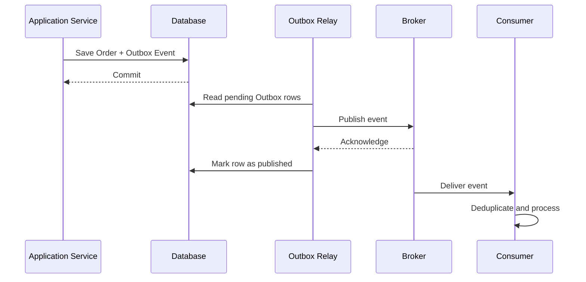

# Phân phối sự kiện bằng Spring với thời điểm giao dịch được xác định

Trong một ứng dụng DDD, một hành vi nghiệp vụ có thể tạo ra sự kiện để những thành phần khác phản ứng. Ví dụ, sau khi Order được xác nhận, hệ thống có thể cần cập nhật read model, gửi thông báo, tạo yêu cầu giao hàng hoặc phát Integration Event cho một hệ thống khác. Câu hỏi quan trọng là: listener nên chạy ở thời điểm nào so với transaction đã lưu thay đổi của Order?

Nếu listener chạy trước khi transaction commit, nó có thể thực hiện tác động bên ngoài dù dữ liệu chính sau đó rollback. Nếu listener chạy sau commit, nó biết thay đổi đã được lưu thành công, nhưng lỗi ở listener không thể đảo ngược transaction đã commit. Nếu xử lý bất đồng bộ, ứng dụng còn phải tính đến việc process dừng sau commit nhưng trước khi listener hoàn thành.

Spring cung cấp Application Event và `@TransactionalEventListener` để gắn thời điểm xử lý listener với vòng đời transaction. Bài học này giải thích cách chọn phase, cách transaction ảnh hưởng đến việc phân phối event, giới hạn của listener đồng bộ/bất đồng bộ và khi nào cần Transactional Outbox để bảo đảm sự kiện được giao bền vững.

## Mục tiêu học tập

Sau bài này, bạn có thể:

- Phân biệt Domain Event, Spring Application Event và Integration Event.
- Phát sự kiện trong transaction bằng `ApplicationEventPublisher`.
- Chọn đúng `TransactionPhase` cho listener.
- Hiểu sự khác nhau giữa BEFORE_COMMIT, AFTER_COMMIT, AFTER_ROLLBACK và AFTER_COMPLETION.
- Biết điều gì xảy ra khi không có transaction hoặc transaction rollback.
- Hiểu tác động của listener đồng bộ, `@Async` và exception.
- Mở transaction mới khi listener sau commit cần ghi dữ liệu.
- Kiểm thử hành vi theo commit/rollback mà không phụ thuộc vào thời gian chờ tùy tiện.
- Nhận biết vì sao Spring event không thay thế hàng đợi bền vững hoặc Outbox.
- Thiết kế phân phối event có idempotency, quan sát và khả năng phục hồi.

## 1. Ba loại sự kiện cần phân biệt

Từ “event” có thể chỉ nhiều hợp đồng khác nhau. Phân biệt chúng giúp xác định ai được phép nhận, dữ liệu nào được công bố và độ tin cậy cần có.

### Domain Event

Domain Event diễn tả một sự thật nghiệp vụ đã xảy ra bên trong mô hình miền, ví dụ `OrderConfirmed` hoặc `SubscriptionCancelled`. Nó thường được tạo bởi Aggregate khi một hành vi hợp lệ hoàn tất.

Domain Event thuộc ngôn ngữ của Bounded Context sở hữu nó. Nó có thể chứa ID, thời điểm, version và dữ liệu cần thiết để mô tả sự thật vừa xảy ra. Không nên đưa HTTP, Kafka hoặc Spring annotation vào lớp Domain Event.

### Spring Application Event

Spring Application Event là cơ chế truyền thông điệp trong cùng ApplicationContext/process. Publisher gọi `ApplicationEventPublisher.publishEvent(...)`; các bean có listener phù hợp nhận sự kiện.

Application Event phù hợp để tách các thành phần trong cùng ứng dụng. Bản thân nó không phải message broker, không có durable storage và không bảo đảm event còn tồn tại khi process dừng.

Một Domain Event có thể được chuyển thành Spring Application Event hoặc được publish trực tiếp nếu ứng dụng chọn dùng Spring làm cơ chế dispatch. Dù chọn cách nào, mô hình miền vẫn nên độc lập với framework.

`@EventListener` thông thường được gọi khi event được publish, tức là ngay trong luồng dispatch mặc định; nó không tự đợi transaction commit. Khi cần ràng buộc thời điểm với transaction, hãy dùng `@TransactionalEventListener` và chọn phase phù hợp.

### Integration Event

Integration Event là hợp đồng được công bố qua ranh giới process hoặc Bounded Context, ví dụ `sales.order-confirmed.v1`. Nó cần schema có version, event ID, thời điểm, correlation/causation metadata và chính sách tương thích.

Integration Event thường được publish lên broker hoặc gửi qua một cơ chế tích hợp. Không nên gửi trực tiếp toàn bộ object graph hoặc class nội bộ của Domain Event cho consumer bên ngoài.

| Loại | Phạm vi | Mục đích | Độ bền mặc định |
| --- | --- | --- | --- |
| Domain Event | Domain Model | Ghi nhận sự thật nghiệp vụ | Tùy cơ chế lưu của ứng dụng |
| Spring Application Event | Một process/ApplicationContext | Phối hợp bean trong ứng dụng | Không durable mặc định |
| Integration Event | Qua process/context | Công bố hợp đồng tích hợp | Phụ thuộc broker/Outbox |

## 2. Publish event bên trong transaction

Giả sử use case xác nhận Order. Aggregate kiểm tra quy tắc, chuyển trạng thái và phát sinh sự kiện. Application Service lưu Aggregate và publish Spring event trong cùng transaction:

```java
public record OrderConfirmed(
    UUID eventId,
    UUID orderId,
    long aggregateVersion,
    Instant occurredAt
) {}

@Service
public class ConfirmOrderService {
    private final OrderRepository orders;
    private final ApplicationEventPublisher events;
    private final Clock clock;

    public ConfirmOrderService(
        OrderRepository orders,
        ApplicationEventPublisher events,
        Clock clock
    ) {
        this.orders = orders;
        this.events = events;
        this.clock = clock;
    }

    @Transactional
    public void confirm(UUID orderId) {
        Order order = orders.findById(orderId)
            .orElseThrow(() -> new OrderNotFound(orderId));

        Instant occurredAt = clock.instant();
        order.confirm(occurredAt);
        orders.save(order);

        events.publishEvent(new OrderConfirmed(
            UUID.randomUUID(),
            order.id(),
            order.version(),
            occurredAt
        ));
    }
}
```

Event được publish trước khi phương thức kết thúc và transaction commit. Điều đó không có nghĩa listener gắn phase AFTER_COMMIT chạy ngay tại dòng publish. Spring đăng ký listener với transaction hiện tại và gọi listener ở phase đã chọn khi transaction đi đến phase đó.

Trong ví dụ, event nên là dữ liệu bất biến và chỉ chứa thông tin cần cho listener. Tránh truyền trực tiếp Aggregate hoặc JPA Entity còn mutable: listener có thể nhìn thấy object đã thay đổi thêm, vô tình kích hoạt lazy loading hoặc phụ thuộc vào persistence context đã kết thúc.

Nếu aggregateVersion do ORM sinh khi flush, không giả định giá trị sau lệnh save đã là version cuối cùng. Hãy dùng version do domain quản lý hoặc lấy version persistence đã xác nhận trước khi ghi event/outbox.

### Transaction boundary phải thực sự tồn tại

`@Transactional` thường được áp dụng qua Spring proxy. Nếu một method trong cùng bean tự gọi một method khác có `@Transactional`, lời gọi nội bộ đó thường không đi qua proxy và annotation có thể không tạo transaction như mong đợi.

Hãy bảo đảm use case được gọi qua bean/proxy phù hợp, transaction manager được cấu hình và event được publish khi transaction đồng bộ đang hoạt động. Nếu event được publish ngoài transaction, listener transactional mặc định sẽ không được kích hoạt.

## 3. Bốn TransactionPhase của Spring

`@TransactionalEventListener` cho phép gắn listener với một phase trong vòng đời transaction.

| Phase | Thời điểm | Dùng khi |
| --- | --- | --- |
| BEFORE_COMMIT | Trước khi transaction commit | Cần thực hiện công việc cục bộ thuộc cùng lần commit |
| AFTER_COMMIT | Sau khi transaction commit thành công | Phản ứng với thay đổi đã được commit |
| AFTER_ROLLBACK | Sau khi transaction rollback | Ghi nhận hoặc xử lý phản ứng sau rollback |
| AFTER_COMPLETION | Sau khi transaction hoàn tất, dù commit hay rollback | Cleanup hoặc quan sát kết quả hoàn tất |

Mặc định, `@TransactionalEventListener` dùng `TransactionPhase.AFTER_COMMIT`.

### BEFORE_COMMIT

Listener chạy trong quá trình hoàn tất transaction, trước khi commit thực sự xảy ra. Nếu listener đồng bộ ném exception phù hợp với rollback rules, lỗi có thể làm transaction rollback.

Dùng phase này khi công việc phải nằm trong cùng transaction và cần hoàn tất trước commit. Ví dụ, kiểm tra hoặc cập nhật một dữ liệu cục bộ khác cùng database có thể thuộc cùng một transaction nếu nó thật sự nằm trong cùng consistency boundary.

Không dùng BEFORE_COMMIT để gọi email, webhook hoặc broker như một tác động không thể rollback. Nếu message đã ra ngoài rồi transaction rollback, hệ thống ngoài vẫn có thể hành động dựa trên dữ liệu chưa commit.

### AFTER_COMMIT

Listener chỉ chạy khi transaction commit thành công. Đây là lựa chọn phù hợp cho phản ứng chỉ có ý nghĩa sau khi thay đổi đã được lưu, ví dụ xóa cache, gửi tín hiệu cho một thành phần nội bộ hoặc bắt đầu một công việc tiếp theo.

```java
@Component
public class OrderNotificationListener {
    private final NotificationService notifications;

    public OrderNotificationListener(
        NotificationService notifications
    ) {
        this.notifications = notifications;
    }

    @TransactionalEventListener(phase = TransactionPhase.AFTER_COMMIT)
    public void on(OrderConfirmed event) {
        notifications.notifyOrderConfirmed(event.orderId());
    }
}
```

Nếu transaction rollback, listener này không chạy. Tuy nhiên, nếu listener thất bại sau commit, thay đổi Order vẫn đã được commit. Không thể rollback transaction cũ để hoàn tác nó.

Với listener đồng bộ, exception phát sinh sau commit có thể được truyền ngược về luồng gọi/commit tùy cách dispatch và xử lý lỗi. Caller có thể nhìn thấy lỗi dù dữ liệu đã commit. Vì vậy, không được hiểu “caller nhận exception” là “transaction chắc chắn rollback”.

### AFTER_ROLLBACK

Listener chỉ chạy khi transaction rollback. Nó có thể hữu ích cho telemetry, ghi nhận kết quả thất bại hoặc thông báo cho một thành phần nội bộ cần biết transaction không thành công.

```java
@Component
public class FailedOrderAttemptListener {
    private final FailureMetrics metrics;

    public FailedOrderAttemptListener(FailureMetrics metrics) {
        this.metrics = metrics;
    }

    @TransactionalEventListener(phase = TransactionPhase.AFTER_ROLLBACK)
    public void on(OrderConfirmationRequested event) {
        metrics.recordRollback(event.orderId());
    }
}
```

Không dùng AFTER_ROLLBACK để thực hiện compensation cho một thay đổi chưa từng commit. Nếu transaction rollback toàn bộ, không có thay đổi cục bộ cần bù trừ. Cũng không dựa vào listener này cho một tác vụ bắt buộc phải được giao bền vững: process có thể dừng trước khi callback chạy.

### AFTER_COMPLETION

Listener chạy khi transaction đã hoàn tất, bất kể commit hay rollback. Có thể dùng cho cleanup hoặc telemetry mà chỉ cần biết transaction đã kết thúc.

Nếu cần biết kết quả cụ thể, hãy kiểm tra trạng thái qua một abstraction phù hợp hoặc tách listener theo AFTER_COMMIT và AFTER_ROLLBACK. Không giả định AFTER_COMPLETION có nghĩa commit thành công.

## 4. Không có transaction thì listener xử lý thế nào?

`@TransactionalEventListener` mặc định có `fallbackExecution = false`. Nếu publisher phát event khi không có transaction đang hoạt động, listener không được gọi.

Điều này bảo vệ ý nghĩa của phase. Một listener AFTER_COMMIT không thể đợi một commit nếu không có transaction nào tồn tại.

Có thể bật fallback:

```java
@TransactionalEventListener(
    phase = TransactionPhase.AFTER_COMMIT,
    fallbackExecution = true
)
public void on(OrderConfirmed event) {
    // Runs immediately when no transaction is active.
}
```

Khi không có transaction, listener được gọi theo fallback thay vì đợi một phase transaction. Vì vậy, với cùng một event, thời điểm chạy phụ thuộc vào việc publisher có transaction hay không.

Chỉ bật fallback khi cả hai tình huống đều có semantics hợp lệ. Không dùng nó để che giấu việc một use case đáng lẽ phải chạy trong transaction nhưng thực tế không có transaction.

Một cách an toàn hơn là xác định rõ application service nào sở hữu transaction và bảo đảm event được publish từ luồng đó.

## 5. Chọn phase theo mục đích nghiệp vụ

Ví dụ cùng một OrderConfirmed có thể kích hoạt nhiều phản ứng, nhưng không phải phản ứng nào cũng cần cùng phase.

| Công việc | Phase gợi ý | Lý do |
| --- | --- | --- |
| Kiểm tra/cập nhật dữ liệu cùng transaction | BEFORE_COMMIT | Phải cùng thành công hoặc rollback |
| Xóa cache sau khi ghi thành công | AFTER_COMMIT | Không xóa cache cho thay đổi bị rollback |
| Gửi tín hiệu nội bộ sau khi lưu | AFTER_COMMIT | Chỉ phản ứng với trạng thái đã commit |
| Ghi metric cho lần xử lý bị rollback | AFTER_ROLLBACK | Chỉ quan tâm thất bại transaction |
| Cleanup tài nguyên tạm sau mọi kết quả | AFTER_COMPLETION | Chạy sau cả commit và rollback |
| Gửi message tích hợp quan trọng | Outbox | Cần lưu bền vững cùng thay đổi dữ liệu |

Phase không thay thế việc thiết kế consistency boundary. Nếu hai thay đổi phải nguyên tử, hãy đặt chúng trong cùng transaction và cùng nguồn dữ liệu hỗ trợ transaction đó. Nếu một tác động đi ra hệ thống ngoài, callback phase chỉ quyết định thời điểm bắt đầu; nó không làm cho nhiều hệ thống trở thành một transaction phân tán.

## 6. Exception trong listener và ý nghĩa với transaction

Hành vi của exception phụ thuộc phase và listener đồng bộ hay bất đồng bộ.

### Exception trước commit

Với BEFORE_COMMIT, listener đồng bộ chạy trong commit path. Exception có thể làm commit thất bại và transaction rollback theo rollback rules của Spring. Mặc định, RuntimeException và Error thường kích hoạt rollback; checked exception cần được cấu hình rollback rule nếu muốn rollback.

Điều này có nghĩa listener BEFORE_COMMIT phải được xem như một phần của thao tác ghi. Nó cần nhanh, xác định và không gọi hệ thống ngoài có độ trễ không kiểm soát.

### Exception sau commit

Với AFTER_COMMIT, dữ liệu chính đã commit. Exception của listener không thể biến transaction đã commit thành rollback. Nếu listener đồng bộ ném lỗi, caller có thể nhận lỗi ở cuối luồng commit dù dữ liệu đã được lưu.

Đây là tình huống nguy hiểm nếu client retry command với một idempotency key mới. Hệ thống có thể thực hiện lại hành động. Command quan trọng cần idempotency, và listener cần có cách retry riêng nếu tác động của nó phải hoàn tất.

### Exception ở listener bất đồng bộ

Nếu listener được dispatch qua executor, exception xảy ra trên thread xử lý nền. Nó không quay lại transaction gốc và không thể rollback transaction đã commit. Cần error handler, retry policy, dead-letter hoặc cơ chế quan sát phù hợp.

Không để một exception bị nuốt im lặng. Ghi nhận event ID, aggregate ID, correlation ID, loại lỗi và số lần thử; tránh log toàn bộ payload nhạy cảm.

## 7. Ghi database trong AFTER_COMMIT: khi nào cần REQUIRES_NEW?

Sau AFTER_COMMIT, transaction cũ đã commit. Spring có thể vẫn giữ một số resource hoặc persistence context gắn với transaction synchronization cho đến khi completion kết thúc, nhưng các thay đổi bổ sung không còn được commit bằng transaction cũ.

Nếu listener cần ghi một bản ghi mới vào database, hãy mở transaction mới bằng `Propagation.REQUIRES_NEW`.

```java
@Service
public class NotificationAuditWriter {
    private final NotificationAuditRepository audits;

    public NotificationAuditWriter(NotificationAuditRepository audits) {
        this.audits = audits;
    }

    @Transactional(propagation = Propagation.REQUIRES_NEW)
    public void record(UUID orderId, Instant notifiedAt) {
        audits.save(new NotificationAudit(orderId, notifiedAt));
    }
}

@Component
public class OrderAuditListener {
    private final NotificationAuditWriter writer;
    private final Clock clock;

    public OrderAuditListener(
        NotificationAuditWriter writer,
        Clock clock
    ) {
        this.writer = writer;
        this.clock = clock;
    }

    @TransactionalEventListener(phase = TransactionPhase.AFTER_COMMIT)
    public void on(OrderConfirmed event) {
        writer.record(event.orderId(), clock.instant());
    }
}
```

Tách writer sang một bean khác giúp lời gọi đi qua Spring proxy. Nếu gọi một method REQUIRES_NEW bằng self-invocation trong cùng bean, proxy transaction có thể không được áp dụng.

REQUIRES_NEW tạo transaction độc lập. Nếu nó thất bại, transaction Order ban đầu vẫn đã commit. Hãy quyết định listener sẽ retry, ghi trạng thái pending hay chuyển sang xử lý vận hành.

Không phải mọi listener AFTER_COMMIT đều cần REQUIRES_NEW. Listener chỉ gọi API ngoài hoặc gửi tín hiệu có thể không cần transaction database. Chỉ mở transaction mới khi có thao tác persistence cần commit độc lập.

## 8. Listener đồng bộ và bất đồng bộ

Mặc định, Spring Application Event listener chạy đồng bộ trong thread publish event, trừ khi được cấu hình bất đồng bộ. Với `@TransactionalEventListener` đồng bộ, listener được gọi tại phase đã chọn trên luồng hoàn tất transaction.

### Listener đồng bộ

Ưu điểm:

- Luồng thực thi dễ hiểu.
- Exception có thể được quan sát ngay trong luồng publish/commit, tùy phase.
- Không cần executor hoặc quản lý hàng đợi nội bộ.
- Thích hợp cho công việc ngắn, cục bộ và có semantics rõ.

Đánh đổi:

- Listener chậm kéo dài thời gian trả response hoặc thời gian hoàn tất transaction.
- AFTER_COMMIT listener lỗi có thể làm caller thấy exception dù dữ liệu đã commit.
- Một listener chậm có thể làm các listener sau phải đợi.

### Listener bất đồng bộ với @Async

Có thể cấu hình executor và đánh dấu listener:

```java
@Configuration
@EnableAsync
public class AsyncEventConfiguration {
    @Bean("domainEventExecutor")
    public Executor domainEventExecutor() {
        ThreadPoolTaskExecutor executor = new ThreadPoolTaskExecutor();
        executor.setCorePoolSize(4);
        executor.setMaxPoolSize(12);
        executor.setQueueCapacity(500);
        executor.setThreadNamePrefix("domain-event-");
        return executor;
    }
}

@Component
public class SearchProjectionListener {
    private final SearchProjectionUpdater updater;

    public SearchProjectionListener(SearchProjectionUpdater updater) {
        this.updater = updater;
    }

    @Async("domainEventExecutor")
    @TransactionalEventListener(phase = TransactionPhase.AFTER_COMMIT)
    public void on(OrderConfirmed event) {
        updater.apply(event);
    }
}
```

Khi listener được gọi, transaction gốc đã commit. Thread xử lý nền không kế thừa transaction database của thread publish. Nếu updater cần transaction, nó phải mở transaction riêng theo hợp đồng của nó.

### Async không có nghĩa durable

Executor trong process chỉ giữ công việc trong bộ nhớ. Nếu ứng dụng commit Order, lên lịch listener rồi process bị dừng trước khi listener chạy, event có thể không được xử lý. Queue đầy hoặc executor từ chối task cũng cần được quan sát và xử lý.

`@Async` giúp tách thời gian xử lý khỏi request thread; nó không thay thế broker hoặc Outbox. Với email quan trọng, thanh toán, giao hàng hoặc Integration Event cần không bị mất, hãy cân nhắc Outbox.

### Cẩn thận với proxy và context của thread

- `@EnableAsync` phải được bật trong cấu hình.
- Lời gọi listener cần đi qua proxy để interceptor async hoạt động.
- Self-invocation không kích hoạt proxy như mong đợi.
- Security context, MDC và trace context có thể cần TaskDecorator hoặc cơ chế truyền context.
- Cần cấu hình queue capacity, rejection policy, shutdown và metric cho executor.
- Không giả định thứ tự thực thi giữa nhiều task bất đồng bộ.

Nếu cần thứ tự theo Aggregate, hãy đưa sequence/version vào event và để consumer bảo vệ thứ tự; không dựa vào thread scheduling.

## 9. Event payload, ordering và idempotency

Event nên bất biến, nhỏ và diễn đạt sự thật đã xảy ra. Một payload tích hợp thường cần:

- eventId duy nhất.
- eventType và schemaVersion.
- aggregateId và aggregateVersion hoặc event sequence.
- occurredAt.
- correlationId và causationId.
- Các dữ liệu nghiệp vụ consumer cần để phản ứng.

Không gửi password, token hoặc toàn bộ thông tin khách hàng chỉ vì listener có thể truy cập chúng. Consumer nên lấy thêm dữ liệu qua API được phép nếu thực sự cần.

### Listener có thể nhận event trùng

Một Spring event được publish hai lần sẽ gọi listener hai lần. Với Outbox, publisher có thể giao lại message sau crash. Vì vậy, consumer thực hiện side effect cần idempotent.

Có thể dùng eventId làm khóa deduplication và ghi nhận nó cùng thay đổi dữ liệu của consumer trong một transaction. Nếu cùng eventId nhưng payload khác, cần xem là lỗi hợp đồng hoặc lỗi dữ liệu, không được âm thầm áp dụng.

### Thứ tự không được bảo đảm chỉ bằng @Order

`@Order` có thể sắp xếp thứ tự các listener trong cùng một cơ chế dispatch khi các điều kiện áp dụng phù hợp. Nó không tạo thứ tự toàn cục giữa thread, executor, broker hay nhiều instance ứng dụng.

Nếu consumer cần biết sự kiện nào mới hơn, hãy dùng aggregateVersion hoặc event sequence. Với projection chỉ cần trạng thái mới nhất, có thể bỏ qua event có version không mới hơn. Với consumer phải áp dụng mọi event, cần sequence và chính sách xử lý gap.

## 10. Spring Application Event không phải Transactional Outbox

Đây là ranh giới quan trọng nhất khi thiết kế phân phối sự kiện.

`@TransactionalEventListener(AFTER_COMMIT)` bảo đảm callback chỉ được gọi sau khi transaction commit trong process còn hoạt động. Nó không lưu event vào nơi bền vững và không bảo đảm callback chắc chắn chạy sau crash.

Tình huống có thể xảy ra:

1. Database commit OrderConfirmed.
2. JVM dừng ngay sau commit.
3. Listener chưa được gọi hoặc chưa hoàn thành.
4. Order đã xác nhận nhưng email/message tích hợp chưa được gửi.

Ngược lại, nếu gửi message đến broker trước khi commit, broker có thể nhận event dù transaction sau đó rollback.

### Transactional Outbox

Outbox giải quyết khoảng trống dual-write bằng cách ghi dữ liệu nghiệp vụ và bản ghi event trong cùng transaction database.



Các bước chính:

1. Application Service thay đổi Aggregate.
2. Cùng transaction, ghi Outbox row chứa eventId, eventType, schemaVersion, aggregateId, payload và createdAt.
3. Commit database.
4. Relay hoặc CDC publisher đọc Outbox và gửi message.
5. Sau khi broker xác nhận, publisher đánh dấu row đã được gửi hoặc checkpoint.
6. Consumer xử lý idempotent.

Ví dụ, application service có thể ghi Outbox bằng cùng transaction manager và cùng database với Order:

```java
@Service
public class ConfirmOrderWithOutbox {
    private final OrderRepository orders;
    private final OutboxRepository outbox;
    private final IntegrationEventMapper mapper;

    public ConfirmOrderWithOutbox(
        OrderRepository orders,
        OutboxRepository outbox,
        IntegrationEventMapper mapper
    ) {
        this.orders = orders;
        this.outbox = outbox;
        this.mapper = mapper;
    }

    @Transactional
    public void confirm(UUID orderId) {
        Order order = orders.findById(orderId)
            .orElseThrow(() -> new OrderNotFound(orderId));

        order.confirm();
        orders.save(order);

        for (DomainEvent event : order.pullDomainEvents()) {
            outbox.append(mapper.toOutboxRecord(
                event,
                order.id(),
                order.version()
            ));
        }
    }
}
```

`OutboxRepository.append` phải ghi vào cùng database transaction với Aggregate. Nếu Outbox nằm ở một database hoặc transaction manager khác, đoạn code trên không còn bảo đảm tính nguyên tử. Khi version chỉ được xác định sau flush, cần lấy version đã được persistence layer xác nhận trước khi tạo record.

### Outbox thường giao ít nhất một lần

Publisher có thể gửi message thành công nhưng crash trước khi đánh dấu row đã publish. Khi khởi động lại, nó gửi lại event. Vì vậy, Outbox thường cung cấp at-least-once delivery; consumer phải deduplicate.

Không tuyên bố exactly-once end-to-end chỉ vì dùng Outbox. Nếu consumer cập nhật database và gọi API bên ngoài, hai tác động đó lại có ranh giới failure riêng. Hãy dùng idempotency key của provider hoặc workflow bù trừ phù hợp.

### Kết hợp Spring event và Outbox

Spring AFTER_COMMIT có thể được dùng như tín hiệu đánh thức một Outbox relay để giảm độ trễ. Nhưng relay vẫn cần polling/recovery hoặc CDC để tìm các row chưa gửi sau restart. Bản ghi Outbox đã commit mới là nguồn bền vững, không phải callback trong bộ nhớ.

## 11. Thiết kế ranh giới Domain Event và Integration Event

Một cách triển khai là Aggregate ghi nhận Domain Event nội bộ; Application Service lấy các event đó sau khi lưu và chuyển chúng thành Integration Event hoặc Spring Application Event phù hợp.

```java
public interface DomainEvent {
    Instant occurredAt();
}

public final class Order {
    private final List<DomainEvent> domainEvents = new ArrayList<>();

    public void confirm(Instant now) {
        // Validate invariants and change state.
        domainEvents.add(new OrderConfirmedDomainEvent(id, now));
    }

    public List<DomainEvent> pullDomainEvents() {
        List<DomainEvent> pending = List.copyOf(domainEvents);
        domainEvents.clear();
        return pending;
    }
}
```

Sau đó application layer có thể ánh xạ sang hợp đồng công bố:

```java
public record OrderConfirmedIntegrationEvent(
    UUID eventId,
    UUID orderId,
    long aggregateVersion,
    Instant occurredAt,
    int schemaVersion
) {}

@Component
public class OrderEventMapper {
    public OrderConfirmedIntegrationEvent toIntegrationEvent(
        OrderConfirmedDomainEvent event,
        long aggregateVersion
    ) {
        return new OrderConfirmedIntegrationEvent(
            UUID.randomUUID(),
            event.orderId(),
            aggregateVersion,
            event.occurredAt(),
            1
        );
    }
}
```

Không nhất thiết mọi Domain Event đều phải trở thành Integration Event. Một event nội bộ chỉ phục vụ projection trong cùng module có thể giữ trong process. Chỉ công bố những sự thật mà consumer bên ngoài cần và có chủ sở hữu hợp đồng rõ ràng.

Nếu Integration Event phải được giao bền vững, hãy ghi payload đã ánh xạ vào Outbox trong cùng transaction. Đừng chờ AFTER_COMMIT rồi mới tạo bản ghi Outbox, vì process có thể dừng giữa commit và callback.

## 12. Kiểm thử theo transaction phase

Test cần chứng minh listener chạy đúng phase, không chỉ chứng minh method được gọi.

### Kiểm thử AFTER_COMMIT và AFTER_ROLLBACK

Dùng `TransactionTemplate` để kiểm soát rõ commit hoặc rollback:

```java
@SpringBootTest
class OrderEventPhaseTest {
    @Autowired
    private TransactionTemplate transactions;

    @Autowired
    private ApplicationEventPublisher events;

    @Autowired
    private OrderEventProbe probe;

    @Test
    void afterCommitListenerRunsOnlyAfterCommit() {
        OrderConfirmed event = sampleEvent();

        transactions.execute(status -> {
            events.publishEvent(event);
            assertFalse(probe.afterCommitCalled());
            return null;
        });

        assertTrue(probe.afterCommitCalled());
    }

    @Test
    void afterCommitListenerDoesNotRunAfterRollback() {
        OrderConfirmed event = sampleEvent();

        transactions.execute(status -> {
            events.publishEvent(event);
            status.setRollbackOnly();
            return null;
        });

        assertFalse(probe.afterCommitCalled());
        assertTrue(probe.afterRollbackCalled());
    }
}
```

Probe là một bean test lắng nghe cùng event ở các phase và ghi nhận kết quả. Trong test thực tế cần reset probe trước mỗi test và tránh dùng trạng thái static dùng chung giữa test song song.

### Test không có transaction

Publish event ngoài transaction và xác nhận listener transactional mặc định không chạy. Nếu một listener bật fallbackExecution, viết test riêng để chứng minh nó được gọi ngay khi không có transaction.

### Test có @Transactional trên test method

Spring test thường rollback transaction ở cuối test. Vì vậy, AFTER_COMMIT listener có thể không chạy như bạn mong đợi. Có thể dùng TransactionTemplate để commit rõ ràng, hoặc với Spring TestContext dùng `TestTransaction.flagForCommit()` và `TestTransaction.end()` khi phù hợp.

Đừng bỏ qua việc kiểm tra transaction của test: một test xanh nhưng toàn bộ test transaction đều rollback có thể chưa hề kiểm tra phase AFTER_COMMIT.

### Test bất đồng bộ

Không dùng `Thread.sleep()` với một khoảng thời gian tùy ý để chờ listener. Dùng CountDownLatch, Future hoặc công cụ đồng bộ test để đợi kết quả với timeout có giới hạn. Đồng thời kiểm tra trường hợp executor từ chối task hoặc listener ném exception.

### Test Outbox

Nếu dùng Outbox, kiểm tra:

- Aggregate và Outbox row cùng commit.
- Rollback không để lại Outbox row.
- Relay retry khi broker lỗi.
- Crash sau publish nhưng trước mark-published dẫn đến duplicate có thể xử lý.
- Consumer deduplicate theo eventId.
- Event schema có version và consumer xử lý tương thích.

## 13. Quan sát và vận hành listener

Một event listener là một phần của luồng nghiệp vụ và cần quan sát được. Với mỗi lần xử lý, nên ghi nhận:

- eventId, eventType và schemaVersion.
- aggregateId và aggregateVersion.
- correlationId và causationId.
- phase hoặc tên handler.
- thời gian chờ và thời gian xử lý.
- kết quả thành công/thất bại.
- số lần retry nếu có.
- loại exception đã phân loại.

Không log toàn bộ payload nhạy cảm. Dùng metric để theo dõi số event phát, số listener lỗi, thời gian xử lý, executor queue depth, Outbox backlog, tuổi của row pending và consumer lag.

Đặt cảnh báo khi backlog vượt ngưỡng hoặc event cũ chưa được xử lý quá thời hạn nghiệp vụ. Với listener in-process không durable, log lỗi không tự tạo cơ chế retry; cần một workflow hoặc Outbox nếu việc bỏ lỡ event không thể chấp nhận.

## 14. Những sai lầm thường gặp

- **Dùng @EventListener khi cần phase transaction:** listener chạy theo cơ chế event thông thường, không đợi commit.
- **Dùng BEFORE_COMMIT để gửi email hoặc gọi broker:** tác động ngoài có thể xảy ra dù transaction rollback.
- **Nghĩ AFTER_COMMIT có thể rollback transaction:** callback chạy sau khi dữ liệu đã commit.
- **Nghĩ Spring event là durable:** process dừng có thể làm mất công việc chưa xử lý.
- **Bật fallbackExecution tùy tiện:** listener có thể chạy ngay cả khi không có transaction, làm mất ý nghĩa phase.
- **Ghi database trong AFTER_COMMIT bằng transaction cũ:** thay đổi mới có thể không được commit; dùng transaction mới khi cần.
- **Cho rằng @Async truyền transaction gốc sang thread nền:** transaction thread-bound không tự được kế thừa.
- **Dùng @Order để bảo đảm thứ tự giữa nhiều instance:** annotation không tạo thứ tự toàn cục.
- **Nuốt exception sau commit:** lỗi bị che giấu trong khi tác động tiếp theo chưa hoàn thành.
- **Coi Outbox là exactly-once:** publish có thể lặp; consumer vẫn cần idempotency.
- **Publish toàn bộ Aggregate làm payload:** consumer bị phụ thuộc vào mô hình nội bộ và có thể nhận dữ liệu không cần thiết.
- **Test @Transactional nhưng không commit:** AFTER_COMMIT listener không được kiểm tra.
- **Dùng Thread.sleep trong async test:** test dễ chập chờn và không chứng minh đúng phase.

## 15. Quy trình chọn cơ chế phân phối sự kiện

Khi một hành vi cần phát event, hãy thực hiện theo thứ tự:

1. **Xác định sự thật nghiệp vụ.** Event diễn tả điều gì đã xảy ra và context nào sở hữu nó?
2. **Xác định consumer.** Consumer nằm trong cùng process, cùng database hay ở hệ thống ngoài?
3. **Xác định transaction boundary.** Event được publish trong transaction nào? Có bảo đảm transaction đang hoạt động không?
4. **Chọn phase.** Công việc phải cùng transaction, chỉ sau commit, chỉ sau rollback hay sau mọi kết quả?
5. **Chọn sync/async.** Công việc có ngắn, cần kết quả ngay hay có thể chạy nền?
6. **Đánh giá failure mode.** Nếu process dừng ngay sau commit, event có được phép mất không?
7. **Chọn Spring event hay Outbox.** Dùng Spring event cho phối hợp in-process; dùng Outbox/broker khi cần giao bền vững qua ranh giới.
8. **Thiết kế payload.** Có eventId, aggregate version/sequence, timestamp và correlation metadata phù hợp?
9. **Bảo vệ consumer.** Có idempotency, ordering và retry policy?
10. **Kiểm thử phase.** Chứng minh commit, rollback, không có transaction, async và lỗi listener.
11. **Quan sát vận hành.** Có log, metric, backlog và cách phục hồi?

Checklist review:

- [ ] Event có tên và payload bất biến, phản ánh sự thật đã xảy ra?
- [ ] Domain Event và Integration Event được phân biệt?
- [ ] Event được publish trong transaction boundary dự kiến?
- [ ] Phase BEFORE_COMMIT/AFTER_COMMIT/AFTER_ROLLBACK/AFTER_COMPLETION được chọn đúng?
- [ ] Đã xác định hành vi khi không có transaction?
- [ ] Listener AFTER_COMMIT không giả định có thể rollback dữ liệu chính?
- [ ] Thao tác ghi mới sau commit mở transaction mới khi cần?
- [ ] Async executor có giới hạn, error handling và metric?
- [ ] Tác động quan trọng không phụ thuộc vào callback trong bộ nhớ?
- [ ] Outbox và consumer idempotency được dùng khi cần delivery bền vững?
- [ ] Test thực sự commit và rollback để kiểm tra phase?
- [ ] Có cách tìm event lỗi và khôi phục tiến trình?

## Kết luận

Spring cho phép gắn listener với vòng đời transaction bằng `@TransactionalEventListener`. BEFORE_COMMIT chạy trước khi commit, AFTER_COMMIT chỉ chạy sau commit thành công, AFTER_ROLLBACK chỉ chạy sau rollback và AFTER_COMPLETION chạy sau cả hai kết quả. Chọn phase theo ý nghĩa nghiệp vụ và consistency boundary, không chỉ theo sự tiện lợi của annotation.

Spring Application Event là cơ chế dispatch trong process. Listener AFTER_COMMIT giúp tránh phản ứng với dữ liệu chưa commit, nhưng không bảo đảm giao event bền vững và không thể rollback thay đổi đã commit nếu listener thất bại. `@Async` tách thread xử lý nhưng không kế thừa transaction gốc và cũng không làm công việc trở nên durable. Với sự kiện quan trọng cần không bị mất qua crash, hãy ghi Outbox cùng transaction, publish theo cơ chế có thể retry và làm consumer idempotent.
