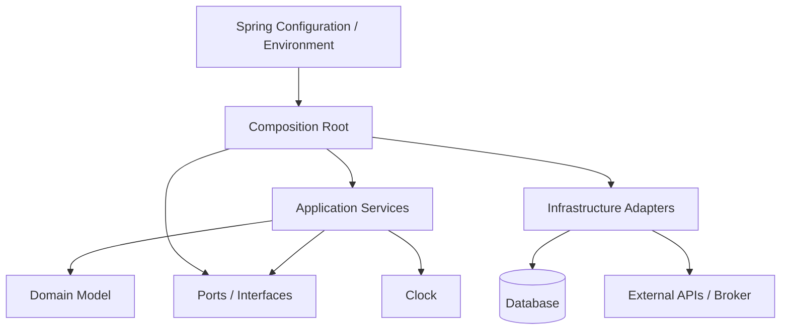

# Kiểm soát cấu hình, thời gian và phụ thuộc bên ngoài khi khởi tạo mô hình

Trong ứng dụng DDD sử dụng Java và Spring, mô hình miền cần được khởi tạo với những dữ liệu và chính sách hợp lệ để bảo vệ invariant. Tuy nhiên, cấu hình môi trường, đồng hồ hệ thống, database, HTTP client và các dịch vụ bên ngoài thuộc về ranh giới ứng dụng hoặc hạ tầng. Nếu đưa những phụ thuộc này trực tiếp vào Entity/Aggregate, mô hình sẽ khó kiểm thử, khó tái sử dụng và dễ bị ràng buộc với framework.

Spring cung cấp Dependency Injection (DI), configuration binding và cơ chế quản lý vòng đời bean để kết nối các thành phần. Thiết kế tốt cần xác định rõ nơi đọc cấu hình, nơi tạo đối tượng miền, cách truyền thời gian và cách gọi dịch vụ ngoài. **Composition root** của ứng dụng lắp ghép các adapter và use case; Application Service điều phối hành vi; Aggregate nhận dữ liệu nghiệp vụ tường minh và tự bảo vệ invariant.

Bài học này trình bày cách quản lý cấu hình bằng Spring Boot, kiểm định cấu hình ngay khi khởi động, tiêm `Clock`, thiết kế port/adapter cho phụ thuộc bên ngoài, tạo Aggregate qua factory, xử lý persistence lifecycle và kiểm thử các ranh giới. Mục tiêu là để mô hình miền giữ được tính độc lập trong khi ứng dụng vẫn tận dụng được hệ sinh thái Spring.

## 1. Phân biệt cấu hình ứng dụng, chính sách miền và dữ liệu của Aggregate

Không phải mọi giá trị có thể cấu hình đều có cùng ý nghĩa. Trước khi chọn nơi lưu hoặc tiêm một giá trị, hãy xác định nó thuộc nhóm nào.

| Loại thông tin | Ví dụ | Nơi thường sở hữu |
|---|---|---|
| Cấu hình triển khai | URL database, broker address, API endpoint, pool size | Infrastructure/configuration |
| Cấu hình bảo mật | Secret, API key, certificate, credential | Secret manager/environment, adapter |
| Chính sách nghiệp vụ | Thời hạn giữ hàng mặc định, ngưỡng phê duyệt, giới hạn số lần gia hạn | Domain policy hoặc application configuration được chuyển thành kiểu miền |
| Dữ liệu của một đối tượng | `expiresAt`, giá đã chốt, hạn mức được cấp cho tài khoản | Aggregate/Entity/Value Object |
| Thời điểm hiện tại | `Instant` lúc xử lý command | Application boundary lấy từ `Clock` |
| Phụ thuộc bên ngoài | Payment provider, email gateway, hệ thống vận chuyển | Port ở phía application/domain cần dùng và adapter ở infrastructure |

Ví dụ, `payment.api-url` là cấu hình hạ tầng. Thời hạn giữ hàng mặc định 15 phút là một chính sách nghiệp vụ có thể thay đổi theo sản phẩm hoặc kênh bán. `expiresAt` của một reservation cụ thể là dữ liệu đã được xác lập khi tạo reservation. Không nên dùng một property `reservation.ttl` để tính lại hạn hết hiệu lực mỗi lần đọc Aggregate.

### 1.1. Cấu hình không phải lúc nào cũng là một phần của domain model

Domain model không nên đọc trực tiếp environment variable, file YAML, Spring `Environment` hoặc `@Value`. Các nguồn đó mô tả môi trường triển khai. Application layer có thể đọc chúng, kiểm tra và chuyển thành kiểu dữ liệu phù hợp trước khi gọi domain behavior.

Nếu một giá trị ảnh hưởng trực tiếp đến quyết định nghiệp vụ, hãy đặt tên và biểu diễn nó bằng một kiểu có ngữ nghĩa. Ví dụ `ReservationPolicy`, `ApprovalThreshold` hoặc `MaximumExtensionCount` dễ hiểu hơn một số `int` không có ý nghĩa.

## 2. Composition Root: nơi lắp ghép ứng dụng

Composition root là điểm mà ứng dụng tạo và kết nối các dependency cụ thể. Trong Spring Boot, container thường đóng vai trò này thông qua `@Configuration`, `@Bean`, component scanning và constructor injection.

Một sơ đồ trách nhiệm:



Composition root biết implementation cụ thể như `JpaOrderRepository`, `HttpPaymentGateway` hoặc `Clock.systemUTC()`. Domain model không cần biết Spring đã tạo các đối tượng đó như thế nào.

### 2.1. Constructor Injection làm dependency hiển thị

```java
@Service
public class SubmitOrderHandler {
    private final OrderRepository orders;
    private final InventoryGateway inventory;
    private final Clock clock;

    public SubmitOrderHandler(
            OrderRepository orders,
            InventoryGateway inventory,
            Clock clock) {
        this.orders = orders;
        this.inventory = inventory;
        this.clock = clock;
    }
}
```

Người đọc biết use case cần repository, gateway và nguồn thời gian nào. Constructor injection cũng giúp test truyền fake hoặc fixed clock trực tiếp.

Với class chỉ có một constructor, Spring có thể tự dùng constructor đó mà không cần `@Autowired` trong các phiên bản Spring hiện đại. Nếu có nhiều constructor, cần chỉ rõ constructor mà container phải sử dụng.

### 2.2. Tránh Field Injection

```java
@Service
public class SubmitOrderHandler {
    @Autowired
    private OrderRepository orders;
}
```

Field injection làm dependency ẩn khỏi constructor và khiến việc tạo object ngoài Spring khó hơn. Unit test phải dùng reflection hoặc khởi tạo Spring context chỉ để gán dependency. Constructor injection giúp object không thể được tạo ở trạng thái thiếu dependency bắt buộc.

## 3. Quản lý cấu hình bằng `@ConfigurationProperties`

Spring Boot hỗ trợ bind một nhóm property vào một kiểu Java. Cách này thường rõ ràng và dễ kiểm định hơn việc rải nhiều `@Value` ở các class.

Ví dụ cấu hình:

```yaml
sales:
  reservation:
    default-ttl: 15m
    max-extension-count: 2
    allow-extension: true
```

Một kiểu cấu hình có thể dùng record:

```java
import java.time.Duration;
import org.springframework.boot.context.properties.ConfigurationProperties;
import org.springframework.validation.annotation.Validated;
import jakarta.validation.constraints.Min;
import jakarta.validation.constraints.NotNull;

@Validated
@ConfigurationProperties(prefix = "sales.reservation")
public record ReservationProperties(
        @NotNull Duration defaultTtl,
        @Min(0) int maxExtensionCount,
        boolean allowExtension
) {}
```

Đăng ký kiểu cấu hình:

```java
@Configuration
@EnableConfigurationProperties(ReservationProperties.class)
public class ReservationConfiguration {
}
```

Hoặc ứng dụng có thể dùng `@ConfigurationPropertiesScan` ở class khởi động để quét các kiểu cấu hình trong phạm vi package phù hợp.

### 3.1. Kiểm tra cấu hình ngay khi khởi động

Một cấu hình sai như TTL bằng 0 hoặc âm có thể làm use case hoạt động sai. Nên phát hiện lỗi khi ứng dụng khởi động thay vì chờ request đầu tiên.

```java
@Validated
@ConfigurationProperties(prefix = "sales.reservation")
public record ReservationProperties(
        @NotNull Duration defaultTtl,
        @Min(0) int maxExtensionCount,
        boolean allowExtension
) {
    public ReservationProperties {
        if (defaultTtl == null || defaultTtl.isZero() || defaultTtl.isNegative()) {
            throw new IllegalArgumentException("defaultTtl must be positive");
        }
    }
}
```

Constructor validation bảo vệ cả khi kiểu properties được tạo trực tiếp trong test hoặc code cấu hình. Bean Validation annotation vẫn hữu ích để báo lỗi bind có cấu trúc; cần có dependency validation tương ứng để chúng được thực thi. Cách bind record và constructor binding phụ thuộc phiên bản Spring Boot đang dùng.

### 3.2. Dùng kiểu dữ liệu có ý nghĩa

Ưu tiên `Duration` cho TTL, `URI` cho endpoint, `ZoneId` cho múi giờ và enum cho các chế độ được giới hạn. Các kiểu này giúp phát hiện cấu hình sai sớm hơn một chuỗi hoặc số nguyên tùy ý.

Ví dụ:

```java
@ConfigurationProperties(prefix = "integration.payment")
public record PaymentProperties(
        URI baseUrl,
        Duration connectTimeout,
        Duration readTimeout
) {}
```

Factory hoặc bean cấu hình có thể kiểm tra endpoint dùng scheme được phép và timeout dương trước khi tạo HTTP client.

## 4. Chuyển cấu hình thành chính sách miền

Không nên để Aggregate phụ thuộc trực tiếp vào `ReservationProperties`. Properties thuộc Spring Boot và có thể chứa tên field gắn với cách triển khai. Thay vào đó, chuyển các giá trị cần thiết thành một kiểu miền có ngữ nghĩa rõ.

```java
import java.time.Duration;

public record ReservationPolicy(
        Duration defaultTtl,
        int maxExtensionCount,
        boolean extensionAllowed
) {
    public ReservationPolicy {
        if (defaultTtl == null || defaultTtl.isZero() || defaultTtl.isNegative()) {
            throw new IllegalArgumentException("defaultTtl must be positive");
        }
        if (maxExtensionCount < 0) {
            throw new IllegalArgumentException("maxExtensionCount must not be negative");
        }
    }
}
```

Chuyển đổi ở composition/configuration boundary:

```java
@Configuration
public class DomainPolicyConfiguration {
    @Bean
    ReservationPolicy reservationPolicy(ReservationProperties properties) {
        return new ReservationPolicy(
                properties.defaultTtl(),
                properties.maxExtensionCount(),
                properties.allowExtension()
        );
    }
}
```

Application Service có thể nhận `ReservationPolicy` và truyền những giá trị cần thiết vào factory hoặc hành vi Aggregate. Domain model chỉ biết chính sách, không biết nguồn cấu hình là YAML, environment hay secret/configuration service.

### 4.1. Cấu hình thay đổi theo thời gian

Nếu chính sách thay đổi trong lúc ứng dụng đang chạy, cần quyết định một Aggregate hiện có áp dụng chính sách lúc tạo hay chính sách mới nhất. Ví dụ reservation đã tạo với `expiresAt` cụ thể thường không nên tự đổi TTL chỉ vì property thay đổi. Một reservation mới có thể dùng policy mới.

Nếu nghiệp vụ yêu cầu policy được version hóa, hãy lưu `policyVersion` hoặc snapshot những giá trị cần tái dựng quyết định. Không dựa vào cấu hình hiện tại để diễn giải lại lịch sử mà không có quy tắc rõ.

## 5. Tách cấu hình kỹ thuật khỏi chính sách nghiệp vụ

Ví dụ một hệ thống có:

- `payment.base-url`: nơi gửi request.
- `payment.read-timeout`: giới hạn chờ kỹ thuật.
- `payment.api-key`: credential.
- `payment.capture-window`: thời hạn nghiệp vụ được phép capture.

Ba giá trị đầu thuộc hạ tầng. `capture-window` có thể là chính sách miền hoặc application policy tùy nơi sở hữu quyết định. Không nên gom tất cả vào một `AppConfig` rồi truyền object đó vào mọi class.

Một cấu trúc dễ quản lý:

```text
configuration/
  PaymentClientProperties.java
  ReservationProperties.java
  PaymentClientConfiguration.java
  DomainPolicyConfiguration.java

payment/
  application/
  domain/
  infrastructure/

inventory/
  application/
  domain/
  infrastructure/
```

Đây là một cách tổ chức minh họa. Với hệ thống lớn, cấu hình của một integration có thể nằm gần adapter sở hữu nó; policy nghiệp vụ có thể nằm gần module domain tương ứng.

## 6. Quản lý thời gian bằng `Clock`

Thời gian hiện tại là một phụ thuộc bên ngoài. Không nên để Entity/Aggregate tự gọi `Instant.now()` ở nhiều nơi vì điều đó làm test phụ thuộc vào đồng hồ máy và có thể tạo nhiều mốc thời gian khác nhau trong cùng một use case.

Đăng ký Clock:

```java
@Configuration
public class TimeConfiguration {
    @Bean
    Clock applicationClock() {
        return Clock.systemUTC();
    }
}
```

Application Service lấy một mốc thời gian:

```java
@Service
public class CreateReservationHandler {
    private final ReservationRepository reservations;
    private final ReservationPolicy policy;
    private final Clock clock;

    public CreateReservationHandler(
            ReservationRepository reservations,
            ReservationPolicy policy,
            Clock clock) {
        this.reservations = reservations;
        this.policy = policy;
        this.clock = clock;
    }

    public ReservationId handle(CreateReservationCommand command) {
        Instant now = clock.instant();
        Reservation reservation = Reservation.create(
                command.reservationId(),
                command.items(),
                now,
                policy.defaultTtl()
        );
        reservations.save(reservation);
        return reservation.id();
    }
}
```

Aggregate nhận `Instant now` và `Duration ttl` như dữ liệu tường minh. Nó có thể kiểm tra TTL dương, tính `expiresAt` và bảo vệ invariant mà không cần biết Spring.

### 6.1. Một mốc thời gian cho một quyết định

Nếu cùng một command kiểm tra deadline, đổi trạng thái và ghi Domain Event, hãy cân nhắc lấy Clock một lần rồi truyền cùng `Instant` vào các bước đó. Tránh gọi `clock.instant()` nhiều lần nếu ngữ nghĩa yêu cầu một mốc quyết định thống nhất.

### 6.2. Ngày nghiệp vụ và múi giờ

Với timestamp tuyệt đối, dùng `Instant`. Với ngày hiện tại tại chi nhánh, dùng `LocalDate.now(clock.withZone(branchZone))`. Không dựa vào timezone mặc định của máy chạy ứng dụng. Một ngày theo lịch không phải lúc nào cũng bằng 24 giờ; hãy phân biệt `Duration` và `Period`.

## 7. Kiểm thử thời gian với `Clock.fixed`

`Clock.fixed` giúp kiểm tra chính xác các điều kiện thời gian mà không phải chờ đồng hồ thật:

```java
Instant fixedNow = Instant.parse("2026-06-30T09:00:00Z");
Clock testClock = Clock.fixed(fixedNow, ZoneOffset.UTC);
```

Trong Spring integration test, có thể cung cấp bean Clock test trong test configuration. Với unit test cho Aggregate nhận `Instant`, không cần Clock hay Spring context; chỉ truyền trực tiếp giá trị cố định.

Các trường hợp nên kiểm tra:

- Ngay trước deadline.
- Đúng tại deadline.
- Ngay sau deadline.
- Reservation còn hạn và đã hết hạn.
- Ngày chuyển tháng, năm nhuận và timezone nghiệp vụ.
- Gia hạn chỉ thành công khi trạng thái cho phép.

Không dùng `Thread.sleep()` để đợi thời gian trôi qua nếu có thể điều khiển Clock. Test dùng thời gian cố định nhanh hơn và ít flaky hơn.

## 8. Phụ thuộc bên ngoài nên đi qua Port/Adapter

Domain model không nên trực tiếp tạo HTTP client, gọi SDK thanh toán, gửi email hoặc truy cập Spring `ApplicationContext`. Các tác động bên ngoài cần đi qua một contract mà application sử dụng; infrastructure cung cấp adapter cụ thể.

Ví dụ:

```java
public interface PaymentGateway {
    PaymentResult authorize(AuthorizePayment request);
    RefundResult refund(RefundPayment request);
}
```

Adapter triển khai contract bằng HTTP client hoặc SDK:

```java
@Component
public class HttpPaymentGateway implements PaymentGateway {
    private final PaymentHttpClient client;
    private final PaymentResponseMapper mapper;

    public HttpPaymentGateway(
            PaymentHttpClient client,
            PaymentResponseMapper mapper) {
        this.client = client;
        this.mapper = mapper;
    }

    @Override
    public PaymentResult authorize(AuthorizePayment request) {
        ProviderPaymentResponse response = client.authorize(request);
        return mapper.toDomainResult(response);
    }

    @Override
    public RefundResult refund(RefundPayment request) {
        ProviderRefundResponse response = client.refund(request);
        return mapper.toDomainResult(response);
    }
}
```

Application Service phụ thuộc vào `PaymentGateway`. Domain Aggregate không cần biết HTTP status, JSON field hoặc loại SDK mà provider sử dụng.

### 8.1. Không gọi dịch vụ ngoài trong constructor Aggregate

Constructor hoặc factory của Aggregate nên thiết lập trạng thái hợp lệ từ dữ liệu đã có. Nếu constructor gọi Payment Provider hoặc tải dữ liệu qua mạng, việc tạo object trở thành một quy trình có side effect và có thể thất bại vì nguyên nhân hạ tầng.

Thay vào đó:

1. Application Service gọi gateway khi use case cần dữ liệu/kết quả ngoài.
2. Adapter chuyển đổi response sang kiểu dữ liệu phù hợp.
3. Application Service gọi hành vi Aggregate với dữ liệu đã nhận.
4. Aggregate kiểm tra invariant và thay đổi trạng thái.

Nếu quy trình kéo dài, hãy mô hình hóa trạng thái `PENDING` và điều phối bất đồng bộ thay vì giữ constructor hoặc transaction mở để chờ provider.

## 9. Chuyển đổi mô hình bên ngoài bằng Adapter/ACL

Provider có thể dùng status, đơn vị hoặc thuật ngữ khác với domain nội bộ. Adapter hoặc Anti-Corruption Layer chuyển đổi contract đó.

Ví dụ provider trả:

```json
{
  "transaction_state": "CAPTURED_OK",
  "provider_reference": "PX-77821"
}
```

Adapter chuyển thành:

```java
public enum PaymentStatus {
    AUTHORIZED,
    CAPTURED,
    DECLINED,
    REFUNDED,
    UNKNOWN
}
```

Không để `CAPTURED_OK` lan khắp domain model. Nếu provider đổi schema, mapping ở adapter là nơi thay đổi chủ yếu. Trường hợp không nhận diện được trạng thái cần xử lý rõ như `UNKNOWN` hoặc lỗi contract, không tự suy diễn thành thành công.

## 10. Cấu hình HTTP client và timeout

Timeout của kết nối và timeout đọc response là cấu hình kỹ thuật, không phải invariant của Aggregate. Có thể bind thành `Duration` rồi dùng khi tạo HTTP client.

```java
@ConfigurationProperties(prefix = "integration.payment")
public record PaymentHttpProperties(
        URI baseUrl,
        Duration connectTimeout,
        Duration responseTimeout
) {}
```

Một cấu hình client có thể tạo adapter:

```java
@Configuration
@EnableConfigurationProperties(PaymentHttpProperties.class)
public class PaymentHttpConfiguration {
    @Bean
    WebClient paymentWebClient(
            WebClient.Builder builder,
            PaymentHttpProperties properties) {
        return builder
                .baseUrl(properties.baseUrl().toString())
                .build();
    }
}
```

Đoạn code trên chỉ minh họa việc cung cấp base URL. Timeout thực tế cần cấu hình tại connector/client implementation phù hợp (ví dụ Reactor Netty hoặc HTTP client được chọn); chỉ khai báo property không tự làm client áp dụng timeout.

### 10.1. Phân loại lỗi adapter

Adapter nên chuyển lỗi kỹ thuật thành kết quả hoặc exception có ngữ nghĩa phù hợp:

- Provider từ chối nghiệp vụ.
- Authentication/authorization lỗi.
- Timeout hoặc mất kết nối.
- Response sai schema.
- Provider quá tải hoặc tạm thời không sẵn sàng.
- Kết quả chưa xác định sau khi request có thể đã được thực hiện.

Application Service quyết định retry, từ chối, chuyển trạng thái pending hoặc yêu cầu đối soát. Không nên để domain model phải bắt `WebClientResponseException` hay exception của SDK bên ngoài.

## 11. Idempotency khi gọi hệ thống ngoài

Một request có thể timeout sau khi provider đã thực hiện tác động. Với payment, việc retry không có bảo vệ có thể thu tiền hai lần. Application cần dùng idempotency key hoặc business reference ổn định nếu provider hỗ trợ.

```java
public record AuthorizePayment(
        PaymentId paymentId,
        Money amount,
        String idempotencyKey
) {}
```

Key phải ổn định qua các lần retry của cùng một ý định. Không tạo key mới cho mỗi lần gọi lại. Nếu provider không hỗ trợ idempotency, cần cơ chế tra cứu theo merchant reference, đối soát hoặc trạng thái `UNKNOWN` trước khi gửi một lệnh mới.

Không thể dùng một database transaction để rollback khoản tiền đã được provider thu. Với quy trình dài, nên dùng outbox/worker, lưu operation state và phối hợp bằng saga.

## 12. Tạo Aggregate bằng Factory thay vì Spring Bean

Aggregate thường là object có vòng đời theo use case hoặc được tải từ Repository. Nó không nên là singleton Spring bean. Spring quản lý các service stateless và adapter; Repository tạo/tải Aggregate theo dữ liệu persistence.

Một factory miền có thể tạo Aggregate mới:

```java
import java.util.Objects;

public final class Reservation {
    private final ReservationId id;
    private final List<ReservationLine> lines;
    private final Instant createdAt;
    private final Instant expiresAt;
    private ReservationStatus status;

    private Reservation(
            ReservationId id,
            List<ReservationLine> lines,
            Instant createdAt,
            Instant expiresAt) {
        Objects.requireNonNull(id, "id");
        Objects.requireNonNull(createdAt, "createdAt");
        Objects.requireNonNull(expiresAt, "expiresAt");
        if (lines == null || lines.isEmpty()) {
            throw new IllegalArgumentException("Reservation needs at least one line");
        }
        if (!expiresAt.isAfter(createdAt)) {
            throw new IllegalArgumentException("Expiry must be after creation");
        }
        this.id = id;
        this.lines = List.copyOf(lines);
        this.createdAt = createdAt;
        this.expiresAt = expiresAt;
        this.status = ReservationStatus.ACTIVE;
    }

    public static Reservation create(
            ReservationId id,
            List<ReservationLine> lines,
            Instant now,
            Duration ttl) {
        Objects.requireNonNull(now, "now");
        if (ttl == null || ttl.isZero() || ttl.isNegative()) {
            throw new IllegalArgumentException("TTL must be positive");
        }
        return new Reservation(id, lines, now, now.plus(ttl));
    }
}
```

Factory nhận dữ liệu cần thiết và kiểm tra invariant. Application Service quyết định thời điểm và policy áp dụng, rồi gọi factory. Aggregate không cần `@Component`, `@Autowired` hoặc truy cập `Environment`.

### 12.1. Khi nào cần Domain Factory?

Dùng factory khi việc tạo object có nhiều quy tắc, cần tạo nhiều đối tượng liên quan hoặc cần bảo đảm invariant ban đầu. Nếu constructor đơn giản và rõ, không cần thêm factory class chỉ vì một pattern.

### 12.2. Không đưa logic lấy dữ liệu bên ngoài vào factory

Factory miền không nên tự truy vấn Repository khác, gọi HTTP hoặc đọc file cấu hình. Nếu cần dữ liệu trước khi tạo Aggregate, Application Service thu thập dữ liệu qua port rồi truyền các giá trị cần thiết vào factory.

## 13. Persistence lifecycle và JPA

JPA có quy tắc khởi tạo Entity riêng. Tùy cách thiết kế, có thể dùng domain model tách biệt với persistence entity hoặc ánh xạ JPA trực tiếp lên một số class domain.

Nếu tách riêng:

- Domain Aggregate dùng constructor/factory để bảo vệ invariant.
- Persistence Entity phục vụ ORM và có thể có constructor theo yêu cầu JPA.
- Mapper chuyển đổi giữa persistence state và domain state.
- Repository là nơi phối hợp tải, mapping và lưu.

Ví dụ cấu trúc:

```text
reservation/
  domain/
    Reservation.java
    ReservationLine.java
    ReservationRepository.java
  application/
    CreateReservationHandler.java
  infrastructure/
    JpaReservationEntity.java
    JpaReservationRepository.java
    ReservationMapper.java
```

Không nên để Application Service sửa trực tiếp các field persistence rồi bỏ qua hành vi Aggregate. Khi tải dữ liệu cũ, mapper hoặc reconstitution path cần khôi phục trạng thái đã lưu mà không áp dụng lại các side effect của thao tác tạo mới.

### 13.1. Constructor JPA không phải factory nghiệp vụ

JPA thường cần constructor không tham số với visibility phù hợp cho provider. Constructor này phục vụ hydration, không nên là public API để application tạo Aggregate mới. Nếu dùng cùng class cho domain và JPA, hãy hiểu rõ lifecycle của provider và tránh để object có thể được sử dụng khi chưa khôi phục đầy đủ trạng thái.

### 13.2. Không phát event hoặc gọi service ngoài khi ORM hydrate

Việc load Aggregate từ database không phải một hành động nghiệp vụ mới. Constructor hoặc callback ORM không nên gửi email, gọi provider hay phát `OrderCreated` như thể người dùng vừa tạo Order. Event cần được tạo bởi hành vi nghiệp vụ hoặc quy trình rehydration có chủ đích.

## 14. Bean lifecycle và side effect khi khởi động

Spring tạo bean khi khởi động hoặc theo scope/lazy policy. Constructor và `@PostConstruct` nên tập trung vào việc thiết lập trạng thái và kiểm tra cấu hình cục bộ.

Tránh:

- Constructor bean gọi API ngoài để thực hiện giao dịch nghiệp vụ.
- `@PostConstruct` tạo dữ liệu nghiệp vụ không có idempotency.
- Khởi động ứng dụng đồng nghĩa gửi email hoặc thu tiền.
- Bean singleton giữ trạng thái của một request hoặc một Aggregate.
- `ApplicationContext.getBean()` được gọi tùy tiện trong domain code để lấy dependency.

Nếu cần kiểm tra kết nối khi startup, hãy tách rõ health check/readiness check và hiểu ảnh hưởng tới khả năng khởi động khi dependency tạm thời không sẵn sàng. Một health check không nên tạo side effect nghiệp vụ.

## 15. Scope của Spring Bean và trạng thái nghiệp vụ

Service và adapter thường là singleton vì chúng không giữ trạng thái nghiệp vụ riêng của từng request. Aggregate là object có trạng thái riêng, thường được tạo/tải trong use case.

Không nên đánh dấu Aggregate là `@Component` singleton:

```java
@Component
public class Order {
    private OrderStatus status;
}
```

Spring sẽ quản lý vòng đời bean theo scope; nhiều request có thể dùng chung một instance và gây rò rỉ trạng thái hoặc race condition.

Thay vào đó, tạo Aggregate qua factory hoặc Repository:

```java
Order order = Order.create(command, now, policy);
```

Một bean prototype cũng không tự động là cách đúng để quản lý Aggregate persistence. Repository và transaction vẫn cần xác định rõ mỗi use case tải, thay đổi và lưu instance nào.

## 16. Tránh Circular Dependency trong Spring

Phụ thuộc vòng như A cần B và B cần A thường là dấu hiệu trách nhiệm bị trộn hoặc orchestration đặt sai chỗ.

Ví dụ:

```text
OrderService -> PaymentService -> OrderService
```

Không nên giải quyết mặc định bằng `@Lazy` hoặc field injection. Hãy xác định use case nào điều phối quy trình và tách trách nhiệm:

- Application Service điều phối bước.
- Domain Service chứa quy tắc cần phối hợp nhiều đối tượng miền.
- Event/Process Manager xử lý bước tiếp theo nếu có thể bất đồng bộ.
- Port/Adapter đảo hướng phụ thuộc vào hợp đồng có ý nghĩa.

Nếu Order cần biết kết quả thanh toán, Payment có thể công bố event hoặc trả kết quả qua contract; Payment không cần gọi ngược vào `OrderService` để sửa trạng thái Order.

## 17. Quản lý secret và cấu hình theo môi trường

URL, timeout, feature flag và secret có vòng đời khác nhau. Không đưa credential vào domain object hoặc commit secret thật trong file cấu hình nguồn.

Nguyên tắc:

- Dùng environment variable, secret manager hoặc cơ chế bảo mật của nền tảng để cấp credential.
- Không log API key, password, token hoặc toàn bộ request nhạy cảm.
- Tách cấu hình local, test, staging và production.
- Dùng default an toàn; tránh default khiến production vô tình gọi sandbox hoặc ngược lại.
- Validate endpoint, timeout, zone và các giá trị bắt buộc khi khởi động.
- Không để domain model phụ thuộc vào Spring `Environment` hoặc profile.

Spring profiles hữu ích để chọn cấu hình triển khai, nhưng không nên dùng profile để thay đổi ngữ nghĩa nghiệp vụ âm thầm. Nếu hành vi nghiệp vụ khác theo tenant, sản phẩm hoặc hợp đồng, hãy mô hình hóa policy rõ ràng.

## 18. Dynamic Configuration và tính nhất quán của quyết định

Một số hệ thống cho phép cập nhật cấu hình khi ứng dụng đang chạy. Cần xác định:

- Cấu hình mới áp dụng cho command bắt đầu sau thời điểm nào?
- Một use case đang chạy có tiếp tục dùng snapshot cấu hình lúc bắt đầu không?
- Aggregate đã tạo có bị thay đổi deadline/chính sách không?
- Có cần audit phiên bản policy đã được dùng không?
- Các application instance có thể nhận config mới lệch thời điểm không?

Với quyết định quan trọng, có thể đọc một snapshot policy tại đầu use case và truyền xuyên suốt. Nếu chính sách phải được tái dựng về sau, lưu version hoặc giá trị đã áp dụng cùng kết quả nghiệp vụ.

Không nên để một use case đọc property nhiều lần ở các bước khác nhau nếu cập nhật config giữa chừng có thể làm các bước áp dụng hai chính sách khác nhau.

## 19. Kiểm thử các ranh giới cấu hình và dependency

### 19.1. Unit test domain model không cần Spring

```java
@Test
void reservationUsesExplicitTtl() {
    Instant now = Instant.parse("2026-06-30T09:00:00Z");
    Reservation reservation = Reservation.create(
            reservationId(),
            List.of(aReservationLine()),
            now,
            Duration.ofMinutes(15)
    );

    assertEquals(now.plus(Duration.ofMinutes(15)), reservation.expiresAt());
}
```

Domain test truyền dữ liệu và policy tường minh. Không cần `@SpringBootTest` để kiểm tra invariant của Aggregate.

### 19.2. Test configuration binding

Spring Boot hỗ trợ test bind properties và validation. Có thể dùng `ApplicationContextRunner` hoặc một test context nhỏ để xác minh cấu hình hợp lệ được bind và cấu hình sai làm context không khởi động theo contract mong muốn.

Các trường hợp nên kiểm tra:

- Thiếu property bắt buộc.
- Duration bằng zero hoặc âm.
- URI sai định dạng hoặc scheme không được phép.
- Timeout quá lớn/nhỏ ngoài giới hạn chính sách vận hành.
- Enum/config mode không được hỗ trợ.

### 19.3. Test Application Service với fake port và Clock.fixed

```java
Clock clock = Clock.fixed(
        Instant.parse("2026-06-30T09:00:00Z"),
        ZoneOffset.UTC
);
PaymentGateway fakeGateway = new SuccessfulPaymentGateway();
```

Test xác minh application gọi đúng port, truyền idempotency key, xử lý kết quả và ghi thay đổi Aggregate. Không cần gọi provider thật.

### 19.4. Adapter integration test

Kiểm thử adapter riêng với mock server hoặc sandbox phù hợp để xác minh:

- Mapping request/response.
- Timeout và lỗi HTTP.
- Authentication header.
- Idempotency key được truyền đúng.
- Response không hợp lệ được xử lý rõ.
- Secret không xuất hiện trong log.

### 19.5. Spring context test

Một số test cần xác minh composition root:

- Bean cần thiết được đăng ký.
- Không có circular dependency ngoài dự kiến.
- Configuration validation hoạt động.
- Profile test cung cấp Clock/adapter phù hợp.
- Không khởi chạy side effect nghiệp vụ khi context được tạo.

## 20. Các lỗi thường gặp

| Lỗi | Hệ quả | Cách cải thiện |
|---|---|---|
| Domain đọc `Environment` hoặc `@Value` | Domain phụ thuộc Spring và môi trường triển khai | Bind ở configuration boundary, truyền policy/giá trị miền |
| Rải `@Value` ở nhiều service | Cấu hình phân tán và khó kiểm định | Gom nhóm bằng `@ConfigurationProperties` |
| Không validate config khi startup | Lỗi chỉ xuất hiện khi request chạy | Dùng validation và factory có invariant |
| Aggregate là Spring singleton | Trạng thái bị chia sẻ giữa request | Tạo qua factory/Repository theo use case |
| Aggregate constructor gọi HTTP | Tạo object có side effect và phụ thuộc mạng | Application gọi port trước, truyền kết quả vào domain |
| Aggregate tự gọi `Instant.now()` | Test khó ổn định và thời điểm không nhất quán | Tiêm Clock ở boundary, truyền Instant |
| Dùng cấu hình hiện tại để tính lại dữ liệu cũ | Lịch sử nghiệp vụ thay đổi ngoài ý muốn | Lưu giá trị đã áp dụng hoặc policy version |
| Application phụ thuộc SDK provider | Coupling với vendor và schema ngoài | Dùng port và adapter/ACL |
| Retry mọi lỗi ngoài hệ thống | Duplicate side effect hoặc tăng tải | Phân loại lỗi, idempotency, backoff và đối soát |
| `@PostConstruct` thực hiện giao dịch nghiệp vụ | Startup/restart tạo tác động lặp | Dùng use case/job riêng có idempotency |
| Dùng `@Lazy` để che circular dependency | Vòng phụ thuộc vẫn tồn tại | Tách orchestration và ownership |
| Unit test luôn khởi động Spring | Test chậm và che giấu coupling | Test domain/application thuần; test Spring ở boundary |

## 21. Quy trình thiết kế một use case có cấu hình và phụ thuộc ngoài

1. **Xác định quyết định nghiệp vụ:** Aggregate cần bảo vệ invariant nào?
2. **Phân loại dữ liệu đầu vào:** cấu hình triển khai, policy hay dữ liệu đã lưu?
3. **Xác định owner:** context nào sở hữu chính sách và dữ liệu?
4. **Bind và validate cấu hình:** dùng kiểu phù hợp, kiểm tra sớm.
5. **Tạo port:** mô tả hành động bên ngoài bằng contract có ngữ nghĩa.
6. **Tạo adapter:** hiện thực bằng Spring/HTTP/SDK ở infrastructure.
7. **Tiêm dependency:** constructor injection tại application/composition root.
8. **Capture thời gian:** lấy Clock một lần khi cần mốc nhất quán.
9. **Tạo hoặc tải Aggregate:** dùng factory/Repository, không để Spring quản lý Aggregate như singleton.
10. **Thực hiện hành vi:** truyền dữ liệu/policy/time tường minh để Aggregate kiểm tra invariant.
11. **Lưu kết quả:** trong transaction phù hợp; dùng outbox nếu cần phát event.
12. **Kiểm thử:** domain unit test, application test, configuration test và adapter integration test.

## 22. Checklist trước khi đưa ứng dụng vào vận hành

- [ ] Domain model không đọc Spring Environment, YAML hoặc system property trực tiếp.
- [ ] Cấu hình được nhóm theo mục đích bằng `@ConfigurationProperties` khi phù hợp.
- [ ] Property bắt buộc và giá trị biên được validate khi startup.
- [ ] Cấu hình kỹ thuật được tách khỏi chính sách nghiệp vụ.
- [ ] Policy được chuyển thành kiểu miền có invariant rõ.
- [ ] Giá trị đã áp dụng cho Aggregate được lưu khi cần tái dựng lịch sử.
- [ ] Clock được cung cấp qua DI và dùng UTC cho timestamp tuyệt đối khi phù hợp.
- [ ] Một command dùng mốc thời gian nhất quán cho các quyết định liên quan.
- [ ] Aggregate nhận thời gian/dữ liệu tường minh và không gọi đồng hồ hệ thống.
- [ ] Phụ thuộc ngoài đi qua port và adapter/ACL.
- [ ] Constructor/factory Aggregate không gọi mạng hoặc tạo side effect ngoài.
- [ ] Aggregate không bị quản lý như singleton Spring bean.
- [ ] Persistence hydration không phát event hoặc gọi dịch vụ ngoài ngoài ý muốn.
- [ ] Timeout, retry, idempotency và unknown outcome được định nghĩa cho integration.
- [ ] Secret được quản lý an toàn và không xuất hiện trong log.
- [ ] Bean lifecycle không thực hiện giao dịch nghiệp vụ lặp khi startup.
- [ ] Có unit test domain không cần Spring context.
- [ ] Có test cấu hình, adapter và composition root tại đúng boundary.

## 23. Kết nối với các khái niệm DDD khác

Aggregate và Value Object bảo vệ invariant; Application Service điều phối use case; Repository tải và lưu Aggregate; Domain Service chứa quy tắc không thuộc tự nhiên về một Entity; Domain Event ghi nhận điều đã xảy ra. Spring cung cấp cơ chế lắp ghép các thành phần thông qua DI, nhưng không nên trở thành một phần bắt buộc của domain model.

Configuration Properties cung cấp giá trị triển khai. Application boundary chuyển những giá trị có ý nghĩa nghiệp vụ thành policy hoặc Value Object. `Clock` cung cấp mốc thời gian có thể kiểm soát. Port/Adapter bảo vệ mô hình khỏi SDK, HTTP và các hệ thống ngoài. Factory tạo Aggregate từ dữ liệu hợp lệ, còn Repository khôi phục trạng thái đã lưu.

Khi các trách nhiệm này được phân tách, Spring có thể thay đổi cách cấu hình bean, HTTP client hoặc persistence mà không buộc domain model thay đổi theo. Ngược lại, khi chính sách nghiệp vụ thay đổi, nhóm có thể sửa và kiểm thử ở đúng module sở hữu. Đó là cách kết hợp DDD với Spring để giữ mô hình miền rõ ràng, khởi tạo có kiểm soát và dễ tiến hóa.
