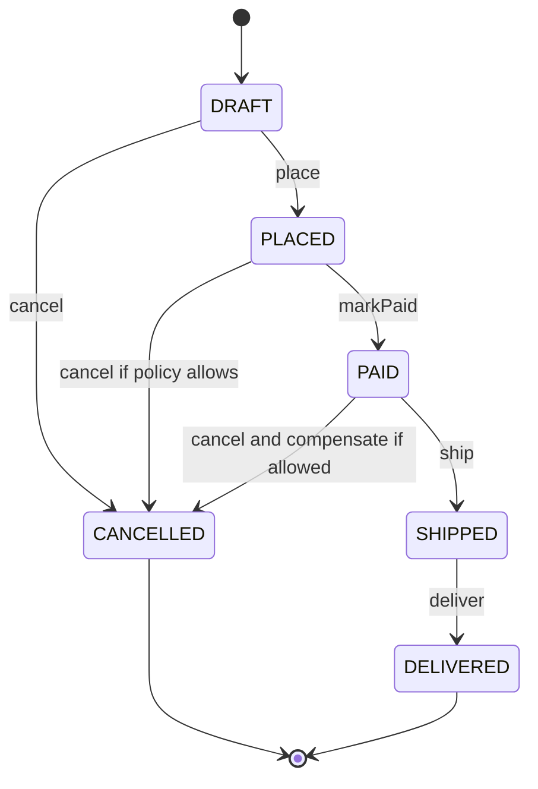

# Kiểm thử Entity và các chuyển trạng thái được phép

Trong Domain-Driven Design (DDD), Entity được nhận diện bằng identity và có vòng đời thay đổi theo thời gian. Một `Order` có thể bắt đầu ở trạng thái nháp, được đặt, thanh toán, giao đi hoặc hủy. Không phải mọi chuyển đổi đều hợp lệ: đơn đã giao không thể quay lại trạng thái nháp; đơn đã hủy không thể tiếp tục thanh toán như một đơn đang hoạt động; một đơn chỉ được xác nhận khi các điều kiện nghiệp vụ cần thiết đã thỏa mãn.

Kiểm thử Entity vì vậy cần tập trung vào **hành vi và quy tắc chuyển trạng thái**, thay vì chỉ kiểm tra getter/setter hoặc cấu trúc field. Test phải chứng minh rằng hành động hợp lệ tạo ra trạng thái đúng, hành động không hợp lệ bị từ chối, invariant luôn được bảo vệ và sự kiện domain chỉ được phát ra khi nghiệp vụ thực sự chấp nhận thay đổi.

Bài viết hướng dẫn xây dựng state transition matrix, viết unit test cho Entity/Aggregate, kiểm tra các điều kiện biên, sự kiện, thời gian và identity, đồng thời phân biệt phần nào cần integration test với persistence. Ví dụ xuyên suốt dùng vòng đời đơn hàng, nhưng cách tiếp cận áp dụng được cho Reservation, Subscription, Payment, Shipment và các Entity có trạng thái khác.

## 1. Vì sao cần kiểm thử Entity theo hành vi?

Entity có identity liên tục qua các lần thay đổi. Hai object có thể có cùng dữ liệu nhưng khác identity; một Entity có thể thay đổi trạng thái mà vẫn là cùng một thực thể nghiệp vụ.

Ví dụ `Order`:

- Được tạo ở trạng thái `DRAFT`.
- Có thể được đặt nếu có ít nhất một dòng hàng hợp lệ.
- Có thể được thanh toán sau khi đã đặt.
- Có thể được giao sau khi thanh toán hoặc theo chính sách thanh toán khi nhận hàng.
- Có thể bị hủy trước một mốc nhất định.
- Không thể bị hủy theo cùng quy trình sau khi đã bàn giao cho hãng vận chuyển.

Nếu Entity chỉ có setter công khai như `setStatus()` thì caller có thể tự chuyển từ `DRAFT` sang `SHIPPED`, bỏ qua thanh toán, kiểm tra tồn kho hoặc các hành vi cần thiết. Unit test cần xác nhận API domain chỉ cho phép những chuyển đổi được nghiệp vụ định nghĩa.

### 1.1. Test getter không chứng minh được quy tắc domain

Test như sau thường có giá trị thấp:

```java
@Test
void setsStatus() {
    Order order = new Order();
    order.setStatus(OrderStatus.PAID);
    assertEquals(OrderStatus.PAID, order.getStatus());
}
```

Test này chỉ chứng minh setter hoạt động. Nó không kiểm tra liệu đơn có được phép thanh toán hay không, có phải đã được đặt trước đó không, hoặc event `OrderPaid` có được ghi nhận đúng không.

Test hành vi nên gọi method biểu đạt ý định nghiệp vụ:

```java
order.markPaid(paymentReference, paidAt);
```

và xác minh kết quả theo quy tắc của domain.

### 1.2. Phân biệt Entity và Aggregate Root khi test

Một Entity có thể nằm bên trong Aggregate và không được phép thay đổi độc lập từ bên ngoài. Ví dụ `OrderLine` có thể là Entity con của `Order`. Nếu invariant phụ thuộc tổng thể đơn hàng, hãy kiểm thử thông qua `Order` Aggregate Root:

```java
order.changeQuantity(lineId, newQuantity);
```

thay vì tải `OrderLine` riêng rồi gọi một setter công khai. Test nên phản ánh đường đi mà production code được phép sử dụng.

## 2. Mô hình hóa state transition trước khi viết test

Trước khi viết test, hãy xác định trạng thái và chuyển đổi hợp lệ. Nếu chưa có bảng chuyển trạng thái, nhóm rất dễ chỉ test những luồng mình nhớ được.

Giả sử đơn hàng có các trạng thái:

| Trạng thái hiện tại | Hành động | Trạng thái tiếp theo | Điều kiện |
|---|---|---|---|
| `DRAFT` | `place()` | `PLACED` | Có ít nhất một dòng hàng, dữ liệu giá hợp lệ |
| `DRAFT` | `cancel()` | `CANCELLED` | Đơn nháp được phép bỏ |
| `PLACED` | `markPaid()` | `PAID` | Có payment reference hợp lệ |
| `PLACED` | `cancel()` | `CANCELLED` | Chưa giao và chính sách cho phép hủy |
| `PAID` | `ship()` | `SHIPPED` | Có shipment reference và đủ điều kiện giao |
| `PAID` | `cancel()` | `CANCELLED` | Chỉ khi policy cho phép và xử lý hoàn tiền được điều phối |
| `SHIPPED` | `deliver()` | `DELIVERED` | Có xác nhận giao hàng hợp lệ |
| `SHIPPED` | `cancel()` | Không cho phép | Cần quy trình thu hồi/return riêng |
| `DELIVERED` | `cancel()` | Không cho phép | Nếu cần, tạo Return/Refund workflow |
| `CANCELLED` | `markPaid()` | Không cho phép | Đơn đã hủy không được thanh toán |

Đây là ví dụ minh họa. Một domain có thể cho phép thanh toán trước khi đặt, giao hàng khi thanh toán khi nhận hàng, hoặc có các trạng thái khác. Domain expert phải xác nhận state machine thực tế.

### 2.1. State transition diagram



Sơ đồ không hiển thị mọi điều kiện và nhánh lỗi. Nó giúp nhóm nhìn thấy các trạng thái và đường chuyển tiếp, còn state transition matrix ghi rõ guard condition và kết quả cần test.

### 2.2. Phân biệt trạng thái với các thuộc tính độc lập

Không phải mọi boolean đều nên biến thành trạng thái. `isGiftWrapped` có thể là thuộc tính độc lập với vòng đời đơn; `isCancelled` và `isDelivered` thường đại diện các trạng thái loại trừ nhau. Khi một Entity có nhiều boolean phụ thuộc nhau, hãy kiểm tra số tổ hợp không hợp lệ và cân nhắc một enum/state machine.

## 3. Xây dựng bộ test từ transition matrix

Với mỗi hành động, kiểm tra ít nhất ba điều:

1. **Precondition:** trạng thái và dữ liệu đầu vào có đáp ứng điều kiện không?
2. **State change:** trạng thái và các field liên quan thay đổi chính xác thế nào?
3. **Side effect trong domain:** event hoặc decision nào được tạo ra?

Với chuyển đổi không hợp lệ, xác minh hành động bị từ chối và Entity vẫn giữ trạng thái nhất quán.

### 3.1. Test mọi chuyển đổi hợp lệ

Mỗi cạnh trong state machine cần ít nhất một test. Ví dụ:

- `DRAFT -> PLACED` khi có dòng hàng hợp lệ.
- `PLACED -> PAID` khi có payment reference.
- `PAID -> SHIPPED` khi có shipment reference.
- `SHIPPED -> DELIVERED` khi có xác nhận giao hàng.
- `DRAFT -> CANCELLED` khi hủy đơn nháp.

Không nhất thiết một test phải bao phủ mọi field. Nhưng test phải chứng minh hành vi và các invariant liên quan đến chuyển đổi đó.

### 3.2. Test các chuyển đổi không hợp lệ

Các cạnh không được phép cũng quan trọng như cạnh hợp lệ:

- `DRAFT -> SHIPPED`.
- `CANCELLED -> PAID`.
- `DELIVERED -> CANCELLED` theo luồng hủy thông thường.
- `SHIPPED -> DRAFT`.
- `PLACED -> DELIVERED` nếu domain yêu cầu thanh toán và giao hàng theo trình tự.

Một cách tiếp cận là kiểm thử theo từng trạng thái nguồn và từng hành động. Không nên chỉ test một exception bất kỳ rồi coi như mọi chuyển đổi sai đã được bảo vệ.

### 3.3. Test guard condition riêng

Một chuyển đổi có thể đúng về trạng thái nhưng không đủ điều kiện vì dữ liệu:

- Không thể đặt đơn rỗng.
- Không thể đánh dấu thanh toán với reference trống.
- Không thể giao nếu thiếu shipment reference.
- Không thể xác nhận giao hàng nếu thời điểm giao không hợp lệ.
- Không thể hủy nếu policy từ chối.

Test guard giúp xác định rõ lý do từ chối và tránh để một trạng thái đúng che giấu dữ liệu sai.

### 3.4. Ma trận test tối thiểu

| Hành vi | Trường hợp hợp lệ | Trường hợp không hợp lệ |
|---|---|---|
| `place()` | Đơn có ít nhất một dòng hàng | Đơn rỗng hoặc dòng hàng không hợp lệ |
| `markPaid()` | Đơn `PLACED`, reference hợp lệ | Đơn `DRAFT`, `CANCELLED` hoặc reference rỗng |
| `ship()` | Đơn `PAID`, shipment reference hợp lệ | Đơn chưa thanh toán hoặc đã hủy |
| `deliver()` | Đơn `SHIPPED`, delivery evidence hợp lệ | Đơn chưa giao hoặc evidence không hợp lệ |
| `cancel()` | Trạng thái và policy cho phép | `SHIPPED`/`DELIVERED` nếu luồng hủy không còn hợp lệ |

## 4. Ví dụ Entity Order có hành vi rõ ràng

Ví dụ sau dùng Java và JUnit 5. Các kiểu `OrderId`, `Money`, `OrderLine`, `PaymentReference` và `ShipmentReference` được rút gọn để tập trung vào state transition.

```java
public enum OrderStatus {
    DRAFT,
    PLACED,
    PAID,
    SHIPPED,
    DELIVERED,
    CANCELLED
}
```

Entity:

```java
public final class Order {
    private final OrderId id;
    private final List<OrderLine> lines = new ArrayList<>();
    private OrderStatus status = OrderStatus.DRAFT;
    private PaymentReference paymentReference;
    private ShipmentReference shipmentReference;
    private DeliveryEvidence deliveryEvidence;
    private Instant placedAt;
    private Instant cancelledAt;
    private Instant deliveredAt;
    private final List<DomainEvent> domainEvents = new ArrayList<>();

    public Order(OrderId id) {
        this.id = Objects.requireNonNull(id);
    }

    public void addLine(OrderLine line) {
        requireStatus(OrderStatus.DRAFT);
        lines.add(Objects.requireNonNull(line));
    }

    public void place(Instant now) {
        requireStatus(OrderStatus.DRAFT);
        if (lines.isEmpty()) {
            throw new EmptyOrderException(id);
        }
        Objects.requireNonNull(now);
        this.status = OrderStatus.PLACED;
        this.placedAt = now;
        domainEvents.add(new OrderPlaced(id, now));
    }

    public void markPaid(PaymentReference reference, Instant paidAt) {
        requireStatus(OrderStatus.PLACED);
        Objects.requireNonNull(reference);
        Objects.requireNonNull(paidAt);
        this.paymentReference = reference;
        this.status = OrderStatus.PAID;
        domainEvents.add(new OrderPaid(id, reference, paidAt));
    }

    public void ship(ShipmentReference reference, Instant shippedAt) {
        requireStatus(OrderStatus.PAID);
        Objects.requireNonNull(reference);
        Objects.requireNonNull(shippedAt);
        this.shipmentReference = reference;
        this.status = OrderStatus.SHIPPED;
        domainEvents.add(new OrderShipped(id, reference, shippedAt));
    }

    public void deliver(DeliveryEvidence evidence, Instant deliveredAt) {
        requireStatus(OrderStatus.SHIPPED);
        Objects.requireNonNull(evidence);
        Objects.requireNonNull(deliveredAt);
        this.deliveryEvidence = evidence;
        this.deliveredAt = deliveredAt;
        this.status = OrderStatus.DELIVERED;
        domainEvents.add(new OrderDelivered(id, evidence, deliveredAt));
    }

    public void cancel(String reason, Instant now) {
        if (status != OrderStatus.DRAFT && status != OrderStatus.PLACED
                && status != OrderStatus.PAID) {
            throw new OrderCannotBeCancelledException(id, status);
        }
        if (reason == null || reason.isBlank()) {
            throw new CancellationReasonRequiredException(id);
        }
        Objects.requireNonNull(now);
        this.status = OrderStatus.CANCELLED;
        this.cancelledAt = now;
        domainEvents.add(new OrderCancelled(id, reason, now));
    }

    private void requireStatus(OrderStatus expected) {
        if (status != expected) {
            throw new InvalidOrderTransitionException(id, status, expected);
        }
    }

    public OrderId id() { return id; }
    public OrderStatus status() { return status; }
    public Optional<PaymentReference> paymentReference() {
        return Optional.ofNullable(paymentReference);
    }
    public List<DomainEvent> domainEvents() {
        return List.copyOf(domainEvents);
    }
}
```

Đây là model minh họa, không phải quy tắc chung cho mọi đơn hàng. Trong hệ thống thực tế, hủy đơn đã thanh toán có thể cần refund workflow; method `cancel()` không nên giả định tiền đã được hoàn ngay lập tức. Application service hoặc process manager điều phối payment compensation, còn aggregate ghi nhận trạng thái phù hợp với nghiệp vụ.

### 4.1. Tránh setter trạng thái công khai

Không nên cung cấp `setStatus(OrderStatus status)` nếu nó cho phép caller bỏ qua hành vi. Nếu ORM cần constructor hoặc access strategy đặc biệt, hãy thiết kế persistence access riêng và bảo đảm application/domain không dùng setter tùy ý.

### 4.2. Trả bản sao collection

`domainEvents()` trả `List.copyOf` để caller không thể xóa hoặc thêm event tùy tiện. Tương tự, các collection domain nên được bảo vệ khỏi sửa đổi bên ngoài nếu việc sửa đó có thể phá invariant.

## 5. Unit test cho chuyển đổi hợp lệ

Một test nên thể hiện điều kiện, hành động và kết quả bằng tên rõ ràng.

```java
class OrderTransitionTest {
    private final OrderId orderId = OrderId.of("ORD-100");

    @Test
    void placesDraftOrderWhenItContainsAtLeastOneLine() {
        Order order = new Order(orderId);
        order.addLine(validLine());
        Instant now = Instant.parse("2026-06-01T10:00:00Z");

        order.place(now);

        assertEquals(OrderStatus.PLACED, order.status());
        assertEquals(1, order.domainEvents().size());
        assertInstanceOf(OrderPlaced.class, order.domainEvents().get(0));
    }

    @Test
    void marksPlacedOrderAsPaid() {
        Order order = placedOrder();
        PaymentReference reference = PaymentReference.of("PAY-900");

        order.markPaid(reference, Instant.parse("2026-06-01T10:05:00Z"));

        assertEquals(OrderStatus.PAID, order.status());
        assertEquals(Optional.of(reference), order.paymentReference());
    }
}
```

`placedOrder()` và `validLine()` là test fixture được định nghĩa trong lớp test. Ví dụ dùng `get(0)` để truy cập phần tử đầu tiên, tương thích với các Java version trước khi collection có `getFirst()`.

### 5.1. Kiểm tra toàn bộ kết quả có liên quan

Khi test `markPaid()`, ngoài status cần xác minh payment reference đã được gắn đúng. Nếu domain phát `OrderPaid`, hãy xác minh event có đúng order ID, payment reference và thời điểm. Tránh chỉ kiểm tra status rồi bỏ sót một phần trạng thái.

### 5.2. Không kiểm tra chi tiết implementation không có ý nghĩa

Test không nên phụ thuộc vào thứ tự gọi private method hoặc cấu trúc collection nội bộ nếu điều đó không phải hợp đồng domain. Hãy xác minh trạng thái, giá trị và event mà caller được phép quan sát.

## 6. Test chuyển đổi không hợp lệ

Test negative path cần xác nhận hai điều:

1. Hành động bị từ chối bằng lỗi hoặc kết quả domain phù hợp.
2. Trạng thái trước đó không bị thay đổi một phần.

Ví dụ đơn nháp không được thanh toán:

```java
@Test
void cannotMarkDraftOrderAsPaid() {
    Order order = new Order(OrderId.of("ORD-101"));
    PaymentReference reference = PaymentReference.of("PAY-901");

    assertThrows(InvalidOrderTransitionException.class,
        () -> order.markPaid(reference, Instant.parse("2026-06-01T10:05:00Z")));

    assertEquals(OrderStatus.DRAFT, order.status());
    assertTrue(order.paymentReference().isEmpty());
    assertTrue(order.domainEvents().isEmpty());
}
```

### 6.1. Kiểm tra trạng thái không đổi khi từ chối

Một method có thể vô tình gán field trước khi kiểm tra hết điều kiện. Ví dụ đặt `paymentReference` rồi mới kiểm tra trạng thái. Khi exception xảy ra, object vẫn giữ một phần thay đổi.

Hãy viết test kiểm tra state sau exception. Trong implementation, kiểm tra precondition trước khi mutate hoặc tính toán kết quả trước rồi áp dụng thay đổi một cách nguyên tử trong phạm vi Entity/Aggregate. Ngoại lệ là trường hợp chính hành động bị từ chối đồng thời thực hiện một transition nghiệp vụ đã được định nghĩa, chẳng hạn đánh dấu reservation là `EXPIRED` khi caller cố xác nhận sau deadline; test khi đó phải xác minh trạng thái kết quả `EXPIRED` theo đúng quy tắc.

### 6.2. Test các trạng thái terminal

Trạng thái như `CANCELLED` hoặc `DELIVERED` thường không cho phép một số hành động tiếp theo. Hãy test rõ:

```java
@Test
void cancelledOrderCannotBePaid() {
    Order order = cancelledOrder();

    assertThrows(InvalidOrderTransitionException.class,
        () -> order.markPaid(PaymentReference.of("PAY-902"), FIXED_TIME));

    assertEquals(OrderStatus.CANCELLED, order.status());
}
```

Không nên giả định mọi trạng thái terminal đều bất biến tuyệt đối. Một số domain có hành động sửa sai hoặc mở lại, nhưng đó phải là hành vi riêng có quyền và điều kiện rõ, không phải setter tổng quát.

## 7. Dùng parameterized test cho nhiều trạng thái nguồn

Khi một hành động bị cấm ở nhiều trạng thái, parameterized test giúp thể hiện quy tắc mà không sao chép nhiều test gần giống nhau.

```java
@ParameterizedTest
@EnumSource(value = OrderStatus.class,
    names = {"DRAFT", "CANCELLED", "SHIPPED", "DELIVERED"})
void cannotMarkPaidFromUnsupportedStatus(OrderStatus sourceStatus) {
    Order order = orderInStatus(sourceStatus);

    assertThrows(InvalidOrderTransitionException.class,
        () -> order.markPaid(PaymentReference.of("PAY-903"), FIXED_TIME));
}
```

`orderInStatus()` không nên dùng setter production để nhảy trực tiếp vào trạng thái bất kỳ. Có thể tạo fixture bằng các hành vi hợp lệ theo chuỗi hoặc dùng test factory/builder được giới hạn trong test. Nếu cần test mọi trạng thái nhanh, hãy cung cấp helper dựng trạng thái qua event history hoặc fixture có chủ đích.

### 7.1. Tránh tạo fixture phá invariant

Một helper kiểu `setStatusForTest()` có thể tiện nhưng dễ tạo object không thể tồn tại trong production. Khi test hành vi từ `SHIPPED`, nên dựng đơn bằng `place()`, `markPaid()` và `ship()` hoặc dùng factory domain được thiết kế để khôi phục trạng thái hợp lệ.

### 7.2. Chia test theo rule nếu ma trận quá lớn

Parameterized test phù hợp với một quy tắc thống nhất. Nếu mỗi trạng thái có điều kiện khác nhau, test riêng thường dễ đọc hơn một bảng dữ liệu phức tạp khó hiểu.

## 8. Kiểm thử invariant của Entity và Aggregate

Invariant là điều kiện luôn phải đúng đối với trạng thái domain hợp lệ. Ví dụ:

- Tổng tiền đơn không âm.
- Số lượng dòng hàng phải dương.
- Đơn đã đặt phải có ít nhất một dòng hàng.
- Đơn đã thanh toán phải có payment reference.
- Đơn đã giao phải có shipment reference hoặc delivery evidence theo mô hình.
- Reservation đã xác nhận không thể đồng thời ở trạng thái hết hạn.

### 8.1. Kiểm tra invariant sau mỗi hành vi liên quan

Không chỉ test method tạo ra invariant; test các method khác có thể phá vỡ invariant đó. Ví dụ, sau khi `place()` thành công, `addLine()` không được phép thay đổi đơn nếu domain đóng nội dung đơn tại thời điểm đặt.

### 8.2. Kiểm tra invariant ở Aggregate Root

Nếu `OrderLine` là Entity con, caller không nên thay đổi quantity trực tiếp mà bỏ qua kiểm tra tổng tiền hoặc trạng thái đơn. Aggregate Root cung cấp hành vi như `changeLineQuantity(lineId, quantity)` để bảo vệ toàn bộ invariant liên quan.

### 8.3. Không dùng test để hợp thức hóa invariant sai

Test chỉ xác nhận quy tắc đã mô hình hóa. Nếu domain expert nói đơn có thể được giao khi chưa thu tiền do hình thức COD, state machine phải phản ánh điều kiện thanh toán phù hợp thay vì cố ép mọi đơn qua `PAID`. Hãy xác nhận quy tắc trước khi khóa nó vào test.

## 9. Kiểm thử thời gian và các điều kiện biên

Các chuyển trạng thái phụ thuộc thời gian thường có lỗi ở ranh giới: đúng thời điểm hết hạn, trước hạn một mili giây hoặc sau hạn một mili giây.

Tránh gọi `Instant.now()` trực tiếp trong domain method nếu thời gian là một phần của quy tắc cần test. Truyền `Instant now` hoặc abstraction `Clock` từ application boundary.

Ví dụ reservation:

```java
public void confirm(Instant now) {
    if (status != ReservationStatus.HELD) {
        throw new ReservationNotHeldException(id);
    }
    if (!now.isBefore(expiresAt)) {
        throw new ReservationExpiredException(id);
    }
    status = ReservationStatus.CONFIRMED;
}
```

Các test biên:

```java
@Test
void canConfirmImmediatelyBeforeExpiry() {
    SeatReservation reservation = reservationExpiringAt(FIXED_TIME);

    reservation.confirm(FIXED_TIME.minusNanos(1));

    assertEquals(ReservationStatus.CONFIRMED, reservation.status());
}

@Test
void cannotConfirmAtExpiryInstant() {
    SeatReservation reservation = reservationExpiringAt(FIXED_TIME);

    assertThrows(ReservationExpiredException.class,
        () -> reservation.confirm(FIXED_TIME));
}
```

Quy tắc dùng `isBefore` có nghĩa thời điểm bằng `expiresAt` đã hết hạn. Nếu domain định nghĩa thời điểm bằng deadline vẫn được chấp nhận, implementation và test phải dùng semantics khác. Đây là quyết định nghiệp vụ, không phải lựa chọn kỹ thuật tùy tiện.

### 9.1. Kiểm thử timezone và ngày nghiệp vụ

Nếu quy tắc dùng ngày địa phương như “hết hạn vào cuối ngày theo múi giờ của chi nhánh”, cần test chuyển đổi timezone, daylight saving nếu có và thời điểm bắt đầu/kết thúc ngày. Không so sánh `LocalDate` với `Instant` mà bỏ mất timezone nghiệp vụ.

### 9.2. Không sleep trong unit test

Không dùng `Thread.sleep()` để chờ hết hạn. Test nên truyền thời điểm giả lập hoặc dùng `Clock.fixed()`/`Clock.offset()` để chạy xác định và nhanh.

## 10. Kiểm thử Domain Event phát sinh từ chuyển trạng thái

Domain Event ghi nhận fact có ý nghĩa đã xảy ra. Khi một chuyển trạng thái được chấp nhận, Entity/Aggregate có thể phát event như `OrderPlaced` hoặc `OrderCancelled`.

Test cần xác minh:

- Đúng loại event được tạo.
- Event gắn với đúng Entity/Aggregate ID.
- Các dữ liệu cần thiết như reason, reference và thời điểm đúng.
- Hành động bị từ chối không tạo event nghiệp vụ thành công.
- Một hành động lặp có semantics rõ: bị từ chối hay idempotently trả kết quả cũ.

Ví dụ:

```java
@Test
void cancellingPlacedOrderRecordsCancellationEvent() {
    Order order = placedOrder();
    String reason = "Customer requested cancellation";
    Instant now = FIXED_TIME;

    order.cancel(reason, now);

    assertEquals(OrderStatus.CANCELLED, order.status());
    List<DomainEvent> events = order.domainEvents();
    OrderCancelled event = assertInstanceOf(
        OrderCancelled.class,
        events.get(events.size() - 1)
    );
    assertEquals(order.id(), event.orderId());
    assertEquals(reason, event.reason());
    assertEquals(now, event.occurredAt());
}
```

Nếu event được dispatch sau commit qua outbox, unit test Entity chỉ cần xác minh domain event được ghi nhận. Integration test mới kiểm tra outbox và publisher. Không gọi message broker thật trong unit test Entity.

### 10.1. Không phát event trước khi hành động hợp lệ

Một lỗi phổ biến là append event rồi mới kiểm tra điều kiện. Nếu hành động bị từ chối, event có thể bị giữ lại và vô tình publish sau đó. Test negative path cần xác minh event collection không tăng khi exception xảy ra.

### 10.2. Một lần chuyển trạng thái có thể tạo nhiều event

Một hành vi có thể tạo nhiều fact liên quan. Ví dụ đóng một subscription có thể ghi `SubscriptionCancelled` và `AccessRevocationRequested`. Nếu nhiều event cùng phát sinh, cần xác định thứ tự và semantics; đừng chỉ kiểm tra số lượng event nếu nội dung mới là điều quan trọng.

## 11. Kiểm thử identity và equality của Entity

Entity được nhận diện bằng identity, không phải chỉ bằng toàn bộ field hiện tại. Khi hai instance đại diện cùng một Entity được tải từ hai persistence context, equality có thể cần dựa vào ID đã được gán.

Test identity nên xem xét:

- Cùng reference phải bằng nhau.
- Hai Entity mới khác identity không được coi là bằng nhau chỉ vì cùng field.
- Hai instance có cùng persisted ID được coi là cùng Entity nếu đó là semantics đã chọn.
- Hai ID khác nhau thì không bằng nhau dù các field khác giống hệt.
- `hashCode()` phải phù hợp với `equals()` và ổn định theo chiến lược identity.

Ví dụ đơn giản cho Entity có ID được gán từ trước:

```java
@Test
void entitiesWithSameIdentityAreEqual() {
    Customer first = Customer.reconstitute(CustomerId.of("CUS-10"), "An");
    Customer second = Customer.reconstitute(CustomerId.of("CUS-10"), "Binh");

    assertEquals(first, second);
    assertEquals(first.hashCode(), second.hashCode());
}
```

Ví dụ cho thấy tên thay đổi không làm thay đổi identity. Factory `reconstitute` chỉ nên dùng ở persistence mapping/test fixture và phải bảo đảm trạng thái hợp lệ.

### 11.1. Identity test khác transition test

Không trộn test equality với test chuyển trạng thái. Entity có thể có equality đúng nhưng state transition sai, và ngược lại. Tách hai nhóm giúp lỗi dễ định vị.

### 11.2. Với generated ID, cần integration test bổ sung

Nếu ID chỉ được sinh khi persist, unit test thuần không thể chứng minh proxy, detached entity hoặc hash-based collection hoạt động đúng với ORM. Cần integration test với provider thực tế cho những semantics đó.

## 12. Kiểm thử hành vi lặp và idempotency

Không phải hành động nào gọi hai lần cũng phải thành công hai lần. Domain cần xác định semantics:

- `place()` lần hai: thường bị từ chối vì đơn không còn `DRAFT`.
- `releaseReservation()` lần hai: có thể trả `already released` nếu hành vi được định nghĩa idempotent.
- `markPaid()` lần hai với cùng payment reference: có thể trả kết quả đã áp dụng hoặc từ chối duplicate, tùy contract.
- `markPaid()` với payment reference khác: thường cần từ chối hoặc tạo quy trình điều chỉnh rõ.

Test nên phân biệt gọi lặp cùng ý định với gọi một hành động mới có dữ liệu khác.

```java
@Test
void repeatedReleaseKeepsReservationReleased() {
    Reservation reservation = heldReservation();

    reservation.release();
    reservation.release();

    assertEquals(ReservationStatus.RELEASED, reservation.status());
}
```

Test Entity chỉ xác minh hành vi cục bộ. Nếu release còn cập nhật inventory hoặc gửi message, cần test transaction/idempotency ở application và persistence boundary.

## 13. Phân biệt domain rule với authorization và orchestration

Không phải mọi điều kiện đều thuộc Entity.

- Invariant nội tại như “đơn đã giao không thể hủy theo luồng thông thường” có thể nằm trong Aggregate.
- Policy như “khách hàng Gold được miễn phí giao hàng” có thể nằm trong domain policy.
- Quyền của actor như “nhân viên kho mới được xác nhận đóng gói” thường được kiểm tra ở application/security boundary; nếu quyền là khái niệm nghiệp vụ, có thể có domain authorization policy.
- Gọi Payment provider, gửi email hoặc điều phối Saga thuộc application/infrastructure workflow.

Test Entity không nên mock HTTP client hoặc message broker nếu Entity không có trách nhiệm gọi chúng. Test application service riêng để xác minh orchestration.

### 13.1. Test quyền ở đúng lớp

Nếu use case chỉ cho phép actor có vai trò nhất định, test application boundary với actor context giả lập. Đừng đưa security framework principal vào Entity. Domain có thể nhận một value object như `ApprovedBy` hoặc quyết định dựa trên quyền nghiệp vụ đã được xác thực ở boundary.

### 13.2. Test domain policy riêng

Policy có thể được test bằng input/output table. Sau đó application test xác minh policy được gọi với đúng dữ liệu và kết quả được áp dụng đúng vào aggregate. Tránh một unit test khổng lồ kiểm tra cả policy, database, HTTP và Entity cùng lúc.

## 14. Unit test, integration test và concurrency test

Mỗi loại test xác minh một loại bảo đảm khác nhau.

| Loại test | Điều cần chứng minh | Ví dụ |
|---|---|---|
| Unit test Entity/Aggregate | Hành vi, invariant và state transition đúng | `DRAFT -> PLACED`, từ chối `CANCELLED -> PAID` |
| Unit test Domain Policy | Quyết định theo input đúng | Điều kiện hủy, discount hoặc eligibility |
| Application test | Use case điều phối đúng repository, policy và transaction boundary | Hủy đơn yêu cầu compensation khi cần |
| Persistence integration test | Mapping, load/save, constraint và optimistic locking đúng | Hai transaction cập nhật cùng version |
| Contract/integration test | Event/API được publish và consumer diễn giải đúng | `OrderCancelled` tạo yêu cầu cập nhật Shipping |
| Concurrency test | Nhiều request đồng thời không phá invariant | Không vượt capacity khi hai người giữ chỗ cuối cùng |

### 14.1. Unit test không chứng minh được concurrency ở database

Hai instance Entity trong hai unit test riêng không mô phỏng được hai transaction cùng đọc một row rồi cùng commit. Nếu invariant phụ thuộc dữ liệu dùng chung như tồn kho hoặc sức chứa, cần integration test với database và isolation/locking thực tế.

### 14.2. Persistence test không thay thế unit test domain

Không cần khởi động database cho mọi chuyển trạng thái. Unit test Entity nhanh hơn và giúp chỉ ra quy tắc nào sai. Integration test tập trung vào những bảo đảm mà persistence provider/database chịu trách nhiệm.

## 15. Tổ chức test data và fixture

Test fixture nên giúp đọc rõ trạng thái ban đầu mà không che giấu cách tạo trạng thái đó.

Ví dụ:

```java
private Order draftOrderWithOneLine() {
    Order order = new Order(OrderId.of("ORD-200"));
    order.addLine(validLine());
    return order;
}

private Order placedOrder() {
    Order order = draftOrderWithOneLine();
    order.place(FIXED_TIME);
    return order;
}

private Order paidOrder() {
    Order order = placedOrder();
    order.markPaid(PaymentReference.of("PAY-200"), FIXED_TIME.plusSeconds(30));
    return order;
}
```

Các helper thể hiện rõ chuỗi hành vi hợp lệ. Nếu nhiều test cần cùng fixture, có thể tạo Test Data Builder:

```java
Order order = anOrder()
    .withOneValidLine()
    .placedAt(FIXED_TIME)
    .paidWith("PAY-200")
    .build();
```

Builder cần gọi các hành vi hợp lệ hoặc tạo trạng thái qua factory được kiểm soát. Tránh builder có thể tạo bất kỳ tổ hợp field nào, vì nó làm test chấp nhận những trạng thái production không thể đạt được.

### 15.1. Dùng fixture nhỏ và tường minh

Không tạo một object graph khổng lồ cho mọi test nếu chỉ cần một Order với một dòng hàng. Fixture tối thiểu giúp biết chính xác điều kiện nào đang được kiểm tra.

### 15.2. Không chia sẻ mutable fixture giữa các test

Mỗi test nên tạo Entity mới hoặc reset state rõ ràng. Chia sẻ cùng một Entity mutable giữa các test có thể làm thứ tự chạy ảnh hưởng kết quả.

## 16. Property-based và stateful testing

Với Entity có nhiều trạng thái và điều kiện, example-based test là nền tảng. Khi không gian đầu vào lớn, có thể bổ sung property-based testing để sinh nhiều trường hợp.

Một số property có thể kiểm tra:

- Số lượng dòng hàng luôn dương.
- Tổng tiền không âm.
- `CANCELLED` không thể chuyển sang `SHIPPED`.
- Mọi trạng thái `DELIVERED` đều có delivery evidence.
- Áp dụng cùng một thao tác idempotent hai lần cho kết quả tương đương một lần.

Stateful/model-based test có thể sinh chuỗi command như `place`, `markPaid`, `ship`, `cancel`, `deliver`, rồi so sánh Entity với một state machine tham chiếu đơn giản.

Pseudo-code:

```text
for each generated command sequence:
    expected = referenceStateMachine.apply(command)
    actual = domainEntity.apply(command)
    assert actual.status == expected.status
    assert actual.invariantsHold()
```

Không cần thêm property-based framework cho mọi Entity. Dùng khi số tổ hợp lớn, quy tắc có nhiều tương tác hoặc lỗi biên khó tìm bằng một vài ví dụ.

## 17. Anti-pattern khi kiểm thử Entity

**Chỉ test getter/setter.** Test không chứng minh hành vi hoặc invariant. Hãy gọi method domain biểu đạt ý định.

**Test mọi method chỉ vì muốn đạt coverage.** Một method trivial không cần test riêng nếu hành vi được kiểm chứng qua use case có ý nghĩa. Coverage cao không đồng nghĩa quy tắc được kiểm tra đúng.

**Dùng setter để tạo trạng thái bất kỳ.** Fixture có thể tạo trạng thái production không thể đạt được. Hãy dựng qua chuỗi hành vi hợp lệ hoặc factory reconstitution rõ ràng.

**Chỉ test happy path.** Chuyển trạng thái bị cấm và guard condition mới là nơi nhiều invariant được bảo vệ. Cần test negative path.

**Chỉ kiểm tra exception mà không kiểm tra state sau lỗi.** Entity có thể bị mutate một phần trước khi ném exception. Xác minh trạng thái và event không đổi.

**Mock chính Entity đang test.** Mock hành vi cần kiểm tra khiến test không còn xác minh domain model thực. Dùng object thật cho Entity/Value Object.

**Mock mọi dependency không tồn tại trong domain behavior.** Entity thuần không cần mock repository, HTTP hoặc broker. Test đúng boundary.

**Dùng thời gian thực trong test.** `Instant.now()` và `sleep()` khiến test không xác định. Truyền clock/time cố định.

**Kiểm tra event chỉ bằng số lượng.** Một event sai loại hoặc sai dữ liệu vẫn có thể làm test pass. Kiểm tra type, ID, reason và timestamp cần thiết.

**Gộp mọi trạng thái vào một test lớn.** Khi thất bại khó biết cạnh nào sai. Chia test theo hành vi hoặc dùng parameterized test có tên rõ.

**Coi unit test là bằng chứng concurrency.** Concurrency cần test transaction/database thực tế.

**Đưa authorization và orchestration vào Entity.** Security framework, HTTP và side effect không phải trách nhiệm của Entity. Test tại application boundary.

## 18. Quy trình thiết kế bộ test cho một Entity

1. Xác định Entity/Aggregate và identity của nó.
2. Trao đổi với domain expert để liệt kê trạng thái có ý nghĩa.
3. Vẽ state transition diagram và lập transition matrix.
4. Ghi guard condition cho từng hành động.
5. Liệt kê invariant phải đúng trước và sau hành vi.
6. Xác định event được phát khi chuyển trạng thái.
7. Viết test cho mọi chuyển đổi hợp lệ.
8. Viết test cho chuyển đổi bị cấm và xác minh state không đổi.
9. Test giá trị biên, thời gian, duplicate và idempotency.
10. Tách test policy, application orchestration và persistence/concurrency.
11. Review tên test bằng ngôn ngữ nghiệp vụ.
12. Bổ sung property/stateful test nếu số chuỗi trạng thái lớn.

## 19. Checklist đánh giá

Trước khi hoàn tất test cho Entity, hãy kiểm tra:

- Identity của Entity có được hiểu và test riêng với state không?
- Các trạng thái nghiệp vụ có tên rõ và không trùng nghĩa không?
- Mỗi chuyển đổi hợp lệ có ít nhất một test không?
- Các chuyển đổi bị cấm có được kiểm tra rõ không?
- Guard condition và điều kiện biên đã được test chưa?
- Test có xác minh invariant sau hành vi không?
- Khi hành động thất bại, trạng thái có giữ nguyên không?
- Domain Event có đúng loại, ID, reason và timestamp không?
- Hành động bị từ chối có tránh phát event thành công không?
- Quy tắc thời gian dùng clock/time cố định và test deadline boundary chưa?
- Semantics của hành động lặp/idempotency đã rõ chưa?
- Fixture có tạo trạng thái hợp lệ qua hành vi domain không?
- Entity con được test qua Aggregate Root khi invariant thuộc aggregate không?
- Authorization và orchestration được test ở đúng application boundary không?
- Mapping, optimistic locking và concurrency có integration test khi cần không?
- Test có tập trung vào hành vi thay vì implementation detail không?

## 20. Câu hỏi tự kiểm tra

1. Vì sao test Entity cần tập trung vào hành vi và state transition thay vì getter/setter?
2. State transition matrix giúp tìm ra những trường hợp test nào?
3. Phân biệt trạng thái với thuộc tính độc lập bằng ví dụ đơn hàng.
4. Vì sao cần kiểm tra trạng thái Entity không đổi sau một hành động bị từ chối?
5. Khi nào nên test Entity con thông qua Aggregate Root?
6. Làm thế nào test các điều kiện hết hạn đúng thời điểm mà không dùng `Thread.sleep()`?
7. Domain Event cần được kiểm tra những thuộc tính nào sau một chuyển trạng thái?
8. Phân biệt test identity/equality với test lifecycle như thế nào?
9. Vì sao unit test không đủ để chứng minh invariant dưới concurrency ở database?
10. Khi nào property-based hoặc stateful testing đem lại giá trị?

## Kết luận

Kiểm thử Entity trong DDD cần chứng minh vòng đời và các quy tắc chuyển trạng thái được thực thi đúng. Hãy bắt đầu bằng state transition diagram và matrix, sau đó viết test cho đường hợp lệ, đường bị cấm, guard condition, invariant, event và các điều kiện biên. Khi một hành động thất bại, kiểm tra Entity không bị thay đổi một phần. Dùng thời gian cố định, fixture tạo trạng thái hợp lệ và test theo đúng ranh giới: Entity/Aggregate ở unit test, orchestration ở application test, còn mapping, locking và concurrency ở integration test. Bộ test tốt phản ánh ngôn ngữ nghiệp vụ và giúp nhóm thay đổi mô hình mà vẫn giữ được các hành vi đã cam kết.
