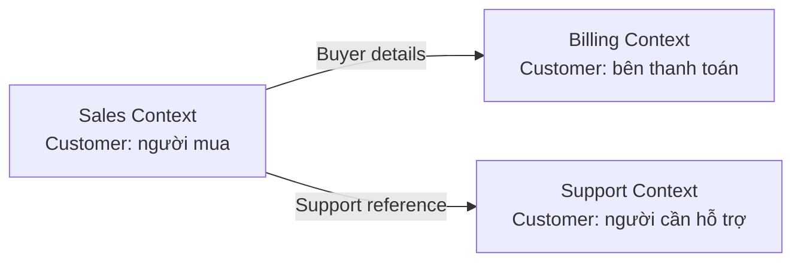
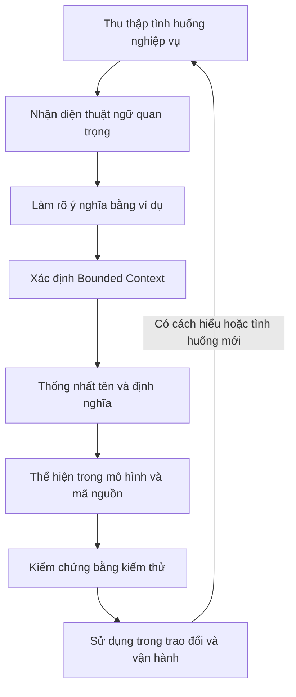

# Ngôn ngữ chung (Ubiquitous Language) trong trao đổi, mã nguồn và kiểm thử

Trong Domain-Driven Design (DDD), **Ubiquitous Language** là ngôn ngữ chung được chuyên gia nghiệp vụ và đội phát triển cùng xây dựng, hiểu và sử dụng nhất quán trong một phạm vi mô hình. Những thuật ngữ quan trọng của nghiệp vụ xuất hiện trong cuộc trao đổi hằng ngày, tài liệu, mô hình, tên lớp, tên phương thức và các bài kiểm thử. Nhờ vậy, cách nhóm nói về nghiệp vụ và cách phần mềm thể hiện nghiệp vụ có thể kiểm chứng lẫn nhau.

Ngôn ngữ chung không chỉ là một bảng thuật ngữ được viết ở đầu dự án. Nó hình thành qua các cuộc trao đổi về tình huống thực tế, được thử nghiệm trong mô hình và mã nguồn, rồi tiếp tục thay đổi khi nhóm hiểu nghiệp vụ sâu hơn. Một thuật ngữ tốt giúp mọi người hiểu cùng một khái niệm; một mô hình tốt giúp nhóm nhận ra khi thuật ngữ đang mơ hồ hoặc không còn phù hợp.

## 1. Vì sao DDD cần ngôn ngữ chung?

Chuyên gia nghiệp vụ và lập trình viên thường nhìn cùng một quy trình từ những góc độ khác nhau. Chuyên gia có thể nói “giữ đơn”, “duyệt đơn”, “đẩy đơn đi” hoặc “đã giao”. Lập trình viên có thể chuyển những từ đó thành `status = 1`, `processOrder()` hoặc `updateState()`. Khi thuật ngữ không được làm rõ, hai bên có thể nghĩ rằng mình đang nói về cùng một việc nhưng thực ra đang mô tả các hành động hoặc trạng thái khác nhau.

Ví dụ, cụm từ “đơn hàng đã giao” có thể mang ba ý nghĩa:

- Hàng đã được đóng gói và sẵn sàng rời kho.
- Kiện hàng đã được bàn giao cho đơn vị vận chuyển.
- Khách hàng đã nhận được kiện hàng.

Nếu nhóm dùng một trạng thái `DELIVERED` cho cả ba ý nghĩa, báo cáo vận hành, quy tắc hủy đơn và thông báo khách hàng có thể đưa ra kết quả sai. Khi nhóm thống nhất các thuật ngữ `Packed`, `HandedOver` và `Delivered`, từng mốc nghiệp vụ trở nên rõ ràng hơn.

Ngôn ngữ chung giúp:

- **Giảm hiểu nhầm:** các bên có cùng cách gọi và cùng cách giải thích những khái niệm quan trọng.
- **Khám phá quy tắc:** câu hỏi về ý nghĩa của một từ thường dẫn đến việc phát hiện điều kiện, ngoại lệ và quyết định nghiệp vụ chưa được nói rõ.
- **Làm mô hình dễ đọc:** tên Entity, Value Object, hành vi và sự kiện diễn đạt điều nghiệp vụ thực sự quan tâm.
- **Giữ trao đổi và cài đặt đồng bộ:** người đọc có thể đối chiếu yêu cầu, mô hình, mã nguồn và kiểm thử bằng cùng thuật ngữ.
- **Hỗ trợ thay đổi:** khi nghiệp vụ đổi cách hiểu, nhóm có thể xác định các phần của mô hình và phần mềm cần cập nhật.

Ngôn ngữ chung không loại bỏ mọi bất đồng. Giá trị của nó nằm ở việc làm cho bất đồng trở nên cụ thể: mọi người biết đang không thống nhất từ nào, quy tắc nào và ví dụ nào.

## 2. Ngôn ngữ chung thuộc về một Bounded Context

Một nguyên tắc quan trọng là ngôn ngữ chung luôn có phạm vi. Trong DDD, phạm vi đó thường là **Bounded Context** — ngữ cảnh giới hạn, nơi một mô hình và các thuật ngữ có ý nghĩa nhất quán.

Không nên mặc định rằng một thuật ngữ phải có cùng ý nghĩa trong toàn doanh nghiệp. Ví dụ, `Customer` có thể được hiểu khác nhau ở các ngữ cảnh:

| Ngữ cảnh | Ý nghĩa của khái niệm | Dữ liệu hoặc hành vi quan tâm |
| --- | --- | --- |
| Sales Context | Người mua đang thực hiện giao dịch. | Đặt hàng, nhận báo giá, điều kiện mua. |
| Support Context | Người đang yêu cầu trợ giúp. | Phiếu hỗ trợ, lịch sử trao đổi, mức độ ưu tiên. |
| Billing Context | Chủ thể chịu trách nhiệm thanh toán. | Thông tin xuất hóa đơn, hạn thanh toán, công nợ. |

Các ngữ cảnh có thể cùng sử dụng từ `Customer`, nhưng mô hình bên trong mỗi ngữ cảnh phục vụ mục tiêu riêng. Nếu cần trao đổi dữ liệu, nhóm phải xác định hợp đồng và cách ánh xạ giữa các mô hình. Không nên ép tất cả ngữ cảnh dùng chung một lớp chỉ để có tên gọi đồng nhất.



Sơ đồ minh họa cùng một khái niệm đời thực được nhìn qua các mô hình khác nhau. Trong triển khai thực tế, hợp đồng tích hợp có thể dùng định danh và dữ liệu phù hợp với nhu cầu của bên nhận; mỗi ngữ cảnh vẫn chịu trách nhiệm về mô hình nội bộ của mình.

Một thuật ngữ chỉ có ý nghĩa khi biết nó được dùng ở đâu. Vì vậy, bảng thuật ngữ nên ghi kèm Bounded Context hoặc phạm vi áp dụng, đặc biệt với những từ xuất hiện ở nhiều bộ phận.

## 3. Nguyên tắc xây dựng ngôn ngữ chung

### 3.1. Bắt đầu từ cách chuyên gia nghiệp vụ mô tả công việc

Hãy lắng nghe cách người làm nghiệp vụ kể về một tình huống thật: họ muốn đạt mục tiêu gì, gọi tên đối tượng nào, hành động ra sao và dựa trên quy tắc nào để quyết định. Không nên tự đặt tên lớp trước rồi yêu cầu chuyên gia xác nhận một thuật ngữ xa lạ.

Khi nghe một từ quan trọng, hãy hỏi:

- Từ này có nghĩa chính xác là gì trong tình huống đang nói?
- Có ví dụ nào được xem là đúng và ví dụ nào không thuộc khái niệm này?
- Từ này khác với thuật ngữ gần nghĩa nào?
- Ai sử dụng thuật ngữ và trong ngữ cảnh nào?
- Nếu điều kiện thay đổi, cách gọi hoặc kết quả có thay đổi không?

Những câu hỏi này giúp nhóm phân biệt một từ mang tính giao tiếp chung với một khái niệm có quy tắc nghiệp vụ riêng.

### 3.2. Dùng một thuật ngữ cho một ý nghĩa trong cùng phạm vi

Nếu cùng một Bounded Context dùng nhiều tên cho cùng một khái niệm, người đọc sẽ khó biết chúng có phải hai khái niệm khác nhau hay không. Nhóm nên thống nhất một tên chuẩn và ghi nhận những từ đồng nghĩa thường gặp để hiểu khi trao đổi.

Ví dụ, nếu “hủy đơn” và “xóa đơn” đều đang được dùng để chỉ việc khách không tiếp tục mua, nhóm cần xác định hành vi thực tế là gì. Xóa dữ liệu khỏi hệ thống có thể mang ý nghĩa kỹ thuật khác với hủy một giao dịch đã được ghi nhận. Khi hai hành vi khác nhau, phải giữ hai thuật ngữ riêng.

### 3.3. Không gộp các khái niệm khác nhau chỉ vì chúng có tên gần giống

Ngược lại, một từ chung có thể che giấu nhiều khái niệm. “Giá” có thể là giá niêm yết, giá tại thời điểm đặt hàng, giá sau chiết khấu hoặc số tiền thực thu. Nếu các giá trị này có quy tắc và vòng đời khác nhau, mô hình cần diễn đạt được sự khác biệt.

### 3.4. Ưu tiên tên gọi thể hiện ý nghĩa và hành vi

Tên gọi nên giúp người đọc hiểu đối tượng đại diện cho điều gì và hành động có tác dụng gì. `confirmOrder()` rõ nghĩa hơn `process()`; `reserveInventory()` cụ thể hơn `updateStock()` nếu hành vi thực tế là giữ trước số lượng hàng.

Đối với sự kiện miền, tên thường diễn đạt việc đã xảy ra, chẳng hạn `OrderConfirmed`, `InventoryReserved` hoặc `PaymentReceived`. Đối với lệnh hoặc hành vi được yêu cầu, tên có thể diễn đạt hành động như `ConfirmOrder` hoặc `ReserveInventory`. Cách đặt tên cần nhất quán trong ngữ cảnh của nhóm.

### 3.5. Kiểm tra thuật ngữ bằng ví dụ

Một định nghĩa ngắn có thể nghe hợp lý nhưng vẫn mơ hồ khi gặp trường hợp biên. Hãy dùng ví dụ thực tế để kiểm tra: điều gì xảy ra khi thanh toán đến muộn, khi chỉ giao được một phần hàng hoặc khi một đơn bị từ chối? Nếu nhóm không thể thống nhất kết quả, thuật ngữ hoặc quy tắc có thể chưa đủ rõ.

### 3.6. Để ngôn ngữ phát triển cùng mô hình

Ngôn ngữ chung không phải bộ từ vựng bất biến. Khi nhóm phát hiện một khái niệm mới hoặc nhận ra cách gọi cũ không còn chính xác, hãy cập nhật thuật ngữ, mô hình và mã nguồn liên quan. Việc đổi tên cần có lý do và phạm vi rõ ràng để tránh thay đổi tùy tiện.

## 4. Sử dụng ngôn ngữ chung trong trao đổi

Cuộc trao đổi là nơi ngôn ngữ chung được hình thành và kiểm chứng. Nhóm nên dùng các thuật ngữ đã thống nhất khi thảo luận yêu cầu, phân tích sự cố, thiết kế hành vi và xem xét kết quả kiểm thử.

### 4.1. Trao đổi bằng tình huống cụ thể

Thay vì hỏi “quy trình xử lý đơn hoạt động thế nào?”, hãy cùng chuyên gia đi qua một trường hợp:

“Khách đã đặt đơn, thanh toán được ghi nhận thành công nhưng kho chỉ còn đủ hàng cho một trong hai dòng sản phẩm. Hệ thống cần làm gì tiếp theo?”

Từ tình huống đó, nhóm có thể làm rõ:

- “Đặt đơn” có tạo ra cam kết giữ hàng hay chỉ ghi nhận ý định mua?
- “Thanh toán thành công” có đồng nghĩa với đơn hàng được xác nhận không?
- Hệ thống được phép xác nhận một phần đơn hay phải từ chối toàn bộ?
- Ai quyết định hoàn tiền và giải phóng lượng hàng đã giữ?
- Những bộ phận nào cần biết kết quả?

Khi các bên trả lời bằng cùng thuật ngữ, nhóm có thể nhận ra quy tắc nào đã rõ và quy tắc nào vẫn cần xác minh.

### 4.2. Ghi nhận thuật ngữ chưa thống nhất

Trong cuộc họp, không nên vội chọn một từ chỉ vì nó được nhiều người sử dụng hơn. Hãy ghi lại các cách hiểu khác nhau, ví dụ và người cần xác nhận. Có thể tạm dùng một cách gọi có chú thích trong tài liệu thảo luận, nhưng không nên đưa một giả định chưa được xác nhận thành tên miền chính thức trong mã nguồn.

### 4.3. Dùng ngôn ngữ chung trong tài liệu

Tài liệu yêu cầu, quyết định thiết kế, sơ đồ quy trình và hướng dẫn vận hành nên sử dụng cùng thuật ngữ. Khi phải dùng từ kỹ thuật như API, database transaction hoặc message broker, hãy phân biệt rõ đó là khái niệm kỹ thuật hay khái niệm nghiệp vụ.

Một tài liệu tốt không cần lặp lại định nghĩa dài ở mọi nơi. Có thể dẫn về bảng thuật ngữ của ngữ cảnh, nhưng phần mô tả tình huống vẫn cần đủ rõ để người đọc hiểu hành vi đang được bàn tới.

## 5. Thể hiện ngôn ngữ chung trong mã nguồn

Mã nguồn là một trong những nơi quan trọng nhất để kiểm tra ngôn ngữ chung. Nếu cuộc họp nói “xác nhận đơn hàng” nhưng mã nguồn chỉ có `updateStatus(2)`, hiểu biết nghiệp vụ đã không được thể hiện rõ trong mô hình.

### 5.1. Đặt tên cho đối tượng theo khái niệm nghiệp vụ

Tên lớp, thuộc tính và kiểu dữ liệu nên phản ánh các khái niệm trong Bounded Context. Ví dụ:

| Khái niệm nghiệp vụ | Tên có thể dùng trong mã nguồn | Ý nghĩa |
| --- | --- | --- |
| Đơn hàng | `Order` | Đơn vị ghi nhận yêu cầu mua hàng và vòng đời của nó. |
| Dòng hàng | `OrderLine` | Một mặt hàng cùng số lượng và giá được ghi nhận trong đơn. |
| Mã đơn hàng | `OrderId` | Định danh của một đơn hàng. |
| Tiền | `Money` | Giá trị tiền gồm số tiền và đơn vị tiền tệ. |
| Giữ tồn kho | `InventoryReservation` | Việc giữ một lượng hàng cho mục đích cụ thể. |

Không phải mọi danh từ trong hội thoại đều cần trở thành một lớp. Chỉ tạo kiểu miền riêng khi khái niệm có ý nghĩa, quy tắc hoặc trách nhiệm đủ rõ.

### 5.2. Đặt tên hành vi thể hiện ý định nghiệp vụ

Một hành vi nên mô tả mục đích mà người gọi muốn thực hiện, không chỉ nói rằng dữ liệu sẽ bị thay đổi.

```java
public final class Order {
    private final OrderId id;
    private OrderStatus status;

    public void confirm() {
        if (status != OrderStatus.PENDING_CONFIRMATION) {
            throw new IllegalStateException(
                    "Only orders pending confirmation can be confirmed"
            );
        }
        status = OrderStatus.CONFIRMED;
    }
}
```

Ở đây, `confirm()` diễn đạt một hành vi nghiệp vụ và bảo vệ điều kiện chuyển trạng thái. Ví dụ chỉ tập trung vào cách đặt tên và thể hiện quy tắc; các kiểu `OrderId` và `OrderStatus` được giả định đã định nghĩa.

So sánh với một API chung chung:

```java
order.setStatus(2);
```

Đoạn gọi thứ hai không cho biết vì sao trạng thái thay đổi, trạng thái `2` có nghĩa gì và điều kiện nào cần được kiểm tra. Một tên hành vi tốt làm cho ý định dễ hiểu và đưa quy tắc về gần đối tượng chịu trách nhiệm.

### 5.3. Phân biệt lệnh, hành vi và sự kiện

Một số tên gọi gần nhau nhưng đại diện cho những ý nghĩa khác nhau:

| Dạng | Ví dụ | Ý nghĩa |
| --- | --- | --- |
| Lệnh (Command) | `ConfirmOrder` | Yêu cầu hệ thống thực hiện việc xác nhận đơn. |
| Hành vi miền | `order.confirm()` | Đối tượng miền kiểm tra điều kiện và thực hiện chuyển đổi hợp lệ. |
| Sự kiện miền (Domain Event) | `OrderConfirmed` | Việc xác nhận đơn đã xảy ra thành công. |

Không nên đặt tên sự kiện bằng động từ ở dạng yêu cầu như `ConfirmOrder`, vì sự kiện phải diễn tả điều đã xảy ra. Tương tự, việc nhận một lệnh không có nghĩa hành động chắc chắn thành công.

### 5.4. Tránh tên kỹ thuật che khuất ý nghĩa nghiệp vụ

Các tên như `data`, `info`, `process`, `manager`, `handler` hoặc `doAction` có thể cần thiết trong một số lớp hạ tầng, nhưng thường quá chung chung đối với mô hình miền. Hãy đặt tên theo vai trò thực tế. Ví dụ, `PaymentPolicy` có thể diễn đạt chính sách thanh toán rõ hơn `PaymentManager` nếu lớp đó thực sự quyết định điều kiện thanh toán.

Tên kỹ thuật vẫn phù hợp ở ranh giới kỹ thuật: `JpaOrderRepository`, `HttpPaymentGateway` hoặc `OrderController` có thể mô tả cách triển khai. Trong miền nghiệp vụ, ưu tiên các tên giúp hiểu quy tắc và hành vi.

### 5.5. Không để mô hình miền bị chi phối bởi cấu trúc lưu trữ

Tên cột, bảng và kiểu ORM có thể khác tên khái niệm miền. Một trường `status_code` trong cơ sở dữ liệu không có nghĩa mô hình phải phơi bày `setStatusCode()`. Lớp ánh xạ dữ liệu có trách nhiệm chuyển đổi cấu trúc lưu trữ sang mô hình có ý nghĩa nghiệp vụ.

## 6. Thể hiện ngôn ngữ chung trong kiểm thử

Kiểm thử là nơi xác nhận rằng cách hiểu được thống nhất đã được hiện thực đúng. Khi tên kiểm thử và dữ liệu kiểm thử dùng ngôn ngữ nghiệp vụ, chuyên gia và lập trình viên có thể cùng đọc kết quả.

### 6.1. Đặt tên kiểm thử theo quy tắc

Tên kiểm thử nên nói rõ điều kiện và kết quả mong đợi. Ví dụ:

```java
@Test
void onlyPendingConfirmationOrderCanBeConfirmed() {
    Order order = anOrderWithStatus(OrderStatus.PENDING_CONFIRMATION);

    order.confirm();

    assertEquals(OrderStatus.CONFIRMED, order.status());
}

@Test
void confirmedOrderCannotBeConfirmedAgain() {
    Order order = anOrderWithStatus(OrderStatus.CONFIRMED);

    assertThrows(IllegalStateException.class, order::confirm);
}
```

Đây là ví dụ minh họa theo phong cách JUnit; hàm tạo dữ liệu và getter được giả định có sẵn. Hai tên kiểm thử cho biết rõ quy tắc đang được xác nhận, thay vì chỉ đánh số như `test1()` hoặc `testStatus()`.

### 6.2. Dùng Given–When–Then để diễn đạt tình huống

Với quy tắc có nhiều điều kiện, cấu trúc **Given–When–Then** giúp tách bối cảnh, hành động và kết quả:

```gherkin
Scenario: Xác nhận đơn đang chờ xác nhận
  Given một đơn hàng đang ở trạng thái chờ xác nhận
  When nhân viên xác nhận đơn hàng
  Then đơn hàng chuyển sang trạng thái đã xác nhận

Scenario: Không xác nhận lại đơn đã xác nhận
  Given một đơn hàng đã được xác nhận
  When nhân viên yêu cầu xác nhận lần nữa
  Then hệ thống từ chối hành động
```

Các câu trong ví dụ sử dụng từ ngữ mà chuyên gia nghiệp vụ có thể hiểu. Nhóm có thể dùng Gherkin với công cụ kiểm thử phù hợp hoặc chỉ dùng cấu trúc này để thảo luận và viết kiểm thử thông thường.

### 6.3. Dùng ví dụ để làm rõ trường hợp biên

Một quy tắc nên được kiểm tra với các ví dụ thành công, thất bại và trường hợp ranh giới. Chẳng hạn, nếu đơn chỉ được xác nhận khi có ít nhất một dòng hàng:

| Bối cảnh | Hành động | Kết quả mong đợi |
| --- | --- | --- |
| Đơn có một dòng hàng hợp lệ, đang chờ xác nhận | Xác nhận đơn | Đơn chuyển sang `CONFIRMED`. |
| Đơn không có dòng hàng | Xác nhận đơn | Hành động bị từ chối. |
| Đơn đã xác nhận | Xác nhận lại | Hành động bị từ chối. |

Những ví dụ này có thể trở thành kiểm thử đơn vị hoặc kiểm thử nghiệp vụ ở cấp cao hơn. Tên và thông điệp nên tiếp tục sử dụng cùng thuật ngữ đã thống nhất.

### 6.4. Không biến kiểm thử thành bản sao khó đọc của mã nguồn

Kiểm thử nên diễn đạt quy tắc từ góc nhìn nghiệp vụ. Nếu tên kiểm thử chỉ lặp lại tên biến hoặc cấu trúc kỹ thuật, nó khó giúp người đọc hiểu mục đích. Tuy nhiên, không cần viết câu quá dài hoặc nhồi mọi chi tiết vào tên kiểm thử; phần Given, dữ liệu và assertion sẽ cung cấp ngữ cảnh còn lại.

## 7. Một ví dụ xuyên suốt: từ cuộc trao đổi đến mã nguồn và kiểm thử

Giả sử một nhóm phát triển hệ thống bán hàng. Trong cuộc trao đổi ban đầu, chuyên gia nói: “Khi khách đặt hàng, nhân viên kiểm tra rồi duyệt đơn.” Nhóm phát hiện từ “duyệt” chưa rõ: đó là chấp nhận yêu cầu mua, xác nhận đã giữ hàng hay xác nhận thanh toán?

Sau khi đi qua các tình huống, nhóm và chuyên gia thống nhất:

1. **Đặt hàng (Place Order):** khách gửi yêu cầu mua các sản phẩm.
2. **Giữ hàng (Reserve Inventory):** hệ thống yêu cầu kho giữ số lượng cần thiết trong một khoảng thời gian.
3. **Xác nhận đơn (Confirm Order):** đơn được xác nhận khi các điều kiện về giữ hàng và thanh toán theo chính sách đã thỏa mãn.
4. **Đơn hàng đã xác nhận (Order Confirmed):** sự kiện ghi nhận việc xác nhận đã thành công.

Nhóm ghi nhận những thuật ngữ này trong ngôn ngữ chung của Order Context. Inventory Context có mô hình riêng về số lượng khả dụng và việc giữ hàng. Hai ngữ cảnh trao đổi qua hợp đồng đã thống nhất.

Mã nguồn có thể thể hiện ý định như sau:

```java
public final class Order {
    private final OrderId id;
    private OrderStatus status;

    public void confirm(ConfirmationEligibility eligibility) {
        if (!eligibility.canBeConfirmed()) {
            throw new IllegalStateException(
                    "Order does not meet confirmation requirements"
            );
        }
        if (status != OrderStatus.PENDING_CONFIRMATION) {
            throw new IllegalStateException(
                    "Only pending orders can be confirmed"
            );
        }
        status = OrderStatus.CONFIRMED;
    }
}
```

Đoạn mã minh họa cách tên miền xuất hiện trong hành vi. `ConfirmationEligibility` là dữ liệu kết quả đã được xác định từ các bước phối hợp; thiết kế thực tế cần làm rõ nơi tính toán điều kiện, thời điểm kiểm tra và cách xử lý nếu thông tin tồn kho hoặc thanh toán thay đổi trong lúc xác nhận.

Kiểm thử dùng cùng cách gọi:

```java
@Test
void orderIsConfirmedWhenConfirmationRequirementsAreMet() {
    Order order = anOrderPendingConfirmation();
    ConfirmationEligibility eligibility = eligibleForConfirmation();

    order.confirm(eligibility);

    assertEquals(OrderStatus.CONFIRMED, order.status());
}
```

Như vậy, chuyên gia có thể đọc câu chuyện “đặt hàng – giữ hàng – xác nhận đơn”, lập trình viên nhìn thấy `placeOrder`, `reserveInventory`, `confirm`, còn người kiểm thử xác nhận quy tắc bằng tên tình huống tương ứng. Các cách diễn đạt khác nhau theo hình thức nhưng cùng phản ánh một mô hình đã được thống nhất.

## 8. Quản lý và duy trì ngôn ngữ chung

Ngôn ngữ chung cần được chăm sóc trong suốt vòng đời sản phẩm. Nếu không có cách duy trì, nhóm có thể quay lại tình trạng mỗi người dùng một từ hoặc tài liệu và mã nguồn dần lệch nhau.

### 8.1. Duy trì bảng thuật ngữ vừa đủ

Một mục trong bảng thuật ngữ có thể gồm:

| Trường | Nội dung cần ghi |
| --- | --- |
| Thuật ngữ | Tên chuẩn được dùng trong ngữ cảnh. |
| Định nghĩa | Ý nghĩa ngắn gọn, đủ để phân biệt với khái niệm gần nghĩa. |
| Ví dụ | Một tình huống thuộc khái niệm và một tình huống không thuộc khái niệm nếu cần. |
| Bounded Context | Phạm vi mà định nghĩa có hiệu lực. |
| Thuật ngữ liên quan | Từ đồng nghĩa, từ dễ nhầm hoặc khái niệm đối lập. |
| Người xác nhận | Vai trò hoặc nhóm đã thống nhất ý nghĩa. |

Bảng thuật ngữ nên tập trung vào những từ quan trọng, dễ gây nhầm lẫn hoặc mang quy tắc nghiệp vụ. Không cần biến mọi từ thông thường trong hội thoại thành một mục từ.

### 8.2. Cập nhật khi mô hình thay đổi

Khi nhóm thêm khái niệm, đổi định nghĩa hoặc phát hiện một từ có nhiều nghĩa, cần xem xét đồng bộ:

- Nội dung thảo luận và tài liệu yêu cầu.
- Tên lớp, phương thức, thuộc tính và sự kiện trong mã nguồn.
- Tên kiểm thử, dữ liệu mẫu và thông điệp lỗi có ý nghĩa nghiệp vụ.
- Hợp đồng trao đổi với các Bounded Context liên quan.
- Tài liệu vận hành hoặc hướng dẫn người dùng nếu thuật ngữ xuất hiện ở đó.

Không phải mọi thay đổi từ ngữ đều cần đổi tên kỹ thuật hoặc thay đổi dữ liệu lưu trữ. Nhóm cần xem xét ảnh hưởng ở từng ranh giới và giữ khả năng tương thích khi cần.

### 8.3. Thảo luận thuật ngữ trong code review

Code review có thể kiểm tra xem tên mới có phản ánh đúng ngôn ngữ chung không. Người review nên hỏi: “Tên này có đúng với cách chuyên gia gọi hành vi không?”, “Có phân biệt được với hành vi gần nghĩa không?” và “Tên này có đúng trong Bounded Context hiện tại không?”.

Nếu thuật ngữ chưa rõ, hãy quay lại ví dụ nghiệp vụ thay vì tranh luận chỉ dựa trên sở thích đặt tên. Khi thống nhất được ý nghĩa, quyết định đó nên được phản ánh vào bảng thuật ngữ và mã nguồn.

### 8.4. Xử lý thuật ngữ khác nhau giữa các ngữ cảnh

Khi một khái niệm đi qua ranh giới Bounded Context, không nhất thiết phải truyền nguyên mô hình của bên gửi. Có thể dùng một hợp đồng tích hợp hoặc lớp chuyển đổi để ánh xạ dữ liệu sang ngôn ngữ của bên nhận. **Anti-Corruption Layer** là một cách bảo vệ mô hình nội bộ khỏi thuật ngữ và cấu trúc không phù hợp từ hệ thống bên ngoài.

Ví dụ, hệ thống vận chuyển bên ngoài trả về mã `DELIVERY_COMPLETE`. Order Context có thể cần diễn giải mã đó thành `ShipmentDelivered` hoặc một trạng thái giao nhận phù hợp với ngôn ngữ nội bộ. Việc ánh xạ phải dựa trên ý nghĩa thực tế của hợp đồng đối tác, không chỉ dựa vào tên trường.

## 9. Những sai lầm thường gặp

### 9.1. Xem ngôn ngữ chung chỉ là glossary

Một bảng thuật ngữ không đủ nếu nhóm vẫn dùng tên khác trong cuộc họp, mã nguồn và kiểm thử. Thuật ngữ chỉ trở thành ngôn ngữ chung khi được dùng để suy nghĩ, trao đổi và thiết kế.

### 9.2. Ép toàn doanh nghiệp dùng một mô hình và một định nghĩa

Các Bounded Context có thể có mô hình riêng vì mục tiêu và quy tắc khác nhau. Cần thống nhất ý nghĩa trong từng phạm vi và thiết kế hợp đồng khi trao đổi, thay vì tạo một mô hình khổng lồ dùng cho tất cả.

### 9.3. Để tên kỹ thuật thay thế tên nghiệp vụ

Tên như `status2`, `processData` hoặc `manager` không cho biết quy tắc. Chúng có thể che khuất những khác biệt mà chuyên gia quan tâm. Hãy ưu tiên tên diễn đạt khái niệm và hành vi trong miền.

### 9.4. Dùng thuật ngữ trước khi xác nhận ý nghĩa

Nếu lập trình viên tự suy ra rằng “duyệt đơn” có nghĩa là thanh toán thành công, mô hình có thể được xây trên giả định sai. Hãy hỏi chuyên gia và kiểm tra bằng ví dụ trước khi biến thuật ngữ thành tên chính thức.

### 9.5. Coi tên gọi là đủ để bảo đảm hành vi đúng

Một phương thức tên `confirmOrder()` vẫn có thể thực hiện sai quy tắc. Ngôn ngữ chung làm ý định rõ hơn, nhưng mô hình cần bảo vệ bất biến và kiểm thử cần xác nhận kết quả.

### 9.6. Thay đổi thuật ngữ mà không cập nhật nơi sử dụng

Nếu tài liệu dùng `HandedOver` nhưng mã nguồn và kiểm thử vẫn dùng `Delivered` cho cùng sự kiện, sự nhập nhằng vẫn tồn tại. Khi thuật ngữ thay đổi, hãy truy tìm các điểm sử dụng có liên quan và cập nhật có kiểm soát.

### 9.7. Nhồi quá nhiều chi tiết vào tên

Tên lớp hoặc phương thức quá dài thường là dấu hiệu một khái niệm đang gánh nhiều trách nhiệm hoặc quy tắc chưa được tách rõ. Hãy xem lại mô hình và ranh giới trước khi cố giải quyết bằng cách ghép thêm từ.

## 10. Quy trình xây dựng ngôn ngữ chung trong một nhóm

Một nhóm có thể bắt đầu từ quy trình thực hành sau:

1. **Chọn một tình huống nghiệp vụ cụ thể:** ưu tiên quy trình quan trọng hoặc nơi đang có nhiều hiểu nhầm.
2. **Thu thập cách gọi hiện tại:** hỏi chuyên gia và người dùng về các khái niệm, hành động, trạng thái và kết quả.
3. **Làm rõ từ mơ hồ:** yêu cầu ví dụ, trường hợp không thuộc khái niệm và các thuật ngữ gần nghĩa.
4. **Xác định phạm vi:** ghi rõ Bounded Context và vai trò xác nhận thuật ngữ.
5. **Thống nhất cách gọi:** chọn tên diễn đạt đúng ý nghĩa, ghi nhận từ đồng nghĩa và điểm chưa thống nhất.
6. **Đưa vào mô hình và mã nguồn:** dùng tên đã thống nhất cho Entity, Value Object, hành vi và Domain Event khi phù hợp.
7. **Viết kiểm thử bằng cùng ngôn ngữ:** diễn đạt điều kiện, hành động và kết quả mong đợi.
8. **Xem lại qua vận hành và thay đổi:** cập nhật thuật ngữ khi có tình huống mới hoặc mô hình được cải tiến.



## 11. Checklist đánh giá ngôn ngữ chung

Khi xem xét một phần mô hình hoặc một tính năng, nhóm có thể dùng các câu hỏi sau:

- [ ] Chuyên gia nghiệp vụ và đội phát triển hiểu cùng ý nghĩa của các thuật ngữ quan trọng.
- [ ] Mỗi thuật ngữ có phạm vi Bounded Context rõ ràng.
- [ ] Các từ đồng nghĩa và từ dễ nhầm đã được phân biệt.
- [ ] Tên Entity, Value Object và hành vi phản ánh khái niệm nghiệp vụ.
- [ ] Tên lệnh và tên sự kiện phân biệt được yêu cầu thực hiện với việc đã xảy ra.
- [ ] Mã nguồn không dùng tên quá chung chung cho quy tắc nghiệp vụ quan trọng.
- [ ] Tên kiểm thử và ví dụ kiểm thử dùng cùng thuật ngữ đã thống nhất.
- [ ] Các tài liệu liên quan không mô tả cùng một hành vi bằng những ý nghĩa mâu thuẫn.
- [ ] Khi thuật ngữ đi qua Bounded Context, hợp đồng và cách ánh xạ đã rõ.
- [ ] Có cách cập nhật thuật ngữ khi nhóm học được điều mới.

Checklist này dùng để mở cuộc trao đổi và tìm điểm chưa rõ. Không nên đánh giá chất lượng ngôn ngữ chung chỉ bằng số lượng mục trong glossary hoặc số lớp đã được đặt tên theo nghiệp vụ.

## 12. Kết luận

Ubiquitous Language giúp chuyên gia nghiệp vụ và đội phát triển cùng suy nghĩ bằng những khái niệm có ý nghĩa trong một Bounded Context. Ngôn ngữ ấy được hình thành qua trao đổi trên tình huống thực tế, được phản ánh trong mô hình và mã nguồn, rồi được kiểm chứng bằng các ví dụ và bài kiểm thử.

Khi tên gọi, hành vi và quy tắc nhất quán, mã nguồn trở thành một cách diễn đạt mô hình nghiệp vụ mà cả nhóm có thể đọc và thảo luận. Khi phát hiện thuật ngữ mơ hồ hoặc tình huống mới, nhóm quay lại trao đổi, làm rõ ý nghĩa và cập nhật mô hình. Đó là cách ngôn ngữ chung duy trì sự kết nối giữa hiểu biết nghiệp vụ và phần mềm trong suốt quá trình phát triển.
