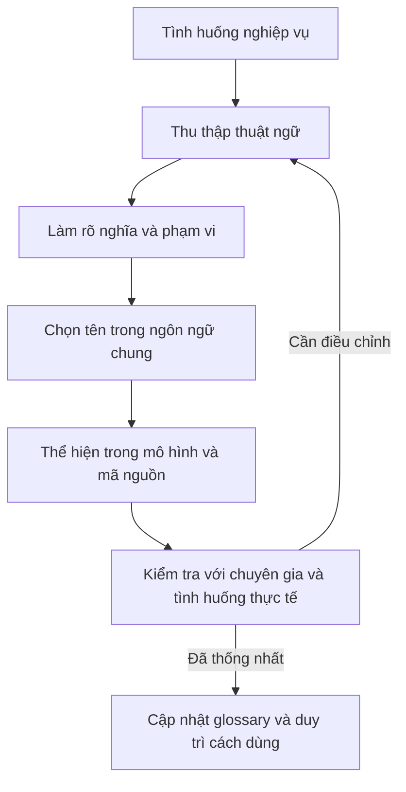

# Đặt tên theo ý nghĩa nghiệp vụ thay vì cấu trúc cơ sở dữ liệu

Trong Domain-Driven Design (DDD), tên gọi là một phần của mô hình. Một tên rõ ràng giúp chuyên gia nghiệp vụ và đội phát triển nhận ra cùng một khái niệm, trao đổi về cùng một quy tắc và tìm được nơi thể hiện quy tắc đó trong mã nguồn. Ngược lại, nếu tên lớp và phương thức chỉ phản ánh tên bảng, mã cột hoặc thao tác lưu trữ, kiến thức nghiệp vụ sẽ bị che khuất sau chi tiết kỹ thuật.

Nguyên tắc cốt lõi của bài học này là: **đặt tên cho điều nghiệp vụ muốn diễn đạt, không đặt tên cho cách dữ liệu tình cờ được lưu trữ**. Cơ sở dữ liệu vẫn cần tên bảng và cột phù hợp với lược đồ của nó. Nhưng ở mô hình miền, tên cần thể hiện khái niệm, ý định, hành vi và quy tắc trong ngôn ngữ chung của bounded context.

## Mục tiêu học tập

Sau bài này, bạn có thể:

- Giải thích vì sao tên trong mô hình miền cần xuất phát từ ngôn ngữ nghiệp vụ.
- Nhận biết tên gọi bị chi phối bởi bảng, cột, mã trạng thái hoặc thao tác kỹ thuật.
- Đặt tên cho entity, value object, hành vi, trạng thái, repository và domain event theo ý nghĩa nghiệp vụ.
- Phân biệt tên trong domain model với tên ở tầng lưu trữ và tích hợp.
- Áp dụng một quy trình kiểm tra tên gọi cùng chuyên gia nghiệp vụ và đội phát triển.

## 1. Tên gọi là một phần của mô hình miền

Mô hình miền không chỉ gồm các lớp và quan hệ. Tên của mỗi khái niệm, thuộc tính và hành vi cũng truyền tải cách đội hiểu nghiệp vụ. Trong DDD, ngôn ngữ chung (ubiquitous language) cần xuất hiện nhất quán trong trao đổi, tài liệu, thiết kế, kiểm thử và mã nguồn của một bounded context.

Hãy xem tình huống cửa hàng trực tuyến tiếp nhận đơn mua hàng. Chuyên gia nghiệp vụ thường nói về “đơn hàng”, “dòng hàng”, “xác nhận đơn”, “hủy đơn”, “giữ hàng” và “hoàn tiền”. Nếu mã nguồn lại dùng **ORD_HDR**, **REC_DTL**, **PROC_FLAG**, **UPDATE_STS** và **AMT_01**, người đọc phải liên tục dịch từ ngôn ngữ kỹ thuật sang ý nghĩa nghiệp vụ. Mô hình đã mất đi một phần vai trò giao tiếp của nó.

So sánh hai cách đặt tên:

| Tên dựa trên cấu trúc hoặc kỹ thuật | Tên theo ý nghĩa nghiệp vụ |
| --- | --- |
| **OrderHeaderRecord** | **Order** |
| **OrderDetailRow** | **OrderLine** |
| **processOrder()** | **confirmOrder()** hoặc **placeOrder()** tùy hành vi thực tế |
| **updateStatus("C")** | **confirm()** |
| **amt** | **totalAmount** hoặc **unitPrice** tùy ý nghĩa |
| **procFlag** | **confirmationStatus** hoặc một trạng thái miền cụ thể |
| **getOrdByNo()** | **findById(OrderId)** |
| **OrderDataManager** | **OrderRepository** hoặc tên diễn đạt đúng trách nhiệm hơn |

Các tên ở cột bên trái có thể hợp lý trong một hệ thống lưu trữ cũ hoặc một adapter kỹ thuật. Vấn đề xuất hiện khi chúng trở thành ngôn ngữ chính của mô hình miền. Tên **processOrder()** không cho biết đơn được tiếp nhận, xác nhận, thanh toán hay chuyển sang vận chuyển. Tên **confirmOrder()** chỉ rõ ý định hơn, miễn là nghiệp vụ thực sự gọi hành động đó là xác nhận đơn.

Một tên tốt không đơn thuần là tên dài hoặc tên tiếng Anh dễ đọc. Nó cần chính xác, nhất quán và có nghĩa với người đang làm việc trong phạm vi nghiệp vụ đó.

## 2. Vì sao không nên lấy cấu trúc cơ sở dữ liệu làm nguồn đặt tên cho mô hình

Cơ sở dữ liệu và mô hình miền phục vụ hai mục tiêu có liên hệ nhưng khác nhau.

- Lược đồ cơ sở dữ liệu tổ chức dữ liệu để lưu trữ, truy vấn, bảo đảm toàn vẹn và đáp ứng yêu cầu vận hành.
- Mô hình miền diễn đạt khái niệm, hành vi và quy tắc để giải quyết vấn đề nghiệp vụ.

Một hệ thống cũ có thể dùng bảng **ORD_HDR** để lưu phần thông tin chung của đơn hàng và **ORD_DTL** để lưu các dòng hàng. Cách chia bảng đó phản ánh quyết định lưu trữ. Người làm nghiệp vụ lại nghĩ về một đơn hàng gồm nhiều dòng hàng, có thể được xác nhận, hủy hoặc hoàn tất. Trong mô hình miền, **Order** và **OrderLine** truyền tải ý nghĩa này tốt hơn.

Tương tự, cột **STAT_CD** có thể chứa các mã **N**, **C**, **X**, **D**. Chỉ nhìn vào mã cột và giá trị, người đọc không biết **C** là created, confirmed, completed hay closed. Mô hình miền nên dùng những trạng thái có ý nghĩa như **DRAFT**, **CONFIRMED**, **CANCELLED**, **FULFILLED** nếu đó là các trạng thái nghiệp vụ thực tế. Lớp ánh xạ lưu trữ chịu trách nhiệm chuyển đổi giữa biểu diễn của miền và biểu diễn trong cơ sở dữ liệu.

Ví dụ minh họa:

| Lược đồ lưu trữ cũ | Mô hình miền | Ý nghĩa |
| --- | --- | --- |
| Bảng **ORD_HDR** | **Order** | Một đơn hàng có định danh và vòng đời |
| Bảng **ORD_DTL** | **OrderLine** | Một dòng hàng thuộc đơn hàng |
| Cột **STAT_CD** | **OrderStatus** | Trạng thái nghiệp vụ của đơn |
| Cột **CONF_TS** | **confirmedAt** | Thời điểm đơn được xác nhận |
| Cột **TOT_AMT** | **totalAmount** | Tổng giá trị đơn hàng |
| Cột **QTY** | **quantity** | Số lượng của dòng hàng |

Không phải lúc nào một cột cũng ánh xạ một-một sang một thuộc tính. **totalAmount** có thể được tính từ các dòng hàng, được lưu để tối ưu truy vấn hoặc được lấy từ một quy tắc định giá. Quyết định đó thuộc thiết kế mô hình và lưu trữ; tên vẫn cần diễn đạt đúng ý nghĩa của giá trị.

### Cấu trúc lưu trữ có thể thay đổi độc lập với ngôn ngữ miền

Một hệ thống có thể chuyển từ một bảng lớn sang nhiều bảng, đổi tên cột, thêm chỉ mục, chuyển cơ sở dữ liệu quan hệ sang một hình thức lưu trữ khác hoặc tích hợp với dịch vụ bên ngoài. Những thay đổi này không nhất thiết làm thay đổi khái niệm “đơn hàng” hay hành vi “xác nhận đơn”.

Nếu mô hình miền phụ thuộc trực tiếp vào tên bảng và cột, thay đổi lưu trữ có thể lan vào toàn bộ mã nghiệp vụ. Khi tên miền diễn đạt đúng nghiệp vụ và việc ánh xạ được đặt ở ranh giới phù hợp, đội phát triển có thể điều chỉnh cách lưu trữ mà không buộc phải đổi ngôn ngữ của mô hình.

Điều đó không có nghĩa tên bảng luôn phải khác tên lớp. Một bảng tên **orders** và một lớp **Order** có thể cùng dùng một từ vì cả hai cùng đại diện cho đơn hàng. Điều cần tránh là để những chi tiết như hậu tố **_HDR**, **_ROW**, mã cột hay quy ước viết tắt của lược đồ quyết định cách đặt tên khái niệm miền.

## 3. Tìm tên từ cách chuyên gia nghiệp vụ mô tả công việc

Tên gọi nên được khám phá qua trao đổi về tình huống thật. Đừng bắt đầu bằng câu hỏi “Ta nên tạo lớp nào?”; hãy hỏi người làm nghiệp vụ đang thực hiện việc gì, gọi đối tượng đó là gì và điều kiện nào khiến hành động hợp lệ.

Với quy trình đơn hàng, có thể đặt câu hỏi:

- Người mua đang tạo giỏ hàng, đặt hàng hay gửi yêu cầu mua?
- Khi nào một đơn được xem là đã tiếp nhận?
- Ai có quyền xác nhận đơn?
- “Giữ hàng” có khác “xuất kho” không?
- “Hủy đơn” có phải cùng một hành động với “hoàn tiền” không?
- Khi nào nghiệp vụ nói đơn đã hoàn tất?

Những câu hỏi này giúp phát hiện các từ tưởng như đồng nghĩa nhưng có ý nghĩa khác nhau. Ví dụ, “đặt hàng” có thể là hành động khách hàng gửi yêu cầu mua; “xác nhận đơn” có thể là hành động cửa hàng chấp nhận yêu cầu sau khi kiểm tra điều kiện. Nếu gộp hai hành vi thành **process()**, mô hình không thể hiện được khác biệt đó.

Một cách làm hữu ích là ghi lại các thuật ngữ cùng định nghĩa ngắn, ví dụ và phạm vi sử dụng:

| Thuật ngữ | Định nghĩa trong phạm vi bán hàng | Cần phân biệt với |
| --- | --- | --- |
| Đặt hàng (Place Order) | Khách hàng gửi yêu cầu mua với các mặt hàng đã chọn | Xác nhận đơn |
| Xác nhận đơn (Confirm Order) | Cửa hàng chấp nhận đơn sau khi kiểm tra các điều kiện cần thiết | Tiếp nhận yêu cầu |
| Giữ hàng (Reserve Stock) | Tạm dành số lượng hàng cho một đơn theo chính sách tồn kho | Xuất kho |
| Hủy đơn (Cancel Order) | Chấm dứt đơn theo quy tắc hủy áp dụng ở trạng thái hiện tại | Hoàn tiền |
| Hoàn tiền (Refund Payment) | Trả lại một khoản tiền đã thu theo chính sách thanh toán | Hủy đơn |

Định nghĩa trong bảng là ví dụ minh họa, không phải thuật ngữ bắt buộc cho mọi cửa hàng. Đội cần xác nhận cách dùng thực tế với chuyên gia nghiệp vụ. Một glossary tốt ghi lại cả những khác biệt quan trọng và những trường hợp thuật ngữ chưa được thống nhất.

## 4. Đặt tên theo đúng loại khái niệm và hành vi

Tên cần giúp người đọc đoán đúng vai trò của thành phần trong mô hình. Có thể dùng một số quy tắc thực hành sau.

### Entity và Value Object: dùng danh từ có ý nghĩa

Entity có định danh và vòng đời riêng. Tên nên phản ánh đối tượng nghiệp vụ mà tổ chức cần theo dõi, ví dụ **Order**, **Customer**, **Shipment** hoặc **Payment**.

Value Object diễn đạt một giá trị được xác định bởi các thuộc tính của nó. Tên nên nói rõ loại giá trị, ví dụ **Money**, **Address**, **Quantity**, **DateRange** hoặc **ShippingAddress** nếu đó là một khái niệm riêng trong miền.

Không nên tạo tên như **OrderTableEntity**, **MoneyRecord** hay **AddressData** chỉ vì lớp đang được lưu trong bảng hoặc được truyền qua một tầng dữ liệu. Nếu một lớp thực sự là đối tượng ánh xạ cơ sở dữ liệu, tên kỹ thuật có thể phù hợp ở tầng persistence. Nhưng lớp đó không nên bị nhầm với khái niệm miền.

### Phương thức: dùng động từ mô tả ý định nghiệp vụ

Phương thức của mô hình nên thể hiện hành động mà nghiệp vụ nhận biết:

- **confirm()** xác nhận đơn.
- **cancel(reason)** hủy đơn với lý do phù hợp.
- **addItem(...)** thêm mặt hàng vào đơn.
- **reserve(quantity)** giữ số lượng hàng.
- **calculateTotal()** tính tổng theo quy tắc đã xác định.

Tên như **setStatus()**, **updateFlag()** hoặc **process()** thường chỉ nói về thao tác kỹ thuật hay quá chung chung. Nếu trạng thái chỉ được phép thay đổi qua một số hành vi nhất định, việc cung cấp một setter công khai còn có thể làm suy yếu bất biến của mô hình. Hãy để hành vi nghiệp vụ kiểm tra điều kiện rồi mới thay đổi trạng thái.

Không phải mọi phương thức đều phải là một động từ nghiệp vụ. Các hàm chuyển đổi, so sánh hoặc tính toán nội bộ có thể dùng tên kỹ thuật rõ ràng. Điều quan trọng là API công khai của mô hình thể hiện đúng ý định và trách nhiệm.

### Trạng thái: dùng tên mô tả giai đoạn nghiệp vụ

Một trạng thái cần cho biết đối tượng đang ở giai đoạn nào. Tránh dùng các mã khó hiểu như **S1**, **S2**, **Y**, **N** trong mô hình miền nếu chúng không mang ý nghĩa với người đọc.

Ví dụ:

- **DRAFT**: đơn còn ở giai đoạn nháp.
- **CONFIRMED**: đơn đã được cửa hàng xác nhận.
- **CANCELLED**: đơn đã bị hủy.
- **FULFILLED**: đơn đã được hoàn tất theo định nghĩa của quy trình.

Không sao chép máy móc những trạng thái ví dụ này vào mọi hệ thống. Một số nghiệp vụ có thể cần trạng thái **ACCEPTED**, **PAID**, **READY_FOR_SHIPMENT** hoặc **DELIVERED**; một số khác không cần. Hãy đặt tên dựa trên các giai đoạn và điều kiện chuyển đổi thực sự.

### Domain Event: dùng tên diễn đạt sự kiện đã xảy ra

Domain Event mô tả một sự kiện nghiệp vụ đã xảy ra, thường được đặt ở dạng quá khứ:

- **OrderPlaced**: khách hàng đã đặt hàng.
- **OrderConfirmed**: đơn đã được xác nhận.
- **StockReserved**: hàng đã được giữ.
- **PaymentRefunded**: khoản thanh toán đã được hoàn.

Tên sự kiện cần phân biệt hành động yêu cầu với kết quả đã xảy ra. **ConfirmOrder** có thể là tên một command yêu cầu xác nhận đơn; **OrderConfirmed** là sự kiện thông báo việc xác nhận đã hoàn tất. Sự khác biệt này giúp người đọc hiểu đâu là ý định cần xử lý và đâu là sự thật đã được ghi nhận.

### Repository và dịch vụ: gọi đúng trách nhiệm

Repository nên dùng tên của aggregate hoặc khái niệm mà nó truy xuất, chẳng hạn **OrderRepository**, với các phương thức như **findById(orderId)** và **save(order)**. Một tên như **OrderDataManager** không nói rõ đối tượng quản lý là gì và trách nhiệm của nó đến đâu.

Dịch vụ miền cần có tên thể hiện một chính sách hoặc hoạt động nghiệp vụ thực sự không thuộc tự nhiên về một entity hay value object, ví dụ **ShippingCostPolicy** hoặc **CreditLimitPolicy**. Tránh gom mọi thao tác vào **CommonService**, **DataProcessor** hay một **Manager** chung chung. Những tên này thường che giấu nhiều trách nhiệm khác nhau.

## 5. Cùng một từ có thể mang nghĩa khác nhau ở các bounded context

Ngôn ngữ chung có phạm vi. DDD không yêu cầu toàn doanh nghiệp phải dùng một mô hình và một từ điển duy nhất cho mọi hoạt động. Một từ có thể có ý nghĩa khác nhau trong những bounded context khác nhau.

Ví dụ, “sản phẩm” trong bounded context bán hàng có thể là thứ được trình bày cho khách hàng với tên hiển thị, mô tả và giá bán. Trong bounded context tồn kho, đối tượng tương ứng có thể được quản lý theo mã SKU, đơn vị lưu kho, vị trí và số lượng. Đội bán hàng và đội kho có thể cùng dùng từ “sản phẩm” trong hội thoại hàng ngày nhưng đang nói về hai mô hình khác nhau.

Không nên ép hai mô hình này thành một lớp **Product** khổng lồ chỉ để mọi nơi dùng chung một tên. Trong mỗi bounded context, hãy chọn tên và định nghĩa phù hợp với trách nhiệm của mô hình. Khi trao đổi giữa các context, context map và hợp đồng tích hợp cần làm rõ cách chuyển đổi dữ liệu và ý nghĩa.

Một thuật ngữ chung ở cấp tổ chức có thể cần được bổ nghĩa trong mã nguồn để tránh mơ hồ. Ví dụ **SalesProduct** và **InventoryItem** có thể hữu ích nếu chúng thực sự đại diện cho hai khái niệm riêng. Không nên thêm tiền tố tùy tiện vào mọi lớp; chỉ dùng khi nó giúp thể hiện phạm vi hoặc phân biệt ý nghĩa.

## 6. Giữ tên miền rõ ràng ở ranh giới với cơ sở dữ liệu

Trong kiến trúc có phân tách domain và infrastructure, mô hình miền có thể dùng tên nghiệp vụ còn lớp persistence dùng tên phù hợp với công nghệ lưu trữ. Một repository triển khai việc ánh xạ giữa hai phía.

Ví dụ, giao diện miền có thể như sau:

```java
public interface OrderRepository {
    Optional<Order> findById(OrderId orderId);
    void save(Order order);
}
```

Phần triển khai hạ tầng có thể dùng ORM hoặc SQL để đọc bảng cũ **ORD_HDR** và **ORD_DTL**, chuyển các mã trạng thái thành **OrderStatus**, rồi tạo lại mô hình **Order**. Khi lưu, nó chuyển mô hình về cấu trúc mà cơ sở dữ liệu yêu cầu.

```java
public final class SqlOrderRepository implements OrderRepository {
    // Đọc ORD_HDR và ORD_DTL, ánh xạ thành Order.
    // Khi lưu, ánh xạ Order về cấu trúc lưu trữ hiện có.
}
```

Đây là phác thảo để minh họa trách nhiệm; chi tiết truy vấn, ORM và khôi phục aggregate phụ thuộc kiến trúc thực tế. Điểm chính là **Order** và **OrderRepository** diễn đạt ngôn ngữ miền, trong khi **SqlOrderRepository** thể hiện công nghệ ở tầng hạ tầng.

Tương tự, API bên ngoài có thể phải dùng tên trường theo hợp đồng đã công bố, còn lớp chuyển đổi sẽ ánh xạ chúng sang mô hình nội bộ. Không nên đổi tên hợp đồng tích hợp tùy tiện chỉ để khớp với domain model; hãy giữ rõ ranh giới và chuyển đổi ở nơi phù hợp.

## 7. Một quy trình thực tế để chọn và thống nhất tên

Có thể áp dụng trình tự sau khi phát hiện một khái niệm hoặc hành vi mới:

1. **Bắt đầu từ tình huống nghiệp vụ.** Ghi lại ai làm gì, với đối tượng nào, trong điều kiện nào và để đạt kết quả gì.
2. **Thu thập từ ngữ đang được sử dụng.** Hỏi chuyên gia và người trực tiếp vận hành cách họ gọi đối tượng, hành động, trạng thái và ngoại lệ.
3. **Làm rõ các từ gần nghĩa.** Phân biệt những khái niệm như tiếp nhận, đặt hàng, xác nhận, giao hàng và hoàn tất nếu quy tắc xem chúng là khác nhau.
4. **Xác định bounded context.** Ghi rõ tên có hiệu lực trong phạm vi nào; kiểm tra xem một nhóm khác có đang dùng cùng từ với nghĩa khác không.
5. **Chọn tên thể hiện ý nghĩa.** Dùng danh từ cho khái niệm, động từ cho hành vi, tên trạng thái cho giai đoạn và dạng quá khứ cho sự kiện đã xảy ra.
6. **Đưa tên vào mô hình và kiểm tra khi đọc.** Đọc câu lệnh, chữ ký phương thức, log nghiệp vụ và tên kiểm thử để xem ý định có rõ không.
7. **Xác nhận với chuyên gia nghiệp vụ.** Đưa ví dụ cụ thể và hỏi tên đó có phản ánh đúng cách họ hiểu công việc không.
8. **Cập nhật glossary và mã nguồn đồng bộ.** Khi cách hiểu thay đổi, sửa tài liệu, tên trong mô hình, kiểm thử và các điểm trao đổi có liên quan.

Sơ đồ sau tóm tắt vòng lặp đặt tên:



Ví dụ, khi phát hiện phương thức **processOrder()** đang vừa kiểm tra điều kiện, vừa xác nhận, vừa gửi yêu cầu giao hàng, đừng chỉ đổi tên nó thành **handleOrder()**. Hãy tách các hành vi theo ý nghĩa nghiệp vụ nếu chúng là những bước riêng: **confirm()**, **requestShipment()** hoặc một hành vi khác đã được chuyên gia xác nhận. Tên gọi tốt thường giúp lộ ra trách nhiệm đang bị trộn lẫn.

## 8. Ví dụ: chuyển từ tên kỹ thuật sang ngôn ngữ miền

Giả sử hệ thống hiện có một đoạn mã thao tác trực tiếp trên bản ghi:

```java
public void processOrder(String ordNo) {
    OrderHeaderRecord record = dao.getOrdByNo(ordNo);
    if ("N".equals(record.getStatCd())) {
        record.setStatCd("C");
        record.setConfTs(Instant.now());
        dao.update(record);
    }
}
```

Đoạn mã này cho biết hệ thống tìm một bản ghi, kiểm tra mã trạng thái và cập nhật cột. Nhưng người đọc chưa biết **N** và **C** có ý nghĩa nghiệp vụ gì, tại sao chỉ trạng thái đó mới được chuyển đổi, hoặc đơn có cần chứa ít nhất một dòng hàng hay không.

Sau khi trao đổi với chuyên gia, đội xác định hành vi là “xác nhận đơn nháp có ít nhất một dòng hàng”. Mô hình có thể diễn đạt như sau:

```java
public final class Order {
    private final OrderId id;
    private final List<OrderLine> lines;
    private OrderStatus status;
    private Instant confirmedAt;

    public void confirm(Instant confirmedAt) {
        if (status != OrderStatus.DRAFT) {
            throw new IllegalStateException("Only a draft order can be confirmed");
        }
        if (lines.isEmpty()) {
            throw new IllegalStateException("An order must contain an item");
        }

        this.status = OrderStatus.CONFIRMED;
        this.confirmedAt = confirmedAt;
    }
}
```

Trong ví dụ, **Order**, **OrderLine**, **confirm**, **DRAFT**, **CONFIRMED** và **confirmedAt** nói về khái niệm và quy tắc của đơn hàng. Repository hoặc adapter sẽ đảm nhận việc đọc và ghi mã trạng thái trong cơ sở dữ liệu. Quy tắc nghiệp vụ được đặt tại mô hình phù hợp nên có thể được kiểm thử mà không cần biết mã trạng thái được lưu là **C**, **02** hay một giá trị khác.

Đây là ví dụ rút gọn. Trong một hệ thống thực tế, việc xác nhận có thể cần kiểm tra tồn kho, hạn mức tín dụng hoặc kết quả thanh toán. Những quy tắc này cần được phân bổ đúng trách nhiệm; không nên đưa mọi kiểm tra vào **Order** nếu chúng thuộc một context hoặc dịch vụ miền khác.

## 9. Những lỗi đặt tên thường gặp

- **Đưa tên bảng và cột vào domain model:** **OrderHeader**, **OrderRow**, **StatusCode** có thể phản ánh cấu trúc lưu trữ hơn là khái niệm nghiệp vụ.
- **Dùng tên quá chung:** **process**, **handle**, **manage**, **data**, **info** không cho biết hành vi hoặc ý nghĩa cụ thể.
- **Dùng viết tắt không phổ biến:** **ord**, **cust**, **amt**, **sts** khiến người mới phải học một từ điển kỹ thuật riêng.
- **Dùng một từ cho nhiều nghĩa:** cùng gọi mọi giai đoạn là “xử lý” làm mất sự khác biệt giữa tiếp nhận, xác nhận và hoàn tất.
- **Đặt tên theo cách triển khai:** **JpaOrderEntity** có thể phù hợp với lớp persistence nhưng không nên là tên của mô hình miền.
- **Tạo tên dài để che sự mơ hồ:** thêm nhiều tiền tố hoặc hậu tố không làm một khái niệm chưa rõ trở nên đúng.
- **Đổi tên mà không xác nhận nghĩa:** một từ nghe hay hoặc hợp chuẩn code style vẫn có thể sai với cách nghiệp vụ vận hành.

Tên miền rõ ràng cũng cần nhất quán về ngữ pháp và quy ước của ngôn ngữ lập trình. Trong mã Java, đội có thể dùng tiếng Anh cho identifier để phù hợp hệ sinh thái và convention hiện có, nhưng cần thống nhất cách dịch và định nghĩa thuật ngữ với chuyên gia nói tiếng Việt. Không nên để mỗi thành viên tự dịch một khái niệm theo cách riêng.

## 10. Kiểm tra chất lượng tên gọi

Khi review mô hình hoặc pull request, hãy thử đọc tên mà không nhìn vào phần triển khai. Một số câu hỏi giúp đánh giá:

- Chuyên gia nghiệp vụ có nhận ra khái niệm này không?
- Tên có nói đúng ý nghĩa trong bounded context hiện tại không?
- Người đọc có phân biệt được hành động yêu cầu, hành động đã hoàn tất và trạng thái hiện tại không?
- Tên có mô tả nghiệp vụ hay chỉ mô tả bảng, cột, framework hoặc thao tác dữ liệu?
- Nếu thay đổi cơ sở dữ liệu, tên này có còn đúng không?
- Có thuật ngữ gần nghĩa nào đang bị dùng lẫn lộn không?
- Tên phương thức có giúp người đọc hiểu điều kiện và kết quả mong đợi không?

Tên tốt giúp mã nguồn trở thành một phần của ngôn ngữ chung. Khi đọc **order.confirm()** hoặc **OrderConfirmed**, người đọc có thể liên hệ trực tiếp với câu chuyện nghiệp vụ. Khi đọc **updateStatCd()** hoặc **processRecord()**, họ thường phải lần theo phần triển khai để đoán ý định.

## Kết luận

Đặt tên theo ý nghĩa nghiệp vụ giúp mô hình miền truyền tải đúng cách tổ chức hiểu và vận hành công việc. Tên entity, value object, hành vi, trạng thái, repository và domain event cần xuất phát từ ngôn ngữ chung trong bounded context. Tên bảng, cột và mã lưu trữ thuộc về lược đồ dữ liệu; chúng có thể được ánh xạ sang mô hình miền ở ranh giới hạ tầng.

Quy trình đặt tên hiệu quả bắt đầu từ tình huống thật, làm rõ thuật ngữ với chuyên gia, xác định phạm vi, thể hiện tên trong mã nguồn và kiểm tra lại bằng ví dụ nghiệp vụ. Khi ngôn ngữ trong trao đổi và trong mã nguồn thống nhất, đội phát triển dễ hiểu quy tắc hơn, dễ nhận ra trách nhiệm của từng thành phần và dễ thay đổi mô hình khi hiểu biết nghiệp vụ tiến triển.
