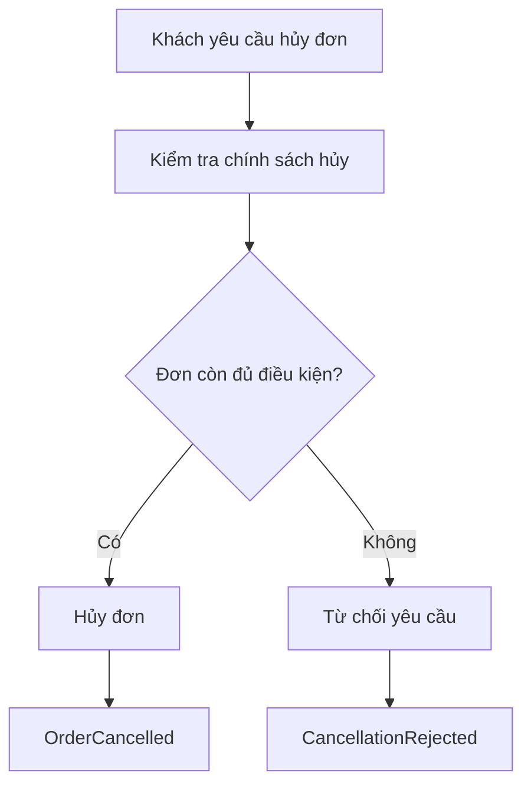

# Diễn đạt hành vi bằng động từ và quy tắc bằng ví dụ rõ ràng

Trong Domain-Driven Design (DDD), Ubiquitous Language là ngôn ngữ chung mà chuyên gia nghiệp vụ và đội phát triển cùng sử dụng trong một Bounded Context. Ngôn ngữ này cần diễn đạt được cả **đối tượng nghiệp vụ**, **hành động** và **quy tắc quyết định**. Một danh sách danh từ như `Order`, `Customer`, `Payment` hay `Product` mới chỉ cho biết hệ thống nói về điều gì; động từ và ví dụ mới làm rõ hệ thống thực hiện điều gì, trong điều kiện nào và kết quả ra sao.

Ví dụ, câu “xử lý đơn hàng” quá rộng. Nó có thể có nghĩa là kiểm tra đơn, xác nhận đơn, giữ hàng, thu tiền hoặc giao hàng. Khi chuyên gia nghiệp vụ nói “đặt đơn”, “xác nhận thanh toán” hay “hủy đơn”, mỗi động từ gợi ra một hành vi và một thời điểm nghiệp vụ riêng. Nếu đội phát triển giữ được sự phân biệt đó trong mô hình và mã nguồn, các quy tắc sẽ dễ trao đổi, kiểm thử và thay đổi hơn.

Bài học này tập trung vào cách chọn động từ chính xác để diễn đạt hành vi và cách dùng ví dụ cụ thể để làm rõ quy tắc. Đây là một kỹ năng thực hành của Ubiquitous Language trong DDD, không phải bài tập đặt tên cho đẹp.

## 1. Vì sao động từ quan trọng trong mô hình nghiệp vụ?

Danh từ giúp nhận diện những khái niệm mà domain quan tâm. Động từ mô tả mối quan hệ và hành vi giữa các khái niệm đó.

Xét một hệ thống bán hàng:

- `Order` là đơn hàng.
- `Customer` là khách hàng.
- `Payment` là khoản thanh toán.
- `Product` là sản phẩm.

Chỉ có các danh từ trên, ta chưa biết khách hàng có thể làm gì với đơn hàng, khi nào đơn được coi là đã đặt, ai xác nhận thanh toán hay điều kiện nào cho phép hủy. Hãy bổ sung các hành vi:

- Khách hàng **tạo** đơn hàng.
- Khách hàng **gửi** đơn hàng để đặt.
- Hệ thống **xác nhận** đơn hàng sau khi kiểm tra điều kiện.
- Cổng thanh toán **ủy quyền** khoản thanh toán.
- Nhân viên kho **giữ** hàng cho đơn đã được chấp nhận.
- Khách hàng **yêu cầu hủy** đơn.
- Hệ thống **hoàn tiền** khi thỏa chính sách hoàn trả.

Những động từ này không thể tùy ý thay thế cho nhau. “Ủy quyền thanh toán” có thể chỉ xác nhận rằng số tiền có thể được thu; “thu tiền” mới là thao tác chuyển tiền theo hợp đồng với nhà cung cấp thanh toán. “Yêu cầu hủy” cũng chưa chắc đồng nghĩa với “đã hủy”: hệ thống có thể cần kiểm tra đơn đã được giao hay chưa.

Động từ chính xác giúp đội ngũ phát hiện những khác biệt nghiệp vụ mà một mô hình chỉ có dữ liệu thường che khuất. Nó còn gợi ý nơi đặt hành vi: hành vi nào thuộc về Aggregate, hành vi nào thuộc quy trình ứng dụng và hành vi nào là trách nhiệm của một hệ thống bên ngoài.

## 2. Chọn động từ phản ánh đúng ý nghĩa nghiệp vụ

### 2.1. Dùng từ mà chuyên gia nghiệp vụ thực sự sử dụng

Hãy bắt đầu bằng cách lắng nghe cách chuyên gia mô tả công việc. Khi một nhân viên nói “chốt đơn”, “giữ chỗ”, “đối soát” hoặc “ghi nhận hoàn tiền”, đừng vội thay bằng một từ kỹ thuật chung chung. Hãy hỏi họ hành động đó bắt đầu khi nào, kết thúc khi nào, ai thực hiện và điều kiện nào phải đúng.

Ví dụ, một cửa hàng có thể dùng từ “xác nhận đơn” để chỉ hai việc khác nhau:

- Nhân viên kiểm tra địa chỉ và xác nhận đơn có thể được tiếp nhận.
- Hệ thống xác nhận đơn sau khi cổng thanh toán ủy quyền thành công.

Nếu hai hành động khác nhau về người thực hiện, điều kiện và kết quả, cần tìm cách diễn đạt riêng. Nếu chúng thực sự là cùng một hành vi, đội ngũ có thể thống nhất một thuật ngữ.

Ubiquitous Language không yêu cầu mọi context phải dùng cùng một từ cho mọi khái niệm. Nó yêu cầu từ ngữ rõ ràng và nhất quán **bên trong Bounded Context**. Chẳng hạn, `Customer` trong Sales có thể khác hồ sơ `Customer` trong Support. Khi trao đổi qua ranh giới, cần làm rõ cách chuyển đổi ý nghĩa.

### 2.2. Ưu tiên động từ cụ thể thay cho động từ bao quát

Các động từ như `process`, `handle`, `manage`, `execute` hoặc `update` thường quá rộng nếu đứng một mình. Chúng không nói rõ điều gì xảy ra với đối tượng nghiệp vụ.

| Cách gọi mơ hồ | Cách gọi diễn đạt rõ hành vi hơn | Điều cần làm rõ |
|---|---|---|
| `processOrder` | `placeOrder`, `confirmOrder`, `cancelOrder` | Đơn đang được đặt, xác nhận hay hủy? |
| `updatePayment` | `authorizePayment`, `capturePayment`, `refundPayment` | Tiền được ủy quyền, thu hay hoàn? |
| `handleReservation` | `reserveStock`, `releaseReservation`, `expireReservation` | Tồn kho được giữ, giải phóng hay hết hạn? |
| `updateAccount` | `suspendAccount`, `reactivateAccount`, `changeBillingAddress` | Trạng thái hay dữ liệu nào thay đổi? |
| `processReturn` | `requestReturn`, `approveReturn`, `receiveReturnedItem` | Khách yêu cầu, doanh nghiệp duyệt hay kho nhận hàng? |

Không phải lúc nào cũng cần một động từ dài. Điều quan trọng là tên gọi phân biệt được các hành vi có quy tắc khác nhau. Nếu `updateStatus` thực sự là một hành vi nghiệp vụ, hãy cân nhắc đặt tên theo ý nghĩa của chuyển trạng thái, chẳng hạn `approveApplication` hoặc `rejectApplication`.

### 2.3. Phân biệt hành động, yêu cầu và kết quả

Trong nghiệp vụ, một người có thể yêu cầu một hành động nhưng hệ thống chưa chắc chấp nhận. Vì vậy, cần phân biệt:

- **Yêu cầu:** một chủ thể đề nghị điều gì đó, ví dụ `RequestCancellation`.
- **Lệnh:** yêu cầu hệ thống thử thực hiện hành vi, ví dụ `CancelOrder`; lệnh vẫn có thể bị từ chối.
- **Sự kiện kết quả:** sự việc đã xảy ra, ví dụ `OrderCancelled`.

Ba cách gọi này thể hiện ba thời điểm khác nhau. Một yêu cầu hủy có thể bị từ chối vì đơn đã được giao. Nếu đặt tên tất cả là `CancelOrder`, người đọc khó biết hệ thống đang tiếp nhận yêu cầu hay đã hoàn tất việc hủy.

Ví dụ luồng:



Tên sự kiện thường diễn đạt sự việc đã xảy ra bằng thì quá khứ hoặc một cụm từ có nghĩa tương đương: `OrderPlaced`, `PaymentAuthorized`, `ReservationExpired`. Tên lệnh thường diễn đạt ý định hoặc yêu cầu: `PlaceOrder`, `AuthorizePayment`, `ExpireReservation`. Một lệnh có thể thất bại; một sự kiện chỉ được phát ra khi sự việc tương ứng thực sự đã xảy ra.

### 2.4. Không nhầm hành vi với trạng thái

Trạng thái trả lời câu hỏi “đối tượng hiện đang ở tình trạng nào?”. Hành vi trả lời “đối tượng có thể thực hiện chuyển đổi nào?”.

Ví dụ:

| Trạng thái | Hành vi chuyển trạng thái | Kết quả |
|---|---|---|
| Draft | `place()` | Placed |
| Placed | `confirm()` | Confirmed |
| Placed | `cancel()` | Cancelled |
| Shipped | `deliver()` | Delivered |

Không nên tạo một phương thức `setStatus(DELIVERED)` cho phép bất kỳ nơi gọi nào thay đổi trạng thái tùy ý nếu nghiệp vụ yêu cầu chỉ được giao hàng sau khi lô hàng đã xuất kho. Phương thức `deliver()` có thể kiểm tra điều kiện và ghi nhận thông tin giao hàng trước khi chuyển trạng thái.

Đặt tên theo hành vi giúp quy tắc nằm gần nơi thay đổi trạng thái. Nó cũng giúp người đọc hiểu vì sao chuyển trạng thái đó được phép.

## 3. Diễn đạt quy tắc bằng cấu trúc rõ ràng

Một quy tắc nghiệp vụ cần cho biết điều kiện và kết quả. Câu “đơn hợp lệ mới được đặt” có vẻ rõ nhưng vẫn để ngỏ nhiều câu hỏi: hợp lệ nghĩa là gì, kiểm tra ở thời điểm nào, có ngoại lệ không và ai chịu trách nhiệm xác nhận?

Một cách diễn đạt có ích là mô tả quy tắc theo cấu trúc:

**Khi** một sự kiện hoặc hành động xảy ra, **nếu** các điều kiện được thỏa mãn, **thì** hệ thống thực hiện kết quả; **ngược lại** hệ thống từ chối hoặc đi theo nhánh ngoại lệ đã xác định.

Ví dụ:

> Khi khách hàng gửi yêu cầu đặt đơn, nếu đơn có ít nhất một dòng hàng, mọi dòng hàng có số lượng lớn hơn 0 và địa chỉ giao hàng hợp lệ, hệ thống chuyển đơn từ Draft sang Placed. Nếu thiếu dòng hàng hoặc địa chỉ không hợp lệ, hệ thống giữ đơn ở Draft và trả về lý do tương ứng.

Câu này làm rõ:

- Tác nhân và hành động khởi phát.
- Điều kiện cần được kiểm tra.
- Trạng thái trước và sau.
- Hành vi khi điều kiện không thỏa mãn.

Không phải quy tắc nào cũng cần đủ các thành phần này. Tuy nhiên, nếu một quy tắc ảnh hưởng đến tiền, quyền truy cập, trạng thái hoặc nghĩa vụ pháp lý, hãy tránh những câu mô tả mơ hồ như “hệ thống xử lý phù hợp”.

### 3.1. Tách điều kiện, quyết định và hệ quả

Một quy tắc thường gồm ba phần:

1. **Điều kiện:** dữ liệu hoặc trạng thái nào cần đúng?
2. **Quyết định:** hệ thống chấp nhận, từ chối hay chọn một chính sách?
3. **Hệ quả:** trạng thái, khoản tiền hoặc thông báo nào thay đổi?

Ví dụ về chính sách miễn phí giao hàng:

- Điều kiện: tổng giá trị hàng hóa sau giảm giá đạt ngưỡng 500.000 đồng.
- Quyết định: đơn đủ điều kiện miễn phí giao hàng.
- Hệ quả: phí giao hàng của đơn bằng 0 đồng.

Cần hỏi thêm: tổng giá trị có bao gồm thuế không? Có tính phí dịch vụ không? Đơn có mã giảm giá thì tính trước hay sau giảm giá? Quy tắc áp dụng theo từng khu vực giao hàng hay toàn quốc? Các câu hỏi này biến một câu chính sách tưởng như đơn giản thành một mô tả có thể triển khai và kiểm thử.

### 3.2. Dùng ví dụ cụ thể để tìm ra phần còn mơ hồ

Ví dụ giúp chuyên gia và lập trình viên cùng nhìn vào một tình huống thay vì diễn giải một câu trừu tượng theo những cách khác nhau.

Giả sử chính sách đặt hàng quy định:

- Đơn phải có ít nhất một sản phẩm.
- Số lượng mỗi sản phẩm phải lớn hơn 0.
- Đơn chỉ được đặt khi địa chỉ giao hàng đã được xác nhận.

Ta có thể minh họa:

| Tình huống | Số dòng hàng | Số lượng | Địa chỉ đã xác nhận? | Kết quả mong đợi |
|---|---:|---:|---|---|
| A | 1 | 1 | Có | Cho phép đặt |
| B | 0 | — | Có | Từ chối: đơn chưa có sản phẩm |
| C | 1 | 0 | Có | Từ chối: số lượng không hợp lệ |
| D | 2 | 1 và 3 | Không | Từ chối: địa chỉ chưa xác nhận |
| E | 2 | 1 và 3 | Có | Cho phép đặt |

Ví dụ A và E cho thấy đơn có thể chứa một hoặc nhiều dòng hàng. B, C và D giúp xác định từng lý do từ chối. Nếu chuyên gia không đồng ý với kết quả ở một hàng, đó là dấu hiệu quy tắc cần được làm rõ trước khi viết mã.

Ví dụ không chỉ để minh họa sau khi đã có quy tắc. Chúng còn là công cụ khám phá quy tắc: đưa ra một trường hợp biên, hỏi chuyên gia hệ thống phải làm gì, rồi cập nhật mô tả cho đến khi hai bên thống nhất.

## 4. Chuyển ví dụ thành kịch bản có thể kiểm chứng

Một cách trao đổi phổ biến là cấu trúc Given–When–Then:

- **Given:** bối cảnh và trạng thái ban đầu.
- **When:** hành động hoặc sự kiện xảy ra.
- **Then:** kết quả quan sát được.

Ví dụ:

```gherkin
Feature: Đặt đơn hàng

  Scenario: Đặt đơn khi có sản phẩm và địa chỉ hợp lệ
    Given đơn hàng đang ở trạng thái Draft
    And đơn hàng có ít nhất một dòng sản phẩm
    And mọi dòng sản phẩm có số lượng lớn hơn 0
    And địa chỉ giao hàng đã được xác nhận
    When khách hàng gửi yêu cầu đặt đơn
    Then đơn hàng chuyển sang trạng thái Placed

  Scenario: Không đặt đơn khi chưa có sản phẩm
    Given đơn hàng đang ở trạng thái Draft
    And đơn hàng không có dòng sản phẩm nào
    When khách hàng gửi yêu cầu đặt đơn
    Then đơn hàng vẫn ở trạng thái Draft
    And hệ thống trả về lý do "Đơn hàng chưa có sản phẩm"
```

Kịch bản này là cách ghi lại thỏa thuận nghiệp vụ. Đội phát triển có thể dùng nó làm tiêu chí chấp nhận hoặc chuyển thành kiểm thử tự động. Khi quy tắc thay đổi, chuyên gia nghiệp vụ và lập trình viên có thể cùng xem lại kịch bản để xác định hành vi mới.

Không nên biến mọi cuộc trao đổi thành một bộ kịch bản dài. Hãy ưu tiên ví dụ cho quy tắc quan trọng, trường hợp biên, nhánh từ chối và những điểm mà hai bên từng hiểu khác nhau.

### 4.1. Bảng quyết định cho nhiều điều kiện

Khi một quyết định phụ thuộc nhiều điều kiện, bảng quyết định giúp phát hiện tổ hợp chưa được mô tả.

Ví dụ, một đơn được miễn phí giao hàng khi khách thuộc chương trình thành viên hoặc tổng tiền hàng đạt ngưỡng, nhưng khu vực giao hàng vẫn phải nằm trong phạm vi hỗ trợ:

| Là thành viên? | Tổng tiền hàng từ 500.000đ? | Khu vực được hỗ trợ? | Miễn phí giao hàng? |
|---|---|---|---|
| Có | Không | Có | Có |
| Có | Có | Có | Có |
| Không | Có | Có | Có |
| Không | Không | Có | Không |
| Có | Không | Không | Không |
| Có | Có | Không | Không |
| Không | Có | Không | Không |
| Không | Không | Không | Không |

Bảng này cho thấy điều kiện khu vực là điều kiện bắt buộc, trong khi tư cách thành viên và ngưỡng tiền là hai cách thay thế nhau để đủ điều kiện. Nếu quy tắc thực tế khác, hãy sửa bảng cùng chuyên gia trước khi chuyển thành mã.

Với bảng quyết định, cần xác định rõ giá trị “không quan trọng” hoặc “không áp dụng” nếu có; tránh để ô trống khiến người đọc tự suy diễn. Cũng cần kiểm tra rằng các hàng bao phủ những tổ hợp có thể xảy ra và không tạo ra hai kết quả mâu thuẫn cho cùng một đầu vào.

### 4.2. Phân biệt quy tắc nghiệp vụ với chi tiết triển khai

Một quy tắc nghiệp vụ nên mô tả điều doanh nghiệp muốn bảo đảm. Ví dụ:

> Một đơn hàng đã được giao không thể bị hủy theo quy trình hủy đơn thông thường.

Đây là quy tắc nghiệp vụ. Cách lưu trạng thái bằng cột `status`, cách kiểm tra bằng Java hay cách trả lỗi HTTP 409 là quyết định triển khai. Những chi tiết này có thể thay đổi mà ý nghĩa nghiệp vụ vẫn giữ nguyên.

Khi viết ví dụ, hãy dùng ngôn ngữ của domain trước. Chỉ đưa chi tiết kỹ thuật vào khi chúng cần thiết để giải thích hợp đồng giữa các thành phần hoặc hành vi mà người dùng hệ thống quan sát được.

## 5. Đưa động từ và quy tắc vào mã nguồn

Mã nguồn là một nơi thể hiện Ubiquitous Language. Tên lớp, phương thức, lệnh và sự kiện nên phản ánh những thuật ngữ đã thống nhất với chuyên gia nghiệp vụ.

Ví dụ về một Aggregate Root:

```java
public class Order {
    private OrderStatus status;
    private final List<OrderLine> lines = new ArrayList<>();

    public void place() {
        ensureDraft();
        ensureHasLines();
        ensureValidQuantities();

        status = OrderStatus.PLACED;
    }

    private void ensureDraft() {
        if (status != OrderStatus.DRAFT) {
            throw new IllegalStateException(
                "Only a draft order can be placed"
            );
        }
    }

    private void ensureHasLines() {
        if (lines.isEmpty()) {
            throw new IllegalStateException(
                "An order must contain at least one line"
            );
        }
    }

    private void ensureValidQuantities() {
        boolean hasInvalidQuantity = lines.stream()
            .anyMatch(line -> line.quantity() <= 0);

        if (hasInvalidQuantity) {
            throw new IllegalStateException(
                "Every order line must have a positive quantity"
            );
        }
    }
}
```

Đoạn mã chỉ minh họa cách biểu đạt: phương thức `place()` nêu hành vi nghiệp vụ, còn các hàm kiểm tra diễn đạt điều kiện để hành vi được phép. Trong hệ thống thực tế, cách biểu diễn lỗi, kiểu dữ liệu số lượng và việc ghi nhận Domain Event cần theo quy ước của domain.

So sánh với cách viết:

```java
public void process() {
    status = OrderStatus.PLACED;
}
```

Tên `process()` không cho biết mục đích, còn việc gán trạng thái trực tiếp bỏ qua điều kiện. Người đọc phải tìm nơi gọi hoặc lần theo tài liệu để biết hành vi thật sự. Khi phương thức có tên `place()`, ý nghĩa rõ hơn và Aggregate có thể bảo vệ quy tắc ngay tại điểm thay đổi.

### 5.1. Tên lệnh, truy vấn và sự kiện

Một quy ước hữu ích là đặt tên theo vai trò của thông điệp:

| Loại | Ý nghĩa | Ví dụ |
|---|---|---|
| Command | Yêu cầu thực hiện một hành động | `PlaceOrder`, `CancelOrder`, `ReserveStock` |
| Query | Yêu cầu đọc thông tin | `GetOrderDetails`, `FindAvailableStock` |
| Domain Event | Ghi nhận sự việc đã xảy ra trong domain | `OrderPlaced`, `OrderCancelled`, `StockReserved` |

Command nên diễn đạt ý định cụ thể. Query nên nói rõ dữ liệu cần tìm. Domain Event nên nói về sự việc đã xảy ra, thường có dữ liệu đủ để consumer hiểu sự kiện trong ngữ cảnh của nó.

Đừng đặt tên sự kiện theo câu lệnh chưa được thực hiện. `CancelOrderRequested` có thể là sự kiện yêu cầu hủy đã được tiếp nhận; `OrderCancelled` chỉ nên xuất hiện sau khi đơn thực sự được hủy. Sự khác biệt này đặc biệt quan trọng khi nhiều Bounded Context trao đổi thông tin qua Integration Event.

### 5.2. Giữ ngôn ngữ nhất quán qua các lớp

Một hành vi có thể đi qua API, application service, domain model và persistence. Tên gọi không nhất thiết phải giống hệt ở mọi tầng, nhưng ý nghĩa phải được giữ nguyên.

Ví dụ:

- API nhận yêu cầu `POST /orders/{id}/cancellation`.
- Application Service điều phối `RequestOrderCancellation`.
- Aggregate kiểm tra và thực hiện `cancel(reason)`.
- Domain ghi nhận `OrderCancelled`.
- Integration layer chuyển sự kiện nội bộ thành thông điệp công bố cho context khác.

Tên endpoint là hợp đồng giao tiếp kỹ thuật; tên hành vi trong domain nên phản ánh ngôn ngữ nghiệp vụ. Nếu API nhận yêu cầu nhưng domain từ chối, phản hồi phải thể hiện rõ việc hủy chưa xảy ra.

## 6. Cùng chuyên gia nghiệp vụ khám phá hành vi và ví dụ

Để xây dựng ngôn ngữ chung, đội phát triển không nên chỉ gửi danh sách tên lớp cho chuyên gia duyệt. Hãy trao đổi bằng tình huống cụ thể.

Một buổi khám phá hành vi có thể diễn ra như sau:

1. **Chọn một quy trình có thật.** Ví dụ khách đặt đơn, nhân viên duyệt hoàn tiền hoặc kho giữ sản phẩm.
2. **Yêu cầu chuyên gia kể lại một trường hợp gần đây.** Ghi lại đúng động từ họ sử dụng và thứ tự các bước.
3. **Hỏi về điều kiện và ngoại lệ.** Điều gì khiến hành động được chấp nhận? Khi nào bị từ chối? Ai có quyền thực hiện?
4. **Đưa ra ví dụ biên.** Đơn có nhiều sản phẩm nhưng một sản phẩm hết hàng thì sao? Khách yêu cầu hủy sau khi đã xuất kho thì sao?
5. **Thống nhất thuật ngữ.** Phân biệt những động từ đang bị dùng thay thế cho nhau và ghi nhận định nghĩa trong phạm vi context.
6. **Chuyển thỏa thuận thành kịch bản.** Dùng Given–When–Then hoặc bảng quyết định cho những quy tắc cần kiểm chứng.
7. **Đối chiếu với mã nguồn.** Kiểm tra tên phương thức, trạng thái và sự kiện có thể hiện đúng điều đã thống nhất không.

Ví dụ, trong buổi trao đổi về hoàn tiền, chuyên gia nói: “Khi đơn trả về kho và nhân viên kiểm tra đạt yêu cầu, chúng tôi duyệt hoàn tiền.” Đội phát triển cần hỏi:

- “Duyệt hoàn tiền” có làm tiền được chuyển ngay không?
- Ai có quyền duyệt?
- Nếu cổng thanh toán lỗi thì trạng thái nghiệp vụ là gì?
- Có hoàn toàn bộ tiền hay trừ phí vận chuyển?
- Nếu sản phẩm chỉ được chấp nhận một phần thì sao?

Sau trao đổi, đội có thể thống nhất các hành vi riêng: `ApproveRefund`, `SubmitRefund` và sự kiện `RefundCompleted`. Cách gọi cuối cùng phải dựa trên thuật ngữ mà doanh nghiệp thực sự sử dụng và sự phân biệt mà quy trình yêu cầu.

## 7. Những dấu hiệu cho thấy ngôn ngữ đang có vấn đề

**Một động từ được dùng cho nhiều hành vi khác nhau.** Nếu `process()` có thể vừa đặt đơn, vừa xác nhận thanh toán, vừa gửi hàng, tên gọi đang che giấu nhiều trách nhiệm. Hãy tách hành vi theo kết quả và quy tắc của chúng.

**Các nhóm dùng những từ khác nhau cho cùng một hành vi.** Sales gọi là “xác nhận”, vận hành gọi là “duyệt”, còn mã nguồn gọi là “approve”. Hãy kiểm tra xem chúng có thực sự là một khái niệm hay là các bước khác nhau. Nếu cùng một hành vi, thống nhất thuật ngữ trong context; nếu khác, giữ riêng và mô tả quan hệ.

**Một từ có nghĩa khác nhau nhưng không có ranh giới.** “Khách hàng” có thể là người mua, người nhận hóa đơn hoặc người nhận hàng. Nếu các vai trò có quy tắc riêng, hãy đặt tên cụ thể như `Buyer`, `BillToParty` và `Recipient` trong mô hình phù hợp.

**Quy tắc chỉ được mô tả bằng tính từ chung chung.** Những câu như “đơn hợp lệ”, “khách hàng tốt”, “giao hàng nhanh” hoặc “hoàn tiền hợp lý” chưa thể kiểm thử. Hãy hỏi điều kiện đo được hoặc quyết định nghiệp vụ nào tạo nên khái niệm đó.

**Tên phương thức chỉ mô tả thao tác dữ liệu.** `setStatus`, `updateFlag` hoặc `saveData` có thể bỏ qua ý nghĩa nghiệp vụ. Nếu thao tác thể hiện một quyết định, hãy đặt tên theo quyết định đó và bảo vệ điều kiện ngay trong mô hình.

**Ví dụ không bao gồm trường hợp từ chối.** Chỉ có ví dụ thành công sẽ bỏ sót quy tắc quan trọng. Hãy bổ sung trường hợp biên, dữ liệu thiếu, trạng thái không hợp lệ và hành động lặp lại.

**Từ ngữ trong tài liệu, kiểm thử và mã nguồn lệch nhau.** Khi tài liệu nói “đặt đơn”, kiểm thử nói “xác nhận đơn” còn code gọi `submit()`, người đọc không biết chúng có cùng ý nghĩa không. Hãy đồng bộ thuật ngữ hoặc giải thích rõ các bước khác nhau.

## 8. Quy trình kiểm tra một hành vi trước khi đưa vào mô hình

Với mỗi hành vi quan trọng, có thể kiểm tra theo danh sách sau:

- Động từ có phải là từ chuyên gia nghiệp vụ dùng trong context này không?
- Tên gọi có phân biệt được hành vi với các hành vi gần nghĩa không?
- Đã xác định ai hoặc thành phần nào khởi phát hành vi chưa?
- Đã biết trạng thái ban đầu và trạng thái kết quả chưa?
- Các điều kiện chấp nhận có được diễn đạt cụ thể không?
- Khi điều kiện không thỏa mãn, kết quả và lý do từ chối có rõ không?
- Đã có ví dụ cho trường hợp bình thường và trường hợp biên chưa?
- Command, Query và Event có được phân biệt theo đúng vai trò không?
- Tên trong tài liệu, kịch bản kiểm thử và mã nguồn có nhất quán không?
- Các thuật ngữ có nằm đúng trong ranh giới Bounded Context không?

Nếu một câu hỏi chưa trả lời được, hãy tiếp tục trao đổi với chuyên gia trước khi cố định mô hình. Không cần làm rõ mọi chi tiết của toàn hệ thống ngay lập tức; ưu tiên hành vi đang được xây dựng và những quy tắc có thể gây sai lệch nghiệp vụ lớn.

## 9. Kết luận

Động từ làm rõ phần mềm đang thực hiện hành vi nghiệp vụ nào. Ví dụ cụ thể làm rõ hành vi đó được phép trong điều kiện nào và kết quả phải ra sao. Khi chuyên gia nghiệp vụ và đội phát triển cùng thống nhất hai phần này, Ubiquitous Language trở thành công cụ thiết kế: nó định hướng tên gọi trong mô hình, vị trí đặt quy tắc, kịch bản kiểm thử và hợp đồng giữa các thành phần.

Hãy bắt đầu từ cách chuyên gia kể về công việc thật, chọn động từ thể hiện đúng quyết định, rồi dùng ví dụ thành công và thất bại để kiểm tra cách hiểu. Mỗi khi một từ còn mơ hồ, hãy tìm tình huống làm lộ ra sự khác biệt và cùng thống nhất lại ngôn ngữ trong Bounded Context.

