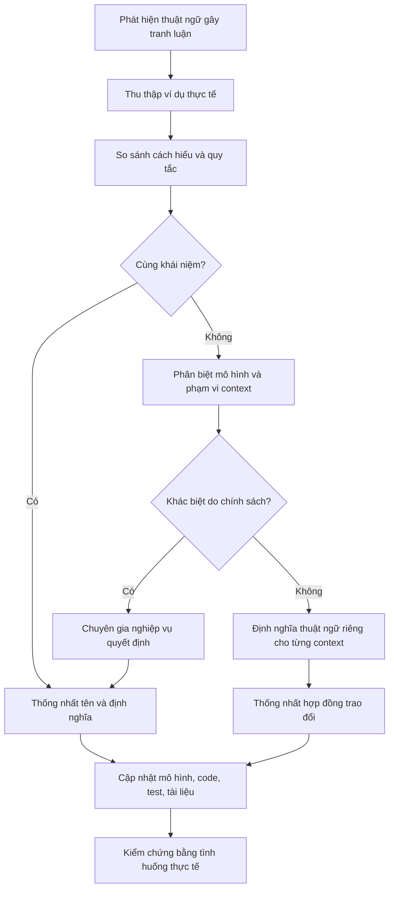
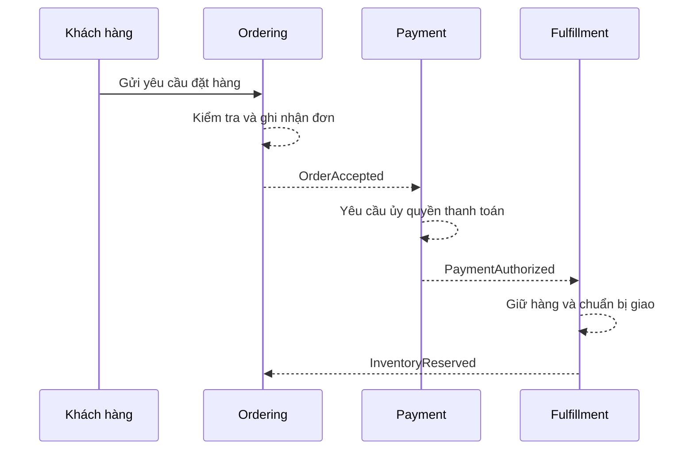

# Giải quyết bất đồng ngôn ngữ giữa các nhóm

Trong một dự án phần mềm, mỗi nhóm thường có cách gọi riêng cho những khái niệm họ làm việc hằng ngày. Nhân viên bán hàng nói “khách”, bộ phận chăm sóc nói “người dùng”, kế toán nói “bên mua”; tất cả có thể đang nói về cùng một người, nhưng cũng có thể đang nói về những vai trò khác nhau. Tình huống khó hơn xuất hiện khi nhiều nhóm dùng cùng một từ nhưng hiểu nó theo những quy tắc khác nhau. Chẳng hạn, “đơn hàng đã xác nhận” có thể có nghĩa là khách đã gửi yêu cầu, hệ thống đã chấp nhận đơn, thanh toán đã được duyệt hoặc kho đã đồng ý chuẩn bị hàng.

Những bất đồng như vậy ảnh hưởng trực tiếp đến mô hình phần mềm. Nếu đội phát triển chọn một từ mà chưa làm rõ ý nghĩa, tên lớp, trạng thái, API và quy trình có thể cùng mang một tên nhưng diễn đạt những hành vi khác nhau. Domain-Driven Design (DDD) giải quyết vấn đề này bằng Ubiquitous Language — ngôn ngữ chung được chuyên gia nghiệp vụ và đội phát triển cùng xây dựng, sử dụng và điều chỉnh liên tục trong phạm vi một mô hình miền.

Bài học này tập trung vào cách phát hiện bất đồng, tìm ra nguyên nhân nghiệp vụ phía sau từ ngữ, thống nhất cách diễn đạt trong từng bounded context và giữ cho ngôn ngữ đó nhất quán trong mã nguồn cùng các giao tiếp giữa nhóm.

## 1. Vì sao bất đồng ngôn ngữ là vấn đề thiết kế?

Ngôn ngữ là phương tiện để con người mô tả khái niệm, quy tắc và quyết định. Khi hai người dùng một từ nhưng gắn cho nó hai ý nghĩa khác nhau, họ có thể tưởng rằng đã thống nhất trong khi thực tế chưa thống nhất. Khi mỗi người dùng một từ khác nhau cho cùng một khái niệm, cuộc trao đổi lại dễ kéo dài vì phải liên tục xác nhận xem mọi người có đang nói về cùng một thứ hay không.

Trong phần mềm, bất đồng ngôn ngữ thường để lại dấu vết ở nhiều nơi:

- Tài liệu nghiệp vụ mô tả một trạng thái, nhưng mã nguồn lại dùng một tên khác với ý nghĩa không rõ ràng.
- Hai nhóm cùng dùng trường `status`, nhưng một nhóm coi `CONFIRMED` là đã nhận yêu cầu, nhóm khác hiểu là đã thu được tiền.
- Một API dùng từ `customer`, trong khi hệ thống tiêu thụ coi mọi tài khoản đăng nhập đều là khách hàng.
- Nhân viên vận hành nói “hủy đơn”, còn đội phát triển dùng cùng thao tác đó cho cả hủy trước thanh toán và hoàn tiền sau khi giao dịch đã hoàn tất.
- Một thay đổi ở nhóm này làm hỏng quy trình nhóm khác vì hai bên không nhận ra rằng cùng một thuật ngữ đang đại diện cho các quy tắc khác nhau.

Hậu quả không chỉ là tên gọi khó hiểu. Đội ngũ có thể xây dựng sai quy tắc, kiểm thử sai điều kiện, tạo trạng thái không thể diễn giải hoặc tích hợp các hệ thống bằng một hợp đồng không phản ánh đúng nghiệp vụ. Vì vậy, giải quyết bất đồng ngôn ngữ là một phần của việc khám phá và thiết kế mô hình miền, không phải công việc chỉnh sửa từ ngữ ở giai đoạn cuối.

## 2. Nhận diện các dạng bất đồng thường gặp

Trước khi chọn thuật ngữ, cần xác định đội ngũ đang gặp loại bất đồng nào. Những dạng dưới đây có cách xử lý khác nhau.

### 2.1. Nhiều từ cho cùng một khái niệm

Các nhóm có thể dùng những từ khác nhau nhưng đang mô tả cùng một khái niệm trong cùng một phạm vi nghiệp vụ. Ví dụ, nhân viên hỗ trợ gọi một người là “khách hàng”, nhóm sản phẩm gọi là “người mua”, còn đội phát triển đặt tên lớp là `Account`.

Hãy hỏi xem các từ đó có cùng danh tính, cùng vòng đời và cùng quy tắc hay không. Nếu có, nhóm có thể thống nhất một thuật ngữ ưu tiên trong bounded context, đồng thời ghi lại các từ đồng nghĩa để nhận biết khi đọc tài liệu cũ. Nếu các từ chỉ những vai trò khác nhau, không nên gộp chúng chỉ để có một tên gọi duy nhất.

### 2.2. Một từ có nhiều ý nghĩa

Đây là trường hợp dễ gây hiểu nhầm nhất. Từ “sản phẩm” trong Catalog có thể là thông tin mô tả để khách lựa chọn; trong Fulfillment, điều cần quản lý có thể là đơn vị hàng hóa vật lý, mã SKU, lô hàng hoặc kiện hàng. Hai nhóm có thể cùng nói “sản phẩm” nhưng đang xử lý hai mô hình khác nhau.

Một từ có nhiều ý nghĩa không nhất thiết là sai. Các bounded context có thể có mô hình riêng, bởi mỗi context giải quyết một nhóm vấn đề và có quy tắc riêng. Điều cần làm là xác định rõ phạm vi mà từ đó có ý nghĩa, rồi thể hiện quan hệ giữa các mô hình ở ranh giới tích hợp.

### 2.3. Tưởng đã thống nhất nhưng thực ra khác quy tắc

Hai nhóm có thể cùng dùng từ “đã xác nhận” nhưng không cùng hiểu điều kiện chuyển sang trạng thái đó. Nhóm Ordering có thể xác nhận rằng yêu cầu đặt hàng hợp lệ; nhóm Payment chỉ coi giao dịch đã hoàn tất sau khi tiền được ghi nhận; nhóm Fulfillment chỉ bắt đầu chuẩn bị khi hàng đã được giữ chỗ.

Đây là bất đồng về ý nghĩa và quy tắc, không thể giải quyết chỉ bằng cách chọn một tên gọi đẹp hơn. Nhóm cần làm rõ sự kiện nào đã xảy ra, ai chịu trách nhiệm quyết định, điều kiện nào phải đúng và hệ quả tiếp theo là gì.

### 2.4. Thuật ngữ mơ hồ hoặc quá rộng

Những từ như “xử lý”, “hoàn tất”, “hợp lệ”, “hoạt động” hay “đã duyệt” thường không nói rõ hành động và điều kiện. Một yêu cầu “xử lý đơn hàng” có thể bao gồm kiểm tra tồn kho, thu tiền, đóng gói và giao hàng. Nếu mã nguồn chỉ có `processOrder()`, người đọc khó biết phương thức chịu trách nhiệm cho bước nào.

Hãy thay từ chung chung bằng tên diễn tả hành động hoặc trạng thái cụ thể, nếu nghiệp vụ có sự phân biệt đó. Ví dụ: `reserveInventory`, `authorizePayment`, `capturePayment`, `prepareShipment`. Tên cụ thể giúp lộ ra ranh giới trách nhiệm và làm cho luồng nghiệp vụ dễ kiểm tra hơn.

### 2.5. Khác biệt do vai trò, quy trình hoặc ngôn ngữ

Một thuật ngữ có thể được dùng khác nhau vì mỗi nhóm quan sát quy trình từ một vai trò khác nhau. Bộ phận bán hàng quan tâm đến người mua và cơ hội bán; kế toán quan tâm đến bên chịu trách nhiệm thanh toán; vận hành quan tâm đến người nhận hàng. Với nhóm làm việc đa ngôn ngữ, một từ tiếng Việt và một từ tiếng Anh có thể không bao phủ cùng một phạm vi nghĩa.

Trong trường hợp này, đừng dịch từng từ một cách máy móc. Hãy yêu cầu các bên mô tả tình huống thực tế, trách nhiệm và quy tắc của họ. Chỉ sau khi hiểu khái niệm mới quyết định tên gọi trong ngôn ngữ chung.

## 3. Nguyên tắc xây dựng ngôn ngữ chung

DDD không yêu cầu toàn doanh nghiệp phải sử dụng một từ duy nhất cho mọi khái niệm. Ngôn ngữ chung được xác định trong phạm vi bounded context — nơi một mô hình có ý nghĩa nhất quán. Các nguyên tắc sau giúp đội ngũ duy trì sự rõ ràng.

### 3.1. Thống nhất ý nghĩa trước khi thống nhất tên

Đừng bắt đầu cuộc thảo luận bằng câu hỏi “nên đặt tên là gì?”. Hãy bắt đầu bằng “đối tượng này là gì, tồn tại khi nào, ai sử dụng, ai thay đổi nó và quy tắc nào áp dụng?”. Khi các bên hiểu cùng một khái niệm, việc chọn từ thường trở nên dễ dàng hơn.

Một định nghĩa tốt cần có ví dụ cụ thể và ranh giới. Chẳng hạn, “đơn hàng được tạo” có thể nghĩa là hệ thống đã ghi nhận yêu cầu của khách; nó chưa khẳng định rằng thanh toán đã thành công hay kho đã giữ được hàng. Câu mô tả này hữu ích hơn một định nghĩa ngắn như “đơn đã được xử lý”.

### 3.2. Một ý nghĩa rõ ràng trong một bounded context

Trong một bounded context, thuật ngữ nên có ý nghĩa nhất quán khi được dùng trong trao đổi, tài liệu và mã nguồn. Nếu cùng một từ được dùng cho hai khái niệm khác nhau trong cùng context, hãy xem xét đổi tên hoặc tách rõ khái niệm.

Giữa các bounded context, cùng một từ có thể mang nghĩa khác nhau. Catalog và Fulfillment không bắt buộc phải dùng chung một mô hình `Product`. Điều quan trọng là mỗi bên hiểu mô hình của mình và biết cách chuyển đổi hoặc trao đổi thông tin với bên kia.

### 3.3. Dùng ngôn ngữ nghiệp vụ trong mã nguồn

Ngôn ngữ chung chỉ có giá trị khi xuất hiện trong công việc phát triển hằng ngày. Tên class, method, biến, event và test nên phản ánh khái niệm mà chuyên gia nghiệp vụ nhận ra.

Ví dụ, nếu nghiệp vụ phân biệt việc “ủy quyền thanh toán” và “thu tiền”, mã nguồn nên thể hiện hai hành vi riêng:

```java
public final class Payment {
    public void authorize() {
        // Kiểm tra và yêu cầu bên cung cấp thanh toán ủy quyền giao dịch.
    }

    public void capture() {
        // Yêu cầu ghi nhận khoản tiền đã được ủy quyền.
    }
}
```

Tên `process()` không cho người đọc biết hành vi nào đang diễn ra. Tên `authorize()` và `capture()` làm rõ sự khác biệt nghiệp vụ, đồng thời giúp test diễn đạt được các tình huống tương ứng. Ví dụ mã chỉ minh họa cách đặt tên; điều kiện và vòng đời thực tế phải theo quy tắc của context Payment.

### 3.4. Dùng ví dụ và quy tắc để kiểm tra định nghĩa

Một định nghĩa có vẻ rõ ràng khi đọc riêng lẻ nhưng có thể thất bại trước tình huống thực tế. Hãy kiểm tra thuật ngữ bằng các trường hợp bình thường, ngoại lệ, biên và tình huống gây tranh luận.

Với trạng thái “đơn đã xác nhận”, hãy hỏi:

- Đơn có thể được xác nhận khi chưa có kết quả thanh toán không?
- Nếu thanh toán bị từ chối thì trạng thái đơn là gì?
- Nếu kho không giữ được hàng thì ai quyết định bước tiếp theo?
- Khách có thể hủy đơn ở thời điểm nào?
- Nhân viên có thể xác nhận thủ công không, và hành động đó được ghi nhận ra sao?

Những câu hỏi này buộc đội ngũ nói về quy tắc thay vì chỉ tranh luận từ ngữ.

### 3.5. Xem ngôn ngữ là một phần của mô hình đang phát triển

Ngôn ngữ chung không phải bộ từ điển bất biến. Khi nhóm khám phá thêm quy tắc, tên gọi cũ có thể không còn phù hợp. Khi đó, cần cập nhật mô hình, mã nguồn, tài liệu, test và hợp đồng tích hợp có liên quan. Việc thay đổi thuật ngữ phải đi cùng việc xác nhận xem ý nghĩa nghiệp vụ có thay đổi hay chỉ có tên gọi thay đổi.

## 4. Quy trình giải quyết bất đồng ngôn ngữ

Một quy trình ngắn gọn nhưng có kỷ luật giúp cuộc thảo luận tập trung vào nghiệp vụ và tạo ra kết quả có thể kiểm chứng.

### Bước 1: Thu thập cách dùng thực tế

Ghi lại từ đang gây tranh luận và các câu nói nguyên văn trong bối cảnh công việc. Tìm ví dụ từ cuộc trao đổi, biểu mẫu, báo cáo, màn hình, quy trình vận hành, API hoặc mã nguồn hiện tại.

Không chỉ hỏi “anh/chị định nghĩa từ này thế nào?”. Hãy hỏi “lần gần nhất anh/chị thực hiện việc này là khi nào?”, “điều gì đã xảy ra trước đó?” và “sau bước này ai làm gì?”. Tình huống cụ thể thường bộc lộ ý nghĩa thật tốt hơn định nghĩa trừu tượng.

### Bước 2: Đặt các cách hiểu cạnh nhau

Tạo một bảng nhỏ để so sánh người sử dụng thuật ngữ, đối tượng được nói đến, điều kiện, hành động và kết quả. Đánh dấu phần giống nhau và phần khác nhau.

| Câu hỏi | Nhóm Ordering | Nhóm Payment |
|---|---|---|
| “Đã xác nhận” nghĩa là gì? | Yêu cầu đặt hàng đã qua kiểm tra và được chấp nhận | Giao dịch đã được bên thanh toán chấp thuận |
| Điều kiện chính | Thông tin đơn hợp lệ, mặt hàng có thể đặt | Nhà cung cấp thanh toán trả kết quả ủy quyền thành công |
| Kết quả | Đơn chuyển sang trạng thái được chấp nhận | Giao dịch chuyển sang trạng thái đã được ủy quyền |
| Trách nhiệm | Quản lý vòng đời đơn hàng | Quản lý vòng đời thanh toán |

Nếu các bên đang mô tả hai sự kiện khác nhau, không nên cố ép chúng vào cùng một trạng thái. Hãy dùng tên riêng cho mỗi sự kiện và làm rõ quan hệ giữa chúng.

### Bước 3: Phân biệt bất đồng từ ngữ và bất đồng nghiệp vụ

Có ít nhất ba khả năng:

1. **Cùng khái niệm, khác cách gọi:** có thể thống nhất một thuật ngữ ưu tiên và ghi nhận từ đồng nghĩa.
2. **Khác khái niệm, vô tình dùng cùng từ:** cần đặt tên riêng và xác định ranh giới mô hình.
3. **Chưa thống nhất quy tắc hoặc chính sách:** cần người có thẩm quyền nghiệp vụ quyết định quy tắc; đội phát triển không nên tự giải quyết bằng cách đổi tên.

Đôi khi bất đồng còn bắt nguồn từ việc hai nhóm đang sở hữu các phần khác nhau của một quy trình. Khi đó, cần làm rõ trách nhiệm và cách bàn giao giữa các nhóm, không chỉ sửa glossary.

### Bước 4: Xác định phạm vi bounded context

Hỏi xem các bên có đang làm việc trong cùng một mô hình hay không. Nếu một thuật ngữ có ý nghĩa khác nhau do mục tiêu và quy tắc khác nhau, đó có thể là dấu hiệu của hai bounded context.

Ví dụ, `Product` trong Catalog có tên hiển thị, mô tả, danh mục và nội dung tiếp thị. Trong Fulfillment, đơn vị cần xử lý có thể là `StockItem` hoặc `SKU`, gắn với kích thước, vị trí lưu kho và khả năng đóng gói. Catalog quan tâm khách chọn gì; Fulfillment quan tâm kho cần lấy và giao vật phẩm nào.

Không nên tách bounded context chỉ vì hai nhóm dùng hai từ khác nhau. Cần xem xét cả quy tắc, trách nhiệm, vòng đời, quyền sở hữu dữ liệu và cách thay đổi mô hình. Ngược lại, cũng không nên ép hai mô hình thành một chỉ để giảm số lượng thuật ngữ.

### Bước 5: Chọn thuật ngữ và định nghĩa có thể kiểm chứng

Trong phạm vi context đã xác định, chọn tên dễ hiểu với chuyên gia và đội phát triển. Định nghĩa nên trả lời được:

- Khái niệm này đại diện cho điều gì?
- Nó thuộc context nào và ai chịu trách nhiệm?
- Nó bắt đầu và kết thúc vòng đời khi nào?
- Những quy tắc hoặc điều kiện nào áp dụng?
- Ví dụ nào thuộc khái niệm này, và trường hợp nào không thuộc?
- Các thuật ngữ gần nghĩa hoặc tên cũ nào cần nhận biết?

Nếu chưa thể trả lời một số câu hỏi, hãy ghi rõ điều chưa được quyết định và người chịu trách nhiệm xác nhận. Đừng biến giả định của đội phát triển thành định nghĩa nghiệp vụ chính thức.

### Bước 6: Cập nhật mô hình, mã nguồn và tài liệu

Sau khi thống nhất, cập nhật những nơi dùng thuật ngữ đó: sơ đồ miền, class và method, tên event, test, tài liệu hướng dẫn, màn hình, API hoặc schema tích hợp. Nếu đổi tên làm ảnh hưởng hệ thống đang hoạt động, cần có kế hoạch tương thích và chuyển đổi phù hợp.

Một định nghĩa chỉ nằm trong biên bản họp sẽ nhanh chóng bị quên. Ngôn ngữ chung cần được thể hiện trong những tạo phẩm mà nhóm sử dụng để xây dựng và vận hành hệ thống.

### Bước 7: Kiểm chứng bằng tình huống và phản hồi

Đọc lại định nghĩa cùng chuyên gia nghiệp vụ bằng các tình huống đã thu thập. Kiểm tra xem tên gọi trong mã nguồn có giúp người đọc hiểu đúng hành vi không. Khi có tình huống mới làm lộ ra mâu thuẫn, cập nhật mô hình và ghi nhận quyết định mới.



## 5. Ví dụ xuyên suốt: “đơn hàng đã xác nhận” trong thương mại điện tử

Giả sử một doanh nghiệp có ba nhóm: Ordering tiếp nhận đơn, Payment xử lý thanh toán và Fulfillment chuẩn bị giao hàng. Trong cuộc họp, cả ba nhóm đều nói “đơn hàng đã xác nhận”. Khi nhóm phát triển hỏi thời điểm nào được xem là xác nhận, các câu trả lời khác nhau:

- Ordering: khách đã gửi đơn và hệ thống kiểm tra các thông tin bắt buộc thành công.
- Payment: giao dịch đã được nhà cung cấp thanh toán ủy quyền.
- Fulfillment: kho đã giữ được số lượng hàng cần thiết và có thể bắt đầu chuẩn bị.

Nếu dùng một trạng thái `CONFIRMED` chung cho cả ba ý nghĩa, hệ thống sẽ không thể diễn đạt rõ trường hợp đơn đã được tiếp nhận nhưng thanh toán chưa hoàn tất, hoặc thanh toán thành công nhưng kho chưa giữ được hàng.

### 5.1. Làm rõ các khái niệm

Sau khi trao đổi bằng tình huống cụ thể, các nhóm có thể thống nhất cách diễn đạt trong phạm vi của mình:

| Bounded Context | Thuật ngữ | Ý nghĩa |
|---|---|---|
| Ordering | `OrderPlaced` | Khách đã gửi yêu cầu đặt hàng và Ordering đã ghi nhận đơn |
| Ordering | `OrderAccepted` | Đơn đã vượt qua các kiểm tra thuộc trách nhiệm Ordering |
| Payment | `PaymentAuthorized` | Khoản thanh toán đã được ủy quyền theo kết quả của nhà cung cấp |
| Payment | `PaymentCaptured` | Khoản tiền đã được ghi nhận/thu theo quy trình thanh toán |
| Fulfillment | `InventoryReserved` | Số lượng hàng cần thiết đã được giữ cho đơn |
| Fulfillment | `ShipmentPrepared` | Hàng đã được chuẩn bị theo quy trình giao hàng |

Các tên trên chỉ là một mô hình minh họa. Một doanh nghiệp có thể có quy trình khác, chẳng hạn không cần ủy quyền trước khi ghi nhận tiền, hoặc cho phép giữ hàng trước khi thanh toán. Thuật ngữ cuối cùng phải phản ánh đúng chính sách thực tế.

### 5.2. Mô tả quan hệ giữa các sự kiện

Sau khi phân biệt khái niệm, các nhóm có thể mô tả luồng phối hợp như sau:



Sơ đồ giúp làm rõ tên và thứ tự của các sự kiện trong một phương án. Hệ thống thật cần xác định rõ điều gì xảy ra nếu thanh toán thất bại, kho hết hàng, event đến trễ hoặc được gửi lặp lại. Những trường hợp đó là một phần của quy tắc và hợp đồng giữa các context.

### 5.3. Đặt tên trong mã nguồn theo ngôn ngữ của context

Ordering có thể biểu diễn hành vi tiếp nhận đơn bằng tên phù hợp với mô hình của mình:

```java
import java.util.UUID;

record OrderId(UUID value) {}
record OrderAccepted(OrderId orderId) {}

public final class Order {
    private final OrderId id;

    public Order(OrderId id) {
        this.id = id;
    }

    public OrderAccepted accept() {
        // Kiểm tra các điều kiện thuộc trách nhiệm của Ordering.
        // Chuyển trạng thái đơn và tạo sự kiện OrderAccepted.
        return new OrderAccepted(id);
    }
}
```

Payment dùng thuật ngữ riêng cho hành vi thanh toán:

```java
import java.util.UUID;

record PaymentId(UUID value) {}
record PaymentAuthorized(PaymentId paymentId) {}

public final class Payment {
    private final PaymentId id;

    public Payment(PaymentId id) {
        this.id = id;
    }

    public PaymentAuthorized authorize() {
        // Kiểm tra trạng thái Payment và điều phối yêu cầu ủy quyền.
        return new PaymentAuthorized(id);
    }
}
```

Không nên đổi tên hành vi của Payment thành `confirmOrder()` chỉ để giống cách gọi ở Ordering. Mã nguồn cần diễn đạt trách nhiệm của context sở hữu hành vi. Khi tích hợp, hai bên thống nhất hợp đồng sự kiện hoặc API và chuyển đổi dữ liệu cần thiết.

## 6. Giữ ngôn ngữ rõ ràng giữa các bounded context

Ngôn ngữ chung được duy trì bên trong từng bounded context. Khi các context trao đổi, đội ngũ cần làm rõ ý nghĩa của dữ liệu đi qua ranh giới. Có một số cách thường dùng.

### 6.1. Context Map và hợp đồng tích hợp

Context Map mô tả quan hệ giữa các context và giúp các nhóm biết ai cung cấp, ai tiêu thụ thông tin, mức độ phụ thuộc ra sao. Hợp đồng tích hợp cần định nghĩa tên trường, trạng thái, sự kiện, phiên bản và ý nghĩa nghiệp vụ của dữ liệu.

Một trường `status` trong API không nên chỉ được mô tả bằng danh sách giá trị. Hợp đồng cần giải thích mỗi giá trị biểu thị điều gì, điều kiện chuyển trạng thái, ai có quyền phát sinh và người tiêu thụ được phép suy luận điều gì từ nó.

### 6.2. Published Language

Published Language là ngôn ngữ trao đổi được công bố để nhiều context có thể hiểu hợp đồng tích hợp. Nó thường xuất hiện trong schema event, API hoặc thông điệp. Published Language cần ổn định và có định nghĩa rõ, nhưng không có nghĩa là mọi context phải dùng cùng cấu trúc nội bộ.

Ví dụ, sự kiện tích hợp `OrderAccepted` có thể mang `orderId`, thời điểm chấp nhận và các thông tin tối thiểu mà bên tiêu thụ cần. Payment không cần sử dụng nguyên lớp `Order` của Ordering; nó chỉ cần hiểu hợp đồng đã công bố.

### 6.3. Anti-Corruption Layer

Anti-Corruption Layer (ACL) là lớp chuyển đổi giúp mô hình nội bộ không bị chi phối bởi cách đặt tên, cấu trúc hoặc quy tắc của hệ thống bên ngoài. ACL đặc biệt hữu ích khi tích hợp với hệ thống cũ hoặc nhà cung cấp có mô hình không phù hợp với ngôn ngữ của context hiện tại.

Ví dụ, hệ thống cũ gửi `status = 3`, trong đó giá trị 3 có nghĩa là “đã thu tiền”. ACL có thể chuyển đổi giá trị đó thành một kiểu và thuật ngữ rõ ràng trong mô hình Payment, đồng thời xử lý các giá trị không nhận diện được. Nhờ vậy, logic miền không phải rải rác các điều kiện phụ thuộc vào mã trạng thái của hệ thống ngoài.

### 6.4. Tránh chia sẻ mô hình chỉ vì muốn dùng chung từ

Việc hai context có cùng một thuật ngữ không chứng minh rằng chúng nên dùng chung một class hoặc một database schema. Mỗi context có thể cần dữ liệu, vòng đời và quy tắc khác nhau. Hãy chia sẻ hợp đồng ở ranh giới khi cần, còn mô hình nội bộ nên phục vụ trách nhiệm của chính context đó.

## 7. Duy trì ngôn ngữ chung trong công việc hằng ngày

Một buổi workshop có thể giải quyết bất đồng trước mắt, nhưng ngôn ngữ chung chỉ bền vững khi được dùng trong các hoạt động thường xuyên.

### 7.1. Gắn thuật ngữ với tạo phẩm phát triển

Khi viết user story, acceptance criteria, test, code review và tài liệu API, hãy dùng các thuật ngữ đã thống nhất. Nếu một yêu cầu sử dụng từ mới hoặc từ cũ với ý nghĩa khác, hãy đặt câu hỏi trước khi triển khai.

Test có thể giúp bảo vệ ý nghĩa của thuật ngữ. Ví dụ, test `cannot_accept_order_without_items` mô tả một quy tắc cụ thể hơn test `invalid_order`. Tên test tốt giúp người đọc hiểu hành vi được mong đợi và phát hiện khi định nghĩa nghiệp vụ thay đổi.

### 7.2. Dùng ví dụ cụ thể trong refinement và review

Khi thảo luận một thuật ngữ, yêu cầu ít nhất một ví dụ bình thường và một ví dụ ngoại lệ. Có thể dùng Example Mapping, Event Storming hoặc các kỹ thuật workshop khác để khám phá sự kiện, quy tắc và câu hỏi chưa được giải đáp.

Mục tiêu của workshop không phải tạo ra một danh sách từ đẹp. Kết quả cần làm rõ các sự kiện, hành vi, điều kiện và trách nhiệm mà hệ thống phải thể hiện.

### 7.3. Ghi nhận quyết định và người chịu trách nhiệm

Với thuật ngữ có ảnh hưởng đến nhiều nhóm, hãy ghi rõ context, định nghĩa, ví dụ, người xác nhận nghiệp vụ, nơi dùng trong mã nguồn hoặc hợp đồng tích hợp và ngày cập nhật. Không nhất thiết phải tạo một tài liệu lớn; glossary hoặc trang tài liệu ngắn có cấu trúc rõ là đủ nếu đội ngũ thực sự duy trì nó.

Khi có tranh chấp về chính sách, cần chỉ rõ ai có thẩm quyền quyết định. Đội phát triển có thể đề xuất mô hình và chỉ ra hệ quả kỹ thuật, nhưng không nên tự chọn một chính sách nghiệp vụ chỉ để làm cho tên gọi nhất quán.

### 7.4. Xử lý thay đổi thuật ngữ có kiểm soát

Khi một thuật ngữ thay đổi, xác định phạm vi ảnh hưởng: mã nguồn, dữ liệu đã lưu, API, event, dashboard, báo cáo, hướng dẫn vận hành và hệ thống bên ngoài. Với hợp đồng đang được tiêu thụ, có thể cần phiên bản mới, giai đoạn tương thích hoặc chuyển đổi dữ liệu.

Không phải mọi lần đổi tên đều là thay đổi mô hình. Có trường hợp chỉ cần đổi từ cho rõ hơn; cũng có trường hợp việc phát hiện ra ý nghĩa mới buộc phải thay đổi trạng thái, quy tắc hoặc ranh giới context. Hãy ghi rõ loại thay đổi để kiểm thử đúng phạm vi.

## 8. Mẫu ghi nhận thuật ngữ

Một mục glossary có thể dùng cấu trúc sau:

| Trường | Nội dung cần ghi |
|---|---|
| Thuật ngữ | Tên được ưu tiên sử dụng trong context |
| Bounded Context | Phạm vi mà định nghĩa có hiệu lực |
| Định nghĩa | Ý nghĩa nghiệp vụ ngắn gọn, rõ ràng |
| Ví dụ | Tình huống cụ thể thuộc khái niệm |
| Không bao gồm | Những trường hợp dễ nhầm nhưng không thuộc khái niệm |
| Quy tắc liên quan | Điều kiện, hành vi, vòng đời hoặc invariant |
| Từ đồng nghĩa/tên cũ | Các cách gọi cần nhận biết khi đọc tài liệu cũ |
| Người xác nhận | Chuyên gia hoặc vai trò chịu trách nhiệm nghiệp vụ |
| Nơi sử dụng | Mô hình, code, test, API hoặc event liên quan |
| Trạng thái | Đang đề xuất, đã thống nhất hoặc cần xem xét lại |

Ví dụ:

| Trường | Giá trị minh họa |
|---|---|
| Thuật ngữ | `PaymentAuthorized` |
| Bounded Context | Payment |
| Định nghĩa | Nhà cung cấp thanh toán đã chấp thuận yêu cầu ủy quyền cho giao dịch |
| Ví dụ | Giao dịch thẻ được cấp quyền với mã tham chiếu từ nhà cung cấp |
| Không bao gồm | Tiền đã được ghi nhận/thu thành công; hàng đã được giữ trong kho |
| Quy tắc liên quan | Chỉ phát sinh sau khi nhận và xác thực kết quả ủy quyền |
| Từ đồng nghĩa/tên cũ | “Thanh toán xác nhận” — cách gọi cũ, không còn được ưu tiên |
| Người xác nhận | Đại diện nghiệp vụ Payment |
| Nơi sử dụng | `Payment.authorize()`, event `PaymentAuthorized`, test của Payment |
| Trạng thái | Đã thống nhất |

Mục glossary là công cụ hỗ trợ trao đổi. Nó không thay thế mô hình, quy tắc thực thi hoặc hợp đồng tích hợp. Khi định nghĩa mâu thuẫn với hành vi thực tế, nhóm cần điều tra và cập nhật mô hình thay vì chỉ sửa câu chữ trong bảng.

## 9. Những sai lầm cần tránh

- **Bỏ phiếu chọn từ mà không phân tích ý nghĩa:** từ được nhiều người thích chưa chắc mô tả đúng nghiệp vụ.
- **Ép toàn doanh nghiệp dùng một mô hình duy nhất:** các bounded context có thể cần cách diễn đạt riêng cho cùng một khái niệm rộng.
- **Dùng glossary thay cho trao đổi:** tài liệu không thể tự giải quyết các chính sách chưa được chuyên gia thống nhất.
- **Chỉ đổi tên class mà không đổi quy tắc:** mã nguồn có thể trông rõ hơn nhưng hành vi vẫn giữ sự mơ hồ ban đầu.
- **Để thuật ngữ chỉ tồn tại trong tài liệu:** nếu code, test và API dùng tên khác, đội ngũ sẽ tiếp tục có nhiều nguồn diễn giải.
- **Dùng từ kỹ thuật thay cho khái niệm nghiệp vụ:** tên như `Data`, `Info`, `Process` hoặc `Manager` thường không giúp người đọc hiểu trách nhiệm miền.
- **Gộp các trạng thái khác nhau:** `OrderAccepted`, `PaymentAuthorized` và `InventoryReserved` không thể thay thế nhau chỉ vì đều được gọi nôm na là “đã xác nhận”.
- **Bỏ qua hệ thống cũ và nhóm tích hợp:** thuật ngữ mới cần được ánh xạ rõ ràng khi dữ liệu đi qua ranh giới.
- **Không xem lại quyết định:** mô hình và ngôn ngữ cần tiến hóa khi nghiệp vụ thay đổi hoặc khi ví dụ mới làm lộ ra mâu thuẫn.

## 10. Checklist cho một buổi giải quyết bất đồng

Trước khi kết thúc buổi trao đổi, hãy kiểm tra:

- [ ] Đã xác định từ hoặc cụm từ gây tranh luận và bối cảnh sử dụng thực tế.
- [ ] Các nhóm đã đưa ra ví dụ, tình huống ngoại lệ và quy tắc liên quan.
- [ ] Đã phân biệt bất đồng từ ngữ với bất đồng chính sách hoặc trách nhiệm.
- [ ] Đã xác định thuật ngữ thuộc bounded context nào.
- [ ] Định nghĩa có ranh giới rõ: bao gồm điều gì và không bao gồm điều gì.
- [ ] Có người chịu trách nhiệm xác nhận quyết định nghiệp vụ.
- [ ] Đã xác định nơi cần cập nhật trong mô hình, code, test, tài liệu và hợp đồng tích hợp.
- [ ] Các bên đã kiểm tra lại định nghĩa bằng tình huống thực tế.
- [ ] Những điểm chưa thống nhất được ghi lại cùng người phụ trách và bước tiếp theo.

## 11. Câu hỏi tự kiểm tra

1. Vì sao hai nhóm cùng dùng một từ vẫn có thể hiểu khác nhau về nghiệp vụ?
2. Phân biệt trường hợp nhiều từ cùng chỉ một khái niệm với trường hợp một từ chỉ nhiều khái niệm như thế nào?
3. Vì sao cần xác định bounded context trước khi quyết định một thuật ngữ có phải dùng chung hay không?
4. Khi nào bất đồng ngôn ngữ thực chất là bất đồng về chính sách nghiệp vụ?
5. Vì sao cần dùng ví dụ và tình huống ngoại lệ để kiểm tra định nghĩa?
6. Ubiquitous Language cần xuất hiện ở những phần nào trong quá trình phát triển phần mềm?
7. Published Language và Anti-Corruption Layer giúp các bounded context trao đổi mà vẫn giữ được mô hình riêng như thế nào?
8. Khi đổi tên một thuật ngữ trong API hoặc domain event, cần xem xét những ảnh hưởng nào?
9. Một glossary tốt cần những thông tin gì để giúp đội ngũ ra quyết định?
10. Nếu Ordering và Payment cùng dùng từ “đã xác nhận” cho hai sự kiện khác nhau, bạn sẽ tổ chức lại mô hình và hợp đồng tích hợp ra sao?

## Kết luận

Giải quyết bất đồng ngôn ngữ bắt đầu bằng việc tìm hiểu cách các nhóm thực sự làm việc, sau đó làm rõ khái niệm, quy tắc và phạm vi của chúng. Nếu các bên chỉ khác cách gọi cho cùng một khái niệm, hãy thống nhất thuật ngữ trong bounded context. Nếu cùng một từ đang đại diện cho các khái niệm hoặc chính sách khác nhau, hãy làm rõ mô hình và trách nhiệm thay vì ép chúng vào một tên chung.

Ngôn ngữ chung chỉ thực sự hữu ích khi chuyên gia nghiệp vụ và đội phát triển cùng sử dụng nó trong trao đổi, mô hình, mã nguồn, test và hợp đồng tích hợp. Khi thuật ngữ được kiểm chứng bằng tình huống thực tế và được cập nhật cùng mô hình, đội ngũ có thể giảm hiểu nhầm, phát hiện ranh giới nghiệp vụ sớm hơn và thay đổi phần mềm với sự tự tin cao hơn.
