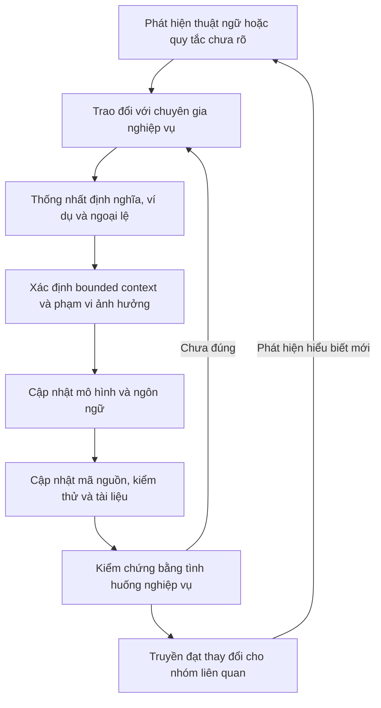

# Cập nhật ngôn ngữ và mã nguồn đồng thời khi hiểu biết thay đổi

Trong một dự án phát triển phần mềm, hiểu biết về nghiệp vụ hiếm khi hoàn chỉnh ngay từ đầu. Khi trao đổi với chuyên gia, quan sát quy trình thực tế và xử lý các trường hợp ngoại lệ, đội phát triển có thể nhận ra rằng một thuật ngữ đang dùng quá rộng, hai khái niệm tưởng giống nhau thực ra khác nhau, hoặc một quy tắc đã được hiểu sai. Khi điều đó xảy ra, ngôn ngữ chung (Ubiquitous Language) và mô hình trong mã nguồn cần được cập nhật cùng nhau.

Trong Domain-Driven Design (DDD), ngôn ngữ chung là cách chuyên gia nghiệp vụ và đội phát triển diễn đạt các khái niệm, hành động, trạng thái và quy tắc trong một bounded context. Ngôn ngữ này xuất hiện trong cuộc trao đổi hằng ngày, ví dụ nghiệp vụ, tài liệu, tên lớp, phương thức, sự kiện và kiểm thử. Nó không phải một bảng thuật ngữ được lập một lần rồi xem là hoàn tất.

Khi hiểu biết thay đổi, đội cần xác nhận ý nghĩa mới với người hiểu nghiệp vụ, điều chỉnh mô hình, cập nhật mã nguồn và kiểm thử, rồi truyền đạt thay đổi đến những người và hệ thống liên quan. Làm đồng bộ như vậy giúp phần mềm tiếp tục phản ánh cách doanh nghiệp thực sự vận hành.

## Sau bài học này

Bạn có thể:

- Nhận biết những dấu hiệu cho thấy ngôn ngữ chung hiện tại đã mơ hồ hoặc không còn đúng.
- Phân biệt việc đổi tên cho rõ nghĩa với việc thay đổi thực sự trong quy tắc nghiệp vụ.
- Tổ chức trao đổi để xác nhận thuật ngữ, định nghĩa, ví dụ và ngoại lệ với chuyên gia nghiệp vụ.
- Cập nhật mô hình, mã nguồn, kiểm thử và tài liệu theo cùng một thay đổi.
- Quản lý thay đổi thuật ngữ qua ranh giới bounded context và hợp đồng tích hợp.
- Thực hiện refactoring theo từng bước, có kiểm chứng và hạn chế làm gián đoạn hệ thống.

## 1. Vì sao ngôn ngữ chung phải thay đổi cùng hiểu biết?

Ở giai đoạn đầu, đội có thể gọi mọi yêu cầu mua hàng là `Order`. Sau khi tìm hiểu kỹ hơn, chuyên gia nghiệp vụ chỉ ra rằng quy trình có ba khái niệm khác nhau:

- **Yêu cầu đặt hàng:** khách hàng gửi đề nghị mua sản phẩm.
- **Đơn hàng được tiếp nhận:** doanh nghiệp chấp nhận xử lý yêu cầu sau khi kiểm tra các điều kiện ban đầu.
- **Đơn hàng được xác nhận:** các điều kiện cần thiết đã thỏa mãn và đơn chuyển sang bước thực hiện tiếp theo.

Nếu đội vẫn dùng một trạng thái `APPROVED` cho cả ba khái niệm, mã nguồn có thể chạy đúng với một số tình huống nhưng sẽ khó diễn đạt các quy tắc mới. Một người đọc `approveOrder()` không biết hành động đó chỉ tiếp nhận yêu cầu, xác nhận cam kết bán hàng hay phê duyệt tín dụng.

Ngược lại, nếu chuyên gia đã thống nhất nghĩa mới nhưng mã nguồn vẫn giữ tên và hành vi cũ, tài liệu và phần mềm sẽ kể hai câu chuyện khác nhau. Người phát triển mới có thể hiểu sai, kiểm thử có thể xác nhận nhầm quy tắc, và những thay đổi tiếp theo sẽ tiếp tục dựa trên mô hình lỗi thời.

Vì vậy, ngôn ngữ chung cần được xem là một phần của mô hình đang phát triển. Khi một khái niệm được làm rõ, các cách biểu đạt liên quan cần được rà soát: lời nói, ví dụ, sơ đồ, tài liệu, mã nguồn, kiểm thử và hợp đồng trao đổi.

### Ngôn ngữ chung không phải danh sách từ khóa

Một danh sách thuật ngữ chỉ hữu ích khi mỗi thuật ngữ gắn với ý nghĩa và cách sử dụng cụ thể. Ví dụ, định nghĩa `Order = Đơn hàng` không cho biết:

- Đơn hàng được tạo ở thời điểm nào?
- Ai có quyền xác nhận hoặc hủy?
- Đơn hàng đã thanh toán có còn được chỉnh sửa không?
- “Hoàn tất” là hoàn tất thanh toán, đóng gói hay giao hàng?
- Một đơn hàng có thể được giao thành nhiều lần không?

Đội cần thống nhất cả cách dùng từ lẫn các quy tắc mà từ đó đại diện. Trong DDD, ngôn ngữ chung được thể hiện qua những ví dụ cụ thể và hành vi của mô hình, không chỉ qua phần chú giải.

### Ngôn ngữ chung có phạm vi theo bounded context

Một từ có thể có nghĩa khác nhau ở các bounded context. Chẳng hạn, `Customer` trong Bán hàng có thể đại diện cho người mua và lịch sử giao dịch; trong Kế toán, `CustomerAccount` có thể đại diện cho chủ thể chịu trách nhiệm thanh toán; trong Vận chuyển, `Recipient` là người nhận kiện hàng.

Không nên ép tất cả ngữ cảnh sử dụng một lớp hoặc một định nghĩa duy nhất chỉ để có vẻ thống nhất. Điều cần thống nhất là ý nghĩa trong từng ranh giới và cách dịch nghĩa khi trao đổi giữa các ranh giới. Context map giúp đội nhận biết nơi nào chia sẻ ngôn ngữ, nơi nào cần hợp đồng và lớp chuyển đổi.

## 2. Dấu hiệu cho thấy cần cập nhật ngôn ngữ và mô hình

Những dấu hiệu sau thường xuất hiện trong trao đổi, mã nguồn hoặc vận hành:

| Dấu hiệu | Ví dụ | Việc cần làm rõ |
| --- | --- | --- |
| Một từ có nhiều nghĩa | “Đóng đơn” có lúc nghĩa là ngừng nhận chỉnh sửa, có lúc nghĩa là giao xong. | Xác định các trạng thái hoặc hành động riêng. |
| Nhiều từ được dùng thay thế nhau | “Duyệt”, “xác nhận”, “chấp nhận” cùng xuất hiện trong tài liệu và mã nguồn. | Xác định chúng là từ đồng nghĩa hay các bước nghiệp vụ khác nhau. |
| Tên trong mã không phản ánh nghiệp vụ | `process()`, `handleStatus()` hoặc `updateFlag()` che giấu hành động thực tế. | Đặt tên theo ý nghĩa và kết quả nghiệp vụ. |
| Quy tắc liên tục nằm ngoài mô hình | Một trạng thái chỉ hợp lệ khi người đọc nhớ một ghi chú trong tài liệu. | Đưa quy tắc vào hành vi, bất biến và kiểm thử phù hợp. |
| Chuyên gia và lập trình viên diễn giải khác nhau | Chuyên gia nói “đã giữ hàng”, lập trình viên hiểu là “đã xuất kho”. | Thống nhất định nghĩa và ví dụ trước khi sửa mã. |
| Ngoại lệ làm lộ ra khái niệm bị thiếu | Một đơn giao nhiều đợt không thể biểu diễn bằng một trạng thái giao hàng duy nhất. | Bổ sung khái niệm hoặc phân biệt vòng đời liên quan. |
| Tích hợp liên tục cần dịch thủ công | Mỗi lần nhận thông điệp từ hệ thống khác, đội phải hỏi trường `status=2` có nghĩa gì. | Làm rõ hợp đồng và ánh xạ thuật ngữ giữa các context. |

Không phải mọi khác biệt về từ ngữ đều đòi hỏi refactor lớn. Có lúc chỉ cần chọn một tên nhất quán. Nhưng nếu từ mới biểu thị một khái niệm hoặc quy tắc mới, đội phải cập nhật mô hình và hành vi tương ứng, không chỉ thay chuỗi ký tự.

## 3. Phân biệt đổi tên với thay đổi ý nghĩa nghiệp vụ

Đây là bước quan trọng trước khi sửa mã nguồn. Một thay đổi từ ngữ có thể thuộc một trong ba trường hợp:

### Trường hợp A: Đổi tên, ý nghĩa không đổi

Đội đang dùng `approve()` nhưng chuyên gia và đội thống nhất rằng `confirm()` diễn đạt chính xác hơn. Hành vi, điều kiện và kết quả vẫn giữ nguyên. Đây chủ yếu là một đợt refactoring tên gọi.

Ví dụ:

```java
// Tên cũ: chưa nói rõ nghiệp vụ
order.approve();

// Tên mới: diễn đạt rõ hành động đã thống nhất
order.confirm();
```

Đội cần tìm tất cả nơi sử dụng tên cũ, cập nhật mã, kiểm thử và tài liệu. Nếu tên cũ đã là API hoặc thông điệp công khai, cần có bước tương thích thay vì đổi ngay mà không thông báo.

### Trường hợp B: Một thuật ngữ cũ được tách thành nhiều khái niệm

Ban đầu, `OrderStatus.APPROVED` được dùng cho cả việc tiếp nhận đơn và xác nhận đơn. Sau khi làm rõ quy trình, đội nhận ra đây là hai quyết định riêng với điều kiện khác nhau.

```java
// Mô hình cũ: một trạng thái gánh hai ý nghĩa
enum OrderStatus {
    DRAFT,
    APPROVED,
    CANCELLED
}

// Mô hình mới: biểu diễn rõ hai bước nghiệp vụ
enum OrderStatus {
    DRAFT,
    ACCEPTED,
    CONFIRMED,
    CANCELLED
}
```

Đây là thay đổi mô hình, không chỉ là đổi tên. Đội cần xác định trạng thái cũ tương ứng với trạng thái mới nào trong từng trường hợp dữ liệu, quy tắc chuyển trạng thái nào được bổ sung và các quy trình đang phụ thuộc vào trạng thái cũ cần thay đổi ra sao.

### Trường hợp C: Một khái niệm được hợp nhất hoặc loại bỏ

Đội có thể phát hiện `PendingReview` và `WaitingForApproval` thực chất chỉ là hai tên cho cùng một trạng thái trong cùng bounded context. Sau khi xác nhận, đội có thể thống nhất một thuật ngữ và chuyển dữ liệu cũ về cách biểu diễn mới.

Không nên hợp nhất chỉ vì hai tên trông giống nhau. Nếu hai trạng thái có người chịu trách nhiệm, điều kiện chuyển tiếp hoặc hậu quả khác nhau, việc gộp chúng sẽ làm mất thông tin nghiệp vụ.

Trước khi sửa, hãy trả lời ba câu hỏi:

1. Ý nghĩa nghiệp vụ có thay đổi không, hay chỉ cách diễn đạt thay đổi?
2. Những quy tắc, trạng thái, quyền hạn hoặc kết quả nào bị ảnh hưởng?
3. Thay đổi chỉ nằm trong một bounded context hay còn tác động đến API, sự kiện và hệ thống khác?

## 4. Quy trình cập nhật ngôn ngữ và mã nguồn đồng thời

Một vòng lặp thực hành có thể tổ chức như sau:



### Bước 1: Ghi nhận vấn đề bằng tình huống cụ thể

Tránh bắt đầu bằng yêu cầu chung chung như “đổi tên trạng thái cho dễ hiểu”. Hãy ghi lại một tình huống làm lộ ra sự mơ hồ:

> Nhân viên bán hàng nói đơn đã được tiếp nhận sau khi kiểm tra thông tin người mua. Nhóm phát triển lại hiểu trạng thái đó có nghĩa kho đã giữ hàng. Khi kho hết hàng, hai bên không thống nhất đơn có được xem là đã xác nhận hay chưa.

Tình huống cụ thể giúp mọi người nhìn thấy hậu quả của cách hiểu hiện tại. Nên ghi nhận thêm ví dụ thành công, ví dụ thất bại và trường hợp biên để tránh chỉ giải quyết một tình huống đơn lẻ.

### Bước 2: Làm rõ ý nghĩa với chuyên gia nghiệp vụ

Trao đổi bằng ngôn ngữ của nghiệp vụ, không bắt đầu từ cấu trúc lớp hoặc tên cột cơ sở dữ liệu. Có thể dùng các câu hỏi:

- Ai thực hiện hành động này và nhằm đạt kết quả gì?
- Điều kiện nào phải đúng trước khi hành động được thực hiện?
- Sau hành động, điều gì đã trở thành sự thật?
- Trường hợp nào không được phép thực hiện?
- Nếu một bước tiếp theo thất bại, trạng thái trước đó có được khôi phục không?
- Có ví dụ thực tế nào mà thuật ngữ này không áp dụng được không?

Hãy ghi lại cả ví dụ và phản ví dụ. Nếu hai bên chưa thống nhất, ghi rõ điểm chưa chắc chắn và người có thể xác nhận. Không nên tự chọn một định nghĩa chỉ vì nó thuận tiện cho cách triển khai hiện tại.

### Bước 3: Xác định phạm vi của thuật ngữ

Xác định thuật ngữ thuộc bounded context nào, ai sở hữu mô hình và những ngữ cảnh nào đang phụ thuộc. Cùng một thay đổi có thể chỉ là refactor nội bộ ở Bán hàng, nhưng lại là thay đổi hợp đồng đối với Kế toán hoặc Vận chuyển.

Ví dụ, `OrderConfirmed` trong Bán hàng không nhất thiết đồng nghĩa với `ShipmentReady` trong Vận chuyển. Khi gửi thông tin giữa hai ngữ cảnh, cần diễn đạt sự kiện và điều kiện của từng bên thay vì dùng chung một trạng thái mơ hồ.

### Bước 4: Cập nhật định nghĩa và mô hình

Sau khi thống nhất, cập nhật những biểu diễn có liên quan:

- Thuật ngữ và định nghĩa trong glossary hoặc tài liệu ngôn ngữ chung.
- Sơ đồ trạng thái, quy trình hoặc mô hình miền nếu quan hệ đã thay đổi.
- Entity, value object, aggregate, domain service hoặc domain event có liên quan.
- Quy tắc chuyển trạng thái và bất biến cần bảo vệ.
- Ví dụ nghiệp vụ và tiêu chí chấp nhận.

Không phải thay đổi nào cũng cần sửa tất cả các mục trên. Chỉ cập nhật những phần bị ảnh hưởng, nhưng phải rà soát có chủ đích để tránh bỏ sót một cách diễn đạt cũ.

### Bước 5: Cập nhật mã nguồn theo ngôn ngữ mới

Đặt tên lớp, phương thức, biến, command và event theo ý nghĩa đã xác nhận. Ưu tiên tên mô tả hành động hoặc sự thật nghiệp vụ thay vì tên kỹ thuật chung chung.

Ví dụ, nếu nghiệp vụ xác định “tiếp nhận đơn” và “xác nhận đơn” là hai bước riêng, mô hình có thể biểu diễn thành hai hành vi:

```java
public final class Order {
    private OrderStatus status;

    public void accept() {
        if (status != OrderStatus.SUBMITTED) {
            throw new IllegalStateException("Only a submitted order can be accepted");
        }
        status = OrderStatus.ACCEPTED;
    }

    public void confirm() {
        if (status != OrderStatus.ACCEPTED) {
            throw new IllegalStateException("Only an accepted order can be confirmed");
        }
        status = OrderStatus.CONFIRMED;
    }
}
```

Đây là ví dụ minh họa. Trong một miền thực tế, điều kiện xác nhận có thể phụ thuộc vào kết quả thanh toán, giữ hàng, kiểm tra tín dụng hoặc chính sách khác. Những điều kiện đó phải được xác nhận với chuyên gia nghiệp vụ trước khi đưa vào mô hình.

### Bước 6: Cập nhật kiểm thử và tài liệu cùng thay đổi

Kiểm thử là nơi kiểm tra xem ngôn ngữ mới có thực sự phản ánh quy tắc đã thống nhất hay không. Tên kịch bản kiểm thử nên dùng thuật ngữ nghiệp vụ:

```java
@Test
void acceptedOrderCanBeConfirmed() {
    Order order = anAcceptedOrder();

    order.confirm();

    assertEquals(OrderStatus.CONFIRMED, order.status());
}
```

Đồng thời rà soát:

- Unit test cho hành vi và invariant của mô hình.
- Acceptance test cho ví dụ nghiệp vụ và các trường hợp ngoại lệ.
- Integration test cho API, message, repository hoặc adapter bị ảnh hưởng.
- Fixture, dữ liệu mẫu và tên kịch bản kiểm thử.
- Tài liệu hướng dẫn, sơ đồ và ví dụ trong code review.

Một kiểm thử có tên `shouldUpdateStatus()` ít nói lên ý nghĩa hơn `cannotConfirmOrderBeforeAcceptance()`. Tên kiểm thử rõ giúp đội phát hiện khi ngôn ngữ và hành vi bắt đầu lệch nhau.

### Bước 7: Kiểm chứng lại với nghiệp vụ và truyền đạt thay đổi

Đưa ví dụ mới cho chuyên gia nghiệp vụ xem xét. Kiểm tra cả luồng bình thường và ngoại lệ: đơn bị từ chối, đơn bị hủy, thanh toán thất bại, kho không đủ hàng hoặc yêu cầu được gửi lặp lại.

Khi kết quả đúng, thông báo cho những nhóm bị ảnh hưởng: người phát triển, kiểm thử, vận hành, phân tích nghiệp vụ và đội sở hữu bounded context liên quan. Nếu thay đổi ảnh hưởng đến hợp đồng tích hợp, cần thống nhất thời điểm chuyển đổi và cách tương thích.

## 5. Ví dụ xuyên suốt: làm rõ vòng đời đơn hàng

Giả sử trong phiên bản đầu, hệ thống có phương thức `approveOrder()` và trạng thái `APPROVED`. Đội nghĩ rằng phương thức này xác nhận đơn sau khi khách hàng gửi yêu cầu.

Trong buổi làm việc với chuyên gia nghiệp vụ, đội phát hiện quy trình thực tế như sau:

1. Khách hàng gửi yêu cầu đặt hàng.
2. Nhân viên kiểm tra thông tin và tiếp nhận yêu cầu.
3. Hệ thống kiểm tra điều kiện bán, giá và các ràng buộc liên quan.
4. Khi đủ điều kiện, doanh nghiệp xác nhận đơn.
5. Kho tiếp nhận yêu cầu giữ hàng và xử lý theo quy trình tồn kho.

Đội nhận ra `APPROVED` đang gộp ít nhất hai khái niệm. Cách xử lý phù hợp là thống nhất định nghĩa và trạng thái trong bounded context Bán hàng, sau đó xác định phần nào thuộc Tồn kho. Ví dụ:

| Thuật ngữ | Ý nghĩa trong ví dụ | Chủ thể hoặc ngữ cảnh chịu trách nhiệm |
| --- | --- | --- |
| `OrderSubmitted` | Khách hàng đã gửi yêu cầu đặt hàng. | Bán hàng |
| `OrderAccepted` | Yêu cầu đã qua bước tiếp nhận ban đầu. | Bán hàng |
| `OrderConfirmed` | Doanh nghiệp đã xác nhận đơn theo chính sách bán hàng. | Bán hàng |
| `StockReservationRequested` | Có yêu cầu giữ hàng cho đơn. | Tích hợp Bán hàng - Tồn kho |
| `StockReserved` | Tồn kho đã giữ được số lượng theo yêu cầu. | Tồn kho |

Các tên trên chỉ là ví dụ. Một doanh nghiệp có thể dùng thuật ngữ khác hoặc có trình tự khác. Điều quan trọng là mỗi thuật ngữ có một định nghĩa, chủ thể sở hữu và thời điểm phát sinh rõ ràng.

Sau khi thống nhất, đội cập nhật:

- Mô hình `Order` để phân biệt tiếp nhận và xác nhận.
- Các hành vi `accept()` và `confirm()` cùng điều kiện chuyển trạng thái.
- Domain event phản ánh sự kiện thực sự đã xảy ra.
- Hợp đồng tích hợp với Tồn kho để yêu cầu giữ hàng và nhận kết quả.
- Kiểm thử cho trường hợp không thể xác nhận đơn khi chưa được tiếp nhận, cũng như trường hợp tồn kho không thể giữ đủ hàng.
- Tài liệu và ví dụ dùng chung trong nhóm.

Điểm cần chú ý: `OrderConfirmed` và `StockReserved` không phải hai cách nói của cùng một sự việc. Một sự kiện nói về quyết định bán hàng, sự kiện còn lại nói về kết quả xử lý tồn kho. Việc giữ hai ý nghĩa riêng giúp đội xác định chính xác trách nhiệm và cách xử lý khi quy trình liên hệ thống gặp lỗi.

## 6. Đồng bộ ngôn ngữ qua API, domain event và hệ thống bên ngoài

Ngôn ngữ chung chủ yếu phục vụ giao tiếp và mô hình bên trong một bounded context. Khi dữ liệu đi qua ranh giới, hai bên cần một hợp đồng tích hợp rõ ràng. Không nên giả định tên lớp nội bộ của bên gửi sẽ luôn phù hợp với bên nhận.

### Phân biệt command, domain event và integration event

- **Command:** diễn đạt yêu cầu thực hiện hành động, thường dùng động từ, ví dụ `ConfirmOrder` hoặc `ReserveStock`.
- **Domain event:** diễn đạt sự thật đã xảy ra trong một bounded context, thường dùng thì quá khứ, ví dụ `OrderConfirmed` hoặc `StockReserved`.
- **Integration event:** thông điệp được công bố qua ranh giới để ngữ cảnh hoặc hệ thống khác phản ứng. Nó là hợp đồng bên ngoài và cần được thiết kế ổn định.

Một domain event nội bộ có thể được ánh xạ thành integration event với tên và cấu trúc phù hợp cho bên nhận. Việc ánh xạ giúp bảo vệ mô hình nội bộ khi ngôn ngữ hoặc cấu trúc của hệ thống tích hợp khác với miền hiện tại.

### Khi thuật ngữ của hệ thống ngoài khác ngôn ngữ nội bộ

Giả sử đối tác thanh toán gửi trạng thái `CAPTURED`, trong khi bounded context Bán hàng sử dụng khái niệm “đã thu tiền”. Adapter hoặc Anti-Corruption Layer có thể chuyển đổi trạng thái từ hợp đồng bên ngoài sang khái niệm nội bộ. Mô hình bán hàng không cần mang nguyên tên hoặc cấu trúc của đối tác vào mọi nơi.

Khi định nghĩa nội bộ thay đổi, đội cần kiểm tra ánh xạ ở lớp chuyển đổi và hợp đồng trao đổi. Điều đó giúp thay đổi mô hình không lan rộng ngoài ý muốn và giúp mỗi bên duy trì ngôn ngữ phù hợp với trách nhiệm của mình.

### Thay đổi hợp đồng cần có lộ trình

Nếu một tên trường, giá trị enum hoặc cấu trúc sự kiện đã được consumer sử dụng, đổi tên ngay có thể làm hỏng tích hợp. Một lộ trình thường dùng là:

1. Thống nhất ý nghĩa mới và xác định consumer bị ảnh hưởng.
2. Bổ sung trường hoặc phiên bản hợp đồng mới theo cách tương thích nếu có thể.
3. Cho producer phát dữ liệu mới; consumer cập nhật để hiểu cả dạng cũ và dạng mới trong giai đoạn chuyển tiếp.
4. Theo dõi việc sử dụng dạng cũ và xác nhận các consumer đã chuyển đổi.
5. Ngừng phát dạng cũ, sau đó loại bỏ hỗ trợ cũ theo lịch đã thống nhất.

Với sự kiện đã lưu trong lịch sử, không nên viết lại quá khứ một cách tùy tiện. Cần phân biệt dữ liệu lịch sử, dữ liệu hiện tại và hợp đồng đang phát. Có thể giữ schema cũ để đọc dữ liệu cũ, dùng upcaster để chuyển đổi khi đọc hoặc tạo phiên bản mới tùy yêu cầu hệ thống.

## 7. Quản lý thay đổi trong mã nguồn và dữ liệu

### Refactoring có kiểm soát

Với thay đổi chỉ là đổi tên nội bộ, công cụ refactoring của IDE thường giúp cập nhật symbol và tham chiếu an toàn. Sau đó, chạy các kiểm thử liên quan và tìm kiếm những chuỗi còn sót lại trong tài liệu, cấu hình hoặc dữ liệu mẫu.

Với thay đổi ý nghĩa, không nên chỉ dùng chức năng rename. Hãy cập nhật hành vi và trạng thái theo từng bước nhỏ:

1. Thêm mô hình hoặc hành vi mới và kiểm thử cho quy tắc mới.
2. Chuyển các luồng sử dụng sang mô hình mới.
3. Chuyển đổi dữ liệu hiện có nếu cấu trúc lưu trữ thay đổi.
4. Bảo đảm các luồng đọc, ghi và tích hợp hiểu cùng một định nghĩa trong giai đoạn chuyển tiếp.
5. Xóa đường đi cũ khi không còn consumer hoặc dữ liệu cần hỗ trợ.

Không giữ hai cách biểu diễn lâu hơn mức cần thiết. Nếu cả `APPROVED` và `CONFIRMED` cùng tồn tại, cần có quy tắc chuyển đổi rõ ràng để tránh mỗi thành phần hiểu chúng theo một cách.

### Cẩn trọng với tên lưu trong cơ sở dữ liệu

Đổi tên một enum trong mã nguồn có thể ảnh hưởng đến dữ liệu nếu ứng dụng lưu trực tiếp tên enum, ví dụ chuỗi `APPROVED`. Trước khi thay đổi, cần xác định cách lưu thực tế:

- Nếu lưu mã ổn định như `A1`, có thể chỉ cần cập nhật cách diễn giải ở tầng ứng dụng.
- Nếu lưu tên enum, cần migration hoặc cơ chế đọc tương thích.
- Nếu dữ liệu được chia sẻ qua bảng, view hoặc báo cáo, cần kiểm tra các consumer đó.

Đối với thay đổi ý nghĩa, migration cần ánh xạ dựa trên sự thật nghiệp vụ. Nếu dữ liệu cũ không đủ để phân biệt hai trạng thái mới, không được tự suy đoán. Có thể cần giữ trạng thái `UNKNOWN`, bổ sung bước rà soát hoặc dùng dữ liệu lịch sử để xác định chính xác.

### Tách thay đổi nghiệp vụ khỏi thay đổi kỹ thuật

Một đợt cập nhật ngôn ngữ có thể kéo theo thay đổi bảng dữ liệu, API, message hoặc giao diện. Hãy mô tả rõ thay đổi nào là:

- Thay đổi cách gọi nhưng giữ nguyên hành vi.
- Thay đổi quy tắc hoặc vòng đời nghiệp vụ.
- Thay đổi cấu trúc lưu trữ.
- Thay đổi hợp đồng tích hợp.

Việc tách rõ các loại thay đổi giúp review, kiểm thử và triển khai đúng trọng tâm. Một đợt rename có thể kiểm tra chủ yếu bằng biên dịch, kiểm thử hồi quy và tìm tham chiếu cũ; một thay đổi vòng đời cần kiểm thử trạng thái, quyền hạn, giao dịch và quy trình liên quan.

## 8. Những thực hành giúp ngôn ngữ chung luôn sống

### Trao đổi bằng ví dụ và phản ví dụ

Thay vì chỉ hỏi “Thuật ngữ này có nghĩa gì?”, hãy cùng chuyên gia mô tả một số tình huống cụ thể. Ví dụ giúp phát hiện khác biệt về điều kiện và kết quả mà định nghĩa ngắn có thể bỏ sót.

### Đặt tên theo ý nghĩa miền

Tên như `confirmOrder()`, `reserveStock()` hoặc `calculateRefund()` cho biết ý định nghiệp vụ. Tên như `process()`, `executeStep()` hoặc `setFlag()` thường đẩy phần quan trọng sang bình luận hoặc tài liệu bên ngoài.

### Dùng cùng thuật ngữ trong hội thoại và kiểm thử

Khi chuyên gia nói “đơn được xác nhận”, kịch bản kiểm thử và mã nguồn cũng nên thể hiện `OrderConfirmed` hoặc `confirm()`, nếu đó là thuật ngữ đã thống nhất. Sự nhất quán giúp phát hiện sớm khi mô hình và cách hiểu bắt đầu lệch nhau.

### Ghi lại quyết định có ảnh hưởng lâu dài

Một glossary gọn có thể ghi thuật ngữ, định nghĩa, bounded context, ví dụ và các từ không nên dùng thay thế. Với quyết định ảnh hưởng đến nhiều nhóm hoặc hợp đồng tích hợp, ghi lại lý do, lựa chọn và hệ quả trong một decision log hoặc tài liệu kiến trúc ngắn.

Không cần ghi mọi cuộc trò chuyện thành tài liệu dài. Hãy lưu những quyết định giúp người khác hiểu tại sao mô hình có hình dạng hiện tại và cách dùng thuật ngữ chính xác.

### Đưa chuyên gia nghiệp vụ vào vòng phản hồi

Chuyên gia không chỉ tham gia ở giai đoạn thu thập yêu cầu. Họ cần xem ví dụ, kiểm thử chấp nhận hoặc bản trình diễn để xác nhận mô hình mới diễn đạt đúng nghiệp vụ. Khi không thể tham gia thường xuyên, đội cần thống nhất người có quyền xác nhận và cách xử lý điểm chưa rõ.

### Thường xuyên rà soát từ ngữ trong code review

Code review nên xem tên lớp, phương thức, sự kiện và kiểm thử có phản ánh đúng thuật ngữ không. Nếu một tên mới xuất hiện, người review có thể hỏi: thuật ngữ này đã được chuyên gia xác nhận chưa, thuộc bounded context nào và có trùng nghĩa với khái niệm hiện tại không?

## 9. Những sai lầm thường gặp

- **Chỉ sửa glossary:** tài liệu dùng từ mới nhưng mã nguồn vẫn diễn đạt mô hình cũ. Người đọc phải tự dịch giữa hai hệ thống thuật ngữ.
- **Chỉ rename trong IDE:** tên đã thay đổi nhưng đội chưa xác nhận ý nghĩa; một khái niệm nghiệp vụ phức tạp bị coi như thao tác thay chuỗi.
- **Ép mọi bounded context dùng cùng một từ:** các ngữ cảnh có trách nhiệm khác nhau bị trộn mô hình, làm mất ranh giới và ngữ nghĩa riêng.
- **Dùng tên kỹ thuật thay cho ngôn ngữ nghiệp vụ:** `status=3`, `processFlag` hoặc `handleEvent` không cho biết sự thật nghiệp vụ nào đang được biểu diễn.
- **Đổi hợp đồng tích hợp mà không phối hợp consumer:** hệ thống nhận thông điệp có thể lỗi dù mô hình nội bộ đã đúng.
- **Gộp các khái niệm chỉ vì tên gần nhau:** hai trạng thái có điều kiện hoặc hậu quả khác nhau bị nhập làm một và mất thông tin.
- **Giữ thuật ngữ cũ và mới vô thời hạn:** đội không biết tên nào là chuẩn; dữ liệu và mã nguồn dần có nhiều cách diễn đạt cho cùng một ý nghĩa.
- **Tự suy đoán dữ liệu lịch sử:** migration gán trạng thái mới dựa trên thông tin không đủ, khiến hệ thống lưu lại một sự thật nghiệp vụ sai.

## 10. Checklist cho một thay đổi ngôn ngữ

Trước khi hoàn tất thay đổi, đội có thể rà soát:

- [ ] Vấn đề được mô tả bằng tình huống nghiệp vụ cụ thể.
- [ ] Thuật ngữ và định nghĩa đã được người có hiểu biết nghiệp vụ xác nhận.
- [ ] Đã phân biệt đổi tên với thay đổi ý nghĩa, trạng thái hoặc quy tắc.
- [ ] Bounded context sở hữu khái niệm đã được xác định.
- [ ] Mô hình, hành vi và bất biến liên quan đã được cập nhật.
- [ ] Mã nguồn, tên biến, command, event và API nội bộ đã được rà soát.
- [ ] Kiểm thử và ví dụ nghiệp vụ dùng ngôn ngữ mới.
- [ ] Tài liệu và glossary đã được cập nhật ở nơi cần thiết.
- [ ] Dữ liệu lưu trữ và hợp đồng tích hợp đã được đánh giá.
- [ ] Consumer và nhóm liên quan biết lộ trình chuyển đổi nếu có breaking change.
- [ ] Kết quả đã được kiểm chứng lại với tình huống thực tế và chuyên gia nghiệp vụ.

## Kết luận

Ngôn ngữ chung trong DDD phát triển cùng hiểu biết của đội về miền nghiệp vụ. Khi một thuật ngữ được làm rõ, đội cần xác nhận ý nghĩa và phạm vi của nó, cập nhật mô hình và mã nguồn, điều chỉnh kiểm thử và tài liệu, rồi kiểm tra ảnh hưởng đến các bounded context và hợp đồng tích hợp. Quy trình này biến hiểu biết mới thành phần mềm có thể diễn đạt và bảo vệ đúng quy tắc nghiệp vụ, đồng thời giữ cho chuyên gia và đội phát triển tiếp tục nói về cùng một thực tế bằng những khái niệm nhất quán.
