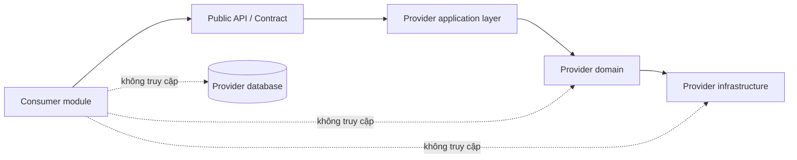

# Kiểm soát API nội bộ và quyền truy cập giữa các mô-đun

Trong Domain-Driven Design, một mô-đun là một ranh giới kỹ thuật giúp bảo vệ mô hình và làm rõ phần nào của hệ thống có thể được sử dụng từ bên ngoài. Khi nhiều mô-đun cùng nằm trong một ứng dụng, việc gọi được một lớp hoặc một package không đồng nghĩa với việc mô-đun đó nên được phép phụ thuộc vào nó. Mục tiêu của thiết kế mô-đun là làm cho các dependency đi qua những API có chủ đích, giữ invariant và ngôn ngữ của domain ở đúng nơi sở hữu chúng.

Chủ đề này thuộc phạm vi `DOMAIN_DRIVEN_DESIGN`: chuyển hiểu biết nghiệp vụ thành mô hình và ngôn ngữ chung, sau đó tổ chức mô hình đó thành các ranh giới có thể phát triển và triển khai độc lập hơn. Vì vậy, kiểm soát API giữa các mô-đun không chỉ là chuyện `public` hay `private`; đó là cách biến boundary của domain thành boundary mà compiler, package và kiến trúc có thể bảo vệ.

## Mục tiêu học tập

Sau bài này, có thể:

- phân biệt API công khai, API nội bộ và implementation detail của một mô-đun;
- xác định module nào sở hữu một quy tắc nghiệp vụ và module nào chỉ sử dụng khả năng của nó;
- thiết kế dependency chỉ đi qua contract ổn định;
- dùng package visibility và Java Module System để giới hạn quyền truy cập khi phù hợp;
- tránh để Entity, Aggregate, ORM model hoặc mutable object nội bộ lọt qua boundary;
- chọn giữa gọi trực tiếp, application service, query contract, domain event và adapter khi hai mô-đun cần giao tiếp;
- kiểm soát dependency một chiều và phát hiện dependency cycle;
- chuẩn bị boundary cho trường hợp modular monolith được tách thành các deployment riêng mà không phải viết lại domain model;
- phân biệt quyền truy cập kỹ thuật giữa module với authorization của người dùng hoặc actor.

## 1. API giữa mô-đun là gì?

API của một mô-đun là tập hợp những khả năng mà mô-đun chủ động cho phép code bên ngoài sử dụng. API có thể là một interface, một command, một query, một DTO, một domain event hoặc một application service. Điều quyết định một thành phần có thuộc API hay không là ý định kiến trúc và ownership, không phải chỉ modifier `public`.

Ví dụ, một lớp sau đây có thể compile được từ package khác:

```java
public class PricingEngine {
    public Money calculate(Product product, Customer customer) {
        // ...
    }
}
```

Nhưng nếu `PricingEngine` là implementation detail của Pricing module, việc đặt nó `public` đã làm tăng số điểm mà module khác có thể phụ thuộc vào. Khi chữ ký, constructor hoặc cách tính thay đổi, nhiều caller có thể bị ảnh hưởng.

Một API có chủ đích thường nhỏ hơn:

```java
public interface PriceQuote {
    Quote quote(ProductId productId, CustomerId customerId);
}
```

Implementation có thể thay đổi mà caller chỉ biết contract `PriceQuote`.

Điểm quan trọng là API phải diễn đạt khả năng nghiệp vụ hoặc use case mà consumer cần, thay vì phơi ra cấu trúc bên trong của producer.

## 2. Ba lớp quyền truy cập cần phân biệt

Trong một hệ thống Java, có ít nhất ba lớp kiểm soát cần xem xét.

| Lớp | Câu hỏi | Cơ chế tiêu biểu | Mục tiêu |
|---|---|---|---|
| Source/package | Code package khác có gọi được không? | `private`, package-private, `protected`, `public` | Giữ implementation detail |
| Build/module | Mô-đun A có được compile phụ thuộc vào B không? | Gradle/Maven dependency, Java `module-info.java` | Kiểm soát dependency |
| Runtime/deployment | Thành phần có thể gọi service đang chạy không? | network, service account, gateway, ACL | Kiểm soát boundary khi deploy |

Ba lớp này bổ trợ nhau. Một class `public` nhưng nằm trong package không được export vẫn có thể bị giới hạn ở Java Module System. Ngược lại, một endpoint HTTP được bảo vệ ở runtime nhưng vẫn có thể tạo coupling quá lớn nếu contract chứa toàn bộ model nội bộ.

Trong bài này, “quyền truy cập giữa các mô-đun” chủ yếu nói về dependency và visibility của code. Authorization của người dùng là một bài toán khác: nó quyết định actor nào được phép thực hiện hành động nghiệp vụ.

## 3. Boundary kỹ thuật phải phục vụ boundary của domain

DDD phân biệt bounded context với module. Bounded context là ranh giới ngữ nghĩa của một mô hình; module là một cơ chế tổ chức code và dependency. Hai khái niệm có thể ánh xạ một-một, nhưng không bắt buộc.

Ví dụ một hệ thống thương mại điện tử có thể có:

```text
Sales Context
 ├── Order
 ├── CustomerOrderPolicy
 └── Checkout

Pricing Context
 ├── PriceList
 ├── DiscountPolicy
 └── PriceQuote

Inventory Context
 ├── StockItem
 └── Reservation
```

Một modular monolith có thể tổ chức chúng thành:

```text
application/
  sales/
  pricing/
  inventory/
```

Mỗi module nên sở hữu model của context tương ứng. Nếu `sales` cần giá sản phẩm, nó nên yêu cầu một khả năng mà `pricing` cung cấp, thay vì đọc trực tiếp `DiscountPolicy` hoặc `PriceList`.

Nguyên tắc đơn giản là: module sở hữu một quy tắc nghiệp vụ thì module đó quyết định API cho phép module khác yêu cầu quy tắc ấy được áp dụng.

## 4. Public API và internal API

Một module thường có ba nhóm thành phần:

1. **Public API**: contract mà consumer được phép phụ thuộc.
2. **Internal API**: contract chỉ dùng trong nội bộ module hoặc giữa các package được kiểm soát chặt.
3. **Implementation detail**: class, field, mapper, repository implementation, ORM model và helper không được consumer biết.

Có thể mô hình hóa bằng cấu trúc:

```text
pricing
├── api
│   ├── PriceQuote.java          <-- public contract
│   ├── ProductId.java           <-- public value used by contract
│   └── Quote.java               <-- public result
├── application
│   └── PricingApplicationService.java
├── domain
│   ├── PriceList.java            <-- internal domain model
│   ├── DiscountPolicy.java       <-- internal domain rule
│   └── Money.java                <-- internal value object nếu không cần export
└── infrastructure
    └── JpaPriceListRepository.java
```

Consumer chỉ cần biết `api`. Khi module khác import `domain.DiscountPolicy`, boundary đã bị thủng dù code vẫn chạy.

## 5. API nhỏ giúp giảm coupling

Một API tốt trả lời đúng nhu cầu của consumer.

Ví dụ use case của Sales chỉ cần lấy giá cuối cùng:

```java
public interface PriceQuoteService {
    PriceQuote quote(ProductId productId, CustomerId customerId);
}
```

API này tốt hơn việc công khai:

```java
public interface PricingInternals {
    PriceList loadPriceList(ProductId productId);
    DiscountPolicy loadDiscountPolicy(CustomerId customerId);
    List<PromotionRule> loadPromotions(ProductId productId);
}
```

API thứ hai buộc consumer biết cấu trúc nội bộ của Pricing. Khi Pricing thay đổi cách lưu promotion hoặc cách kết hợp policy, consumer phải thay đổi theo.

Có thể kiểm tra chất lượng API bằng câu hỏi: “Nếu implementation bên trong thay đổi hoàn toàn, consumer có còn giữ nguyên code không?” Nếu câu trả lời là không, cần xem lại boundary.

## 6. Đừng xuất Entity chỉ vì consumer cần một vài dữ liệu

Entity thường chứa invariant và hành vi thuộc model của module sở hữu nó. Trả Entity qua boundary dễ tạo ra coupling hai chiều.

Ví dụ không nên làm:

```java
public interface CustomerService {
    Customer findCustomer(CustomerId id);
}
```

Nếu `Customer` là Aggregate của Customer context, Sales có thể bắt đầu gọi các method domain của Customer, đọc state và phụ thuộc vào cấu trúc của aggregate.

Thay vào đó, contract có thể trả một projection nhỏ:

```java
public record CustomerCreditStatus(
    CustomerId customerId,
    boolean allowed,
    Money availableCredit
) {}

public interface CreditCheck {
    CustomerCreditStatus check(CustomerId customerId, Money orderTotal);
}
```

Consumer nhận đúng thông tin cần thiết để tiếp tục use case. Ownership của Customer aggregate vẫn ở module Customer.

## 7. Không để ORM model trở thành API

Một lỗi phổ biến là dùng entity của persistence làm contract giữa module:

```java
// Không nên dùng như cross-module API.
@Entity
public class OrderJpaEntity {
    @Id
    private UUID id;

    private String status;
    private BigDecimal total;
}
```

Nếu module khác nhận `OrderJpaEntity`, cấu trúc database, annotation và lifecycle của ORM đã trở thành dependency của consumer.

Boundary nên dùng DTO hoặc value được thiết kế cho contract:

```java
public record OrderSummary(
    OrderId orderId,
    OrderStatus status,
    Money total
) {}
```

Persistence có thể thay đổi từ JPA sang JDBC hoặc document store mà API vẫn giữ nguyên.

## 8. Package-private là một công cụ DDD rất hữu ích

Java mặc định cho phép class không có modifier truy cập từ các class cùng package. Đây là cách đơn giản để giữ implementation detail trong một package.

Ví dụ:

```java
package com.example.pricing.domain;

final class DiscountCalculator {
    Money calculate(Price price, DiscountPolicy policy) {
        // implementation detail
    }
}
```

Consumer ở package khác không thể gọi `DiscountCalculator` trực tiếp.

Một application service có thể là entry point:

```java
package com.example.pricing.application;

public final class PricingApplicationService {
    private final PriceRepository prices;
    private final DiscountPolicyProvider policies;

    public PricingApplicationService(
        PriceRepository prices,
        DiscountPolicyProvider policies
    ) {
        this.prices = prices;
        this.policies = policies;
    }

    public PriceQuote quote(ProductId productId, CustomerId customerId) {
        // load aggregate/domain data, invoke domain behavior,
        // and return a stable API result.
    }
}
```

Điểm cần nhớ: `public` nên được dùng vì một consumer cần capability đó, không phải vì IDE hoặc framework cần truy cập thuận tiện.

## 9. Java Module System có thể củng cố boundary

Khi dự án sử dụng Java Platform Module System, `module-info.java` cho phép khai báo package nào được export.

Ví dụ module Pricing API:

```java
module com.example.pricing.api {
    exports com.example.pricing.api;
}
```

Consumer:

```java
module com.example.sales {
    requires com.example.pricing.api;
}
```

Pricing implementation có thể nằm trong module khác và không export package domain:

```java
module com.example.pricing.impl {
    requires com.example.pricing.api;
}
```

Khi package không được export, code module khác không thể import type của package đó chỉ vì type được khai báo `public`.

Điều này làm cho boundary trở thành một phần có thể kiểm tra ở compile time.

## 10. Export ít, require đúng

Một `module-info.java` tốt thường có ít `exports` và dependency rõ ràng.

Ví dụ:

```java
module com.example.sales {
    requires com.example.pricing.api;
    requires com.example.inventory.api;

    exports com.example.sales.api;
}
```

Ở đây Sales có thể sử dụng API của Pricing và Inventory, đồng thời export API của chính nó. Các package `sales.domain`, `sales.application.internal` và `sales.infrastructure` không trở thành contract cho module khác.

Nếu một module phải `requires` rất nhiều module khác, đó là tín hiệu cần xem lại trách nhiệm. Một module có quá nhiều incoming và outgoing dependency thường đang đóng vai trò trung tâm quá lớn hoặc đang phơi bày quá nhiều chi tiết.

## 11. Dependency nên đi về phía contract ổn định

Một dependency tốt có dạng:

```text
Sales application
      |
      v
Pricing API
      |
      v
Pricing implementation
```

Sales không nên đi xuyên qua API để tới implementation:

```text
Sales
  |
  +----> PricingApi
  |
  +----> PricingJpaRepository     X
  |
  +----> DiscountPolicyImpl      X
```

Consumer nên phụ thuộc vào điều ổn định và producer được tự do thay đổi phần triển khai.

Trong DDD, “ổn định” không có nghĩa là API không bao giờ thay đổi. Nó có nghĩa là API thay đổi theo nhu cầu nghiệp vụ của consumer và được quản lý như một contract, thay vì vô tình thay đổi vì refactor implementation.

## 12. Dependency cycle là dấu hiệu boundary chưa rõ

Ví dụ:

```text
Order -> Customer -> Order
```

Nếu cả hai module đều cần gọi trực tiếp implementation của nhau, dependency cycle có thể xuất hiện ở build hoặc ở runtime.

Có thể phá cycle bằng cách xác định capability mà một bên thực sự cần:

```text
Order ----> Customer Credit API
```

Hoặc sử dụng domain event:

```text
Order --OrderPlaced--> Event Bus --> Customer/Notification/Inventory
```

Event phù hợp khi consumer không cần đồng bộ kết quả ngay trong cùng lời gọi. Không nên dùng event chỉ để che một dependency đồng bộ mà use case thực sự yêu cầu.

## 13. Chọn kiểu giao tiếp theo nhu cầu nghiệp vụ

Không phải mọi cross-module call đều nên trở thành HTTP hoặc event.

| Nhu cầu | Cơ chế phù hợp | Ví dụ |
|---|---|---|
| Cần kết quả ngay | Synchronous API | kiểm tra hạn mức tín dụng |
| Cần yêu cầu một hành động | Command/Application API | reserve inventory |
| Chỉ cần dữ liệu đã được chuẩn bị | Query/Projection | đọc CustomerCreditStatus |
| Thông báo một sự kiện đã xảy ra | Domain/Event integration | OrderPlaced |
| Hai model khác ngôn ngữ | Adapter/ACL | Money/Customer mapping |
| Module đã tách process | HTTP/gRPC/message broker | Pricing service |

Điều cần giữ ổn định là contract và ownership, còn transport có thể thay đổi.

## 14. Application service là một cửa vào tốt cho module

Application service điều phối use case và giữ domain object ở bên trong module.

```java
public final class ReserveInventoryService {
    private final InventoryRepository repository;

    public ReservationResult reserve(
        ProductId productId,
        Quantity quantity,
        ReservationId reservationId
    ) {
        StockItem stock = repository.get(productId);
        stock.reserve(reservationId, quantity);
        repository.save(stock);

        return ReservationResult.accepted(
            reservationId,
            productId,
            quantity
        );
    }
}
```

API bên ngoài chỉ thấy `reserve` và `ReservationResult`. Nó không cần biết `StockItem` lưu ở đâu hoặc invariant được kiểm tra bằng những method nào.

## 15. Command và Query nên có contract riêng

Một module có thể tách command và query để tránh làm API thành một “god interface”.

```java
public record ReserveStock(
    ProductId productId,
    Quantity quantity,
    ReservationId reservationId
) {}

public record ReservationResult(
    ReservationId reservationId,
    ReservationStatus status
) {}

public interface InventoryCommands {
    ReservationResult reserve(ReserveStock command);
}

public interface InventoryQueries {
    StockAvailability availability(ProductId productId);
}
```

Consumer chỉ phụ thuộc vào phần mình cần. Điều này cũng giúp dễ nhận biết một module đang bị sử dụng sai: nếu Sales bắt đầu đọc trực tiếp mọi bảng hoặc mọi repository của Inventory, boundary đã bị phá vỡ.

## 16. Cross-module DTO nên là immutable

DTO qua boundary nên hạn chế mutable state.

```java
public record StockAvailability(
    ProductId productId,
    int availableUnits
) {}
```

`record` làm rõ ý định dữ liệu là value truyền qua contract. Với Java version không hỗ trợ record, có thể dùng class immutable với field `final` và không cung cấp setter.

Mutable DTO tạo ra câu hỏi khó: module nào được quyền thay đổi object và thay đổi đó có hiệu lực ở đâu? Khi boundary rõ ràng, dữ liệu đi vào và đi ra nên có ownership rõ ràng.

## 17. Không dùng shared mutable model để “tiết kiệm mapping”

Hai module có thể cùng dùng một class `Customer` để giảm số dòng mapper. Cái giá là cả hai cùng bị khóa vào một model.

Ví dụ:

```text
Customer module
      |
      +---- shared Customer class <---- Sales
      |
      +---- Marketing
```

Nếu Customer thêm state phục vụ Marketing, Sales có thể bị ảnh hưởng dù Sales không có nhu cầu. Model chung trở thành điểm coupling.

Nếu hai module có ý nghĩa khác nhau, hãy để mỗi module có model của mình và map ở boundary:

```text
Customer domain ----> CustomerProfileContract ----> Sales
```

Mapping không phải lúc nào cũng là overhead vô ích. Nó là nơi xác nhận rằng hai model có ngữ nghĩa khác nhau.

## 18. Anti-Corruption Layer bảo vệ model của consumer

Khi một module phải dùng một API có ngôn ngữ khác, adapter có thể chuyển đổi contract đó thành khái niệm mà consumer hiểu.

```text
Sales Domain
    |
    v
PricingGateway
    |
    v
Pricing API
```

Ví dụ:

```java
public interface SalesPriceCalculator {
    Money calculateTotal(ProductId productId, CustomerId customerId);
}

final class PricingGateway implements SalesPriceCalculator {
    private final PriceQuoteService pricing;

    @Override
    public Money calculateTotal(
        ProductId productId,
        CustomerId customerId
    ) {
        PriceQuote quote = pricing.quote(productId, customerId);
        return quote.total();
    }
}
```

Nếu Pricing đổi cách gọi hoặc đổi thuật ngữ, Sales chỉ sửa adapter. Domain Sales không cần học cấu trúc nội bộ của Pricing.

## 19. API boundary không thay thế ownership của invariant

Giả sử Inventory có invariant “không thể reserve quá số lượng available”. Sales không được tải `StockItem`, giảm số lượng rồi gọi `save` trực tiếp.

Sai boundary:

```java
StockItem stock = inventoryRepository.find(productId);
stock.availableUnits -= requested;
inventoryRepository.save(stock);
```

Đúng hơn là yêu cầu Inventory thực hiện hành vi:

```java
ReservationResult result = inventoryCommands.reserve(
    new ReserveStock(productId, quantity, reservationId)
);
```

Invariant thuộc module sở hữu Aggregate. Consumer yêu cầu capability, không tự tái hiện quy tắc của producer.

## 20. Đừng sao chép business rule chỉ vì API hiện tại khó dùng

Nếu Sales phải viết:

```java
if (stock.availableUnits() >= quantity
        && !stock.isLocked()
        && !stock.isExpired()) {
    // reserve
}
```

thì Sales đã bắt đầu sở hữu một phần invariant của Inventory. API nên cung cấp hành vi đủ mức:

```java
inventoryCommands.reserve(command);
```

Nếu consumer cần quá nhiều thông tin để quyết định có gọi producer hay không, cần xem lại ownership và use case. Có thể producer cần cung cấp một capability hoặc một decision API thay vì expose raw state.

## 21. Quyền truy cập của code và authorization là hai bài toán khác nhau

Một class không thể import từ module khác là một vấn đề compile-time. Một người dùng không được phép đặt hàng trên một tài khoản là authorization.

Ví dụ:

```text
Module boundary
    -> Sales được gọi Pricing API?

Authorization
    -> Actor A có được thay đổi Order B?
```

Không nên dùng package-private hoặc Java module export để giải quyết authorization nghiệp vụ. Ngược lại, không nên dùng role check để bù cho một dependency architecture đang sai.

Authorization có thể nằm ở application layer:

```java
public OrderResult cancel(
    Actor actor,
    OrderId orderId,
    CancellationReason reason
) {
    authorization.checkCanCancel(actor, orderId);
    Order order = orders.load(orderId);
    order.cancel(reason);
    orders.save(order);
    return OrderResult.from(order);
}
```

Boundary kỹ thuật và boundary nghiệp vụ phối hợp nhưng không thay thế nhau.

## 22. Kiểm soát API trong modular monolith

Modular monolith có lợi thế là các module vẫn chạy cùng process nhưng có thể giữ boundary như các service nhỏ.

```text
+-------------------- Application --------------------+
|                                                     |
|  Sales      ---> Pricing API                       |
|    |                 |                              |
|    +----> Inventory API                             |
|                                                     |
+-----------------------------------------------------+
```

Không nên vì “cùng JVM nên gọi gì cũng được” mà cho module truy cập trực tiếp database repository của nhau. Nếu boundary được giữ từ đầu, việc thay transport sau này dễ hơn.

## 23. Chuẩn bị cho việc tách deployment

Một boundary tốt có thể chuyển từ direct call sang remote call:

```text
Giai đoạn 1: modular monolith

Sales --> PricingGateway --> PricingApplicationService


Giai đoạn 2: tách deployment

Sales --> PricingGateway --> HTTP/gRPC --> PricingService
```

`PricingGateway` và contract có thể giữ vai trò tương tự. Thay đổi chủ yếu nằm ở adapter.

Điều này không có nghĩa mọi module nên được thiết kế như microservice ngay từ đầu. Chỉ cần giữ ownership, contract và dependency rõ ràng để việc triển khai có thêm lựa chọn.

## 24. Database cũng phải được xem như boundary

Một module không nên đọc trực tiếp bảng do module khác sở hữu chỉ vì cùng dùng một database.

Sai:

```text
Sales code --> pricing.price_list table
```

Đúng hơn:

```text
Sales --> Pricing API --> Pricing persistence
```

Nếu cần hiệu năng cho query liên module, có thể tạo projection hoặc read model được sở hữu rõ ràng. Việc tối ưu truy vấn không nên vô tình chuyển ownership của dữ liệu.

## 25. Shared kernel cần được dùng có chủ đích

Một số value rất ổn định có thể được chia sẻ, nhưng shared kernel là quyết định kiến trúc có chi phí.

Ví dụ:

```text
shared-kernel
 ├── Currency
 ├── CountryCode
 └── TenantId
```

Nếu `shared-kernel` bắt đầu chứa `Order`, `Customer`, `Promotion`, `Invoice`, nó trở thành một domain model chung khổng lồ. Khi đó mọi bounded context bị buộc vào cùng một ngôn ngữ và cùng lifecycle.

Một thành phần nên vào shared kernel khi:

- ngữ nghĩa thực sự giống nhau giữa các consumer;
- thay đổi được quản lý chung;
- consumer chấp nhận cùng contract và cùng lifecycle;
- chi phí coupling thấp hơn chi phí duplicate model.

Nếu chỉ cần một giá trị nhỏ, có thể duplicate một value object thay vì tạo dependency lớn.

## 26. API versioning là quản lý contract

Khi nhiều consumer phụ thuộc vào API, thay đổi contract phải được đánh giá theo compatibility.

Ví dụ thêm field vào response thường ít phá vỡ hơn đổi hoặc xóa field:

```java
public record PriceQuote(
    ProductId productId,
    Money total,
    String currency
) {}
```

Nếu consumer đã phụ thuộc vào `currency`, đổi thành `Currency` object có thể tạo migration cost.

API versioning nên xuất hiện khi có nhu cầu tương thích thực sự. Không nên tạo `V1`, `V2`, `V3` cho mọi thay đổi nhỏ nếu contract có thể tiến hóa tương thích.

## 27. Consumer-driven contract và boundary

Khi module có nhiều consumer, producer nên biết những phần nào của API thực sự được sử dụng. Contract test có thể kiểm tra assumption quan trọng mà không cần expose implementation.

Ví dụ consumer cần:

```text
quote(productId, customerId)
 -> total
 -> currency
```

Contract test có thể xác nhận response vẫn có các field và semantics đó. Test không nên kiểm tra rằng Pricing dùng `JpaPriceRepository` hay một class cụ thể nào.

Boundary được bảo vệ tốt khi test kiểm tra hành vi của contract thay vì cấu trúc implementation.

## 28. Các lớp API nên được đặt ở đâu?

Một cấu trúc thực dụng:

```text
pricing/
├── api/
│   ├── PriceQuoteService.java
│   ├── PriceQuote.java
│   └── ProductId.java
├── application/
│   ├── PricingApplicationService.java
│   └── PricingCommandHandler.java
├── domain/
│   ├── PriceList.java
│   ├── DiscountPolicy.java
│   └── Money.java
└── infrastructure/
    ├── JpaPriceRepository.java
    └── PricingConfiguration.java
```

Nếu `api` cần import nhiều class từ `domain`, API đang có nguy cơ kéo domain implementation ra ngoài. Hãy xem mỗi type có thực sự cần thuộc contract hay có thể chuyển thành DTO/value nhỏ hơn.

## 29. Một ví dụ hoàn chỉnh

Giả sử Checkout cần đặt hàng và kiểm tra tồn kho.

API Inventory:

```java
public record ReserveStock(
    ProductId productId,
    Quantity quantity,
    ReservationId reservationId
) {}

public record ReservationResult(
    ReservationId reservationId,
    boolean accepted
) {}

public interface InventoryApi {
    ReservationResult reserve(ReserveStock command);
}
```

API Pricing:

```java
public interface PricingApi {
    PriceQuote quote(ProductId productId, CustomerId customerId);
}
```

Checkout chỉ biết hai capability:

```java
public final class CheckoutService {
    private final PricingApi pricing;
    private final InventoryApi inventory;
    private final OrderRepository orders;

    public CheckoutService(
        PricingApi pricing,
        InventoryApi inventory,
        OrderRepository orders
    ) {
        this.pricing = pricing;
        this.inventory = inventory;
        this.orders = orders;
    }

    public CheckoutResult checkout(CheckoutCommand command) {
        PriceQuote quote = pricing.quote(
            command.productId(),
            command.customerId()
        );

        ReservationResult reservation = inventory.reserve(
            new ReserveStock(
                command.productId(),
                command.quantity(),
                command.reservationId()
            )
        );

        if (!reservation.accepted()) {
            return CheckoutResult.rejected("STOCK_UNAVAILABLE");
        }

        Order order = Order.place(
            command.orderId(),
            command.customerId(),
            quote.total()
        );
        orders.save(order);

        return CheckoutResult.accepted(order.id());
    }
}
```

Checkout không biết `StockItem`, `DiscountPolicy`, `PriceList` hay `JpaOrderEntity`. Mỗi module giữ model và invariant của mình.

## 30. Trường hợp cần event thay vì synchronous API

Giả sử Notification chỉ cần biết Order đã được đặt. Checkout không cần kết quả từ Notification để hoàn tất order.

Khi đó có thể phát event:

```java
public record OrderPlaced(
    OrderId orderId,
    CustomerId customerId,
    Instant occurredAt
) {}
```

Luồng:

```text
Order module
    |
    | OrderPlaced
    v
Event infrastructure
    |
    +----> Notification
    +----> Analytics
    +----> Loyalty
```

Producer không cần biết implementation của các consumer. Đây là một cách giảm coupling runtime, nhưng đổi lại phải xử lý eventual consistency, duplicate delivery và failure handling.

Nếu Checkout phải biết ngay Notification đã gửi thành công trước khi trả kết quả, event không tự động giải quyết yêu cầu đó. Khi ấy synchronous API hoặc workflow có trạng thái rõ ràng có thể phù hợp hơn.

## 31. Access control ở Java package và module

Có thể dùng nhiều mức visibility:

```text
private
  -> chỉ class sở hữu

package-private
  -> chỉ package

protected
  -> package và subclass theo quy tắc Java

public
  -> có thể được tham chiếu nếu module/package cho phép
```

Trong domain model, package-private thường hữu ích để giới hạn constructor hoặc helper. Ví dụ:

```java
public final class Order {
    private final OrderId id;

    private Order(OrderId id) {
        this.id = id;
    }

    public static Order place(OrderId id) {
        // enforce creation invariant
        return new Order(id);
    }
}
```

Caller không thể tự ý gọi constructor và tạo object ở trạng thái mà domain không cho phép.

## 32. Constructor visibility là một phần của invariant

Một Entity có constructor `public` nhận mọi field dễ bị tạo ở trạng thái không hợp lệ:

```java
public Order(
    OrderId id,
    OrderStatus status,
    Money total
) {
    // rất dễ bỏ qua invariant
}
```

Thay vào đó, dùng factory hoặc named constructor diễn đạt hành vi:

```java
public static Order place(
    OrderId id,
    CustomerId customerId,
    Money total
) {
    if (total.isNegative()) {
        throw new InvalidOrderTotalException();
    }
    return new Order(id, customerId, total, OrderStatus.PLACED);
}
```

Boundary của module bắt đầu ngay từ cách object được tạo. Không nên mở constructor chỉ để serializer hoặc test dễ hơn nếu điều đó làm suy yếu invariant.

## 33. Khi framework cần reflection

Một số ORM hoặc serialization framework cần constructor hoặc member visibility đặc biệt. Đây là lý do kỹ thuật, không phải lý do để biến domain API thành public API.

Có thể cô lập nhu cầu framework ở infrastructure package, dùng adapter hoặc cấu hình module phù hợp. Khi Java Module System được sử dụng, `opens` và `exports` có ý nghĩa khác nhau:

```java
module com.example.orders {
    exports com.example.orders.api;
    opens com.example.orders.persistence to org.hibernate.orm.core;
}
```

`exports` cho phép code module khác truy cập type; `opens` chủ yếu hỗ trợ reflective access. Không nên `exports` toàn bộ persistence package chỉ vì ORM cần reflection.

## 34. Kiểm soát dependency bằng quy ước build

Nếu dự án chưa dùng Java Module System, vẫn có thể tạo boundary bằng module build và architecture test.

Ví dụ dependency mong muốn:

```text
checkout -> pricing-api
checkout -> inventory-api
pricing-api -> (không phụ thuộc checkout)
inventory-api -> (không phụ thuộc checkout)
```

Một architecture test có thể kiểm tra package không được truy cập package khác. Ý tưởng quan trọng là rule phải được thực thi tự động, vì boundary chỉ nằm trong tài liệu sẽ dần bị phá vỡ khi code phát triển.

## 35. Khi một API bắt đầu phình to

Dấu hiệu thường gặp:

- interface có hàng chục method thuộc nhiều use case khác nhau;
- consumer phải gọi nhiều method theo một thứ tự cụ thể;
- response trả về Entity hoặc object chứa quá nhiều state;
- một thay đổi nội bộ làm nhiều module khác phải sửa;
- module consumer biết tên repository hoặc table của producer;
- nhiều consumer dùng các phần hoàn toàn khác nhau của cùng một API.

Cách xử lý là quay lại use case và ownership. Có thể tách thành các capability nhỏ hơn:

```text
PricingApi
  -> PriceQuoteApi
  -> PromotionCheckApi
  -> PriceHistoryQuery
```

Không cần tách máy chủ hoặc repository ngay. Trước hết tách contract và trách nhiệm.

## 36. Khi API quá nhỏ

API cũng có thể bị phân mảnh quá mức:

```text
getPrice()
getDiscount()
getPromotion()
getTax()
getCurrency()
```

Consumer phải gọi năm lần để thực hiện một use case. Điều này làm tăng coupling theo số lần gọi và dễ tạo trạng thái không nhất quán.

Nếu nghiệp vụ thực sự cần một quyết định tổng hợp, API nên thể hiện capability đó:

```java
PriceQuote quote(ProductId productId, CustomerId customerId);
```

Boundary tốt không đồng nghĩa API có ít method nhất. Nó có nghĩa contract phù hợp với hành vi mà consumer cần.

## 37. Idempotency ở cross-module command

Nếu module A gửi command tới module B nhiều lần do retry, B cần biết command có thể lặp hay không.

Ví dụ:

```java
public record ReserveStock(
    ReservationId reservationId,
    ProductId productId,
    Quantity quantity
) {}
```

`reservationId` có thể đóng vai trò idempotency key nếu domain cho phép. Inventory cần đảm bảo cùng reservation không làm giảm stock hai lần.

Điều này là một phần của contract khi API có thể chạy qua network hoặc message broker. Với direct call trong cùng JVM, lỗi này vẫn có thể xuất hiện do retry ở application layer.

## 38. Timeout và failure cũng là một phần của boundary khi deploy

Khi hai module ở cùng process, một method call thường cho cảm giác “chắc chắn”. Khi tách deployment, dependency có thêm failure mode:

```text
Sales -> Pricing
         |
         +-- timeout
         +-- unavailable
         +-- partial response
         +-- duplicate retry
```

Không nên vì vậy mà biến mọi module thành distributed service. Nhưng nếu một boundary có khả năng được tách process, contract nên tránh phụ thuộc vào object graph lớn và mutable state.

## 39. Transaction boundary phải theo ownership

Một transaction lớn xuyên qua nhiều module thường là dấu hiệu coupling mạnh.

Ví dụ:

```text
Sales transaction
  ├── update Order
  ├── update Inventory tables
  └── update Pricing tables
```

Nếu mỗi module sở hữu dữ liệu và invariant riêng, nên xem xét transaction boundary theo từng owner, sau đó dùng event hoặc workflow để đạt eventual consistency khi nghiệp vụ cho phép.

Không phải mọi workflow đều phải eventual consistency. Nếu nghiệp vụ yêu cầu một quyết định nguyên tử trong cùng boundary, hãy giữ nó trong module sở hữu invariant thay vì tạo distributed transaction chỉ để che một boundary sai.

## 40. Ma trận quyền truy cập giúp làm rõ boundary

Có thể tạo một ma trận đơn giản:

| Consumer | Provider | API được phép | Internal package | Database |
|---|---|---|---|---|
| Sales | Pricing | `PricingApi` | Không | Không |
| Sales | Inventory | `InventoryApi` | Không | Không |
| Notification | Sales | `OrderPlaced` | Không | Không |
| Pricing | Catalog | `ProductCatalogApi` | Không | Không |
| Pricing | Pricing | Domain internals | Có | Có |

Ma trận này giúp phát hiện một dependency mới trước khi nó trở thành coupling lâu dài.

## 41. Quy trình thiết kế một cross-module API

Khi một module cần dữ liệu hoặc capability của module khác, có thể đi theo các bước:

1. Viết use case mà consumer đang thực hiện.
2. Xác định quyết định hoặc hành vi thuộc domain nào.
3. Xác định module sở hữu invariant liên quan.
4. Định nghĩa capability nhỏ nhất mà consumer cần.
5. Thiết kế command/query/result không làm lộ model nội bộ.
6. Chọn synchronous call, query, event hoặc adapter theo nhu cầu nhất quán.
7. Giới hạn package export và build dependency.
8. Viết architecture/contract test cho boundary quan trọng.
9. Kiểm tra dependency có tạo cycle hoặc shared mutable state không.
10. Xác nhận API có thể thay đổi implementation mà consumer không phải sửa không.

## 42. Ví dụ refactor từ boundary xấu sang boundary tốt

### Trước

```java
public CheckoutResult checkout(OrderJpaEntity order) {
    PriceListEntity prices = priceRepository.find(...);
    StockEntity stock = inventoryRepository.find(...);

    if (stock.available() < order.quantity()) {
        return CheckoutResult.rejected();
    }

    // tính giá, cập nhật stock, cập nhật order trực tiếp
}
```

Checkout đang sở hữu dữ liệu và quy tắc của ba module.

### Sau

```java
PriceQuote quote = pricing.quote(
    command.productId(),
    command.customerId()
);

ReservationResult reservation = inventory.reserve(
    new ReserveStock(
        command.productId(),
        command.quantity(),
        command.reservationId()
    )
);
```

Checkout điều phối use case; Pricing sở hữu logic giá; Inventory sở hữu invariant tồn kho; Order sở hữu lifecycle của Order.

## 43. Những anti-pattern cần nhận diện

### God API

Một interface đại diện cho toàn bộ module và có hàng chục method. Consumer chỉ cần một phần nhỏ nhưng phải phụ thuộc toàn bộ contract.

### Leaky domain model

Consumer nhận Entity/Aggregate và bắt đầu thao tác trực tiếp trên state của nó.

### Shared persistence

Nhiều module đọc và ghi trực tiếp bảng của nhau.

### Shared mutable DTO

Một object được tạo ở module A rồi module B sửa trực tiếp.

### Public-by-default

Tất cả class đều `public` để “dễ dùng”, khiến boundary không còn ý nghĩa.

### Remote-shaped local API

Mọi call trong modular monolith đều được thiết kế như HTTP dù không có nhu cầu remote, làm model khó dùng và tăng ceremony không cần thiết.

### Event as escape hatch

Dùng event chỉ để tránh một dependency đồng bộ, trong khi use case cần kết quả ngay.

### Shared kernel phình to

Đưa ngày càng nhiều domain object vào package dùng chung để tránh mapping.

## 44. Một checklist review API giữa mô-đun

Trước khi merge một dependency mới, hãy hỏi:

- Consumer đang cần capability nào?
- Module nào sở hữu invariant liên quan?
- API có thể diễn đạt capability thay vì raw data không?
- Có Entity/Aggregate/ORM model nội bộ nào lọt qua boundary không?
- Có mutable object nào được chia sẻ không?
- Consumer có thể phụ thuộc vào package internal không?
- Java `exports` có đang mở quá rộng không?
- Build dependency có tạo cycle không?
- Database của provider có bị consumer truy cập trực tiếp không?
- API có tạo shared kernel mới mà chưa có lý do rõ ràng không?
- Nên dùng synchronous call, query hay event?
- Nếu retry, command có cần idempotency không?
- Nếu tách deployment, contract có còn hợp lý không?
- Authorization của actor có đang bị nhầm với module visibility không?
- Test đang kiểm tra contract hay đang khóa vào implementation?

## 45. Checklist thiết kế boundary theo DDD

Một boundary tốt thường có các đặc điểm sau:

| Tiêu chí | Câu hỏi xác nhận |
|---|---|
| Ownership | Ai sở hữu invariant? |
| Language | Contract dùng thuật ngữ của context nào? |
| API size | Consumer có nhận đúng dữ liệu cần không? |
| Encapsulation | Internal model có bị lộ không? |
| Dependency | Dependency có một chiều không? |
| Visibility | Package/module có export tối thiểu không? |
| Persistence | Consumer có truy cập storage của provider không? |
| Consistency | Call là synchronous hay eventual và vì sao? |
| Failure | Retry, timeout và duplicate được xử lý ở đâu? |
| Evolution | Implementation có thể đổi mà consumer ít ảnh hưởng không? |
| Deployment | Boundary có thể tách process nếu cần không? |
| Security | Authorization có nằm đúng layer không? |

## 46. Sơ đồ tổng hợp



Sơ đồ này diễn tả một nguyên tắc: consumer biết capability của provider; provider giữ model, persistence và invariant bên trong boundary.

## 47. Bài tập tự kiểm tra

### Bài tập 1: tìm boundary bị rò

Cho cấu trúc:

```text
sales
 └── CheckoutService
      └── pricing.domain.DiscountPolicy
```

Hãy xác định module nào đang sở hữu discount rule và đề xuất một API để Sales yêu cầu giá cuối cùng.

Đáp án kỳ vọng: DiscountPolicy thuộc Pricing; Sales gọi một contract như `PricingApi.quote(...)` hoặc capability tương đương. Sales không nên tạo hoặc sửa DiscountPolicy.

### Bài tập 2: package visibility

Cho:

```java
public final class JpaPriceRepository {
    // persistence implementation
}
```

Hãy giải thích vì sao đổi thành package-private chỉ là một phần của giải pháp.

Đáp án: cần đồng thời đặt class ở package implementation, không export package đó và cung cấp abstraction/API phù hợp. Visibility của một class không tự thiết kế được toàn bộ module boundary.

### Bài tập 3: event hay call?

Notification chỉ cần gửi email sau khi Order được đặt và không ảnh hưởng kết quả checkout. Inventory cần xác nhận còn hàng trước khi Order được xác nhận.

Thiết kế hợp lý thường là Order/Checkout dùng synchronous capability với Inventory, còn Notification tiêu thụ `OrderPlaced` event.

### Bài tập 4: database boundary

Sales cần `available_units` của Inventory để hiển thị màn hình. Có nên đọc trực tiếp `inventory.stock` không?

Không nếu bảng đó thuộc ownership của Inventory. Có thể dùng query API, projection hoặc read model được thiết kế rõ ràng.

## 48. Kết luận

Kiểm soát API nội bộ và quyền truy cập giữa các mô-đun là cách biến boundary của domain thành boundary mà code có thể bảo vệ. Một module nên công khai capability và contract mà consumer cần, giữ Entity, Aggregate, policy, repository và persistence detail bên trong ownership của mình.

Package-private, `module-info.java`, build dependency, architecture test và deployment boundary là những công cụ kỹ thuật hỗ trợ mục tiêu đó. Chúng có giá trị khi được dẫn dắt bởi ownership của nghiệp vụ: invariant nằm ở đâu, context nào sở hữu thuật ngữ nào, và use case cần capability nào.

Khi boundary được thiết kế rõ, modular monolith có thể giữ các module độc lập trong cùng process và vẫn có đường tiến hóa sang deployment riêng nếu nhu cầu xuất hiện. Quan trọng nhất là consumer phụ thuộc vào hành vi và contract ổn định, còn provider được tự do thay đổi model và implementation bên trong mà không làm lan truyền coupling.
