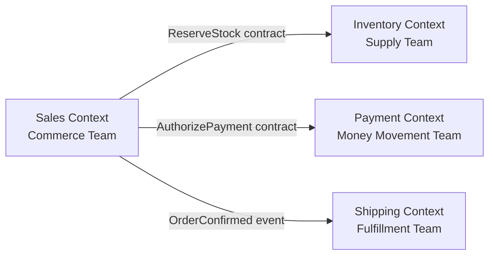

# Rà soát quyền sở hữu của nhóm cùng ranh giới triển khai

Trong Domain-Driven Design (DDD), Bounded Context xác định phạm vi mà một mô hình và ngôn ngữ nghiệp vụ có ý nghĩa nhất quán. Nhưng một ranh giới domain chỉ có tác dụng lâu dài khi tổ chức cũng biết ai chịu trách nhiệm phát triển, thay đổi và vận hành phần mềm nằm trong ranh giới đó. Nếu một context có nhiều nhóm cùng sửa nhưng không có owner rõ, hoặc một nhóm phải xin nhiều nhóm khác mỗi lần phát hành, boundary kỹ thuật có thể tồn tại trên sơ đồ nhưng không hoạt động trong thực tế.

Rà soát quyền sở hữu của nhóm cùng ranh giới triển khai là việc kiểm tra sự phù hợp giữa bốn yếu tố: **trách nhiệm nghiệp vụ, quyền sở hữu mô hình và code, quyền quyết định thay đổi, và trách nhiệm vận hành khi phần mềm chạy**. Mục tiêu không phải ép mỗi nhóm sở hữu đúng một microservice. Mục tiêu là để một nhóm có thể chịu trách nhiệm rõ ràng cho một phần domain, thay đổi phần đó qua contract có kiểm soát và phát hành theo nhịp phù hợp với nhu cầu của nó.

Một Bounded Context có thể được triển khai trong modular monolith hoặc thành một service riêng. Một team có thể sở hữu một hoặc nhiều context có liên quan. Quyết định tách deployment cần dựa trên nhu cầu về phát hành độc lập, tải, độ tin cậy, bảo mật và vận hành, đồng thời tính đến chi phí phân tán mà nó tạo ra.

## 1. Bốn loại ranh giới cần phân biệt

Khi thảo luận ownership và deployment, nhóm thường dùng lẫn các từ module, context, team và service. Chúng liên quan nhưng không đồng nghĩa.

| Khái niệm | Câu hỏi nó trả lời | Ví dụ |
|---|---|---|
| Bounded Context | Mô hình và ngôn ngữ nào có hiệu lực trong phạm vi này? | Sales, Inventory, Shipping |
| Code module | Code và dependency được tổ chức, giới hạn thế nào? | `sales`, `inventory`, `shipping` trong một repository |
| Team ownership boundary | Nhóm nào chịu trách nhiệm về roadmap, code, thay đổi và vận hành? | Commerce team sở hữu Sales context |
| Deployment boundary | Thành phần nào được build, phát hành, scale và rollback như một đơn vị? | `sales-service`, `inventory-service` |

Các ranh giới có thể trùng nhau nhưng không bắt buộc. Một team có thể sở hữu hai context liên quan; hai team có thể cùng đóng góp vào một modular monolith nhưng mỗi team sở hữu module riêng; một context có thể được triển khai thành nhiều process vì nhu cầu scale hoặc isolation.

### 1.1. Bounded Context không tự động là microservice

Bounded Context là ranh giới mô hình nghiệp vụ. Microservice là một lựa chọn triển khai phân tán. Nếu một context được triển khai thành service riêng, điều đó không tự động chứng minh model của nó tốt. Ngược lại, một context nằm trong modular monolith vẫn có thể có model, API nội bộ và ownership rõ.

Đừng tách process chỉ vì sơ đồ Context Map có một đường nối. Trước hết, xác định trách nhiệm và contract. Sau đó mới quyết định có cần process, database hoặc lịch phát hành riêng hay không.

### 1.2. Team boundary không phải package boundary

Package có thể giới hạn quyền truy cập trong compiler, nhưng không nói ai được quyết định thay đổi ưu tiên, ai trực khi production lỗi hoặc ai chịu trách nhiệm với domain expert. Một team boundary cần được thể hiện qua quyền quyết định, backlog, ownership tài liệu, review và vận hành.

### 1.3. Deployment boundary không phải ownership boundary

Một service có thể được deploy độc lập nhưng vẫn phụ thuộc vào nhóm khác để sửa schema, thay contract hoặc xử lý sự cố. Khi đó deployment boundary có vẻ độc lập về kỹ thuật nhưng chưa độc lập về tổ chức.

## 2. Quyền sở hữu trong DDD có nghĩa là gì?

Quyền sở hữu một context hoặc module không chỉ là quyền commit vào thư mục. Nó là trách nhiệm duy trì sự đúng đắn của mô hình và khả năng sử dụng phần mềm trong suốt vòng đời.

Một team owner cần biết:

- Domain expert và stakeholder nào giúp xác nhận quy tắc.
- Thuật ngữ và mô hình nào team chịu trách nhiệm duy trì.
- Aggregate, policy và invariant nào thuộc context.
- API, event và data contract nào team công bố.
- Consumer nào đang phụ thuộc vào contract đó.
- Ai quyết định thay đổi, version và thời điểm ngừng hỗ trợ contract cũ.
- Ai xây dựng, kiểm thử, triển khai, theo dõi và xử lý sự cố.
- Team có quyền thay đổi hệ thống cần thiết mà không phải chờ một nhóm khác cho những việc thuộc phạm vi của mình hay không.

### 2.1. Ownership bao gồm trách nhiệm từ đầu đến cuối

Một mô hình ownership hữu ích là team chịu trách nhiệm từ khi hiểu nhu cầu đến khi thay đổi chạy an toàn trong production:

1. Làm rõ yêu cầu với domain expert.
2. Quyết định thay đổi có thuộc context của mình không.
3. Cập nhật model, code, test và contract.
4. Phát hành và quan sát hành vi sau deploy.
5. Sửa lỗi, xử lý incident và cập nhật tài liệu.

Nếu team chỉ viết code rồi chuyển cho một nhóm vận hành không có đủ ngữ cảnh domain, feedback về thiết kế và production behavior có thể bị chậm. Tuy vậy, trách nhiệm vận hành có thể được hỗ trợ bởi platform/SRE team; điều quan trọng là ownership sản phẩm và đường phối hợp phải rõ.

### 2.2. Ownership không có nghĩa độc quyền mọi quyết định

Một team owner vẫn cần phối hợp với Security, Data, Platform, Compliance hoặc các context upstream/downstream. Owner có quyền quyết định trong phạm vi đã thống nhất và chịu trách nhiệm công bố ảnh hưởng ra ngoài. Các quyết định có tác động liên tổ chức cần có cơ chế review rõ, không phải quyền phủ quyết mơ hồ.

## 3. Context Map là đầu vào để rà soát team ownership

Context Map mô tả quan hệ giữa các Bounded Context, chẳng hạn Customer-Supplier, Conformist, Anti-Corruption Layer hoặc Published Language. Khi rà soát ownership, hãy thêm câu hỏi về người chịu trách nhiệm cho từng đầu mối.

Ví dụ:



Sơ đồ cần làm rõ thêm:

- Team nào sở hữu contract ở phía producer?
- Team nào chịu trách nhiệm adapter/ACL ở phía consumer?
- Ai phối hợp khi schema hoặc semantics thay đổi?
- Ai theo dõi lỗi tích hợp và ai xử lý retry/DLQ?
- Khi một quy trình thất bại giữa các context, ai sở hữu workflow tổng thể?

### 3.1. Một dependency cần có owner ở cả hai đầu

Producer sở hữu semantics và khả năng được công bố. Consumer sở hữu cách diễn giải contract vào model của mình. Ví dụ Inventory công bố `ReserveStock`; Sales quyết định khi nào gọi và xử lý kết quả trong quy trình checkout. Inventory không nên tự quyết định trạng thái Order, còn Sales không nên tự cập nhật tồn kho.

### 3.2. Contract ownership phải rõ

Với mỗi API hoặc integration event, ghi rõ:

- Producer và consumer.
- Owner của schema và semantics.
- Quy tắc tương thích và versioning.
- Thời hạn hỗ trợ version cũ.
- Cách thông báo breaking change.
- Cách test contract và xử lý lỗi production.

Không nên để một event schema trở thành “của chung” mà không có người quyết định. Nếu nhiều team cùng quản lý contract, cần chỉ định vai trò contract owner hoặc cơ chế ra quyết định chung có thời hạn.

## 4. Team boundary nên theo luồng giá trị và domain ownership

Một cách tổ chức hữu ích là nhóm có trách nhiệm rõ với một luồng giá trị hoặc một phần domain mà họ có thể phát triển liên tục. Trong Team Topologies, các loại team thường được thảo luận gồm:

- **Stream-aligned team:** tập trung vào một luồng giá trị hoặc một nhóm nhu cầu người dùng, sở hữu khả năng đưa thay đổi đến production.
- **Platform team:** cung cấp nền tảng nội bộ như CI/CD, observability, runtime hoặc developer tooling dưới dạng dịch vụ cho các team khác.
- **Complicated-subsystem team:** sở hữu một subsystem cần chuyên môn sâu, chẳng hạn tối ưu thuật toán hoặc xử lý kỹ thuật đặc thù.
- **Enabling team:** giúp các team khác tiếp cận kỹ năng hoặc phương pháp mới, thường qua hỗ trợ có mục tiêu và chuyển giao năng lực.

Các kiểu team này là gợi ý để thiết kế tương tác, không phải nhãn bắt buộc cho mọi tổ chức. Một nhóm có thể đảm nhiệm nhiều vai trò khi quy mô nhỏ.

### 4.1. Stream-aligned team và Bounded Context

Một stream-aligned team có thể sở hữu một Bounded Context hoặc một nhóm context có liên quan chặt. Điều này thường thuận lợi khi team có đủ domain knowledge và quyền quyết định để xử lý phần lớn thay đổi trong luồng giá trị.

Ví dụ Commerce team sở hữu Sales context, bao gồm checkout, order lifecycle và chính sách bán hàng. Khi cần tồn kho, team gọi Inventory API. Team không cần quyền sửa trực tiếp Inventory aggregate.

### 4.2. Một team sở hữu nhiều context có thể hợp lý

Ở giai đoạn đầu, một team nhỏ có thể sở hữu Sales và Checkout context nếu hai phần này có cùng roadmap và chưa cần tách năng lực. Điều đó không có nghĩa hai context phải hợp nhất model. Giữ module boundary rõ sẽ giúp tổ chức tách ownership sau này nếu tải, chuyên môn hoặc tốc độ thay đổi khác nhau.

### 4.3. Một context có nhiều team là tín hiệu cần xem xét

Nhiều team cùng sửa một context có thể cần thiết trong giai đoạn chuyển đổi hoặc khi domain lớn. Nhưng nếu việc này kéo dài, cần xác định:

- Context có thực sự chứa nhiều subdomain hoặc capability khác nhau không?
- Có thể chia ownership theo module/use case mà không phá invariant không?
- Có một team owner chịu trách nhiệm về mô hình và contract tổng thể không?
- Các team có phải chờ nhau thường xuyên để thay đổi hoặc deploy không?
- Có duplicate decision hoặc rule được triển khai ở nhiều nơi không?

Không chia context chỉ để làm đẹp sơ đồ team. Chỉ tách khi có ranh giới ngôn ngữ, quy tắc, data ownership và lifecycle đủ rõ.

## 5. Conway's Law và sự phù hợp giữa tổ chức với kiến trúc

Conway's Law quan sát rằng cấu trúc giao tiếp của tổ chức có xu hướng phản ánh vào cấu trúc hệ thống mà tổ chức tạo ra. Nếu ba team phải phối hợp chặt để hoàn thành mọi thay đổi, kiến trúc thường xuất hiện nhiều dependency giữa ba phần đó.

Điều này không có nghĩa cứ đổi sơ đồ tổ chức là kiến trúc tự động tốt lên. Nhưng khi một nhóm phải liên tục xin thay đổi từ nhóm khác, cần xem liệu boundary domain, API hoặc quyền quyết định có đang không phù hợp.

### 5.1. Ví dụ lệch giữa team và kiến trúc

Giả sử:

- Team A chỉ viết controller.
- Team B sở hữu toàn bộ domain logic.
- Team C sở hữu database schema.
- Team D triển khai production.

Một thay đổi nhỏ như thêm trạng thái đơn có thể cần bốn team. Không team nào có thể đưa thay đổi hoàn chỉnh đến production. Đây là mô hình tổ chức theo layer kỹ thuật, thường tạo handoff và queue.

Một hướng khác là team theo capability hoặc luồng giá trị, sở hữu vertical slice từ API đến domain và persistence trong boundary của mình. Platform team cung cấp CI/CD và hạ tầng dùng chung theo self-service.

### 5.2. Không phải mọi dependency liên nhóm đều xấu

Payment có thể cần phối hợp Security hoặc Finance vì có ràng buộc pháp lý. Một complicated subsystem có thể cần chuyên gia riêng. Vấn đề là tần suất và tính chất phối hợp: phụ thuộc có được thể hiện bằng contract và quy trình rõ, hay mọi thay đổi đều cần một cuộc họp và chờ phê duyệt không xác định?

## 6. Ranh giới triển khai nên được quyết định bằng tiêu chí nào?

Deployment boundary xác định đơn vị build, release, scale và rollback. Một module nên được tách thành process riêng khi lợi ích về độc lập hoặc isolation lớn hơn chi phí phân tán.

Các tiêu chí chính:

| Tiêu chí | Câu hỏi cần trả lời |
|---|---|
| Tốc độ thay đổi | Phần này có cần phát hành thường xuyên theo nhịp khác phần còn lại không? |
| Quyền tự chủ | Team owner có thể build, test, deploy và rollback mà không chờ team khác không? |
| Scale | Tải có khác biệt đủ lớn để scale riêng không? |
| Reliability | Có cần cô lập lỗi hoặc SLO khác nhau không? |
| Security/compliance | Có yêu cầu cách ly dữ liệu, network hoặc quyền vận hành riêng không? |
| Công nghệ | Có nhu cầu runtime hoặc công nghệ riêng thực sự cần thiết không? |
| Data ownership | Có thể quản lý dữ liệu và transaction trong boundary riêng không? |
| Integration cost | Contract, network failure, retry và observability có thể được vận hành không? |
| Team capacity | Team có đủ năng lực on-call và vận hành service mới không? |

Không nên tách service chỉ vì module có nhiều class hoặc vì muốn dùng một công nghệ mới. Số lượng class không phải tiêu chí deployment.

### 6.1. Tách khi cần phát hành độc lập

Nếu Shipping thay đổi quy tắc phân công hãng vận chuyển thường xuyên nhưng Sales ít thay đổi, deployment riêng có thể giảm phối hợp. Tuy nhiên, Shipping cần contract ổn định với Sales và phải tương thích với producer/consumer trong thời gian rollout.

### 6.2. Tách khi cần scale hoặc isolation riêng

Inventory có thể có tải đọc lớn và yêu cầu latency khác Sales. Tách process có thể giúp scale hoặc giới hạn sự cố. Nhưng nó cũng tạo network call, timeout, retry, cache và consistency concern. Hãy so sánh với read replica, projection hoặc module optimization trước khi tách.

### 6.3. Chưa nên tách nếu transaction và thay đổi vẫn gắn chặt

Nếu hai phần luôn phải cập nhật cùng nhau trong một transaction và cùng một nhịp phát hành, việc tách service có thể làm workflow phức tạp hơn mà không đem lại quyền tự chủ. Giữ chung deployment nhưng duy trì module boundary có thể là lựa chọn tốt hơn.

## 7. Modular monolith là một lựa chọn triển khai nghiêm túc

Modular monolith giữ nhiều module trong một process/deployment nhưng kiểm soát dependency và ownership. Đây không phải kiến trúc tạm bợ nếu boundary được thiết kế và kiểm tra tốt.

```text
Application deployment
├── sales module
│   ├── api
│   ├── application
│   ├── domain
│   └── infrastructure
├── inventory module
│   ├── api
│   ├── application
│   ├── domain
│   └── infrastructure
└── payment module
    ├── api
    ├── application
    ├── domain
    └── infrastructure
```

Mỗi module có thể có team owner, API nội bộ và schema ownership rõ dù cùng được phát hành trong một artifact. Nếu một module cần deploy riêng sau này, nhóm có thể tách adapter và runtime boundary khi có lý do.

### 7.1. Cần tránh shared database access không kiểm soát

Các module có thể dùng cùng một database server nhưng nên giữ quyền sở hữu schema/table. Sales không nên cập nhật bảng Inventory trực tiếp. Nếu query liên module cần thiết, dùng API, projection hoặc read model có owner và freshness contract rõ.

### 7.2. Build chung không có nghĩa dependency tự do

Một build artifact duy nhất vẫn có thể kiểm tra dependency graph. Có thể dùng Java Module System, Gradle subprojects hoặc architecture tests để ngăn module import package nội bộ của nhau.

### 7.3. Deploy chung cần có trách nhiệm release chung

Nếu mọi module phát hành cùng một artifact, một team có thể chịu trách nhiệm release pipeline. Tuy nhiên, team owner vẫn phải xác nhận thay đổi của module mình và giữ tương thích với module khác. Một release chung không nên xóa mờ ownership.

## 8. Microservice làm thay đổi trách nhiệm của team

Khi module được tách thành service, team owner phải xử lý thêm những vấn đề mà direct method call trước đây không có:

- Network latency, timeout và connection failure.
- Authentication giữa service và authorization ở API boundary.
- Retry, idempotency và duplicate message.
- Versioning, backward/forward compatibility.
- Observability xuyên service.
- Data migration và backup/restore riêng.
- Deployment, rollback, capacity và incident response.
- Chi phí cloud, secrets, certificate và network policy.

Một service mới không chỉ là thêm một repository. Nó là thêm một đơn vị cần được vận hành.

### 8.1. Service ownership phải bao gồm production readiness

Trước khi tách service, xác định:

- Team nào trực khi service lỗi?
- SLO và alert nào áp dụng?
- Ai có quyền deploy và rollback?
- Ai chịu trách nhiệm database backup và restore drill?
- Log, metric, trace và correlation ID được chuẩn hóa thế nào?
- Ai xử lý security patch và dependency update?
- Chi phí hạ tầng được theo dõi ở đâu?

Nếu không có câu trả lời, service chưa có ownership vận hành đầy đủ.

### 8.2. Platform team nên cung cấp đường đi chuẩn

Platform team có thể cung cấp template service, pipeline, logging, metrics, tracing, secret management và deployment platform. Nhờ đó, stream-aligned team có thể sở hữu service mà không phải tự xây lại toàn bộ hạ tầng.

Platform không nên trở thành đội phải làm mọi lần deploy thay cho các team sản phẩm. Mục tiêu là cung cấp khả năng self-service có guardrail và hỗ trợ khi cần.

## 9. Data ownership là một phần của deployment boundary

Một service được deploy độc lập nhưng nhiều service cùng ghi vào một bảng sẽ khó tiến hóa độc lập. Thay đổi schema có thể buộc các team phối hợp đồng bộ.

### 9.1. Một nguồn có thẩm quyền cho dữ liệu domain

Ví dụ:

| Dữ liệu | Owner | Consumer có thể giữ |
|---|---|---|
| Order lifecycle | Sales | Order summary/projection |
| Available stock và reservation | Inventory | Availability view có thời điểm cập nhật |
| Payment authorization/capture/refund | Payment | Payment status projection |
| Shipment và delivery progress | Shipping | Delivery status projection |

Consumer có thể lưu bản sao để đọc nhanh, nhưng không được xem bản sao đó là nơi sửa nguồn dữ liệu. Thay đổi phải quay về owner qua command hoặc contract được công bố.

### 9.2. Shared database tạo coupling ngầm

Nếu Sales query trực tiếp bảng `inventory.reservation`, một thay đổi cột hoặc constraint của Inventory có thể phá Sales mà không có API contract nào báo trước. Khi dùng chung database trong modular monolith, vẫn nên giới hạn schema ownership và kiểm tra query cross-schema.

### 9.3. Tách database cần migration có kế hoạch

Khi chuyển từ shared database sang database riêng, cần xem:

- Dữ liệu nào thuộc owner nào?
- Consumer nào đang đọc trực tiếp bảng?
- Có dữ liệu trùng lặp và nguồn sự thật không rõ không?
- Cách đồng bộ dữ liệu trong giai đoạn chuyển tiếp?
- Cách xử lý write cũ và write mới?
- Khi nào có thể ngừng truy cập schema cũ?

Không nên tách database trước khi biết chính xác các luồng đọc/ghi và quyền sở hữu.

## 10. Team API và các cách phối hợp

Team boundary cần có cách thức giao tiếp phù hợp. Có thể dùng ba kiểu tương tác thường gặp:

- **Collaboration:** hai team làm việc sát nhau trong một khoảng thời gian để khám phá hoặc thay đổi boundary chưa ổn định.
- **X-as-a-Service:** một team cung cấp API, platform hoặc capability để team khác tự sử dụng với mức phối hợp thấp.
- **Facilitating:** một team hỗ trợ team khác học kỹ năng hoặc áp dụng công nghệ, sau đó giảm dần sự phụ thuộc.

Không nên để mọi quan hệ thành collaboration liên tục. Nếu hai team phải họp và đồng bộ từng thay đổi nhỏ, hãy xem có thể ổn định contract và chuyển sang X-as-a-Service không.

### 10.1. Team API cần công bố điều gì?

Team API không chỉ là Swagger hoặc danh sách endpoint. Nó có thể gồm:

- Capability và use case được hỗ trợ.
- Contract, schema và semantics.
- SLO, giới hạn tải và availability.
- Cách xác thực và quyền sử dụng.
- Chính sách versioning/deprecation.
- Kênh hỗ trợ và incident escalation.
- Tài liệu ví dụ và môi trường thử nghiệm.
- Roadmap hoặc thông báo thay đổi có ảnh hưởng consumer.

### 10.2. Không biến mọi yêu cầu thành ticket chờ provider

Nếu consumer cần một trường hoặc hành vi mới, provider nên có quy trình tiếp nhận và ưu tiên minh bạch. Với nhu cầu nhỏ, có thể cung cấp extension point hoặc contract linh hoạt. Với thay đổi thuộc domain provider, provider vẫn chịu trách nhiệm quyết định semantics.

Consumer không nên fork hoặc truy cập database nội bộ để né quy trình; provider cũng không nên trở thành bottleneck cho mọi thay đổi không thuộc ownership của mình.

## 11. Ma trận trách nhiệm và quyền quyết định

RACI hoặc một ma trận trách nhiệm đơn giản giúp tránh tình trạng “mọi người cùng chịu trách nhiệm nên không ai chịu trách nhiệm”.

Ví dụ minh họa:

| Công việc | Context owner team | Consumer team | Platform team | Security/Compliance |
|---|---|---|---|---|
| Định nghĩa domain rule | Responsible/Accountable | Consulted | Informed | Consulted khi cần |
| Thiết kế public contract | Accountable | Consulted | Informed | Consulted khi cần |
| Adapter ở consumer | Consulted | Responsible/Accountable | Informed | Informed |
| Runtime platform | Consulted | Consulted | Responsible/Accountable | Consulted |
| Service SLO và alert | Responsible/Accountable | Informed | Consulted | Informed |
| Security control | Responsible theo service | Responsible theo consumer | Consulted | Policy owner/Consulted |
| Breaking change | Accountable producer | Responsible cập nhật consumer | Informed | Consulted nếu có ràng buộc |

RACI chỉ là công cụ trao đổi. Cần điều chỉnh theo cấu trúc tổ chức; không nên dùng bảng để tạo thêm tầng phê duyệt cho mọi commit.

## 12. Rà soát quyền sở hữu qua một ví dụ

Giả sử nền tảng bán hàng có bốn context: Sales, Inventory, Payment và Shipping. Tổ chức hiện có ba team:

- Commerce team: checkout và order.
- Operations team: inventory và fulfillment.
- Finance team: payment và refund.

### 12.1. Vấn đề hiện tại

Commerce team phải gửi ticket cho Operations để sửa điều kiện giữ hàng. Operations lại cần Finance thay đổi payment status mapping. Mỗi lần release, một release coordinator phải chờ cả ba nhóm. Các nhóm cũng đọc chung một số bảng dữ liệu để giảm số API.

Các dấu hiệu:

- Ownership của reservation và shipment chưa tách rõ.
- Payment status được diễn giải ở nhiều nơi.
- Shared database làm thay đổi schema có ảnh hưởng ngầm.
- Release phụ thuộc vào lịch của nhiều team.
- Không rõ ai xử lý khi order đã được xác nhận nhưng shipment chưa tạo.

### 12.2. Rà soát theo domain

Nhóm làm rõ:

- Sales sở hữu trạng thái và cam kết của Order.
- Inventory sở hữu stock và reservation.
- Payment sở hữu authorization, capture và refund.
- Shipping sở hữu shipment và delivery progress.

Operations team có thể tiếp tục sở hữu Inventory và Shipping nếu hai phần có cùng luồng giá trị và năng lực vận hành. Tuy nhiên, chúng vẫn là hai context với model và contract riêng. Nếu quy tắc, tải hoặc roadmap khác biệt đáng kể, có thể cân nhắc chia ownership sau khi có bằng chứng.

### 12.3. Rà soát theo deployment

Nếu các module còn dùng cùng transaction và cùng release cadence, giữ modular monolith có thể phù hợp. Nhóm vẫn áp dụng schema ownership và API nội bộ.

Nếu Payment cần isolation bảo mật, SLO và release riêng, có thể tách Payment thành service. Khi đó cần API/event contract, idempotency, timeout handling, database ownership và on-call rõ.

Shipping chỉ nên tách riêng khi cần scale, release hoặc reliability độc lập; không tách chỉ vì tên context khác Inventory.

### 12.4. Ownership của quy trình xuyên context

Order fulfillment là workflow xuyên Sales, Inventory, Payment và Shipping. Không một context nào sở hữu toàn bộ dữ liệu của các context khác. Sales có thể sở hữu trải nghiệm checkout và process manager của đơn, nhưng mỗi context vẫn xác nhận kết quả của dữ liệu mình.

Khi quy trình thất bại, process owner điều phối retry/compensation; từng context owner chịu trách nhiệm thực thi command và bảo vệ invariant của mình. Trách nhiệm workflow và ownership dữ liệu cần được phân biệt.

## 13. Rà soát quyền sở hữu khi tổ chức thay đổi

Team có thể đổi tên, hợp nhất, chia tách hoặc thay đổi ưu tiên. Khi đó, ownership phải được chuyển giao có chủ đích.

Một handover cần bao gồm:

- Domain glossary và các quyết định mô hình quan trọng.
- Context Map, dependency và contract consumer.
- Module/package ownership và build/deploy pipeline.
- Data ownership, migration, backup và retention.
- SLO, dashboard, alert, runbook và incident history.
- Known risks, backlog kỹ thuật và các thay đổi đang triển khai.
- Quyền truy cập production, secrets và quy trình phê duyệt.
- Người liên hệ domain expert và stakeholder.

Không nên chỉ chuyển repository hoặc đổi CODEOWNERS rồi coi như ownership đã hoàn tất. Team mới cần đủ ngữ cảnh và quyền để thực sự chịu trách nhiệm.

### 13.1. Tránh ownership mơ hồ sau khi chia team

Khi tách một team thành hai, hãy quyết định ai sở hữu model, contract, dữ liệu và incident cho từng phần. Nếu một module vẫn cần hai team cùng quyết định mọi thay đổi, việc chia team có thể chưa tạo ra boundary có ích.

### 13.2. Tránh “shared ownership” không có cơ chế

Shared ownership có thể cần thiết cho shared kernel hoặc nền tảng chung, nhưng phải có quy trình thay đổi, người điều phối và nguyên tắc tương thích. Nếu không, shared ownership dễ biến thành tranh chấp hoặc trì hoãn.

## 14. Chỉ số phát hiện boundary không phù hợp

Không có một metric duy nhất để kết luận team boundary tốt hay xấu. Có thể theo dõi một tập tín hiệu:

| Tín hiệu | Có thể cho thấy | Câu hỏi cần điều tra |
|---|---|---|
| Nhiều team cùng sửa một module | Ownership hoặc domain boundary chưa rõ | Có thể phân chia capability nào? |
| Một thay đổi nhỏ cần nhiều team | Coupling hoặc quyền quyết định phân tán | Contract có ổn định và đủ capability không? |
| Release phải chờ nhiều nhóm | Deployment boundary không khớp ownership | Có thể deploy module độc lập hoặc giảm release coupling không? |
| Incident thường xuyên chuyển team | Service ownership và runbook chưa rõ | Ai chịu trách nhiệm end-to-end? |
| Consumer truy cập database provider | API chưa đáp ứng nhu cầu hoặc boundary bị bypass | Có query contract/projection phù hợp không? |
| Nhiều breaking change | Contract evolution thiếu quy trình | Có version/deprecation policy không? |
| Một team sở hữu quá nhiều service | Cognitive load hoặc on-call quá lớn | Có thể giảm service count hoặc phân chia ownership không? |
| Platform team làm deploy thủ công cho mọi team | Platform thiếu self-service | Cần template/automation/guardrail nào? |

Các chỉ số như lead time, deployment frequency, change failure rate và time to restore có thể cung cấp thêm góc nhìn, nhưng cần xem cùng bối cảnh sản phẩm, độ rủi ro và loại thay đổi. Không dùng metric để xếp hạng team mà bỏ qua nguyên nhân hệ thống.

## 15. Khi nào nên điều chỉnh team boundary?

### 15.1. Có thể cần điều chỉnh khi

- Một team không có quyền thay đổi phần lớn thành phần cần thiết cho capability mình sở hữu.
- Nhiều team liên tục sửa cùng một model hoặc database schema.
- Một team phải duy trì nhiều context không liên quan và cognitive load vượt khả năng.
- Contract giữa các context không có owner hoặc quy trình thay đổi.
- Incident không có người chịu trách nhiệm rõ.
- Release coupling khiến thay đổi nhỏ phải chờ nhiều nhóm.
- Team được giao service nhưng không có năng lực hoặc quyền vận hành.

### 15.2. Chưa nên điều chỉnh chỉ vì

- Sơ đồ tổ chức không trùng một-một với sơ đồ Bounded Context.
- Một module có nhiều package hoặc class.
- Một context chưa được tách thành microservice.
- Có một vài thay đổi cần phối hợp liên nhóm nhưng contract và quy trình vẫn hiệu quả.
- Một pattern tổ chức đang phổ biến ở công ty khác.

Ranh giới tốt phục vụ luồng giá trị và khả năng thay đổi. Không cần tối ưu cho sự đối xứng của sơ đồ.

## 16. Quy trình review ownership và deployment boundary

Một buổi review có thể tiến hành theo trình tự:

1. **Xác định capability và Bounded Context.** Ghi mục tiêu, ngôn ngữ, model và invariant chính.
2. **Xác định owner hiện tại.** Ai quản lý roadmap, code, contract, dữ liệu và production?
3. **Vẽ Context Map.** Thêm producer, consumer, ACL và contract owner.
4. **Vẽ dependency/deployment map.** Xác định module, process, database, release unit và runtime dependency.
5. **Lần theo thay đổi thực tế.** Chọn một thay đổi gần đây và xem cần bao nhiêu team/module để hoàn thành.
6. **Lần theo incident.** Kiểm tra ai phát hiện, ai chẩn đoán, ai quyết định và ai khôi phục.
7. **Đánh giá team capacity.** Xem cognitive load, domain knowledge, on-call và quyền tự chủ.
8. **Tìm mismatch.** So sánh domain ownership với code, data, contract và deployment ownership.
9. **Đề xuất điều chỉnh nhỏ nhất.** Có thể sửa API, chuyển ownership, tách module hoặc tách deployment; không mặc định chọn microservice.
10. **Ghi quyết định và thời điểm review lại.** Đặt tiêu chí thành công có thể quan sát.

## 17. Ví dụ bản đồ ownership và deployment

Một bảng tổng hợp có thể như sau:

| Context | Team owner | Module | Deployment | Data owner | Contract chính |
|---|---|---|---|---|---|
| Sales | Commerce | `sales` | Modular monolith | Order schema | `PlaceOrder`, `OrderPlaced` |
| Inventory | Supply | `inventory` | Modular monolith | Stock/reservation schema | `ReserveStock`, `StockReserved` |
| Payment | Money Movement | `payment` | Service riêng | Payment database | `AuthorizePayment`, `PaymentAuthorized` |
| Shipping | Fulfillment | `shipping` | Modular monolith | Shipment schema | `CreateShipment`, `ShipmentCreated` |

Ví dụ này cho thấy deployment không cần đồng nhất với context. Payment có thể được tách vì isolation và compliance; các context còn lại có thể ở cùng deployment nhưng vẫn có owner và contract riêng.

## 18. Những sai lầm thường gặp

**Đồng nhất Bounded Context với microservice.** Boundary mô hình không bắt buộc phải là process riêng. Tách service khi có lý do triển khai hoặc vận hành.

**Đồng nhất team với một service.** Một team có thể sở hữu nhiều service hoặc một modular monolith; số service không phải cách đo ownership.

**Sở hữu code nhưng không sở hữu production.** Team không có dashboard, quyền deploy hoặc trách nhiệm incident sẽ khó chịu trách nhiệm end-to-end.

**Tách team theo layer kỹ thuật.** Các team controller, database và UI thường tạo handoff cho một thay đổi dọc theo use case.

**Chia context chỉ để cân bằng số lượng service.** Context cần dựa trên ngôn ngữ, quy tắc và ownership dữ liệu, không phải sơ đồ tổ chức.

**Cho phép shared database access để tăng tốc ngắn hạn.** Điều này tạo dependency ngầm và làm data owner khó thay đổi schema.

**Không có owner cho contract.** Producer và consumer có thể đổ lỗi cho nhau khi semantics thay đổi. Cần owner và compatibility policy.

**Tách service nhưng không có on-call hoặc SLO.** Một deployment unit mới tạo thêm trách nhiệm vận hành; cần năng lực thực tế để duy trì.

**Platform team trở thành ticket queue.** Nếu mọi deploy và thay đổi hạ tầng đều cần platform thực hiện thủ công, platform chưa cung cấp đủ self-service.

**Dùng RACI để thêm tầng phê duyệt.** Ma trận trách nhiệm phải làm rõ quyền quyết định, không biến mọi thay đổi thành chuỗi xin phép.

**Không handover ngữ cảnh domain.** Chuyển repository mà không chuyển glossary, decision record và incident knowledge làm team mới sở hữu trên giấy.

**Đo team bằng số commit hoặc số service.** Những chỉ số đó không phản ánh giá trị, độ phức tạp hay khả năng phục hồi.

## 19. Checklist đánh giá

Trước khi xác nhận team ownership và deployment boundary, hãy kiểm tra:

- Bounded Context và trách nhiệm nghiệp vụ có được mô tả rõ không?
- Team owner có domain knowledge và quyền quyết định phù hợp không?
- Ownership có bao gồm code, contract, data, release và production không?
- Consumer và producer của mỗi contract có được xác định không?
- Ai chịu trách nhiệm cho ACL và mapping ở phía consumer?
- Module dependency có phản ánh ownership hay đang vượt boundary?
- Data/schema có một owner có thẩm quyền không?
- Có truy cập trực tiếp database của module khác không?
- Deployment boundary có lý do về release, scale, reliability, security hoặc technology không?
- Service mới có SLO, dashboard, alert, backup, runbook và on-call không?
- Team có đủ cognitive capacity để sở hữu các thành phần được giao không?
- Platform có self-service và guardrail phù hợp không?
- Cross-team collaboration có mục tiêu và thời hạn rõ không?
- Incident và workflow xuyên context có người điều phối cùng owner dữ liệu rõ không?
- Việc chia hoặc gộp team có dựa trên evidence từ thay đổi và vận hành không?
- Handover có glossary, contract, decision record và production knowledge không?

## 20. Câu hỏi tự kiểm tra

1. Phân biệt Bounded Context, code module, team ownership boundary và deployment boundary.
2. Vì sao Bounded Context không tự động phải trở thành microservice?
3. Ownership end-to-end bao gồm những trách nhiệm nào?
4. Context Map giúp rà soát team ownership và contract ownership ra sao?
5. Conway's Law gợi ý điều gì khi nhiều team phải phối hợp cho một thay đổi nhỏ?
6. Những tiêu chí nào có thể biện minh cho việc tách deployment?
7. Vì sao modular monolith vẫn có thể hỗ trợ ownership độc lập?
8. Data ownership và deployment boundary liên quan với nhau như thế nào?
9. Phân biệt collaboration, X-as-a-Service và facilitating trong tương tác giữa team.
10. Khi một quy trình xuyên nhiều context thất bại, process owner và data owner chịu trách nhiệm khác nhau ra sao?
11. Những tín hiệu nào cho thấy một team có cognitive load hoặc on-call burden quá lớn?
12. Cần chuyển giao những thông tin gì khi ownership đổi team?

## Kết luận

Rà soát quyền sở hữu của nhóm cùng ranh giới triển khai là kiểm tra xem trách nhiệm nghiệp vụ, model, code, contract, dữ liệu và production có nằm trong những boundary rõ ràng hay không. Bounded Context giúp xác định nơi một ngôn ngữ và quy tắc có hiệu lực; team ownership xác định ai duy trì và thay đổi mô hình; deployment boundary xác định đơn vị phát hành và vận hành. Ba ranh giới này nên hỗ trợ nhau nhưng không cần trùng khít một-một. Modular monolith có thể giữ ownership tốt nếu dependency và data access được kiểm soát; microservice chỉ có ích khi team đủ quyền tự chủ và năng lực vận hành. Hãy dùng Context Map, lịch sử thay đổi, incident và chi phí phối hợp làm bằng chứng để điều chỉnh boundary, rồi ghi rõ owner, contract và trách nhiệm production cho từng phần.
