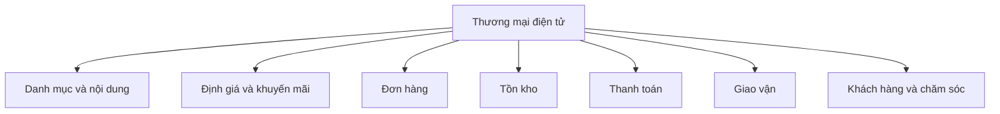
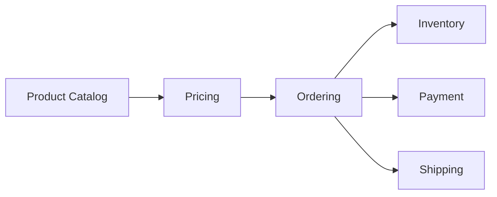

# Khảo sát mô hình hiện có và xác định khu vực nghiệp vụ cần ưu tiên

Khi áp dụng Domain-Driven Design (DDD) vào một hệ thống đang vận hành, điểm bắt đầu không phải là vẽ lại toàn bộ kiến trúc hay thay database. Trước hết cần hiểu hệ thống hiện tại đang hỗ trợ công việc nào, những quy tắc nghiệp vụ đang nằm ở đâu, dữ liệu được tạo và sử dụng như thế nào, các bộ phận gọi cùng một khái niệm bằng những tên gì và thay đổi ở một khu vực sẽ ảnh hưởng đến những khu vực nào.

Khảo sát mô hình hiện có là hoạt động kết hợp giữa tìm hiểu nghiệp vụ và điều tra kỹ thuật. Mục tiêu là dựng được bức tranh đủ tin cậy về quy trình, thuật ngữ, dữ liệu, quy tắc, ứng dụng, tích hợp và các điểm đau. Từ bức tranh đó, đội phát triển cùng chuyên gia nghiệp vụ xác định khu vực nào cần được cải tiến trước, khu vực nào có thể giữ nguyên tạm thời và những ranh giới nào có thể dùng để tách mô hình mới khỏi hệ thống cũ.

Trong DDD, ưu tiên không đồng nghĩa với chọn module có nhiều dòng code nhất hoặc công nghệ cũ nhất. Một khu vực đáng ưu tiên thường có tác động kinh doanh đáng kể, đang gây khó khăn thực tế, có khả năng cải thiện đo lường được và có phạm vi đủ rõ để thay đổi an toàn. Ngược lại, một phần hệ thống quan trọng nhưng phụ thuộc dày đặc, dữ liệu chưa hiểu rõ hoặc chưa có cách chuyển đổi an toàn có thể cần giai đoạn khảo sát và giảm rủi ro trước khi tái cấu trúc.

Bài viết trình bày cách khảo sát mô hình hiện tại, thu thập bằng chứng từ nghiệp vụ và code, nhận diện ranh giới domain, đánh giá mức độ đau và giá trị, xây dựng ma trận ưu tiên, rồi chuyển kết quả thành lộ trình cải tiến theo từng bước. Ví dụ xuyên suốt là một hệ thống thương mại điện tử lâu năm có các chức năng đặt hàng, quản lý kho, thanh toán, giao vận và chăm sóc khách hàng.

## 1. Mục tiêu và phạm vi của cuộc khảo sát

Khảo sát hệ thống hiện có cần trả lời một số câu hỏi thực tế:

- Doanh nghiệp đang tạo ra giá trị qua những quy trình nào?
- Những khái niệm nghiệp vụ quan trọng là gì và các nhóm có đang dùng chúng nhất quán không?
- Quy tắc nghiệp vụ nằm trong code, database, cấu hình, spreadsheet hay kiến thức của nhân viên?
- Những ứng dụng và module nào đang tham gia vào một quy trình?
- Dữ liệu nào là nguồn có thẩm quyền cho từng khái niệm?
- Những khu vực nào thay đổi thường xuyên, gây lỗi hoặc làm chậm công việc?
- Khu vực nào có thể tách hoặc cải tiến với rủi ro chấp nhận được?
- Làm thế nào để biết thay đổi đã đem lại kết quả tốt hơn?

Không nhất thiết phải khảo sát toàn bộ hệ thống với cùng độ sâu. Bắt đầu từ mục tiêu chuyển đổi, phạm vi sản phẩm và những vấn đề doanh nghiệp muốn giải quyết. Sau đó mở rộng khảo sát tới các hệ thống phụ thuộc trực tiếp.

### 1.1. Phân biệt khảo sát hệ thống với kiểm kê công nghệ

Kiểm kê công nghệ thường ghi lại ngôn ngữ lập trình, framework, database, server, phiên bản và hạ tầng. Đây là dữ liệu hữu ích, nhưng chưa đủ để hiểu mô hình nghiệp vụ.

Ví dụ, một ứng dụng Java có thể chứa cả logic đặt hàng, tính giá, giữ hàng và gửi thông tin vận chuyển. Một ứng dụng khác có thể chỉ là màn hình gọi API. Nếu chỉ nhìn sơ đồ triển khai, ta không biết quy tắc nào thuộc Ordering, quy tắc nào thuộc Inventory và ai chịu trách nhiệm cho quyết định cuối cùng.

Khảo sát DDD cần kết hợp ba góc nhìn:

| Góc nhìn | Cần tìm hiểu | Bằng chứng thường gặp |
|---|---|---|
| Nghiệp vụ | Mục tiêu, quy trình, quy tắc, ngoại lệ, thuật ngữ | Phỏng vấn, workshop, tài liệu vận hành, quan sát công việc |
| Dữ liệu và mô hình | Entity, quan hệ, trạng thái, nguồn dữ liệu, lịch sử thay đổi | Schema, query, báo cáo, event, file trao đổi |
| Kỹ thuật và vận hành | Module, API, job, tích hợp, lỗi, phụ thuộc, triển khai | Source code, log, trace, dashboard, cấu hình, sơ đồ hệ thống |

Ba góc nhìn phải được đối chiếu. Tài liệu nói một quy tắc, nhân viên thực hiện một cách khác và code có thể chứa một cách triển khai thứ ba. Sự khác biệt đó chính là phát hiện quan trọng của khảo sát.

### 1.2. Xác định câu hỏi trước khi thu thập dữ liệu

Không nên mở đầu bằng yêu cầu đọc toàn bộ codebase. Cách đó dễ tạo ra một lượng ghi chú kỹ thuật lớn nhưng thiếu câu trả lời cho vấn đề kinh doanh.

Hãy viết các câu hỏi khảo sát gắn với mục tiêu. Ví dụ:

- Vì sao việc thay đổi chính sách giá mất nhiều tuần?
- Tại sao số lượng tồn kho trên màn hình khác số lượng có thể bán?
- Vì sao một đơn hàng bị hủy vẫn có thể được gửi sang hệ thống giao vận?
- Khi đổi thông tin khách hàng, bộ phận nào cần cập nhật dữ liệu và ở đâu?
- Những thay đổi nào thường làm hỏng quy trình thanh toán?

Câu hỏi tốt giúp xác định đúng người cần phỏng vấn, dữ liệu cần xem và code path cần điều tra.

### 1.3. Định nghĩa đầu ra của khảo sát

Một cuộc khảo sát có ích cần tạo ra các sản phẩm cụ thể:

1. Bản đồ capability hoặc quy trình nghiệp vụ ở mức phù hợp.
2. Bảng thuật ngữ và các khái niệm đang có nhiều nghĩa.
3. Danh sách quy tắc nghiệp vụ, ngoại lệ và nơi chúng đang được thực thi.
4. Bản đồ ứng dụng, module, dữ liệu và tích hợp liên quan.
5. Danh sách điểm đau có bằng chứng và ảnh hưởng.
6. Các vùng domain hoặc bounded context giả định cần xác minh.
7. Ma trận đánh giá và thứ tự ưu tiên đề xuất.
8. Các rủi ro, phụ thuộc và câu hỏi còn chưa được trả lời.
9. Lộ trình khám phá hoặc cải tiến tiếp theo với tiêu chí thành công.

Các đầu ra này là bản đồ làm việc, không phải chân lý bất biến. Chúng cần được cập nhật khi nhóm hiểu thêm nghiệp vụ.

## 2. Bắt đầu từ mục tiêu kinh doanh và capability

DDD hướng sự chú ý vào domain và cách doanh nghiệp tạo giá trị. Vì vậy, hãy bắt đầu từ khả năng doanh nghiệp cần có, thay vì từ danh sách package hoặc bảng database.

Business capability mô tả doanh nghiệp có khả năng làm gì, tương đối ổn định theo thời gian. Ví dụ trong thương mại điện tử:

- Quản lý danh mục sản phẩm.
- Định giá và áp dụng khuyến mãi.
- Tiếp nhận và quản lý đơn hàng.
- Quản lý tồn kho và giữ hàng.
- Xử lý thanh toán và hoàn tiền.
- Tổ chức giao hàng.
- Quản lý khách hàng và chăm sóc sau bán.

Capability không nhất thiết tương ứng một service, một team hay một database. Đây là góc nhìn giúp tổ chức khảo sát và trao đổi với doanh nghiệp.

### 2.1. Phân biệt capability với quy trình

Capability trả lời doanh nghiệp có khả năng gì; quy trình mô tả một chuỗi hoạt động để hoàn thành một mục tiêu.

Ví dụ:

- Capability: quản lý đơn hàng.
- Quy trình: tiếp nhận đơn, xác nhận thông tin, kiểm tra điều kiện, giữ hàng, xác nhận đơn và theo dõi trạng thái.

Một quy trình có thể đi qua nhiều capability. Việc đặt đơn có thể dùng năng lực định giá, kiểm tra tồn kho, thanh toán và giao vận. Không nên ép toàn bộ chuỗi thành một capability duy nhất.

### 2.2. Xác định capability cốt lõi và hỗ trợ

Có thể phân loại sơ bộ:

- **Core domain:** năng lực tạo lợi thế cạnh tranh hoặc quyết định cách doanh nghiệp khác biệt trên thị trường.
- **Supporting subdomain:** năng lực cần thiết để vận hành nhưng không phải nguồn khác biệt chính.
- **Generic subdomain:** bài toán phổ biến có thể dùng giải pháp chuẩn hoặc dịch vụ bên ngoài.

Phân loại này phụ thuộc chiến lược doanh nghiệp, không phụ thuộc độ phức tạp code. Một hệ thống tính giá có thể là Core Domain với nhà bán lẻ có chính sách giá độc đáo, nhưng chỉ là Generic Subdomain ở doanh nghiệp dùng giá cố định.

### 2.3. Dùng capability map để định hướng khảo sát

Bản đồ đơn giản:



Sơ đồ này chỉ là khung ban đầu. Workshop với các bộ phận sẽ làm rõ capability thực tế, ranh giới trách nhiệm và những chỗ chồng lấn. Không nên biến một sơ đồ chung thành kiến trúc đích khi chưa có bằng chứng.

## 3. Thu thập hiểu biết từ chuyên gia nghiệp vụ

Mô hình hiện tại thường chứa nhiều quy tắc không được ghi trong tài liệu. Một số quy tắc chỉ tồn tại trong cách nhân viên xử lý ngoại lệ hoặc trong thỏa thuận giữa các bộ phận.

### 3.1. Phỏng vấn theo công việc thực tế

Thay vì hỏi chung quy trình đặt hàng hoạt động thế nào, hãy yêu cầu người tham gia kể lại một trường hợp cụ thể:

- Đơn được tạo từ kênh nào?
- Ai hoặc hệ thống nào xác nhận đơn?
- Điều gì xảy ra nếu sản phẩm hết hàng?
- Khi khách đổi địa chỉ sau khi thanh toán thì ai quyết định?
- Khi payment gateway timeout, nhân viên kiểm tra điều gì?
- Khi một phần đơn đã giao nhưng phần khác chưa giao, trạng thái được thể hiện ra sao?

Trường hợp bình thường giúp hiểu happy path; trường hợp ngoại lệ thường làm lộ quy tắc quan trọng nhất.

### 3.2. Quan sát người dùng thực hiện công việc

Tài liệu quy trình có thể đã lỗi thời. Quan sát nhân viên thao tác trên màn hình, spreadsheet, email và công cụ nội bộ giúp phát hiện:

- Bước nào phải nhập lại dữ liệu.
- Bước nào cần gọi điện hoặc xin phê duyệt thủ công.
- Trạng thái nào nhân viên tự suy ra vì hệ thống không thể hiện.
- Có file riêng được dùng làm nguồn dữ liệu thay thế không.
- Nhân viên có workaround nào để tránh lỗi hệ thống.

Workaround lặp đi lặp lại là tín hiệu về khoảng trống của mô hình hoặc quy trình. Không nên vội kết luận nhân viên làm sai; có thể hệ thống chưa phản ánh đúng công việc thực tế.

### 3.3. Dùng ví dụ và câu chuyện thay vì chỉ hỏi định nghĩa

Nếu các nhóm bất đồng về nghĩa của “đơn đã xác nhận”, hãy hỏi họ đưa ra ví dụ:

- Đã kiểm tra địa chỉ nhưng chưa giữ hàng thì có phải xác nhận không?
- Payment đã được authorize nhưng kho chưa giữ hàng thì đơn ở trạng thái nào?
- Một phần hàng đã được giao thì đơn được coi là hoàn tất hay chưa?

Ví dụ cụ thể giúp phân biệt các trạng thái có vẻ giống nhau và tìm ra nơi cần mô hình hóa riêng.

### 3.4. Ghi lại thuật ngữ, từ đồng nghĩa và từ mơ hồ

Tạo glossary ban đầu:

| Thuật ngữ | Nhóm sử dụng | Ý nghĩa hiện tại | Câu hỏi cần xác minh |
|---|---|---|---|
| Đơn mới | Bán hàng | Đơn vừa được tiếp nhận | Đã kiểm tra điều kiện chưa? |
| Đơn xác nhận | Vận hành | Có thể đang chờ giữ hàng hoặc đã giữ hàng | Xác nhận ở bước nào? |
| Hàng giữ chỗ | Kho | Số lượng tạm dành cho đơn | Khi nào hết hạn? |
| Thanh toán thành công | Tài chính | Có thể là authorize hoặc capture | Gateway trả trạng thái nào? |
| Đã giao | Giao vận | Đơn vị vận chuyển báo đã giao | Có cần khách xác nhận nhận hàng? |

Một từ có nhiều nghĩa không nhất thiết là lỗi. Trong các Bounded Context khác nhau, cùng một từ có thể có mô hình riêng. Điều quan trọng là nhận diện và ghi rõ ngữ cảnh sử dụng.

### 3.5. Tổ chức Event Storming hoặc workshop quy trình

Event Storming có thể giúp nhóm khám phá luồng sự kiện nghiệp vụ theo thời gian. Bắt đầu với các sự kiện đã xảy ra như OrderPlaced, StockReserved, PaymentAuthorized và ShipmentDispatched. Sau đó hỏi command nào tạo ra event, actor nào kích hoạt, policy nào phản ứng và dữ liệu nào cần có.

Workshop giúp tìm:

- Sự kiện quan trọng.
- Quyết định và quy tắc.
- Điểm chờ hoặc xử lý bất đồng bộ.
- Hệ thống hoặc bộ phận tham gia.
- Chỗ có nhiều cách hiểu.
- Các bước thủ công hoặc ngoại lệ.

Không cần hoàn thành một bản Event Storming toàn doanh nghiệp trước khi ưu tiên. Có thể dùng workshop ngắn cho quy trình đang gây đau nhất.

## 4. Điều tra codebase và cấu trúc kỹ thuật

Sau khi có bức tranh nghiệp vụ ban đầu, hãy truy dấu cách hệ thống hiện thực hóa các khái niệm đó.

### 4.1. Lần theo một use case từ đầu đến cuối

Chọn một hành động có ý nghĩa, ví dụ đặt đơn, rồi truy vết:

1. API hoặc giao diện nào tiếp nhận yêu cầu?
2. Controller hoặc message handler gọi service nào?
3. Quy tắc nằm trong Aggregate, service hay rải trong nhiều lớp?
4. Repository nào đọc và ghi dữ liệu?
5. Có gọi database procedure, trigger hoặc job nền không?
6. Có gửi message hoặc gọi hệ thống bên ngoài không?
7. Trạng thái được cập nhật ở những bảng nào?
8. Lỗi được xử lý và retry ở đâu?

Một sơ đồ sequence cho đường đi thực tế có thể hữu ích hơn sơ đồ package tổng quát.

### 4.2. Tìm quy tắc bị ẩn trong code

Quy tắc nghiệp vụ có thể xuất hiện dưới dạng:

- Điều kiện if/else trong Service.
- SQL procedure hoặc trigger.
- Constraint trong database.
- Feature flag hoặc cấu hình.
- Bảng mã trạng thái.
- Job chạy định kỳ.
- Quy tắc mapping trong API adapter.
- Logic được sao chép trong nhiều module.

Đừng chỉ tìm class có tên Order hoặc Inventory. Hãy tìm các điều kiện và cập nhật dữ liệu liên quan đến quy trình đã được chuyên gia mô tả.

### 4.3. Kiểm tra schema và dữ liệu thực tế

Schema cho biết cấu trúc lưu trữ, nhưng không luôn nói được semantics. Cần xem:

- Primary key và foreign key.
- Unique constraint và check constraint.
- Cột trạng thái, cột thời gian và soft-delete flag.
- Bảng lịch sử hoặc audit.
- Quan hệ một-nhiều và các bảng nối.
- Dữ liệu trùng, null hoặc giá trị không hợp lệ.
- Các cột có tên khác nhau nhưng lưu cùng khái niệm.

Dữ liệu thực tế có thể cho thấy trạng thái nào hiếm khi được dùng, field nào luôn null hoặc cùng một khách hàng có nhiều ID. Đây là manh mối để điều tra, không phải kết luận tự động về quy tắc nghiệp vụ.

Khi dữ liệu có thông tin cá nhân hoặc nhạy cảm, chỉ dùng mẫu dữ liệu được phép và ẩn danh hóa theo chính sách của tổ chức. Không cần sao chép toàn bộ dữ liệu production về máy phát triển để khảo sát.

### 4.4. Lập bản đồ tích hợp và phụ thuộc

Với mỗi API, message, file hoặc database link, ghi lại:

- Bên gửi và bên nhận.
- Mục đích nghiệp vụ.
- Contract hoặc schema.
- Tần suất và thời điểm trao đổi.
- Cơ chế đồng bộ hay bất đồng bộ.
- Nguồn dữ liệu có thẩm quyền.
- Cách retry, timeout và xử lý lỗi.
- Ai sở hữu contract và có thể thay đổi nó.

Một module có ít code nhưng được nhiều hệ thống phụ thuộc có thể có rủi ro chuyển đổi cao. Bản đồ phụ thuộc giúp tránh đánh giá ưu tiên chỉ dựa vào kích thước hoặc mức đau.

### 4.5. Dùng log và trace để kiểm chứng

Log, metric và distributed trace có thể trả lời:

- Một yêu cầu đi qua bao nhiêu module?
- API nào có tỷ lệ lỗi cao?
- Job nào thường chạy quá hạn?
- Database nào là nút thắt?
- Timeout xảy ra trước hay sau khi ghi dữ liệu?
- Một thao tác có bị xử lý lặp không?

Dữ liệu vận hành giúp định lượng vấn đề. Nhưng log chỉ cho thấy những gì hệ thống ghi lại; nếu một quy tắc không có instrumentation, cần phỏng vấn hoặc đọc code để hiểu.

## 5. Dựng bản đồ mô hình hiện có

Sau khi thu thập dữ liệu, hãy tổng hợp thành một bản đồ có thể trao đổi giữa nghiệp vụ và kỹ thuật.

### 5.1. Bản đồ khái niệm và trách nhiệm

Với từng khu vực, ghi:

- Mục tiêu nghiệp vụ.
- Các khái niệm chính.
- Hành động và trạng thái quan trọng.
- Quy tắc quyết định.
- Người hoặc bộ phận chịu trách nhiệm.
- Ứng dụng và module liên quan.
- Dữ liệu được tạo, đọc và cập nhật.
- Các hệ thống phụ thuộc.

Ví dụ:

| Khu vực | Khái niệm chính | Quyết định quan trọng | Hệ thống hiện tại |
|---|---|---|---|
| Ordering | Order, OrderLine, OrderStatus | Có thể đặt/hủy đơn không? | Order module trong monolith |
| Inventory | StockItem, Reservation | Có đủ hàng để giữ không? | Warehouse service và DB kho |
| Payment | Payment, Authorization, Refund | Khoản tiền đã được authorize/capture chưa? | Payment adapter |
| Shipping | Shipment, Tracking | Kiện hàng đang ở đâu? | Logistics integration |

Bảng này là giả thuyết ban đầu. Cần xác minh quyền sở hữu và nghĩa của từng khái niệm với các nhóm.

### 5.2. Phân biệt mô hình logic với sơ đồ triển khai

Một Bounded Context có thể đang nằm trong một package của monolith, một database dùng chung hoặc nhiều ứng dụng. Ngược lại, một ứng dụng có thể chứa nhiều Bounded Context.

Không suy ra bounded context từ tên service, repository hoặc database schema. Ranh giới context được xác định bởi ngôn ngữ, mô hình và trách nhiệm nghiệp vụ; deployment boundary là một quyết định kỹ thuật có thể thay đổi sau.

### 5.3. Nhận diện mô hình trùng lặp và mô hình dùng chung quá mức

Dấu hiệu thường gặp:

- Cùng class Customer được dùng cho bán hàng, hỗ trợ, hóa đơn và giao vận.
- Một enum Status có quá nhiều giá trị phục vụ nhiều quy trình.
- Một service có trách nhiệm cập nhật dữ liệu của nhiều capability.
- Một bảng chung lưu trạng thái của nhiều loại tài nguyên.
- Các module phải biết field nội bộ của nhau.
- Một thay đổi nhỏ ở một khu vực buộc nhiều nhóm release cùng lúc.

Những dấu hiệu này có thể cho thấy ranh giới domain chưa rõ. Tuy nhiên, chia sẻ dữ liệu hoặc code không tự động là sai. Cần xem các nhóm có thật sự chia sẻ cùng ngôn ngữ và cùng quy tắc hay chỉ đang dùng chung một cấu trúc kỹ thuật.

### 5.4. Ghi lại điểm chưa chắc chắn

Mỗi phát hiện nên có trạng thái:

- Đã xác minh bằng nhiều nguồn.
- Có bằng chứng nhưng cần chuyên gia xác nhận.
- Giả thuyết cần khảo sát thêm.
- Chưa có dữ liệu.

Ví dụ: “Order module đang sở hữu giá bán cuối cùng” có thể được suy ra từ code, nhưng chuyên gia Pricing cần xác nhận chính sách giá và thời điểm chốt giá. Ghi rõ độ tin cậy giúp tránh biến suy đoán thành kiến trúc đích.

## 6. Nhận diện khu vực nghiệp vụ cần cải tiến

Không phải mọi khu vực có code cũ đều cần chuyển đổi trước. Ưu tiên nên dựa trên ảnh hưởng kinh doanh, mức đau, cơ hội cải thiện, độ sẵn sàng và rủi ro.

### 6.1. Dấu hiệu một khu vực đang gây đau

Một khu vực có thể đáng chú ý khi:

- Thay đổi chính sách mất nhiều thời gian hoặc thường xuyên gây lỗi.
- Nhiều nhóm phải phối hợp thủ công để hoàn thành một công việc.
- Quy tắc nghiệp vụ bị sao chép hoặc mâu thuẫn giữa các module.
- Dữ liệu không đáng tin hoặc phải đối chiếu bằng spreadsheet.
- Tỷ lệ lỗi, hoàn tiền hoặc xử lý thủ công cao.
- Không thể thử nghiệm một tính năng mới mà không ảnh hưởng hệ thống khác.
- Một nhóm chuyên gia phải giải thích lại cùng một quy tắc cho nhiều đội.
- Hệ thống phụ thuộc vào một vài cá nhân nắm kiến thức không được ghi lại.

### 6.2. Đánh giá tác động kinh doanh

Hãy gắn điểm đau với kết quả đo được hoặc hậu quả cụ thể:

- Mất doanh thu do đơn không hoàn tất.
- Chi phí nhân sự cho xử lý thủ công.
- Thời gian đưa chính sách giá mới ra thị trường.
- Tỷ lệ giao hàng trễ do giữ hàng sai.
- Số lần đối soát thanh toán thất bại.
- Thời gian cần để khắc phục một sự cố.
- Mức độ ảnh hưởng tới khách hàng hoặc nghĩa vụ pháp lý.

Nếu chưa có số liệu, ghi rõ đây là ước lượng và đề xuất cách đo. Không tạo số liệu giả chỉ để điền vào bảng ưu tiên.

### 6.3. Phân biệt mức đau với mức ưu tiên

Một module có thể rất khó chịu nhưng ít quan trọng đối với chiến lược hiện tại. Một capability khác có thể chưa phát sinh nhiều sự cố nhưng đang là nút thắt khiến doanh nghiệp không thể triển khai sản phẩm mới.

Ưu tiên cần xem cả:

- Giá trị kinh doanh nếu cải thiện.
- Mức độ đau hiện tại.
- Tính cấp bách hoặc nghĩa vụ bắt buộc.
- Khả năng giải quyết bằng thay đổi có kiểm soát.
- Phụ thuộc và rủi ro.
- Khả năng đo kết quả.

Không nên lấy số bug hoặc số dòng code làm đại diện duy nhất cho giá trị.

## 7. Dùng ma trận để xếp thứ tự ưu tiên

Một ma trận giúp nhóm so sánh các khu vực theo tiêu chí thống nhất. Có thể dùng thang điểm 1–5, trong đó 1 là thấp và 5 là cao.

Ví dụ bộ tiêu chí:

| Tiêu chí | Trọng số minh họa | Câu hỏi |
|---|---:|---|
| Giá trị chiến lược | 25% | Cải thiện khu vực này có tạo lợi thế hoặc hỗ trợ mục tiêu quan trọng không? |
| Mức đau hiện tại | 20% | Lỗi, chi phí thủ công hoặc chậm trễ đang nghiêm trọng đến đâu? |
| Tần suất thay đổi | 15% | Quy tắc hoặc yêu cầu ở đây thay đổi thường xuyên không? |
| Phạm vi tác động | 15% | Bao nhiêu người dùng, quy trình hoặc capability bị ảnh hưởng? |
| Khả năng tách và sẵn sàng | 15% | Có ranh giới, dữ liệu và người chịu trách nhiệm đủ rõ không? |
| An toàn chuyển đổi | 10% | Có thể chuyển đổi và rollback an toàn đến mức nào? |

Với các tiêu chí thuận chiều, điểm cao nghĩa là ưu tiên cao. Riêng tiêu chí an toàn chuyển đổi, điểm cao nghĩa là rủi ro thấp hơn hoặc đã có cách giảm thiểu đáng tin cậy. Nếu tổ chức muốn chấm mức rủi ro theo chiều ngược lại, phải đảo công thức trước khi cộng điểm.

Điểm tổng có thể tính:

```text
Điểm ưu tiên = Σ (điểm tiêu chí / 5 × trọng số)
```

Trọng số chỉ là ví dụ. Doanh nghiệp có thể thay đổi chúng theo chiến lược và nghĩa vụ trong giai đoạn hiện tại. Hãy ghi lại lý do chấm điểm và người xác nhận.

### 7.1. Ví dụ chấm điểm

Giả sử nhóm khảo sát ba khu vực:

- Ordering: nhiều thay đổi chính sách và ảnh hưởng trực tiếp tới trải nghiệm mua.
- Inventory: sai lệch giữ hàng gây hủy đơn, nhưng phụ thuộc nhiều thiết bị và hệ thống kho.
- Customer Support: nhiều thao tác thủ công, phạm vi kỹ thuật tương đối tách biệt.

Bảng điểm giả định:

| Tiêu chí | Trọng số | Ordering | Inventory | Customer Support |
|---|---:|---:|---:|---:|
| Giá trị chiến lược | 25% | 5 | 4 | 3 |
| Mức đau hiện tại | 20% | 4 | 5 | 4 |
| Tần suất thay đổi | 15% | 5 | 3 | 3 |
| Phạm vi tác động | 15% | 5 | 4 | 3 |
| Khả năng tách và sẵn sàng | 15% | 3 | 2 | 4 |
| An toàn chuyển đổi | 10% | 3 | 2 | 4 |
| **Điểm tổng / 5** | **100%** | **4,25** | **3,45** | **3,40** |

Với giả định trên, Ordering có điểm cao nhất và là ứng viên hợp lý để khám phá sâu hoặc làm pilot. Inventory có mức đau rất cao nhưng khả năng tách và an toàn chuyển đổi thấp; nó có thể cần một giai đoạn làm rõ luồng dữ liệu và giảm phụ thuộc trước khi chuyển đổi. Customer Support có thể là một ứng viên pilot kỹ thuật ít rủi ro hơn nếu mục tiêu là kiểm chứng quy trình triển khai.

Điểm số không tự quyết định thứ tự. Nếu Inventory đang gây thất thoát lớn hoặc có nghĩa vụ kiểm soát bắt buộc, doanh nghiệp có thể ưu tiên xử lý rủi ro đó trước. Ma trận giúp cuộc thảo luận minh bạch, không thay thế quyết định của người chịu trách nhiệm.

### 7.2. Thêm điều kiện loại trừ và cờ rủi ro

Một điểm tổng cao không có nghĩa phải bắt đầu ngay. Có thể cần điều kiện tiên quyết:

- Chưa có chủ sở hữu nghiệp vụ.
- Không có dữ liệu đủ tin cậy để đối chiếu.
- Hệ thống phụ thuộc không có môi trường test.
- Chưa xác định được nguồn sự thật.
- Không có kế hoạch rollback.
- Thay đổi có nguy cơ ảnh hưởng nghĩa vụ tài chính hoặc pháp lý.

Ghi các điều kiện này riêng với điểm số. Có thể quyết định “ưu tiên khảo sát thêm” thay vì “ưu tiên triển khai”.

### 7.3. Phân biệt ưu tiên khám phá và ưu tiên chuyển đổi

Đây là hai quyết định khác nhau:

- **Ưu tiên khám phá:** nơi có nhiều bất định, ảnh hưởng lớn hoặc rủi ro cần hiểu rõ.
- **Ưu tiên chuyển đổi:** nơi có giá trị đủ lớn, phạm vi đủ rõ, khả năng kiểm chứng và kế hoạch chuyển đổi an toàn.

Một khu vực có thể đứng đầu danh sách khám phá nhưng chưa phải ứng viên triển khai đầu tiên.

## 8. Xác định Bounded Context từ bằng chứng khảo sát

Sau khi hiểu capability, quy trình và ngôn ngữ, nhóm có thể đề xuất các Bounded Context. Đây là giả thuyết về ranh giới mô hình, cần được kiểm tra với nghiệp vụ.

### 8.1. Dấu hiệu các mô hình có thể thuộc những context khác nhau

- Cùng một từ nhưng có ý nghĩa hoặc vòng đời khác nhau.
- Các nhóm có quy tắc và trách nhiệm riêng.
- Một nhóm cần thay đổi mô hình mà nhóm khác không nên bị ảnh hưởng.
- Dữ liệu có nguồn có thẩm quyền khác nhau.
- Các hành vi có invariant khác nhau.
- Một mô hình dùng cho giao dịch, mô hình kia dùng cho báo cáo hoặc vận hành.

Ví dụ, Customer trong Sales có thể tập trung vào quan hệ và phân khúc khách hàng; Customer trong Billing có thể tập trung vào thông tin pháp lý và địa chỉ hóa đơn. Không nhất thiết phải dùng chung một Customer Entity.

### 8.2. Không dùng team hoặc database làm ranh giới duy nhất

Một nhóm hiện tại có thể sở hữu nhiều trách nhiệm do lịch sử tổ chức. Một database dùng chung có thể chứa nhiều mô hình. Một Bounded Context có thể chưa tách thành service độc lập.

Hãy xác định ranh giới theo ngôn ngữ, mô hình và trách nhiệm trước; sau đó mới chọn cách tổ chức code, dữ liệu và deployment.

### 8.3. Vẽ Context Map sơ bộ

Ví dụ:



Sơ đồ chỉ biểu diễn các mối quan hệ cần điều tra, chưa khẳng định tất cả đều là lời gọi đồng bộ hoặc phụ thuộc trực tiếp. Cần bổ sung loại quan hệ, hướng dữ liệu, contract, quyền sở hữu và cách xử lý lỗi khi hiểu rõ hơn.

### 8.4. Xác định context nào đang là Core Domain

Không phải context nào cũng cần thiết kế riêng hoặc đầu tư như nhau. Một context hỗ trợ có thể dùng giải pháp chuẩn; một context cốt lõi có thể cần mô hình sâu, chuyên gia nghiệp vụ tham gia thường xuyên và đội ngũ ổn định.

Phân loại Core, Supporting và Generic giúp quyết định mức đầu tư. Đừng đánh đồng Core Domain với module lớn nhất hoặc có nhiều kỹ thuật phức tạp nhất.

## 9. Phân tích phụ thuộc và mức độ sẵn sàng chuyển đổi

Một khu vực có thể có giá trị cao nhưng rất khó tách vì nhiều phụ thuộc ẩn. Trước khi đề xuất thay đổi, cần hiểu các đường đi vào và ra của nó.

### 9.1. Lập dependency map

Với mỗi khu vực, ghi:

- Module nào gọi vào?
- Module nào được gọi ra?
- Có chia sẻ database hoặc bảng không?
- Có truy cập trực tiếp bảng của khu vực khác không?
- Có batch job hoặc báo cáo đọc dữ liệu không?
- Có message hoặc file trao đổi không?
- Có client bên ngoài phụ thuộc API không?
- Có dữ liệu lịch sử hoặc tác vụ đang chạy cần giữ nguyên không?

Sơ đồ phụ thuộc nên thể hiện cả luồng dữ liệu và luồng điều khiển. Một module có thể không gọi API trực tiếp nhưng vẫn phụ thuộc vào bảng database của module khác.

### 9.2. Đánh giá coupling và cohesion

Dấu hiệu coupling cao:

- Một thay đổi schema buộc nhiều module sửa cùng lúc.
- Nhiều module cập nhật cùng một bản ghi.
- Có truy vấn join trực tiếp bảng thuộc capability khác.
- Dùng chung enum hoặc class domain dù semantics khác nhau.
- Một service điều phối nhiều quy tắc không liên quan.

Dấu hiệu cohesion thấp:

- Một module chứa các hành vi thuộc nhiều mục tiêu nghiệp vụ.
- Tên module không phản ánh được trách nhiệm.
- Thay đổi một quy tắc thường không liên quan vẫn ảnh hưởng module.
- Một nhóm không thể giải thích rõ module phục vụ capability nào.

Các chỉ số code như dependency count hoặc số module import có thể hỗ trợ, nhưng cần kết hợp hiểu biết nghiệp vụ. Không có một ngưỡng số học phổ quát để xác định bounded context tốt.

### 9.3. Đánh giá khả năng quan sát và kiểm thử

Một khu vực sẵn sàng chuyển đổi hơn khi:

- Có test bao phủ hành vi quan trọng.
- Có log/metric để so sánh trước và sau.
- Có dữ liệu test hoặc cách tạo dữ liệu đại diện.
- Có thể chạy một phần hệ thống độc lập.
- Có contract với các bên phụ thuộc.
- Có cách đối chiếu kết quả cũ và mới.

Nếu chưa có, việc đầu tiên có thể là bổ sung characterization test, instrumentation hoặc contract test trước khi thay đổi kiến trúc.

## 10. Xác định chiến lược cho từng khu vực

Không phải mọi khu vực đều cần viết lại. Kết quả khảo sát có thể dẫn đến nhiều hướng:

| Lựa chọn | Khi phù hợp | Hành động |
|---|---|---|
| Giữ nguyên | Hệ thống ổn định, giá trị cải tiến thấp | Duy trì và theo dõi |
| Cải thiện tại chỗ | Vấn đề cục bộ, ranh giới đã đủ rõ | Refactor từng phần, bổ sung test |
| Bao bọc hệ thống cũ | Chưa thể thay thế nhưng cần giao diện rõ | Tạo adapter hoặc façade |
| Tách mô hình | Ngôn ngữ và trách nhiệm đã khác biệt | Xác lập context boundary và contract |
| Thay thế từng phần | Có thể chuyển dần một capability | Strangler pattern hoặc route theo chức năng |
| Thay thế toàn bộ | Phạm vi nhỏ, phụ thuộc ít, có đường chuyển đổi rõ | Lập kế hoạch cutover có kiểm soát |

### 10.1. Bao bọc hệ thống cũ bằng Anti-Corruption Layer

Nếu hệ thống cũ dùng khái niệm hoặc API không phù hợp, có thể tạo adapter chuyển đổi giữa mô hình mới và mô hình cũ.

Ví dụ, hệ thống cũ có một trường status_code với các giá trị số và semantics không rõ. Ordering mới có thể dùng OrderStatus rõ ràng; adapter chuyển đổi giữa hai biểu diễn và tập trung xử lý các trường hợp không ánh xạ được.

Anti-Corruption Layer bảo vệ mô hình mới khỏi bị kéo theo cấu trúc cũ. Tuy nhiên, nó không tự giải quyết mọi vấn đề dữ liệu hoặc quy tắc. Cần ghi rõ các trường hợp chuyển đổi, lỗi và giới hạn.

### 10.2. Dùng Strangler Fig để chuyển đổi từng phần

Có thể đưa chức năng mới vào một ranh giới riêng, rồi định tuyến từng use case từ hệ thống cũ sang hệ thống mới. Trong giai đoạn chuyển tiếp, một số chức năng vẫn chạy ở legacy, một số đã chuyển sang mô hình mới.

Điều cần kiểm soát:

- Chức năng nào đang do hệ thống nào sở hữu?
- Dữ liệu nào là nguồn có thẩm quyền?
- Có ghi kép không và nếu có thì cách đối soát?
- Route nào quyết định request đi tới đâu?
- Cách rollback khi phiên bản mới có lỗi?
- Khi nào có thể loại bỏ đường đi cũ?

Không nên để hai hệ thống cùng là nguồn có thẩm quyền cho cùng một dữ liệu nếu không có quy tắc đồng bộ rõ.

### 10.3. Không bắt đầu bằng microservices nếu ranh giới chưa rõ

Tách deployment khi mô hình và ownership chưa rõ có thể tạo distributed monolith: nhiều service nhưng vẫn chia sẻ database, gọi chéo dày đặc và phải release cùng nhau.

Có thể bắt đầu bằng modular monolith với Bounded Context được phân tách trong code và contract. Khi nhu cầu triển khai, mở rộng hoặc ownership thực sự đòi hỏi, mới cân nhắc tách service.

## 11. Chọn pilot có giá trị và phạm vi kiểm soát được

Pilot giúp kiểm chứng giả thuyết về domain boundary, cách làm việc và chiến lược chuyển đổi trước khi nhân rộng.

Một pilot phù hợp thường có:

- Giá trị nghiệp vụ đủ rõ để đo.
- Một nhóm chuyên gia sẵn sàng tham gia.
- Phạm vi use case tương đối giới hạn.
- Dữ liệu và hệ thống phụ thuộc có thể kiểm soát.
- Cách chạy song song hoặc rollback.
- Kết quả có thể quan sát trong thời gian hợp lý.

Không nhất thiết chọn khu vực đơn giản nhất. Nếu pilot quá ít ý nghĩa, nhóm không kiểm chứng được những vấn đề thật. Cũng không nên chọn khu vực quan trọng nhất nhưng chưa hiểu rủi ro nếu chưa có khả năng bảo vệ vận hành.

### 11.1. Ví dụ chọn pilot

Giả sử hệ thống thương mại điện tử đang có ba ứng viên:

- Customer Support: nhiều thao tác thủ công, có thể tách màn hình và truy vấn trước.
- Pricing: chiến lược quan trọng, nhưng quy tắc khuyến mãi phức tạp và thay đổi liên tục.
- Inventory Reservation: ảnh hưởng trực tiếp khả năng bán hàng, phụ thuộc thiết bị kho và đồng bộ nhiều hệ thống.

Một lộ trình có thể là:

1. Khám phá sâu Pricing để thống nhất thuật ngữ, chính sách và nguồn dữ liệu.
2. Chọn một luồng Customer Support có phạm vi rõ để kiểm chứng cách tạo context boundary và adapter.
3. Bổ sung contract test và đối soát cho Inventory trước khi thay đổi hành vi giữ hàng.
4. Chuyển một quy tắc Pricing có phạm vi nhỏ khi mô hình và test đã đủ tin cậy.

Đây chỉ là ví dụ. Lộ trình thật cần dựa vào điểm số, phụ thuộc, mức độ cấp bách và năng lực đội ngũ.

### 11.2. Định nghĩa tiêu chí thành công trước khi bắt đầu

Không dùng tiêu chí mơ hồ như code sạch hơn. Hãy đo kết quả có liên hệ với vấn đề:

- Thời gian thay đổi một chính sách giảm từ bao lâu xuống bao lâu.
- Tỷ lệ lỗi do cập nhật trạng thái sai giảm bao nhiêu.
- Số thao tác thủ công trong một quy trình giảm thế nào.
- Thời gian triển khai một thay đổi giảm ra sao.
- Tỷ lệ đối soát dữ liệu thành công tăng thế nào.
- Số module bị ảnh hưởng bởi một thay đổi giảm hay không.
- Có thể rollback trong thời gian mục tiêu không.

Chỉ số cần có baseline trước khi triển khai. Nếu không có baseline, hãy đo trước ở giai đoạn khảo sát.

## 12. Chuyển kết quả khảo sát thành lộ trình

Lộ trình chuyển đổi nên chia theo capability hoặc use case có giá trị, không chỉ theo tầng kỹ thuật như database trước, service sau, UI cuối cùng.

### 12.1. Tạo bản đồ trạng thái hiện tại và trạng thái mục tiêu

Với mỗi khu vực, ghi:

- Current state: cách làm hiện tại và vấn đề.
- Target hypothesis: mô hình hoặc ranh giới mong muốn.
- Gap: khác biệt về dữ liệu, quy tắc, contract và trách nhiệm.
- Transition: các bước để đi từ hiện tại tới mục tiêu.
- Exit criteria: điều kiện để loại bỏ cách làm cũ.

Ví dụ:

| Nội dung | Hiện tại | Giả thuyết mục tiêu |
|---|---|---|
| Trạng thái đơn | Enum dùng chung cho nhiều module | Ordering sở hữu OrderStatus riêng |
| Giữ hàng | Service đặt hàng cập nhật bảng kho trực tiếp | Inventory cung cấp hành vi reserve |
| Giá | Nhiều module tự tính lại | Pricing cung cấp báo giá có contract |
| Giao vận | Đọc trực tiếp bảng đơn | Nhận Integration Event/contract ổn định |

Giả thuyết mục tiêu cần được kiểm chứng. Có thể phát hiện sau khảo sát rằng một phần nên giữ nguyên hoặc dùng giải pháp chuẩn thay vì tạo mô hình mới.

### 12.2. Chia theo lát cắt dọc

Một lát cắt dọc đi qua giao diện, application, domain và persistence để hoàn thành một hành vi nghiệp vụ cụ thể. Ví dụ, chuyển một luồng “xem trạng thái đơn” hoặc “đổi địa chỉ giao hàng” có thể kiểm chứng toàn bộ contract.

Chuyển từng tầng riêng lẻ có thể tạo ra một khoảng thời gian dài mà không có chức năng hoàn chỉnh và khó đo giá trị. Tuy vậy, một số việc nền như chuẩn hóa dữ liệu hoặc tạo adapter có thể cần thực hiện trước.

### 12.3. Quản lý dữ liệu trong giai đoạn chuyển tiếp

Dữ liệu thường là phần khó nhất của migration. Cần xác định:

- Ai là owner của từng bảng hoặc field?
- Có ghi kép không?
- Đồng bộ theo event, CDC, batch hay API?
- Làm sao phát hiện bản ghi bị thiếu hoặc trùng?
- Có cần backfill lịch sử không?
- Quy tắc xử lý dữ liệu không hợp lệ là gì?
- Khi cutover, làm sao xác nhận hai phía tương đương?
- Có thể quay lại hệ thống cũ mà không mất cập nhật không?

Không nên coi việc copy bảng là hoàn tất migration. Mô hình mới có thể có semantics khác, cần chuyển đổi giá trị và kiểm tra dữ liệu theo quy tắc nghiệp vụ.

### 12.4. Thiết kế rollback và điểm dừng

Trước mỗi lần cutover, xác định:

- Điều kiện cho phép chuyển traffic.
- Metric và cảnh báo theo dõi sau chuyển.
- Ngưỡng kích hoạt rollback.
- Ai có quyền quyết định.
- Dữ liệu phát sinh trong thời gian chạy mới sẽ được xử lý ra sao nếu quay lại.
- Có cần dừng ghi ngắn hạn hoặc dùng cơ chế đồng bộ bù không.

Rollback của code dễ hơn rollback dữ liệu đã biến đổi. Hãy lập kế hoạch cho cả hai.

## 13. Quản lý bất định và bằng chứng

Khảo sát hệ thống cũ hiếm khi có đủ thông tin ngay từ đầu. Cần quản lý những điều chưa biết thay vì lấp bằng giả định.

### 13.1. Dùng sổ ghi nhận phát hiện

Một phát hiện nên có:

| Trường | Nội dung |
|---|---|
| ID | Mã phát hiện |
| Phát hiện | Điều quan sát được |
| Bằng chứng | Người xác nhận, code path, log, query hoặc tài liệu |
| Ảnh hưởng | Tác động tới quy trình hoặc khách hàng |
| Độ tin cậy | Đã xác minh, có cơ sở, giả thuyết |
| Câu hỏi mở | Điều cần điều tra tiếp |
| Owner | Người chịu trách nhiệm xác minh |
| Hạn xử lý | Thời điểm cần có câu trả lời |

Ví dụ: “Cùng một đơn có thể mang trạng thái PAID ở Order DB và PENDING ở Payment DB”. Bằng chứng cần chỉ rõ thời điểm, luồng cập nhật và nguồn có thẩm quyền; nếu chỉ nhìn hai bản ghi ở hai thời điểm khác nhau, có thể đó là độ trễ bình thường chứ không phải dữ liệu sai.

### 13.2. Phân biệt triệu chứng và nguyên nhân

Triệu chứng: nhân viên phải nhập lại địa chỉ giao hàng.

Các nguyên nhân có thể khác nhau:

- Không có API chia sẻ dữ liệu.
- Quyền truy cập không cho phép đồng bộ.
- Hai context có semantics địa chỉ khác nhau.
- Quy trình yêu cầu xác nhận lại địa chỉ.
- Dữ liệu khách hàng không có nguồn có thẩm quyền.
- Giao diện cũ không hỗ trợ chọn địa chỉ đã lưu.

Nếu chỉ sửa thao tác nhập liệu mà không hiểu nguyên nhân, vấn đề có thể xuất hiện ở bước khác.

### 13.3. Đặt câu hỏi có thể kiểm chứng

Thay vì “module này coupling cao”, hãy ghi:

- Khi thay cột order_status, những ứng dụng nào bị ảnh hưởng?
- Có bao nhiêu module đọc trực tiếp bảng orders?
- Có những job nào cập nhật trạng thái mà không gọi Order Service?
- Những thay đổi nào cần release đồng thời?
- Test nào hiện đang bảo vệ các chuyển trạng thái?

Câu hỏi cụ thể giúp chuyển nhận xét thành công việc điều tra và bằng chứng.

## 14. Những sai lầm thường gặp

**Bắt đầu từ công nghệ thay vì nghiệp vụ.** Nâng cấp framework hoặc tách database chưa chắc giải quyết được điểm đau. Hãy bắt đầu từ capability và quy tắc cần cải thiện.

**Đọc code mà không nói chuyện với người dùng nghiệp vụ.** Code phản ánh cách triển khai, không nhất thiết phản ánh toàn bộ công việc thực tế. Kết hợp phỏng vấn, quan sát và điều tra code.

**Tin tài liệu cũ như nguồn sự thật duy nhất.** Quy trình có thể đã thay đổi. Đối chiếu tài liệu với thao tác và dữ liệu đang chạy.

**Suy ra Bounded Context từ package hoặc database.** Cấu trúc kỹ thuật hiện tại có thể không phản ánh ranh giới mô hình. Dựa vào ngôn ngữ, quy tắc và ownership.

**Chọn khu vực lớn nhất để làm trước.** Kích thước không đồng nghĩa với giá trị hoặc khả năng chuyển đổi. Đánh giá tác động, rủi ro và phạm vi.

**Chỉ chọn khu vực dễ nhất.** Pilot quá nhỏ có thể không kiểm chứng được các giả thuyết quan trọng. Chọn phạm vi có giá trị nhưng kiểm soát được.

**Dùng điểm số như quyết định tự động.** Ma trận phụ thuộc giả định và trọng số. Ghi lý do, bất định và điều kiện tiên quyết; quyết định cuối cần người có trách nhiệm xác nhận.

**Coi mức đau là ưu tiên chuyển đổi ngay.** Khu vực đau nhất có thể có rủi ro hoặc phụ thuộc lớn. Có thể ưu tiên khảo sát, instrumentation hoặc giảm rủi ro trước.

**Tách microservice khi ownership chưa rõ.** Điều này có thể tạo distributed monolith. Làm rõ context và contract trước khi tách deployment.

**Copy database rồi coi là migration xong.** Dữ liệu cần được chuyển đổi theo semantics, đối chiếu và có kế hoạch cutover/rollback.

**Không có baseline và tiêu chí thành công.** Không thể biết cải tiến có tạo giá trị hay không. Đo hiện trạng trước khi thay đổi.

**Không ghi lại giả thuyết và câu hỏi mở.** Nhóm sau có thể coi suy đoán là sự thật. Ghi nguồn bằng chứng và độ tin cậy cho từng phát hiện.

## 15. Quy trình khảo sát và ưu tiên theo từng bước

Một quy trình thực tế có thể gồm các bước sau:

1. **Xác định mục tiêu và phạm vi.** Chọn vấn đề kinh doanh cần giải quyết, nhóm người dùng và quy trình liên quan.
2. **Lập capability map ban đầu.** Ghi các năng lực chính và xác định Core, Supporting, Generic ở mức giả thuyết.
3. **Phỏng vấn và quan sát.** Thu thập câu chuyện thực tế, ngoại lệ, thuật ngữ và workaround.
4. **Dựng glossary.** Ghi thuật ngữ, định nghĩa, nhóm sử dụng và những điểm mơ hồ.
5. **Truy dấu use case trong hệ thống.** Từ API/UI qua service, domain, repository, database và tích hợp.
6. **Kiểm tra dữ liệu và vận hành.** Đối chiếu schema, dữ liệu mẫu được phép, log, metric, trace và lỗi.
7. **Vẽ mô hình và phụ thuộc hiện tại.** Ghi trách nhiệm, nguồn dữ liệu, luồng điều khiển và contract.
8. **Đề xuất bounded context.** Dựa vào ngôn ngữ, invariant, ownership và vòng đời thay đổi.
9. **Ghi nhận điểm đau có bằng chứng.** Định lượng ảnh hưởng hoặc ghi rõ cách đo còn thiếu.
10. **Chấm điểm ưu tiên.** Dùng tiêu chí thống nhất, ghi lý do và cờ rủi ro.
11. **Phân biệt ưu tiên khám phá và chuyển đổi.** Chọn việc cần hiểu thêm trước khi chọn pilot.
12. **Định nghĩa pilot và tiêu chí thành công.** Chọn một lát cắt có giá trị, phạm vi rõ và rollback khả thi.
13. **Lập lộ trình chuyển đổi.** Xác định adapter, dữ liệu, contract, cutover, quan sát và điều kiện loại bỏ đường cũ.
14. **Cập nhật bản đồ theo bằng chứng mới.** Xem khảo sát là hoạt động liên tục trong quá trình chuyển đổi.

## 16. Ví dụ tổng hợp: khảo sát hệ thống đặt hàng lâu năm

Một doanh nghiệp đang dùng monolith để quản lý đơn hàng. Nhân viên phản ánh việc hủy đơn đôi khi không giải phóng hàng; dashboard tồn kho không khớp số lượng có thể bán; thay đổi chính sách khuyến mãi cần sửa nhiều module.

### 16.1. Phát hiện từ nghiệp vụ

Workshop cho thấy:

- Sales gọi đơn là “đã xác nhận” ngay sau khi kiểm tra thông tin khách.
- Kho chỉ coi hàng được giữ khi có reservation hợp lệ.
- Tài chính gọi thanh toán là “thành công” khi gateway trả authorization, dù tiền chưa capture.
- Chăm sóc khách hàng có thể yêu cầu hủy, nhưng kho và thanh toán xử lý các bước riêng.
- Một số đơn được chia thành nhiều shipment.

Những thuật ngữ tưởng như thống nhất thực ra đang biểu diễn các trạng thái khác nhau. Nhóm ghi lại glossary và xác định cần làm rõ state transition giữa Ordering, Inventory, Payment và Shipping.

### 16.2. Phát hiện từ code và dữ liệu

Điều tra code cho thấy:

- OrderService cập nhật trực tiếp bảng inventory_reservation.
- Một scheduled job giải phóng reservation quá hạn.
- Payment adapter ghi trạng thái vào bảng dùng chung.
- Dashboard đọc trực tiếp nhiều bảng.
- Có ba nơi tính lại giá khuyến mãi.
- Một trigger database tự thay đổi cờ order_status.

Nhóm truy vết thêm job và trigger vì chúng có thể thay đổi trạng thái ngoài đường đi của Application Service. Test hiện tại chỉ mock Repository nên chưa kiểm tra được hành vi database.

### 16.3. Giả thuyết về ranh giới

Nhóm đề xuất:

- Ordering sở hữu vòng đời Order và quyết định đơn có thể chuyển trạng thái nào.
- Inventory sở hữu Stock và Reservation.
- Payment sở hữu Authorization, Capture và Refund.
- Shipping sở hữu Shipment và Tracking.
- Pricing sở hữu báo giá và quy tắc khuyến mãi.

Đây là giả thuyết cần chuyên gia xác nhận. Ví dụ, nếu Pricing chỉ là một tập quy tắc đơn giản và không có ownership riêng, có thể nó vẫn là một module trong Ordering. Không nên tách context chỉ để tạo đủ số service.

### 16.4. Xếp thứ tự công việc

Nhóm đánh giá Ordering có giá trị chiến lược và mức đau cao, đồng thời có thể chọn một use case hủy đơn để làm lát cắt đầu tiên. Inventory cần khảo sát sâu hơn về reservation, job nền và dữ liệu tồn kho. Pricing cần thống nhất semantics của giá và khuyến mãi trước khi thay logic phân tán.

Kết quả đầu tiên không nhất thiết là viết lại OrderService. Nhóm có thể:

1. Bổ sung test đặc trưng cho luồng đặt và hủy đơn hiện tại.
2. Xác định nguồn có thẩm quyền của reservation.
3. Tạo adapter để Ordering yêu cầu Inventory giữ hoặc giải phóng hàng qua contract.
4. Đối chiếu trạng thái cũ và mới trong một phạm vi nhỏ.
5. Chuyển một luồng có thể rollback.
6. Theo dõi tỷ lệ reservation bị kẹt và số đơn hủy không giải phóng hàng.

### 16.5. Đo kết quả

Baseline có thể gồm:

- Số đơn hủy nhưng reservation còn tồn tại.
- Thời gian trung bình để xử lý một yêu cầu hủy.
- Số lần nhân viên phải can thiệp thủ công.
- Tỷ lệ chênh lệch giữa dashboard và dữ liệu kho.
- Thời gian triển khai thay đổi trạng thái.

Sau pilot, so sánh cùng cách đo. Nếu số lỗi giảm nhưng thao tác hủy tăng thời gian quá mức, cần điều chỉnh quy trình hoặc contract. Migration phải cải thiện kết quả tổng thể chứ không chỉ chuyển code sang vị trí khác.

## 17. Checklist khảo sát và lựa chọn khu vực ưu tiên

**Mục tiêu và nghiệp vụ**

- Vấn đề kinh doanh cần giải quyết đã được mô tả rõ chưa?
- Capability và quy trình chính đã được xác định chưa?
- Chuyên gia và người thực hiện công việc đã được phỏng vấn chưa?
- Các ngoại lệ và workaround đã được ghi lại chưa?
- Thuật ngữ mơ hồ đã được làm rõ theo ngữ cảnh chưa?

**Mô hình và kỹ thuật**

- Đã truy dấu ít nhất một use case từ đầu đến cuối chưa?
- Quy tắc trong code, database, job và cấu hình đã được tìm chưa?
- Schema và dữ liệu mẫu được phép đã được kiểm tra chưa?
- Tích hợp, phụ thuộc và nguồn dữ liệu có thẩm quyền đã được ghi chưa?
- Các giả thuyết về Bounded Context có bằng chứng và người xác nhận chưa?

**Điểm đau và ưu tiên**

- Điểm đau có gắn với ảnh hưởng kinh doanh không?
- Có baseline hoặc kế hoạch đo không?
- Giá trị chiến lược, mức đau, tần suất thay đổi và phạm vi tác động đã được xem xét chưa?
- Khả năng tách, mức sẵn sàng và rủi ro đã được chấm riêng chưa?
- Đã phân biệt ưu tiên khám phá với ưu tiên chuyển đổi chưa?
- Điều kiện tiên quyết và cờ rủi ro đã được ghi chưa?

**Lộ trình**

- Pilot có giá trị và phạm vi đủ rõ không?
- Có chuyên gia nghiệp vụ và owner kỹ thuật tham gia không?
- Contract và nguồn có thẩm quyền đã được xác định chưa?
- Có characterization test, đối soát dữ liệu và quan sát vận hành không?
- Có kế hoạch cutover, rollback và xử lý dữ liệu phát sinh không?
- Tiêu chí thành công có thể đo được không?

**Quản lý tri thức**

- Mỗi phát hiện có nguồn bằng chứng và độ tin cậy không?
- Câu hỏi mở có owner và thời hạn xác minh không?
- Glossary, capability map, context map và dependency map có được cập nhật không?
- Những quyết định kiến trúc có ghi rõ giả định và lý do không?

## 18. Kết luận

Khảo sát mô hình hiện có là bước nền tảng khi đưa DDD vào một hệ thống đang vận hành. Đội phát triển cần hiểu đồng thời cách doanh nghiệp làm việc, ngôn ngữ và quy tắc nghiệp vụ, cấu trúc dữ liệu, code path, tích hợp và hành vi vận hành. Chỉ nhìn source code hoặc sơ đồ database sẽ không cho thấy đầy đủ mô hình thật.

Khu vực cần ưu tiên nên được chọn dựa trên giá trị chiến lược, mức đau, tần suất thay đổi, phạm vi tác động, khả năng tách và mức an toàn chuyển đổi. Ma trận điểm giúp minh bạch hóa trao đổi, nhưng quyết định cuối cùng cần xét tới bằng chứng, bất định, phụ thuộc và nghĩa vụ kinh doanh. Đồng thời, cần phân biệt nơi nên khám phá sâu với nơi đã sẵn sàng chuyển đổi.

Kết quả khảo sát tốt không phải một bản vẽ kiến trúc thật lớn. Đó là một tập hiểu biết có thể kiểm chứng: capability và quy trình, glossary, mô hình và ranh giới giả định, điểm đau có bằng chứng, dependency map, thứ tự ưu tiên và lộ trình pilot có tiêu chí thành công. Những hiểu biết này giúp nhóm cải tiến từng phần, bảo vệ hoạt động hiện tại và dần hình thành mô hình domain phù hợp hơn với cách doanh nghiệp thực sự vận hành.

