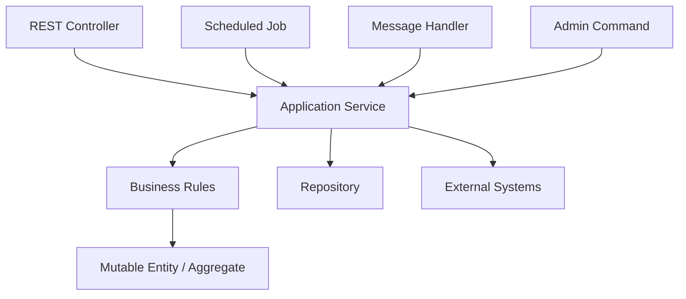
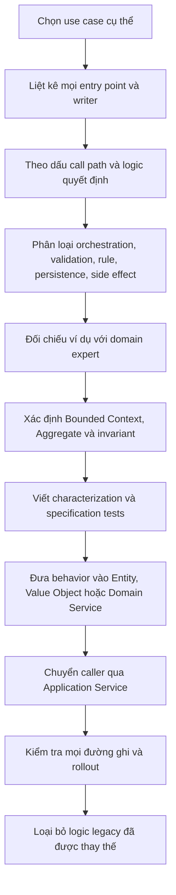

# Nhận diện mô hình thiếu hành vi và logic rải rác trong lớp dịch vụ

Trong nhiều hệ thống lâu năm, Entity chủ yếu chứa field, getter và setter; còn các lớp Service quyết định gần như mọi việc: kiểm tra trạng thái, tính giá, xác nhận quyền, thay đổi dữ liệu và điều phối nhiều bước nghiệp vụ. Khi đó, mô hình miền chỉ phản ánh dữ liệu, trong khi ý nghĩa và quy tắc nằm rải rác trong application service, controller, batch job hoặc message handler. Cách tổ chức này thường được gọi là **Anemic Domain Model (mô hình miền thiếu hành vi)**.

Anemic Domain Model không đơn giản là một class có ít method. Vấn đề xuất hiện khi các đối tượng miền không bảo vệ được những quy tắc thuộc về chúng, khiến mọi caller phải biết cách thay đổi trạng thái cho đúng. Một quy tắc có thể được lặp lại ở nhiều service; một entry point mới có thể quên kiểm tra invariant; và việc đổi chính sách thường đòi hỏi tìm kiếm nhiều nhánh code không có một chủ sở hữu rõ ràng.

Trong DDD, mục tiêu của chuyển đổi là đặt hành vi và invariant vào đúng mô hình: Entity giữ identity và hành vi gắn với vòng đời; Value Object biểu diễn giá trị cùng quy tắc của nó; Aggregate Root bảo vệ tính nhất quán trong ranh giới Aggregate; Domain Service xử lý quy tắc không thuộc tự nhiên về một Entity; Application Service điều phối use case và hạ tầng. Bài này hướng dẫn cách nhận diện vấn đề, lần theo logic nghiệp vụ, phân biệt business rule với orchestration, và chuyển đổi từng lát cắt an toàn trong một hệ thống đang vận hành.

`DOMAIN_DRIVEN_DESIGN` dùng strategic design qua subdomain, Bounded Context và Context Map; tactical design qua Entity, Value Object, Aggregate, Repository và Domain Event. Khi di chuyển một mô hình thiếu hành vi, trước tiên cần biết quy tắc thuộc context nào và thuật ngữ đang có nghĩa gì ở context đó. Không nên gom mọi logic vào một domain model dùng chung nếu các context có chính sách và vòng đời khác nhau.

## 1. Mô hình miền thiếu hành vi là gì?

### 1.1. Dữ liệu nằm trong Entity, quyết định nằm trong Service

Một mô hình thiếu hành vi thường có Entity gần như chỉ là túi dữ liệu:

```java
public class Order {
    private UUID id;
    private String status;
    private BigDecimal total;
    private Instant placedAt;

    public UUID getId() { return id; }
    public String getStatus() { return status; }
    public void setStatus(String status) { this.status = status; }
    public BigDecimal getTotal() { return total; }
    public void setTotal(BigDecimal total) { this.total = total; }
    public Instant getPlacedAt() { return placedAt; }
    public void setPlacedAt(Instant placedAt) { this.placedAt = placedAt; }
}
```

Các quy tắc lại nằm trong Service:

```java
@Service
public class OrderService {
    public void cancel(Order order, Instant now) {
        if (!"PLACED".equals(order.getStatus())) {
            throw new IllegalStateException("Order cannot be cancelled");
        }
        if (now.isAfter(order.getPlacedAt().plus(Duration.ofHours(2)))) {
            throw new IllegalStateException("Cancellation window expired");
        }
        order.setStatus("CANCELLED");
    }
}
```

Service biết quá nhiều về cách thay đổi Order. Một controller, scheduler hoặc listener khác có thể tự viết lại các điều kiện và gọi `setStatus` trực tiếp. Khi đó, Entity không thể bảo đảm rằng mọi thay đổi đều hợp lệ.

### 1.2. Dấu hiệu cốt lõi là thiếu nơi sở hữu quy tắc

Anemic Domain Model không được xác định bằng số lượng method. Một class có nhiều getter, formatter hoặc helper vẫn có thể là mô hình giàu hành vi nếu các quy tắc quan trọng được bảo vệ đúng chỗ. Ngược lại, một Entity có vài method đơn giản vẫn có thể thiếu hành vi nếu mọi quyết định thực sự nằm bên ngoài.

Hãy đặt câu hỏi: **nếu một caller mới muốn thay đổi đối tượng này, nó có thể gọi một hành vi có ý nghĩa nghiệp vụ hay phải tự biết thứ tự kiểm tra và các field cần sửa?** Nếu caller phải tự kiểm tra trạng thái, tính toán, thay nhiều field và phát event đúng trình tự, mô hình có thể đang thiếu hành vi.

### 1.3. Logic rải rác khiến cùng một quy tắc có nhiều phiên bản

Một quy tắc hủy đơn có thể xuất hiện ở:

- `OrderController.cancel()` kiểm tra trạng thái.
- `OrderService.cancel()` kiểm tra thời hạn.
- `OrderBatchJob.expireOrders()` tự cập nhật status.
- `PaymentEventHandler` thay đổi Order khi payment bị từ chối.
- `AdminOrderService.forceCancel()` bỏ qua một số điều kiện.

Mỗi đường đi có thể hợp lý trong phạm vi của nó, nhưng nếu không có mô hình và chính sách chung, hành vi sẽ lệch nhau theo thời gian. Một entry point mới dễ bỏ sót quy tắc đã tồn tại ở entry point cũ.

## 2. Dấu hiệu nhận diện trong codebase

Không có một dấu hiệu đơn lẻ đủ để kết luận. Hãy tìm một cụm dấu hiệu liên quan đến quyền sở hữu hành vi, tính nhất quán và khả năng thay đổi.

### 2.1. Entity chủ yếu là getter/setter

Các class như `Order`, `Invoice`, `Subscription`, `Account` chỉ có constructor rỗng, getter/setter hoặc builder công khai. Những thao tác như `approve`, `close`, `renew`, `reserve`, `refund` lại không xuất hiện trong model.

Getter và setter không tự động là sai. Persistence framework, serializer hoặc mapper có thể cần chúng. Dấu hiệu đáng chú ý là caller có thể tùy ý tạo ra trạng thái không hợp lệ bằng cách gọi nhiều setter theo bất kỳ thứ tự nào.

### 2.2. Service chứa nhiều nhánh quyết định về cùng một đối tượng

Tìm những method có nhiều điều kiện về trạng thái, quyền, thời gian, hạn mức hoặc loại giao dịch:

```java
if (order.getStatus() == ...)
if (order.getCustomerType() == ...)
if (order.getPaymentStatus() == ...)
order.setStatus(...)
```

Một vài điều kiện ở application service là bình thường, nhất là kiểm tra đầu vào hoặc quyền truy cập. Vấn đề là service phải lặp lại các quy tắc nội tại của Order hoặc thay đổi nhiều field mà không thông qua hành vi của Order.

### 2.3. Cùng một quy tắc xuất hiện ở nhiều entry point

Đối chiếu controller, REST endpoint, GraphQL resolver, scheduled job, consumer, command handler và batch process. Nếu nhiều nơi cùng kiểm tra `status == ACTIVE`, tính phí hoặc thay đổi trạng thái, cần xác định liệu chúng đang áp dụng cùng một chính sách hay những chính sách khác nhau theo context.

### 2.4. Tên Service chung chung và phạm vi quá rộng

Các lớp `CommonService`, `ManagerService`, `ProcessService`, `Helper`, `Util` hoặc `BusinessService` có thể là nơi tập trung logic mà không thể hiện chủ sở hữu nghiệp vụ. Một `OrderService` có thể chứa tạo đơn, tính giá, phân bổ tồn kho, thu tiền, gửi email và lập hóa đơn.

Tên lớp không phải bằng chứng quyết định. Hãy xem các method có cùng một lý do thay đổi và cùng một ngôn ngữ nghiệp vụ hay không.

### 2.5. Trạng thái được thay đổi trực tiếp từ nhiều nơi

Tìm các lệnh như `setStatus`, `status =`, `update status`, SQL update hoặc thao tác repository trực tiếp. Nếu trạng thái có vòng đời nghiệp vụ nhưng có thể bị đổi từ nhiều nơi, hệ thống đang thiếu một cổng chuyển trạng thái có trách nhiệm kiểm tra điều kiện.

Không phải mọi cập nhật trực tiếp đều đáng lo. Một read model, projection hoặc dữ liệu kỹ thuật có thể không cần hành vi miền. Hãy tập trung vào state transition có ý nghĩa nghiệp vụ.

### 2.6. Test tập trung vào Service và mock quá nhiều collaborator

Nếu test một quy tắc đơn giản cần mock Repository, Clock, Client, Mapper, Event Publisher và nhiều service khác, có thể logic nghiệp vụ đang phụ thuộc quá nhiều vào điều phối. Domain behavior thường có thể được kiểm thử bằng object thật, dữ liệu rõ và thời gian cố định.

Tuy vậy, số lượng mock không tự chứng minh mô hình anemic. Một use case thực sự điều phối nhiều hệ thống vẫn cần nhiều collaborator. Hãy xem test đang xác minh quy tắc miền hay chỉ xác minh thứ tự gọi method.

### 2.7. Invariant chỉ tồn tại trong một đường đi

Ví dụ, Order phải có ít nhất một dòng khi được đặt. Nếu điều kiện chỉ nằm trong `PlaceOrderService`, một batch import hoặc admin endpoint có thể lưu Order rỗng. Invariant thuộc Aggregate phải được bảo vệ ở mọi cách tạo và thay đổi Aggregate, không phụ thuộc caller nhớ kiểm tra.

### 2.8. Thay đổi một chính sách phải sửa nhiều lớp không liên quan

Nếu thay đổi quy tắc hủy đơn phải sửa controller, service, batch job, event handler và mapper, có thể logic chưa được gom theo khái niệm miền. Tuy nhiên, thay đổi lan qua nhiều context hoặc adapter đôi khi là đúng; hãy phân biệt coupling do quy tắc bị sao chép với coupling do contract tích hợp.

## 3. Phân biệt mô hình thiếu hành vi với những trường hợp hợp lý

Không phải mọi class dữ liệu đều cần trở thành domain object giàu hành vi. Chẩn đoán quá mức có thể tạo ra abstraction không cần thiết.

| Trường hợp | Có phải Anemic Domain Model? | Cách xử lý phù hợp |
|---|---|---|
| DTO chỉ vận chuyển dữ liệu qua API | Không | Giữ DTO đơn giản, validate ở boundary |
| Projection dùng cho màn hình báo cáo | Không | Tối ưu truy vấn và định dạng dữ liệu |
| Entity cấu hình chỉ chứa vài giá trị độc lập | Chưa chắc | Giữ đơn giản nếu không có quy tắc đáng kể |
| CRUD đơn giản với ít invariant | Không nhất thiết | Application service và persistence model đơn giản có thể đủ |
| Aggregate có nhiều state transition nhưng mọi logic nằm trong service | Dấu hiệu mạnh | Chuyển hành vi và invariant vào mô hình miền |
| Domain model chỉ chứa dữ liệu nhưng service lặp lại cùng chính sách | Dấu hiệu mạnh | Tìm nơi sở hữu quy tắc, gom logic theo domain concept |

### 3.1. Application Service vẫn cần tồn tại

DDD không yêu cầu xóa Service. Application Service là nơi điều phối use case:

- Nhận command và kiểm tra cấu trúc đầu vào.
- Tải Aggregate qua Repository.
- Gọi hành vi miền hoặc Domain Service.
- Lưu Aggregate.
- Điều phối transaction, authorization boundary và tích hợp.
- Gửi hoặc lên lịch xử lý side effect theo cơ chế phù hợp.

Một Application Service mỏng không có nghĩa là không làm gì; nó biểu diễn một use case và điều phối các thành phần có trách nhiệm rõ ràng. Điều cần tránh là để nó trở thành nơi chứa mọi quy tắc về đối tượng miền.

### 3.2. Domain Service cũng là nơi hợp lệ cho một số quy tắc

Không phải mọi hành vi đều phải đặt vào Entity. Một quy tắc liên quan tự nhiên đến nhiều Entity hoặc Value Object, không có chủ sở hữu duy nhất, có thể thuộc Domain Service hoặc Domain Policy.

Ví dụ, `ExchangeRatePolicy` có thể tính số tiền quy đổi từ Money và tỷ giá theo ngày. Domain Service vẫn nên dùng thuật ngữ miền và không phụ thuộc Spring, JPA, HTTP hoặc broker.

### 3.3. Đừng biến DTO thành Aggregate

DTO phục vụ giao tiếp; Aggregate bảo vệ invariant và có vòng đời. Thêm method vào mọi DTO chỉ để tránh cảm giác “anemic” không làm mô hình miền tốt hơn.

## 4. Lần theo logic nghiệp vụ trước khi thay đổi kiến trúc

Trước khi chuyển method, cần biết logic hiện tại nằm ở đâu, được gọi từ đâu và quy tắc nào đang có hiệu lực.

### 4.1. Bắt đầu từ một use case cụ thể

Chọn một hành vi có ranh giới rõ như:

- Hủy đơn hàng.
- Phê duyệt khoản chi.
- Gia hạn thuê bao.
- Đóng tài khoản.
- Giữ chỗ hoặc giải phóng tồn kho.

Không bắt đầu bằng việc đổi toàn bộ `OrderService` hoặc `CustomerService`. Một use case cụ thể giúp nhóm xác định actor, trạng thái đầu vào, quyết định và kết quả.

### 4.2. Lập bản đồ entry point và call path

Vẽ các đường đi dẫn đến hành vi:



Mục tiêu của sơ đồ là tìm mọi caller và vị trí ra quyết định. Nếu mỗi entry point đi qua một service khác nhau và tự thay đổi Entity, hãy ghi nhận chính sách nào đang bị lặp hoặc bỏ qua.

### 4.3. Tạo bảng kiểm kê quy tắc

Ví dụ với hành vi hủy Order:

| Quy tắc | Nơi tìm thấy | Đối tượng liên quan | Mức tin cậy | Câu hỏi |
|---|---|---|---|---|
| Chỉ đơn đã đặt mới được hủy | OrderService | Order | Đã xác nhận | Có ngoại lệ admin không? |
| Chỉ hủy trong 2 giờ | Controller và Service | Order | Mâu thuẫn | Mốc tính theo lúc đặt hay lúc thanh toán? |
| Đơn đã giao không thể hủy | Event Handler | Order/Fulfillment | Quan sát | Quy trình trả hàng có khác hủy không? |
| Hoàn tiền khi đã capture | Payment Service | Payment | Đã xác nhận một phần | Refund đồng bộ hay bất đồng bộ? |

Đừng vội kết luận mọi điều kiện thuộc Order. Một số điều kiện có thể thuộc Payment hoặc Fulfillment Context và cần phối hợp qua contract.

### 4.4. Ghi nhận nguồn và mức độ chắc chắn

Phân biệt:

- `CONFIRMED`: domain expert hoặc policy owner đã xác nhận.
- `OBSERVED`: thấy trong code, log hoặc dữ liệu production nhưng chưa rõ có đúng nghiệp vụ không.
- `DISPUTED`: các nguồn hoặc stakeholder mâu thuẫn.
- `UNKNOWN`: chưa đủ thông tin.

Code hiện tại cho biết hệ thống đang làm gì; nó không tự chứng minh đó là quy tắc đúng. Ticket, audit log và production data là bằng chứng quan sát. Domain expert giúp xác nhận ý nghĩa nghiệp vụ.

### 4.5. Xác định invariant và điều kiện chuyển trạng thái

Với mỗi Aggregate, hỏi:

- Trạng thái nào hợp lệ?
- Hành động nào được phép từ mỗi trạng thái?
- Những field nào phải thay đổi cùng nhau?
- Điều gì luôn phải đúng trước và sau hành động?
- Ai có quyền thực hiện hành động?
- Quy tắc có phụ thuộc vào thời gian, tenant hoặc chính sách versioned không?
- Có side effect nào cần được phát ra sau khi state transition thành công?

Invariant là điều phải đúng trong ranh giới nhất quán của Aggregate. Một workflow qua nhiều service không tự động là một invariant của một Aggregate.

## 5. Ví dụ: từ Service-centric sang Behavior-centric

### 5.1. Cách viết cũ: Service quyết định và sửa dữ liệu

Giả sử hệ thống quản lý thuê bao có Entity chỉ giữ dữ liệu:

```java
public class Subscription {
    private UUID id;
    private String status;
    private Instant expiresAt;
    private Instant cancelledAt;

    public String getStatus() { return status; }
    public void setStatus(String status) { this.status = status; }
    public Instant getExpiresAt() { return expiresAt; }
    public void setExpiresAt(Instant expiresAt) { this.expiresAt = expiresAt; }
    public Instant getCancelledAt() { return cancelledAt; }
    public void setCancelledAt(Instant cancelledAt) { this.cancelledAt = cancelledAt; }
}
```

Service chứa toàn bộ quy tắc:

```java
@Service
public class SubscriptionService {
    private final SubscriptionRepository repository;
    private final Clock clock;

    public void cancel(UUID id) {
        Subscription subscription = repository.findById(id).orElseThrow();

        if (!"ACTIVE".equals(subscription.getStatus())) {
            throw new IllegalStateException("Subscription is not active");
        }

        Instant now = clock.instant();
        subscription.setStatus("CANCELLED");
        subscription.setCancelledAt(now);
        repository.save(subscription);
    }
}
```

Nếu batch job, admin API và message handler cũng hủy thuê bao, mỗi nơi có thể tự thực hiện các phép kiểm tra và set field khác nhau. Mô hình không ngăn được trạng thái `CANCELLED` nhưng `cancelledAt` lại rỗng.

### 5.2. Xác định khái niệm miền trước khi chuyển code

Từ use case, có thể nhận diện:

- `SubscriptionId`: identity của thuê bao.
- `SubscriptionStatus`: trạng thái có ý nghĩa rõ.
- `SubscriptionPeriod`: thời gian hiệu lực.
- `Cancellation`: quyết định hủy và thời điểm.
- `Subscription`: Aggregate Root quản lý vòng đời.

Domain expert cần xác nhận các câu hỏi như: thuê bao đã hết hạn có thể hủy không? Hủy có hiệu lực ngay hay cuối chu kỳ? Có hoàn tiền không? Tạm dừng khác hủy như thế nào? Không suy ra các câu trả lời này chỉ từ tên field hoặc nhánh `if` cũ.

### 5.3. Đưa state transition vào Aggregate

```java
public enum SubscriptionStatus {
    ACTIVE, SUSPENDED, EXPIRED, CANCELLED
}

public final class Subscription {
    private final SubscriptionId id;
    private SubscriptionStatus status;
    private Instant expiresAt;
    private Instant cancelledAt;

    public Subscription(
        SubscriptionId id,
        SubscriptionStatus status,
        Instant expiresAt,
        Instant cancelledAt
    ) {
        this.id = Objects.requireNonNull(id);
        this.status = Objects.requireNonNull(status);
        this.expiresAt = Objects.requireNonNull(expiresAt);
        this.cancelledAt = cancelledAt;
        if (status == SubscriptionStatus.CANCELLED && cancelledAt == null) {
            throw new IllegalArgumentException("Cancelled subscription needs a timestamp");
        }
    }

    public void cancel(Instant now) {
        if (status != SubscriptionStatus.ACTIVE) {
            throw new SubscriptionCannotBeCancelled(status);
        }
        status = SubscriptionStatus.CANCELLED;
        cancelledAt = Objects.requireNonNull(now);
    }

    public SubscriptionId id() { return id; }
    public SubscriptionStatus status() { return status; }
    public Optional<Instant> cancelledAt() { return Optional.ofNullable(cancelledAt); }
}
```

Aggregate kiểm soát state transition và bảo đảm các field liên quan thay đổi cùng nhau. `Clock` không cần nằm trong Aggregate; Application Service lấy thời điểm và truyền vào để hành vi có thể kiểm thử xác định. Nếu chính sách hủy phức tạp hơn, Aggregate có thể nhận một quyết định đã được Domain Policy tính toán.

### 5.4. Application Service trở thành bộ điều phối

```java
@Service
public class CancelSubscriptionService {
    private final SubscriptionRepository subscriptions;
    private final Clock clock;

    public CancelSubscriptionService(
        SubscriptionRepository subscriptions,
        Clock clock
    ) {
        this.subscriptions = subscriptions;
        this.clock = clock;
    }

    @Transactional
    public void cancel(SubscriptionId id) {
        Subscription subscription = subscriptions.findById(id)
            .orElseThrow(() -> new SubscriptionNotFound(id));

        subscription.cancel(clock.instant());
        subscriptions.save(subscription);
    }
}
```

Controller, batch job và message handler có thể gọi cùng use case hoặc cùng một application command handler. Không cần sao chép quy tắc hủy ở từng adapter. Application Service vẫn chịu trách nhiệm transaction và điều phối Repository; Aggregate quyết định state transition có hợp lệ không.

### 5.5. Side effect thuộc quy trình điều phối

Hủy thuê bao có thể cần dừng thanh toán định kỳ, thu hồi quyền truy cập và gửi thông báo. Những thao tác này có thể thuộc các context hoặc hệ thống khác. Không nên gọi trực tiếp mọi hệ thống từ Aggregate.

Aggregate có thể ghi nhận Domain Event `SubscriptionCancelled`. Application layer hoặc outbox publisher xử lý sự kiện sau khi trạng thái được lưu thành công. Nếu các bước cần tính nhất quán dài hạn, dùng workflow/Saga phù hợp và xác định cách retry, idempotency và bù trừ.

## 6. Đặt hành vi vào đúng tactical building block

### 6.1. Entity: hành vi gắn với identity và vòng đời

Entity phù hợp với hành vi làm thay đổi trạng thái của một đối tượng có identity:

- `Subscription.cancel()`.
- `Order.place()`.
- `Invoice.issue()`.
- `Account.block()`.

Hành vi nên được đặt gần state mà nó bảo vệ. Caller yêu cầu hành động bằng ngôn ngữ nghiệp vụ, thay vì tự sửa các field cấu thành trạng thái.

### 6.2. Value Object: quy tắc gắn với giá trị

Một số logic bị rải rác vì dữ liệu nguyên thủy được dùng ở nhiều nơi. Ví dụ, mỗi service tự kiểm tra số tiền âm, currency, rounding hoặc khoảng thời gian.

```java
public record Money(BigDecimal amount, Currency currency) {
    public Money {
        Objects.requireNonNull(amount);
        Objects.requireNonNull(currency);
        if (amount.scale() > 2) {
            throw new IllegalArgumentException("Unsupported precision");
        }
    }

    public Money add(Money other) {
        if (!currency.equals(other.currency)) {
            throw new IllegalArgumentException("Currency mismatch");
        }
        return new Money(amount.add(other.amount), currency);
    }
}
```

Value Object gom quy tắc về giá trị và equality. Ví dụ trên chỉ phù hợp với miền tiền tệ có precision cố định hai chữ số; domain thực tế có thể cần currency-specific fraction digits và rounding policy. Không sao chép cùng một phép kiểm tra vào nhiều service.

### 6.3. Aggregate Root: bảo vệ invariant trong một ranh giới nhất quán

Nếu `Order` sở hữu `OrderLine`, root có thể bảo đảm tổng tiền, số lượng và trạng thái đơn được cập nhật nhất quán. Caller không nên lấy child từ Repository rồi sửa trực tiếp ngoài root.

Aggregate không phải một object graph lớn chứa mọi đối tượng liên quan. Giữ Aggregate đủ nhỏ để transaction và concurrency boundary có ý nghĩa; tham chiếu Aggregate khác bằng ID khi phù hợp.

### 6.4. Domain Service: quy tắc không có Entity sở hữu tự nhiên

Ví dụ, xác định một giao dịch có được phân bổ vào nhiều tài khoản theo một chính sách có thể cần nhiều đối tượng. `AllocationPolicy` có thể là Domain Service nếu đó là quy tắc miền và không thuộc tự nhiên về một Entity cụ thể.

Domain Service nên stateless, dùng tên miền và không phụ thuộc framework. Nếu logic chỉ là gọi API, lưu database hoặc gửi email, đó là trách nhiệm application/infrastructure chứ không phải Domain Service.

### 6.5. Application Service: điều phối, không sao chép quy tắc

Application Service thường làm các việc sau:

1. Nhận command và xác thực cấu trúc dữ liệu.
2. Xác định actor/tenant và áp dụng authorization boundary.
3. Tải Aggregate và dữ liệu cần thiết.
4. Gọi hành vi Entity/Aggregate hoặc Domain Service.
5. Lưu thay đổi và ghi event/outbox trong transaction phù hợp.
6. Trả kết quả hoặc điều phối bước tiếp theo.

Application Service không nên tự biết mọi chi tiết của quy tắc như “đổi trạng thái từ A sang B nếu X, Y, Z”; nó nên gọi một hành vi có tên và ý nghĩa rõ.

## 7. Phân loại logic đang nằm trong Service

Khi xem một method service, tách các đoạn code theo trách nhiệm. Một method có thể chứa nhiều loại logic khác nhau.

| Loại logic | Ví dụ | Nơi thường phù hợp |
|---|---|---|
| Kiểm tra cấu trúc input | ID không null, field bắt buộc có mặt | API/Application boundary |
| Authorization | Actor có quyền truy cập tenant/resource không | Security/Application boundary; policy miền nếu quyền là quy tắc nghiệp vụ |
| Invariant nội tại | Đơn đã giao không thể hủy | Aggregate/Entity |
| Quy tắc giá trị | Money cùng currency mới cộng được | Value Object |
| Chính sách nhiều đối tượng | Phân bổ giữa nhiều tài khoản | Domain Service/Policy |
| Điều phối use case | Tải Order, gọi cancel, lưu | Application Service |
| Persistence | SQL, JPA mapping, query | Repository Adapter |
| Tích hợp | Gửi message, gọi Payment API | Application/Infrastructure Adapter |
| Trình bày | Định dạng ngày, currency cho UI | Presentation/Query layer |

### 7.1. Authorization không phải lúc nào cũng là invariant của Aggregate

Kiểm tra người dùng có quyền truy cập tenant hoặc tài nguyên thường nằm ở application/security boundary. Nhưng chính sách như “người tạo khoản chi không được tự phê duyệt” là một quy tắc nghiệp vụ và cần được bảo vệ trong hành vi miền hoặc Domain Policy.

Không chuyển mọi `if` vào Entity. Hãy hỏi điều kiện đó mô tả quyền truy cập hệ thống hay mô tả điều được phép trong nghiệp vụ.

### 7.2. Validation không phải lúc nào cũng là domain behavior

Kiểm tra JSON đúng định dạng hoặc chuỗi không vượt giới hạn request là validation ở boundary. Kiểm tra một hợp đồng chỉ có thể gia hạn khi còn hiệu lực là quy tắc miền. Cả hai đều quan trọng nhưng có owner khác nhau.

### 7.3. Side effect không tự động trở thành Domain Service

Gọi email, HTTP, database hoặc broker là side effect hạ tầng. Domain có thể phát biểu rằng một sự kiện đã xảy ra; application layer quyết định cách thông báo hoặc tích hợp.

## 8. Tìm và xử lý logic trùng lặp

### 8.1. Trùng code chưa chắc là trùng quy tắc

Hai context có thể cùng có method `calculateFee`, nhưng một bên tính phí vận chuyển và bên kia tính phí thanh toán. Tên và công thức có thể giống nhau nhưng semantics, owner, thời điểm và quy tắc làm tròn khác nhau.

Đừng gom logic chỉ vì code giống nhau. Hãy so sánh:

- Ngôn ngữ nghiệp vụ.
- Dữ liệu đầu vào và đơn vị đo.
- Thời điểm áp dụng.
- Chính sách versioning.
- Người sở hữu và lý do thay đổi.
- Hệ quả nếu một context đổi quy tắc.

### 8.2. Một quy tắc bị sao chép trong cùng context

Nếu nhiều service trong cùng Bounded Context áp dụng cùng một invariant, hãy tìm một mô hình hoặc policy sở hữu quy tắc. Có thể bắt đầu bằng một domain method hoặc policy thuần rồi thay từng caller.

### 8.3. Quy tắc khác nhau giữa các context

Giữ chúng độc lập và trao đổi qua contract, Published Language hoặc Anti-Corruption Layer. Đừng tạo một `CommonDomainService` dùng chung cho nhiều context nếu nó buộc các mô hình có ngôn ngữ và vòng đời khác nhau phải tuân theo một định nghĩa.

### 8.4. Tạo bảng quyết định thay vì một chuỗi if khó hiểu

Với quy tắc có nhiều tổ hợp, bảng quyết định giúp domain expert xác nhận:

| Trạng thái | Đã thanh toán? | Trong thời hạn? | Kết quả minh họa |
|---|---|---|---|
| DRAFT | Không | Có | Không cần hủy; có thể xóa nháp |
| PLACED | Không | Có | Cho phép hủy |
| PLACED | Có | Có | Hủy đơn và khởi tạo hoàn tiền |
| PLACED | Bất kỳ | Không | Từ chối hoặc chuyển quy trình hỗ trợ |
| SHIPPED | Bất kỳ | Bất kỳ | Đi theo quy trình trả hàng |

Kết quả trên chỉ minh họa cấu trúc thảo luận. Chính sách thật phải được xác nhận theo context và quy định kinh doanh.

## 9. Lộ trình chuyển đổi tăng dần trong hệ thống đang chạy

Không cần viết lại toàn bộ ứng dụng. Chọn một use case có rủi ro và phạm vi phù hợp, sau đó chuyển trách nhiệm từng bước.

### 9.1. Bước 1: chọn lát cắt có giá trị

Ưu tiên một hành vi:

- Đang có logic lặp lại hoặc lỗi do entry point khác nhau.
- Có domain expert/owner xác nhận được.
- Có test hoặc có thể tạo characterization test.
- Có ranh giới Aggregate tương đối rõ.
- Có thể triển khai độc lập mà không phải thay schema lớn ngay.

Không chọn một service quá rộng chỉ vì nó chứa nhiều code. Bắt đầu từ một quy tắc hoặc state transition cụ thể.

### 9.2. Bước 2: bảo vệ behavior hiện tại

Viết characterization test cho các tình huống đang quan sát. Sau đó phân loại mỗi kết quả là đúng, bug, ngoại lệ hoặc chưa rõ. Test ghi nhận code cũ không tự trở thành specification của mô hình mới.

### 9.3. Bước 3: xác nhận ngôn ngữ và quy tắc

Thảo luận với domain expert, ghi Given–When–Then, invariant, ngoại lệ và câu hỏi còn mở. Đặt tên hành vi theo ngôn ngữ chung trong đúng Bounded Context.

### 9.4. Bước 4: tạo domain behavior và giữ adapter cũ

Tạo method trên Aggregate hoặc Value Object. Có thể để Application Service cũ gọi method mới, nhờ vậy API và caller hiện tại không phải thay đổi cùng lúc.

Ví dụ:

```text
Before:
  Controller -> LegacyOrderService -> setStatus(...)
  BatchJob   -> SQL UPDATE orders SET status = ...

Transition:
  Controller -> CancelOrderUseCase -> Order.cancel(...)
  BatchJob   -> CancelOrderUseCase -> Order.cancel(...)

Target:
  mọi command hủy đơn đi qua cùng một hành vi miền
```

Nếu batch job đang dùng SQL update trực tiếp, cần chuyển nó sang command/use case hoặc một đường xử lý có cùng invariant. Một đường ghi lách qua Aggregate sẽ làm mục tiêu chuyển đổi chưa hoàn tất.

### 9.5. Bước 5: chuyển từng caller

Chuyển controller, batch job, message handler và admin command sang cùng application use case hoặc cùng domain behavior. Giữ nguyên contract bên ngoài nếu không có yêu cầu thay đổi API.

### 9.6. Bước 6: xóa logic cũ sau khi xác nhận không còn caller

Tìm reference, route, scheduled task, consumer và script vận hành. Chỉ xóa nhánh legacy khi đã chứng minh không còn đường ghi sử dụng nó và test đã bao phủ behavior mục tiêu.

### 9.7. Bước 7: theo dõi sau rollout

Theo dõi số lượng lỗi state transition, conflict, retry, dữ liệu không hợp lệ và khác biệt giữa các entry point. Nếu có thể, log decision code và correlation ID; không log dữ liệu nhạy cảm không cần thiết.

## 10. Ví dụ refactor một use case theo từng commit

Một chuỗi thay đổi dễ review có thể gồm:

| Commit | Thay đổi | Bằng chứng cần có |
|---|---|---|
| 1 | Thêm characterization tests | Test tái hiện các trường hợp cũ |
| 2 | Thêm domain type và behavior mới | Unit test cho invariant |
| 3 | Chuyển service cũ gọi behavior mới | Use case test vẫn pass |
| 4 | Chuyển batch/message/admin callers | Test mỗi entry point |
| 5 | Loại bỏ setter hoặc SQL path không còn dùng | Search caller và integration test |
| 6 | Xóa code legacy, cập nhật tài liệu | Full test và theo dõi rollout |

Giữ thay đổi nhỏ giúp tìm nguyên nhân khi test fail và cho phép rollback theo lát cắt. Nếu cần đổi schema, hãy có kế hoạch migration tương thích và rollout theo giai đoạn.

## 11. Kiểm thử mô hình mới

### 11.1. Unit test cho hành vi Aggregate

Test tập trung vào trạng thái đầu vào, hành động và kết quả:

```java
@Test
void activeSubscriptionCanBeCancelled() {
    Subscription subscription = activeSubscription();
    Instant now = Instant.parse("2026-11-18T04:00:00Z");

    subscription.cancel(now);

    assertEquals(SubscriptionStatus.CANCELLED, subscription.status());
    assertEquals(Optional.of(now), subscription.cancelledAt());
}

@Test
void suspendedSubscriptionCannotBeCancelledByThisOperation() {
    Subscription subscription = suspendedSubscription();

    assertThrows(
        SubscriptionCannotBeCancelled.class,
        () -> subscription.cancel(Instant.parse("2026-11-18T04:00:00Z"))
    );
}
```

Thời gian được truyền vào thay vì đọc đồng hồ hệ thống trong Aggregate, giúp test ổn định và thể hiện rõ mốc nghiệp vụ.

### 11.2. Test Application Service

Kiểm tra use case tải đúng Aggregate, gọi behavior, lưu và phát event theo contract. Mock Repository có thể hữu ích ở layer này, nhưng không cần mock chính Aggregate.

### 11.3. Test integration cho Repository và transaction

Xác minh mapping, optimistic locking, transaction rollback, outbox và query thật. Unit test của Aggregate không thể chứng minh JPA adapter lưu đúng hoặc batch job không còn cập nhật SQL trực tiếp.

### 11.4. Test invariant qua mọi entry point

Nếu REST, batch và message handler đều có thể hủy thuê bao, hãy có test xác nhận chúng đi qua cùng behavior và cùng kết quả. Test không nhất thiết phải lặp toàn bộ rule; có thể kiểm tra mỗi adapter gọi đúng use case và bổ sung integration scenario.

### 11.5. Kiểm tra kiến trúc

Có thể dùng ArchUnit hoặc module boundary test để ngăn domain package phụ thuộc Spring/JPA và ngăn controller truy cập persistence entity trực tiếp. Đây là guardrail cho dependency direction, không thay thế review về chất lượng mô hình.

## 12. Những rủi ro khi chuyển đổi

### 12.1. Chỉ chuyển code từ Service sang Entity

Nếu method được copy nguyên vẹn vào Entity nhưng vẫn phụ thuộc Repository, HTTP client và static utility, mô hình chỉ đổi vị trí code. Hãy tách pure domain decision khỏi side effect và orchestration.

### 12.2. Tạo một Aggregate quá lớn

Đưa mọi đối tượng liên quan vào cùng Aggregate để “đặt hết logic vào model” có thể làm transaction dài, lock nhiều dữ liệu và khó mở rộng. Aggregate chỉ bảo vệ invariant cần nhất quán cùng nhau.

### 12.3. Tạo Domain Service cho mọi method

Nếu mỗi method cũ thành một `XxxDomainService`, domain model vẫn phân tán. Domain Service chỉ phù hợp khi quy tắc không có chủ sở hữu tự nhiên trong Entity/Value Object.

### 12.4. Đưa framework vào Domain Layer

Thêm `@Service`, `@Transactional`, `JpaRepository` hoặc `ApplicationEventPublisher` vào Entity có thể tạo coupling mới. Giữ domain model độc lập; adapter và application layer đảm nhiệm framework.

### 12.5. Quên các đường ghi ngoài ứng dụng chính

SQL script, stored procedure, ETL, admin tool, cron job hoặc consumer cũ có thể tiếp tục thay đổi trạng thái mà không qua Aggregate. Kiểm kê mọi writer, không chỉ REST endpoint.

### 12.6. Dual write trong giai đoạn chuyển tiếp

Không nên để code vừa cập nhật mô hình mới vừa cập nhật bảng/logic cũ mà không có semantics idempotent và transaction rõ. Nếu cần đồng bộ hai mô hình, dùng một chiến lược migration có kiểm soát như outbox, CDC hoặc shadow read; tránh hai nguồn ghi độc lập.

### 12.7. Thay đổi behavior ngoài ý muốn

Refactor có thể vô tình thay đổi rounding, timezone, thứ tự kiểm tra, exception, audit hoặc event. Giữ characterization tests và specification tests riêng; mọi khác biệt phải được phân loại và phê duyệt.

## 13. Dùng Domain Event để nối hành vi với phần còn lại của hệ thống

Sau khi Aggregate thực hiện một state transition hợp lệ, Domain Event mô tả điều đã xảy ra:

```java
public record SubscriptionCancelled(
    SubscriptionId subscriptionId,
    Instant occurredAt
) {}
```

Event không phải lệnh yêu cầu một context khác thay đổi. Nó là sự kiện đã xảy ra trong context sở hữu. Consumer có thể dừng billing, thu hồi quyền hoặc gửi thông báo theo chính sách của context đó.

Để tránh mất event khi database commit nhưng broker publish thất bại, có thể lưu outbox record trong cùng transaction. Consumer cần idempotency vì message có thể được giao lại. Nếu các bước liên quan kéo dài và có thể thất bại từng phần, dùng Saga/process manager với trạng thái và hành động bù trừ phù hợp.

Không biến Domain Event thành cách gọi mọi service khác từ Entity. Aggregate chỉ ghi nhận sự kiện; Application/Infrastructure điều phối việc phát và xử lý.

## 14. Tiêu chí đánh giá chuyển đổi có hiệu quả

Không đánh giá bằng số lượng method đã chuyển khỏi Service hoặc số class mới được tạo. Hãy nhìn vào khả năng thay đổi và tính nhất quán:

- Một state transition có một hành vi miền rõ ràng và có owner.
- Các entry point dùng cùng quy tắc thay vì tự sửa field.
- Invariant được bảo vệ khi tạo và thay đổi Aggregate.
- Domain model có thể test mà không khởi động Spring hoặc database.
- Application Service thể hiện use case và orchestration rõ ràng.
- Repository chỉ tải/lưu Aggregate và không trở thành nơi chứa policy.
- Quy tắc của các Bounded Context khác nhau vẫn giữ được ngữ nghĩa riêng.
- Side effect có retry, idempotency và failure handling rõ.
- Thay đổi chính sách có thể tìm được test, model element và owner liên quan.

Một mô hình tốt giúp người đọc hiểu quy tắc bằng tên và hành vi của đối tượng, đồng thời làm giảm khả năng một caller vô tình bỏ qua invariant.

## 15. Quy trình nhận diện và chuyển đổi



Các bước thực hiện:

1. Chọn một use case và một Bounded Context.
2. Liệt kê controller, job, listener, batch và script có thể thay đổi dữ liệu.
3. Theo dấu nơi kiểm tra điều kiện và nơi sửa trạng thái.
4. Phân loại logic theo trách nhiệm, không gom tất cả vào domain.
5. Xác nhận business examples, thuật ngữ, invariant và ngoại lệ.
6. Xác định Entity, Value Object, Aggregate Root hoặc Domain Service sở hữu hành vi.
7. Viết characterization tests cho behavior quan sát và specification tests cho behavior mục tiêu.
8. Thêm domain behavior, giữ Application Service làm orchestration.
9. Chuyển từng caller sang use case mới và kiểm tra transaction/integration.
10. Xóa đường ghi cũ sau khi chứng minh không còn caller.
11. Theo dõi production và cập nhật tài liệu mô hình.

## 16. Checklist

Khi đánh giá một mô hình và lập kế hoạch chuyển đổi, hãy kiểm tra:

- [ ] Entity có identity và vòng đời rõ ràng.
- [ ] Các state transition quan trọng có hành vi miền có tên.
- [ ] Caller không cần tự sửa nhiều field để hoàn tất một hành động.
- [ ] Invariant được bảo vệ ở Aggregate Root.
- [ ] Value Object giữ quy tắc gắn với giá trị.
- [ ] Domain Service chỉ chứa quy tắc không có Entity sở hữu tự nhiên.
- [ ] Application Service tập trung vào điều phối use case.
- [ ] Validation ở boundary được phân biệt với business rule.
- [ ] Authorization kỹ thuật được phân biệt với policy nghiệp vụ.
- [ ] Đã kiểm kê controller, job, consumer, batch và direct database writer.
- [ ] Logic trùng lặp được xác nhận cùng semantics trước khi gom.
- [ ] Quy tắc của các Bounded Context khác nhau không bị ép dùng chung.
- [ ] Có characterization test và specification test phù hợp.
- [ ] Có test cho mọi state transition và invariant quan trọng.
- [ ] Transaction và concurrency boundary được xác định.
- [ ] Domain Event và side effect được xử lý ngoài Aggregate.
- [ ] Có kế hoạch rollout, rollback và loại bỏ code legacy.
- [ ] Có theo dõi lỗi dữ liệu và state transition sau rollout.

## 17. Câu hỏi tự kiểm tra

1. Anemic Domain Model khác một DTO hoặc projection ở điểm nào?
2. Vì sao nhiều getter/setter chưa đủ để kết luận một mô hình là anemic?
3. Dấu hiệu nào cho thấy quy tắc đang bị rải rác trong service layer?
4. Application Service vẫn cần làm những việc gì trong DDD?
5. Khi nào một quy tắc nên thuộc Entity/Aggregate và khi nào nên thuộc Domain Service?
6. Vì sao không nên chuyển mọi điều kiện `if` từ Service vào Entity?
7. Làm thế nào phân biệt behavior quan sát được với policy nghiệp vụ đã xác nhận?
8. Vì sao phải kiểm kê batch job và direct database writer khi migration?
9. Domain Event nên được phát và xử lý ở đâu?
10. Tiêu chí nào cho thấy refactor đã giảm logic phân tán thực sự?

**Gợi ý trả lời:**

- Câu 1: DTO/projection có mục đích vận chuyển hoặc đọc dữ liệu, không có trách nhiệm bảo vệ invariant. Anemic Domain Model là mô hình miền mà hành vi nghiệp vụ quan trọng bị đặt bên ngoài trong service.
- Câu 2: Getter/setter có thể cần cho serialization hoặc persistence. Cần xem caller có phải tự quyết định và sửa trạng thái hay không.
- Câu 3: Nhiều service lặp cùng điều kiện, nhiều nơi trực tiếp set trạng thái, cùng một hành động cho kết quả khác nhau giữa REST/job/message handler.
- Câu 4: Nhận command, xác định boundary, tải Aggregate, gọi hành vi miền, lưu, quản lý transaction và điều phối tích hợp.
- Câu 5: Entity/Aggregate sở hữu hành vi gắn với identity và invariant của nó; Domain Service xử lý quy tắc có ý nghĩa miền nhưng không thuộc tự nhiên về một Entity/Value Object.
- Câu 6: Vì một số điều kiện là input validation, authorization, orchestration hoặc policy của context khác. Chuyển sai nơi sẽ tạo coupling và Aggregate phình to.
- Câu 7: Dùng code/log làm bằng chứng observed, sau đó xác nhận với domain expert/owner; ghi rõ confirmed, disputed hoặc unknown.
- Câu 8: Các đường này có thể thay đổi trạng thái ngoài Aggregate, làm invariant bị bỏ qua dù REST path đã được refactor.
- Câu 9: Aggregate ghi nhận Domain Event khi hành vi hợp lệ; application/infrastructure lưu outbox và publish/dispatch sau commit.
- Câu 10: Có hành vi miền sở hữu rõ, mọi entry point đi qua cùng quy tắc, invariant được test và không còn đường ghi cũ lách qua model.

## Kết luận

Mô hình thiếu hành vi xuất hiện khi Entity chủ yếu chứa dữ liệu còn các quyết định nghiệp vụ và state transition nằm rải rác trong Service hoặc nhiều entry point. Cách xử lý không phải chuyển mọi method vào Entity, mà là tìm đúng Bounded Context, xác nhận quy tắc, phân biệt invariant với orchestration, rồi đặt hành vi vào Entity, Value Object, Aggregate hoặc Domain Service phù hợp. Application Service vẫn điều phối use case, Repository vẫn xử lý persistence và Domain Event nối các context sau khi hành vi đã xảy ra. Chuyển đổi từng lát cắt cùng characterization tests, specification tests và kiểm tra mọi đường ghi giúp giảm logic trùng lặp mà vẫn bảo toàn behavior đã được xác nhận.
